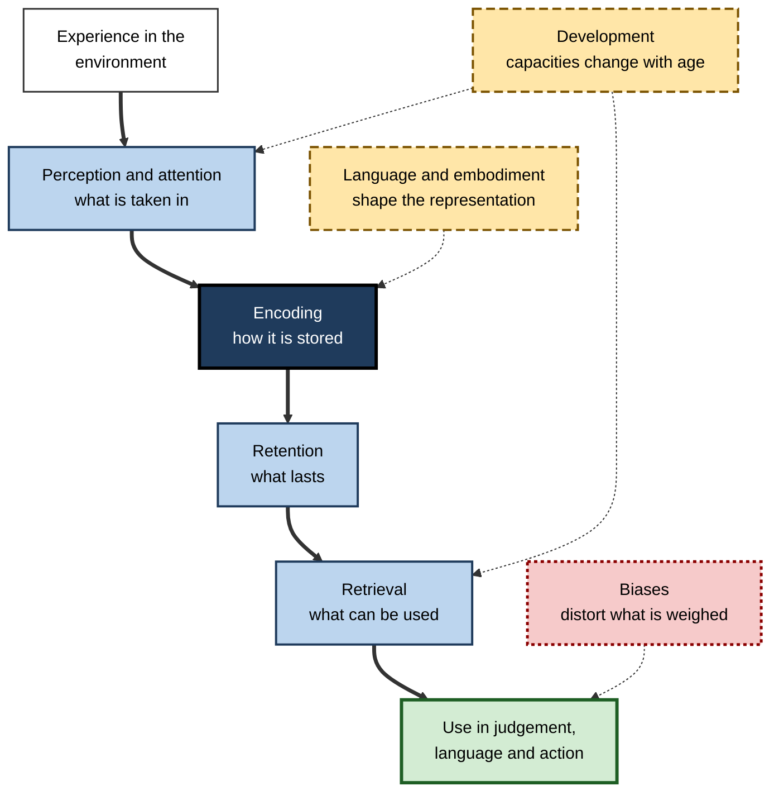
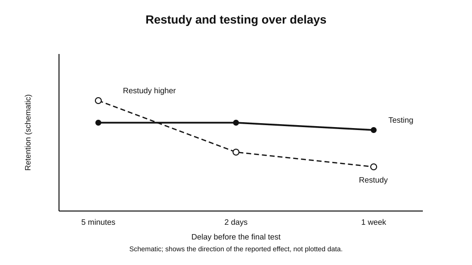
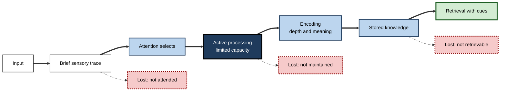
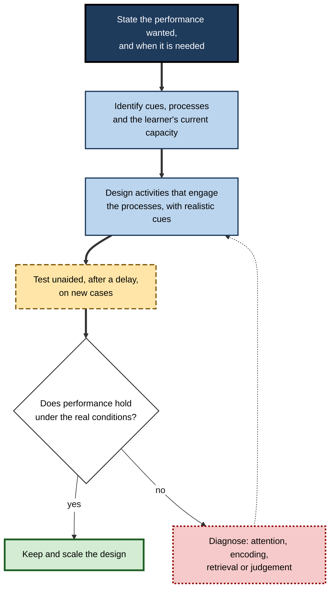
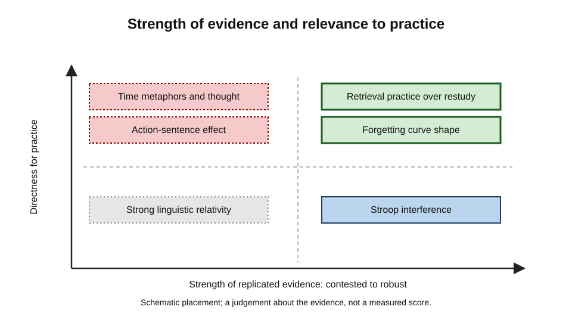

# B. Cognitive Science of Learning

A junior engineer reads a design standard on Monday, is asked a question about it in a review on Wednesday, and answers confidently with the wrong threshold. The engineer had read the standard carefully and had no reason to doubt the answer. The failure was not one of effort or intelligence. Somewhere between reading the standard and giving the answer, the number was perceived but not held, stored in a form that did not connect to the situation of use, and then retrieved from a related but wrong item.

Every one of those steps is a cognitive process, and each has known properties. Cognitive science of learning is the discipline that describes those processes, measures how they behave under different conditions, and uses that knowledge to explain why some learning lasts and some does not.

> **Definition — Cognitive science of learning:** the study of the mental processes by which experience becomes stored, retrievable and usable knowledge. It draws on experiments, neural measures and computational models to explain how attention, encoding, retention, retrieval, judgement and development shape what a person learns, and to test which conditions make that learning durable.

**Why it matters**

- Every theory of learning, whether it concerns schools, workplaces, software or self-study, makes assumptions about how minds take in, hold and use information. Making those assumptions explicit and testable is the central contribution of this field.
- It explains common, predictable failures: forgetting that follows a regular curve, judgements distorted by systematic biases, and skills that look secure in training but collapse under new conditions.
- It identifies which methods of study and instruction engage the processes that produce durable learning, and which only produce the feeling of learning.
- It provides a shared vocabulary for designers, clinicians, engineers, educators and researchers, so that disagreements can be stated precisely and tested.

---

## What the Subject Covers

The subject is not a single theory. It is a set of connected questions about the mind, pursued with methods from psychology, neuroscience, linguistics, computer science and philosophy. Four questions organise most of the work.

- **What must the mind do to learn?** Learning requires that information be taken in, held, transformed, stored and later found again. Each of these steps can fail, and each has its own laws.
- **How do the mind's limits shape learning?** Attention is selective, the capacity for active processing is small, and the stored store is organised by what was connected to what. These limits make some learning routes efficient and others almost impossible.
- **How do people judge what they have learned?** Judgement is itself a cognitive process, and it is systematically shaped by fluency, recency, expectation and bias. Judgements of learning can therefore be unreliable guides to the learning that has occurred.
- **How do learning processes change across a life?** Capacities for perception, memory, reasoning and speed change at different rates, and experience can build capacities that maturation alone would not supply.

> **Key point:** learning is not observed directly. It is inferred from performance, and performance is a noisy, context-bound window. Much of the subject concerns the gap between what was learned and what can be shown, and how to narrow it.

### Learning as a change that lasts

Learning is a relatively lasting change in what a person can do, caused by experience. The subject treats this change as a change in mental structure, in the strength and organisation of stored representations, and in the procedures that use them. The change can be understood at several levels, from the activity of neurons to the behaviour of a whole organisation, but the cognitive level is the one at which the processes described here operate.

**Figure 1.** The processes that connect experience to usable knowledge, and the influences that act on each.

---

## From Behaviour to Mental Process

The subject took its present shape through a change of focus. Earlier accounts of learning explained behaviour in terms of observable stimuli, responses and their consequences, and they did so with considerable rigour. They struggled, however, with the capacities that dominate human learning: planning, language, the use of knowledge in unfamiliar situations, and the reasoning that goes beyond the immediate stimulus.

From the middle of the twentieth century, researchers began to treat the mind as a system that transforms information through stages and stores, and to build models that could be tested against behaviour. This shift made it possible to explain why a learner who can perform a task today may fail to perform it next week, and why identical instruction produces different results for different learners.

The approach has its own hazards. Computational metaphors are useful for precision but misleading when taken literally, and models that fit data are not thereby proven to be correct.

> **Definition — Information processing:** the view that cognition consists of the transformation, storage and use of information by a system that has limited capacity and characteristic operations, which can be described and tested.

---

## Attention and Perception: The Entry Point

Nothing can be learned from an experience that has not been perceived. Perception organises sensory input into objects and meanings, and the selection of which input receives further processing is shaped by attention. Learning therefore depends on what a person notices, and noticing is far from automatic. People can miss a salient event while they are attending to something else, and the failure is not a lapse of diligence.

Experts perceive more than novices in their fields largely because practice has built meaningful patterns that guide attention and recognition. A learning design that ignores what learners will actually notice will often fail regardless of the quality of its content.

---

## Encoding and Retention: Building a Durable Trace

Once information has been attended to, the processing it receives determines what is stored. Encoding depends on the depth of analysis, on the meaning the learner builds, and on how distinctive the trace becomes. Some operations reliably strengthen later memory: generating an answer from cues is more effective than reading one, relating new material to the self can help when the relation is meaningful, and organising items into structures creates more routes to them later. Mere repetition, by contrast, keeps information active for a while without building a lasting trace.

Retention, the persistence of what was encoded, follows a characteristic pattern. Hermann Ebbinghaus (1885) measured forgetting of nonsense syllables and showed that loss is steep soon after learning and slows over time. The shape of the curve has been studied since, and the forgetting that it describes has several causes: decay, interference from similar material, failure of retrieval cues and disuse.

> **Definition — Forgetting curve:** a plot of retention against the time since learning, which typically falls quickly at first and then more slowly.

**Study card — Murre and Dros (2015)**

- **Design:** the researchers repeated Ebbinghaus's procedure, using the savings measure, which records how much less effort relearning requires, over an interval from about twenty minutes to about a month.
- **Results:** the forgetting curve was closely reproduced, with a possible small upturn around the one-day point.
- **Conclusion:** the basic shape of the curve survives replication, which strengthens confidence in one of the oldest findings in the subject.
- **Status:** the replication supports the general pattern for the material studied. It does not establish that every kind of material, learner or skill follows the same curve.

---

## Retrieval: Where Learning Is Used

Learning is judged by performance, and performance depends on retrieval, the process of using cues to bring stored information back into use. Retrieval can fail even when the trace is intact. A cue may not reach the trace, a competing item may be retrieved instead, or the content may be rebuilt with errors. Recognition is easier than recall because the options themselves provide cues, and a high recognition score can overstate what a learner can produce unaided.

Retrieval also changes what is stored. This is one of the most robust findings in the subject: retrieving information from memory tends to improve later retention more than restudying the same material does, even though restudy often feels more effective at the time.

**Study card — Roediger and Karpicke (2006)**

- **Design:** participants read prose passages and then either studied them repeatedly or studied them once and took one or more free-recall tests without feedback. Retention was tested after five minutes, two days or one week.
- **Results:** at the five-minute test, repeated study was better. At the delayed tests, prior testing gave clearly better retention than repeated study, even though students who had restudied were more confident about what they could remember.
- **Conclusion:** testing does more than assess learning; it helps to produce lasting learning. Confidence after restudy is a poor guide to delayed retention.
- **Status:** replicated across many materials and settings, with the size of the benefit depending on the test format and the delay.

> **Key point:** a method that makes material feel familiar is not the same as a method that makes it retrievable. The subject's most consequential practical lesson is that the two can diverge sharply.

**Figure 2.** Restudy and testing compared across delays, schematic of the direction reported in the research.

---

## Processing Limits and the Architecture of Learning

The mind's processing is constrained. The capacity to hold and manipulate information actively is small, and it is consumed by distraction, by complex material and by attempts to do too much at once. Early estimates of the capacity of short-term memory, such as George Miller's (1956) proposal of about seven items, have been revised, and the revised estimates are debated, but the central point holds: learning routes that exceed the capacity for active processing tend to fail, while those that build meaningful chunks can handle more material.

Learning also has an architecture of stores and transfers, and the details of that architecture have changed as evidence has accumulated. The fundamental idea remains useful. Information must be attended, held, connected and stored before it can be retrieved, and each of those transitions can be a point of loss. Depth of processing, emphasised by Fergus Craik and Robert Lockhart (1972), can be understood as a continuum rather than a fixed sequence, with meaning-based processing producing more durable traces.

**Figure 3.** The stores and transfers of the information processing framework, with the points at which information can be lost.

---

## Judgement, Bias and the Feeling of Learning

People form judgements about their own learning and about the evidence for claims, and those judgements are systematically shaped by cognitive biases. Amos Tversky and Daniel Kahneman (1974) showed that judgements under uncertainty rely on heuristics that are efficient and usually accurate but that produce predictable errors. Availability makes vivid cases seem frequent; anchoring pulls estimates toward irrelevant values; base rates are neglected in favour of stereotypes. A related tendency, hindsight bias, makes outcomes seem more predictable once they are known.

Confirmation bias is especially consequential for learning. Peter Wason's (1960) demonstration with a rule-discovery task, and his later selection task (1966), showed that people tend to seek evidence that supports their hypotheses rather than evidence that could refute them. The bias affects learners, teachers and evaluators alike, and it is one reason why evaluations of training programmes so often rely on evidence that cannot discriminate between success and coincidence.

> **Definition — Confirmation bias:** the tendency to seek, interpret and remember information in ways that support an existing belief, while giving less weight to information that contradicts it.

Two kinds of thinking are also relevant. Dual-process theories distinguish fast, associative responses from slower, deliberate reasoning. The fast response is often correct and is usually accepted; a deliberate check is needed when the fast answer is attractive but wrong. Whether the check happens depends on time, attention, knowledge and the signals that flag a problem, and the design of practice can make such signals more likely.

Expert intuition is reliable in environments where patterns are regular and feedback is prompt and accurate, and unreliable where feedback is sparse or misleading.

---

## Language, Meaning and the Body

Language is one of the most important representational resources in human learning. The categories a language provides can make some distinctions easier to notice, remember and use, although the strong claim that language determines thought is not supported. Colour naming shows universal structure together with language-specific boundaries, and the effects of language on speeded discrimination are real in some cases. Claims about language shaping thinking about time have been widely discussed and have not replicated consistently, so their status is contested.

Embodiment adds a further dimension. Physical gesture and action can support memory and understanding in some tasks, and the body can carry structure that is difficult to convey verbally. A child who gestures while learning a mathematical strategy may retain it better than one who only hears it. Yet the strongest claims, that all meaning is simulated through sensorimotor systems, are contested, and a 2022 pre-registered replication did not reproduce a widely cited action-sentence effect.

A sound position holds that the body contributes to some representations, that its contribution is testable, and that designs should not assume it for every concept.

**Study card — Winawer and colleagues (2007)**

- **Design:** Russian speakers, who have separate basic terms for lighter and darker blues, and English speakers discriminated pairs of blues, some crossing the Russian boundary and some lying within a category, under speeded conditions.
- **Results:** Russian speakers were faster to discriminate pairs that crossed the boundary between their two terms; English speakers did not show this advantage.
- **Conclusion:** a named category can make a boundary more salient in speeded perceptual judgement, which supports a weak form of the claim that language influences thought.
- **Status:** the basic effect is well known. The authors found that a verbal secondary task removed the advantage while a spatial one did not, which they read as language being used during the judgement; whether the mechanism is perceptual or strategic remains debated.

---

## Development Across the Lifespan

The processes of learning change across life. Infants show early organised knowledge of objects, which later reasoning builds on. Piaget's stage theory was an influential account of childhood thinking; it has been criticised for overstating abrupt, broad stages. Later research has found development more continuous and more uneven across domains, and some critics attribute apparent stage boundaries to task demands such as the wording of questions. Adolescent reasoning is sensitive to emotion, reward and peers, and it is misleading to describe it as simply irrational.

In adulthood, fluid abilities for novel reasoning tend to decline gradually, while crystallised knowledge often grows and is maintained, and different abilities reach their peaks at different ages. Processing speed slows in later life, and older learners can compensate through strategies and the use of existing knowledge.

Development also shapes how instruction should be designed. Vygotsky's zone of proximal development, and the scaffolding that Wood, Bruner and Ross (1976) described in tutoring, give a principled way to pitch support: tasks just beyond unaided ability, with support gradually withdrawn. The design implication is that learners should be assessed for the capacities that matter for a particular task, not assumed to differ by age.

> **Watch out:** developmental differences are averages with wide spreads. Designing by age group can stereotype individuals, so the more reliable approach is to assess the specific knowledge and demands of the task for each learner.

---

## Applying the Subject to Study and Practice

Cognitive science is applied wherever learning matters, and its most direct application is to study. 

The principle is to begin from the performance required at the moment of use, identify the processes that performance needs, and choose activities that engage those processes. Activities that feel productive, such as re-reading and passive highlighting, often engage recognition rather than retrieval, and they can leave learners confident and unprepared. Activities that require unaided retrieval, explanation of worked examples and application to new cases tend to match the processes that tests and tasks demand.

Practice design follows the same logic. A learning environment should make important cues perceptible, should reduce competing demands at the points that matter, should provide regular retrieval under realistic cues and should include feedback that is prompt and accurate enough to teach the right lesson. 

Where the environment is sparse in feedback, deliberate methods must be taught, because experience alone will not correct errors.

**Figure 4.** A design loop for a learning intervention, grounded in the processes described above.

---

## Evidence and Its Quality

A mature understanding of the subject requires knowing which findings are robust and which are fragile.

Some results have been replicated for decades under varied conditions: the Stroop interference effect, the advantage of retrieval practice over restudy for delayed tests, and the basic shape of forgetting. Others have been contested: the strong form of linguistic relativity, the claim that people think about time along a horizontal or vertical line in ways that determine their judgements, and a widely cited action-sentence effect that did not replicate in a large pre-registered study.

Replication, therefore, is a central methodological concern. Failure to replicate does not always mean the original effect was false, since conditions may have differed. Yet persistent failure, especially in large and pre-registered studies, should lower confidence and prompt more precise theories about when an effect occurs. Replication culture has also made the subject more cautious about effect sizes, which tend to shrink in larger and more varied samples.

**Figure 5.** Example findings placed by how strongly they have been supported and how directly they bear on practice. Schematic placement.

> **Watch out:** a finding that is widely repeated in popular accounts is not thereby robust. Many popular claims about learning come from single studies, misreported results or extrapolation beyond the conditions tested.

---

## Case Study (illustrative): Rebuilding a Corporate Induction Programme

- **Situation:** a large professional services firm ran a two-week induction for new consultants. The programme consisted of lectures on the firm's methods, a library of recorded sessions, and a final multiple-choice test.
- **Problem:** after six months, managers reported that consultants could describe the firm's methods but applied them inconsistently with clients. Quality reviews found errors in the same two areas each quarter.
- **Diagnosis:**
  - the test measured recognition of statements from the lectures, so it overstated unaided retrieval;
  - the methods were taught as lists of steps, without the reasons for each step or the cues that would prompt its use;
  - the two error-prone areas were similar to other methods, and the similarity was never made explicit, so interference was likely;
  - feedback on live client work was delayed and sparse, so consultants had few chances to correct their judgements.
- **Actions:**
  1. Replaced the multiple-choice test with an unaided scenario assessment, repeated at four weeks and twelve weeks.
  2. Required consultants to explain, for each method, why it applied in a given case and why a similar method did not.
  3. Added short, frequent practice on realistic client cases, with prompt feedback from a senior colleague.
  4. Added a structured check for the two error-prone areas, prompted at the start of each client deliverable.
- **Result (illustrative):** in the following two quarters, errors in the two areas fell, and managers reported that consultants were more able to justify their approach to clients.
- **Side effects / caveats:** the programme took more time, and the new assessments were demanding for some consultants. The firm did not run a controlled comparison, so the contribution of each change cannot be separated.
- **Lesson:** the programme's problems were understood once each failure was located in a process: recognition in place of retrieval, procedures without reasons, similar items without discrimination, and feedback that came too late.

---

## Worked Example (illustrative): Diagnosing a Learning Failure

**Situation:** a hospital pharmacist who passed a training course on a new dosing protocol makes a dosing error in the third week of practice.

1. **Describe the performance.** The pharmacist must recognise the patient's characteristics, retrieve the protocol's rules, apply the correct adjustment and check the result, under time pressure.
2. **Locate the attention step.** Did the pharmacist notice the relevant patient feature? If the feature was present but not salient on the screen, the failure is perceptual.
3. **Locate the encoding step.** Was the adjustment rule learned with its reason, or only as a step in a list? If only as a list, the rule is weakly encoded and easily confused.
4. **Locate the retrieval step.** Did a similar protocol for a related drug intrude? If so, interference is the likely cause.
5. **Locate the judgement step.** Did the pharmacist accept a fast answer without a check? If so, the check was not triggered by the environment or by practice.

**Conclusion:** the error can be located at a particular step, and each location suggests a different remedy: salience for perception, explained rules for encoding, discrimination training for interference and a designed check for judgement. A general instruction to "study the protocol again" would address none of these directly.

> **Watch out:** this diagnosis is a reasoning aid, not a proof. Several steps may have failed together, and the evidence should be gathered before a remedy is chosen.

---

## Open Questions

- **How should the subject's findings be integrated into a single account of learning?**
  - Models at different levels of description, from neural to behavioural, are developing in parallel, and linking them remains difficult.
- **How far do laboratory findings generalise to complex, professional learning?**
  - Many robust effects were established with simple materials; their reach into rich, real-world tasks is still being tested.
- **Which findings in the subject are contested, and why do they persist in popular accounts?**
  - Replication failures are not always publicised, and simple, memorable claims travel faster than careful qualifications.
- **How should AI systems be designed so that they support rather than replace the retrieval and explanation that learning needs?**
  - Bastani and colleagues (2025) ran a field experiment with nearly a thousand high school students. Unrestricted access to a GPT-4 tutor raised scores during practice but lowered scores on a later unaided exam, whereas a tutor with safeguards largely avoided that loss. The design conditions that protect unaided capability are still under study.
- **How should learning be assessed so that it reflects durable, transferable capability?**
  - Most assessments still favour recognition and immediate performance, and the costs of better measures are real.

---

## Summary

- **Cognitive science of learning** describes the processes that turn experience into stored, retrievable and usable knowledge, and tests which conditions make learning durable.
- **Learning** is a lasting change that is inferred from performance, which is a noisy window onto it.
- **Attention and perception** determine what is taken in; expertise rests partly on learned perceptual patterns.
- **Encoding** depends on depth, meaning and distinctiveness; generation and explanation tend to strengthen traces, and mere repetition does little.
- **Forgetting** follows a regular curve that replication has supported (**Murre and Dros, 2015**), with decay, interference, retrieval failure and disuse as causes.
- **Retrieval** is the process that performance depends on, and retrieval practice improves delayed retention more than restudy (**Roediger and Karpicke, 2006**).
- **Processing limits** and the stores of the framework explain why some routes to learning fail and others succeed.
- **Judgement** is shaped by biases and by the feeling of fluency; confirmation bias and hindsight distort evaluations of learning.
- **Language and embodiment** influence representation in some tasks; strong claims in both areas are contested.
- **Development** changes capacities at different rates; scaffolding supports learning in the zone beyond unaided ability.
- **Application** begins from the performance required and designs activities that engage the processes it needs.
- **Evidence** must be weighed by replication and by the conditions of the findings.

---

## Self-Check

1. Define cognitive science of learning and name three kinds of question it answers.
2. Why is learning inferred rather than observed, and what does that imply for judging whether learning has occurred?
3. Describe the sequence from attention to retrieval, and give one point at which information can be lost.
4. What did Ebbinghaus show about forgetting, and what did the 2015 replication add?
5. Explain why recognition can overstate what a learner can produce unaided.
6. What did Roediger and Karpicke (2006) find about testing and restudy over delays, and why does this matter for judging study methods?
7. Why is a strictly stage-based account of development now considered incomplete?
8. What is confirmation bias, and how does it affect the evaluation of a training programme?
9. Distinguish a kind learning environment from a wicked one, and say why this matters for trusting expert intuition.
10. Summarise the current position on the strong and weak forms of linguistic relativity.
11. Explain how the zone of proximal development guides the support that a learner needs.
12. A colleague says that because an effect was widely cited, it must be robust. Evaluate this claim using the subject's standards of evidence.
13. A team wants to know whether its new training works. Using the subject's principles, describe what evidence would be needed.
14. Describe how the processes of learning would guide the redesign of a failing induction programme, starting from the performance required.

### Answer Key

1. Cognitive science of learning studies the mental processes that turn experience into stored, retrievable and usable knowledge. Three question types: what processes learning requires; how the mind's limits shape learning; how learners judge their own learning and how that judgement can mislead.
2. Learning consists of internal changes that cannot be seen directly, so they are inferred from performance. A test that fails to show performance does not prove that learning is absent, and a good performance on an immediate test does not prove that learning will last.
3. Information is attended, held in active processing, encoded into stored knowledge, and retrieved with cues. Loss can occur at attention (not attended), maintenance (not held), or retrieval (not found when needed).
4. Ebbinghaus showed that loss is steep soon after learning and slows over time, using nonsense syllables and the savings measure. The 2015 replication by Murre and Dros reproduced the curve closely, supporting the basic shape for the material studied, though not establishing it for every material.
5. Options provide cues that make recognition easier than recall, and recognition may rest on familiarity without reconstruction. A high recognition score therefore does not show that the learner can produce the content unaided.
6. At an immediate test, repeated study outperformed testing; at delayed tests, prior testing gave better retention, even though restudying produced more confidence. It matters because a study method that feels effective can be less effective for delayed performance.
7. Development shows gradual, task-dependent change rather than discrete stages, and some competences appear earlier when tasks are simplified.
8. Confirmation bias is the tendency to seek and interpret evidence that supports existing beliefs. In evaluation, it leads to looking for evidence of success and treating ambiguous results as support, so a programme may be credited with outcomes that have other causes. Designs need pre-specified criteria and comparison groups.
9. A kind environment has stable patterns and prompt, accurate feedback, so intuition built from experience is reliable. A wicked environment has delayed or sparse feedback, so experience can reinforce errors. This matters because confidence in expert intuition should depend on which environment applies.
10. The strong claim that language determines thought is not supported. The weak claim, that language makes some distinctions easier to use, has support in some tasks, notably colour discrimination in speeded conditions. Claims about time metaphors are contested.
11. The zone is the range of tasks a learner cannot do alone but can do with guidance. Support should be pitched in that zone, gradually withdrawn as competence grows, so the learner builds independent capability.
12. Wide citation does not establish robustness. The claim should be checked against replication evidence, especially large, pre-registered studies. The action-sentence effect was widely cited, but a large pre-registered replication did not find it reliably.
13. The evidence would need a baseline, a comparison group, unaided performance on new cases after a delay, measures of the processes the training targets, and pre-specified criteria for success. Immediate satisfaction or end-of-course quizzes would not be sufficient.
14. Start by describing the performance the induction should produce. Then identify cues, processes and the learners' current capacities. Redesign activities to engage retrieval and explanation under realistic cues, add prompt feedback, test unaided after a delay, and diagnose remaining errors at attention, encoding, retrieval or judgement.

---

## Glossary

| Term | Meaning |
|---|---|
| Attention | Selective allocation of limited processing to some information. |
| Biased assimilation | Judging mixed evidence in favour of prior belief. |
| Cognitive bias | A systematic tendency that produces errors in a predictable direction. |
| Cognitive science of learning | The study of the processes that turn experience into stored, retrievable, usable knowledge. |
| Confirmation bias | Seeking and interpreting evidence that supports an existing belief. |
| Dual-process theory | The distinction between fast, associative and slow, deliberate thinking. |
| Embodied cognition | The view that cognition depends on the body and its interactions with the environment. |
| Encoding | Processing that converts attended information into a stored trace. |
| Forgetting curve | A plot of retention against time since learning. |
| Generation effect | Better memory for information a learner produces than for information only read. |
| Information processing | The transformation, storage and use of information by a limited-capacity system. |
| Interference | Competition from similar information that disrupts recall. |
| Linguistic relativity | The claim that language structure influences thought. |
| Retrieval | Using cues to reactivate stored knowledge for use. |
| Retrieval practice effect | Better long-term retention from retrieving than from restudying. |
| Scaffolding | Support given in the zone of proximal development, gradually withdrawn. |
| Stroop effect | Slower naming of ink colour when the printed word names a conflicting colour. |
| Zone of proximal development | Tasks a learner cannot yet do alone but can do with guidance. |
