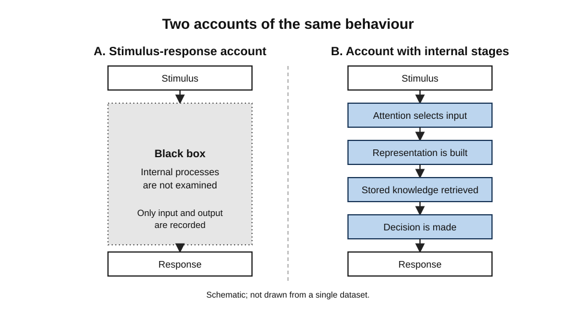
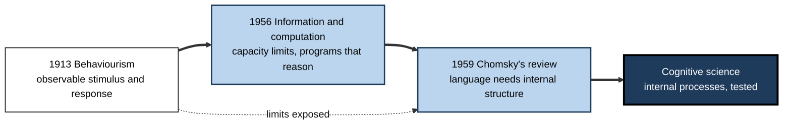
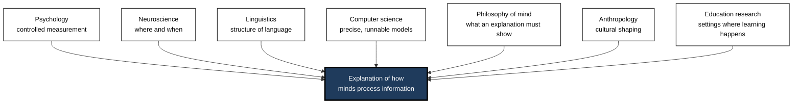
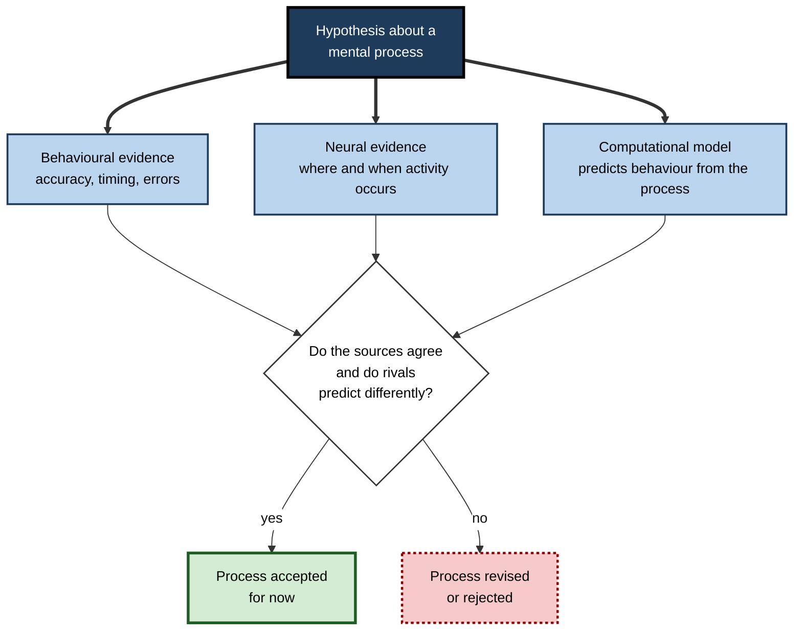
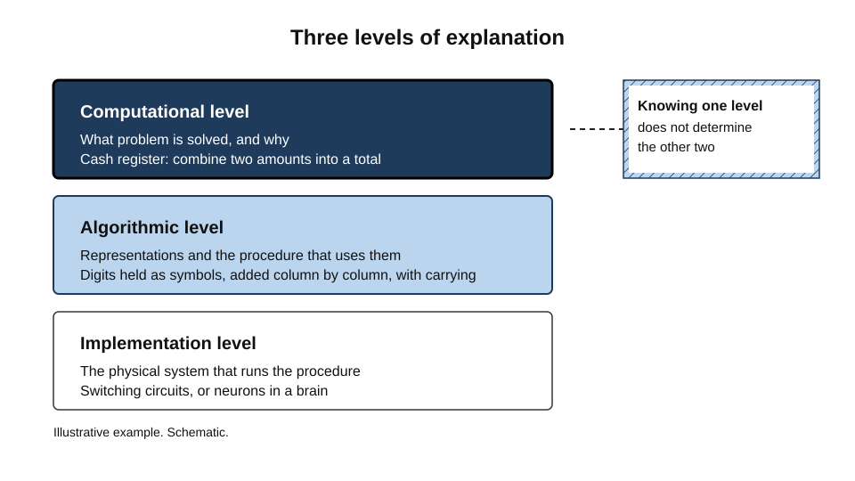

# B.1. Introduction to Cognitive Science

A student watches a worked example of a quadratic equation, nods along, and the next morning cannot reproduce a single step.

An air-traffic controller holds a dozen aircraft in mind, notices within a second which one is drifting towards another, and gives an instruction without writing anything down.

A support agent hears a caller describe a faulty router, recalls the matching troubleshooting procedure, and skips two steps that a newcomer would need. Each of these is cognition: the processes by which people take in information, represent it, hold it, transform it and act on it. Cognitive science is the scientific attempt to explain those processes.

> **Definition — Cognitive science:** the interdisciplinary study of the mind as a system that processes information. It asks how people, and other systems, perceive, represent, remember, reason, learn, communicate and act, and it tests its explanations with experiments, computational models and measures of brain activity.

**Why it matters for learning**

- Learning is a change in what a mind can do afterwards, so its explanation depends on how the mind takes in, holds and retrieves information.
- The field explains why some study methods work and others only feel as if they work.
- Its vocabulary and models are used by instructional designers, clinicians, user-experience researchers, engineers and designers of artificial intelligence systems.
- It separates what a person can observe (behaviour, errors, speed) from what must be inferred (the internal steps that produced them). Much confusion about learning comes from treating those two as the same.

---

## What Cognitive Science Asks

Every cognitive scientist, whatever the discipline, returns to a small set of questions.

- **Representation** — what form does knowledge take? Propositions, images, procedures, categories, associations, or some mixture?
- **Processing** — what steps occur when a person handles information, in what order, and with what limits on speed and capacity?
- **Control** — what decides where attention goes, which goal is pursued, and when a strategy is switched?
- **Storage and retrieval** — how is information kept, and how is the right piece brought back at the right time?
- **Variation** — how do these processes differ between people, across the lifespan, between cultures and under stress or fatigue?
- **Use** — how do knowledge and processes combine in reasoning, language, decisions and skilled action?

> **Key point:** cognition cannot be watched directly. Every claim about a mental process is an inference from behaviour, from brain activity or from a model that predicts behaviour. The quality of cognitive science rests on how well those inferences are tested.

### Inference from indirect evidence

- **Behaviour** — accuracy, speed, errors and the pattern of errors.
  - *e.g.* a learner who confuses two similar terms more often when they appear on consecutive lines reveals something about how items are held in sequence.
- **Brain activity** — electrical, metabolic or magnetic signals recorded while a person performs a task.
  - *e.g.* a brain region that becomes more active when a task demands more control.
- **Models** — running programs or equations that predict behaviour under many conditions.
  - *e.g.* a model that predicts the order in which people retrieve items from a list.

---

## From Behaviourism to the Cognitive View

### Behaviourism and its limits

- **John B. Watson (1913)** argued in a manifesto that psychology should study observable behaviour and its stimuli, and should not rely on introspection about inner states.
- **Strength:** the approach brought rigour. Its experiments were repeatable and its claims could be checked against measurements.
- **Limit:** many important human capacities, such as planning, language, mental imagery and the ability to reason about things not present, could not be explained by a simple chain of stimulus and response.

**Figure 1.** A stimulus-response account compared with an account that posits internal stages.

**Study card — Donders (1868) and the subtraction method**

- **Origin:** the Dutch physiologist Franciscus Donders published work on reaction times in 1868 (published in Dutch).
- **Design:** participants responded to a signal in three conditions of increasing complexity: simply press a key when a light appears; press one of two keys for two different signals; and respond only to one signal while ignoring another.
- **Method:** by subtracting the time of a simpler condition from a more complex one, Donders estimated the duration of the extra mental stage the complex task required, such as choosing a response.
- **Significance:** this was an early demonstration that internal stages could be timed from outside, which later became a standard logic in cognitive experiments.
- **Caveat:** the subtraction logic assumes that the added stage does not change the others. Later researchers questioned this assumption, so the durations estimated by the method are approximate.

### The cognitive turn

- **Noam Chomsky (1959)** published a review of B. F. Skinner's 1957 book on verbal behaviour. He argued that speakers produce and understand novel sentences, which conditioning based on past reinforcement could not explain, so language must rest on internal structure. The argument from the poverty of the stimulus, developed later, is named for this line of reasoning.
- **Around 1956**, several researchers presented work that treated the mind as a system that encodes, transforms and stores information. George Miller worked on the limits of human information capacity; Allen Newell, Herbert Simon and their colleagues built a program, the Logic Theorist, that proved many of the theorems in Whitehead and Russell's *Principia Mathematica* (in one case finding a shorter proof than the book gives); and Chomsky developed formal theories of grammar. The period is commonly called the cognitive revolution.
- **Result:** the mind became a legitimate object of experiment, and models of its processes could be built, tested and compared.

> **Definition — Behaviourism:** the view that psychology should explain behaviour in terms of observable stimuli, responses and their consequences, without appeal to inner mental states.

> **Definition — Cognitive revolution:** the shift, from the 1950s onward, towards explaining behaviour through internal representations and processes that could be modelled and tested.

**Figure 2.** Three developments that shaped the field.

---

## What the Field Is Made Of

Cognitive science is a meeting point rather than a single department. Its contributors ask the same questions with different tools.

- **Psychology** — experiments on perception, memory, attention, language and reasoning.
  - Contributes controlled measurement and the study of individual differences.
- **Neuroscience** — the biological systems that carry out cognition.
  - Contributes evidence about where and when activity occurs, and about damage to particular regions.
- **Linguistics** — the structure of language and how sounds, words and sentences are combined.
  - Contributes formal descriptions of what language knowledge must contain.
- **Computer science and artificial intelligence** — algorithms, representations and computational limits.
  - Contributes precise models that either run or fail, which forces vagueness out of theories.
- **Philosophy of mind** — concepts such as representation, consciousness and intentionality.
  - Contributes clarity about what an explanation must establish.
- **Anthropology** — how cognition is shaped by culture, tools and social practice.
  - Contributes evidence that some apparently universal processes vary across communities.
- **Education research** — how people learn in the settings where they learn.
  - Contributes tests of whether laboratory processes matter in classrooms and workplaces.

> **Key point:** the interdisciplinary mix is a strength and a risk. A model can satisfy a computer scientist and still be implausible to a neuroscientist; progress comes when the constraints from each field are applied together.

**Figure 3.** How contributing disciplines feed one explanatory goal.

---

## Methods of the Field

### Behavioural measures

- **Accuracy and error patterns** — which items are correct, and which wrong answers recur.
- **Response time** — how long a decision or retrieval takes. Timing reveals processing steps that accuracy alone hides.
- **Eye tracking** — where a person looks, and for how long, as a proxy for where attention goes.
- **Think-aloud protocols** — people speak while working. K. Anders Ericsson and Herbert Simon (1980) analysed when verbal reports are reliable: reports of what was attended to are usually accurate, whereas reports of why a choice was made are often reconstructions.

### Neural and physiological measures

- **Functional magnetic resonance imaging (fMRI)** — measures changes in blood oxygenation that follow neural activity. It localises activity well but tracks it slowly, over seconds.
- **Electroencephalography (EEG)** — records electrical activity at the scalp with millisecond timing. It times processes well but localises them poorly.
- **Lesion studies** — patients with damage to a particular region reveal which abilities depend on it. Damage shows necessity, not sufficiency, so it is interpreted with care.
- **Transcranial magnetic stimulation (TMS)** — temporarily disrupts activity in a small region, allowing a test of whether that region is needed for a task.

### Computational models

- **Cognitive architectures** — integrated systems of memory, goals and procedures that run tasks in the same way a person might.
- **Connectionist networks** — layered networks of simple units whose connection weights change with experience.
- **Mathematical models** — equations, such as those for forgetting or choice, that predict accuracy or time from a small number of parameters.

> **Watch out:** a model that fits data is not thereby the correct model. Several structurally different models can produce the same pattern, so good cognitive science compares rival models on predictions they make differently.

**Figure 4.** Converging evidence for an inferred mental process.

**Table 1.** Strengths and limits of the three method families.

| Method family | What it reveals well | Main limit |
|---|---|---|
| Behavioural | Accuracy, timing and error patterns under controlled conditions | Many processes produce similar behaviour, so behaviour alone is ambiguous |
| Neural | Where and when activity happens, and what is needed for a task | Correlation with activity does not establish the function that activity serves |
| Computational | Whether a proposed set of processes can actually produce the observed behaviour | A model is only as good as its assumptions and its fit to data |

---

## Levels of Explanation

David Marr (1982) argued in his book *Vision* that an information-processing system must be understood at three levels, and that a complete explanation needs all three.

- **Computational level** — what problem the system solves, and why that solution is appropriate.
- **Algorithmic level** — the representations used and the procedure that transforms input into output.
- **Implementation level** — the physical substrate that runs the procedure: neurons in the brain, or transistors in a computer.

> **Definition — Levels of explanation (Marr):** three complementary descriptions of the same system. The computational level says what is computed, the algorithmic level says how, and the implementation level says what physically does it.

**Example (illustrative):** a cash register adds two numbers. At the computational level the device computes a sum. At the algorithmic level it represents the numbers in a notation and applies a procedure, such as adding digits and carrying. At the implementation level it uses switching circuits. Knowing the circuit does not tell you the arithmetic problem being solved, and knowing the problem does not tell you how the circuit works.

**Figure 5.** Three levels at which a cognitive process can be explained.

> **In practice:** when a learning problem is diagnosed, decide which level is at issue. A learner who cannot solve a problem may lack the representation (the concept), may lack the procedure (the method), or may be overloaded at the level of the physical system (fatigue, interruption). Each calls for a different remedy.

---

## Core Vocabulary

> **Definition — Representation:** an internal state or structure that stands for something else, such as an object, a rule, a word or a plan, and can be used to guide processing.

> **Definition — Information processing:** the transformation of signals into other signals by a system that can store, combine and act on them.

> **Definition — Cognitive architecture:** a proposed set of components, such as memories, buffers and procedures, and rules for how they interact, intended to explain many tasks at once.

> **Definition — Computational model:** a precise, runnable description of a cognitive process, whose predictions can be compared with human data.

### A second classic: the Stroop effect

**Study card — Stroop (1935)**

- **Origin:** John Ridley Stroop published the experiment in 1935.
- **Design:** participants named the ink colour of colour words as quickly as possible. In one condition the words were colour names printed in matching inks (*green* in green). In another they were colour names printed in mismatched inks (*red* in blue). In a third they were neutral strings of symbols.
- **Results:** naming the ink was slower when the printed word named a different colour than when the word was neutral or matched the ink.
- **Conclusion:** reading is automatic and runs even when it conflicts with the task the person is trying to do. Attention must resolve the conflict.
- **Status:** a very robust effect. Colin MacLeod's review (1991) of its many variants confirmed its reliability, and it is widely used as a measure of controlled attention.

> **Key point:** the Stroop result shows that cognitive processes can run without being chosen. Much of what people do in learning is shaped by processes they neither control nor notice.

---

## A Worked Example: Decomposing a Mental Task

**Situation:** a fraud analyst at a bank looks at a payment and must decide whether to hold it for review.

1. **Perceive** — the analyst reads the amount, the country, the time and the account history. Each item is taken in through the eyes and held briefly.
2. **Represent** — the analyst builds a working picture: this account usually makes small payments, and this one is large and to an unfamiliar country.
3. **Retrieve** — the analyst recalls patterns from earlier cases: large payments to new countries, shortly after a change of password, are often fraudulent.
4. **Compare and decide** — the current picture is matched with the recalled pattern. The decision is either automatic (the pattern clearly matches) or deliberate (the case is ambiguous and the analyst checks more fields).
5. **Respond** — the payment is held, and a short note records the reason.

**Conclusion:** each step draws on a different process. Training that targets only step 5, for example by teaching the approval form, leaves steps 2 and 3 untouched, so the analyst will still struggle with unfamiliar patterns.

> **Watch out:** this decomposition is a model, not a recording. Experts often skip steps, and what looks like one step may be several processes working together.

---

## Case Study (illustrative): Redesigning an Introductory Programming Course

- **Situation:** a university offered a first course in programming. Students completed the weekly exercises, but in the final test many could not trace the behaviour of a simple loop.
- **Problem:** the exercises had been solved in class with the teaching assistant's help. Students recognised the solutions but could not produce them from a blank page.
- **Diagnosis:**
  - the course treated correct output as proof of understanding;
  - students had no explicit representation of what happens to variables during a loop;
  - the in-class help reduced the processing students did for themselves;
  - in tests, the many items students had to keep in mind at once overwhelmed them.
- **Actions:**
  1. Introduced tracing tasks in which students predicted the state of each variable line by line before running the code.
  2. Used worked examples with parts removed gradually, so that students completed more of each solution as the term progressed.
  3. Asked students to explain each solution in their own words before receiving feedback.
  4. Set short delayed quizzes on material from several weeks earlier.
- **Result (illustrative figures):** on the final test, students who had completed tracing tasks identified loop errors more reliably than the previous cohort, and fewer needed hints on problems that were new to them.
- **Side effects / caveats:** the tracing tasks lengthened each class, and the comparison was between cohorts, not randomised groups.
- **Lesson:** a cognitive account of the task (what must be represented, what must be retrieved, what must be held at once) identified a problem that course content alone did not.

---

## Limits of the Computer Metaphor

- **Early information-processing theories** used the computer as a model because it made the idea of stages, storage and retrieval precise.
- **Brains differ** from conventional computers in important respects: processing is massively parallel, slow relative to electronics, continuously shaped by experience and bound up with emotion and the body.
- **Cognition is situated** — much of what people know is bound to the places, tools and people with whom they work.
- **Use the metaphor for what it clarifies, and drop it where it misleads.** Its usefulness is in forcing precise predictions, not in claiming that a mind is a computer program.

> **Watch out:** "cognitive" is sometimes used to mean "thoughtful" or "mental" in everyday speech. In the field it has a narrower sense: a commitment to explaining behaviour through internal processes that can be tested.

---

## Open Questions

- **How much of cognition is computation, and how much is something else?**
  - Symbolic, connectionist and embodied accounts each explain some phenomena better than the others, and their reconciliation is incomplete.
- **Do laboratory processes operate the same way in complex, real-world work?**
  - Simplified tasks give clean measurements, but the conditions that matter in workplaces are often messy.
- **How far do individual differences change the processes themselves, rather than only the speed or accuracy with which they run?**
  - The answer shapes whether training can change underlying capacity or can only teach strategies.
- **Can neural and behavioural evidence be integrated in a single explanation?**
  - Neural evidence is growing quickly, but linking a brain signal to a specific process remains difficult.

---

## Summary

- **Cognitive science** studies the mind as an information-processing system, using experiments, neural measures and computational models.
- **Cognition is inferred**, never observed directly, so claims must be tested against behaviour, brain activity and predictions.
- **Behaviourism** explained behaviour through stimuli and responses; its limits in explaining language and reasoning led to the **cognitive revolution** after 1956.
- **Donders's subtraction logic** and **Stroop's interference effect** show that internal processes can be timed and that some processes run without choice.
- The field draws on **psychology, neuroscience, linguistics, computer science, philosophy, anthropology and education research**.
- **Marr's three levels** — computational, algorithmic and implementation — separate what a system does from how and from what physically does it.
- Method choice matters: behavioural data show timing and error patterns, neural data show where and when, and models test whether proposed processes can produce the data.
- **The computer metaphor** is useful for precision but misleading if taken literally.
- In practice, diagnosing a difficulty means identifying which process is failing, because each calls for a different remedy.

---

## Self-Check

1. Define cognitive science and name three kinds of evidence it uses.
2. Why can cognitive processes not be observed directly, and what follows for how claims are tested?
3. Describe the behaviourist position and one capacity it struggled to explain.
4. What did Chomsky's review of Skinner's book on verbal behaviour argue, and why was it influential?
5. Explain the logic of Donders's subtraction method and one assumption it depends on.
6. What did the Stroop experiment show about automatic processing?
7. Distinguish the computational, algorithmic and implementation levels using an example outside computing.
8. Why might a model that fits a set of data still be the wrong explanation?
9. Compare what fMRI and EEG each do well, and why a researcher might use both.
10. A training department says its course failed because learners could not "recall the procedure". Propose two different cognitive explanations and the evidence that would tell them apart.
11. Why is the computer metaphor both useful and misleading in cognitive science?
12. A product team says its interface is "intuitive" because users completed tasks quickly in a demonstration. What further evidence would a cognitive scientist want?

### Answer Key

1. Cognitive science is the interdisciplinary study of the mind as an information-processing system. Evidence: behavioural data (accuracy, timing, errors), neural measures (fMRI, EEG, lesion data) and computational models.
2. Processes such as attention and retrieval are internal, so they must be inferred from behaviour, brain activity or models that predict behaviour. Claims are therefore tested by predictions that could fail, and by comparing rival explanations.
3. Behaviourism explained behaviour through observable stimuli, responses and consequences. It struggled with language, planning, imagery and reasoning about things not present, because these depend on internal organisation that the stimulus-response chain did not capture.
4. Chomsky argued that children produce and understand novel sentences from limited input, so language requires internal structure that conditioning alone could not supply. The argument shifted attention to internal representation and helped establish the cognitive approach.
5. Donders compared reaction times in conditions that differed by one added process, and attributed the time difference to that process. The assumption is that adding the process leaves the others unchanged, which may not hold, so estimates are approximate.
6. Naming the ink colour is slower when the word conflicts with it. Reading runs automatically, even when the person intends to ignore words, so conflicting automatic processes must be resolved by attention.
7. Example: a traffic light. Computational: coordinate traffic flow safely. Algorithmic: a sequence of states and timed transitions. Implementation: lamps, wiring and a controller board. Each answers a different question.
8. Different structural models can predict the same pattern, so fit alone does not discriminate. Good work compares models on predictions where they differ.
9. fMRI localises activity well but is slow, responding over seconds. EEG times activity to milliseconds but localises poorly. Together they can show both where and roughly when a process occurs.
10. Explanation one: the learners lacked a representation of the procedure, so retrieval had no structure to act on. Explanation two: the retrieval cues available at test differed from those in training, so the procedure was not accessible. Evidence: test the same learners with and without useful cues, and check whether the errors cluster at the representation or the cue.
11. It is useful because it forces precise stages, storage and retrieval, and yields testable predictions. It is misleading if taken literally, because brains are parallel, emotional, embodied and continually changed by experience.
12. A cognitive scientist would want delayed testing, unaided performance, transfer to new tasks, comparison with a control interface, and measures of error and workload. Speed in a demonstration may reflect familiarity with the demonstrator's guidance rather than the interface's intuitiveness.

---

## Glossary

| Term | Meaning |
|---|---|
| Behaviourism | The view that psychology should explain behaviour through observable stimuli and responses. |
| Cognitive architecture | A proposed set of mental components and rules for their interaction. |
| Cognitive revolution | The shift from the 1950s onward to explaining behaviour through internal representations. |
| Cognitive science | The interdisciplinary study of the mind as an information-processing system. |
| Computational model | A precise, runnable description of a process whose predictions can be tested. |
| Connectionist network | A layered network of simple units whose connection weights change with experience. |
| Electroencephalography (EEG) | Recording of electrical brain activity at the scalp with millisecond timing. |
| Functional MRI (fMRI) | Imaging of blood-oxygen changes that follow neural activity, with good spatial but slower temporal resolution. |
| Information processing | The transformation of signals by a system that stores, combines and acts on them. |
| Levels of explanation | Marr's three descriptions: computational, algorithmic and implementation. |
| Representation | An internal structure that stands for something and guides processing. |
| Stroop effect | Slower naming of ink colour when the printed word names a conflicting colour. |
| Subtraction method | Estimating the duration of a mental stage by subtracting reaction times of two conditions. |
