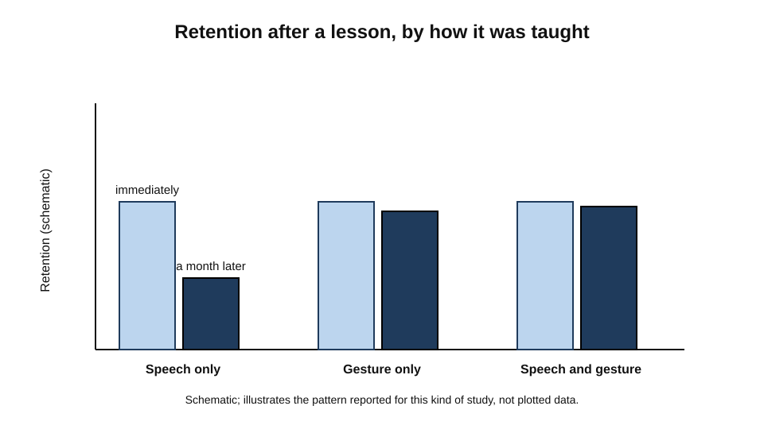
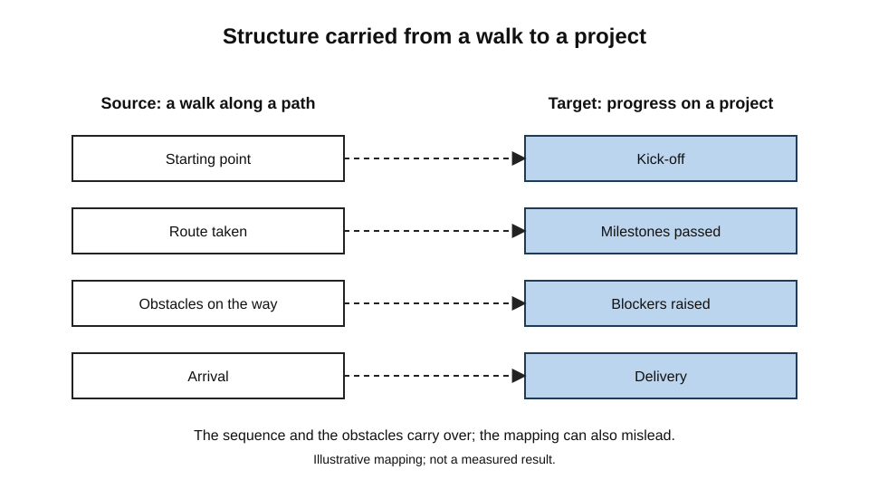
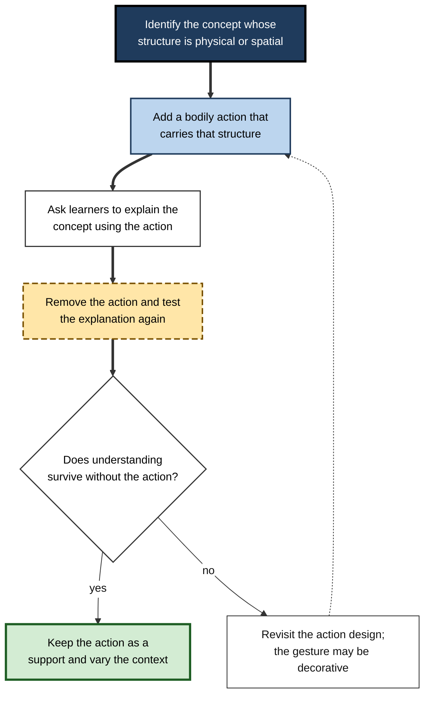
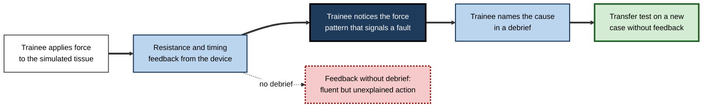

# B.10. Embodied Cognition and Learning

An engineer explaining how a pressure-relief valve opens moves both hands: one flat palm rises, the other stays still, and the fingers of one hand press down on the other to show a spring compressing. A colleague who has never seen the valve follows the explanation more easily than one who only read the manual.

A child learning to count to twenty points at each object as she names it, and tends to lose her place when the pointing is taken away. 
A trainee surgeon who has practised with a simulator that resists the hand in the same way as tissue reports that the real procedure feels familiar, even though the trainee has never seen the operating room.

In each case the body does more than carry the mind from place to place.

It appears to take part in the thinking, and the question is how much.

Embodied cognition is the research programme that asks this question.

> **Definition — Embodied cognition:** the view that cognitive processes such as perception, memory, language and reasoning depend on the body's sensorimotor systems and on its interactions with the environment, rather than operating on abstract symbols alone.

**Why it matters for learning**

- Many professional skills are physical or spatial, and the knowledge behind them may be partly sensorimotor. Training that ignores the body may miss a source of understanding.
- Gesture, movement and physical manipulation are common in teaching, and the research suggests they can affect retention as well as engagement.
- Embodiment challenges a common assumption in instructional design, namely that learning is a matter of transmitting propositions, and it suggests that some representations are best built through action.
- The field has also produced claims that have not replicated well. A sound understanding of embodiment includes knowing which claims are strong and which are weak.

---

## Degrees of Embodiment

Researchers distinguish several claims, which differ in strength. Margaret Wilson (2002) described six views that are often run together, and the most useful distinction for learning is between weaker and stronger positions.

- **The body as constraint** — the body limits what a mind can perceive and do, and so shapes cognition indirectly. This is widely accepted.
  - *e.g.* the size of the hand limits the range of tool grips that a learner can use, which shapes what skills develop.
- **The body as support** — physical actions can offload or structure cognitive work, as in counting on the fingers or sketching a diagram. This is well supported for some tasks.
  - *e.g.* a learner who moves physical tokens while solving a puzzle may find the structure easier to track.
- **Grounded cognition** — concepts are partly represented by reactivating the sensory and motor experiences in which they were formed. This is an active research programme. Lawrence Barsalou (2008), in the *Annual Review of Psychology*, reviewed evidence that perceptual and modal systems are engaged during conceptual processing.
  - *e.g.* understanding the word "grasp" may involve some simulation of the action.
- **Strong embodiment** — cognition is nothing more than sensorimotor activity, and abstract symbols are rejected. This position is contested and difficult to test.

> **Key point:** most of the empirical work supports the weaker claims. Strong claims about the necessity of bodily simulation for every concept are not well established, and the evidence for specific effects has been mixed.

**Figure 1.** Degrees of embodiment, from the weakest to the strongest claim.

```mermaid
%%{init: {'theme':'base','themeVariables':{'fontFamily':'Arial, Helvetica, sans-serif','fontSize':'15px','primaryColor':'#FFFFFF','primaryTextColor':'#111111','primaryBorderColor':'#222222','lineColor':'#333333','secondaryColor':'#F2F2F2','tertiaryColor':'#FFFFFF','clusterBkg':'#FAFAFA','clusterBorder':'#555555','edgeLabelBackground':'#FFFFFF','titleColor':'#111111'}}}%%
flowchart LR
    classDef core    fill:#1F3B5C,stroke:#000000,stroke-width:3px,color:#FFFFFF
    classDef key     fill:#BCD5EE,stroke:#1F3B5C,stroke-width:2px,color:#000000
    classDef detail  fill:#FFFFFF,stroke:#333333,stroke-width:1.5px,color:#000000
    classDef accent  fill:#FFE6A8,stroke:#7A5200,stroke-width:2px,stroke-dasharray:8 4,color:#000000
    classDef good    fill:#D3ECD3,stroke:#1E5E24,stroke-width:3px,color:#000000
    classDef caution fill:#F6CACA,stroke:#8B0000,stroke-width:2.5px,stroke-dasharray:3 3,color:#000000

    C1["Body as constraint<br/>widely accepted"]
    C2["Body as support<br/>well supported for some tasks"]
    C3["Grounded cognition<br/>active research, mixed evidence"]
    C4["Strong embodiment<br/>contested, hard to test"]

    C1 ==> C2 ==> C3 ==> C4

    class C1 good
    class C2 key
    class C3 accent
    class C4 caution
```

---

## Simulation, Grounding and Meaning

Much of the case for embodiment rests on the idea that understanding a concept involves partly re-running the experience in which it was acquired. Arthur Glenberg (1997), in the target article *What Memory Is For*, argued that memory serves action, and that meaning is grounded in the body's ways of acting on the world.

> **Definition — Perceptual simulation:** the partial reactivation of the sensory and motor states that were active during an experience, used when a concept is thought about or a sentence is understood.

- **Evidence for simulation** comes from tasks in which people judge sentences about actions or objects. Responses are sometimes faster or slower when the required motor response is compatible with the action described.
- **Evidence for neural overlap** has been reported in studies showing that some words for actions activate motor regions of the brain, although the interpretation of such activation is debated.
- **Limits** — activation during a task does not show that it is necessary for understanding. A region can be active without contributing to the judgement.

**Study card — Glenberg and Kaschak (2002): the action-sentence compatibility effect**

- **Design:** participants judged whether sentences were sensible while making a physical response. In some trials the response moved the hand toward the body, and in others away. Sentences described motion toward or away from the reader.
- **Results:** the reported finding was that judgements were faster when the direction of the response matched the direction of motion in the sentence.
- **Conclusion:** the sentences were understood partly by simulating the actions they described, so motor systems took part in comprehension.
- **Status:** a widely cited result that stimulated much research. A pre-registered, multi-laboratory replication published in 2022 (Morey and colleagues, *Psychonomic Bulletin & Review*), which included Glenberg and Kaschak among its authors, tested the effect across 18 laboratories and found no reliable effect; the pooled estimate was close to zero. The replication is a substantial challenge to the original claim. Some researchers argue that the original effect may depend on conditions that the replication did not reproduce, so the question remains open.

> **Watch out:** an effect that is attractive in theory and widely cited can still fail under careful replication. Learning designers should be cautious about building programmes on single laboratory effects of this kind.

---

## Gesture and Learning

Gesture is the most practical area of embodied research for teaching, and the most carefully tested. Speakers gesture spontaneously while explaining, and the gestures often carry information that the speech does not.

**Study card — Cook, Mitchell and Goldin-Meadow (2008)**

- **Design:** children were taught a strategy for a new mathematical concept. Some were taught the strategy in speech only, some in gesture only, and some in speech and gesture together. Children's understanding was measured immediately after the lesson and again about a month later.
- **Results:** children in all three conditions improved to a similar degree immediately after the lesson. A month later, only the children who had gestured during the lesson, either alone or with speech, retained the strategy well.
- **Conclusion:** gesturing while learning a new idea appeared to strengthen its retention, and gesture was not merely a sign of readiness to learn. The study manipulated gesture directly, which strengthens the causal claim.
- **Status:** widely cited, and the general finding that gesture can support learning has been studied in other tasks. Its generality across ages and domains is still being examined.

**Figure 2.** Schematic pattern of retention for speech-only, gesture-only and speech-plus-gesture teaching.

> **In practice:** a trainer teaching a sequence of steps for a mechanical procedure can ask learners to trace each step in the air as it is described. The movement is not a decoration: it gives the sequence a physical form that learners can recall.

---

## Physical Action in Skill Learning

Motor skills are learned through practice, and the body's contribution is obvious. The more interesting question for learning is whether physical experience supports understanding of the concepts behind a skill.

- **Action builds structure** — physically performing a procedure, rather than watching it, tends to build a representation of the sequence that is more usable in practice.
- **Feedback shapes the body** — correction from touch, sound or movement changes how a movement is organised, and the correction can be designed to draw attention to the relevant feature.
- **Haptic and simulated feedback** — simulators that provide resistance can help learners attend to force, tissue and timing, which are difficult to convey verbally.
- **Limits** — physical practice is not automatically useful. Repeated movement without understanding can produce a fluent but brittle skill that breaks down in new conditions.

> **Definition — Haptic feedback:** information conveyed to the body through touch and force, such as the resistance felt when pressing a control or the vibration of a tool.

---

## Metaphor and the Body

George Lakoff and Mark Johnson (1980) argued that much abstract reasoning uses metaphors grounded in bodily experience. The mind understands an abstract domain by mapping structure from a concrete, experienced one.

- **Source domain** — the concrete experience that supplies the structure, such as movement along a path.
- **Target domain** — the abstract concept that is understood through it, such as progress in a project.
- **Mapping** — the relations in the source are carried over to the target, so "we are at a turning point" carries a sense of direction and choice.

**Figure 3.** A metaphor mapping, showing how structure from a bodily experience supports an abstract concept.

> **Watch out:** metaphors shape reasoning, and they can also mislead. A project described as a journey may encourage learners to expect a single route, even when the work has many possible paths. Teaching should make the mapping explicit and test where it fails.

---

## Designing Embodied Learning

A learning designer who takes embodiment seriously can build physical elements into practice without making unsupported claims.

**Figure 4.** A design sequence for embodied practice, with checks at each stage.

**Figure 5.** How a training simulator's feedback reaches the learner's understanding in a hypothetical case.

> **Example (illustrative):** a warehouse supervisor learns the feel of an overloaded lift through a training rig. The supervisor can describe the cause of the fault in words only after a debrief, which shows that the physical experience and the verbal understanding need to be linked deliberately.

---

## Case Study (illustrative): A Procedure Trainer for Sterile Assembly

- **Situation:** a medical device manufacturer trained technicians in a sterile assembly procedure that involved precise hand movements and a fixed sequence of checks. The training was delivered as slides and video, followed by supervised practice on the line.
- **Problem:** new technicians performed the movements unevenly, and some checks were omitted under time pressure. Supervisors reported that technicians could explain the procedure but did not seem to feel when a step had gone wrong.
- **Diagnosis:**
  - the video showed the movements but did not give the learner any physical feedback;
  - the critical features of the procedure, such as the feel of a seal seating, were not verbalised during practice;
  - checks were learned as verbal items, not as part of the movement pattern.
- **Actions:**
  1. A low-cost practice rig was built with the same components and tactile features as the production equipment.
  2. Technicians practised the movements with a supervisor describing what the hands should feel at each stage, then repeated the practice without the description.
  3. Each session ended with a short debrief in which technicians explained the reason for each check, linking the physical experience to its purpose.
- **Result (illustrative):** in the next quarter, omitted checks fell in supervised observation, and technicians were more often able to describe a faulty step before supervisors noticed it.
- **Side effects / caveats:** the rig was costly, and the team did not measure whether the physical practice alone produced the improvement. The debrief may have contributed as much as the rig.
- **Lesson:** physical practice builds a sensorimotor representation of the procedure, but the representation becomes usable in new conditions when it is linked to explained purpose.

---

## Open Questions

- **How much of conceptual understanding is grounded in sensorimotor experience?**
  - The weaker claims are well supported, but the necessity of simulation for abstract concepts is not settled.
- **Which gesture and action effects replicate across tasks, ages and settings?**
  - The gesture effect in children has been influential, but its generality needs more study.
- **Can physical practice transfer to unfamiliar situations, and under what conditions?**
  - Transfer from a rig to live work is plausible but not always demonstrated.
- **How should embodied learning be weighed against the cost of physical equipment?**
  - Few studies compare physical and low-cost alternatives directly, so practical decisions rest on partial evidence.

---

## Summary

- **Embodied cognition** holds that cognitive processes depend on the body and its interactions with the environment.
- The **weaker claims** — the body as constraint and as support — are well accepted; **grounded cognition** is an active research programme with mixed evidence; **strong embodiment** is contested.
- **Perceptual simulation** suggests that understanding partly re-activates sensorimotor experience. **Glenberg and Kaschak (2002)** reported an action-sentence effect that a large, pre-registered replication in 2022 did not reproduce.
- **Gesture** can strengthen retention: **Cook, Mitchell and Goldin-Meadow (2008)** showed that gesturing during a lesson was associated with better retention a month later.
- **Physical action** builds sensorimotor structure, and haptic feedback can draw attention to features that are hard to describe.
- **Metaphor** maps structure from bodily experience to abstract concepts, and can mislead if the mapping is not examined.
- In practice, add bodily actions that carry the relevant structure, test understanding without them, and link physical experience to explained purpose.

---

## Self-Check

1. Define embodied cognition and name two of its weaker claims.
2. What does grounded cognition propose, and what kind of evidence would support it?
3. Describe the action-sentence compatibility study and the status of its finding.
4. Why is a replication failure important even when the original effect was widely cited?
5. Describe the Cook, Mitchell and Goldin-Meadow design and its main result.
6. Why might gesture affect retention, and what would distinguish a causal effect from a correlation?
7. What is haptic feedback, and why might it help a learner attend to force or timing?
8. Explain the source and target domains of a metaphor, using an example from work.
9. A training manager shows a video of a manual procedure and expects technicians to perform it well. Identify two weaknesses of this design from an embodied perspective.
10. How would you test whether an action in a training design carries understanding, rather than being a decoration?
11. A colleague argues that all concepts must be physically grounded because the body is necessary for thought. Evaluate the claim.
12. A simulator is expensive. Describe how you would decide whether its cost is justified for a particular skill.

### Answer Key

1. Embodied cognition holds that perception, memory, language and reasoning depend on sensorimotor systems and interactions with the environment. Weaker claims: the body as constraint (it limits what can be perceived and done) and the body as support (physical actions offload or structure work).
2. Grounded cognition holds that concepts are partly represented by reactivating the sensory and motor experiences in which they were formed. Support would come from tasks showing that sensorimotor systems are engaged during conceptual judgements, and that disrupting those systems impairs the judgements.
3. Participants judged sentences while making physical responses toward or away from the body. Judgements were reportedly faster when the response matched the direction of motion in the sentence. A large pre-registered replication in 2022 did not find a reliable effect, so the claim is seriously challenged.
4. Widely cited results shape theory and practice; if they fail to replicate, programmes built on them may be ineffective. Replication failures also show where the claim depended on conditions that were not made explicit.
5. Children were taught a strategy in speech, gesture or both. Immediately after the lesson, all groups improved similarly; a month later, only the gesturing groups retained the strategy well.
6. Gesture may give the sequence a physical form or reduce the load on memory, and it may strengthen the representation. Causal evidence comes from manipulating gesture directly, as Cook and colleagues did, rather than observing spontaneous gesture alone.
7. Haptic feedback conveys information through touch and force. It helps learners attend to features such as resistance and timing that are difficult to describe in words.
8. The source domain is the concrete experience (for example, moving along a path); the target domain is the abstract concept (for example, progress in a project). The structure of the source, such as direction and stages, is carried over to the target.
9. A video gives no physical feedback and does not link the critical sensory features to the actions. Practice without feedback may not build the sensorimotor structure needed for fluent performance.
10. Remove the action and test understanding of the concept; if understanding survives, the action was a support, and if not, the action was decorative or not carrying the structure. Test in new conditions as well.
11. The claim is too strong. Evidence supports the body as constraint and support, and grounding for some concepts, but the necessity of bodily grounding for all concepts is not established.
12. Identify the skill's physical and perceptual demands, compare simulator practice with cheaper alternatives under the same design, and measure delayed, unaided performance in realistic conditions. Cost is justified if the simulator produces a measurable advantage in transfer that the alternatives do not.

---

## Glossary

| Term | Meaning |
|---|---|
| Embodied cognition | The view that cognition depends on the body and its interactions with the environment. |
| Grounded cognition | The view that concepts are partly represented by reactivating sensorimotor experience. |
| Haptic feedback | Information conveyed through touch and force. |
| Metaphor mapping | Carrying the structure of a concrete source domain over to an abstract target domain. |
| Perceptual simulation | Partial reactivation of sensory and motor states during thought or comprehension. |
| Sensorimotor | Relating to the combined systems of sensing and movement. |
| Source domain | The concrete experience that supplies structure to a metaphor. |
| Target domain | The abstract concept understood through a metaphor. |
