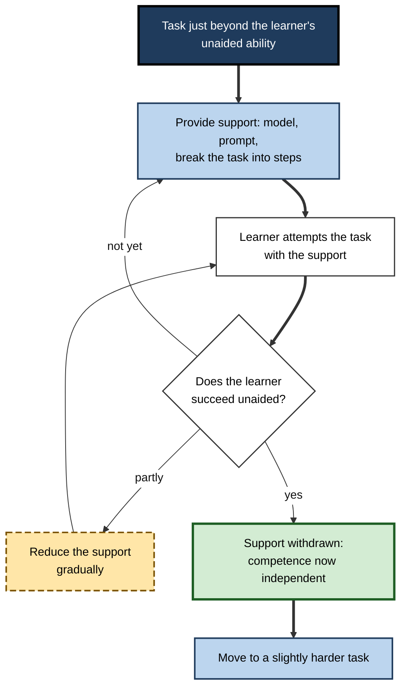
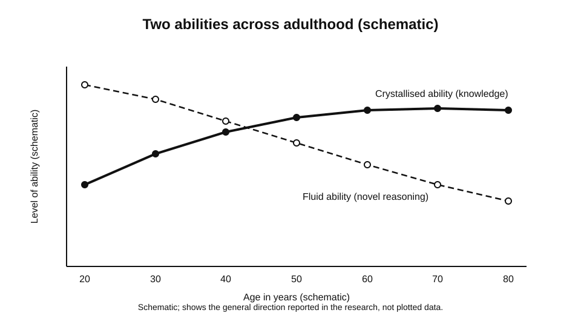
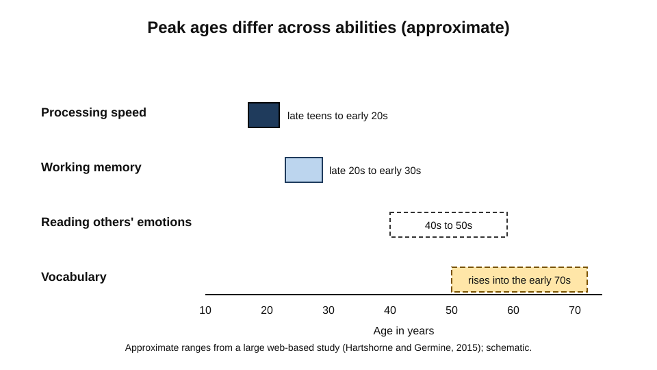
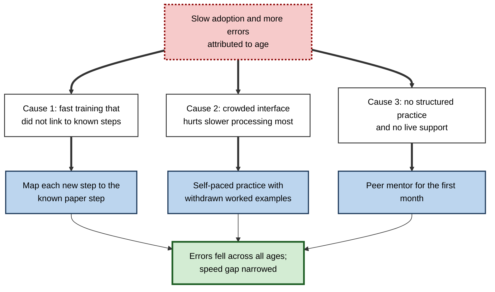

# B.11. Cognitive Development Across Lifespan

A four-year-old who is shown a biscuit placed in a box, then sees the box moved while the biscuit stays behind, will often search in the box where the biscuit was last seen.

A sixteen-year-old may weigh the risks of a decision with a clear grasp of the consequences but make the choice in the presence of friends in a way that would be unlikely a decade later.

A sixty-five-year-old with decades of experience in a trade may solve a practical problem more quickly than a newcomer, while taking longer over a novel laboratory puzzle. These are not three stages of one simple ladder. They reflect different abilities that change at different rates, that depend on experience as much as on biological maturation, and that are shaped by the environments in which people learn. Cognitive development is the study of how these abilities change across the whole lifespan.

> **Definition — Cognitive development:** the systematic change in the capacity to perceive, remember, reason, understand and learn, from infancy through old age, arising from maturation, experience and their interaction.

**Why it matters for learning**

- Learning outcomes depend on the learner's current capacities. A training design that suits a graduate may overwhelm a learner whose working capacities, prior knowledge or processing speed differ.
- Development is not complete at adulthood. Some capacities continue to grow, others decline slowly, and many change in ways that interact with experience.
- Older learners bring extensive knowledge and judgement, and their learning may be limited by different factors from those affecting younger learners.
- Claims about "learning styles" or fixed developmental stages can lead to poor decisions. The evidence on what actually changes, and how fast, should guide practice.

---

## Principles of Change Across the Lifespan

Several general principles hold across most research on development.

- **Different abilities change at different times.** Processing speed, working memory, vocabulary and factual knowledge do not follow the same trajectory.
- **Change is continuous rather than a sequence of sharp stages**, although some abilities show clear periods of rapid growth.
- **Experience shapes development.** The same ability can develop quite differently depending on the practice and instruction a person receives.
- **Decline and growth coexist.** Some abilities decline in later life while others continue to grow, and a person may be strong in one and weak in another at the same age.
- **Individual differences are large.** Averages describe trends, not individuals, and the spread among people of the same age can exceed the difference between ages.

> **Key point:** the most useful developmental questions for a learning designer are about which capacities a learner has now, how they are changing, and what experience is needed to build the ones that matter.

**Figure 1.** Major phases of cognitive change across the lifespan, with the dominant shifts in each.

```mermaid
%%{init: {'theme':'base','themeVariables':{'fontFamily':'Arial, Helvetica, sans-serif','fontSize':'15px','primaryColor':'#FFFFFF','primaryTextColor':'#111111','primaryBorderColor':'#222222','lineColor':'#333333','secondaryColor':'#F2F2F2','tertiaryColor':'#FFFFFF','clusterBkg':'#FAFAFA','clusterBorder':'#555555','edgeLabelBackground':'#FFFFFF','titleColor':'#111111'}}}%%
flowchart LR
    classDef core    fill:#1F3B5C,stroke:#000000,stroke-width:3px,color:#FFFFFF
    classDef key     fill:#BCD5EE,stroke:#1F3B5C,stroke-width:2px,color:#000000
    classDef detail  fill:#FFFFFF,stroke:#333333,stroke-width:1.5px,color:#000000
    classDef accent  fill:#FFE6A8,stroke:#7A5200,stroke-width:2px,stroke-dasharray:8 4,color:#000000
    classDef good    fill:#D3ECD3,stroke:#1E5E24,stroke-width:3px,color:#000000

    I["Infancy<br/>rapid perceptual and<br/>object knowledge growth"]
    C["Childhood<br/>language, memory strategies,<br/>school-based concepts"]
    A["Adolescence<br/>reasoning under emotion,<br/>social influence"]
    D["Adulthood<br/>knowledge and expertise,<br/>some speed changes"]
    L["Later life<br/>knowledge maintained,<br/>processing speed slows"]

    I ==> C ==> A ==> D ==> L

    class I detail
    class C key
    class A accent
    class D core
    class L good
```

---

## Infancy: Early Knowledge of Objects and Events

Research on infants has changed the picture of early cognition. Earlier views held that infants had little organised knowledge. Experiments using looking time, which exploit the tendency of infants to look longer at events that violate their expectations, suggested that much more is understood early.

**Study card — Baillargeon, Spelke and Wasserman (1985)**

- **Design:** five-month-old infants watched a screen rotate back and forth through 180 degrees, like a drawbridge, until they were familiar with the event. A box was then placed behind the screen. Test events showed either a possible outcome, with the screen stopping at the box, or an impossible one, with the screen moving through the space the box occupied. The time infants spent looking at each outcome was measured.
- **Results:** infants looked longer at outcomes that appeared to violate the physical rules of the event, such as a screen rotating through an object that was apparently still in place.
- **Conclusion:** young infants appear to have some expectation about the permanence and solidity of objects, which is a foundation for later reasoning.
- **Status:** the violation-of-expectation method has been widely used and extended. Bogartz, Shinskey and Schilling (2000) argued that the looking pattern can be explained by the familiarity or novelty of the events, rather than by knowledge of what is possible, so interpretation of looking-time differences is debated, and researchers continue to examine how far early knowledge is innate, learned or a product of rapid early experience.

> **Key point:** the infant studies show that some organised knowledge exists early, but they do not show that the knowledge is complete or that it looks like adult reasoning.

---

## Childhood: From Concrete Reasoning to Strategy

Jean Piaget proposed four stages of cognitive development: sensorimotor (action-based learning in infancy), preoperational (symbolic thought, which is still intuitive and egocentric), concrete operational (logical thinking about concrete things, including conservation) and formal operational (abstract and hypothetical reasoning). His account was enormously influential, and it framed understanding of children's thinking for decades.

> **Definition — Piagetian stage theory:** the proposal that cognitive development passes through qualitatively different stages, each with its own characteristic forms of thinking, with progress resulting from the child's active construction of knowledge.

The stage account has been criticised and revised.

- **Gradual change** — researchers have documented that children's performance on a task often changes gradually, and that the same child can show different levels on different tasks.
- **Task dependence** — the stage a child appears to be at depends on the difficulty and format of the task. Simpler tasks can reveal earlier competence.
- **Earlier competence** — some abilities that Piaget placed later have been found in younger children when tasks are designed to reduce demands.

Robert Siegler (1996) argued in *Emerging Minds* that children's thinking changes through the gradual discovery and selection of strategies, and that variation in strategy use within a child is normal. Strategy choice, rather than fixed stage, is a productive way to think about childhood learning.

### Scaffolding and the zone of proximal development

Lev Vygotsky (1930s) proposed the zone of proximal development: the distance between what a child can do alone and what the child can do with help from a more capable partner. Learning occurs most readily in this zone.

> **Definition — Zone of proximal development:** the range of tasks a learner cannot yet perform alone but can perform with appropriate guidance.

> **Definition — Scaffolding:** support given to a learner in the zone of proximal development, which is gradually withdrawn as competence grows. The term is generally credited, in its modern sense, to David Wood, Jerome Bruner and Gail Ross (1976), whose study of tutoring in problem solving (in *Journal of Child Psychology and Psychiatry*) examined how tutors help learners solve problems.

**Figure 2.** The scaffolding cycle, in which support is withdrawn as competence grows.

---

## Adolescence: Reasoning Under Emotion and Social Influence

Adolescence is a period of substantial change in reasoning, self-regulation and social sensitivity. Brain development during this period has been studied intensively. A 2008 review in *Developmental Review* describes reward-related limbic systems developing relatively early, while top-down control systems develop later. Self-regulation under emotional arousal shows steady improvement into the twenties.

- **Reasoning ability** — adolescents can reason logically in many tasks by the late teens, but decisions made under emotional arousal are less consistently mature.
- **Self-regulation** — the capacity to resist impulses and to plan ahead develops gradually and is sensitive to emotional and social context.
- **Interpretation** — the link between brain maturation and specific behaviour is complex. Simple claims that the adolescent brain is "unfinished" can be misleading, because many adolescents show mature judgement in familiar situations.

> **Watch out:** adolescence is often described as a period of irrational thinking. The evidence supports a more specific claim: adolescents can reason well in calm, familiar conditions, and their decisions are more responsive to incentives and socioemotional context than adults' decisions are in many settings.

> **Example (illustrative):** a graduate trainee in a new company may be asked to speak in a team meeting with senior colleagues present. The trainee understands the purpose of the meeting and can reason about its requirements, but the social presence of senior people can change the quality of the trainee's reasoning and speech, which a training design can anticipate.

---

## Adulthood: Fluid and Crystallised Abilities

Raymond Cattell, with his student John Horn, distinguished two broad kinds of ability. Fluid abilities are the capacity to reason with novel material, to learn new patterns and to manipulate information quickly. Crystallised abilities are the stored knowledge and skills that a person has acquired through experience, such as vocabulary and domain knowledge.

> **Definition — Fluid ability:** the capacity to reason, solve novel problems and manipulate information, relatively independent of specific prior knowledge.

> **Definition — Crystallised ability:** the knowledge and skills that a person has built through experience, such as vocabulary, general knowledge and professional expertise.

- **Fluid abilities** tend to peak in early adulthood and decline gradually afterwards, on many measures.
- **Crystallised abilities** tend to grow through much of adulthood and are often maintained into later life.
- **The practical picture** — older adults can be slower on novel reasoning tasks, while being more effective in domains where their knowledge is extensive and the environment is familiar.

**Figure 3.** Fluid and crystallised abilities across adulthood, schematic.

**Study card — Hartshorne and Germine (2015)**

- **Design:** the researchers analysed data from very large numbers of participants who completed web-based tests of many cognitive abilities across a wide range of ages, and checked their results against established paper-based tests (the Wechsler scales) and survey data.
- **Results:** different abilities reached their peak at different ages. Processing speed peaked in the late teens and early twenties; working memory rose into the late twenties and early thirties; the ability to read others' emotions peaked in the forties and fifties; and vocabulary kept improving until about the late sixties or early seventies.
- **Conclusion:** there is no single age at which people peak across all cognitive abilities, and the trajectories are staggered.
- **Status:** widely discussed. The precise ages depend on the measures and the populations, and the large web-based samples raise questions of representativeness that the authors addressed by comparison with other data.

**Figure 4.** Approximate peak timing for abilities that change at different rates across the lifespan.

---

## Later Life: Processing Speed and Strategy

Ageing is associated with slower processing for many tasks. Timothy Salthouse (1996) proposed that much of age-related change in complex cognition reflects a general slowing of basic processing. In his processing-speed theory, slower processing creates two problems: operations may not finish in time, and earlier results may no longer be available when later operations are complete.

- **Processing speed** begins to decline in many people in early adulthood, and the decline is one of the more consistent findings in ageing research.
- **Compensation** — older adults often compensate by using knowledge, strategies and experience. A slower process can still produce a good outcome if the person chooses efficient methods.
- **Variation** — the rate of decline varies widely, and health, education and activity are associated with differences in outcome. Causal links are difficult to establish.
- **Learning** — older learners can acquire new skills, though they often need more time, more practice and clearer structure than younger learners.

> **Key point:** later-life learning is often limited by speed and working capacity, not by inability to understand. Designs that reduce unnecessary load, allow more time and build on existing knowledge tend to work well.

---

## Worked Example: Designing a Course for Mixed-Age Learners

**Situation:** a professional body must offer one online course on a new regulatory standard to practitioners aged from their twenties to their sixties.

1. **Identify the capacities that matter.** The course requires reading, applying rules to cases, and remembering a sequence of steps. Speed matters less than accurate application.
2. **Build on existing knowledge.** Practitioners are shown how the standard connects to the rules they already use. Experienced staff gain from a short orientation that uses their own terminology.
3. **Reduce unnecessary demands.** Each screen presents a limited amount of new information, with the navigation kept stable and self-paced timing.
4. **Provide scaffolding.** Early case exercises include worked solutions, with support withdrawn as practitioners complete cases successfully.
5. **Test application, not speed.** Assessment uses realistic cases with ample time, so that differences in processing speed do not confound the measure of understanding.

**Conclusion:** the design accounts for differences in speed and in knowledge without assuming that any group is less capable. It addresses the demands of the task directly.

> **Watch out:** tailoring to age can slide into stereotype. The design principles above apply to individuals with varied capacities, and should be checked against actual performance rather than assumed from age.

---

## Case Study (illustrative): Mentoring Older Technicians in a Digital Transition

- **Situation:** a utilities company replaced its paper-based maintenance records with a digital system. Technicians who had worked for many years with paper records were asked to adopt the new system within three months.
- **Problem:** the rollout produced slower record-keeping and more errors among a group of experienced technicians, and some managers concluded that older staff were not able to learn the new system.
- **Diagnosis:**
  - the training was delivered at speed, with demonstrations that did not link the new steps to the old procedures the technicians knew well;
  - the interface placed many similar options close together, which increased confusion for everyone, but more among those with slower processing;
  - the technicians had no structured practice on realistic records, and no support was available during live work.
- **Actions:**
  1. Training was rebuilt to map each digital step onto the paper step the technician already knew, with the existing terminology kept on screen.
  2. Practice used real but anonymised records, with self-paced timing and worked examples that were gradually withdrawn.
  3. A peer mentor who had recently learned the system was assigned to each team for the first month.
- **Result (illustrative):** errors fell across all age groups during the second month, and the gap in speed between experienced and newer technicians narrowed.
- **Side effects / caveats:** the mentoring took time from production, and the company did not separate the effect of the interface changes from that of the training changes.
**Figure 5.** How the slow adoption was traced to design causes, and how the actions addressed each one.

- **Lesson:** a difficulty that looked like an age effect came from the design of the training and the interface. The learners' experience became a resource once it was connected to the new procedures.

---

## Open Questions

- **How much of the apparent decline in later-life learning reflects biology, and how much reflects experience and education?**
  - Separating these influences requires long studies that are hard to run.
- **Do early developmental milestones predict later learning, or do later experiences largely override them?**
  - The evidence points in both directions, depending on the ability.
- **How should designers balance the benefits of tailoring to ability against the risk of stereotyping by age?**
  - Individual assessment is more accurate than age-based assumptions, but it is costly to do at scale.
- **Do the trajectories of fluid and crystallised abilities hold across cultures and education systems?**
  - Most large studies come from a limited range of populations.

---

## Summary

- **Cognitive development** is the change in capacities to perceive, remember, reason and learn across the lifespan, shaped by maturation and experience.
- **Different abilities change at different rates**; growth and decline coexist, and individual differences are large.
- **Infant studies** using violation-of-expectation methods (**Baillargeon, Spelke and Wasserman, 1985**) show early knowledge about objects, though its interpretation is debated.
- **Piagetian stages** were influential but are now seen as gradual, task-dependent and strategy-based (**Siegler, 1996**).
- **Scaffolding**, drawn from Vygotsky's zone of proximal development, supports learning in the gap between unaided and assisted performance.
- **Adolescent reasoning** is sensitive to emotion, reward and peers, and should not be characterised as simply irrational.
- **Fluid and crystallised abilities** follow different trajectories (**Cattell, Horn**); **Hartshorne and Germine (2015)** found staggered peak ages across abilities.
- **Processing speed** declines in later life (**Salthouse, 1996**), but knowledge and strategy can compensate in familiar domains.
- In practice, design for the capacities a learner actually brings, build on existing knowledge, and reduce demands that are not part of the skill.

---

## Self-Check

1. Define cognitive development and name two sources of change across the lifespan.
2. What does the violation-of-expectation method measure, and what did it suggest about infants?
3. Describe two criticisms of Piaget's stage theory.
4. What is the zone of proximal development, and how does scaffolding relate to it?
5. Why is "the adolescent brain is unfinished" a misleading summary of adolescent reasoning?
6. Distinguish fluid from crystallised ability with one example of each.
7. What did Hartshorne and Germine (2015) find about the timing of peak abilities?
8. Explain Salthouse's processing-speed theory and its two mechanisms.
9. How can older learners compensate for slower processing?
10. A manager says that older staff cannot learn a new system. Identify three alternative explanations for slow adoption and how to test them.
11. Design a training sequence for a skill with a clear structure, for learners with different levels of prior knowledge, using scaffolding.
12. A designer uses age as a proxy for learning needs. Evaluate this approach and propose a better one.

### Answer Key

1. Cognitive development is systematic change in the capacity to perceive, remember, reason, understand and learn across the lifespan. Sources include biological maturation and experience (for example, practice and instruction).
2. It measures how long infants look at events that do or do not match their expectations. Longer looking at violations suggested that infants have some expectations about objects, such as permanence and solidity.
3. Change is often gradual rather than stage-like, and performance depends on task difficulty and format; some abilities appear earlier when tasks are simplified.
4. It is the range of tasks a learner cannot do alone but can do with guidance. Scaffolding is the support given in that zone, which is gradually withdrawn as competence grows.
5. Adolescents can reason well in calm, familiar conditions. Their decisions are more sensitive to emotion, reward and peers, so the claim of irrationality overstates the evidence.
6. Fluid ability is reasoning with novel material (for example, solving an unfamiliar puzzle). Crystallised ability is accumulated knowledge (for example, professional vocabulary).
7. Different abilities peaked at different ages: processing speed in the late teens and early twenties, working memory in the late twenties and early thirties, and vocabulary into the late sixties or early seventies. There was no single peak age for all abilities.
8. Processing slows with age, and two mechanisms follow: operations may not finish in time (limited time), and earlier products may no longer be available when later processing completes (simultaneity).
9. Older learners can use knowledge, efficient strategies and experience. They often benefit from more time, clearer structure and reduced unnecessary demands.
10. Alternatives: the training was delivered too fast; the interface was confusing for everyone; there was no structured practice or support. Test by varying these factors across groups and measuring unaided performance after a delay.
11. Start with a task slightly beyond the learner's unaided ability, provide worked examples and prompts, have learners attempt the task, withdraw support as success is shown, then move to a harder task. Adjust starting points for prior knowledge.
12. Age is a weak and sometimes misleading proxy; learners vary widely at every age. A better approach is to assess the specific prior knowledge and demands of the task for each learner and to design support accordingly.

---

## Glossary

| Term | Meaning |
|---|---|
| Cognitive development | Systematic change in the capacities to perceive, remember, reason and learn across life. |
| Crystallised ability | Knowledge and skill built through experience. |
| Fluid ability | Capacity to reason with novel material and manipulate information. |
| Piagetian stage theory | The proposal that development passes through qualitatively different stages. |
| Processing speed | The rate at which basic cognitive operations are carried out. |
| Scaffolding | Support given in the zone of proximal development, gradually withdrawn. |
| Violation-of-expectation method | Measuring looking time to events that match or violate expectations, used with infants. |
| Zone of proximal development | Tasks a learner cannot yet do alone but can do with guidance. |
