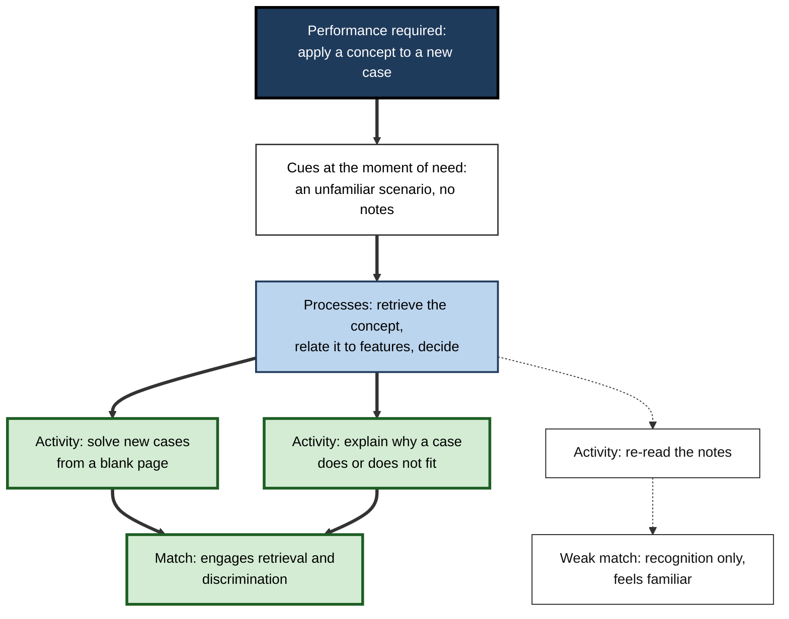
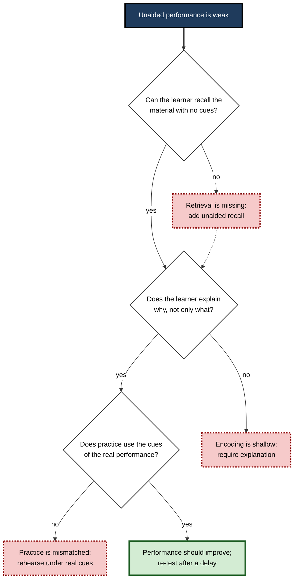
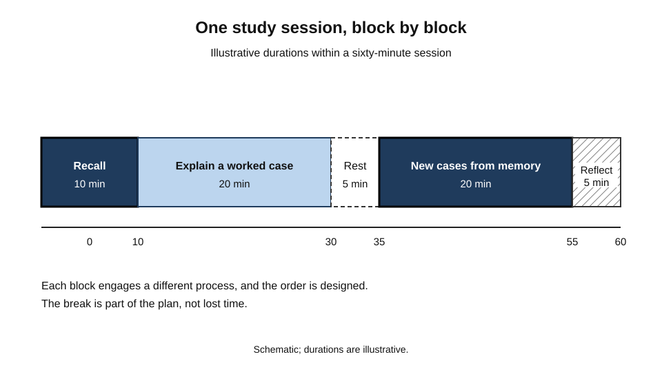
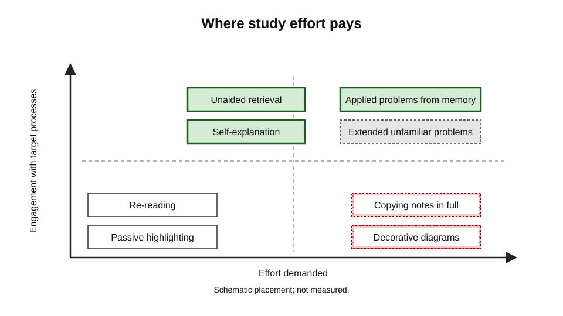
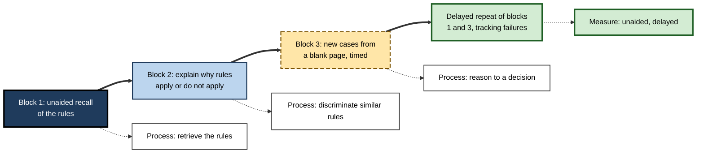

# B.12. Applying Cognitive Science to Study

A student spends six hours on a Sunday re-reading the course notes, highlighting the important sentences and redrawing the diagrams in neat colours. By the evening the material feels familiar and the student feels prepared. On Thursday the test asks for the steps of an argument, the difference between two similar concepts, and an application to a new case, and the student can recognise most of the material but produce very little of it unaided.

The effort was real and the time was spent, yet the study did not match what the test required. Cognitive science does not supply a single correct method for studying, but it does supply a way of reasoning from the mechanisms of memory, attention and retrieval to the design of study sessions that serve a particular goal.

> **Definition — Applied cognitive science of study:** the use of established findings about attention, encoding, retrieval and the limits of working memory to design study activities whose processes match the demands of the intended performance.

**Why it matters for learning**

- Most study time is spent on activities chosen by habit, not by analysis. Habits that feel productive can add little to the performance that will be tested.
- A method can be judged by the process it engages. Whether an activity produces durable, retrievable learning depends on whether it requires the learner to attend, encode and retrieve in the way the goal demands.
- The learner can diagnose failures. When a study approach does not work, the cause can usually be located at one of a few points: attention, encoding, retrieval or the conditions of testing.
- The same principles apply in professional development and in everyday work, so study skills that are understood mechanistically transfer more readily than recipes.

---

## Start From the Performance

The starting point for any study design is the performance that the learner needs. Cognitive analysis asks what the learner must do at the moment of use, and works back to the processes that will make that performance possible.

1. **Describe the performance.** Write what the learner must do: state, explain, apply, compare, decide or perform.
2. **Identify the cues.** List what will be present when the performance is needed: the question, the situation, the tools, the time pressure.
3. **Identify the processes.** Determine what must be encoded (facts, relationships, procedures), what must be retrieved, and what must be reasoned with.
4. **Choose activities that engage those processes.** Select activities that require the learner to do the processes, not only to see their outputs.

> **Key point:** an activity is a good study method for a goal only if its processes resemble the processes the goal demands. Reading a worked solution resembles checking, not solving; producing a solution from a blank page resembles solving.

**Figure 1.** From the performance required to the study activity that engages the same processes.

---

## Attention: Protecting the Process

Study cannot work if attention is elsewhere. Cognitive science provides three principles that are directly relevant to study sessions.

- **Attention is limited** — the working capacity that holds and manipulates information during study is small, so every distraction takes from it. A learner who checks messages while working through a problem is dividing a limited resource.
- **Attention is selective** — the learner attends to what seems relevant. If the study material does not seem to matter, attention drifts. A clear statement of what the session is for helps direct attention.
- **Attention is not effort** — a learner can work hard while attending to the wrong thing, such as the appearance of notes. Effort must be aimed at the processes that build the target performance.

> **In practice:** before a study session, state in one sentence the performance the session should improve, and close every source that does not serve it. The sentence is a cue that helps keep attention on the purpose.

---

## Encoding: Making the Material Work

Encoding depends on what the learner does with information while it is attended. Cognitive science points to three practical questions.

- **Does the learner generate or merely receive?** Producing an answer, explanation or example engages encoding more than reading one.
- **Does the learner connect the new material to something known?** Explanations that relate a new idea to existing knowledge are more durable than isolated statements.
- **Does the learner make distinctions?** For concepts that are easily confused, the study activity should require the learner to identify what differs and why.

**Study card — Chi and colleagues (1989)**

- **Design:** university students studied worked examples of mechanics problems from a physics textbook while thinking aloud, and their spoken protocols were recorded. The researchers compared students who explained the examples to themselves in a substantial way with those who explained them less.
- **Results:** students who produced more self-explanations, including explanations of why each step followed from the principles, tended to perform better on later problems, and their explanations were of higher quality.
- **Conclusion:** explaining a worked example to oneself appears to support the learning of principles and their application to new problems.
- **Status:** a widely cited study, and the self-explanation effect has been studied in many domains. The effect depends on the quality of the explanations, and encouraging superficial explanations produces less benefit.

> **Watch out:** self-explanation is a process, not a ritual. A learner who writes "this is correct because it is correct" has produced an explanation in form only.

---

## Retrieval: Checking What Can Be Used

Study should include regular occasions on which the learner must bring information out of memory without the material in front of them. The reason is that retrieval is the performance that will be tested. On delayed tests, retrieval practice has been shown to produce better retention than restudying the same material, although restudying can do better on an immediate test (Roediger and Karpicke, 2006).

- **Use unaided retrieval as the test of study** — the learner asks whether they can produce the information, not whether it looks familiar.
- **Retrieve the relationships, not only the facts** — for a concept that is easily confused, retrieve what distinguishes it from its neighbours.
- **Retrieve under realistic cues** — practise with the kinds of question, situation and time pressure that the test or task will use.

**Study card — Karpicke and Blunt (2011)**

- **Design:** students read short science passages and then either drew concept maps of the material, or practised recalling the material from memory, with the passage removed. Retention was tested a week later, using questions that required inference as well as recall.
- **Results:** students who practised retrieval outperformed those who built concept maps on the delayed test, including on questions requiring inference, and this advantage persisted even when the final test asked students to produce concept maps.
- **Conclusion:** retrieval practice can produce better understanding and retention than an elaborative method that seems more structured and effortful to some learners.
- **Status:** a widely discussed result. The advantage was observed with the materials and tasks used, and its extension to other domains depends on further study.

> **Key point:** the feeling that a method is well organised is not a measure of its effect. Judge a study method by how well the learner performs later, unaided, on the performance that matters.

---

## Diagnosing a Study Approach That Is Not Working

When study does not produce the expected performance, the cause can usually be located using the processes above.

**Figure 2.** A diagnostic path for a study approach that feels productive but does not produce unaided performance.

> **Watch out:** the diagnosis should be based on evidence of performance, not on the feeling of progress. A learner who has had many pleasant hours of review may still have a weak unaided performance, and the diagnosis should follow the test, not the mood.

---

## Scheduling Study Sessions

Cognitive science informs the timing of study as well as its content. Two points matter most.

- **Attention and load are limited within a session.** Long sessions with no change of activity tend to produce a decline in the quality of processing. Short, well-defined blocks, with a change of activity, can keep processing focused.
- **Study spreads across time.** A quantitative review of distributed practice in verbal recall tasks (Cepeda and colleagues, 2006) found that spacing study sessions generally improves retention compared with massed study, and that the best gap between sessions grows as the delay before the final test grows. A single long session is therefore seldom the best use of time for a durable goal.

**Figure 3.** A study session as a sequence of blocks with different processes, shown schematically.

> **In practice:** a session might open with unaided recall of the previous session's material, move to a worked explanation of a new concept, end with applied problems from memory, and close with a short note on what was hard. Each block engages a different process, and the sequence is designed rather than accidental.

---

## Where Effort Pays

Learners have finite time, and cognitive science suggests that some study effort pays more than other effort. Judging where effort pays depends on whether the activity engages the processes the goal needs and whether it is done in a way that the learner can sustain.

**Figure 4.** Study activities placed by how much they engage the processes of the target performance and how much effort they demand.

- **High engagement, moderate effort** — unaided retrieval, self-explanation and applied problems from memory.
- **Low engagement, low effort** — re-reading and passive highlighting. These feel productive but do little for the target performance.
- **High effort, low engagement** — copying notes in full or making elaborate decorative diagrams that do not represent the content.
- **High engagement, high effort** — extended problem solving on unfamiliar cases. Valuable, but only when the learner has enough prior knowledge to make progress.

---

## Worked Example: Preparing for a Practical Certification

**Situation:** a professional must pass a certification that tests the application of a regulatory framework to unfamiliar cases, under a time limit.

1. **Describe the performance.** Given a case, decide which rules apply, justify the decision and identify what additional information is needed.
2. **Identify the cues and processes.** The case description is the cue. The processes are: recognise the case type, retrieve the rules, discriminate between similar rules, and reason to a decision.
3. **Plan the first block.** Unaided recall of the rule set, with each rule written from memory before checking against the source.
4. **Plan the second block.** Explain, for each of ten worked examples, why the rule applies and why a similar rule does not. The explanation is written before the answer is shown.
5. **Plan the third block.** Solve new cases from a blank page under time limits, then review the decision against the explanation.
6. **Schedule the review.** Repeat the unaided recall and new-case practice after a delay, and track which cases still fail.

**Figure 5.** The certification plan, with each block tied to a required process.

**Conclusion:** each block corresponds to a process the performance requires. The plan reads more like a sequence of tasks than a reading list, and its progress is judged by unaided and delayed performance.

> **Watch out:** this plan assumes the framework itself is available to study. Where the framework is incomplete or contested, the practice should be supplemented by a check against authoritative guidance.

---

## Case Study (illustrative): A Study Programme That Changed Its Tests

- **Situation:** a graduate trainee in an analytics team was preparing for a professional qualification. The trainee had a reading schedule of six chapters per week and attended a weekly study group.
- **Problem:** after three months, the trainee had completed the reading but failed two practice examinations. The trainee felt that the material was familiar and could not explain why the practice results were poor.
- **Diagnosis:**
  - the study activities were reading and summarising, which engaged recognition rather than retrieval;
  - the trainee did not explain the reasons for the answers, so discrimination between similar concepts was weak;
  - the practice examinations were the first unaided test the trainee had taken, so the gap was discovered late.
- **Actions:**
  1. Replaced the reading schedule with a three-block session: unaided recall, explanation of worked cases, and new cases under time limits.
  2. Introduced a weekly unaided check on the previous week's material.
  3. Kept the study group, but used it to compare explanations of case decisions rather than to discuss chapters.
- **Result (illustrative):** the trainee's practice scores rose over the following two months, and the trainee reported that errors were more often identified before the examination.
- **Side effects / caveats:** the new sessions took more concentration and were tiring, and the trainee's self-reported confidence fell at first. The case compares one trainee's programme with an earlier period, not with a control.
- **Lesson:** a study approach should be judged by unaided, delayed performance. Fluency during reading is not evidence of readiness.

---

## Open Questions

- **Which study activities are most effective for which kinds of goal?**
  - The answer is partly known for some activities; the wider map of goals and methods is incomplete.
- **How should study be adjusted for learners with different prior knowledge?**
  - Expert and novice learners may need different activities, and the boundary between them is not sharp.
- **How can learners be persuaded to abandon study habits that feel productive?**
  - Learners often resist methods that feel harder, even when the evidence favours them.
- **How well do study principles transfer from academic tests to professional performance?**
  - The transfer of study methods to complex, real-world tasks is less studied than transfer within education.

---

## Summary

- **Applied cognitive science of study** designs activities whose processes match the performance the learner will need.
- **Start from the performance**: describe it, identify the cues and processes, then choose activities that engage those processes.
- **Attention is limited and selective**; effort must be aimed at the processes that build the target performance.
- **Encoding** benefits from generation, connection and distinction; **self-explanation** of worked examples supports learning when the explanations are substantive (**Chi and colleagues, 1989**).
- **Retrieval** is the performance that tests measure, and practice in retrieval can produce better understanding than elaborate organisation (**Karpicke and Blunt, 2011**).
- **Diagnose failures** at retrieval, encoding and practice, based on unaided performance rather than feelings of progress.
- **Schedule sessions** in short, varied blocks, and spread study across time.
- **Effort pays** when it engages the processes of the target performance; re-reading and passive highlighting feel productive but add little.
- In practice, judge every method by how well the learner performs later, unaided, on the performance that matters.

---

## Self-Check

1. Describe the four steps for designing study from the performance required.
2. Why is reading a worked solution a weak match for solving a problem?
3. What three principles of attention apply to study sessions?
4. Explain self-explanation and the condition under which it helps.
5. What did Karpicke and Blunt (2011) compare, and what did they find on the delayed test?
6. Why is a method's organised appearance not a reliable measure of its effect?
7. Using the diagnostic path, what would you check first for a learner who cannot solve new cases unaided?
8. Describe a session design with at least three blocks, each engaging a different process.
9. Which study activities are high in engagement and which feel productive but add little, and why?
10. A learner says that they have studied a topic for twenty hours and feel ready. Use the principles of applied study to evaluate that claim and propose a check.
11. A professional must apply a regulatory framework under time pressure. Describe the cues and processes of that performance and design two study blocks for it.
12. A teacher argues that students should write summaries of every chapter because it promotes deep understanding. Evaluate this claim.

### Answer Key

1. Describe the performance; identify the cues present at the moment of need; identify the processes (encoding, retrieval, reasoning) the performance requires; choose activities that engage those processes.
2. Re-reading a worked solution engages recognition and checking, whereas solving a problem requires generating the steps from cues. The processes differ, so the match is weak.
3. Attention is limited, so distractions reduce processing capacity; attention is selective, so a clear purpose helps direct it; attention is not effort, so effort must be aimed at the right processes.
4. Self-explanation is explaining a worked example to oneself, including why each step follows. It helps when the explanations are substantive and connect steps to principles, and it adds little when the explanations are empty restatements.
5. They compared concept mapping with retrieval practice on science texts. On the delayed test, including questions requiring inference, the retrieval group outperformed the concept-mapping group.
6. A method can feel organised, effortful or productive without producing durable, unaided performance. Feelings during study are a weak guide to later performance.
7. Check first whether retrieval is present: does the learner practise producing the material and the solutions from memory? If not, add unaided recall before any more rereading.
8. Example: block one, unaided recall of the previous material; block two, explanation of a worked case with reasons; block three, new cases from memory under time limits; a closing note on difficulties. Each engages a different process.
9. High engagement: unaided retrieval, self-explanation and applied problems from memory. Feels productive but low engagement: re-reading and passive highlighting, because they require little retrieval or meaning-making.
10. Twenty hours is an input measure, not an outcome. Readiness should be tested by unaided performance on realistic cases, after a delay, with the result compared to the criteria of the test.
11. Cues: an unfamiliar case description with the framework unavailable or under time limits. Processes: recognise the case type, retrieve the rules, discriminate similar rules, decide and justify. Block one: unaided recall of the rules. Block two: explain the application of rules to cases, including why similar rules do not apply.
12. Summaries can be useful, but writing summaries of everything may be low-engagement if they copy the text. The claim should be tested: whether summaries require retrieval and explanation, and whether learners perform better later on the performance that matters. Deep understanding is not assured by the act of summarising.

---

## Glossary

| Term | Meaning |
|---|---|
| Attention | Selective allocation of limited processing capacity to some information. |
| Diagnostic path | A sequence of checks that locates the cause of weak unaided performance. |
| Performance cue | A feature present at the moment of need that helps retrieval. |
| Retrieval practice | Producing information from memory, which tests and strengthens later access. |
| Self-explanation | Explaining a worked example to oneself, including why each step follows. |
| Session block | A distinct phase of study engaging a particular process. |
| Unaided performance | Performance without notes, prompts or the source material in view. |
