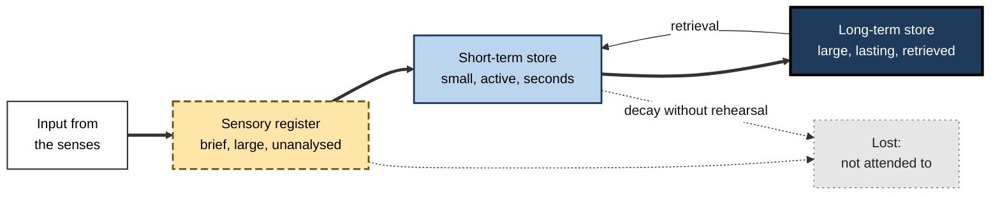
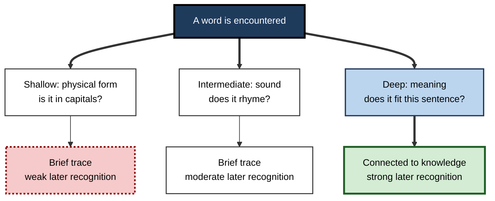
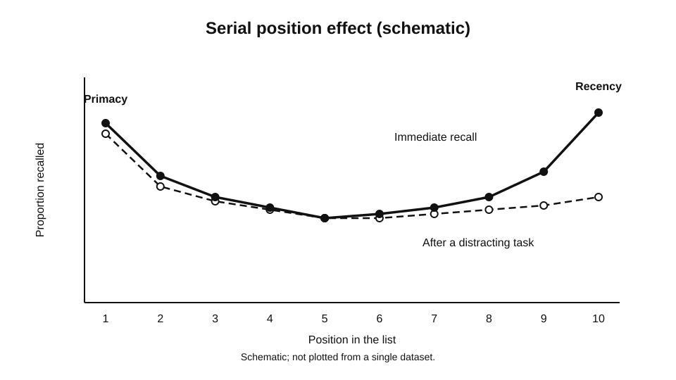
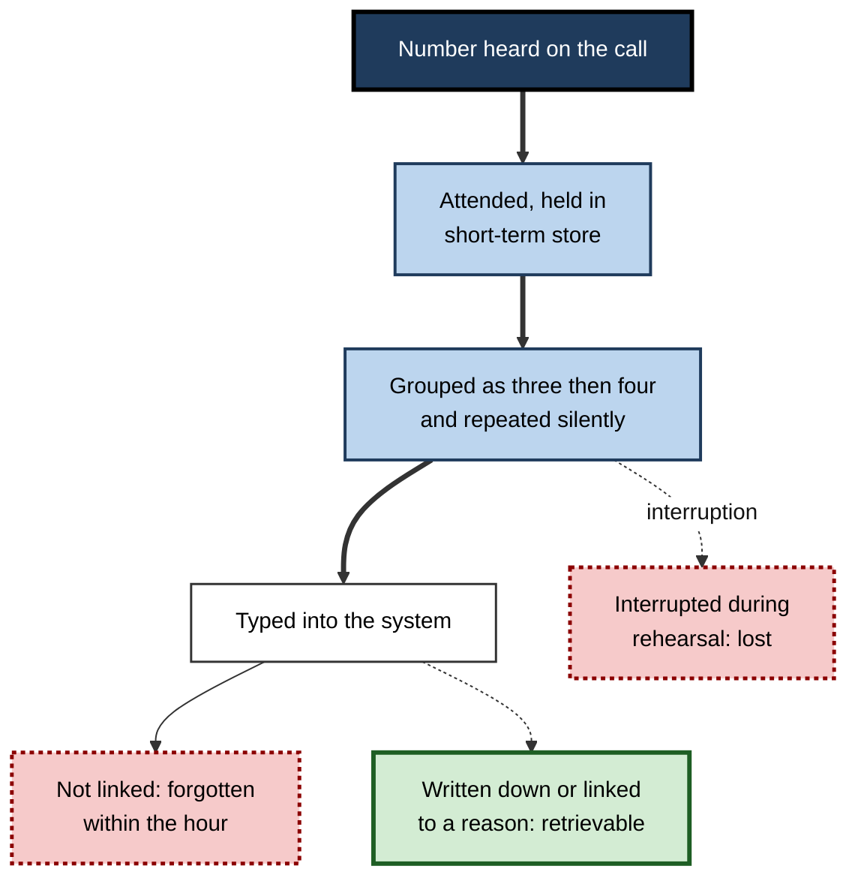
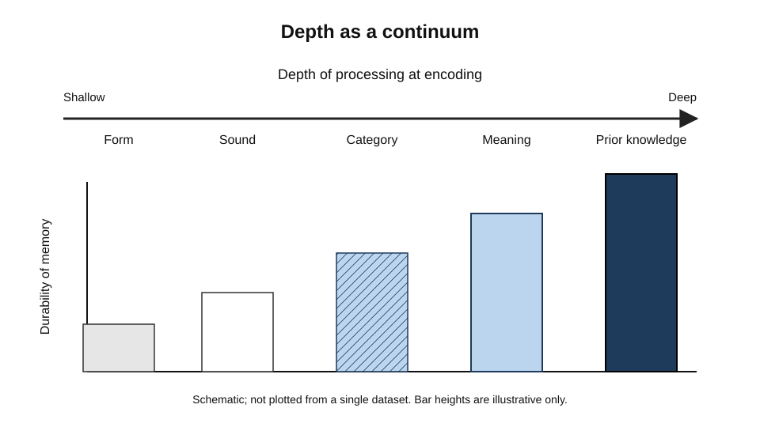

# B.2. Information Processing Model

A customer reads an account number on a letter, carries it across the room in their head, and types it into a web form. Within a few seconds the number has passed through three different kinds of mental holding: a brief impression of the printed page, a working grip on the digits while the eyes move away, and a durable trace that may be needed again next month.

If the customer is interrupted by a colleague halfway through, the number is lost; if the same number was read six times and linked to a familiar bank, it survives the interruption. The information processing model is the framework that explains why these outcomes differ, and it remains the most widely used starting point for thinking about how a mind takes in, holds and uses information.

> **Definition — Information processing model:** an account of human cognition in which information passes through a sequence of processes and stores, each with characteristic capacities, durations and operations. Its central claim is that the outcome of an experience depends on which processes the information receives and for how long.

**Why it matters for learning**

- The model separates the question "was the information noticed?" from "was it stored?" and from "can it be found again?". Many failures of learning are failures at one of these points, not at all of them.
- It explains why information that is clearly perceived can still be forgotten within seconds, and why information that was briefly held can be retained for decades.
- It gives a vocabulary for diagnosing a difficulty: a learner who cannot recall a fact may have never attended to it, may have held it too briefly, or may have stored it in a form that cannot be retrieved in the situation where it is needed.
- It supplies the structure within which later and more detailed theories, such as models of working memory and long-term memory, were developed.

---

## Origins of the Model

### Information as a quantity

- **Claude Shannon and Warren Weaver (1949)** published a mathematical theory of communication. It treated information as a quantity that could be measured, transmitted and transformed, and it provided a vocabulary of channels, capacities and noise.
- The idea spread into psychology after the 1950s. Researchers began to ask how much information a person can transmit, how quickly, and with what errors.
- **George Miller (1956)** showed that people could reliably identify only about seven categories of a single dimension (such as pitch or loudness) and that memory span for unrelated items was also around seven. He proposed that the limit is best described in chunks, meaningful units formed from smaller items.

> **Definition — Chunk:** a meaningful unit that a person treats as a single item in memory. A telephone number is three items for a reader who sees it as one area code and two groups of digits, and ten items for a reader who sees ten digits.

### From analogy to explicit model

- **Donald Broadbent (1958)** described a model in which information passes through a limited-capacity filter after a brief sensory stage. This made the sequence of stages central.
- **Richard Atkinson and Richard Shiffrin (1968)** proposed a multi-store model in which information moves through three stores: a sensory register, a short-term store and a long-term store. Their model became the standard textbook account of memory. It was linear: information passed from one store to the next, and the movement depended on attention, rehearsal and retrieval.
- **Fergus Craik and Robert Lockhart (1972)** argued that the stores themselves were less important than the depth of processing. Their levels-of-processing theory treated memory as a by-product of how deeply information is analysed, which led researchers away from a fixed sequence towards a continuum.

> **Key point:** the model is a set of claims about constraints, not a picture of the brain. Its value lies in the predictions it makes about capacity, duration and the effects of different operations, and in how those predictions have been tested.

---

## The Stores of the Model

### Sensory register

> **Definition — Sensory register:** a brief, high-capacity store that holds raw sensory input for a fraction of a second, before the input is either attended to or lost. Each sense has its own register; the visual version is often called iconic memory and the auditory version echoic memory.

- **Capacity:** large. People can take in a great deal of sensory input at once.
- **Duration:** very brief. A visual impression fades in well under a second.
- **Operation:** no meaning is extracted at this stage. The register holds a sensory copy, not an understanding.
- **Evidence:** George Sperling (1960) showed a brief array of letters, then asked people to report either all of the letters (whole report) or only the letters in one row, indicated by a tone that sounded after the array disappeared (partial report). Whole report was limited to about four or five letters, whereas partial report showed that people could report almost any row they were cued to report, implying that more had been available briefly than could be reported in full. Later replications have supported the general pattern, although the precise numbers depend on method.

**Study card — Sperling (1960)**

- **Design:** a grid of letters was flashed for a very short time. In one condition participants reported every letter; in another, a tone indicated which row to report, cued either immediately or after a delay.
- **Results:** whole report was limited, but cued report of a single row was far more accurate than whole report implied when the cue came right after the display. Accuracy fell as the delay before the cue increased.
- **Conclusion:** a brief, high-capacity sensory trace existed that faded quickly. Attention can select from it, but only if the selection happens before the trace is gone.
- **Status:** the effect has been replicated many times, and the exact duration and capacity estimates have been debated.

> **Watch out:** the sensory register is often described as "a camera". The analogy is misleading in one respect: the register is not a passive recording. It is the first stage at which the system begins to organise input, and it is strongly shaped by what the observer expects.

### Short-term store

> **Definition — Short-term store:** a limited-capacity store that holds information currently being used, typically for a period of seconds unless the information is rehearsed.

- **Capacity:** small. Miller's (1956) estimate of about seven items has been revised downward by later work. Nelson Cowan (2001) argued that Miller's figure was a loose estimate and that the limit is closer to four chunks. The debate is not fully resolved, and the number depends on the material and the task.
- **Duration:** short without rehearsal. Lloyd and Margaret Peterson (1959) asked people to remember a three-consonant trigram while counting backwards in threes for a short interval; recall fell sharply within about twenty seconds. The result is widely cited, though the exact time course depends on conditions.
- **Operation:** information is held by repeating it, grouping it into chunks, or relating it to something already known.
- **Role:** the short-term store is where information is manipulated. It is the work surface on which a person reasons, compares and calculates.

**Study card — Peterson and Peterson (1959)**

- **Design:** participants saw a three-consonant trigram, then counted backwards in threes for a period from three to eighteen seconds, and then recalled the trigram.
- **Results:** recall fell steeply over the first few seconds. Much of the trigram was lost by about the time the counting ended.
- **Conclusion:** information in the short-term store decays quickly unless it is actively maintained. Rehearsal, which the counting task prevented, is the usual means of maintaining it.
- **Status:** a classic result. Later research has refined the account of why forgetting occurs in these conditions, and whether decay or interference does most of the work is still discussed.

### Long-term store

> **Definition — Long-term store:** the store of knowledge retained over long periods. Its capacity is very large, and its contents are retrieved when they are needed rather than held continuously.

- **Capacity:** effectively very large relative to what a person encounters in a lifetime.
- **Duration:** potentially permanent, though retrieval may fail long before the information is lost.
- **Organisation:** information is stored in networks of association, schemata and procedures. Organisation strongly determines how easily information can be found again.
- **Operation:** information enters the long-term store through processing in the short-term store, most commonly through elaboration and meaningful connection.

> **Key point:** the long-term store does not keep information in a neat archive. Its contents must be found, and the ease of finding depends on how the information was stored, which is why the same fact can be easy to recall in one setting and invisible in another.

---

## Movement Between Stores

The model's most important claim concerns the transfers between stores.

- **Attention** moves information from the sensory register into the short-term store. Information that is not attended to decays from the register without being used.
- **Rehearsal** keeps information in the short-term store. Simple repetition maintains information but does little to build long-term retention.
- **Elaboration** links new information to existing knowledge, and is the operation most strongly associated with transfer into long-term storage.
- **Retrieval** brings information from the long-term store back into the short-term store, where it can be used.

**Figure 1.** Stores and the transfers between them in the information processing model.

> **Watch out:** the arrows in this model are a simplification. Information does not simply pass from one store to the next and leave the first behind. Traces can be copied, partly retained, and reactivated by cues, so a single linear path is an approximation.

---

## Depth of Processing

Craik and Lockhart (1972) proposed that the number of stores matters less than the kind of processing applied to information. They argued that processing ranges from shallow, which analyses physical or sound features, to deep, which analyses meaning, and that deeper processing produces more durable memory.

> **Definition — Levels of processing:** a theory that memory durability depends on the depth of analysis at encoding. Shallow processing attends to physical form or sound; deep processing attends to meaning and its connections to existing knowledge.

**Study card — Craik and Tulving (1975)**

- **Design:** participants answered a question about each of a list of words. The questions required one of three kinds of processing: structural (is the word in capitals?), phonemic (does the word rhyme with a given word?) or semantic (does the word fit a given sentence?). A later, unexpected recognition test included the target words among distractors.
- **Results:** words processed semantically were recognised far more often than words processed structurally or phonemically.
- **Conclusion:** the kind of processing at encoding shapes later memory. The effect was strong for meaning-based processing and weak for surface processing.
- **Status:** widely replicated. Its interpretation remains contested: some researchers argue that part of the effect reflects the match between processing at study and at test.

**Figure 2.** Processing that attends to meaning produces more durable memory than processing that attends to surface features.

### Why depth is not the whole story

- **Repetition without meaning** can produce some retention, so depth is a tendency rather than a rule.
- **Elaboration** — adding meaning — is effective only if the elaboration is relevant and connected to what will be needed later.
- **Transfer-appropriate processing** — a later test that demands different processing may fail even after deep study, because retrieval depends on the match between the conditions at study and at test.
- **The concept of depth** is hard to define independently of its effects. A critic may say that "deep" simply means "remembered well", which makes the theory difficult to test. Later work tried to measure depth more directly, with partial success.

---

## The Serial Position Effect

When people try to recall a list of items, they tend to remember the first items and the last items better than those in the middle. This pattern is the serial position effect, and it provides evidence for distinct stores in a way that the model's authors had hoped.

> **Definition — Serial position effect:** the tendency for recall of a list to depend on an item's position in the list. Items at the beginning (primacy) and end (recency) are recalled better than items in the middle.

- **Primacy effect** — early items receive more rehearsal and are more likely to be stored in long-term memory.
- **Recency effect** — the last items are still in the short-term store when recall begins, so they are recalled readily.
- **Delay test** — when recall is delayed by a distracting task, the recency advantage disappears but the primacy advantage remains. This pattern was used to argue for separate stores.
- **Murdock (1962)** provided a systematic study of this pattern in free recall of word lists. The general shape is widely replicated, although the explanations have been revised.

**Figure 3.** A schematic serial position curve, showing primacy and recency.

> **Example (illustrative):** a manager reads a list of six instructions aloud. If asked to repeat them immediately, the first and last instructions are usually repeated best. If asked after a five-minute distraction, the first instruction is still often repeated, but the last one is much less likely to be.

---

## Worked Example: Tracing an Item Through the Model

**Situation:** an accounts clerk hears a seven-digit reference number over the phone and must enter it into a system.

1. **Attention.** The clerk attends to the call, so the sound enters the echoic register and is then attended, moving into the short-term store.
2. **Maintenance.** The clerk repeats the number silently, grouping it as three digits then four. The grouping is a chunk strategy that reduces the number of items held.
3. **Use.** The number is typed into the system while the clerk keeps it in the short-term store.
4. **Storage.** If the clerk is later asked for the number, a recall from the long-term store is needed. The number was not elaborated, so it is unlikely to be retrieved unless it is written down or repeated.
5. **Interruption.** If a colleague asks a question after step 2, the rehearsal is broken and the number may be lost before it is typed.

**Figure 4.** The clerk's route through the model, and the points at which the number can be lost.

**Conclusion:** the model explains why the clerk can enter the number correctly but cannot repeat it an hour later, and why an interruption at step 2 causes a different failure from an interruption at step 4.

> **Watch out:** this worked example uses a simplified sequence. Real processing overlaps, and the same number may be held by more than one route at once.

---

## Case Study (illustrative): A Finance Team's Lost Instructions

- **Situation:** a finance team received instructions about a change to the approval threshold for supplier payments. The instructions were sent in a long email with several other items.
- **Problem:** two weeks later, several staff were still applying the old threshold. Staff reported that they had "read the email", but could not state the new figure when asked.
- **Diagnosis:**
  - the email was read on a phone between other tasks, which produced brief attention and little rehearsal;
  - the threshold was a bare number with no link to the reason for the change;
  - the change was not tied to any task staff performed regularly, so there was no retrieval cue at the moment of action.
- **Actions:**
  1. The team leader summarised the change in a single sentence, linked the number to the reason for it (a recent audit finding), and asked each person to state the new threshold aloud.
  2. The threshold was built into the approval form as a visible prompt, so that retrieval happened at the point of action.
  3. A short quiz was sent a week later, asking staff to apply the threshold to three example payments.
- **Result (illustrative):** the error rate on the following month's approvals fell, and staff could apply the threshold to unfamiliar examples in the quiz.
- **Side effects / caveats:** the form change required IT work, and the team could not tell how much of the improvement came from the explanation and how much from the prompt.
- **Lesson:** a clear message attended to at the sensory stage is not enough. Information must be held long enough, linked to meaning and placed where it will be retrieved.

---

## Limits of the Multi-Store Model

**Figure 5.** A continuum of processing depth in place of a fixed sequence of stores.

- **Linearity** — the strict order of the model is hard to reconcile with evidence that information can be retrieved from long-term storage without first being held in the short-term store in the expected way.
- **Storage is not one thing** — the model treats each store as a single system, whereas later evidence shows many specialised systems for different content.
- **Retrieval is underspecified** — the model says that retrieval moves information back into the short-term store but says little about the cues or processes that make retrieval succeed.
- **Capacity estimates** — the number of items held in the short-term store depends on what counts as an item, so the same memory may appear larger or smaller depending on chunking.

> **Key point:** the model's lasting contribution is its concern with bottlenecks and transfers. The details have been revised, but the questions it asks about where information is lost remain central.

---

## Open Questions

- **Is there one short-term store, or several?**
  - Evidence supports multiple short-term systems for different kinds of content, but the exact structure remains debated.
- **How should chunk capacity be measured without depending on the strategy used?**
  - Estimates vary with material and task, and it is hard to separate capacity from the skill of grouping.
- **Does depth of processing have a measure independent of its effects?**
  - Without an independent measure, the theory risks being circular.
- **How do transfers between stores operate in naturalistic settings?**
  - Most evidence comes from short lists and controlled tasks; the everyday processing of rich, meaningful material is less well mapped.

---

## Summary

- The **information processing model** describes learning as a sequence of stores with characteristic capacities, durations and operations.
- The **sensory register** holds raw input for a fraction of a second; **Sperling (1960)** showed it holds more than can be reported in full.
- The **short-term store** holds a small number of items for seconds without rehearsal; **Peterson and Peterson (1959)** showed rapid loss, and **Miller (1956)** and **Cowan (2001)** debated its capacity.
- The **long-term store** is effectively very large and lasting, but retrieval depends on how information was organised.
- **Attention, rehearsal, elaboration and retrieval** govern the transfers between stores.
- **Levels of processing** shift the focus from stores to depth: meaning-based processing produces more durable memory (**Craik and Tulving, 1975**).
- The **serial position effect** shows primacy and recency, supporting the idea of distinct stores, though its explanation is revised.
- The model is a set of testable constraints. Its linear form and loose treatment of retrieval are its main limits.
- In practice, a failure to learn can arise at attention, maintenance, storage or retrieval, and each calls for a different remedy.

---

## Self-Check

1. Describe the three stores of the multi-store model and give the approximate duration of each.
2. What did Sperling's partial report procedure show that whole report did not?
3. Why is the sensory register not simply a camera?
4. Explain Miller's proposal about the limit of short-term memory and why chunking matters.
5. What did Peterson and Peterson's counting task show about maintenance?
6. Distinguish rehearsal from elaboration, and say which is more strongly linked to transfer into long-term storage.
7. Explain the levels-of-processing theory and the result from Craik and Tulving (1975).
8. What is the serial position effect, and how does a delayed test help to separate primacy from recency?
9. Why is a strictly linear model difficult to reconcile with all the evidence?
10. A trainee can repeat a new procedure immediately but not a week later. Using the model, list three points at which the learning could have failed.
11. A colleague says that a memory must be "deep" because it lasts. Why is this argument circular, and what independent evidence would help?
12. Design a simple instruction that would rely on elaboration rather than repetition, and explain why it should last longer.

### Answer Key

1. Sensory register: a fraction of a second. Short-term store: seconds without rehearsal. Long-term store: potentially permanent, retrieval-dependent.
2. Whole report was limited to about four or five letters, but when a row was cued, participants reported most of that row, implying that more information was briefly available than whole report could show.
3. The register is an early stage at which the system begins to organise input, and its contents are shaped by expectation, so it is not a passive recording.
4. Miller proposed a limit of about seven items, expressed in chunks, meaningful units. Chunking matters because it increases how much meaning can be held even when the number of chunks is small.
5. Maintenance without rehearsal fails quickly: when counting prevented rehearsal, recall of the trigram fell steeply within seconds.
6. Rehearsal maintains information in the short-term store. Elaboration links it to existing knowledge and is more strongly linked to long-term retention and transfer.
7. Levels of processing holds that memory durability depends on the depth of analysis, with meaning-based analysis producing stronger memory. Craik and Tulving (1975) found that semantically processed words were recognised far more often than those processed structurally or phonemically.
8. The serial position effect is better recall for items at the beginning and end of a list. A delayed test removes the recency advantage but leaves primacy, suggesting recency reflects the short-term store and primacy the long-term store.
9. Retrieval and storage do not follow a single path; information can be retrieved without the expected sequence, and specialised systems exist for different content.
10. Possible points: the initial attention was weak (sensory and attention stage); the trainee did not maintain or link the procedure (maintenance and elaboration); the procedure was not stored in a form that could be found later (storage and retrieval cues).
11. Depth is inferred from durability, so using durability to prove depth assumes the conclusion. Independent measures, such as the quality of the connections a learner can describe or the performance on a later task that requires meaning, would help.
12. Example: "Replace the password reset procedure with a rule: if the account is locked, check the second email address first, because the first is often out of date." Explaining why and linking to a known situation should last longer than a bare list of steps repeated many times.

---

## Glossary

| Term | Meaning |
|---|---|
| Chunk | A meaningful unit treated as a single item in memory. |
| Elaboration | Linking new information to existing knowledge to give it meaning. |
| Information processing model | An account of cognition as a sequence of stores with characteristic capacities and transfers. |
| Levels of processing | The theory that memory durability depends on the depth of analysis at encoding. |
| Long-term store | The store of knowledge retained over long periods, retrieved when needed. |
| Primacy effect | Better recall of items at the beginning of a list. |
| Recency effect | Better recall of items at the end of a list. |
| Rehearsal | Repetition that maintains information in the short-term store. |
| Sensory register | A brief, high-capacity store that holds raw sensory input. |
| Serial position effect | Recall depending on an item's position in a list. |
| Short-term store | A limited-capacity store holding information in active use for seconds. |
