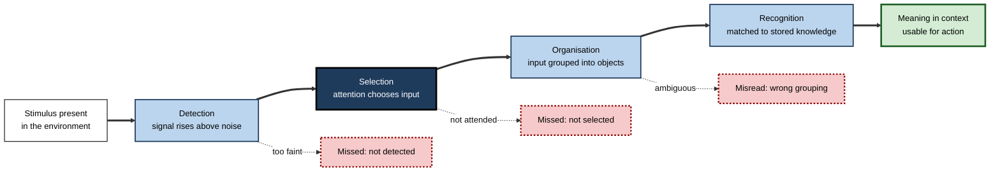
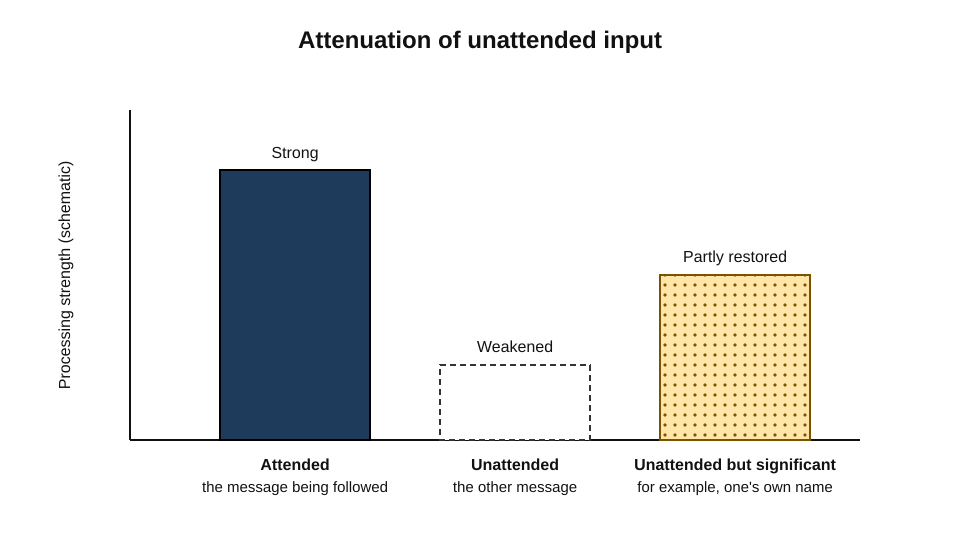
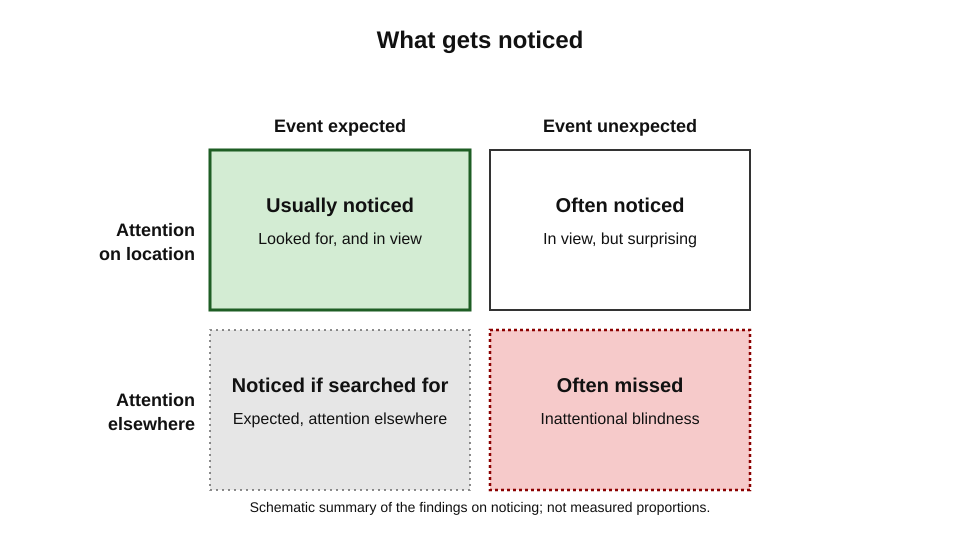
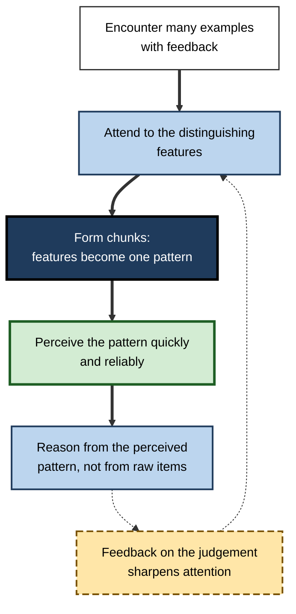
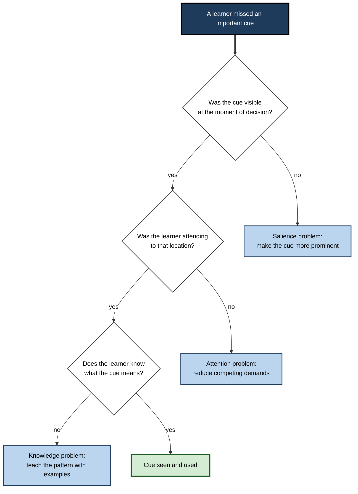

# B.3. Perception and Attention in Learning

A nurse on a night shift notices that a patient's breathing has changed pattern, a few seconds before the monitor alarms.

A new pilot reads the instrument panel perfectly and misses the taxiway that a more experienced crew member spots at once. Two radiologists look at the same scan; one sees a faint shadow that the other, under the same conditions, does not. In each case the difference lies before any question of memory or reasoning arises. What a person perceives, and what they notice at all, determines what can later be learned from an experience, and it determines what can be practised, corrected and remembered.

> **Definition — Perception:** the process by which sensory input is organised and interpreted so that the observer experiences objects, events and their meanings. Perception is not a passive copy of the world; it uses expectation, prior knowledge and the task at hand.

**Why it matters for learning**

- Nothing that is not perceived can be learned from directly. A learner can only build knowledge from what has been taken in.
- Perception is trainable. Experts often perceive patterns that novices miss, and the difference is partly the product of practice.
- Attention decides which perceived material is processed further, so two people in the same room can learn different things from the same experience.
- Many learning failures are perceptual: the relevant cue was present, but it was not seen.

---

## From Input to Meaning

The path from stimulus to usable knowledge has several steps, and learning can fail at any of them.

- **Detection** — something is present in the sensory input.
- **Selection** — a limited amount of that input is chosen for further processing.
- **Organisation** — the selected input is grouped into objects, sounds or patterns.
- **Recognition** — the organised input is matched against stored knowledge, which gives it a meaning.
- **Interpretation** — the meaning is placed in a context, which determines what it implies and what to do.

**Figure 1.** The path from input to usable meaning, and where learning can fail along it.

> **Key point:** the stages are not strictly ordered. Expectation and knowledge influence detection and grouping as well as recognition, so what a person expects shapes what they perceive from the outset.

---

## Selective Attention: Where the Bottleneck Sits

> **Definition — Selective attention:** the process by which some information is chosen for further processing while other information is reduced or ignored.

The question of where selection occurs has been argued over for seventy years, and the answer shapes how learning should be designed.

- **Colin Cherry (1953)** studied the "cocktail party" problem: listeners could follow one voice among several. In his shadowing experiments, participants repeated one spoken message while a different message was played to the other ear. Listeners noticed physical features of the unattended message, such as a change in the speaker's sex, but many did not notice when the unattended message switched from English to German, and they had little memory for its content.
- **Donald Broadbent (1958)** proposed that selection happens early, through a filter that admits information on the basis of its physical properties before its meaning is analysed. The filter protects a limited channel from overload.
- **Anne Treisman (1964)** proposed an attenuation account: the unattended message is weakened rather than blocked, so that some meaningful material can still get through. A person's own name, or a highly important word, can break through an unattended channel.
- **Later work** has placed the selection point at different stages depending on the task, and it is now widely accepted that selection can occur early or late, depending on demands.

> **Watch out:** the early-versus-late debate is sometimes presented as settled in one direction. It is more accurate to say that selection is flexible: the stage at which it happens depends on how much the task demands and how much the input is expected to matter.

**Study card — Cherry (1953)**

- **Design:** participants heard two spoken messages separately, one in each ear, and were asked to repeat only one of them (shadowing).
- **Results:** participants reported the physical characteristics of the unattended message reliably, but they could not report its meaning in most cases.
- **Conclusion:** attention separates information at a physical level, and meaning of the unattended channel is largely lost unless it becomes relevant.
- **Status:** a foundational result. Cherry's dichotic method was used by Broadbent and Treisman, and the debate about the stage of selection continued from their work.

**Figure 2.** Schematic signal strength for attended, unattended and personally significant input under attenuation.

---

## Noticing Is Not Seeing: Inattentional and Change Blindness

Perception can fail even when the eyes are on the right place. Two phenomena are especially important for learning.

> **Definition — Inattentional blindness:** failure to notice a fully visible, unexpected object or event when attention is occupied by another task.

> **Definition — Change blindness:** failure to notice a change between two views of a scene, especially when the change occurs during a brief interruption, such as a blink, a cut or a moment of visual disruption.

**Study card — Simons and Chabris (1999)**

- **Design:** observers watched a short video of two teams passing basketballs, and were asked to count the passes made by one team. Partway through, a person in a gorilla costume walked across the court, stopped, and beat its chest before leaving.
- **Results:** roughly half of the observers did not report the gorilla when asked about it afterwards. The result depended on how demanding the counting task was.
- **Conclusion:** attention to one task can prevent people from noticing a salient and unexpected event that lies in plain view.
- **Status:** a much-cited demonstration. Later work has shown that the effect varies with task and observer, and the exact proportions depend on the version of the video and the sample. The core finding is widely replicated.

> **Example (illustrative):** a support engineer watching a dashboard for a particular error may miss an unrelated warning colour in a corner of the screen that the engineer's colleague notices, because the colleague's task was different.

Change blindness shows a related limit. When a visual scene changes during a brief interruption, observers often fail to detect the change even when they are looking at the part of the scene that changed. Daniel Simons and Ronald Rensink (2005) reviewed the conclusions drawn from change blindness, separating those the evidence supports from those it does not.

**Figure 3.** What is noticed depends on two factors: whether the observer is attending to the relevant location, and whether the event is expected.

---

## Expectation and Top-Down Perception

Perception runs in two directions at once. Sensory input drives perception from the bottom up, and knowledge, expectation and goals drive it from the top down.

- **Expectation** speeds recognition of what is expected and slows recognition of what is not.
  - *e.g.* an experienced reviewer reads a familiar code pattern as correct before reading each line.
- **Context** resolves ambiguity.
  - *e.g.* a word that is unclear on its own is identified quickly within a sentence.
- **Goals** determine what is looked for.
  - *e.g.* an auditor searching for inconsistent dates may not register a mistake in a total.

> **Key point:** expertise improves perception partly by providing expectations. An expert sees more because the expert knows what to look for, and that knowledge was itself acquired through perception and practice.

> **Watch out:** top-down expectation can produce errors as well as efficiency. An observer who expects a particular outcome may see confirmation where the evidence does not support it.

---

## Perceptual Learning

> **Definition — Perceptual learning:** a relatively permanent improvement in the ability to discriminate, identify or extract information from sensory input, resulting from practice or experience.

Eleanor Gibson's work on perceptual learning, which began in the 1950s, argued that perception is itself learned: infants and adults become better at detecting the distinguishing features of things they encounter repeatedly. Perceptual learning differs from learning new facts. It changes what information is available to the observer, so later reasoning starts from a richer input.

- **Discrimination learning** — learning to tell similar things apart.
  - *e.g.* a laboratory technician learns to distinguish two similar-looking bacterial colonies.
- **Feature learning** — learning which aspects of a stimulus carry information.
  - *e.g.* an analyst learns that the timing of transactions, not the amount, flags a particular fraud pattern.
- **Unitisation** — learning to perceive several features as one object.
  - *e.g.* a musician hears a chord as a single unit, not as separate notes.

### Chunking in expert perception

**Study card — Chase and Simon (1973)**

- **Design:** chess players of different skill levels were shown positions from real games, and then asked to reconstruct them from memory after brief exposure. The same task was repeated with positions in which the pieces had been placed at random.
- **Results:** masters reconstructed real positions far more accurately than novices, but their advantage disappeared with random positions.
- **Conclusion:** expertise lies in perceiving meaningful patterns (chunks) built from practice, not in a generally better memory.
- **Status:** a widely replicated and influential result, though later work has debated how large the chunks are and how they are learned.

> **In practice:** the chess result is used in many fields to argue that expert performance rests on learned perceptual patterns. Designing practice so that learners see meaningful patterns, rather than isolated items, is one application.

**Figure 4.** The perceptual learning cycle in skilled work.

> **Example (illustrative):** a quality inspector initially checks every component against a long list. After weeks of examples with feedback, the inspector notices a particular pattern of surface wear first, and checks the list only when the pattern is ambiguous.

---

## Designing for Noticing

A learning environment can be designed so that important information is more likely to be perceived.

- **Make the cue salient** — size, contrast, position and timing all affect whether a cue is detected.
- **Reduce competing demands** — a cue is more likely to be noticed when the attention needed for other tasks is lower.
- **Prompt the right location** — directing attention to where a cue will appear increases detection.
- **Train discrimination on realistic examples** — learners detect what they have practised discriminating, and realistic variation builds more robust perception than artificial examples.

**Figure 5.** A decision path for checking whether a missed cue is a perceptual or a knowledge problem.

---

## Worked Example: A Code Reviewer's Missed Defect

**Situation:** a junior developer reviews a colleague's change to a payment function. The change includes a check that compares two currency codes, and one code is wrongly written in lower case.

1. **Detection.** The defect is on line 42, in a block of similar-looking lines. The reviewer's eyes pass over it; the detection of the difference is weak because the lines look alike.
2. **Selection.** The reviewer's attention is on the logic of the main branch, which was the focus of the change, so the lower-case code is not selected for close inspection.
3. **Organisation.** The reviewer groups the block as one unit, a common pattern, and so the odd character does not stand out.
4. **Knowledge.** Even if noticed, the reviewer may not know that comparisons in this system must be case-sensitive, so the error would not be classified as a defect.

**Conclusion:** the reviewer had three separate chances to catch the error, and each depended on a different perceptual or knowledge process. Targeted practice, such as reviewing examples with deliberate errors of the same kind, improves detection at steps 1 and 3, while explanation improves step 4.

> **Watch out:** the example shows where failure can occur, not that every failure has one cause. The same error may be missed for any combination of the four reasons.

---

## Case Study (illustrative): A Monitoring Team's Blind Spot

- **Situation:** a team responsible for a manufacturing line monitored a control panel with dozens of indicators. Operators were trained by watching experienced colleagues, and most incidents were caught in time.
- **Problem:** a slow drift in one indicator preceded a shutdown that cost a full shift. The warning was on the panel, but no operator had acted on it.
- **Diagnosis:**
  - the drifting indicator sat in a crowded corner and its colour changed only slightly over several hours;
  - operators were trained on the alarm states, not on the drift pattern;
  - during busy periods, attention was on the alarm panel, so the drift did not register.
- **Actions:**
  1. Added a trend line for the indicator, so that a slow change was visible as a shape rather than a value.
  2. Ran short training sessions using recorded drift episodes, with feedback on whether the operator had noticed the pattern.
  3. Reduced the number of indicators in the busiest view and grouped related ones.
- **Result (illustrative):** in the following quarter, drift warnings were identified earlier in most recorded tests, and the number of unexplained shutdowns fell.
- **Side effects / caveats:** the changes were made together, so their separate contributions cannot be measured. The trend display also increased the amount of information operators had to scan.
- **Lesson:** noticing is shaped by the display, by the training and by competing demands. Learning that depends on noticing must address all three.

---

## Open Questions

- **Is selection early, late or flexible?**
  - The answer depends on task demands, and the best model of flexibility is still debated.
- **How far does perceptual learning transfer?**
  - Training on one set of examples often improves performance on similar stimuli, but the transfer to new settings is less well established.
- **What is the size and nature of expert perceptual chunks?**
  - Chess has been studied most, and the findings may not generalise to domains with less structured patterns.
- **How should training weigh perceptual practice against explanation?**
  - Both matter; the evidence on the best balance for particular professions is limited.

---

## Summary

- **Perception** organises sensory input into meaning, and learning can fail at detection, selection, organisation, recognition or interpretation.
- **Selective attention** determines what is processed further. **Cherry (1953)** showed that unattended speech is largely lost in meaning, and Broadbent and Treisman proposed early filters and attenuation.
- **Inattentional blindness** (**Simons and Chabris, 1999**) shows that attention to one task can prevent noticing a salient, unexpected event.
- **Change blindness** shows that observers often miss changes in a scene they are looking at, so the sense of a complete visual picture overstates what is represented.
- **Expectation and goals** guide perception from the top down, which makes experts efficient and can also produce errors.
- **Perceptual learning** improves discrimination and pattern recognition through practice; **Chase and Simon (1973)** showed that chess expertise lies in meaningful patterns.
- Designing for noticing involves salience, reduced competing demands, prompted locations and realistic discrimination practice.
- In practice, a missed cue calls for diagnosis: it may be a salience, attention or knowledge problem, and each needs a different remedy.

---

## Self-Check

1. Name the five steps between a stimulus and usable meaning, and give one way learning can fail at each.
2. What did Cherry's shadowing experiment show about the unattended message?
3. Distinguish Broadbent's filter account from Treisman's attenuation account.
4. Why is the early-versus-late debate better described as flexible selection?
5. Describe the design of the gorilla study and what it demonstrated.
6. What is the difference between inattentional blindness and change blindness?
7. Explain how expectation can make perception efficient and also produce errors.
8. Define perceptual learning and give one example that is not about remembering facts.
9. What did Chase and Simon's chess study show about expertise?
10. A team keeps missing a warning on a dashboard. Outline how you would diagnose whether the cause is salience, attention or knowledge.
11. Why might a training programme that teaches procedures fail to improve noticing?
12. A colleague says that because a trainee read the safety rule, the trainee has perceived the hazard. What is wrong with this reasoning?

### Answer Key

1. Detection (signal rises above noise), selection (attention chooses input), organisation (grouping into objects), recognition (matching to stored knowledge), interpretation (meaning in context). Example failures: too faint to detect; not attended to; grouped wrongly; mismatched to knowledge; misread in context.
2. The physical features of the unattended message were reported, but its meaning was largely not retained, showing that attention filters input at a physical level.
3. Broadbent proposed an early filter that rejects input before its meaning is analysed. Treisman proposed that unattended input is weakened rather than blocked, so meaningful material such as one's own name can still get through.
4. Because the stage of selection changes with task demands and the expected importance of input, no single fixed stage describes all situations.
5. Observers counted passes in a video of two teams; many did not report a gorilla that walked through the scene, showing that attention to one task can prevent noticing an unexpected, fully visible event.
6. Inattentional blindness is failure to notice an event because attention is elsewhere. Change blindness is failure to notice a change between views, often during a brief interruption.
7. Expectation speeds recognition of what is expected, which is efficient, but it can also make observers see confirmation where the evidence does not support it.
8. A lasting improvement in discrimination or pattern extraction from input through practice. Example: a technician learns to tell two similar samples apart without consciously listing features.
9. Masters reconstructed real positions much better than novices, but not random ones, indicating that their expertise lies in learned meaningful patterns rather than a general memory advantage.
10. Check whether the warning was visible at the moment of decision (salience), whether the observer was attending to its location (attention), and whether the observer knew what it meant (knowledge). Remedy each accordingly.
11. Procedures teach what to do once a cue is recognised; they do not necessarily train the perception of the cue. Noticing may need discrimination practice on realistic examples and changes to salience.
12. Reading a rule shows exposure to the information, not perception of the hazard in a real situation. Perception needs the cue to be noticed under the conditions of work, and practice with examples is the usual means of establishing that.

---

## Glossary

| Term | Meaning |
|---|---|
| Attenuation | Weakening of unattended input, rather than blocking it entirely (Treisman). |
| Change blindness | Failure to notice a change between two views of a scene. |
| Chunk | A meaningful pattern that is perceived or remembered as one unit. |
| Detection | Registering that a stimulus is present. |
| Inattentional blindness | Failure to notice a visible, unexpected event while attention is occupied elsewhere. |
| Perception | The organisation and interpretation of sensory input, shaped by expectation and goals. |
| Perceptual learning | Lasting improvement in discrimination or pattern extraction through experience. |
| Selective attention | Choosing some input for further processing while reducing or ignoring other input. |
| Top-down processing | Perception driven by expectation, knowledge and goals. |
| Unitisation | Learning to perceive several features as a single object. |
