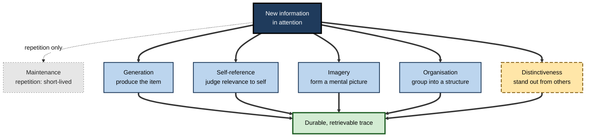
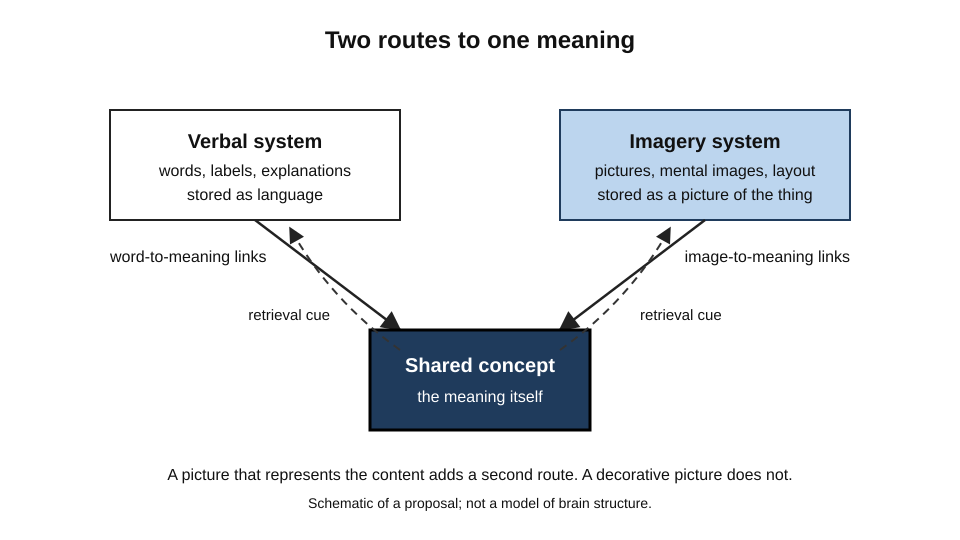
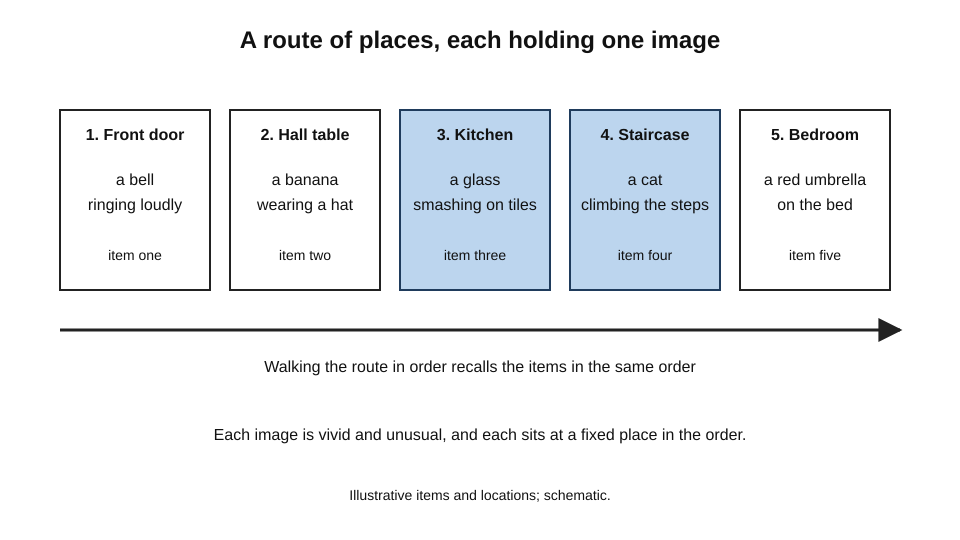
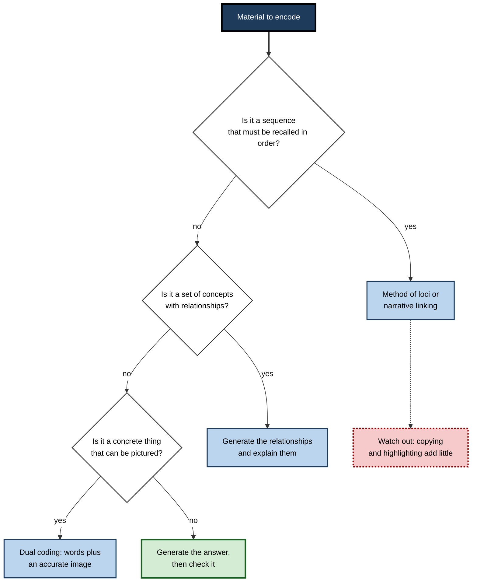

# B.4. Encoding: How We Store Information

Two students sit through the same forty-minute lecture on the causes of inflation. One copies the slides line by line; the other pauses to ask how the argument would apply to the price of bread in their own town, then sketches a short chain of cause and effect in the margin.

A week later the first student recognises the slides but struggles to explain the mechanism, while the second reconstructs the argument from scratch. Nothing about the lecture differed between them. What differed was the processing each student performed while the material was in the short-term store, and that processing determined what could later be retrieved. Encoding is the name for the processes that turn a passing experience into a stored trace, and the way it is done matters at least as much as how long it lasts.

> **Definition — Encoding:** the mental processing that converts information currently in attention into a stored representation, which later retrieval can use. The quality of a stored trace depends on what the information was connected to, how distinct it was, and what the learner did with it.

**Why it matters for learning**

- Encoding is the step at which most learning is decided. A failure to encode cannot be repaired by better retrieval practice, because there is nothing to retrieve.
- Encoding choices are usually made without awareness. Learners tend to copy, highlight and re-read, which are weak encoding operations, and they are often confident that they have encoded material well.
- Encoding and retrieval are linked. The features that are stored determine which cues will later bring the information back, which is why the same material can be easy to recall in one setting and invisible in another.
- Encoding strategies can be chosen deliberately. Once the operations that work are understood, a learner or designer can build them into study and instruction.

---

## What Encoding Does

Encoding has at least three outcomes that a teacher or a learner can influence.

- **Strength** — how much processing the information receives.
  - Brief exposure produces a weak trace; repeated and sustained processing produces a stronger one.
- **Meaning** — how the information is connected to what is already known.
  - A new fact that links to existing knowledge is easier to find later than an isolated one.
- **Distinctiveness** — how much the trace differs from other traces.
  - An item that stands out from its surroundings is more likely to be retrieved than one that blends in.

> **Key point:** strength alone is not enough. Two traces can receive the same amount of processing and yet differ greatly in durability, because one is connected to meaning and the other is not.

### Maintenance and elaboration

Two operations dominate the encoding of new information, and they differ sharply in what they achieve.

- **Maintenance** — repeating information in order to keep it active. It keeps information available for the moment and does little to build a durable trace.
  - *e.g.* silently repeating a phone number until it is typed.
- **Elaboration** — adding meaning by connecting information to other knowledge, examples or reasons.
  - *e.g.* relating a new term to a process the learner already understands.

> **Definition — Elaboration:** processing that adds connections, examples, causes or implications to new information, so that the trace is linked to more of the learner's existing knowledge.

> **Watch out:** elaboration is not the same as adding information. A long paragraph that the learner reads passively is not elaborated in the relevant sense. Elaboration requires the learner to do something with the material, such as explaining it, comparing it or deciding how it applies.

---

## Operations That Build Durable Traces

Research on encoding has identified several operations that reliably improve later retention. Each works by a different route, and they can be combined.

### Generation

**Study card — Slamecka and Graf (1978)**

- **Design:** participants were given rules, such as producing a synonym, together with a cue and the first letter of a target word. Some participants produced the target word themselves; others read the completed pair. Later memory was tested with recognition and recall tasks.
- **Results:** words that participants had generated were remembered better than words they had only read, on the memory tests used.
- **Conclusion:** producing an item from its cues creates a stronger trace than receiving it.
- **Status:** the generation effect is well established for many kinds of material, but its size varies, and it does not appear under every condition.

> **Definition — Generation effect:** the finding that information a learner produces, from cues or rules, is remembered better than the same information that the learner only reads.

> **Example (illustrative):** a trainee support agent given the rule "for a connection problem, first check the router's status light" who must state the next step before seeing it will remember the step more reliably than one who only reads the procedure.

### Self-reference

**Study card — Rogers, Kuiper and Kirker (1977)**

- **Design:** participants judged whether adjectives described themselves, and in other conditions judged the same words for their structure, sound or meaning in a more neutral way. A later unexpected recall test measured retention.
- **Results:** words judged for their relevance to the self were recalled better than words processed for form or sound. Meaning-based judgements about other things produced a smaller advantage.
- **Conclusion:** information linked to the self is encoded richly and is easier to retrieve.
- **Status:** the self-reference effect is widely reported. Klein and Kihlstrom (1986) argued that much of the advantage may come from the organisation that self-referential judgements impose, rather than from the self as such. The debate concerns the mechanism, not the existence of the effect.

### Dual coding

> **Definition — Dual coding:** Allan Paivio's (1971) proposal that information can be stored in a verbal system, for words and their meanings, and an imagery system, for pictures and mental images. Concrete material is often encoded in both systems, which gives it more routes to retrieval.

- Paivio's work showed that concrete words, which evoke images easily, were usually recalled better than abstract words.
- The theory predicts that material encoded both verbally and as an image has more retrieval routes than material encoded in one form.
- The evidence supports the general claim that imagery helps for many kinds of material, but dual coding does not mean that any picture improves learning. A decorative image that does not represent the content adds little.

**Figure 1.** Operations that encoding can use, grouped by the kind of processing each one involves.

**Figure 2.** A dual coding schematic: verbal and imagery routes converge on one concept.

### Organisation and distinctiveness

- **Organisation** — grouping items into categories or hierarchies at encoding. Gordon Bower and colleagues (1969) reported that lists whose words were arranged into hierarchical categories were recalled far better than the same words presented without structure. The organising structure gives the trace more retrieval routes.
- **Distinctiveness** — an unusual item is recalled better than an ordinary one in a list of ordinary items. This is the isolation effect, first reported by Hedwig von Restorff in 1933.
- **Caution** — distinctiveness helps only while the surrounding material remains encoded. If everything is made unusual, the isolation advantage disappears.

> **Definition — Isolation effect (von Restorff effect):** the better recall of an item that differs from the others in a list.

---

## Encoding Through Imagery and Places

### The method of loci

The method of loci is an ancient technique in which a learner imagines a familiar route and places vivid images of items to be remembered at successive locations along it. Recall proceeds by walking the route mentally.

- **Mechanism** — the route provides a fixed order and a set of retrieval cues; the images give each item a distinct and meaningful representation.
- **Evidence** — a 2025 systematic review and meta-analysis of the method found large effects on the recall of serial lists compared with rehearsal, but rated the quality of the evidence as low, mainly because of the risk of bias in the studies. The method is therefore effective in the studies examined, but the strength of that conclusion is limited.
- **Debate** — some researchers have questioned whether the spatial route is essential. Recent experiments that trained participants to use virtual environments found that navigation knowledge did not strongly predict verbal memory success, and suggested that the method may be best seen as a variant of peg methods, which use ordered cues. The working ingredient may be the ordered cues and the vivid images, rather than space itself.

> **Definition — Method of loci:** a mnemonic in which items are encoded as vivid images placed at successive locations along a familiar route, so that recall follows the route.

**Figure 3.** A route of locations, each holding one vivid image to be recalled in order.

### Narrative linking

- **Bower and Clark (1969)** found that presenting lists of words as stories, in which the words appeared in a meaningful sequence, produced far better recall than learning the same words as unrelated lists.
- The result is consistent with the general principle that meaningful organisation at encoding improves retrieval, and it has been used to explain why stories are easy to recall.
- The effect depends on the learner being able to construct or follow the links. Vague or arbitrary links provide less benefit.

---

## Choosing an Encoding Strategy

Not all strategies suit all material. A learner or designer can match the strategy to the kind of knowledge being encoded.

**Figure 4.** A decision path for choosing an encoding operation.

### Weak operations and why they persist

- **Copying and highlighting** — produce a sense of activity and a fluent feeling of familiarity, but add little meaning.
- **Re-reading** — increases fluency without deepening the trace.
- **Transcription without transformation** — writing out the words of a source keeps the content in the short-term store but does not change how it is stored.
- **Why they persist** — they are easy, they feel productive, and their effects appear during the session, when learners judge their own progress.

> **Watch out:** a note that reproduces a lecture word for word is a record of the lecture, not an encoded understanding of it. The test of encoding is whether the learner can use the material to answer a question they have not seen before.

---

## Worked Example: Encoding a Regulatory Requirement

**Situation:** a financial services analyst must remember a rule that a client's identity must be verified before any change to contact details is recorded.

1. **Maintain.** The analyst repeats the rule. The rule is now active, but this will not last.
2. **Generate.** The analyst writes the rule from memory without looking. Any gap shows where the trace is weak.
3. **Elaborate.** The analyst asks why the rule exists: a changed contact address could redirect a fraudster's access to the account. The rule is now connected to a reason and to a particular risk.
4. **Make distinctive.** The analyst notes that this rule is one of few that apply before a record is changed rather than after, and links it to the change-of-address form the analyst uses every day.
5. **Check.** The analyst applies the rule to two unfamiliar cases, one in which contact details are changed by a manager on the client's behalf.

**Figure 5.** How the five steps build a trace with several routes to retrieval.

```mermaid
%%{init: {'theme':'base','themeVariables':{'fontFamily':'Arial, Helvetica, sans-serif','fontSize':'15px','primaryColor':'#FFFFFF','primaryTextColor':'#111111','primaryBorderColor':'#222222','lineColor':'#333333','secondaryColor':'#F2F2F2','tertiaryColor':'#FFFFFF','clusterBkg':'#FAFAFA','clusterBorder':'#555555','edgeLabelBackground':'#FFFFFF','titleColor':'#111111'}}}%%
flowchart LR
    classDef core    fill:#1F3B5C,stroke:#000000,stroke-width:3px,color:#FFFFFF
    classDef key     fill:#BCD5EE,stroke:#1F3B5C,stroke-width:2px,color:#000000
    classDef detail  fill:#FFFFFF,stroke:#333333,stroke-width:1.5px,color:#000000
    classDef accent  fill:#FFE6A8,stroke:#7A5200,stroke-width:2px,stroke-dasharray:8 4,color:#000000
    classDef good    fill:#D3ECD3,stroke:#1E5E24,stroke-width:3px,color:#000000

    M["Maintain<br/>repeat the rule"]
    G["Generate<br/>write it from memory"]
    E["Elaborate<br/>why the rule exists"]
    D["Make distinctive<br/>tied to a daily form"]
    C["Check<br/>apply to new cases"]
    R["Routes to retrieval:<br/>reason, trigger, purpose"]

    M ==> G ==> E ==> D ==> C
    E -.-> R
    D -.-> R
    C ==> R

    class M detail
    class G key
    class E core
    class D accent
    class C key
    class R good
```

**Conclusion:** steps 2 to 4 build a trace that has more routes to retrieval than the repetition in step 1. Step 5 tests whether the trace transfers to new cases. Only the repetition alone would have left the analyst with a rule that was easy to recognise but hard to apply.

> **Watch out:** this sequence is a teaching illustration. In practice the steps overlap, and some learners need only one or two of them.

---

## Case Study (illustrative): Redesigning an Onboarding Module for Customer Service

- **Situation:** a telecommunications company ran a five-day onboarding course for new customer service staff. The course consisted of slides summarising procedures, followed by a quiz at the end of the week.
- **Problem:** in the first month, staff could describe procedures but often applied them incorrectly to real calls, particularly where two procedures looked similar.
- **Diagnosis:**
  - the slides were encoded passively, so the procedures were stored as statements rather than as actions;
  - the similar procedures had no distinctive features, so they were confused at retrieval;
  - the quiz tested recognition of the wording, which the slides had supplied.
- **Actions:**
  1. Replaced some slides with prompts: staff stated the next step of a call before it was shown.
  2. Added a short explanation of why each procedure existed, linked to a customer harm that the procedure prevented.
  3. Gave each of the two confusable procedures a distinctive trigger, such as the first question a customer asks.
  4. Used scenario questions that required staff to decide which procedure applied, rather than to recite it.
- **Result (illustrative):** in the following quarter, errors on the two confusable procedures fell, and new staff were more able to explain their choices to supervisors.
- **Side effects / caveats:** the redesigned course took longer to deliver, and the company's measure of success relied on supervisor judgement rather than a controlled comparison.
- **Lesson:** encoding is designed through the tasks learners perform during learning. Statements that are shown and recognised are not enough when the task later requires action.

---

## Open Questions

- **Which encoding operation is most effective for which kind of knowledge?**
  - Results differ across materials and tests, and a general ranking is not yet settled.
- **How much of the effect of meaning is due to organisation rather than the self or the meaning as such?**
  - The self-reference debate shows how difficult it is to separate mechanisms.
- **Does dual coding help beyond concrete material?**
  - Abstract concepts may benefit from different forms of representation, but the evidence is less clear.
- **How should encoding strategies be taught to learners who believe that copying and highlighting work?**
  - Learners often resist strategies that feel harder, and the best ways to change that belief are still being studied.

---

## Summary

- **Encoding** converts attended information into a stored trace whose quality depends on strength, meaning and distinctiveness.
- **Maintenance** keeps information active but builds little durable memory; **elaboration** links it to existing knowledge.
- **Generation** — producing information from cues — produces a stronger trace than reading it (**Slamecka and Graf, 1978**).
- **Self-reference** — judging information for its relevance to oneself — improves later recall (**Rogers, Kuiper and Kirker, 1977**), though the mechanism is debated.
- **Dual coding** (**Paivio, 1971**) proposes that verbal and imagery routes both support retrieval; accurate images help, decorative ones do not.
- **Organisation** and **distinctiveness** improve recall; the isolation effect was reported by von Restorff (1933).
- The **method of loci** and **narrative linking** provide structure and cues; the evidence for the method is large in effect but low in quality.
- Copying, highlighting and re-reading feel productive but add little meaning, and learners often overrate them.
- In practice, design encoding by requiring learners to produce, explain and distinguish the material.

---

## Self-Check

1. Define encoding and name three properties of a stored trace that depend on how encoding was done.
2. Distinguish maintenance from elaboration with an example of each.
3. Describe the design of the generation study and what it showed.
4. Why does generation help, and what does a learner need to produce for it to matter?
5. What did Rogers, Kuiper and Kirker's study show about self-relevant information, and what is the debate about it?
6. Explain dual coding and the condition under which a picture helps.
7. What is the isolation effect, and why does it stop working if everything is made distinctive?
8. Describe the method of loci and the main caution about the evidence for it.
9. Why do copying and highlighting persist as study habits despite adding little?
10. A trainer wants staff to remember two procedures that look alike. Propose a design that addresses encoding rather than repetition, and explain what each element does.
11. A learner says that because they wrote detailed notes, they have encoded the material well. What evidence would show whether this is true?
12. Why might an encoding strategy that works well for a word list fail to help with a complex, multi-step procedure?

### Answer Key

1. Encoding is the processing that converts attended information into a stored representation. Properties: strength (amount of processing), meaning (links to knowledge) and distinctiveness (difference from other traces).
2. Maintenance repeats information to keep it active, such as silently repeating a number. Elaboration adds meaning, such as relating a term to a known process.
3. Participants generated some target words from rules and cues and read others. Later recognition and cued recall were better for generated words, showing that producing an item creates a stronger trace.
4. Generation forces retrieval of the relationship between cue and target, creating a richer trace. The learner must produce the item from the cues; simply completing a blank that is shown does not provide the same benefit.
5. Adjectives judged for self-relevance were recalled better than those processed for form or sound. The debate is whether the advantage is specific to the self or results from the organisation that self-judgement imposes.
6. Dual coding proposes that verbal and imagery systems both store information. A picture helps when it accurately represents the content and adds a second route to retrieval; decorative pictures add little.
7. The isolation effect is better recall of an item that differs from the others in a list. If every item is made distinctive, no item stands out, so the advantage vanishes.
8. The method of loci places vivid images along a familiar route and recalls them by walking the route. Evidence shows large effects on serial recall in the studies reviewed, but the quality of that evidence was rated low.
9. They produce fluent familiarity and a sense of progress during study, while adding little meaning. Learners judge their progress by how they feel during study, which favours these habits.
10. Design: staff state the next step before it is shown (generation); each procedure is explained by its purpose (elaboration); each has a distinctive trigger (distinctiveness); and scenario questions require choosing between procedures (retrieval under realistic conditions). Each element targets a different encoding property.
11. Test the notes: ask the learner to answer questions the notes do not directly supply, after a delay, and compare with a learner who generated and explained the material. Detailed notes can be a record of the source rather than encoding.
12. A word list can be encoded by linking each item to a vivid image or neighbour, but a multi-step procedure requires the learner to encode the sequence, the conditions and the reasons, which need different operations such as explanation and practice in context.

---

## Glossary

| Term | Meaning |
|---|---|
| Dual coding | The proposal that verbal and imagery systems both store information. |
| Elaboration | Processing that adds connections, causes or examples to new information. |
| Encoding | Processing that converts attended information into a stored trace. |
| Generation effect | Better memory for information a learner produces than for information only read. |
| Isolation effect | Better recall of an item that differs from others in a list. |
| Maintenance | Repetition that keeps information active without building a durable trace. |
| Method of loci | A mnemonic placing images at successive locations along a familiar route. |
| Organisation | Grouping information into categories or structures at encoding. |
| Self-reference effect | Better recall of information judged for its relevance to the self. |
| Distinctiveness | The degree to which a trace differs from other traces. |
