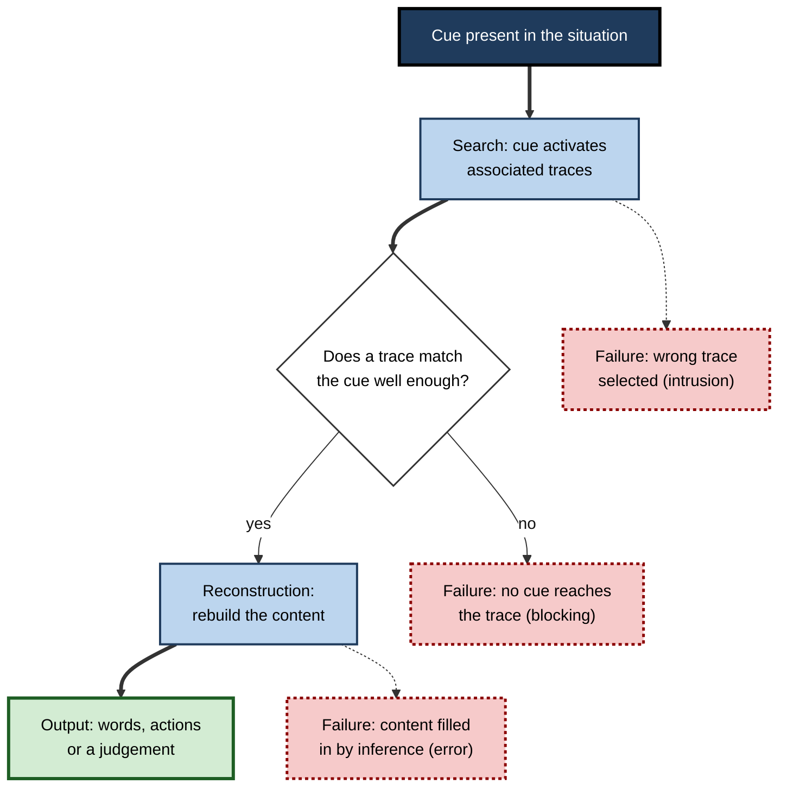
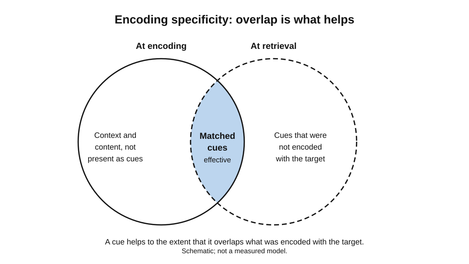
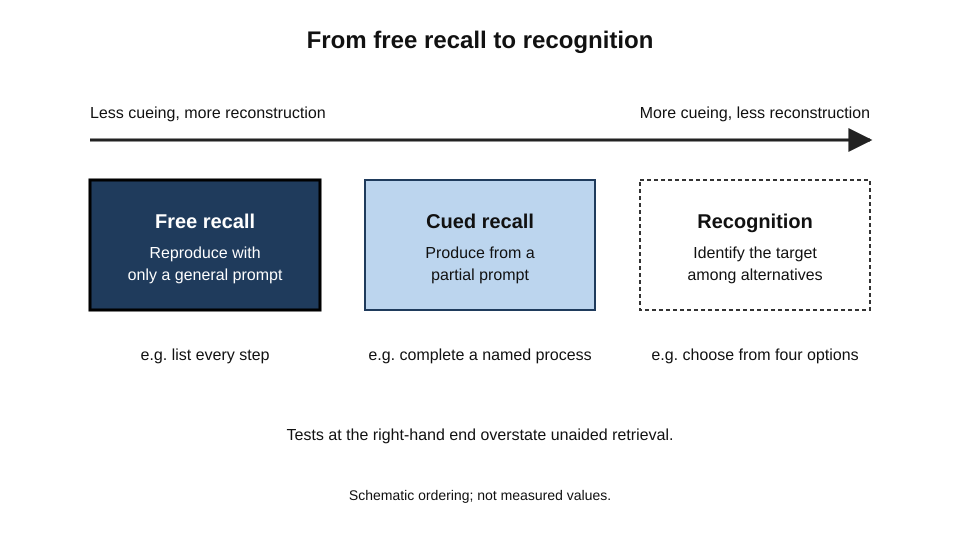
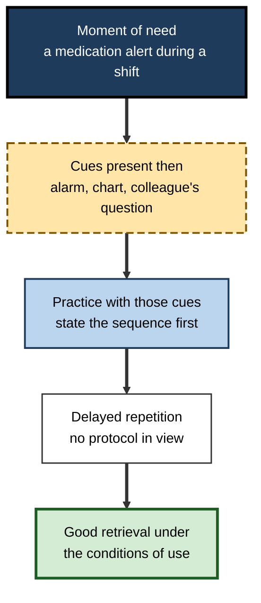

# B.5. Retrieval: Accessing Stored Knowledge

In a hallway a colleague asks for the name of a client whose contract you reviewed last spring. You know the name; you can almost feel its first syllable; you can picture the grey office where the meeting took place.

Yet the name will not come. Thirty seconds later, on the train home, it returns unbidden. Another day, a student confidently recalls an answer that turns out to be the wrong one, because it is the answer to a neighbouring question. Both failures involve knowledge that is stored but not reaching the mind when it is needed. Retrieval is the set of processes that bring stored information back into use, and a great deal of what people call forgetting is in fact a failure of retrieval.

> **Definition — Retrieval:** the process of using cues to reactivate a stored representation so that it can be used in thought or action. Retrieval succeeds when the cues available at the moment of need are sufficient to reach the stored trace and to reconstruct the information from it.

**Why it matters for learning**

- A stored memory is useful only when it can be accessed at the right time. A learner who has encoded a procedure but cannot retrieve it during a live incident has not learned it in any practical sense.
- Retrieval is itself a learning event. The act of bringing information back changes the trace, which is why retrieval practice is among the most robust findings in the study of learning.
- Retrieval is reconstructive. What comes back is not always an exact copy of what went in, and errors can be produced by the retrieval process itself.
- Many everyday judgements about knowledge rest on retrieval. A person's confidence that they know something depends partly on how easily it comes to mind, which can mislead them.

---

## The Retrieval Process

Retrieval can be described as a sequence of steps, each of which can fail.

1. **Cue** — something in the current situation, or something the person generates, serves as a retrieval cue.
2. **Search** — the cue activates associated representations in the stored network.
3. **Match** — a representation is judged to fit the cue well enough to be selected.
4. **Reconstruction** — the selected representation is used to rebuild the information, which may combine stored content with inference.
5. **Output** — the reconstructed information is expressed, in words, actions or judgements.

**Figure 1.** The steps of retrieval, with the points at which each can fail.

### Cues and the context of recall

- **Cue** — any feature of the situation that helps the search, such as a word, a place, a feeling or a question.
- **Cue strength** — how well a cue matches the content of the trace. A cue that matches a trace's distinctive features is strong; a generic cue is weak.
- **Context** — the physical and mental setting in which retrieval occurs. Context is one of the cues that the search uses, and its effect is strongest when it matches the context at encoding.

> **Definition — Encoding specificity:** the principle that retrieval depends on the overlap between the information present at encoding and the cues present at retrieval. Endel Tulving and Donald Thomson (1973) argued that a cue is effective to the extent that it was encoded with the target.

**Figure 2.** Encoding specificity as the overlap between what was encoded and what is available as a cue.

---

## Recall, Recognition and the Cue Spectrum

Retrieval tasks differ greatly in how much they help the searcher. Ordered from most to least demanding, the common forms are free recall, cued recall and recognition.

- **Free recall** — reproducing the information with no prompt except a general instruction.
  - *e.g.* listing every step of a procedure from memory.
- **Cued recall** — producing the information from a partial prompt.
  - *e.g.* completing a sentence that begins with the name of a process.
- **Recognition** — identifying the target among alternatives.
  - *e.g.* choosing the correct description of a process from four options.

> **Key point:** recognition is usually easier than recall because the options provide the cue, and the recognition judgement may rest on a feeling of familiarity without any reconstruction. Tests that rely on recognition therefore overstate what a person can retrieve unaided.

**Figure 3.** Retrieval tasks ordered by how much cueing they provide, and how much reconstruction they demand.

> **Watch out:** a high score on a recognition test is not evidence of fluent recall. A trainer who measures knowledge only with multiple-choice questions is measuring a different capacity from one who measures it with unprompted action.

---

## Failures of Retrieval

### Tip-of-the-tongue

> **Definition — Tip-of-the-tongue state:** a feeling of knowing a word or name that cannot be produced, often accompanied by partial recall of its first letter, its sound or its meaning.

Roger Brown and David McNeill (1966) asked people to define uncommon words and recorded the states they reported when they could not produce the word. Many participants could report the number of syllables, the first letter, or similar words, even when the target did not come. The state is best understood as partial activation of the target representation: enough is available to produce the feeling, but not enough to complete retrieval.

### Blocking and interference

- **Blocking** — a strongly activated but incorrect item prevents retrieval of the target.
  - *e.g.* a previous supplier's name blocks the name of the current one.
- **Interference** — similar items compete, so each makes the others harder to reach.
  - *e.g.* two procedures for similar forms are retrieved in place of one another.
- **Retrieval-induced forgetting** — practising retrieval of some items in a category can make other items in the same category harder to recall later.

**Study card — Anderson, Bjork and Bjork (1994)**

- **Design:** participants learned category–exemplar pairs (such as fruit and its names). Some exemplars were practised repeatedly through retrieval, others from the same categories were not practised, and exemplars from categories that were never practised served as a baseline. Later memory was tested for all items.
- **Results:** practised items were recalled well, but unpractised exemplars from the same categories were recalled less well than items from categories that had not been practised.
- **Conclusion:** strengthening one item by retrieval can weaken its competitors, which is a form of interference produced by retrieval itself.
- **Status:** the retrieval-induced forgetting effect has been widely replicated, though its size and boundary conditions are still studied.

> **Example (illustrative):** a team practises one way of handling a common customer complaint in role-play. Later, a different and equally valid approach for a related complaint is harder to recall, because the practised approach has become the default.

### Reconstruction and error

Retrieval does not simply play back a recording. The content is rebuilt from the trace and from general knowledge, and the rebuilding can introduce details that were never encoded.

**Study card — Loftus and Palmer (1974)**

- **Design:** participants watched a short film of a car accident and then answered questions about it. The verb in one question varied across groups: some were asked how fast the cars were going when they "hit" each other, others when they "smashed" or "contacted" each other, and so on.
- **Results:** the verb influenced estimates of speed. Participants who heard "smashed" gave higher speed estimates than those who heard "hit". In a follow-up, the verb also influenced the chance that participants later reported broken glass, although none had been shown.
- **Conclusion:** information supplied after an event can be incorporated into the retrieved memory, so the memory is partly reconstructed at the moment of recall.
- **Status:** a classic result that has been replicated in many variations. Researchers continue to debate how far it generalises to important real-world events, and the size of the effect depends on conditions.

> **Watch out:** the misinformation effect does not mean that memories are arbitrary. Many retrieved details are accurate. The lesson is that confidence in a retrieved detail is not a reliable indicator of its accuracy when the retrieval conditions include suggestion.

---

## Why Retrieval Strengthens Memory

Retrieval is not only a way of testing what is stored. Successful retrieval appears to change the trace, making it easier to retrieve later.

**Study card — Roediger and Karpicke (2006)**

- **Design:** participants read prose passages. In one condition they studied the passage repeatedly. In another they studied it once and then took one or more free-recall tests without feedback. Final retention was tested after five minutes, two days or one week.
- **Results:** at the five-minute test, repeated study outperformed repeated testing. At the later tests, the pattern reversed: prior testing produced clearly better retention than repeated study, even though students who had restudied felt more confident about what they could remember.
- **Conclusion:** retrieval does more than measure learning; it produces lasting learning. Feelings of confidence after restudy are a poor guide to delayed retention.
- **Status:** replicated across many materials and settings. The size of the benefit depends on the test format and the delay, and it is greater for delayed tests than for immediate ones.

> **Definition — Retrieval practice effect (testing effect):** the finding that retrieving information from memory improves later retention more than an equivalent period of restudying the same material.

Karpicke and Blunt (2011) compared retrieval practice with a popular elaborative method, concept mapping, using science texts. Students who practised retrieving the material outperformed those who built concept maps on a later test of understanding, including a test that asked them to produce maps. The finding suggests that the benefit of retrieval is not confined to recall of isolated facts.

**Figure 4.** Restudy and repeated testing compared over delays, schematic of the direction of the effect.

### Why the effect works

- **Effort** — retrieval is harder than re-reading, and the difficulty appears to strengthen the trace. This is a desirable difficulty: it slows short-term performance but improves long-term retention.
- **Reconsolidation of the trace** — a retrieved trace is rebuilt and may be stored with new connections. Neural accounts of this change are not settled; the functional point is that retrieval changes what is stored.
- **Discrimination** — retrieval practice shows which parts of a memory are weak, so attention moves to them.

---

## Context and the Conditions of Retrieval

**Study card — Godden and Baddeley (1975)**

- **Design:** deep-sea divers learned a list of words either on land or underwater, and were then tested either in the same environment or the other one.
- **Results:** recall was better when learning and testing took place in the same environment.
- **Conclusion (original authors):** the physical context at learning was taken to be part of the cue set, so a mismatch reduces retrieval. The later replication (below) did not support this.
- **Status:** a widely cited result that has not held up consistently. A 2021 replication with sixteen divers did not find the advantage for recall in the learning context, and replications of context-dependent memory more generally have been mixed. The general principle that retrieval depends on the match between cues and the conditions of encoding rests more securely on encoding specificity research.

> **In practice:** a manager who trains staff in a classroom and expects them to act on the training in a noisy shop floor may find retrieval weaker than the training suggested. Practice in conditions close to the real task helps retrieval where it is needed.

**Worked example (illustrative): planning a retrieval-friendly training scenario**

1. **Identify the moment of need.** A nurse must recall the sequence for a medication alert during a busy shift.
2. **Identify the cues present then.** The alert sound, the patient's chart, the colleague's question.
3. **Design practice with those cues.** Scenarios include the alert sound and an interruption, and learners must state the sequence before checking the protocol.
4. **Add a delay.** The scenario is repeated after a week, without the protocol in view.

**Figure 5.** The planning sequence for a retrieval-friendly scenario.

**Conclusion:** the design puts retrieval under the conditions where retrieval must succeed. Practice in a quiet room with the protocol open would produce a different and weaker retrieval.

---

## Case Study (illustrative): A Maintenance Team's Procedure Recall

- **Situation:** an industrial maintenance team had a detailed procedure for isolating a pump before servicing. Staff completed a classroom course and passed a written test.
- **Problem:** in practice, two of six isolation steps were often skipped. Supervisors found that staff could describe the steps when asked, but in the field the steps did not come to mind.
- **Diagnosis:**
  - the training was entirely recognition-based, with multiple-choice questions and a reading of the procedure;
  - the field context (noise, time pressure, a partly open valve) was absent from practice, so the cues at the moment of need were not those trained;
  - the two skipped steps were similar to other steps in the procedure, and were subject to interference.
- **Actions:**
  1. Replaced the written test with a timed practice on a training rig, in which staff isolated the pump from memory and then checked the procedure.
  2. Introduced a short scenario at the start of each shift, asking staff to state the next two steps before starting work.
  3. Repeated the rig practice after two weeks, and again after six weeks.
- **Result (illustrative):** skipped steps fell over the following quarter, and staff were more able to state the sequence unaided when observed.
- **Side effects / caveats:** the rig practice took time away from production; the team did not compare with a control group, so the effect of each change cannot be separated.
- **Lesson:** knowledge that is tested only by recognition may not be available at the moment of need. Retrieval practice under realistic cues, repeated after delays, addresses that gap.

---

## Open Questions

- **Why does retrieval practice benefit long-term retention more than short-term performance, and is the explanation the same across material types?**
  - Desirable difficulty, discrimination and reconsolidation have all been proposed, and their relative importance is unclear.
- **How large is the retrieval-induced forgetting effect in everyday learning, where many items are practised at once?**
  - Laboratory conditions are simpler than the competition among items in real work.
- **How much of the misinformation effect applies to important real-world memories?**
  - The laboratory effect is clear, but its size in consequential events is debated.
- **How far does context-dependent retrieval hold in complex, realistic settings?**
  - The effect has been less consistent than early studies suggested, and the conditions that matter most are not yet well specified.

---

## Summary

- **Retrieval** uses cues to reactivate stored traces, through search, match, reconstruction and output, and each step can fail.
- **Recognition** is easier than **recall** because the options supply cues; recognition tests overstate unaided retrieval.
- **Tip-of-the-tongue** states show partial activation; **blocking** and **interference** show competition among traces.
- **Retrieval-induced forgetting** (**Anderson, Bjork and Bjork, 1994**) shows that practising some items can weaken related ones.
- **Reconstruction** can introduce errors, shown by **Loftus and Palmer (1974)** in the misinformation effect.
- **Encoding specificity** means that a cue helps to the extent that it matches what was encoded.
- **Retrieval practice** improves delayed retention more than restudy (**Roediger and Karpicke, 2006**), and the benefit extends to understanding (**Karpicke and Blunt, 2011**).
- **Context** can aid retrieval when it matches learning conditions; the evidence for context effects is mixed in size.
- In practice, design practice around the cues present at the moment of need, and test after delays.

---

## Self-Check

1. Describe the five steps of retrieval and one way each can fail.
2. Why is recognition an unreliable guide to unaided recall?
3. What is a tip-of-the-tongue state, and what does it suggest about how retrieval works?
4. Explain retrieval-induced forgetting and give an example from work.
5. What did Loftus and Palmer's study show about reconstruction, and what is the limit of its lesson?
6. Describe the design of the Roediger and Karpicke study and the reversal in its results.
7. Why might confidence after restudy be a poor guide to later retention?
8. State the encoding specificity principle in your own words.
9. Explain why context can affect retrieval, and what the practical implication is.
10. A training provider reports that its course is effective because trainees score highly on multiple-choice quizzes. Identify two weaknesses in the evidence and propose a better measure.
11. A supervisor wants staff to retrieve a safety sequence reliably during emergencies. Design a practice schedule and explain the reasons for each element.
12. Why might retrieval practice help understanding as well as recall of facts?

### Answer Key

1. Cue (a feature of the situation or a generated prompt); search (the cue activates associated traces); match (a trace is judged to fit); reconstruction (the content is rebuilt); output (the content is expressed). Failures: no cue reaches the trace; the wrong trace is selected; content is filled in wrongly.
2. Options supply cues, and recognition can rest on familiarity rather than on rebuilding the content, so high recognition scores do not show that a person can produce the content unaided.
3. It is a feeling of knowing a word that cannot be produced, often with partial information such as its first letter. It suggests that the target is partly activated, and that retrieval can fail even when much of the trace is available.
4. Practising retrieval of some items in a category can make related unpractised items harder to recall, because the practised items compete with them. Example: practising one approach to a complaint makes an equally valid alternative harder to recall later.
5. Post-event information, such as a verb in a question, altered later estimates and reports, showing that memory is partly rebuilt at recall. The lesson does not imply that memories are arbitrary; it shows that suggestion can change retrieved details, and confidence does not guarantee accuracy.
6. Participants studied passages repeatedly or studied once and were tested. At an immediate test, restudy was better; at delayed tests, prior testing gave better retention, even though restudy made participants more confident.
7. Restudy produces a sense of familiarity and fluency that feels like knowledge but does not predict delayed retention well.
8. Retrieval depends on the overlap between what was present at encoding and the cues present at retrieval; a cue is effective to the extent that it was encoded with the target.
9. Context forms part of the cue set; when conditions at retrieval match those at learning, retrieval is easier. The practical implication is to practise in conditions close to the real task.
10. Weaknesses: recognition-based tests overstate unaided recall; the immediate timing gives no evidence about retention; the test may match the training wording. Better measure: a delayed, unaided task in a realistic setting, with new examples and a comparison group.
11. Practice the sequence under realistic cues (noise, time pressure, an interruption), require staff to state steps from memory before checking, and repeat after delays. Each element targets a part of the retrieval process: cue match, search, and durability.
12. Retrieval requires the learner to reconstruct and apply relationships, not only to produce isolated words. Practising retrieval of explanations and applications strengthens the links that understanding depends on.

---

## Glossary

| Term | Meaning |
|---|---|
| Blocking | A strongly activated incorrect item that prevents retrieval of the target. |
| Cue | A feature of the situation or a generated prompt that helps the search for a stored trace. |
| Cued recall | Producing information from a partial prompt. |
| Encoding specificity | The principle that a cue is effective to the extent that it was encoded with the target. |
| Free recall | Reproducing information with only a general instruction. |
| Interference | Competition among similar items that makes each harder to retrieve. |
| Recognition | Identifying a target among alternatives. |
| Reconstruction | Rebuilding retrieved content from a trace and general knowledge. |
| Retrieval | Using cues to reactivate a stored representation for use. |
| Retrieval-induced forgetting | Weakening of unpractised related items caused by retrieval practice on others. |
| Retrieval practice effect | Better long-term retention from retrieving information than from restudying it. |
| Tip-of-the-tongue state | A feeling of knowing a word that cannot yet be produced. |
