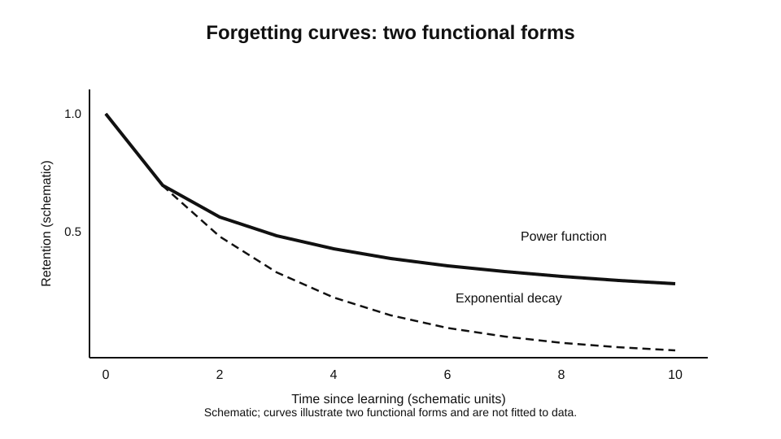
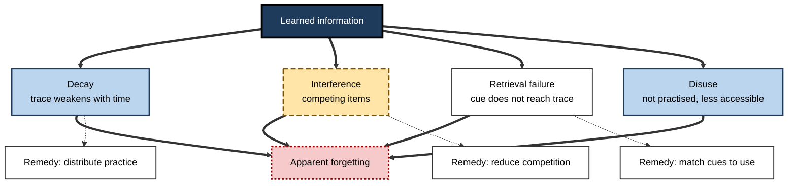
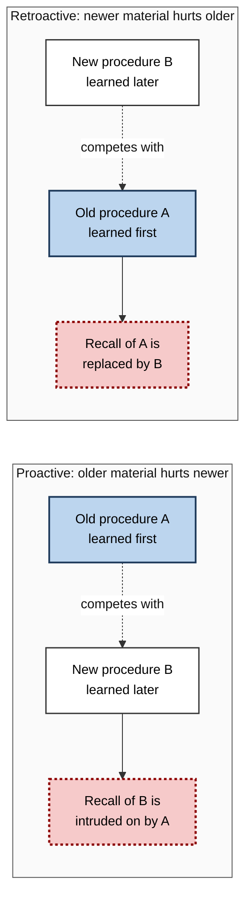
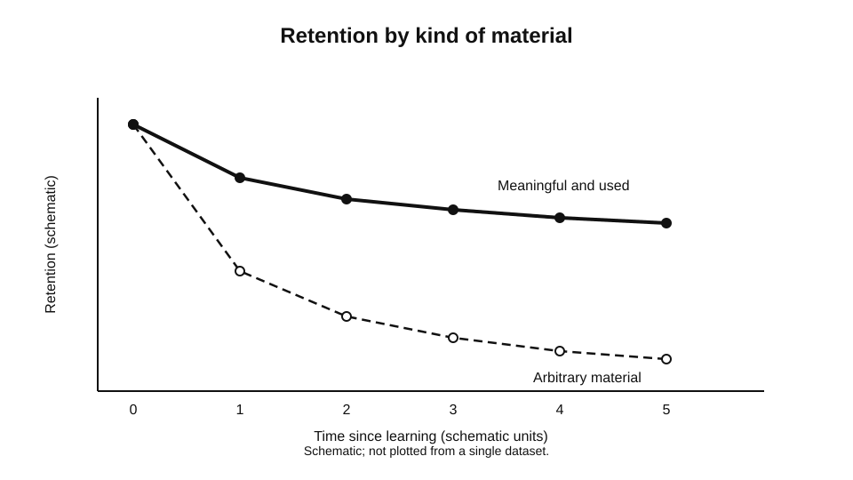
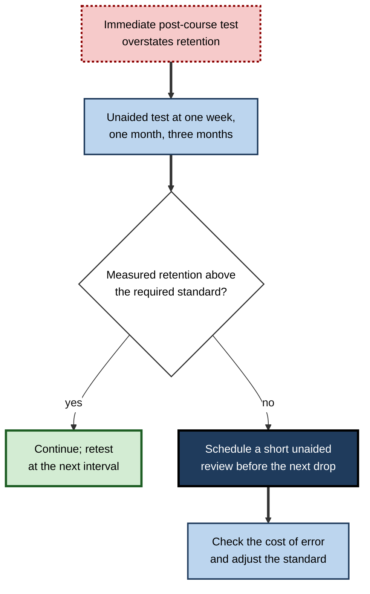

# B.6. Forgetting and the Forgetting Curve

A trainee learns a supplier-approval procedure on Monday and passes the test on Friday. By the following Monday, the trainee cannot describe the second step, although the first and last steps come back immediately when prompted. Nothing dramatic happened in between, and the trainee did not stop caring about the work.

Forgetting of this kind is so ordinary that it is easy to treat as a personal failing, yet its shape is orderly. Most of the loss happens soon after learning, the rate of loss slows over time, and the amount lost depends on what was learned, how it was learned and what happened afterwards. The forgetting curve is the name for this orderly pattern, and understanding it is essential for judging how long learning will last.

> **Definition — Forgetting:** the loss of access to information that was once known or learned, observed as a reduced ability to recall, recognise or use it. Forgetting is inferred from performance, and it can be partial: information may be unavailable on one test and recoverable on another.

**Why it matters for learning**

- A learning outcome is only meaningful for the period over which it lasts. A course that produces knowledge which is gone within a month has taught something quite different from one whose effects last for years.
- The shape of the forgetting curve tells planners when retention is most at risk, and therefore when checks and refreshers are most useful.
- Different causes of forgetting call for different remedies. Loss by decay, interference and failed retrieval are not solved by the same changes to practice.
- Learners who expect to remember what they have just studied tend to misjudge their own retention. Understanding the curve corrects that expectation.

---

## Ebbinghaus and the First Curve

Hermann Ebbinghaus was the first to measure forgetting systematically. Working in the 1880s, he learned lists of nonsense syllables, such as meaningless consonant-vowel-consonant strings, and measured how much of each list he could recall after intervals ranging from minutes to days. His 1885 monograph reported the basic pattern, which has been reproduced many times since.

> **Definition — Forgetting curve:** a plot of retention against the time elapsed since learning. It typically shows a rapid loss in the first period after learning, followed by a slower decline that continues over longer intervals.

**Study card — Ebbinghaus (1885)**

- **Design:** Ebbinghaus studied himself. He learned lists of nonsense syllables to a fixed standard, then relearned each list after intervals of different lengths. He recorded the effort saved on relearning, which he called the savings measure, as well as direct recall.
- **Results:** savings fell steeply over the first hours and days, then more gradually over longer intervals. Relearning was faster than original learning even when little could be recalled directly.
- **Conclusion:** forgetting has a characteristic shape that is orderly and not random, and some traces persist beyond the point at which they can be recalled unaided.
- **Status:** a foundational result, based on a single very practised participant and on nonsense material. Its generality depended on later replication.

In 2015, Murre and Dros repeated Ebbinghaus's procedure with the savings measure over an interval from about twenty minutes to about a month, and reported that the curve was reproduced closely, with a possible small upturn near the one-day point. The replication strengthened confidence in the basic shape, though it does not establish that every kind of material follows the same curve.

> **Watch out:** the forgetting curve describes averages across conditions and materials. An individual's curve can differ greatly, and a single curve drawn for one person's data is an example, not a law.

---

## The Shape of the Curve

Two broad families of mathematical function have been proposed to describe the curve.

- **Exponential decay** — retention falls by a constant proportion over each equal interval. The rate of loss is highest at first and then declines in absolute terms.
- **Power function** — retention falls quickly and then ever more slowly, so that the curve flattens in a way that continues over long periods.

**Study card — Wixted and Ebbesen (1991)**

- **Design:** the researchers analysed forgetting data from word recall and face recognition in humans and from delayed matching in pigeons, and reanalysed Ebbinghaus's savings data.
- **Results:** the power function described retention better than several alternatives, including the exponential, across these datasets.
- **Conclusion:** long-term retention follows a pattern in which early loss is steep and later loss is gradual, which fits a power law more closely than a simple exponential.
- **Status:** influential, but the choice between functions remains debated. Anderson and Tweney (1997) argued that averaging exponential curves across subjects can produce an apparent power curve, and Wixted and Ebbesen (1997) replied that individual subjects' forgetting functions are better described by a power function.

> **Key point:** the practical message is the same whichever function is preferred. Most of the loss happens early, so the period immediately after learning is the most important window for consolidation and review, and the loss that remains after a long interval tends to be slower and more stable.

**Figure 1.** A schematic forgetting curve compared with an exponential and a power-law shape.

---

## Why Forgetting Happens

Several processes can produce forgetting, and they often operate together.

- **Decay** — the trace weakens over time, if it is not used. The idea is widely held but has been difficult to isolate, because time passes alongside other events that interfere with memory.
- **Interference** — other information competes with the target, either before it was learned or after.
- **Retrieval failure** — the trace remains but the cues available at the moment of need do not reach it.
- **Disuse** — information that is not used is less likely to be accessed, even if the trace is intact.

**Figure 2.** The main causes of forgetting, and what each one implies.

---

## Interference

Interference is one of the most consistently demonstrated causes of forgetting in laboratory studies, and it is also central to many real-world errors.

> **Definition — Proactive interference:** the disruption of learning or recall of new information by previously learned, similar information.

> **Definition — Retroactive interference:** the disruption of recall of previously learned information by new, similar information learned afterwards.

**Study card — Underwood (1957)**

- **Design:** participants learned many lists of verbal material, and the number of lists learned before a target list was varied. Recall of the target list was then tested after a delay.
- **Results:** the more lists a person had learned earlier, the lower the recall of the later target list.
- **Conclusion:** much apparent forgetting was attributed to proactive interference, that is, competition from earlier learning.
- **Status:** an influential result in the study of proactive interference. Later critics argued that the decline may reflect differences in how well the earlier lists were learned, not interference alone.

**Figure 3.** Proactive and retroactive interference, shown as the direction in which similar material competes.

> **Example (illustrative):** an engineer who has used one software product for years struggles for a while after moving to a new one with similar menus. The old menu paths intrude on the new ones (proactive), and the new paths make the old ones harder to recall when the engineer returns to the first product (retroactive).

> **Watch out:** interference is not always a sign of poor learning. Similar material learned in the same context is often the most interfering, so the amount of interference depends heavily on how the material is organised for the learner.

---

## Forgetting in Meaningful Material

Ebbinghaus used nonsense syllables to avoid the influence of prior knowledge. Real knowledge is different: its meaning, its connections and its use over time shape how long it lasts.

**Study card — Bahrick (1984)**

- **Design:** adults who had studied Spanish at school were tested many years later on their retention, using recognition and recall of vocabulary and other material, and compared with the level of their original learning and the grades they had received.
- **Results:** many participants retained a considerable amount of the material decades after leaving school. Recognition was more durable than recall. Retention depended on the level of original training and on the grades received. Over the first three to six years the retention curve fell steeply, and it then changed little for up to thirty years. Most participants had rehearsed so little that rehearsal effects could not be detected.
- **Conclusion:** meaningful, well-learned material can persist for many years, and the persistence depends on the original depth of learning and on the form of test used.
- **Status:** the notion of a stable long-term store for well-learned material is often called permastore. The findings are widely cited, although the specific proportions depend on the test and the sample.

> **Key point:** material that is meaningful and deeply learned tends to show much slower forgetting than material that is merely memorised. The curve for practical knowledge is often much flatter than the curve for arbitrary material.

**Figure 4.** Schematic retention for arbitrary material and for meaningful, used material.

---

## The Forgetting Curve and Expectation

Learners tend to predict that they will remember what they have just learned, and they tend to be wrong about how fast loss occurs. A procedure that feels clear on the day of training can be difficult to recall a week later, because the feeling of clarity is driven by the recency of exposure rather than by the strength of the trace.

- **Recency** makes material feel known.
- **Immediate performance** — a test straight after training — reflects the state of the trace at its strongest, and so overstates retention.
- **Delayed testing** reveals the actual curve, and is the only reliable basis for judging how long learning will last.

> **Watch out:** a high score on an end-of-course test tells a planner about learning at the end of the course, not about learning in six weeks. Retention needs to be measured after an interval that matches the period over which the learning must last.

---

## Worked Example: Estimating When Review Is Needed

**Situation:** a regulatory team must keep a set of reporting rules accurate across the year. A training course is delivered in January.

1. **Identify the rate of loss.** The team assumes, for planning purposes, that a large share of the course content will be lost within the first month if it is not used, following the shape of the curve. The team does not know the exact figure for its own material, so it measures it.
2. **Measure retention at intervals.** Staff are tested unaided on a sample of rules at one week, one month and three months. The results are compared with the immediate post-course test.
3. **Fit the rate.** The team plots the results and examines how the loss is distributed over time. If loss is front-loaded, as the curve suggests, reviews are most valuable early.
4. **Schedule review.** A short unaided review at around the point where measured retention falls below the team's required standard is scheduled, and its results are used to adjust the schedule.

**Figure 5.** A review schedule derived from measured retention rather than assumed retention.

**Conclusion:** the team does not guess at the curve. It estimates it from its own material, and schedules review where the measured loss would otherwise be largest.

> **Watch out:** the team's rules for the threshold are a judgement, not a property of memory. The curve helps to place reviews, but the required standard depends on the risk of error in the work.

---

## Case Study (illustrative): Onboarding Retention in a Clinical Laboratory

- **Situation:** a clinical laboratory trained new technicians in a three-week programme on sample handling and quality checks. The programme ended with a practical assessment on the final day.
- **Problem:** after three months, supervisors found that technicians often skipped one quality check that had been taught and assessed. The error was not frequent, but it was serious when it occurred.
- **Diagnosis:**
  - the assessment was immediate, so it overstated retention;
  - the quality check was rarely used during the first months, so it was not practised;
  - the check was similar to another procedure used more often, so interference was a likely cause.
- **Actions:**
  1. Added unaided delayed tests at four weeks and twelve weeks, so retention would be visible to supervisors.
  2. Built the quality check into the daily workflow, with a prompt at the step where it applied, so that it was used regularly.
  3. Made the difference between the two similar procedures explicit, and practised the discrimination with examples.
- **Result (illustrative):** the omission rate fell over the following two quarters, and the delayed tests identified a group of technicians who needed a refresher, who were then given one.
- **Side effects / caveats:** the prompt added a step to each workflow, and the laboratory did not measure whether the prompt caused any new errors. The comparison was with the previous cohort only.
- **Lesson:** retention must be measured after an interval, and forgetting is best reduced by using the skill, separating it from its competitor and placing the cue where the skill is needed.

---

## Open Questions

- **Is decay a real cause of forgetting, separate from interference?**
  - Time is confounded with other events, so isolating decay experimentally remains difficult.
- **Which functional form describes long-term retention best?**
  - The power and exponential debate has not been fully resolved, and different materials may follow different curves.
- **How much of the permastore effect depends on the use of knowledge after learning?**
  - The findings show that the depth of original learning matters. The contribution of later use is not settled by those data, because most participants had rehearsed little.
- **How should forgetting be predicted for complex professional skills?**
  - Most curves come from simple materials; professional skills have many components that may decay at different rates.

---

## Summary

- **Forgetting** is the loss of access to learned information, inferred from performance and often partial.
- The **forgetting curve** shows steep early loss and slower later loss. **Ebbinghaus (1885)** described it, and **Murre and Dros (2015)** reproduced its basic shape.
- **Power** and **exponential** functions have been proposed to describe the curve; **Wixted and Ebbesen (1991)** favoured the power function.
- Causes include **decay**, **interference**, **retrieval failure** and **disuse**, and they call for different remedies.
- **Proactive** and **retroactive** interference show how similar material competes; **Underwood (1957)** showed that earlier learning can impair later recall.
- Meaningful, deeply learned material can persist for decades (**Bahrick, 1984**), which the permastore idea captures.
- Learners overestimate retention because recency creates a feeling of familiarity; delayed, unaided tests are the only reliable measure.
- In practice, estimate the curve from your own material, measure at intervals and place review where measured loss is largest.

---

## Self-Check

1. Define forgetting and explain why it is inferred from performance.
2. Describe the general shape of the forgetting curve and what it implies for when review matters most.
3. What did Ebbinghaus study, and what does his result suggest about traces that cannot be recalled?
4. Why did Murre and Dros's replication matter, and what does it not establish?
5. Distinguish exponential decay from a power function.
6. List four causes of forgetting and one remedy for each.
7. Distinguish proactive from retroactive interference with an example.
8. What did Underwood's study show about earlier learning and later recall?
9. Why does meaningful, well-used material often show a flatter curve than arbitrary material?
10. A training provider tests participants immediately after a course and reports a high pass rate as evidence of lasting learning. Explain the flaw and design a better measure.
11. A team's new procedure is confused with an older one. Using the interference concept, explain what is likely to be happening and propose two changes.
12. A manager asks how often refresher training should be scheduled. Outline how you would answer using the concepts of decay, interference and measured retention, and identify what information you would need.

### Answer Key

1. Forgetting is the loss of access to learned information. It is inferred because the trace cannot be observed directly, and it is judged from recall, recognition or use, which can be partial.
2. Loss is steep soon after learning and slower later. Review matters most early, because most loss occurs in that period.
3. Ebbinghaus learned nonsense syllables and measured recall and relearning after intervals. Relearning was faster even when little could be recalled, showing that some traces persist beyond recall.
4. It confirmed the basic shape of the curve with a method closely following the original, which strengthens confidence in the pattern. It does not establish that every material or learner follows the same curve.
5. Exponential decay loses a constant proportion over equal intervals. A power function falls quickly and then ever more slowly, so it often fits long-term data better.
6. Decay (remedy: practice to maintain traces); interference (remedy: separate or discriminate competing items); retrieval failure (remedy: practise retrieval with the cues of use); disuse (remedy: use the skill regularly).
7. Proactive: an old procedure disrupts recall of a newer one. Retroactive: a newer procedure disrupts recall of an older one. Example: a new expense form is confused with the old one when recalled.
8. The more lists learned before a target list, the lower the later recall of the target.
9. Meaningful material is connected to other knowledge, is deeply learned and is used, so the traces are supported by many routes and reinforced in practice. Arbitrary material lacks these supports.
10. The immediate test reflects the strongest state of the trace, not retention. A better measure is unaided testing at an interval matching the period over which the learning must last, with comparison to a control group if possible.
11. Interference is likely: the two procedures compete at retrieval. Changes: make the distinguishing features explicit and practise discrimination with examples; provide retrieval cues that point to the right procedure at the point of use.
12. The answer requires knowing the rate of loss for the material (measured by delayed tests at intervals), the required standard for accurate performance, and the consequence of error. Review would then be scheduled where measured retention falls below the standard. Information needed: the measured curve, the risk of error and the cost of training.

---

## Glossary

| Term | Meaning |
|---|---|
| Decay | Weakening of a trace over time, if it is not used. |
| Disuse | Reduced access to information that is not practised. |
| Exponential decay | A model in which retention falls by a constant proportion over equal intervals. |
| Forgetting | Loss of access to learned information, inferred from performance. |
| Forgetting curve | A plot of retention against time since learning. |
| Interference | Competition from similar information that disrupts recall. |
| Permastore | Long-lasting retention of well-learned, meaningful material. |
| Power function | A model in which retention falls quickly and then ever more slowly. |
| Proactive interference | Disruption of new learning by older, similar learning. |
| Retroactive interference | Disruption of older learning by newer, similar learning. |
| Retrieval failure | Loss of access because cues do not reach an intact trace. |
| Savings | Reduced effort on relearning, compared with original learning. |
