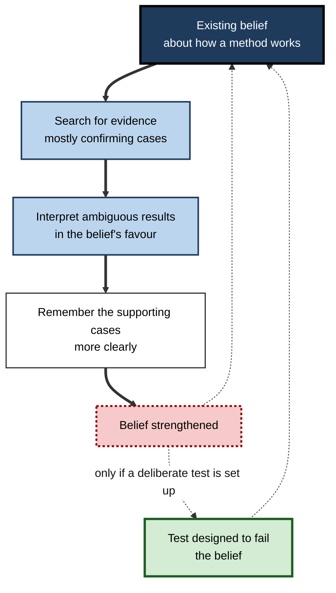
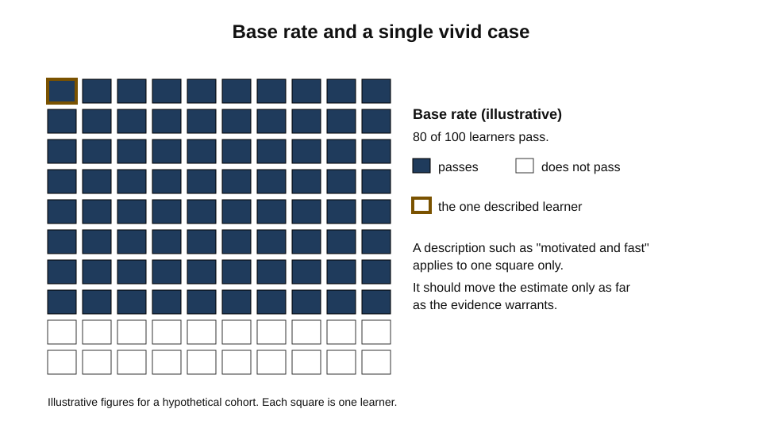
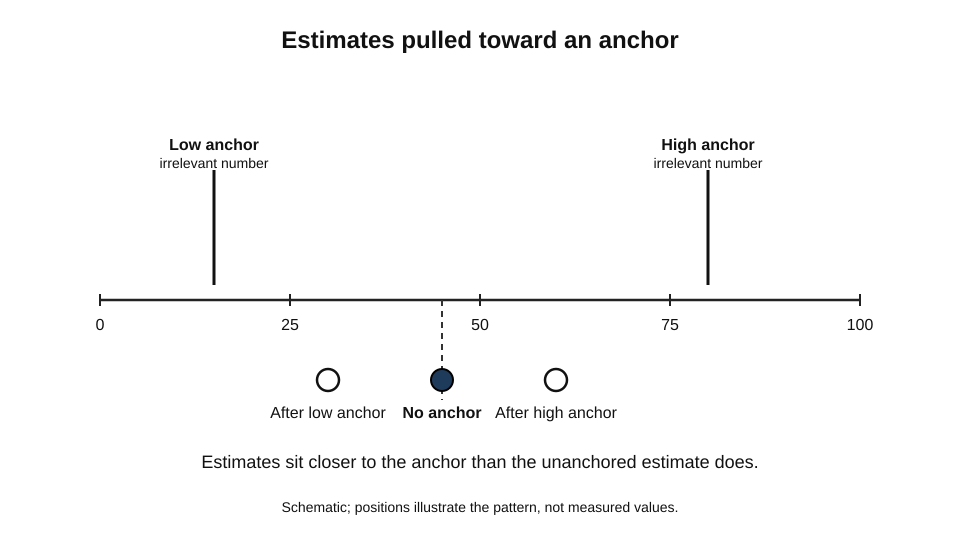
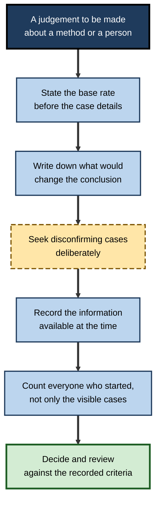
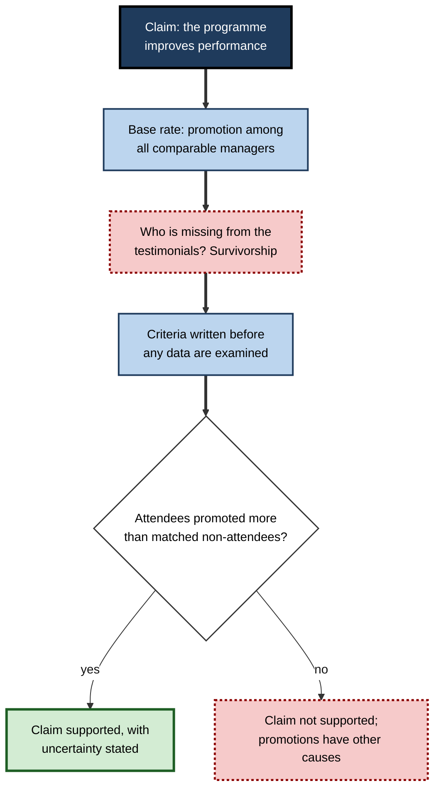

# B.7. Cognitive Biases Affecting Learning

A team lead recalls one dramatic failure of a training vendor and decides, without reviewing the rest of the record, that the vendor is unreliable. A learner who has already settled on a favourite explanation reads three textbooks and remembers only the passages that agree with it. After a project ends badly, a manager says the warning signs were obvious all along, although they were not obvious when the decisions were made. None of these people is careless.

Each is applying a reasonable mental shortcut in a situation where the shortcut systematically distorts the conclusion. Cognitive biases are these systematic tendencies. They matter for learning because they shape what learners and those who teach them take as evidence, what they remember from experience, and which lessons they draw from it.

> **Definition — Cognitive bias:** a systematic tendency in judgement or memory that produces errors in a predictable direction, often because a shortcut that usually works is applied in a situation where it does not.

**Why it matters for learning**

- Biases shape what learners attend to, what they retrieve, and which feedback they accept. A learner's error can be consistent and predictable, which makes it teachable, but only if the bias is recognised.
- Organisations draw conclusions from experience, and biased inference from a few vivid cases can lead to poor decisions about training, tools and people.
- Biases are not removed by intelligence or expertise. Experts often show them in their own domains, and sometimes more strongly, because their expectations are stronger.
- A bias concerns how evidence is weighed, whereas a feeling of confidence concerns how sure a person is. The two often interact, and this account keeps to the weighing of evidence.

---

## Heuristics and Their Biases

Amos Tversky and Daniel Kahneman (1974) argued that judgements under uncertainty rely on a small number of heuristics: representativeness, availability and anchoring. Heuristics are efficient and usually accurate. Their errors are systematic, and the errors are the main source of biases studied in this field.

> **Definition — Heuristic:** a simple rule of thumb that reduces the effort of judgement and generally gives reasonable answers, but that can produce predictable errors when conditions depart from those for which it works.

**Study card — Tversky and Kahneman (1974)**

- **Design:** the authors presented participants with problems in which the answer depended on probability, frequency or estimation, and examined the patterns of error across many versions.
- **Results:** judgements of probability and frequency were systematically influenced by the ease with which examples came to mind, by irrelevant numerical anchors, and by how well a case resembled a stereotype.
- **Conclusion:** the heuristics are reliable in many situations but yield predictable errors in others, and those errors are not random.
- **Status:** foundational for the study of judgement. Later work has shown that some biases depend on how problems are presented, and that methods for reducing biases have had varying success.

---

## Confirmation Bias

> **Definition — Confirmation bias:** the tendency to seek, interpret and remember information in ways that support an existing belief or hypothesis, and to give less weight to information that contradicts it.

Peter Wason's work on reasoning is the classic demonstration. In an early study (1960), participants were told that a sequence of three numbers followed a rule, and were asked to discover the rule by proposing their own triples and receiving feedback. Most participants proposed triples that confirmed a hypothesis they already had, rather than triples designed to test it, and many did not discover the actual rule.

**Study card — Wason (1966): the selection task**

- **Design:** participants were shown four cards, each with a letter on one side and a number on the other. They were told a rule about the cards, such as "if a card has a vowel on one side, it has an even number on the other", and asked which cards they must turn over to test the rule.
- **Results:** the abstract version was very hard. Few participants selected the cards that could falsify the rule, and most chose cards that could only confirm it. When the same logic was expressed in a familiar social setting, performance was much higher.
- **Conclusion:** people tend to look for confirming instances and to overlook the evidence that could refute their rule. The difficulty depends strongly on context and familiarity.
- **Status:** a very influential result. The exact success rates depend on the version used, and the context effect has been studied extensively and remains debated in its explanation.

> **Watch out:** confirmation bias is not merely a matter of wilful blindness. People who sincerely want to find the truth still tend to test their beliefs by looking for what supports them, because support is easier to see and feels like progress.

**Figure 1.** A loop that shows how confirmation bias can keep a belief in place.

---

## Availability and Vivid Cases

> **Definition — Availability heuristic:** judging the frequency or probability of an event by how easily examples come to mind. Memorable, recent or emotionally charged cases are more available and so seem more common.

- **Recent failures** — a single well-publicised failure can make a tool seem more dangerous than its record justifies.
- **Vivid success** — a single success story can make a method seem more effective than the broader evidence supports.
- **Personal experience** — a trainer who has seen one student fail a course may overestimate how often the course fails.

> **Example (illustrative):** a training manager remembers one failed rollout of a learning platform that was accompanied by a complaint on social media. The manager concludes that the platform is unreliable, without comparing its record across the organisation's other rollouts.

> **Watch out:** availability is not always wrong. Rare events that are memorable can be important, and a sensible response may be to take them seriously. The error is to use availability as a measure of frequency without checking.

---

## Base-Rate Neglect

> **Definition — Base rate:** the underlying frequency of a category or condition in the population. Base-rate neglect is the failure to take this frequency into account when judging the probability that an individual case belongs to the category.

Kahneman and Tversky (1973), in *Psychological Review*, studied judgements in which a description of a person was given, along with a base rate for the groups from which that person might come. Participants tended to base their judgements on how well the description fitted a stereotype, and to neglect the base rates, even when the base rates were stated clearly. The effect is a clear instance of representativeness at work.

**Figure 2.** A base rate applied to a population, and how a vivid case can mislead when the base rate is ignored.

> **Example (illustrative):** a learning team sees a learner who has passed the first two assessments and is described as "motivated and fast". The team predicts that the learner will pass the certification. The base rate of passing for the whole cohort matters: if most of the cohort passes, the prediction is reasonable; if most fails, the description alone should not override the base rate.

---

## Hindsight Bias

> **Definition — Hindsight bias:** the tendency, once an outcome is known, to believe that it was predictable, and to overestimate the probability that one would have predicted it beforehand.

**Study card — Fischhoff (1975)**

- **Design:** participants read descriptions of historical events and were told that one of several possible outcomes had occurred. Other participants read the same descriptions without knowing the outcome. Both groups then estimated the probability of each outcome.
- **Results:** participants who knew the outcome gave it a higher probability than participants who did not know it.
- **Conclusion:** knowledge of an outcome changes the perceived predictability of events, so that retrospective judgements about what was foreseeable are unreliable.
- **Status:** the broader hindsight effect has been studied widely, but replications of this specific experiment have been mixed, with some succeeding and others failing. Hindsight bias affects learning from experience: people review decisions after a result and judge them as more obviously mistaken, or more obviously right, than they were at the time.

> **In practice:** a post-incident review that asks "why did nobody see this coming?" invites hindsight bias. A review that asks what information was available at each decision point, and what each person believed at the time, supports better learning.

---

## Anchoring

> **Definition — Anchoring:** the tendency for an initial value, whether relevant or not, to influence subsequent estimates, which are typically adjusted too little from the anchor.

**Study card — Tversky and Kahneman (1974): the wheel of fortune**

- **Design:** participants saw a wheel of fortune spun to stop on a number, and were then asked to estimate the proportion of African countries in the United Nations. The number was known to be random.
- **Results:** estimates were pulled toward the random number. Those who saw a higher number gave higher estimates than those who saw a lower one.
- **Conclusion:** an irrelevant anchor can influence estimates, which shows how strongly initial values constrain later judgements.
- **Status:** a classic demonstration. The size of the effect varies. Anchoring was among the effects tested in Many Labs 1, a multi-laboratory replication project (Klein and colleagues, 2014), which reproduced it. Its mechanisms are still debated.

**Figure 3.** Estimates pulled toward an anchor, compared with an unanchored estimate.

> **Watch out:** anchoring affects expert estimates as well as novice ones. An experienced planner who starts from last year's budget may make the same kind of adjustment, even when the context has changed.

---

## Biased Assimilation

People faced with mixed evidence do not always weigh it evenly. They can examine the same information and come away more convinced of their starting position.

**Study card — Lord, Ross and Lepper (1979)**

- **Design:** 48 undergraduates who supported or opposed capital punishment were shown two purported studies on deterrence, one supporting and one opposing their view. They rated the quality of each study and their beliefs were measured before and after.
- **Results:** participants rated the study that agreed with them as better in methodology, and their beliefs became more extreme after reading the mixed evidence.
- **Conclusion:** evaluation of evidence is shaped by prior belief, so that mixed evidence can polarise rather than inform.
- **Status:** widely cited in research on belief change. The design has been extended to other contested topics, such as violent video games, and some researchers argue that polarisation can arise from reasoning that is not biased, so the interpretation remains debated.

> **Key point:** biased assimilation explains why a training review presented with mixed results can produce more confidence in whatever the reviewers already believed. Good evaluation designs specify in advance what evidence would change the conclusion.

---

## Survivorship and Selection Bias

> **Definition — Survivorship bias:** drawing conclusions from the cases that remain or are visible, while overlooking those that have been removed or are unseen.

- **Abraham Wald's wartime analysis** of aircraft returning from missions illustrates the principle: the aircraft that did not return were not available for inspection, so the damage observed on returning aircraft could not show where a bomber was most vulnerable. The popular account of Wald's specific recommendation about armour is disputed, but the reasoning about missing data is well documented.
- **In learning**, a programme's graduates are the visible cases. Those who dropped out, and their reasons, are absent from the picture unless they are tracked.
- **In practice**, a leadership course that is praised by its successful alumni may appear effective, even though many enrolled participants left without completing it.

> **Watch out:** survivorship bias is easy to miss because the missing cases are not seen. The test is to ask what happened to everyone who started, not only to those who finished.

---

## Bias Blind Spot

> **Definition — Bias blind spot:** the tendency to recognise biases in others more readily than in oneself, which makes people less likely to correct their own judgements.

Emily Pronin, Daniel Lin and Lee Ross (2002) found that people rated themselves as less susceptible to biases than others. In a follow-up study, participants who showed this self-exemption still insisted that their own self-assessments were accurate and objective after reading how the biases could have affected them. The finding has practical consequences: a learner who has read about confirmation bias may still believe that their own reasoning is exempt.

**Figure 4.** A sequence of practices that reduce the influence of biases on learning decisions.

> **Watch out:** these practices reduce biases but do not remove them. Some practices, such as writing down criteria in advance, are effective largely because they make the reasoning visible to others, who can notice errors the reasoner cannot.

---

## Worked Example: Evaluating a Training Programme

**Situation:** a leadership programme is claimed to improve managers' performance. The evidence offered is a set of testimonials from managers who completed the programme and were promoted.

1. **State the base rate.** Promotion is common among managers in the organisation over the same period, whether or not they attended. The base rate of promotion must be known before the promotions can be credited to the programme.
2. **Identify survivorship.** The testimonials come only from managers who were promoted and who chose to speak. Managers who attended and were not promoted, and managers who left, are absent.
3. **Specify disconfirming evidence in advance.** The evaluators agree that if the promotion rate of attendees is no higher than that of a matched group of non-attendees, the programme cannot be credited with the promotions.
4. **Compare against a matched group.** Managers who were comparable at entry but did not attend are tracked over the same period.

**Figure 5.** How a claimed programme effect is tested against the base rate and a matched comparison.

**Conclusion:** the testimonials are not evidence of effect. The comparison with the base rate and a matched group provides evidence that could support or refute the claim.

> **Watch out:** the example does not show that the programme is ineffective. It shows that the evidence offered does not discriminate between the programme working and the programme having no effect.

---

## Case Study (illustrative): A Learning Strategy Review

- **Situation:** an organisation had invested heavily in a single learning approach, based on positive feedback from a small group of enthusiastic early users.
- **Problem:** later measures showed no improvement in performance across the organisation, and the investment was questioned. The senior team was reluctant to accept the result.
- **Diagnosis:**
  - the early feedback was vivid and came from enthusiasts, so availability and survivorship shaped the picture;
  - the leadership had publicly endorsed the approach, so the review was biased toward confirming it;
  - the success criteria were set after the programme began, so hindsight judgements were used.
- **Actions:**
  1. The review was restructured with criteria written before the review, and a comparison group of teams that did not use the approach was added.
  2. Data were drawn from all teams that began the programme, including those that dropped out.
  3. A reviewer from outside the original sponsoring group examined the data and was asked to identify the evidence that would change the conclusion.
- **Result (illustrative):** the comparison showed a small benefit for some teams and none for others. The organisation kept the approach for those teams where it helped, and stopped it elsewhere.
- **Side effects / caveats:** the review took longer, and some staff felt that the earlier enthusiasm was dismissed. The evidence for the subgroup benefit is itself open to later bias.
- **Lesson:** biases shape evaluations as well as the decisions that they evaluate. Pre-committed criteria, comparison groups and complete records are the main safeguards.

---

## Open Questions

- **Can biases be reduced by training?**
  - Warnings and tools help in some contexts, but the transfer of reduction from one task to another is limited.
- **Why do some heuristics produce larger errors than others in practice?**
  - The conditions that make a heuristic fail are only partly understood.
- **How much do biases operate in group decisions compared with individual ones?**
  - Groups can correct some errors and amplify others, and the balance depends on how the group works.
- **Can the bias blind spot be overcome by feedback?**
  - Evidence is mixed, and self-assessment of bias may be particularly resistant to change.

---

## Summary

- **Cognitive biases** are systematic errors in judgement or memory, arising from shortcuts that usually work.
- **Heuristics** (representativeness, availability, anchoring) produce predictable errors (**Tversky and Kahneman, 1974**).
- **Confirmation bias** leads people to seek and interpret support for existing beliefs; **Wason's** selection task showed that people often test rules by looking for confirming cases.
- **Availability** makes vivid cases seem frequent; **base-rate neglect** ignores the underlying frequency of a category.
- **Hindsight bias** makes outcomes seem predictable after the fact (**Fischhoff, 1975**), which distorts learning from experience.
- **Anchoring** pulls estimates toward initial values, even irrelevant ones.
- **Biased assimilation** (**Lord, Ross and Lepper, 1979**) can make mixed evidence polarise belief.
- **Survivorship bias** draws conclusions from visible cases; the **bias blind spot** makes people underrate their own susceptibility (**Pronin, Lin and Ross, 2002**).
- In practice, evaluate with stated base rates, pre-committed criteria, comparison groups and complete records.

---

## Self-Check

1. Define cognitive bias and explain why a shortcut that usually works can produce a systematic error.
2. What did Tversky and Kahneman (1974) propose about heuristics, and what did they add about their errors?
3. Describe Wason's 2-4-6 task and what it showed about confirmation.
4. Why is the selection task a useful test of confirmation, and what did its context effects show?
5. How does availability produce errors in judgements of frequency?
6. Explain base-rate neglect with an example from a learning context.
7. What is hindsight bias, and why does it matter for reviewing decisions?
8. Describe the wheel-of-fortune demonstration and what it shows about anchoring.
9. What is biased assimilation, and why does it make mixed evidence less informative?
10. Explain survivorship bias using an example from training evaluation, and say how to detect it.
11. What is the bias blind spot, and why does it make bias harder to correct?
12. A colleague proposes that a new learning platform should be scrapped because of one failed pilot. Identify three biases that might be shaping the proposal and suggest a way to test it fairly.

### Answer Key

1. A bias is a systematic tendency that produces errors in a predictable direction. A shortcut that works in most conditions can produce systematic errors when conditions differ from those in which it works.
2. They proposed that judgements rely on representativeness, availability and anchoring, which are efficient and usually accurate but produce predictable errors.
3. Participants were told a rule for a triple of numbers and asked to discover it. Most tested their own hypotheses with confirming triples, and many failed to find the actual rule.
4. The selection task requires testing a rule by finding cases that could falsify it. Most people choose confirming cases in the abstract version, and performance improves in familiar social contexts, showing that context strongly affects reasoning.
5. Easily recalled examples, such as recent or vivid ones, seem more common, so frequency is overestimated for memorable events.
6. A learner described as "motivated and fast" is judged likely to pass, ignoring the cohort's pass rate. The base rate should be the starting point, adjusted by individual evidence.
7. Hindsight bias is the belief, after an outcome is known, that it was predictable. It distorts post-event reviews by making decisions seem more obviously wrong or right than they were when made.
8. Participants saw a random number on a rigged wheel, then estimated a proportion. Estimates were pulled toward the random number, showing that irrelevant anchors influence judgement.
9. Participants rated supporting evidence as better and became more extreme in belief after reading mixed evidence. Mixed evidence can therefore polarise rather than inform, unless the criteria for judgement were set in advance.
10. Survivorship bias arises when only the visible graduates are assessed. Detection: ask what happened to everyone who started, including those who dropped out, and compare outcomes across all enrolees.
11. It is the tendency to see biases in others more readily than in oneself. It makes people less likely to correct their own judgements, even when they know the biases exist.
12. Possible biases: availability (the vivid failure), confirmation (seeking evidence for the proposal), and hindsight or anchoring (judging from the outcome of the pilot). A fair test would define success criteria in advance, compare the platform with a matched group over a suitable period, and include all users, not only the failures or enthusiasts.

---

## Glossary

| Term | Meaning |
|---|---|
| Anchoring | Influence of an initial value on later estimates, which are typically adjusted too little. |
| Availability heuristic | Judging frequency by how easily examples come to mind. |
| Base rate | The underlying frequency of a category in the population. |
| Base-rate neglect | Ignoring the underlying frequency when judging an individual case. |
| Bias blind spot | Recognising biases in others more readily than in oneself. |
| Biased assimilation | Judging mixed evidence in favour of prior belief. |
| Cognitive bias | A systematic tendency that produces errors in a predictable direction. |
| Confirmation bias | Seeking and interpreting evidence in favour of existing beliefs. |
| Heuristic | A simple rule of thumb that usually works and can produce predictable errors. |
| Hindsight bias | Believing, after the fact, that an outcome was predictable. |
| Survivorship bias | Drawing conclusions from visible cases while overlooking those removed or unseen. |
