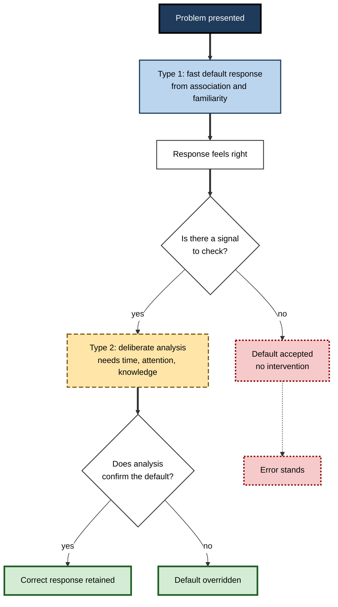
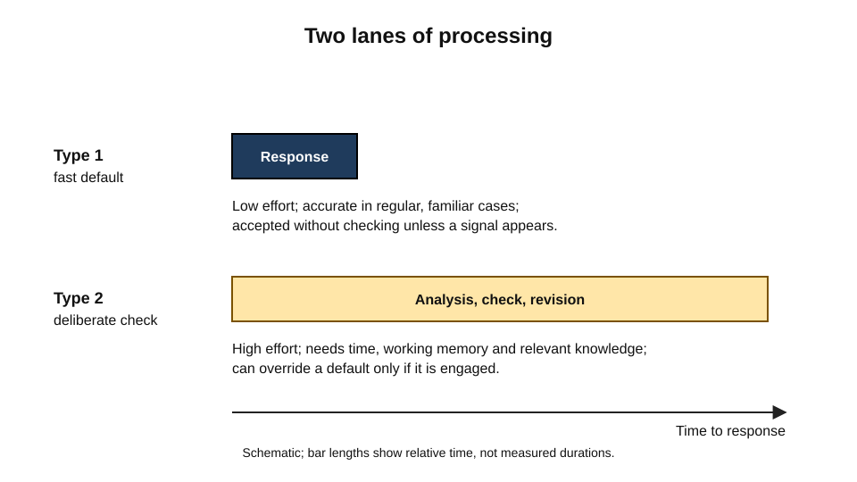
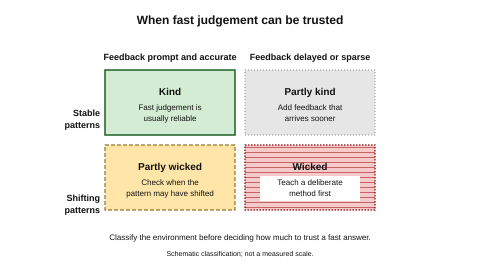
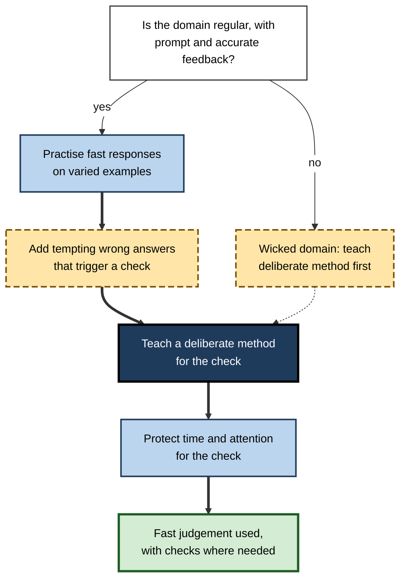
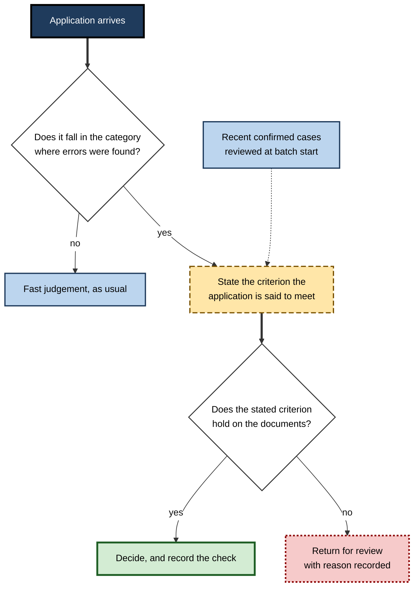

# B.8. Dual-Process Theory in Learning

Ask a group of people a short puzzle: a bat and a ball cost one dollar and ten cents together, and the bat costs one dollar more than the ball. How much does the ball cost?

A large share of people answer quickly, "ten cents", and then feel the answer is obviously right. A moment's further thought shows that a ball costing ten cents would make the bat cost one dollar and twenty cents, and the total would be one dollar and thirty. The correct answer is five cents. The error is not a matter of ignorance; the people who make it can usually do the arithmetic.

What differs is whether a fast, compelling answer was accepted without checking. Dual-process theories are an attempt to explain this pattern, and they matter for learning because much of what learners must do is to override fast answers with slower, more careful reasoning.

> **Definition — Dual-process theory:** the family of accounts in psychology that distinguishes two broad kinds of thinking. Type 1 processes are fast, automatic and associative; Type 2 processes are slower, deliberative and rule-based. Theories differ in how the two interact and in which tasks engage each.

**Why it matters for learning**

- Many learning failures are failures to check. A learner who accepts the first answer that feels right has not necessarily lacked the knowledge needed to reject it.
- Learning changes which responses become fast. Practice can turn a deliberate procedure into an automatic one, which is efficient but can also make errors automatic.
- Learners and teachers often assume that more effort always produces better reasoning. Dual-process accounts suggest that effort helps only when it is directed at the right point.
- The theory provides a framework for designing practice that trains both kinds of response, and for deciding when a fast response should be trusted.

---

## The Two Families of Process

Psychologists have described dual-process accounts in many forms, and the terms "System 1" and "System 2" are widely used as shorthand. Jonathan Evans and Keith Stanovich (2013) argued that critics often attack dual-process theories as though they were a single generic model, when several versions exist.

- **Type 1 processes** are rapid, do not require working memory in most cases, run in parallel, and operate from associations and experience.
  - *e.g.* recognising a familiar face, or a familiar error message, without deliberate analysis.
- **Type 2 processes** are slower, sequential, draw on working memory, and can follow explicit rules or hypothetical reasoning.
  - *e.g.* working through the steps of a long calculation, or checking whether an argument follows from its premises.

> **Watch out:** the two types are not two separate brain systems located in particular places. They are a useful description of two kinds of process, and the neural correspondence, if any, is not established. Treat the labels as descriptions of function.

### What the theory is not

- It is not a claim that fast thinking is always wrong. Type 1 processes are accurate in many familiar situations, and they are the basis of most expertise.
- It is not a claim that slow thinking is always right. Deliberate reasoning can be misled by incorrect rules or by fixation on a plausible but wrong method.
- It is not a single agreed model. Evans and Stanovich distinguished several versions, and critics have argued that the categories are too broad to make precise predictions in every case.

---

## Default-Interventionist Models

The most influential account in reasoning research holds that Type 1 processing produces a default response quickly, and that Type 2 processing may intervene to change it. Evans and Stanovich (2013) described this as a default-interventionist model.

> **Definition — Default-interventionist model:** an account in which a fast, intuitive response is produced first and is accepted unless a slower, deliberative process detects a problem and overrides it.

- **Detection** — something signals that the default may be wrong: a conflict between responses, an unusual feature, or an explicit instruction to check.
- **Intervention** — deliberative reasoning is engaged, which requires time, attention and some knowledge.
- **Override** — the default is replaced if the deliberation finds it wanting. If no intervention occurs, the default stands.

**Figure 1.** The default-interventionist sequence, with the points at which an error is accepted or corrected.

---

## The Bat-and-Ball Problem and the Cognitive Reflection Test

**Study card — Frederick (2005)**

- **Design:** Shane Frederick developed a short test of three items, each with an intuitive but incorrect answer that comes to mind quickly, and a correct answer that requires a moment of reflection. The bat-and-ball puzzle is one of the items. Participants were also measured on decision preferences, including time preference and risk preference.
- **Results:** many participants gave the intuitive wrong answer to at least one item. Higher scores were associated with greater patience over short time horizons and with less risk aversion for gains, across a range of measures.
- **Conclusion:** the test is a short, simple measure of the tendency to override a first answer by reflection, which Frederick treated as a type of cognitive ability.
- **Status:** the test, known as the Cognitive Reflection Test, is widely used. Later work argued that its items also draw on numerical ability (Sinayev and Peters, 2015). Because the items now circulate widely, some people may recall answers rather than reason them out, which complicates interpretation.

> **Key point:** the test shows that knowing the relevant arithmetic is not enough. The learner must also be prompted to check, and must have the disposition to do so.

> **Example (illustrative):** a finance trainee who knows how to compute a percentage change may still report the wrong figure in a quick review, because the first figure that comes to mind is not checked against the question asked.

---

## Individual Differences in Reasoning

**Study card — Stanovich and West (2000)**

- **Design:** university students completed many reasoning problems from the heuristics-and-biases research tradition, along with measures of cognitive ability.
- **Results:** performance on many problems was related to cognitive ability, though not perfectly.
- **Conclusion:** the authors argued that departures from the normative answer can reflect performance errors, limits of computation, a different construal of the task, or the wrong norm being applied. Some apparent irrationalities may therefore reflect whether deliberative processing was engaged, and others reflect how the task was construed.
- **Status:** influential and debated. Critics have argued that the distinction between systems is too sharply drawn, and that the same data can be read in more than one way.

This line of work suggests that the learning goal is not only to add knowledge but to build the habit of engaging deliberate reasoning at the right moments, together with the rules and strategies that can be used when reasoning deliberately.

---

## When Fast Thinking Can Be Trusted

Dual-process theory does not imply that intuition should always be distrusted. Experienced practitioners often make accurate fast judgements, and the question is when those judgements are reliable.

Daniel Kahneman and Gary Klein (2009) examined when expert intuition can be trusted. They concluded that judging whether an intuition is likely to be good depends on two things: how predictable the environment is, and whether the person has had the opportunity to learn its regularities. Where these conditions are absent, intuition tends to be less accurate, and subjective confidence is not a dependable sign of accuracy.

> **Definition — Kind learning environment:** an environment with stable patterns and prompt, accurate feedback, in which intuition built from experience can be trusted.

> **Definition — Wicked learning environment:** an environment in which feedback is delayed, sparse or misleading, so that experience does not reliably teach the right lesson.

The labels "kind" and "wicked" are sometimes used for these two types of environment.

**Figure 2.** Two lanes of processing, showing where fast and slow responses differ in speed, effort and reliability.

**Figure 3.** Environment type and the reliability of fast judgement.

> **Watch out:** feeling confident in an intuition is not evidence that it is accurate. In a wicked environment, practice can reinforce confidence and mistakes together.

---

## Training Both Kinds of Response

Designing practice for dual-process learning involves two goals: building the fast responses that are accurate in a domain, and building the habit of detecting when a fast response should be checked.

- **Build accurate fast responses** through practice with prompt, accurate feedback on many varied examples.
- **Build detection** by including problems in which the fast response is attractive but wrong, so that the learner experiences the signal that something needs checking.
- **Build deliberate methods** that can be applied when a check is needed, such as a written procedure, a calculation method or a checklist of questions.
- **Protect the conditions for deliberation.** Time pressure, interruption and high load reduce the chance that a learner will intervene on a fast response.

**Figure 4.** A design sequence for practice that develops both fast accuracy and the habit of checking.

> **In practice:** a regulated analysis team could give junior analysts routine cases with deliberately tempting errors, and ask them to state which step they would check before deciding. The check then becomes part of the routine, and it is practised until it is no longer an extra burden.

---

## Case Study (illustrative): A Screening Team's Overconfident Judgements

- **Situation:** a team screened applications using experienced judgement. New members were trained by shadowing senior colleagues, and the team's decisions were generally accepted by managers.
- **Problem:** an audit found that a category of applications was consistently misclassified, and the misclassifications were made with confidence by both junior and senior staff.
- **Diagnosis:**
  - the environment was partly wicked: decisions were confirmed only much later, and the feedback that reached staff was sparse;
  - the default judgements were fast and reinforced by experience, so the error was not detected;
  - no routine check existed for the category in which the error occurred.
- **Actions:**
  1. Added a short structured check for the category, which asked the screener to state the criterion that the application met.
  2. Built a set of recent cases with confirmed outcomes, and used them in short sessions with immediate feedback.
  3. Protected time for the check by scheduling it at the start of each batch, rather than leaving it to the end.
- **Result (illustrative):** the misclassification rate in the category fell over the next two audit cycles, and staff reported that they were more aware of when a judgement needed checking.
- **Side effects / caveats:** the structured check slowed the process, and the audit sample was small. The team could not separate the effect of feedback from that of the check.
**Figure 5.** The screening check, as a decision path applied to each application.

- **Lesson:** fast judgement can be reliable in regular environments, but in environments with sparse feedback, deliberate checks and feedback must be designed in.

---

## Limits and Criticisms

- **Too broad to test easily** — some critics argue that dual-process labels can be used to explain almost any pattern after the fact.
- **Overlapping processes** — the categories may blur, since many fast processes are learned and some deliberate processes become fast with practice.
- **Single-system alternatives** — some researchers argue that a single process with varying parameters can account for many of the same results.
- **Neural claims** — the link between the functional distinction and brain systems is not established, and claims about specific regions should be treated cautiously.

> **Key point:** these limits do not remove the practical value of the distinction. They argue for precise predictions about when fast and slow responses should differ, rather than for dropping the idea.

---

## Open Questions

- **When does deliberation actually intervene on a fast response?**
  - The triggers for detection are not fully specified, and they likely vary with the individual and the task.
- **Can the disposition to check be trained, and does the training transfer?**
  - Some studies suggest transfer is limited, and the best training methods are still debated.
- **How do learned fast responses change over long periods of practice?**
  - Practice can make accurate responses faster, and it can make inaccurate ones faster too.
- **How should learning environments be designed to be kind rather than wicked?**
  - The features that make feedback sparse or misleading are only partly understood in most professional settings.

---

## Summary

- **Dual-process theory** distinguishes fast, associative Type 1 processes from slower, deliberative Type 2 processes.
- The **default-interventionist** model holds that a fast response is produced first and accepted unless deliberation detects a problem and overrides it (**Evans and Stanovich, 2013**).
- The **bat-and-ball** problem and the **Cognitive Reflection Test** (**Frederick, 2005**) show that the tendency to accept the first answer is a distinct and trainable disposition.
- **Stanovich and West (2000)** found that rational responding on many problems is related to ability, though not perfectly, and that construal of the task and processing differences also matter.
- **Kind** environments, with stable patterns and prompt feedback, make fast judgements reliable; **wicked** environments, with sparse or misleading feedback, can reinforce error (**Kahneman and Klein, 2009**).
- Training should build accurate fast responses, add tempting errors that trigger checks, teach deliberate methods and protect time for them.
- The theory has been criticised as too broad and as overlapping, and its neural claims are weak; its practical use depends on precise predictions.
- In practice, identify whether the environment is kind or wicked before deciding how much to trust fast judgement.

---

## Self-Check

1. Describe Type 1 and Type 2 processes and give one everyday example of each.
2. Why should the labels "System 1" and "System 2" be treated as descriptions of function rather than brain systems?
3. Explain the default-interventionist model, including the three stages of detection, intervention and override.
4. What does the bat-and-ball problem reveal about learning, beyond arithmetic ability?
5. What does the Cognitive Reflection Test measure, and what complicates its interpretation?
6. What did Stanovich and West (2000) find about the relation between ability and rational responding?
7. Distinguish a kind learning environment from a wicked one.
8. Why does confidence not show that a fast judgement is accurate?
9. Describe a practice design that builds both fast accuracy and the habit of checking.
10. An experienced underwriter makes fast, confident decisions that are later found to be wrong for one category of case. Using the theory, explain what might be happening and what should change.
11. Give two criticisms of dual-process theory and say why they do not remove its practical value.
12. A training provider says that slowing trainees down will always improve their decisions. Evaluate this claim using the theory.

### Answer Key

1. Type 1 is fast and associative, for example recognising a familiar face. Type 2 is slower and rule-based, for example working through a long calculation step by step.
2. The distinctions are functional and cover several dimensions. Neural correspondence has not been established, so the labels should not be read as anatomical claims.
3. A fast default response is produced first. A signal triggers detection; deliberate analysis intervenes; the default is overridden if the analysis finds it wanting, or stands if no intervention occurs.
4. A fast, compelling answer can be accepted without checking, even when the learner has the arithmetic needed to reject it. The disposition to check is distinct from ability.
5. It measures a tendency to override an intuitive wrong answer with a reflective correct one. Its items are now widely known, so some people may recall answers rather than reason them out.
6. Performance on many problems was related to cognitive ability, though not perfectly. The authors also argued that departures from the normative answer can reflect performance errors, computational limits, the wrong norm, or a different construal of the task.
7. A kind environment has stable patterns and prompt, accurate feedback, so experience teaches the right lesson. A wicked environment has delayed, sparse or misleading feedback, so experience can reinforce errors.
8. Confidence depends on how fluent and familiar an answer feels, and in wicked environments practice can increase confidence without increasing accuracy.
9. Practise fast responses on varied examples with feedback; include tempting wrong answers that trigger a check; teach a deliberate method for the check; protect time and attention for the check.
10. The underwriter's fast judgements are likely reliable in regular categories but not in the category where feedback is sparse or misleading, so the default is accepted without a check. Change: add a structured check for that category, provide feedback on confirmed outcomes, and protect time for the check.
11. Criticisms: the theory is broad and can be used to explain patterns after the fact; the categories overlap, since fast processes can be learned and deliberate ones can become fast. The distinction still guides predictions about when fast and slow responses should diverge and which checks to design.
12. The claim is too strong. Slowing helps when a fast default is wrong and deliberation is capable of finding the error; in a kind environment, slowing down may add time without improving accuracy. The training should identify which decisions need checks and which fast judgements are reliable.

---

## Glossary

| Term | Meaning |
|---|---|
| Cognitive Reflection Test | A short test of the tendency to override an intuitive wrong answer with a reflective one. |
| Default-interventionist model | An account in which a fast response is accepted unless deliberation overrides it. |
| Dual-process theory | The family of accounts distinguishing fast, associative from slow, deliberative thinking. |
| Kind learning environment | An environment with stable patterns and prompt, accurate feedback. |
| Type 1 process | A fast, automatic and associative process. |
| Type 2 process | A slower, deliberative and rule-based process. |
| Wicked learning environment | An environment with delayed, sparse or misleading feedback. |
