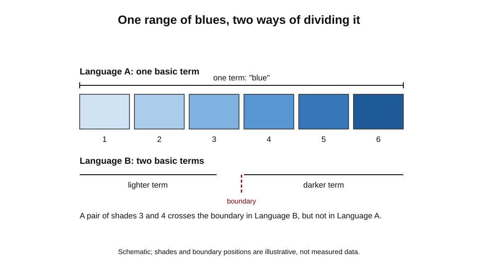
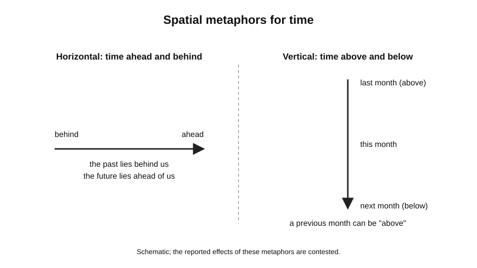
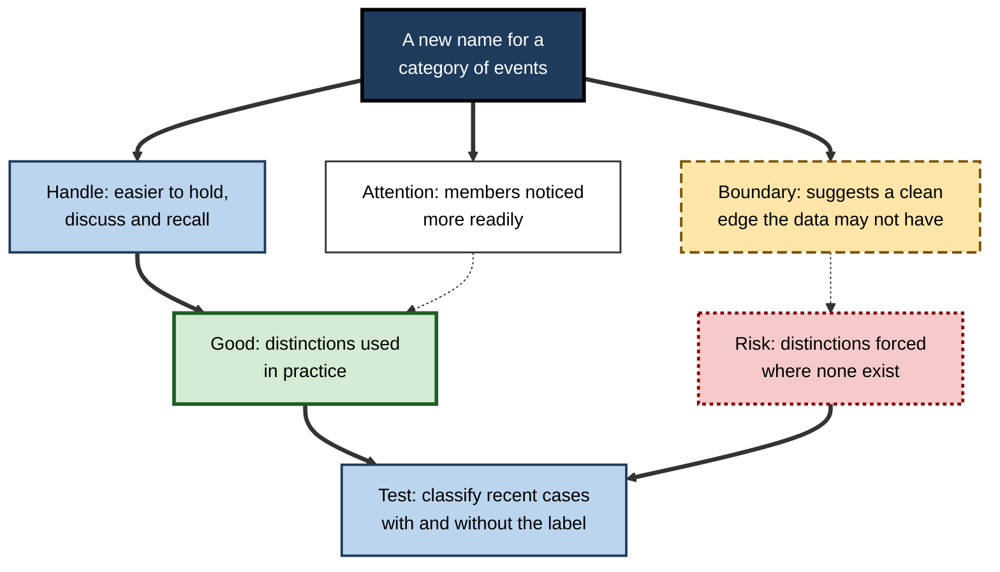
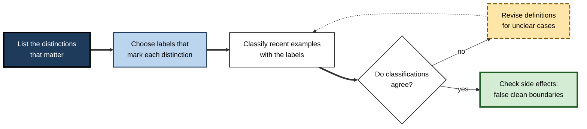
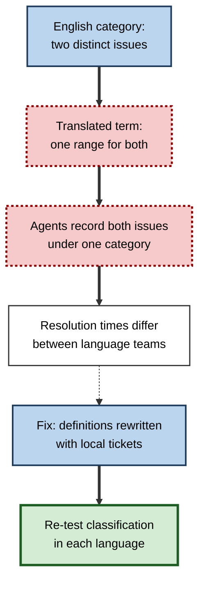

# B.9. Language and Thought in Cognition

Two colleagues look at the same square of paint and agree on everything about it except the name. One calls it simply "blue". The other, a native speaker of a language with a separate everyday word for the lighter blues, calls it "light blue" or uses the native term without hesitation.

When asked to pick out a matching shade from a set of blues, the second colleague may be quicker at telling apart two shades that fall on either side of the language's boundary. Neither colleague has a defect of perception.

The question is whether the words a person uses shape how the world is perceived, remembered and categorised, or whether words only name categories that thought has already formed. That question sits at the centre of the study of language and cognition.

> **Definition — Language and cognition:** the study of how the structure of language relates to the processes of perception, memory, reasoning and categorisation, and whether, and how far, the language a person speaks shapes those processes.

**Why it matters for learning**

- Learners work in words. Explanations, instructions, assessments and feedback all depend on language, so the way language carries meaning affects what is learned from them.
- Technical vocabulary is itself a learning target. A term that names a distinction makes that distinction easier to notice and to remember.
- Learners who use more than one language, or who move between professional jargon and everyday speech, may categorise the same material differently.
- Language can support thought through labels and descriptions, or it can mislead when a label suggests a category boundary that the material does not have.

---

## Language, Thought and the Question of Influence

Three positions are usually distinguished.

- **Language determines thought (strong view)** — the categories a language provides fix what its speakers can think. This position is widely regarded as untenable in its strict form, because people can learn new concepts and can describe things their language does not name.
- **Language influences thought (weak view)** — the categories a language provides make some distinctions easier to attend to, remember or use, without preventing others. This is the position that many researchers now take when the evidence is considered, though its size and reach are debated.
- **Language does not influence thought (no-influence view)** — language is a means of expressing thought that is independent of it. Evidence from many tasks argues against the strongest form of this view, but it remains a reference point for thinking about universal cognition.

> **Definition — Linguistic relativity:** the family of claims, associated with Edward Sapir and Benjamin Lee Whorf in the early and middle twentieth century, that the structure of a language influences the thought of its speakers. The strong and weak versions differ in how much influence they ascribe to language.

> **Watch out:** the strong version of relativity is often presented as the hypothesis in popular accounts. The debate is most productively framed in terms of which distinctions are affected, in which tasks, and by how much.

---

## Colour: A Test Case

Colour is the most studied domain, because the physical dimensions of colour are well understood and the categories that languages use can be compared directly.

**Study card — Berlin and Kay (1969)**

- **Design:** Brent Berlin and Paul Kay asked speakers of many languages to name and sort colour chips, and compared the systems of basic colour terms across languages.
- **Results:** languages differ in how many basic colour terms they have, but the terms follow an implicational order: a language with few terms distinguishes dark from light first, then adds red and other colours in a regular sequence. Focal colours, the best examples of each colour, tended to be similar across languages.
- **Conclusion:** the basic colour categories show universal structure, which suggests that perception and biology constrain colour naming, while the boundaries drawn by each language vary.
- **Status:** influential and widely cited. Later revisions found that the order of terms Berlin and Kay proposed does not describe every language. Paul Kay and Terry Regier's review (2006) concluded that universal constraints exist, but that cross-language differences in colour naming can produce differences in colour cognition in some tasks.

> **Definition — Focal colour:** the best or most typical example of a colour category, which speakers of different languages tend to agree on more readily than they agree on category boundaries.

**Study card — Winawer and colleagues (2007)**

- **Design:** Russian speakers have two basic terms for blue, one for lighter blues (goluboy) and one for darker blues (siniy), where English has a single term. Researchers compared the speed with which Russian and English speakers discriminated pairs of blues, some of which crossed the Russian boundary and some of which did not.
- **Results:** Russian speakers were faster at discriminating pairs that crossed the boundary between the two Russian terms than pairs that lay within one category. English speakers did not show this advantage. When Russian speakers performed a verbal distraction task, the advantage disappeared, whereas a spatial distraction task did not remove it.
- **Conclusion:** having a named category can make a boundary more salient in perception, in a task where speed was measured. The effect was specific to the boundary and to the language.
- **Status:** a related pattern was reported for Greek speakers, who use two basic terms for light and dark blue, using an automatic brain response rather than a speeded response (Thierry and colleagues, 2009). The effect is treated as a case of the weak view, and researchers continue to debate how far it reflects perception itself rather than response strategies.

> **Key point:** the colour results support a weak claim. Language can make some distinctions easier to use in speeded tasks, without determining what can be perceived at all.

**Figure 1.** How two languages divide the same hue range differently, with boundaries that do not coincide.

---

## Space and Time Metaphors

Languages describe time in spatial terms, and the spatial terms differ across languages. English often speaks of the future as "ahead" and the past as "behind", which arranges time along a horizontal line. Some other languages use vertical terms for time, so that a previous month may be described as "above" the current one.

**Study card — Boroditsky (2001)**

- **Design:** Lera Boroditsky compared English and Mandarin speakers. Participants first saw a spatial prime, horizontal or vertical, and then judged true or false statements about the order of times, such as "March comes earlier than April". The prediction was that vertical primes would speed Mandarin speakers' responses to temporal questions more than English speakers' responses.
- **Results:** the original paper reported that Mandarin speakers were faster to judge temporal relations after vertical primes, which was read as consistent with language shaping habitual thought about time.
- **Conclusion:** the spatial metaphors of a language may influence how people think about time, at least in speeded judgement tasks.
- **Status:** contested. Chen (2007) reported a failed replication, in which four attempts did not reproduce the effect, and a corpus analysis that found Chinese speakers used horizontal spatial metaphors for time more often than vertical ones. January and Kako (2007) also did not find the effect. The dispute is unresolved.

> **Watch out:** the time-metaphor case shows why the strength of a claim matters. A metaphor in everyday language is not the same as a cognitive effect in an experiment, and the link between the two requires evidence that replicates.

**Figure 2.** The spatial metaphor for time in two languages, as described in the literature. Schematic; the reported effects are contested.

---

## Labels and Categories

A label can help people form a category. Lupyan, Rakison and McClelland (2007) reported that redundant labels, meaning names given alongside the members of a category, facilitated learning of novel categories, although the size of the benefit depends on the task and the type of category.

- **Labels as handles** — a name makes a category easier to hold in mind and to communicate.
  - *e.g.* a team that agrees to call a particular failure type a "silent drop" can discuss and detect it more readily than a team that describes it each time from scratch.
- **Labels as boundaries** — a name can suggest a boundary, and so can make a category seem more distinct than it is.
  - *e.g.* a classification of risk as "high" or "low" can hide the continuous distribution beneath it.
- **Labels and attention** — once a category has a label, members may be noticed more readily, which is a route for language to influence perception.

> **Example (illustrative):** a clinic introduces the term "medication reconciliation" for a checking process it already performed. The term helps staff recall the steps and name the activity in handover notes, but it can also imply that the activity has a fixed, complete form that the clinic's real process does not match.

**Figure 3.** How a label can help or mislead when it names a category.

---

## Language and Number

Number words illustrate how language can extend or limit the representation of quantities. Many languages have precise words for small numbers and vague words for larger ones, and speakers of such languages may find it harder to represent exact quantities above a certain size. The evidence from studies of speakers of languages with limited number vocabularies is contested.

Interpretation is complicated by differences in schooling, culture and test design. Where precise number terms are used, people can represent larger numbers and perform arithmetic with them. The important point for learning is that vocabulary for a concept does not determine whether the concept can be learned, but it can make the concept easier to hold, combine and teach.

---

## Inner Speech and Verbal Thought

People often report talking to themselves while solving problems, and language appears to contribute to some forms of reasoning. Verbal labelling can help people hold rules in mind, and verbal self-instruction is used in training programmes for tasks such as sustained attention and impulse control. Lev Vygotsky (1934, in *Thinking and Speech*) argued that inner speech develops from social speech and becomes a tool for organising thought.

Modern research treats verbal thought as one resource among several. Visual, spatial and motor representations also support reasoning, and the balance differs across people and tasks.

> **Key point:** language is one of several representational resources. It is most useful where the task is verbal, rule-based or sequential, and less useful where the task depends on fine perceptual judgement or spatial manipulation.

---

## Worked Example: Designing Technical Vocabulary for a Team

**Situation:** a software team needs to discuss three similar kinds of defect that currently go by different names in different teams.

1. **List the distinctions that matter.** The team identifies what differs between the three defects: where they arise, how they are detected and how they are fixed.
2. **Choose labels that mark the distinctions.** Names are chosen to make the differences obvious, such as a name that refers to the stage where the defect is introduced.
3. **Test the labels on examples.** Each new team member is given recent cases and asked to classify them. Misclassifications show where the labels fail to separate the categories.
4. **Revise the boundaries.** Cases that fall between categories are discussed, and the definitions are changed to remove ambiguity.
5. **Check for side effects.** The team asks whether a label is making a category seem more clearly bounded than the data support.

**Figure 4.** The loop for designing and testing team vocabulary.

**Conclusion:** the process treats vocabulary as a designed tool, tested against examples, with attention to what each label includes, excludes and implies.

> **Watch out:** a shared vocabulary can make a team efficient and also make it blind to cases that do not fit the labels. The classification test in step 3 should be repeated as the work changes.

---

## Case Study (illustrative): Terminology in a Multilingual Support Centre

- **Situation:** a support centre served customers in three languages. Agents were trained in a single English vocabulary for product issues, which was translated into the other languages for local staff.
- **Problem:** the same product issue was recorded under different categories in different languages, and resolution times differed between language teams. Quality reviewers found that some categories were used inconsistently.
- **Diagnosis:**
  - the translated terms did not carry the same boundaries as the English originals;
  - one language had a single term where the English vocabulary had two, so agents in that language treated two distinct issues as one;
  - the training examples were drawn from English-language tickets, so the boundaries were learned from the wrong cases.
- **Actions:**
  1. Reviewed the category definitions with native-speaker agents, and identified where each translated term covered a different range.
  2. Rewrote definitions in each language using examples drawn from that language's own tickets.
  3. Added a short classification test for each language team, with feedback on misclassified tickets.
- **Result (illustrative):** inconsistency in categorisation fell in the following review period, and the gap in resolution times narrowed.
- **Side effects / caveats:** rewriting definitions required time from specialist agents, and the reviewers were not blind to which language team they were assessing.
**Figure 5.** How the same ticket category can be recorded differently across language teams.

- **Lesson:** vocabulary carries boundaries as well as names. Translation of labels can change which distinctions learners attend to, so categories must be tested in each language with examples from that language.

---

## Open Questions

- **How large is the effect of language on perception and memory in everyday tasks?**
  - Laboratory effects are often specific to speeded or constrained tasks, and their reach outside the laboratory is unclear.
- **Which linguistic distinctions have effects, and which do not?**
  - Colour boundaries show effects in some tasks; time metaphors show contested effects; other domains are less studied.
- **Can bilingual learners switch categories flexibly, and does that flexibility help learning?**
  - Evidence suggests that bilingualism can affect categorisation, but the direction and size of effects vary.
- **How should technical vocabulary be designed so that it helps without misleading?**
  - Principles for testing labels exist, but systematic evaluation in professional settings is limited.

---

## Summary

- **Linguistic relativity** holds that language affects thought; the strong version is generally rejected, and the weak version (language makes some distinctions easier to use) has more support.
- **Colour** is the best-studied domain: **Berlin and Kay (1969)** found universal structure and an implicational order of terms, and **Winawer and colleagues (2007)** showed a boundary effect in speeded discrimination.
- **Time metaphors** (**Boroditsky, 2001**) provided influential but contested evidence, and replication has been difficult.
- **Labels** serve as handles for categories and can also imply boundaries that the material does not have.
- **Number words** show how vocabulary can make some concepts easier to hold, without determining whether they can be learned.
- **Inner speech** supports some reasoning, but verbal thought is one resource among several.
- In practice, design technical vocabulary as a tool: list the distinctions that matter, test the labels on examples and check for side effects.
- Translation can change boundaries, so categories must be tested in each language.

---

## Self-Check

1. Describe the strong, weak and no-influence positions on language and thought.
2. What is a focal colour, and why is it useful in studying colour naming?
3. Summarise the Berlin and Kay (1969) findings and their implication.
4. What did the Winawer and colleagues (2007) study show, and what is the limit of its conclusion?
5. Describe the time-metaphor study by Boroditsky (2001) and the status of its findings.
6. Give one benefit and one risk of a label for a category.
7. Why is the strong version of linguistic relativity generally rejected?
8. What is inner speech, and what role does it play in reasoning?
9. A team introduces a new term for a process. Describe two checks that would show whether the term helps or misleads.
10. A multilingual organisation translates its training materials and finds that categorisation differs by language. Explain two possible causes and how to investigate them.
11. Why might a language's number vocabulary be less important for learning arithmetic than the teaching methods used?
12. A colleague claims that because English speakers think of time as horizontal, English teaching materials should always use horizontal timelines. Evaluate the claim.

### Answer Key

1. Strong: language fixes what can be thought. Weak: language makes some distinctions easier to use without preventing others. No-influence: language merely expresses thought that is independent of it. The strong version is generally rejected; the weak version has the most support.
2. A focal colour is the best example of a colour category. Speakers of different languages agree on focal colours more readily than on boundaries, so focal colours allow comparisons across languages.
3. Languages differ in the number of basic colour terms, but the terms follow an implicational order, and focal colours are similar across languages. The implication is that biology and perception constrain colour naming while boundaries vary by language.
4. Russian speakers, who have two basic blue terms, discriminated blues across the boundary faster than within a category; English speakers did not. The conclusion is limited to speeded discrimination and does not show that perception itself is wholly determined by language.
5. Boroditsky compared English and Mandarin speakers in priming tasks about time, and reported that vertical primes affected Mandarin speakers more. The findings are contested, and several replication attempts have failed.
6. Benefit: a label can make a category easier to hold and communicate. Risk: a label can suggest a clean boundary that the underlying data do not have.
7. Because people can learn new concepts and describe things their language does not name, and because many cognitive tasks show performance that is not determined by language.
8. Inner speech is talking to oneself. It can help people hold rules in mind and organise thought, and it is used in training for self-instruction. It is one resource among several.
9. Check one: classify recent examples with and without the term, and see whether classifications agree. Check two: ask whether the term implies a clean boundary or a fixed process that the real activity does not match.
10. Causes: translated terms may have different boundaries from the originals; training examples may have been drawn from the wrong language or source. Investigation: review definitions with native-speaker agents and test classification in each language with that language's own examples.
11. Teaching methods, practice and the representations they build usually determine whether arithmetic is learned. Number vocabulary helps in making quantities easier to hold and teach, but it does not by itself determine learning.
12. The claim is unsupported. Horizontal timelines may be common in English, but the time-metaphor evidence is contested, and learning materials should be designed around the learners' tasks and tested for comprehension, not assumed from a contested metaphor.

---

## Glossary

| Term | Meaning |
|---|---|
| Basic colour term | A colour word that is simple, widely used and not contained in another colour term. |
| Focal colour | The best example of a colour category, which speakers agree on more readily than boundaries. |
| Inner speech | Talking to oneself, which can support organisation of thought. |
| Language and cognition | The study of how language structure relates to perception, memory and reasoning. |
| Linguistic relativity | The claim that language structure influences the thought of its speakers. |
| Spatial metaphor for time | Describing time in spatial terms, such as the future as ahead. |
| Strong view | The position that language fixes what can be thought. |
| Weak view | The position that language makes some distinctions easier to use, without preventing others. |
