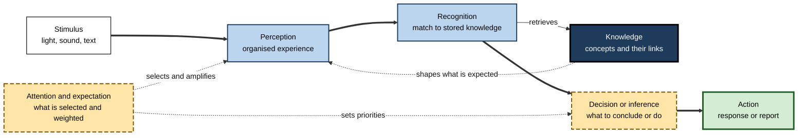
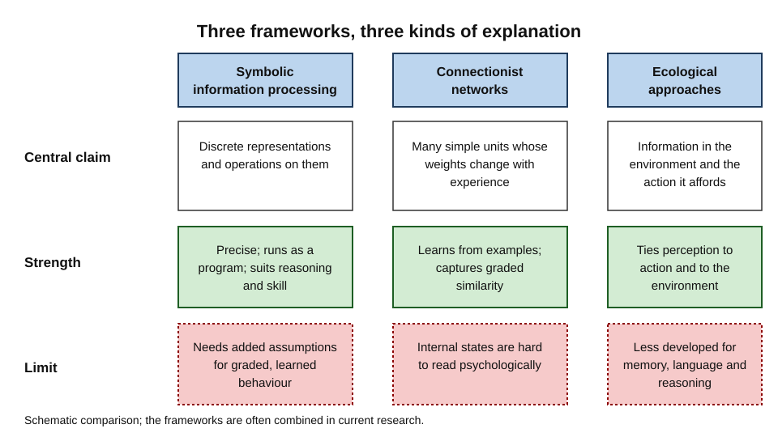
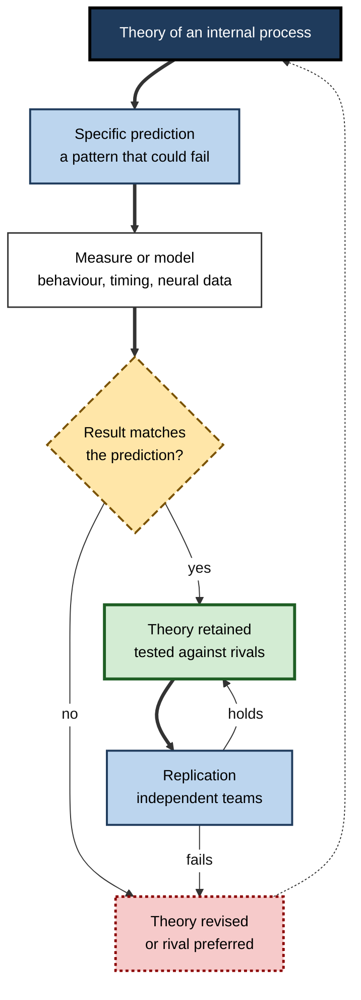
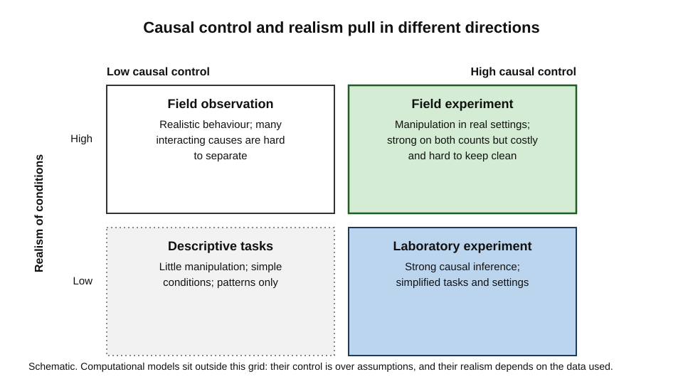
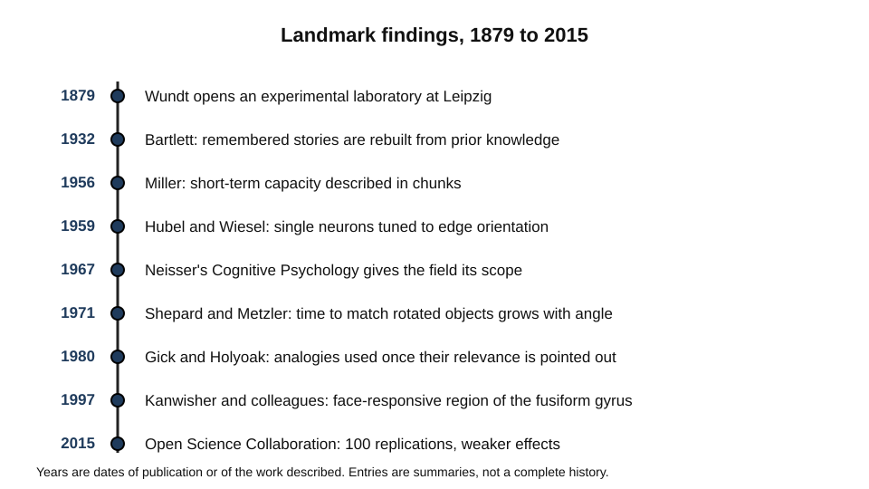
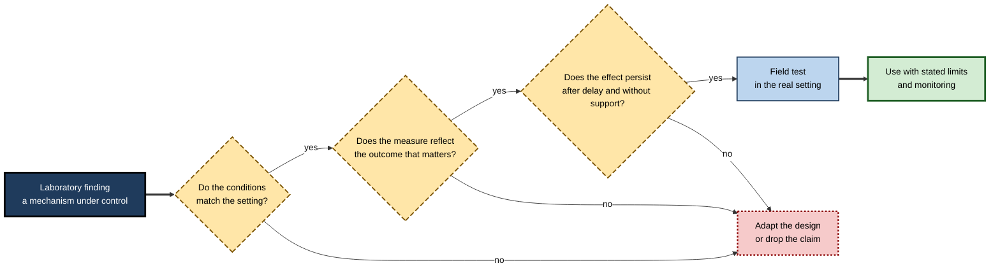

# C. Cognitive Psychology

A pilot notices one warning light among twenty instruments and corrects before the alarm sounds. A shopper finds a familiar brand on a crowded shelf in under a second. A student reads a paragraph twice, understands it the second time, and cannot say what changed. Each of these is a behaviour that depends on processes inside the person: attending, perceiving, recognising, understanding and deciding. Cognitive psychology is the branch of psychology that explains such behaviour by specifying those internal processes and testing them against what people do.

> **Definition — Cognitive psychology:** the scientific study of the internal processes by which people perceive, attend, remember, understand language, reason and solve problems, and of how those processes shape action.

**Why it matters**

- It explains why competent people make systematic errors, and why those errors are predictable rather than random.
- It separates what can be observed, such as speed, accuracy and pattern of errors, from what must be inferred, such as the representation that produced them.
- It gives designers, educators, clinicians and engineers a tested account of how a human will perceive, interpret and act on what they are given.
- It sets standards for evidence. Its best-known achievements are the experiments that could have failed and did not.

---

## What the Field Explains

Cognitive psychology is concerned with the path from input to action. Information arrives as light, sound or touch; it is selected, organised, interpreted, stored, retrieved and used. Each stage can be studied, and each can fail.

- **Perception** turns physical energy into organised experience. How sensation becomes perception of objects and events is the subject of sensation and perception.
- **Categorisation** groups the world into kinds, so that what is known about one member can be used for others; how patterns are recognised and grouped belongs to pattern recognition and categorisation.
- **Representation** is the form in which knowledge is held, whether as statements, images, procedures, networks or models; the field's account of concepts and representations is the subject of that area.
- **Language** converts sound and print into meaning and back again, so that understanding can be shared; how that conversion works is the subject of language processing and comprehension.
- **Reasoning and problem solving** determine how people move from a current state to a goal, and how they test their conclusions; these are the subject of problem solving and reasoning.
- **Decisions, expertise, development and individual difference** shape how these processes are used across a life, which is where the field meets practice.

The field's central claim is that each of these processes can be inferred from behaviour, modelled explicitly and tested. That claim, rather than any particular topic, is what makes the field cumulative.

> **Key point:** cognition cannot be observed directly. Every explanation is an inference from behaviour, from a physical measure, or from a model that predicts behaviour, and its value depends on how sharply it can be tested.

---

## Origins of the Field

### From introspection to measurement

- **Wilhelm Wundt** opened a laboratory at Leipzig in 1879, usually treated as the beginning of experimental psychology.
  - The label "first laboratory" is partly a conventional origin story; the Leipzig laboratory is important as one of the first permanent, purpose-built laboratories for psychological experiments.
  - Early work used trained introspection, in which observers reported their experience under controlled conditions.
- Introspection proved hard to standardise. Later work asked instead for measurable behaviour: accuracy, speed, errors and their pattern.

### Memory and perception as construction

- **Frederic Bartlett (1932)** showed that remembered stories drift towards familiar expectations, arguing that remembering is a reconstruction guided by prior knowledge.
- **Max Wertheimer (1923)** described the factors that cause elements to be seen as wholes, starting a tradition in which organisation is a property of perception itself rather than of added judgement.
- Both lines of work anticipated the view that cognition is active and shaped by what is already known.

### The cognitive turn

- In the 1950s and 1960s, researchers in psychology, linguistics, computing and neuroscience began to explain behaviour in terms of internal representations and processes that could be modelled and tested.
- **Ulric Neisser's** book *Cognitive Psychology* (1967) gave the field a comprehensive statement of its scope and helped popularise the name, although the term had been used earlier. Neisser described cognition as the processes by which sensory input is transformed, reduced, elaborated, stored, recovered and used.
- **George Miller (1956)** argued that the capacity of short-term memory is better described in chunks, meaningful units, than in bits, and this idea became a foundation for later work on memory and expertise.
- **Allen Newell and Herbert Simon (1972)** described human problem solving as search through states, and showed how much of it could be modelled.

> **Watch out:** the field's history is often told as a simple succession from behaviourism to cognition. In practice, behavioural methods and cognitive concepts coexisted for decades, and many modern studies use both.

---

## Core Assumptions

Most work in the field rests on a few shared assumptions.

- **Processes are real but hidden.** Attention, memory and reasoning are inferred from patterns of behaviour and from measures such as timing and neural activity.
- **Processes have stages.** A complex response usually depends on a sequence of operations, each of which can be disrupted separately.
- **Processes have limits.** Capacity, speed and accuracy vary, and their limits shape what people can do.
- **Representations mediate behaviour.** The same input can produce different responses because it is represented differently.
- **Explanations must predict.** A process is credible when it predicts outcomes that rival accounts would not.

> **Remember:** the field does not claim that the mind is a computer program, that people are rational optimisers, or that behaviour is fixed. It claims that behaviour can be explained by structured, limited and testable internal processes.

**Figure 1.** The stages that a cognitive explanation typically posits between a stimulus and an action.

---

## Competing Frameworks

The field has organised its explanations around a small number of frameworks. Each is useful for some questions and weak for others.

**Figure 2.** Three frameworks, their central claims and their characteristic limits.

- **Symbolic information processing** explains behaviour through discrete representations and operations on them, such as rules, propositions and procedures.
  - Strength: precise, easy to implement as a program, and well suited to reasoning and skill.
  - Limit: slower to explain graded, context-sensitive and learned behaviour without many added assumptions.
- **Connectionist networks** explain behaviour through many simple units whose connection weights change with experience.
  - Strength: learn from examples, degrade gracefully and capture similarity and graded categories.
  - Limit: harder to interpret, and the link between the network's internal states and psychological constructs needs separate argument.
- **Ecological approaches** explain perception through information that is available in the structured environment, and through the action possibilities it offers.
  - Strength: explain how perception is tied to action and to the environment in which it occurs.
  - Limit: less developed as an account of memory, language and reasoning, which depend more on internal representation.

> **Key point:** the frameworks disagree about how much of cognition is representation, how much is learned and how much is shaped by the environment. Most current research uses elements of several.

### Landmark debates

- **Symbols or patterns?** Whether knowledge is best described by discrete symbolic structures or by distributed patterns of activation remains unresolved.
- **Construction or pickup?** Whether perception builds representations from sensory evidence and prior knowledge, or picks up information already present in the environment, is a long-running question.
- **Modular or distributed?** Whether mental processes are carried out by separable specialised systems, or by broadly shared resources, is contested, especially for faces, language and reasoning.
- **Laboratory or life?** Whether laboratory processes operate in the same way in the conditions of ordinary life is an open empirical question.

---

## How Explanations Are Built and Tested

### The cycle of discovery

The field moves through a repeated cycle. A theory makes a prediction; an experiment or model tests it; the result either supports the theory or forces a revision. The cycle works only when the predictions are specific enough to fail.

**Figure 3.** The cycle by which explanations are proposed, tested and revised.

### Replication and its lessons

- In 2015 the **Open Science Collaboration** repeated 100 published psychology studies. About 97% of the original studies reported statistically significant results, but only about 36% of the replications did, and the replication effects were roughly half the size of the originals.
- The finding did not show that psychology was uniquely unreliable. It showed that effect sizes in published work had often been overstated, and that single studies are weak evidence on their own.
- The response has been wider use of preregistration, larger samples, open materials and replication as a routine part of research.

> **Watch out:** a failed replication does not prove that an effect is false. It shows that the evidence is less certain than the original report, and that its conditions need to be specified more carefully.

### Control and realism

Every method trades control against realism. A tightly controlled experiment establishes cause but may not resemble ordinary life; a study of ordinary behaviour resembles life but cannot easily separate causes.

**Figure 4.** The trade-off between causal control and realism in four common approaches.

- **Laboratory experiments** establish cause through manipulation and random assignment, but simplify tasks and settings.
- **Field observation** captures realistic behaviour, but cannot easily separate the influence of many interacting factors.
- **Field experiments** manipulate conditions in real settings, which gives both control and realism, but are costly, slow and hard to keep clean.
- **Computational models** make assumptions explicit and generate precise predictions, but they are only as good as the assumptions and the data used to fit them.

---

## Landmark Findings at a Glance

The field's progress is visible in a few landmark findings, each of which changed what researchers could claim.

**Figure 5.** Landmark findings and the questions they opened.

- **Sternberg (1966)** showed that response time rises with the number of items held in memory, which made the internal scanning of memory measurable.
- **Shepard and Metzler (1971)** showed that the time to judge whether two rotated objects match grows with the angle between them, making mental imagery measurable.
- **Hubel and Wiesel (1959)** showed that single cortical neurons respond selectively to the orientation of edges, giving a physical basis for feature detection.
- **Gick and Holyoak (1980)** showed that analogies are often not noticed spontaneously, but can be used once their relevance is pointed out.
- **Kanwisher, McDermott and Chun (1997)** identified a region of the fusiform gyrus that responded more to faces than to other objects in most participants, prompting a long debate about specialisation.

---

## Applying the Field

Cognitive psychology is applied wherever human performance matters, but the path from laboratory result to practice is rarely direct.

**Figure 6.** The steps by which a laboratory finding should be checked before it is used in practice.

- **Education:** the field informs how learners retain material, how instruction is sequenced, and how feedback works. Evidence from a laboratory must be tested over delays and in the classroom.
- **Design of interfaces and information:** perception, attention and language determine what users notice, how they read a display and how they interpret a label.
- **Safety-critical work:** detection failures, fatigue and expectation shape how operators respond to alarms and instructions.
- **Decision support and artificial intelligence:** systems that present information change what people perceive, remember and conclude, so they must be evaluated with human performance measures, not only with system accuracy.
- **Clinical and occupational assessment:** the field supplies measures of attention, memory and reasoning, and it also explains why a single test can fail to represent everyday function.

### Case study (illustrative): redesigning a claims form

- **Situation:** an insurance company's claims form was revised several times to add fields. Claims were increasingly returned for missing information, and customers complained that the form was confusing.
- **Problem:** the form was complete in the company's view, but customers and staff misread several sections.
- **Diagnosis:**
  - the form relied on field labels that were ambiguous in ordinary language, which produced misreadings;
  - a negative instruction sat inside a long sentence, so readers built the wrong meaning;
  - the sections were ordered by internal process, not by the order in which people recall their own experience, so customers searched for information they had already forgotten;
  - staff trusted the form's apparent completeness and did not check against the claim.
- **Actions:**
  1. Watched a sample of customers complete the form and recorded where they paused, went back and asked questions.
  2. Rewrote labels in plain language and split long instructions into numbered steps.
  3. Reordered sections to follow a short sequence of events that customers could recall.
  4. Asked staff to predict, for a set of sample claims, which fields would be missing, then compared the predictions with the errors.
- **Result (illustrative figures):** returns for missing information fell over the following quarter, and staff predictions became more accurate.
- **Side effects / caveats:** the revised form was longer in places, and needed monitoring as products changed.
- **Lesson:** the same form can be perceived, understood and remembered differently by different people. Testing the form against how people read and recall it is more informative than testing whether it looks complete.

---

## Open Questions

- **Which framework will prove most useful?**
  - Symbolic, connectionist and ecological accounts each explain some findings better than others. Their integration is incomplete.
- **How far do laboratory effects survive in ordinary life?**
  - Many effects have been shown in controlled settings; the conditions under which they hold in practice are less well known.
- **How much of cognition is specialised and how much is shared?**
  - Evidence for specialised systems, such as face processing, is strong in some domains and contested in others.
- **How reliable are the field's findings?**
  - Replication has shown that some effects are robust and others weaker than first reported. The proportion across the field is still being estimated.
- **How should cognitive science respond to artificial systems that perform human-like tasks?**
  - Similar outputs do not establish similar processes, and the field is still developing ways to tell them apart.

---

## Summary

- **Cognitive psychology** explains behaviour through internal processes that are inferred from performance and tested by experiment, measurement and models.
- The field's roots include Wundt's experimental laboratory, Bartlett's reconstructive memory, the Gestalt account of organisation and the cognitive turn of the 1950s and 1960s.
- **Neisser's** 1967 book gave the field a comprehensive statement of its scope, and **Newell and Simon** showed how problem solving could be modelled as search.
- Explanations take the form of **stages** and **representations**, which must make predictions that could fail.
- Three frameworks dominate: **symbolic** processing, **connectionist** networks and **ecological** approaches, each with its strengths and limits.
- Method involves a trade-off between **control** and **realism**; computational models make assumptions explicit.
- The **Open Science Collaboration** showed that many published effects were weaker in replication, which made replication and precise reporting central.
- Landmark findings, such as the measurement of memory scanning and mental rotation, and the discovery of orientation-selective neurons, changed what researchers could claim.
- In practice, a laboratory finding must be checked for conditions, measures and persistence before it is used in a real setting.

---

## Self-Check

1. Define cognitive psychology and name four processes it studies.
2. Why does cognitive psychology treat cognition as something that must be inferred?
3. What was Wundt's contribution, and why is the "first laboratory" claim partly a conventional origin story?
4. What did Bartlett's work on remembering a folk tale show about memory?
5. Explain why Neisser's definition of cognition is broader than the processes that respond to a current stimulus.
6. What does a computational model add to a verbal theory, and what risk does it carry?
7. Compare the symbolic, connectionist and ecological frameworks using one strength and one limit for each.
8. Describe the cycle by which a cognitive explanation is proposed, tested and revised.
9. What did the Open Science Collaboration find, and what does a failed replication not establish?
10. Explain the trade-off between control and realism, and name one method that tries to reduce it.
11. Why is a landmark finding such as memory scanning important even if its interpretation is debated?
12. A vendor claims that a new dashboard improves decisions because users find items faster in a demonstration. Identify two gaps in this evidence.
13. How would you test whether a laboratory effect of attention holds in a busy clinic?
14. A system produces answers like a human expert. What evidence would show that its processes are similar to the expert's, rather than merely its outputs?

### Answer Key

1. Cognitive psychology is the scientific study of internal processes that shape behaviour. Examples include perception, attention, memory, language comprehension, reasoning and problem solving.
2. Processes such as attention and retrieval are not directly observable, so they must be inferred from behaviour, from physical measures such as timing and neural activity, or from models that predict behaviour.
3. Wundt opened the Leipzig laboratory in 1879 and used trained introspection under controlled conditions. The "first" label is partly an origin story; the Leipzig laboratory is significant as one of the first permanent, purpose-built laboratories for experimental psychology.
4. Recall of an unfamiliar story drifted towards familiar expectations and was reshaped by prior knowledge, which showed that remembering is a reconstruction rather than a copy.
5. Neisser included processes that run without current external input, such as imagery and hallucinations, so an account limited to responses to stimuli would miss them.
6. A computational model states the process precisely enough to generate predictions and expose hidden assumptions. Its risk is that a model can fit data for reasons unrelated to the mechanism it claims to describe.
7. Symbolic: explicit and precise, but slower to explain graded and learned behaviour. Connectionist: learns from examples and captures graded similarity, but its internal states are harder to interpret. Ecological: explains perception tied to action and environment, but is less developed for memory, language and reasoning.
8. A theory is used to make a specific prediction, which is measured or modelled. If the result matches, the theory is retained and tested against rivals; if not, it is revised or a rival is preferred. Replication by independent teams tests whether the result holds.
9. About 97% of original studies were significant, against about 36% of replications, with replication effects roughly half the size. A failed replication does not prove that an effect is false; it shows the evidence is less certain or that conditions need specifying.
10. Laboratory experiments give strong causal control but simplified settings; field observation gives realism but weak causal separation. Field experiments attempt both, though they are costly and difficult to keep clean.
11. It fixed a method for measuring an internal process and showed how process structure could be inferred from timing. Its interpretation can be debated while its methods remain useful.
12. The demonstration may reflect familiarity with the tasks rather than the dashboard's effect. It lacks a comparison with the current tool, delayed testing, and evidence about decisions rather than speed.
13. Run the effect in the clinic with realistic interruptions and workload, measure the outcome that matters, such as errors or time to decision, and test again after a delay to check that the effect persists.
14. Evidence would include whether the system's errors and response times resemble the expert's on the same items, whether it fails in similar ways under similar conditions, and whether interventions that disrupt the expert's process disrupt the system's in analogous ways.

---

## Glossary

| Term | Meaning |
|---|---|
| Cognitive psychology | The study of internal processes that shape behaviour, tested through experiment and models. |
| Cognitive turn | The shift from the 1950s onward to explaining behaviour through internal representations. |
| Computational model | A precise, runnable description of a process whose predictions can be compared with data. |
| Connectionist network | A network of simple units whose connection weights change with experience. |
| Control–realism trade-off | The tension between causal certainty in controlled settings and relevance to ordinary life. |
| Ecological approach | An account of perception through information in the environment and the action it affords. |
| Falsifiable prediction | A prediction that a possible result would contradict. |
| Inference | A conclusion about an internal process drawn from behaviour, measures or models. |
| Introspection | Reporting one's own experience, used early in the field and now treated cautiously. |
| Replication | Repeating a study to test whether its findings recur. |
| Representation | An internal structure that stands for something and guides processing. |
| Symbolic information processing | An approach that explains behaviour through discrete representations and operations on them. |
