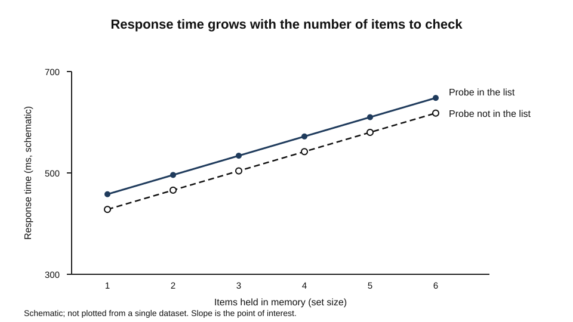
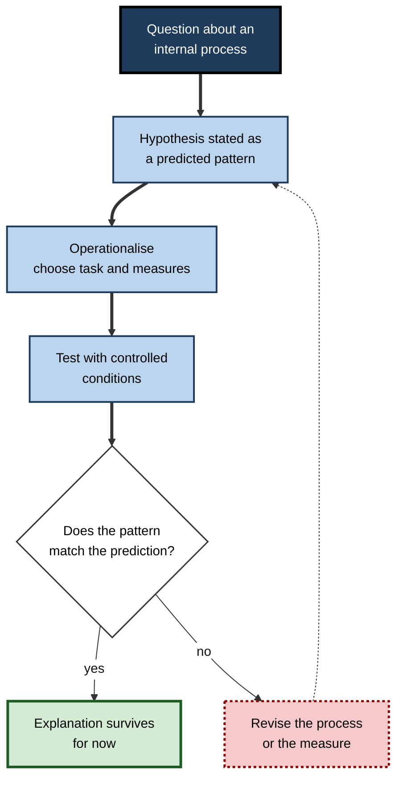
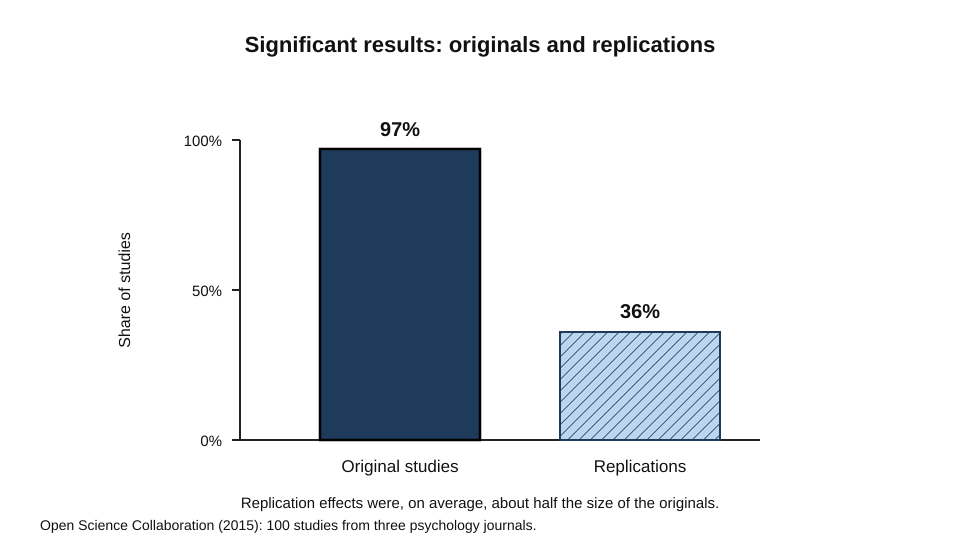
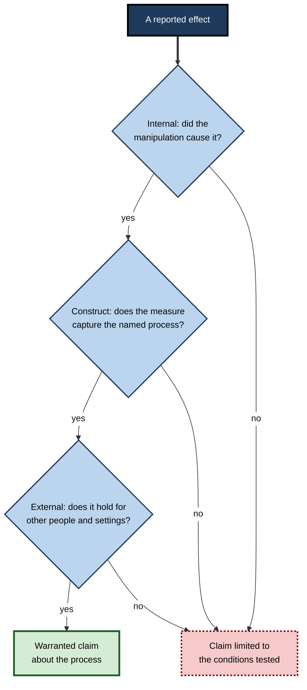
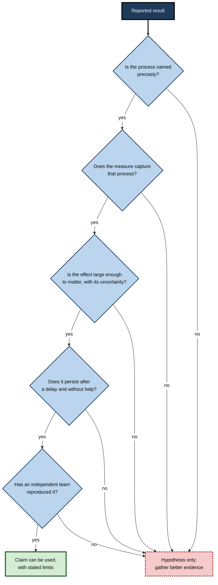

# C.1. Foundations of Cognitive Psychology

A driver sees a child move towards the kerb and brakes before deciding to. A customer-service agent recalls a refund rule and applies it to a case no manual describes. A student reads the same mathematical result for the second time and fails to recognise it.

Each event is a behaviour, and each has an internal explanation: a perception, a retrieval, a judgement that happened inside a person and cannot be seen directly. Cognitive psychology is the branch of psychology that specifies those internal processes and tests them against what people actually do.

> **Definition — Cognitive psychology:** the branch of psychology that explains behaviour in terms of internal mental processes, such as perception, attention, memory, language and reasoning, and tests those explanations with controlled experiments.

**Why it matters**

- It explains why two people given the same instruction behave differently: the difference often lies in how the instruction was perceived, stored or retrieved.
- It locates failure. A slow or error-prone performance can be traced to a specific stage, which points to a specific remedy.
- It supplies the evidence used by people who design training, software, instructions, clinical tools and decision-support systems.
- It disciplines explanation. A mental process is accepted only when it predicts behaviour that could have turned out otherwise.

---

## What "Cognition" Covers

The word comes from the Latin for "to know", but in the field it names something much broader than factual knowledge.

- **Neisser's definition (1967):** in his book *Cognitive Psychology*, Ulric Neisser described cognition as the set of processes by which sensory input is transformed, reduced, elaborated, stored, recovered and used.
  - The list is a sequence of operations, not a list of faculties.
  - *e.g.* a spoken instruction is transformed into sound patterns, reduced to its meaning, elaborated with what the listener already knows, stored, later recovered, and used to choose an action.
- **Processes without outside input:** Neisser included imagery and hallucinations, which arise without a current stimulus.
  - Cognition is therefore not a response to the world alone; the mind also generates and manipulates representations.
- **Unconscious processes count:** most cognition is never reported.
  - *e.g.* a reader recognises a misspelt word without noticing the spelling error.

> **Definition — Cognitive process:** a mental operation that transforms information, such as recognising a shape, retrieving a rule or comparing two options, and that can be inferred from behaviour.

> **Key point:** the field is organised around processes, not around the things people say or do. A process is the explanation; behaviour is the evidence for it.

---

## Where the Discipline Began

### Laboratories and introspection

- **Leipzig, 1879:** Wilhelm Wundt opened a laboratory at the University of Leipzig devoted to experimental psychology.
  - It is usually treated as the start of psychology as an independent experimental discipline.
  - The "first laboratory" label is partly an origin story. Historians note that the Leipzig laboratory was notable as a permanent, purpose-built space for experimental psychological work, which is the sense that matters.
- **Trained introspection:** Wundt's early experiments asked observers to report, in trained and controlled terms, what they experienced while perceiving a stimulus.
  - The aim was to make inner experience a measurable object.
  - Reports varied between observers and depended heavily on training, so later psychologists moved towards measures that others could repeat.
- **The lesson that survived:** a person's account of how they reached a judgement is often a reconstruction rather than a record.
  - Later methods therefore measure behaviour directly: accuracy, timing, errors and the pattern of errors.

> **Watch out:** introspection is not useless. Reports of what someone is attending to are often accurate; reports of *why* a choice was made are less reliable. Cognitive psychology uses reports cautiously and checks them against behaviour.

### Memory as reconstruction

**Study card — Bartlett (1932)**

- **Design:** English participants read an unfamiliar folk tale from another culture, then recalled it after increasing intervals. In a second version, each recall was passed to the next person in a chain (serial reproduction).
- **Results:**
  - recall shortened the story and dropped details that did not fit familiar expectations;
  - unfamiliar elements were often changed into familiar forms;
  - the main outline survived while the surface detail drifted.
- **Conclusion:** remembering is an active, meaning-driven reconstruction shaped by prior knowledge, not a replay of a recording. Bartlett called the organised prior knowledge involved a *schema*.
- **Significance:** the study moved the field away from the idea that memory is a passive store of traces and towards the idea that understanding and recall are constructive.

### The cognitive turn

- In the 1950s and early 1960s, researchers in several disciplines began to explain behaviour by internal representations that could be modelled and tested.
- Neisser's 1967 book gave the approach a comprehensive statement of its scope and helped popularise the name, although the term had been used earlier.
- The move drew on information theory, the emerging computer, and a growing dissatisfaction with explanations that stopped at stimulus and response.

> **Definition — Information processing approach:** the view that the mind can be described as a system that receives, stores, transforms and outputs information through identifiable stages.

---

## The Core Assumptions

Every study in the field rests on a few assumptions. Knowing them makes the field's claims easier to judge.

- **Processes are real but hidden.** Attention, memory and reasoning are not observed; they are inferred from patterns in behaviour.
- **Processes have stages.** A complex response usually depends on a sequence of operations, each of which can be disrupted separately.
- **Processes have limits.** Capacity, speed and accuracy vary, and the limits themselves are informative.
- **Representations mediate behaviour.** The same stimulus can produce different responses because it is represented differently.
- **Explanations must predict.** A theory earns credibility by predicting outcomes that a rival theory would not.

> **Remember:** cognitive psychology does not claim that the mind is a computer, that people are rational, or that behaviour is simply the output of fixed programs. It claims that behaviour can be explained by internal processes that are structured, limited and testable.

---

## How the Field Gathers Evidence

### The experimental logic

A controlled experiment compares conditions that differ in one respect.

- **Independent variable:** the factor the experimenter manipulates.
  - *e.g.* whether a warning label is placed near an exit on a diagram.
- **Dependent variable:** the measure that responds.
  - *e.g.* the time taken to locate the exit, and the number of wrong choices.
- **Control condition:** a comparison without the manipulation, so that any change can be attributed to it.
- **Random assignment:** participants are allocated to conditions by chance, so that individual differences are spread across groups.
- **Counterbalancing:** when every participant does every condition, the order of conditions is varied so that order effects do not masquerade as effects of the manipulation.
- **Within-participant and between-participant designs:** the first compares each person with themselves, which is more sensitive; the second compares different people, which avoids carry-over but needs more participants.

> **Worked example (illustrative):** a team asks whether a warning label speeds up finding the exit on a building plan.
>
> 1. **Define the outcome:** time from the start signal until the participant points to the exit.
> 2. **Create the conditions:** plans with the label placed near the exit, and plans with no label.
> 3. **Randomise and counterbalance:** half of the participants see the labelled plans first; the order of plans is shuffled.
> 4. **Analyse:** compare times and errors across conditions, not just averages for one group.
> 5. **Conclude:** the label helps only if the difference is larger than ordinary variation and persists across the plans used.
>
> **Watch out:** a difference between conditions can arise from something other than the manipulation, such as the participants' familiarity with the layout or a visual habit of the designer. A good design rules out these alternatives explicitly.

### Measures

| Measure | What it reveals well | Main limitation |
|---|---|---|
| Accuracy and error patterns | Which items are handled correctly, and which confusions recur | Many processes can produce the same accuracy |
| Response time | How long a stage takes; changes in processing steps | Slower can mean harder, more careful, or less practised |
| Eye movements | Where and when visual attention lands | Looking is not the same as processing what is seen |
| Verbal reports | Content people can describe about their own processing | Reports are often reconstructions |
| Neural measures | Where and when brain activity changes with a task | Correlation with a process does not establish its function |
| Computational models | Whether a proposed set of processes could produce the data | A model can fit data for the wrong reasons |

### Study card — Sternberg (1966)

- **Design:** participants were shown a short list of digits, then a single probe digit. They judged whether the probe had been in the list. The number of items in the list (the set size) was varied, and response times were recorded.
- **Results:**
  - response time increased roughly linearly with set size;
  - the rate of increase was about the same whether the probe was in the list or not.
- **Interpretation:** the author argued that participants compared the probe with each item in turn, and did so for every item, even after a match. He called this serial, exhaustive scanning.
- **Significance:** the study showed that a mental operation could be timed from outside and that its structure could be inferred from how time scales with load.
- **Status:** the result is widely replicated, but the exact interpretation has been debated. The slope and the intercept of the function are often read as different stages, and later work has tested the assumptions of that reading rather than accepting it as settled.

**Figure 1.** Response time as the number of items held in memory increases.

> **Key point:** timing is one of the field's most powerful tools. When time rises in step with load, a process is being repeated for each item; when it does not, the process may be parallel or may not be involved.

### Process diagrams

The field usually moves through the same cycle when it tests an explanation.

**Figure 2.** The cycle by which cognitive explanations are tested.

---

## Replication and Its Discontents

### Study card — Open Science Collaboration (2015)

- **Design:** teams of researchers repeated 100 published studies from three leading psychology journals, using the original materials where possible.
- **Results:**
  - about 97% of the original studies reported statistically significant results;
  - about 36% of the replications reached statistical significance;
  - the average size of the effects in replications was roughly half that of the originals.
- **Conclusion:** many published findings were weaker in replication than in the original report.
- **Significance:** the project turned replication from an occasional exercise into a standard part of the field's self-correction.

**Figure 3.** Statistical significance in the original studies and in their replications.

> **Watch out:** a failed replication does not prove that an effect is false. Replications can differ in population, materials, measurement or analysis. The correct conclusion is that the evidence for the effect is less certain than the original report suggested, and that the size of the effect needs to be estimated more carefully.

> **Remember:** before accepting a finding, ask how large the effect is, how many people were studied, whether the design was preregistered, and whether independent teams have reproduced it.

---

## Theories, Models and Explanation

- **Verbal theories** state a mechanism in words. They are easy to write and hard to test, because loose wording can accommodate almost any result.
- **Mathematical models** state the relation between variables in equations. They make precise predictions but may hide assumptions in their parameters.
- **Computational models** are running programs that process inputs in the way the theory proposes. They expose hidden assumptions, because the program must do something specific at every step.
- **Parsimony:** when two models explain the data equally well, the simpler model with fewer free parameters is usually preferred, though this is a rule of thumb and not a proof.

> **Definition — Falsifiable prediction:** a prediction that a given result would contradict. A theory whose predictions cannot be contradicted tells the reader nothing about how the process works.

> **Watch out:** a model that reproduces a pattern of data has not thereby shown that the mechanism is right. Rival models often make the same prediction for the variable that was measured and differ for a variable that was not.

---

## Validity: What a Study Can and Cannot Show

Three kinds of validity determine how far a finding can be trusted and carried over.

- **Internal validity:** did the manipulation cause the difference, rather than some confound?
  - Random assignment, control conditions and counterbalancing protect it.
- **Construct validity:** does the measure capture the process it is supposed to capture?
  - *e.g.* a task that reads response time as "memory" may in fact be measuring motor speed.
- **External validity and ecological validity:** do the results hold in other people, settings and tasks?
  - Laboratory tasks are simplified. Their results may not transfer to a busy workplace or a classroom without testing.

**Figure 4.** The three questions that determine how far a result can be trusted.

---

## Ethics and Participants

- Participants must be informed about what will happen, and must be able to stop without penalty.
- Deception is sometimes unavoidable in cognitive experiments, because knowing the purpose can change the process being studied. When used, it must be justified and followed by a debrief.
- Data from people are personal. Records should be anonymised and retained only as long as the study requires.
- Studies that involve learners, patients or employees raise additional questions about consent when the researcher also has authority over them.

---

## Professional Practice in the Foundations

### Reading a claim critically

- **Identify the process claimed.** "Memory" or "attention" is too vague; ask which operation is meant.
- **Identify the measure.** Does it capture that operation, or a neighbouring one?
- **Check the effect size and its uncertainty**, not only whether a result is significant.
- **Ask for the delay and the conditions.** An immediate, unaided test and a delayed, unaided test answer different questions.
- **Look for replication.** A single striking study is a hypothesis, not a settled fact.

**Figure 5.** The questions that turn a reported result into a usable conclusion.

### Case study (illustrative): a usability team's "quick reaction test"

- **Situation:** a product team wanted to show that a redesigned navigation menu made users "think less". Their evidence was a demonstration in which participants found three items quickly.
- **Problem:** the demonstration used the same tasks the designers had practised, with the designers present.
- **Diagnosis:**
  - the measure was speed on familiar items, which reflects familiarity as much as design;
  - there was no comparison with the old menu;
  - the claim "less thinking" was not measured at all.
- **Actions:**
  1. Specified the process claim: users locate target items with fewer errors and fewer detours.
  2. Ran a between-participant comparison of old and new menus, with participants who had not seen either before.
  3. Added a delayed return visit a week later to test whether the layout was learned and remembered.
  4. Recorded eye movements to see where users searched before selecting.
- **Result (illustrative figures):** the new menu produced faster first selections, but the advantage shrank by the delayed test, and the eye-movement data showed longer searches in one section.
- **Side effects / caveats:** the team had to choose between a quick launch and a delayed test; the delayed test was smaller than planned.
- **Lesson:** a demonstration that shows speed is not evidence about the process behind it. The claim has to be specified, measured under fair conditions and checked over time.

---

## Open Questions

- **Which kind of explanation should win?**
  - Accounts of the same behaviour can be given in terms of neurons, representations or computations; how these should be integrated remains unsettled.
- **How much of the lab result survives contact with real work?**
  - Simplified tasks give clean measurements, but the conditions that matter in practice are often messy.
- **How reliable are the field's most famous effects?**
  - Large replication efforts have shown that some effects are robust and others considerably weaker; the proportion across the field is still being estimated.
- **Can introspection be made trustworthy?**
  - Self-report remains attractive because it is cheap, yet it is systematically shaped by reconstruction.

---

## Summary

- **Cognitive psychology** explains behaviour through internal processes, which are inferred from performance and tested by experiment.
- **Cognition**, in Neisser's sense, is the set of processes that transform, store, recover and use information, and it includes unconscious and internally generated processes.
- The field's roots lie in Wundt's experimental laboratory and in the move from introspection to measurable behaviour; Bartlett showed that memory is reconstructive.
- Good studies use **controlled conditions, random assignment and counterbalancing**; the choice of measure determines which process is actually being observed.
- **Sternberg's** work showed that response time can reveal how a process scales with load.
- The **Open Science Collaboration** found that many published effects were weaker in replication, which made replication a core discipline.
- Explanations must be **falsifiable**; models must be checked for hidden assumptions and rival fits.
- Every claim needs **internal, construct and external validity** before it is carried into practice.
- In practice, a claim is only as strong as the process it names, the measure it uses and the delay and conditions under which it was tested.

---

## Self-Check

1. Define cognitive psychology in one sentence, and name three processes it studies.
2. Explain Neisser's definition of cognition. Why did he include imagery and hallucinations?
3. Why did Wundt's trained introspection give way to measures of behaviour?
4. What did Bartlett's study of an unfamiliar folk tale show about memory?
5. In Sternberg's task, what does it mean that response time rose with set size, and what did the author conclude?
6. Describe the logic of random assignment and counterbalancing, and say what each protects against.
7. Distinguish internal, construct and external validity with an example of a threat to each.
8. What did the Open Science Collaboration find about the replication of published studies, and what does a failed replication not prove?
9. Why is a verbal theory that accommodates every result scientifically weak?
10. Explain why a model that fits a data pattern may still have the wrong mechanism.
11. A training vendor shows that trainees answer a quiz faster after a session. Identify two reasons this does not show that a process has changed.
12. Why might a measure of response time reflect familiarity rather than the process a designer intends?
13. A team proposes that users "think less" with a new interface. Write a testable version of this claim.
14. Compare a within-participant and a between-participant design for measuring the speed of a simple decision. What does each cost?

### Answer Key

1. Cognitive psychology explains behaviour in terms of internal processes; examples include perception, attention, memory, language and reasoning.
2. Cognition is the set of processes by which input is transformed, reduced, elaborated, stored, recovered and used. Imagery and hallucinations arise without current external input, so an account that covers only responses to stimuli would miss them.
3. Reports of experience varied between observers and depended on training, and people's accounts of their judgements are often reconstructions. Measures of accuracy, timing and errors offered reproducible evidence.
4. Recall was shortened and reshaped to fit familiar expectations, and unfamiliar details were changed. Memory is an active reconstruction shaped by prior knowledge rather than a replay of a stored record.
5. Each additional item added time, which suggests the items were checked one at a time. The author concluded that the scanning was serial and exhaustive, examining every item even after a match.
6. Random assignment spreads individual differences across groups, protecting against systematic bias. Counterbalancing varies the order of conditions, protecting against order effects that could mimic a treatment effect.
7. Internal: a confound such as a different test difficulty between groups. Construct: a response-time task that mainly measures motor speed. External: a laboratory result that does not hold for experienced staff in a busy setting.
8. About 97% of original studies were significant, against about 36% of replications, with replication effects roughly half the original size. A failed replication does not prove the original effect is false; the conditions may differ, or the effect may be smaller than first reported.
9. Such a theory cannot be contradicted by data, so it does not specify how the process works or allow rivals to be compared.
10. Different mechanisms can produce the same pattern for the measured variable and diverge elsewhere. A fit shows consistency, not uniqueness.
11. The quiz may be easier to answer faster because of familiarity with the questions, or practice on the test format. Speed on a quiz that was just taught does not show retained or transferred change.
12. A well-practised item is processed faster regardless of design, so the speed may reflect what users already know rather than the effect of the new layout.
13. For example: "Compared with the old menu, new users will complete the three tasks with fewer errors and fewer returns to the top of the menu, and the advantage will persist at a one-week return visit."
14. The within-participant design is more sensitive and needs fewer people, but practice effects can carry over between conditions. The between-participant design avoids carry-over but needs more participants and is more affected by individual differences.

---

## Glossary

| Term | Meaning |
|---|---|
| Between-participant design | Different people experience different conditions. |
| Cognition | The processes by which input is transformed, stored, recovered and used. |
| Cognitive process | A mental operation inferred from behaviour. |
| Construct validity | The degree to which a measure captures the process it is intended to measure. |
| Control condition | A comparison condition without the manipulation. |
| Counterbalancing | Varying the order of conditions across participants. |
| Dependent variable | The measured outcome that responds to manipulation. |
| Ecological validity | The degree to which findings apply to real-world settings. |
| External validity | The degree to which findings generalise to other people, tasks and settings. |
| Falsifiable prediction | A prediction that a possible result would contradict. |
| Independent variable | The factor the experimenter manipulates. |
| Information processing approach | Describing the mind as stages that receive, store, transform and output information. |
| Internal validity | The degree to which a manipulation, rather than a confound, caused the observed difference. |
| Introspection | Reporting one's own experience; used in early laboratory work and now treated cautiously. |
| Random assignment | Allocating participants to conditions by chance. |
| Replication | Repeating a study to test whether its findings recur. |
| Schema | Organised prior knowledge that shapes perception, memory and interpretation. |
| Serial exhaustive scanning | Checking each item in turn, including after a match has been found. |
| Within-participant design | The same participants experience every condition. |
