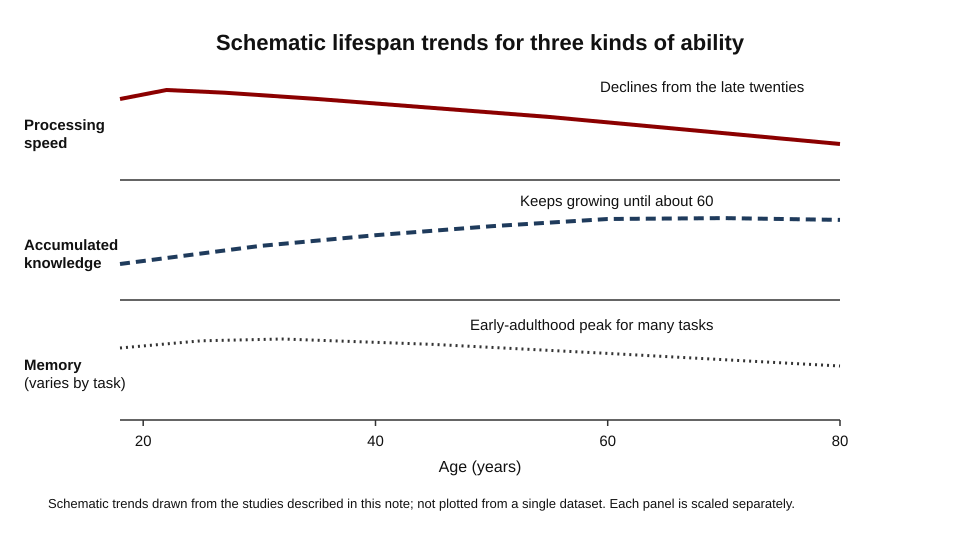
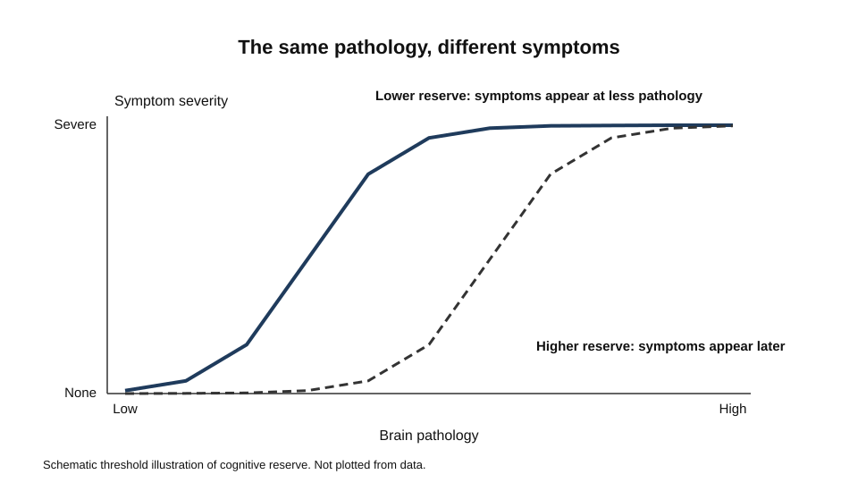
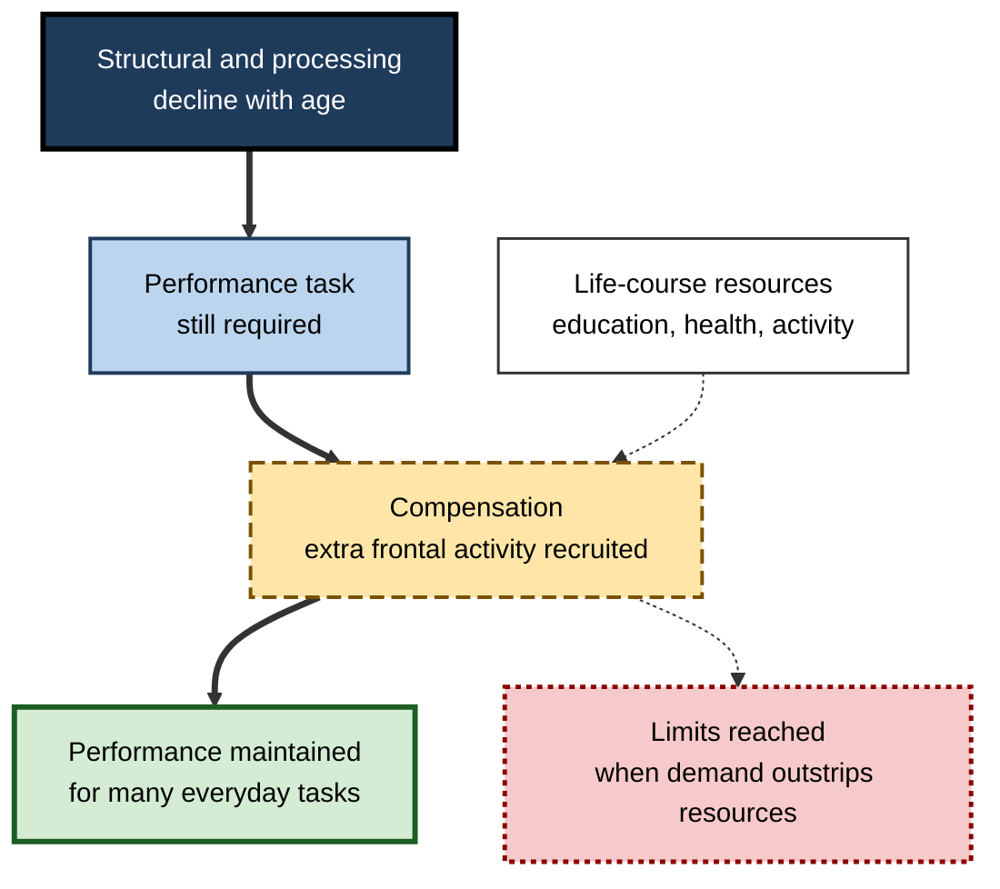
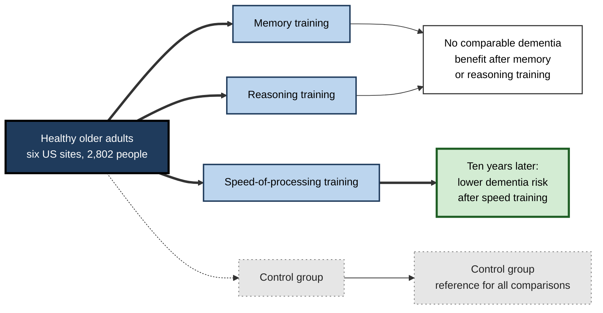
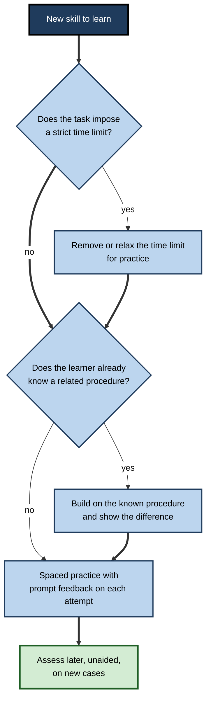

# C.10. Cognitive Aging and Learning

A sixty-eight-year-old retiree learns to use a new banking app. She is slower than her grandchildren at finding the right screen, but she recognises the logic of the menus quickly, asks sharper questions and rarely repeats a mistake.

A forty-five-year-old project lead finds that remembering the names of new colleagues has become harder, yet her judgement about which risks matter has improved. A company that employs many people over fifty asks whether its training works for them, and whether the answer should differ from the one it gives to younger staff. Each case involves the same underlying question: how do cognitive abilities change across adulthood, and what does that change mean for learning?

> **Definition — Cognitive ageing:** the changes in cognitive function across adult life. These changes are not uniform: some abilities decline, some continue to grow and some change little, and the pattern varies between individuals.

**Why it matters**

- Ageing is one of the largest sources of variation in cognitive ability within a workforce, and training designed for one age group can fail another.
- Common beliefs about older learners are often too simple. Some are partly true, some are false, and some have not been tested.
- Understanding which abilities decline, which are protected and which can be trained changes how learning should be designed.
- The effects on everyday functioning matter for safety, independence and the length of working life.

---

## Different Abilities, Different Paths

### One pattern, several trajectories

- **Speed and novel reasoning** — tend to be highest in early adulthood and decline gradually afterwards.
- **Accumulated knowledge** — such as vocabulary and general information, typically continues to grow into middle and later adulthood.
- **Memory tasks** — results depend strongly on the type of task, and some memory measures are at their best in early adulthood.

These patterns describe averages. An individual can show a different profile, with a stronger or weaker ability in each area.

### Study card — Salthouse (2009)

- **Design:** a longitudinal study followed about 2,000 healthy adults aged 18 to 60 over seven years, testing several cognitive abilities on repeated occasions.
- **Results:**
  - Measures of some abilities, such as rapid comparisons and reasoning on abstract problems, were at their best early and began to decline in the late twenties.
  - Measures of accumulated knowledge, such as vocabulary and general knowledge, continued to increase at least until about age 60.
- **Conclusion:** the decline in some measures begins much earlier than common usage of the word "ageing" suggests, while knowledge-based abilities keep growing.

> **Watch out:** the early onset of decline in some measures does not mean that people are functionally worse at 30 than at 20. Most tasks in working life rely on several abilities at once, and experience can compensate for slower processing.

### Study card — Hartshorne and Germine (2015)

- **Design:** very large samples completed online cognitive tests, supplemented by reanalysis of older test data covering many subtests.
- **Results:**
  - Different components of cognitive ability peak at different ages. Some fluid-related components peak in early adulthood, while some others peak as late as about age 40.
  - Older adults on average performed better on vocabulary tasks, and younger adults on memory-related tasks.
- **Conclusion:** there is no single age at which cognition peaks. Each ability has its own trajectory.

> **Definition — Crystallised knowledge in later life:** accumulated information and skill that can keep growing with experience, even when processing speed is declining.

**Figure 1.** Schematic lifespan trends for three kinds of ability.

---

## Processing Speed

### Salthouse's processing-speed account

- **Salthouse (1996)** proposed that much of age-related decline in cognition reflects a decrease in the speed at which many mental operations can be carried out.
- **Consequences:**
  - a slower sequence of operations takes longer to complete;
  - when a task depends on holding earlier results while later steps run, the slower steps can leave earlier results at risk of being lost;
  - tasks with strict time limits show the effect most clearly.
- **Practical effect:** learning on self-paced material, with time to think, reduces the cost of slower processing. Learning under time pressure increases it.

> **Watch out:** processing speed is not the whole story. Experience, strategy and knowledge can offset slower operations, which is why performance on real tasks often declines more slowly than laboratory measures.

---

## Brain Changes and Compensation

### Cognitive reserve

> **Definition — Cognitive reserve (Stern's account, 2002):** the brain's ability to cope with damage or ageing, which may rest on using its networks more efficiently or on recruiting alternative networks when needed.

- **Passive models** — reserve is a fixed amount of brain tissue or capacity; people with more of it can sustain more damage before symptoms appear.
- **Active models** — reserve is the ability to use networks flexibly, so that people with more reserve compensate for damage.
- **Key distinction:**
  - *Reserve* — optimising performance in the normal state.
  - *Compensation* — raising performance after damage by using structures or networks not needed in an undamaged brain.
- **Why it matters:** the same amount of brain pathology can be associated with different levels of symptoms in different people, which reserve helps to explain.

**Figure 2.** The same pathology can produce different symptoms depending on reserve.

### Scaffolding and compensation in older brains

- **Park and Reuter-Lorenz (2009)** argued that older adults often show increased activity in frontal brain regions during tasks that younger adults perform with less activity.
- **Scaffolding theory** interprets this pattern as adaptive: the brain recruits additional support, or scaffolding, to maintain performance as the original structures decline.
- **Later revision** — the same authors updated the model (2014) to include life-course factors, such as education and health, that build or deplete neural resources.

**Figure 3.** How scaffolding and compensation are thought to maintain performance in later life.

> **Watch out:** increased activity in an older brain may reflect compensation, but it can also reflect inefficiency. The interpretation of brain imaging in ageing is debated, and a more active region does not by itself prove better performance.

---

## Learning in Later Adulthood

### Where older learners are slower

- **Speeded material** — tasks with strict time limits, such as fast-paced e-learning with timed quizzes.
- **Dense new information** — large amounts of unfamiliar material presented at once, which strains working capacity.
- **Unstructured tasks** — learning with no framework connecting new details, so that the learner has nothing to attach them to.

### Where older learners are strong

- **Knowledge-rich domains** — prior knowledge gives a framework that makes new material easier to connect and retain.
- **Self-paced, meaningful practice** — time to think, and material with a clear purpose, reduce the cost of slower processing.
- **Judgement and integration** — experienced learners often see patterns and exceptions that newcomers miss.

> **Key point:** the variables that matter most for older learners are usually the design of the learning, not age alone. Pace, prior knowledge and feedback can shift outcomes more than the learner's age does.

### Study card — Edwards and colleagues (2017), the ACTIVE trial

- **Design:** the ACTIVE trial randomly assigned 2,802 healthy older adults at six US sites to memory training, reasoning training, speed-of-processing training or a control group. Training was delivered in a limited number of sessions, with booster sessions later.
- **Results:**
  - Over ten years, the speed-of-processing group had a lower dementia risk than controls; the reduction was about 29%.
  - The memory and reasoning groups did not show the same dementia benefit.
- **Conclusion:** a specific form of training was associated with a lower dementia risk over a decade. The result is encouraging, but the mechanism and its generality still need confirmation.
- **Earlier follow-up:** a ten-year follow-up (Rebok and colleagues, 2014) reported that gains on the targeted reasoning and speed abilities were maintained, while memory-training gains on memory performance were not.

**Figure 4.** The structure of the ACTIVE trial and the outcomes reported.

> **Watch out:** a trial's headline outcome is one of many outcomes measured. Confidence in a result grows when it is replicated, and when the outcome was specified before the analysis.

### Designing training for older learners

| | Common default | Design for later-life learners |
|---|---|---|
| Pace | Fixed pace with timed tests | Self-paced, with time to think |
| Link to prior knowledge | Introduce new terms and tools without connection | Map new steps onto procedures the learner already uses |
| Practice | One long session | Spaced sessions with time to consolidate |
| Feedback | End-of-course score | Prompt feedback on each attempt |
| Support | Learner must remember steps | Reference material available during practice |

**Figure 5.** A decision path for designing training when pace and prior knowledge matter.

---

## Professional Practice

### Case study (illustrative): a quality-system rollout in manufacturing

- **Situation:** a manufacturer introduced a new quality-control system. Training was delivered as fast-paced online modules with timed quizzes. Many long-serving operators had difficulty completing them.
- **Problem:** completion rates were lower among older operators, and some managers concluded that the older workforce could not adapt.
- **Diagnosis:**
  - The modules imposed strict time limits on each step, which penalised slower responding rather than understanding.
  - The new system's procedures were presented without reference to the operators' existing quality checks, which they had used for years.
  - Feedback came only as an end-of-module score, so errors were not corrected in the moment.
- **Actions:**
  1. Remove the timed quizzes during practice and keep time limits only for a final assessment, set with a generous allowance.
  2. Map each new procedure onto an existing check that operators already performed, and explain the difference.
  3. Use spaced practice sessions across three weeks, with a reference card available at each step.
  4. Give prompt feedback after each practice attempt.
  5. Evaluate the training by performance on new cases after two weeks, without reference material.
- **Result:** completion rates converged across age groups, and error rates on new cases fell for all groups. The firm reported that the older operators' fault rates were comparable with those of younger colleagues after training.
- **Side effects and caveats:** the redesign took longer to build, and the firm had to keep checking that the final assessment was not penalising slower but competent learners.
- **Lesson:** the mismatch was in the design of the training, not the age of the learners. Pace, prior knowledge and feedback determined the outcome.

---

## Open Questions

- **How much of later decline is reversible, and through what means?**
  - Training gains have been reported, but durability and transfer to everyday tasks are still being tested.
- **Does domain expertise protect performance in later life?**
  - The question is actively studied, and the answer probably differs by domain and by the kind of expertise.
- **Which reserve measures are valid across cultures and education systems?**
  - Reserve is usually estimated from education, occupation and activity, and these proxies vary widely in meaning.
- **Why do some brains show more compensation than others?**
  - Imaging differences are reported consistently, but their causes and their functional meaning remain unsettled.
- **How should working life and training be designed as the workforce ages?**
  - Evidence from controlled trials is growing, but workplace studies are fewer and harder to control.

---

## Summary

- **Cognitive ageing** is uneven: some abilities decline, others keep growing, and individual paths differ.
- **Salthouse (2009)** found declines in some measures from the late twenties, while knowledge-based measures continued to rise until about 60.
- **Hartshorne and Germine (2015)** showed that different abilities peak at different ages.
- Salthouse's **processing-speed account** explains why slower operations matter most under time pressure.
- **Cognitive reserve** (Stern, 2002) explains why the same brain pathology can produce different symptoms.
- **Scaffolding theory** (Park and Reuter-Lorenz, 2009) interprets extra frontal activity in older adults as adaptive, though the interpretation is debated.
- Older learners are most affected by speeded and unstructured learning; prior knowledge, self-paced practice and prompt feedback help them.
- The **ACTIVE trial** reported a lower dementia risk over ten years for speed-of-processing training, and the result needs confirmation.
- Training for older staff should be designed around pace, prior knowledge and feedback, and not around age stereotypes.

---

## Self-Check

1. Why is cognitive ageing better described as a set of trajectories than as a single decline?
2. Summarise Salthouse's 2009 findings on the timing of decline in some measures and on knowledge-based measures.
3. What did Hartshorne and Germine find about the age at which different abilities peak?
4. Explain Salthouse's processing-speed account and why it matters most under time pressure.
5. Distinguish reserve from compensation in Stern's framework.
6. What does the passive-versus-active distinction in reserve models predict about two people with the same brain pathology?
7. Describe scaffolding theory and state one reason its interpretation is debated.
8. Which kinds of learning design are most likely to disadvantage older learners, and why?
9. What did the ACTIVE trial find about speed-of-processing training and dementia risk, and what caveats apply?
10. How do the memory and reasoning training groups differ from the speed group in the ACTIVE trial?
11. A manager concludes that older staff cannot learn a new system. Identify two design explanations that fit the evidence better.
12. Design a short training module for a team that includes experienced staff in their fifties and new hires. What would you measure, and when?

### Answer Key

1. Because abilities change differently: some decline, some grow, and individuals differ in their profiles. A single decline curve hides these differences and leads to poor design decisions.
2. Measures of rapid comparison and abstract reasoning declined from the late twenties in some measures, in a study of about 2,000 adults aged 18 to 60 over seven years. Vocabulary and general knowledge continued to increase at least until about 60.
3. Different components of cognitive ability peak at different ages; some peak as late as about 40, and older adults on average did better on vocabulary than younger adults.
4. Salthouse proposed that much decline reflects slower mental operations. Slower operations matter most when a task has strict time limits or requires holding earlier results while later steps run.
5. Reserve refers to the brain's capacity to optimise performance in its normal state, while compensation refers to raising performance after damage by using networks not needed in an undamaged brain.
6. In passive models, people with more reserve tolerate more pathology before symptoms appear. In active models, people with more reserve use their networks more flexibly to compensate. Both predict that the same pathology can produce different symptoms.
7. Scaffolding theory proposes that increased frontal activity in older adults is a compensatory response to declining structures. The interpretation is debated, since more activity can also indicate inefficiency.
8. Speeded, dense and unstructured learning disadvantage older learners most, because each adds load on processing speed or working capacity without giving a framework to connect new material.
9. Speed-of-processing training was associated with about a 29% lower dementia risk over ten years compared with controls; memory and reasoning training were not. Caveats include the need for replication and the fact that dementia was one of many outcomes.
10. The speed group showed the dementia benefit; the memory and reasoning groups did not. Follow-up reports also indicated that memory-training gains on memory performance were not maintained.
11. Design explanations include time limits that penalised slower responding and training that did not connect to procedures the staff already used. Feedback only at the end of the course is a third candidate.
12. A good answer uses self-paced practice with spaced sessions, links to existing procedures, prompt feedback and a delayed unaided assessment on new cases. It compares groups on that assessment and checks that age differences are not driven by design features.

---

## Glossary

| Term | Meaning |
|---|---|
| Cognitive ageing | Changes in cognitive function across adult life, which vary by ability and individual. |
| Cognitive reserve | The brain's capacity to cope with damage or ageing through efficient or flexible use of networks. |
| Compensation | Raising performance after damage by recruiting networks not needed in an undamaged brain. |
| Crystallised knowledge | Accumulated information and skill that can keep growing with experience. |
| Processing speed | The rate at which mental operations can be carried out. |
| Scaffolding theory | The account that increased frontal activity in older adults is an adaptive, compensatory response. |
| Speeded task | A task with strict time limits that penalise slow responding. |
| Trajectory | The pattern of change in an ability across the lifespan. |
