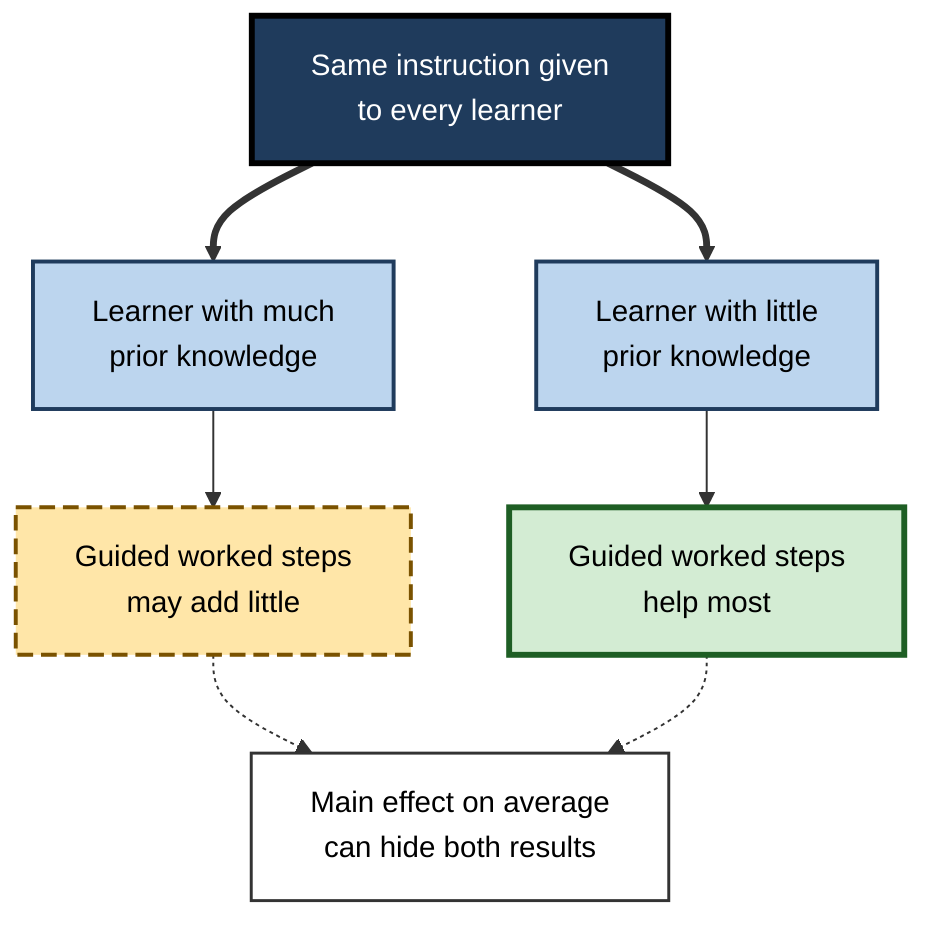
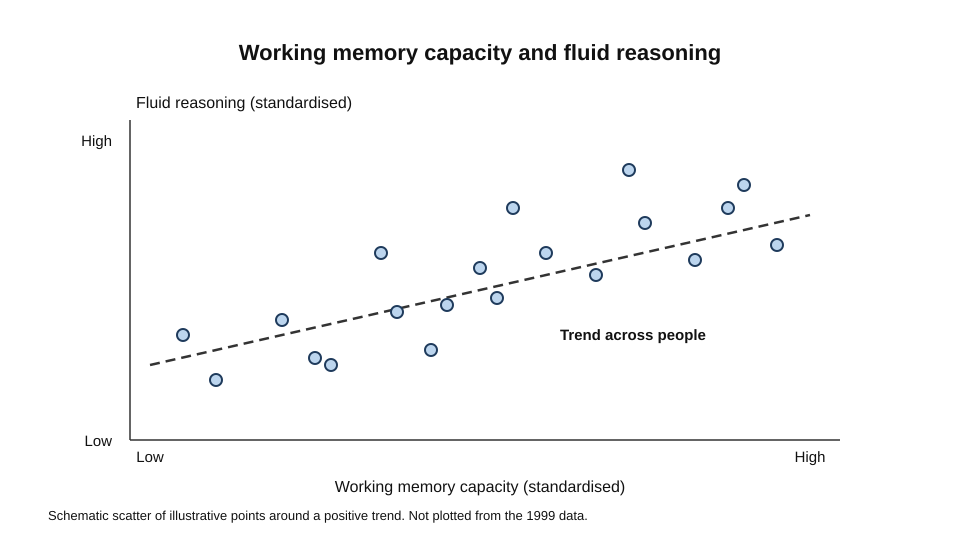
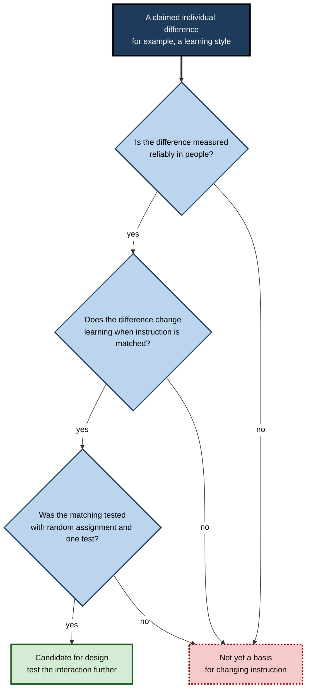
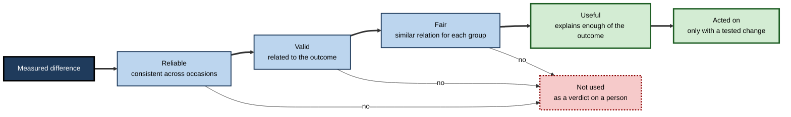
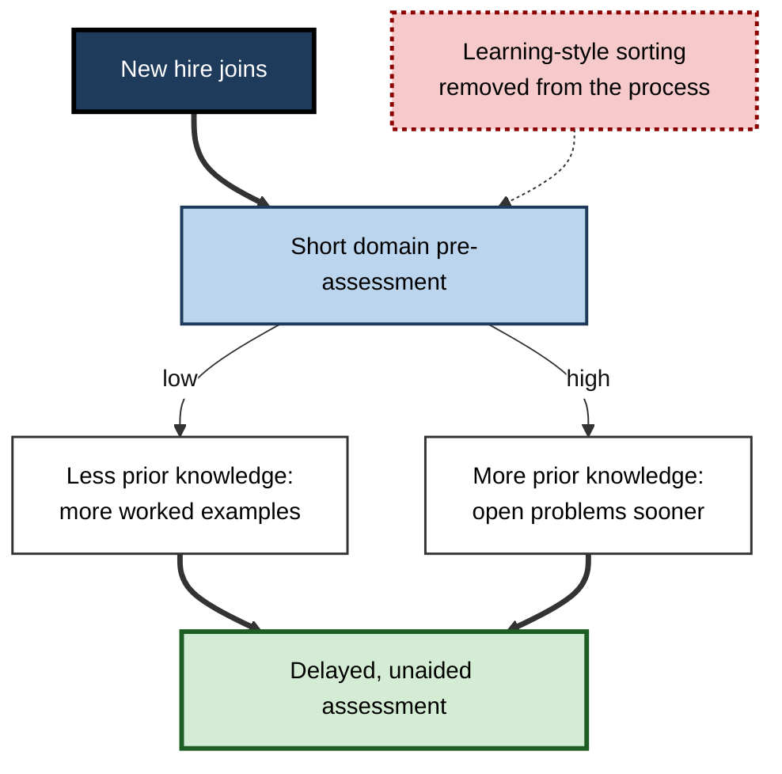

# C.11. Individual Differences in Cognition

Three people sit through the same two-hour workshop on data governance. One already runs a customer database and follows the discussion easily. A second has a strong capacity to hold and manipulate several new rules at once, but no prior exposure to the subject. The third is highly conscientious and reviews the slides every evening, but finds the technical vocabulary hard to hold onto. All three attended the same session and will be assessed on the same material.

Yet each will learn different things at different rates. Cognitive science explains the variation as individual differences: systematic, measurable ways in which people differ in capacity, knowledge, strategy and disposition.

> **Definition — Individual differences in cognition:** systematic and measurable differences between people in cognitive abilities, prior knowledge, strategies and related traits, and in how those differences shape performance and learning.

**Why it matters**

- A teaching method that works well for one group may work poorly for another, so claims about what works must be tested across people, not only on average.
- Selection, placement and support decisions depend on measuring differences fairly and accurately.
- Many popular claims about "types" of learner are not supported by evidence, and knowing how to test them protects against wasted time and unfair treatment.
- The field's central methodological puzzle, how the person and the treatment interact, shapes how research is designed and how professionals should read it.

---

## Two Disciplines and the Interaction Problem

### Cronbach's call

- **Lee Cronbach (1957)**, in his presidential address to the American Psychological Association, described two traditions in scientific psychology.
  - The **correlational** tradition studies differences between people.
  - The **experimental** tradition studies differences between treatments.
- **His argument:** the two should be combined. A unified psychology would examine how people with different characteristics respond differently to different treatments.
- **Interaction** — the effect of a treatment depends on a person characteristic. This is the core idea behind aptitude-treatment interaction research.

> **Definition — Aptitude-treatment interaction:** a pattern in which a learner characteristic (such as prior knowledge, ability or preference) changes which instructional treatment works best.

**Figure 1.** How a learner characteristic can change which treatment works best.

> **Watch out:** an average effect of a treatment can be small while the treatment helps some learners and harms others. Reporting only the average can hide the information a professional needs.

---

## Working Memory and Reasoning Ability

### Study card — Engle and colleagues (1999)

- **Design:** 133 participants completed eleven memory tasks, two fluid intelligence tests and standardised verbal and quantitative tests. Structural equation modelling separated the constructs statistically.
- **Results:**
  - Working memory capacity, as a latent factor, was strongly associated with fluid intelligence.
  - Short-term memory, once storage was separated out, was not associated with fluid intelligence in the same way.
- **Conclusion:** the authors proposed that both working memory and fluid intelligence depend on the ability to keep information active despite interference and distraction, not on passive storage alone.
- **Replication:** a later study with 120 young adults (Conway and colleagues, 2002) reported similar results, with working memory capacity, but not short-term memory or processing speed, predicting general fluid intelligence.

> **Watch out:** a correlation between two measures does not show that one causes the other or that they share a single mechanism. The result describes how individual differences co-vary in a particular sample.

**Figure 2.** A schematic relation between working memory capacity and fluid reasoning.

---

## Prior Knowledge as a Source of Difference

- **Prior knowledge** is often the largest single source of difference between learners in a specific domain.
  - *e.g.* a financial analyst reads a new regulation faster than a general reader, because the terms and the structure are already familiar.
- **Knowledge and general ability are separate sources of difference.** A learner can have high general ability and little domain knowledge, or the reverse.

### Study card — Recht and Leslie (1988)

- **Design:** students who were good or poor readers, and who knew a lot or little about baseball, read a passage describing part of a baseball game. They then reenacted the action.
- **Results:** the poorer readers who knew a lot about baseball outperformed the better readers who knew little about it.
- **Conclusion:** domain knowledge can matter as much as, or more than, general reading ability for understanding a text in that domain.
- **Note on the design:** the study is often cited for its surprising result, and the result is only as strong as the grouping of readers.
- **Caution:** a later critique (Seidenberg, 2020) argued that the procedures used to form the reading-skill groups did not produce groups that clearly differed in reading skill. The finding therefore needs careful reading, and should be treated as suggestive for the knowledge effect rather than as a settled measure of reading ability.

> **Key point:** prior knowledge changes what a learner can attach new information to. Two learners with the same general ability can learn the same material very differently if their knowledge differs.

> **In practice:** when designing training, measure what people already know in the domain before deciding how much support to provide. Assuming that everyone starts from the same base is a frequent cause of poor design.

---

## Personality and Conscientiousness

- **Poropat (2009)** combined studies of the five-factor model of personality with academic performance in a meta-analysis published in *Psychological Bulletin*, with cumulative samples of more than 70,000.
- **Findings:**
  - Several personality dimensions related to academic performance, including conscientiousness, agreeableness and openness.
  - The link between conscientiousness and performance was largely independent of the links with intelligence, where both were tested.
  - Once earlier performance was controlled, conscientiousness added as much to the prediction of later academic performance as intelligence did.
- **Interpretation:** the self-regulatory habits of planning, persistence and orderly work are associated with academic success beyond the abilities a test measures.

> **Watch out:** these are correlations across studies, and their strength varies with the level of education and the age of the students. A conscientious learner can still struggle with a poorly designed course, and a less conscientious learner can succeed with strong structure.

---

## Learning Styles: The Claim and the Evidence

- **The claim:** people learn best when instruction matches their preferred style, such as visual, auditory or kinaesthetic.
- **The distinction that matters:** people do differ in preferences, and some differences in ability are real. The question is whether matching instruction to a stated preference improves learning.

### Study card — Pashler and colleagues (2008)

- **Design:** a review of the research literature, set against strict criteria. A study counted as evidence only if learners were divided by their learning style, randomly assigned to instruction matched or unmatched to that style, and tested on the same measure.
- **Results:** very few studies met these criteria. Among those that did, the matching effect was not supported.
- **Conclusion:** there is no good evidence that tailoring instruction to learning styles improves achievement, and the authors recommended that schools should not invest scarce resources in such matching.
- **Significance:** the review set a clear standard for testing a claim of individual difference in learning. The authors noted that a well-designed future study might still show an effect.

> **Watch out:** the failure of the matching claim does not mean that individuals are identical. Different people have different prior knowledge, abilities and goals, and these can call for different approaches. The matching claim fails because the preferred style is the wrong difference to match on.

**Figure 3.** A test for whether a claimed individual difference should change instruction.

---

## Measuring Individual Differences Well

- **Reliability** — a measure must give consistent results. An unreliable measure cannot separate learners.
- **Validity** — the measure must capture the difference it claims to capture, and predict what it should.
- **Group differences** — average differences between groups do not establish that a measure is biased, and do not establish that it is fair. Fairness requires evidence about how the measure relates to the outcome for each group.
- **Stability** — a trait measured once may change with experience, so a one-off profile can mislead.
- **Base rates** — a difference that is real can still be unimportant if it explains little of the variation in the outcome.

> **Remember:** a measured difference is a starting point for a decision, not a verdict on a person. The best decisions combine several measures, check them against outcomes, and test any change in treatment.

**Figure 4.** The checks a measured difference must pass before it changes a decision.

---

## Professional Use

### Case study (illustrative): personalising onboarding in a professional services firm

- **Situation:** a firm had new staff from many backgrounds. Its onboarding included a short questionnaire that sorted new hires into "learning types", and training was assigned according to the result.
- **Problem:** completion and assessment results did not differ by learning type, and managers complained that the sorting was arbitrary.
- **Diagnosis:**
  - The questionnaire measured stated preferences, which had weak links to outcomes.
  - The training content was the same for all types, only the format changed.
  - The firm had not measured the thing that most affected how quickly new hires learned the material: their existing knowledge of the domain.
- **Actions:**
  1. Stop sorting by learning type and remove the claim that the questionnaire predicts learning.
  2. Give a short pre-assessment of domain knowledge at the start of onboarding.
  3. Offer more worked examples to those with less prior knowledge and more open problems to those with more.
  4. Keep the questionnaire for preference data only, and let learners choose formats without a claim that matching will improve learning.
  5. Compare outcomes on a delayed, unaided assessment across the adjusted and standard paths.
- **Result:** completion improved for the newest hires, and the delayed assessment showed a modest gain. The improvement was clearer for those with least prior knowledge.
- **Side effects and caveats:** the pre-assessment added time at the start, and a few experienced hires disliked being tested on material they assumed they knew.
- **Lesson:** the useful individual difference was prior knowledge, not a stated style. Measuring what matters for the outcome, and adjusting the content to it, works better than matching format to preference.

**Figure 5.** The redesign of onboarding around prior knowledge rather than stated style.

---

## Open Questions

- **Which individual differences matter most for which learning outcomes?**
  - The answer depends on the task, the domain and the measure of learning, and is still being mapped.
- **How stable are the links between cognitive measures and learning in real settings?**
  - Most evidence comes from laboratories and selected samples.
- **Can aptitude-treatment interactions be reliably identified in practice?**
  - Many proposed interactions do not replicate, and testing them requires large samples and careful design.
- **How should individual differences be handled in technology-based learning?**
  - Adaptive systems can respond to learner data, but their evidence base and fairness are not yet well established.
- **Where do personality traits and cognitive abilities interact?**
  - Some combinations appear to matter for performance, but the pattern is not yet clear.

---

## Summary

- **Individual differences** are systematic, measurable differences in abilities, knowledge, strategies and dispositions, and they shape how people learn.
- **Cronbach (1957)** called for combining the study of people and treatments, and introduced the idea of interaction.
- **Engle and colleagues (1999)** found working memory capacity strongly associated with fluid intelligence, but not short-term memory in the same way.
- **Prior knowledge** is often the largest source of difference within a domain, and it can outweigh general ability.
- **Poropat (2009)** found conscientiousness predicted academic performance partly independently of intelligence.
- **Pashler and colleagues (2008)** found no good evidence that matching instruction to learning styles improves achievement.
- Measures must be reliable, valid and checked for fairness; a measured difference is a starting point, not a verdict.
- Good practice measures the difference that matters for the outcome, such as prior knowledge, and tests any change in treatment.

---

## Self-Check

1. Define individual differences in cognition and give one example each of ability, knowledge and disposition.
2. What did Cronbach (1957) argue about the two disciplines of psychology?
3. Explain aptitude-treatment interaction with an example in which an average effect would hide opposite effects.
4. Describe Engle and colleagues' 1999 result on working memory and fluid intelligence, and state the main caution about interpreting it.
5. Why might prior knowledge explain more of a learner's success in a domain than general ability?
6. What caution applies to the Recht and Leslie (1988) study?
7. What did Poropat (2009) find about conscientiousness and academic performance?
8. Describe the criteria Pashler and colleagues (2008) used to judge learning-style evidence, and their conclusion.
9. Why does the failure of the learning-style matching claim not show that individuals are identical?
10. Distinguish reliability from validity, and explain why a reliable measure can still be unfair.
11. A training provider reports that a new method works well on average. What additional information would you ask for before adopting it for everyone?
12. Design a decision rule for when to adjust instruction for a learner characteristic. What evidence should it require?

### Answer Key

1. Individual differences are systematic, measurable variation between people. Ability: capacity for fluid reasoning. Knowledge: the amount of domain-specific information a person already has. Disposition: a trait such as conscientiousness, which shapes persistence and planning.
2. Cronbach argued that correlational psychology (differences between people) and experimental psychology (differences between treatments) should be combined, so that researchers study how people with different characteristics respond to different treatments.
3. If a worked-example treatment helps novices and hinders experts, the average effect may be small, though the effects for each group are large and in opposite directions. Reporting only the average would hide the information needed to decide who should receive the treatment.
4. Working memory capacity, as a latent factor, was strongly associated with fluid intelligence, while short-term memory was not in the same way. The main caution is that correlation does not establish causation or a single shared mechanism.
5. Prior knowledge gives a framework for attaching new information, so two learners with the same general ability can learn the same material at very different rates depending on their domain knowledge.
6. The baseball study suggests a knowledge effect, but a later critique argued that the procedure for forming reading-skill groups did not produce clearly different groups, so claims about reading skill in the study are weak.
7. Conscientiousness was associated with academic performance, largely independently of intelligence, and added as much prediction of later performance as intelligence did once earlier performance was controlled.
8. Learners had to be divided by learning style, randomly assigned to matched or unmatched instruction, and tested on the same measure. Very few studies met these criteria, and among those that did, the matching effect was not supported.
9. The claim fails because the preferred style is the wrong difference to match on, not because people have no differences. Prior knowledge, ability and goals are real differences that may warrant different instruction.
10. Reliability is the consistency of a measure; validity is whether it captures and predicts the intended construct. A reliable measure can consistently capture a difference that is related to group membership rather than to job-relevant skill, so fairness requires evidence about how it relates to outcomes for each group.
11. Ask for the spread of results, the proportion of learners who benefit and who are harmed, delayed and unaided outcome measures, and whether the effect differs by prior knowledge or ability.
12. Change instruction only when the characteristic is measured reliably, when there is evidence of an interaction with the treatment, and when a randomised test shows that matched instruction improves a delayed, unaided outcome.

---

## Glossary

| Term | Meaning |
|---|---|
| Aptitude-treatment interaction | A pattern in which a learner characteristic changes which treatment works best. |
| Correlational psychology | The tradition that studies differences between people. |
| Experimental psychology | The tradition that studies differences between treatments under controlled conditions. |
| Fairness | The degree to which a measure relates to outcomes in the same way for different groups. |
| Individual differences | Systematic, measurable differences between people in abilities, knowledge, strategies and dispositions. |
| Latent factor | A statistical construct inferred from several measures. |
| Learning styles | The claim that learners have preferred modes of instruction that should be matched to teaching. |
| Prior knowledge | Knowledge a learner already holds about a domain before instruction. |
| Reliability | The consistency of a measure across occasions or forms. |
| Validity | The degree to which a measure captures and predicts the construct it claims to measure. |
