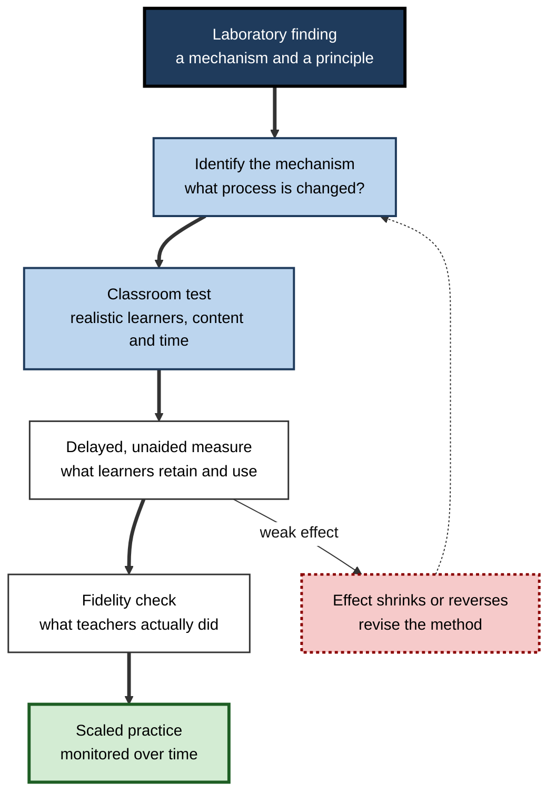
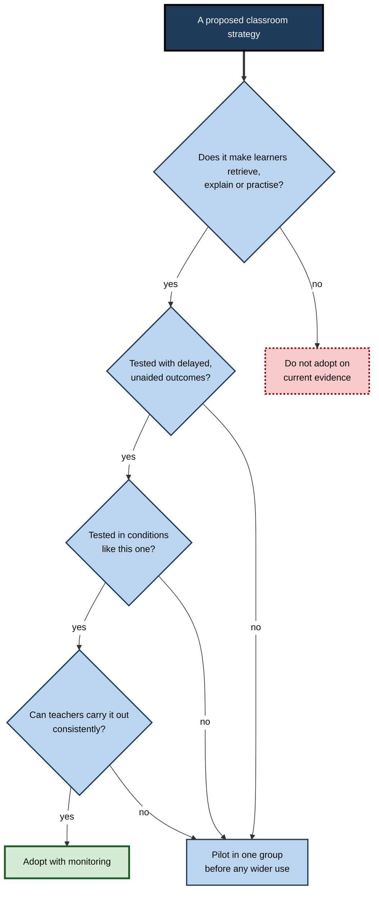
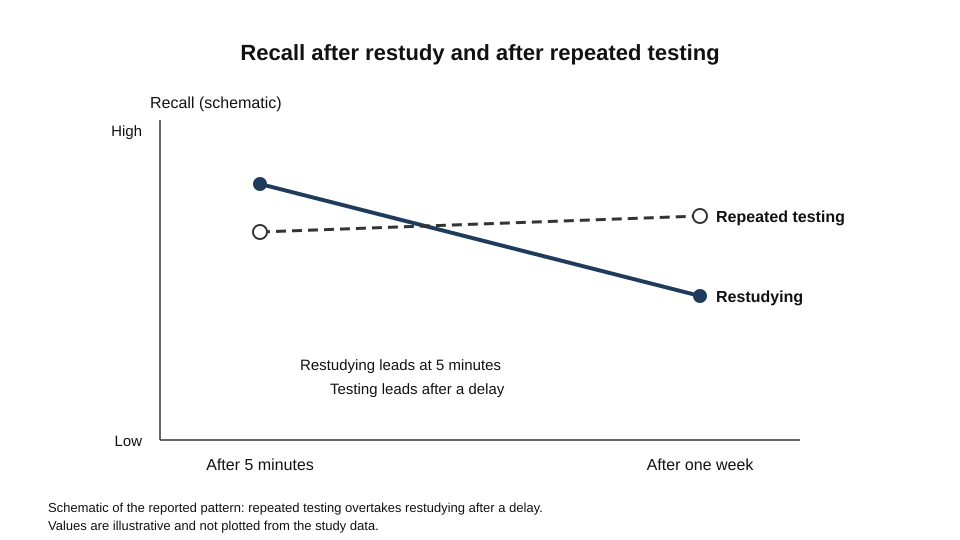
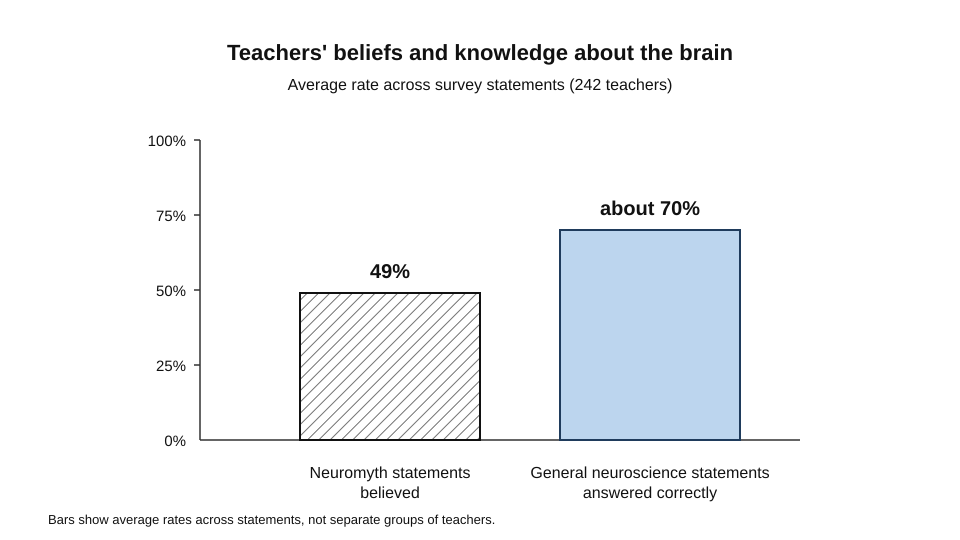

# C.12. Applied Cognitive Psychology in Education

A science teacher notices that students who scored well on last month's unit test cannot answer questions about it now.

A school district buys a reading programme whose manual cites a list of cognitive principles, and asks whether the programme will work.

An online course designer wants to know whether a video with on-screen text helps learners more than a narration alone. Each question can be answered with cognitive research, but none of the answers can be taken straight from a laboratory result. Applied cognitive psychology is the discipline of turning evidence about how people think, remember and learn into decisions about teaching, assessment and design, and of checking whether those decisions work.

> **Definition — Applied cognitive psychology in education:** the use of cognitive research to design, adapt and evaluate instruction, assessment and learning environments, with evidence gathered in the settings where learning actually takes place.

**Why it matters**

- Most education decisions are made on the basis of tradition, intuition, commercial claims or fashion. Cognitive research offers a principled alternative.
- Many laboratory findings do not survive the move into real classrooms without adaptation, so applied work needs its own evidence.
- Poor translation has costs: time lost on ineffective methods, and misconceptions that become institutional habits.
- Teachers, designers and leaders need to judge claims, not just adopt them, and that requires understanding what the evidence does and does not show.

---

## From Laboratory Finding to Classroom Practice

### Why translation is not automatic

- **Conditions differ** — laboratory tasks are often short, controlled and with motivated volunteers; classrooms have time limits, mixed abilities and competing demands.
- **Measures differ** — a laboratory test may check a narrow skill immediately after learning, while schools care about delayed, unaided, transferable performance.
- **Mechanisms are shared, outcomes vary** — a principle can work well in one context and be weak in another, so the same method may need adjusting.

### A translation pathway

1. **Identify the mechanism** — what process is the principle thought to change?
2. **Test in realistic conditions** — with learners, content and time constraints similar to the target setting.
3. **Measure delayed and unaided performance** — what learners can do later, without help.
4. **Adapt and check fidelity** — record what teachers actually do, and whether that matches the design.
5. **Monitor after scaling** — effects can shrink as a method spreads.

**Figure 1.** The steps from a laboratory finding to monitored classroom practice.

---

## Evidence Review and the Rating of Strategies

Teachers and students use many study and teaching strategies, and they need a way to judge which are worth the time. Reviews of the research give a structured basis for those judgements.

### Study card — Dunlosky and colleagues (2013)

- **Design:** a review of ten learning techniques commonly recommended to students, rated for their likely benefit across learners, materials and conditions. The techniques included practice testing, distributed practice, elaborative interrogation, self-explanation, summarisation, highlighting and rereading.
- **Results:**
  - **High utility:** practice testing and distributed practice, which had been shown to improve performance across many kinds of test and for students of different ages.
  - **Low utility:** summarisation, highlighting and underlining, and rereading, even though students report relying on them heavily.
  - The remaining techniques were rated between these extremes, with the rating depending on the conditions where evidence existed.
- **Conclusion:** the most common strategies are not the most effective, and classroom time is better spent on practice testing and spaced practice.

> **Watch out:** a rating describes the evidence available, not a guarantee in every subject or school. It summarises research on the techniques as tested, so it cannot settle how they perform in every classroom.

### Rating classroom strategies

When a leader considers a new classroom approach, four questions structure the judgement.

- **Mechanism** — does the approach make learners retrieve, explain, compare or practise in a way that the research associates with learning?
- **Delayed evidence** — has the approach been tested with delayed, unaided outcomes, not only immediate results?
- **Conditions** — were learners, subjects and time demands similar to this setting?
- **Feasibility** — can teachers carry it out consistently within their workload?

**Figure 2.** Four questions to ask before adopting a classroom strategy.

---

## Testing as Learning, Not Only Assessment

### Study card — Roediger and Karpicke (2006)

- **Design:** students read prose passages and then either restudied them or took repeated free-recall tests without feedback. Their retention was measured after five minutes, two days or one week.
- **Results:**
  - Immediately after learning, repeated studying gave better recall than repeated testing.
  - After one week the pattern reversed: students who had been tested recalled substantially more than those who had restudied.
  - Restudying increased students' confidence in their memory, even when their later recall was weaker.
- **Conclusion:** taking a test is a learning event, not only a measurement. The benefit appears in delayed recall.

**Figure 3.** A schematic of restudy and retrieval over time.

> **Watch out:** a test that checks only recall of the exact words of a lesson will teach narrow recall. Tests designed to require application give learners practice in the skill they will use later.

### Designing assessment for learning

- **Low-stakes quizzes with feedback** — the test itself strengthens memory, and the feedback shows where understanding is weak.
- **Delayed evaluation** — judge whether a teaching change worked with a test given after a delay, not at the end of the unit.
- **Alignment** — the assessment should require the performance the course claims to teach.
- **Feedback on reasoning** — the most useful feedback explains why an answer is right or wrong, not only whether it is.

> **In practice:** when a unit test shows strong results but students forget within weeks, the assessment has measured immediate performance. A delayed test on the same content will show whether learning has taken place.

---

## Misconceptions in Educational Practice

### Study card — Dekker and colleagues (2012)

- **Design:** an online survey of 242 primary and secondary teachers in the United Kingdom and the Netherlands who were interested in the neuroscience of learning. The survey had 32 statements about the brain and learning, 15 of which were neuromyths.
- **Results:**
  - Teachers believed about 49% of the neuromyths on average, with the highest belief in those linked to commercial educational programmes.
  - Teachers answered about 70% of the general neuroscience knowledge statements correctly.
  - Greater general knowledge did not protect teachers from neuromyths; more knowledge in some cases was linked to a stronger belief in them.
- **Conclusion:** interest in neuroscience, and general knowledge of it, does not guarantee that a teacher can separate sound claims from popular myths. Better communication between neuroscience and education is needed.

**Figure 4.** Teachers' knowledge of neuroscience statements compared with their belief in neuromyths.

> **Watch out:** a plausible-sounding brain claim is not evidence. Claims that mention the brain, neurons or specific regions can seem credible, even when they do not support the practice they are used to justify.

### How misconceptions spread

- **Plausible mechanism** — a misconception often rests on a real finding, such as the brain's specialised regions, which is then stretched beyond what the evidence supports.
- **Commercial packaging** — products and programmes that cite a misconception can spread it through training, marketing and school purchasing.
- **Repetition** — a claim repeated in professional development and popular media becomes familiar, and familiarity feels like evidence.

---

## Sequencing, Diagnosis and Planning

- **Diagnostic assessment** — a short check at the start of a unit shows what learners already know, so teaching can build on it rather than repeat it.
- **Sequencing** — decisions about the order of topics depend on what learners need to know first. The aim is to build on existing knowledge without leaving gaps.
- **Planned review** — spaced review is planned in advance, rather than added when tests show forgetting.
- **Worked examples and practice** — how much guidance to give depends on what learners can already do, and should change as they progress.

---

## Professional Development and Implementation

- **Implementation fidelity** — a method can only be judged if teachers use it as designed. Many failed evaluations reflect changed practice rather than a failed principle.
- **Coaching with examples** — teachers learn new methods more readily when they see worked examples of practice and discuss them with colleagues.
- **Reflective use of evidence** — teachers who understand the mechanism behind a method can adapt it sensibly, rather than applying it mechanically.
- **Testing the teacher's own claims** — schools benefit from simple, repeated measures of their own students' delayed performance, not only from external reports.

---

## Technology and New Tools

- **Digital tools** can deliver spaced practice, retrieval questions and immediate feedback at a scale that teachers cannot match alone.
- **Design matters** — a tool that gives answers quickly can take over the effortful thinking that produces learning. Tools should require the learner to do the work that matters.
- **Evidence standard** — claims about an adaptive or AI-based tool should be tested against delayed, unaided outcomes, with comparison groups, before being adopted widely.
- **Teacher role** — tools are most effective when teachers can see the data they produce and use it to plan instruction.

---

## Case Study (illustrative): Retention in a Secondary Science Department

- **Situation:** a secondary school science department noticed that students performed well on unit tests but struggled with the same content weeks later in the following unit.
- **Problem:** teachers' revision was mostly rereading of notes and highlighting, and the unit tests were given immediately after each topic.
- **Diagnosis:**
  - The main study methods used by students were among those with low utility in the evidence review.
  - The unit tests measured recall shortly after learning, so they could not show forgetting.
  - Teachers had little shared information about which misconceptions students brought to each topic.
- **Actions:**
  1. Begin each lesson with three retrieval questions drawn from the previous week's content, with feedback given in class.
  2. Plan spaced review across the term, rather than revision only before tests.
  3. Add a delayed test, given a month after each unit, to evaluate whether the changes improved retention.
  4. Run a short diagnostic at the start of each unit, to identify common misconceptions, and adjust teaching accordingly.
  5. Train teachers in the mechanism behind retrieval practice, so they can design good questions.
- **Result:** delayed-test scores rose over two terms, and students' explanations of topics became more accurate. Immediate test scores changed little.
- **Side effects and caveats:** lessons began more slowly, and some students disliked the opening quizzes. The department judged the trade-off worthwhile because delayed performance mattered more for its aims.
- **Lesson:** an evaluation measures what it times. Adopting a method on the basis of evidence is only the start; the test of the change is delayed, unaided performance.

**Figure 5.** The cycle the department used to plan, deliver and evaluate its changes.

```mermaid
%%{init: {'theme':'base','themeVariables':{'fontFamily':'Arial, Helvetica, sans-serif','fontSize':'15px','primaryColor':'#FFFFFF','primaryTextColor':'#111111','primaryBorderColor':'#222222','lineColor':'#333333','secondaryColor':'#F2F2F2','tertiaryColor':'#FFFFFF','clusterBkg':'#FAFAFA','clusterBorder':'#555555','edgeLabelBackground':'#FFFFFF','titleColor':'#111111'}}}%%
flowchart LR
    classDef core    fill:#1F3B5C,stroke:#000000,stroke-width:3px,color:#FFFFFF
    classDef key     fill:#BCD5EE,stroke:#1F3B5C,stroke-width:2px,color:#000000
    classDef detail  fill:#FFFFFF,stroke:#333333,stroke-width:1.5px,color:#000000
    classDef good    fill:#D3ECD3,stroke:#1E5E24,stroke-width:3px,color:#000000

    D["Diagnose at unit start<br/>common misconceptions"]
    R["Retrieval questions<br/>at the start of each lesson"]
    SP["Planned spaced review<br/>across the term"]
    DT["Delayed unit test<br/>one month after the unit"]
    A["Adjust teaching<br/>to the results"]

    D ==> R ==> SP ==> DT ==> A
    A -.-> D

    class D key
    class R,SP detail
    class DT good
    class A core
```

---

## Open Questions

- **How well do laboratory principles transfer across ages, subjects and cultures?**
  - Evidence is strongest for some age groups and subjects, and thinner elsewhere.
- **Which evaluation designs are feasible for schools?**
  - Randomised trials are rare in education, and schools need practical methods that still give reliable evidence.
- **How can misconceptions be corrected rather than replaced?**
  - Training helps some teachers, but the most effective ways of changing deeply held beliefs remain uncertain.
- **What is the right balance between teacher judgement and evidence-based routines?**
  - Experienced teachers hold valuable knowledge that research may not capture, and the boundary between the two is debated.
- **How should new digital and AI tools be evaluated before adoption?**
  - Tools change quickly, and evidence about their effects on delayed, unaided learning is still being gathered.

---

## Summary

- **Applied cognitive psychology in education** uses research to design, adapt and evaluate teaching, assessment and learning environments, with evidence gathered in real settings.
- Laboratory principles do not transfer automatically; conditions, measures and fidelity all matter.
- **Dunlosky and colleagues (2013)** rated practice testing and distributed practice highly, and rereading, highlighting and summarisation lower.
- **Roediger and Karpicke (2006)** showed that testing produced better delayed recall than restudying, even though restudying felt more effective.
- Assessment should be delayed, aligned with the goal and used to give feedback on reasoning.
- **Dekker and colleagues (2012)** found teachers believed about half of the neuromyths presented to them, and general knowledge did not protect them.
- Diagnosis, planned review and implementation fidelity determine whether a principle reaches practice.
- Digital and AI tools should be judged against delayed, unaided outcomes and must require the learner to do the work that matters.

---

## Self-Check

1. Define applied cognitive psychology in education and explain why laboratory findings do not transfer automatically.
2. List the five steps of the translation pathway and say which one is most often skipped.
3. What did Dunlosky and colleagues conclude about the strategies most commonly used by students, and why did the authors caution against treating ratings as guarantees?
4. Describe the design of Roediger and Karpicke's 2006 study and its delayed result.
5. Why did restudying feel more effective to students, and why is that feeling a poor guide?
6. A unit test is given at the end of the unit and shows high scores. What does this measure, and what would you change?
7. What did Dekker and colleagues find about teachers' belief in neuromyths and about their general neuroscience knowledge?
8. Explain how a real finding can be stretched into a neuromyth.
9. What four questions should a leader ask before adopting a classroom strategy?
10. A commercial programme claims to raise results using a brain-based approach. Describe the evidence you would require before purchasing it.
11. Why is implementation fidelity essential for evaluating a teaching method?
12. Design a delayed evaluation for a change in how a school teaches fractions. What would you measure, and when?
13. Why might a digital tool that gives immediate answers reduce learning, even if performance during practice improves?

### Answer Key

1. It is the use of cognitive research to design, adapt and evaluate instruction, assessment and learning environments, with evidence collected in real settings. Laboratory conditions, measures and motivation differ from classroom conditions, so the principle may work differently in practice.
2. Identify the mechanism; test in realistic conditions; measure delayed and unaided performance; check fidelity; monitor after scaling. Delayed and unaided measurement is often skipped, which leads schools to rely on immediate performance.
3. Practice testing and distributed practice were rated highly; rereading, highlighting, underlining and summarisation were rated low, although students relied on them heavily. Ratings describe available evidence and conditions, not guarantees in every subject or school.
4. Students read prose and either restudied it or took repeated free-recall tests without feedback. Retention was measured after five minutes, two days and one week. After one week, students who had been tested recalled substantially more.
5. Restudying increases familiarity and fluency, which feels like knowing. Fluency is a poor indicator of retention after a delay, so students who restudy feel more confident while remembering less.
6. It measures performance at the point of learning, so high scores may not reflect retention. The unit should add a delayed, unaided test and compare results across methods.
7. About 49% of neuromyths were believed on average, and about 70% of general knowledge statements were answered correctly. Greater general knowledge did not protect teachers from neuromyths, and in some cases was linked to a stronger belief in them.
8. A real finding, such as the brain's specialised regions for different senses, is stretched into a claim that the evidence does not support, such as a claim that individual learners need matched teaching for each sense.
9. Does the strategy require retrieval, explanation or practice? Has it been tested with delayed, unaided outcomes? Was it tested in similar conditions? Can teachers carry it out consistently?
10. Evidence would include comparison with a control group, delayed and unaided outcomes, independent evaluation, and details of how the programme was implemented. A brain-based claim alone is not evidence.
11. Without knowing whether teachers used the method as designed, a poor result may reflect changed practice rather than a failed principle. Fidelity separates the two explanations.
12. Use a pre-test, teach the two methods, and give a delayed, unaided test on new fraction problems after several weeks. Compare against a comparison group, and check how teachers implemented each approach.
13. Immediate answers can replace the effortful retrieval or reasoning that builds durable memory, so practice scores rise while unaided performance later does not.

---

## Glossary

| Term | Meaning |
|---|---|
| Applied cognitive psychology | The use of cognitive research to design and evaluate learning in real settings. |
| Delayed test | An assessment given after a gap, used to measure retention. |
| Fidelity | The degree to which a method is implemented as designed. |
| Neuromyth | A widely held belief about the brain and learning that the evidence does not support. |
| Practice testing | Retrieving information from memory as a learning activity. |
| Retention | The persistence of learning over time. |
| Translation pathway | The steps by which a laboratory finding is adapted and evaluated for practice. |
| Utility | A rating of how well a strategy is likely to help learning across conditions. |
