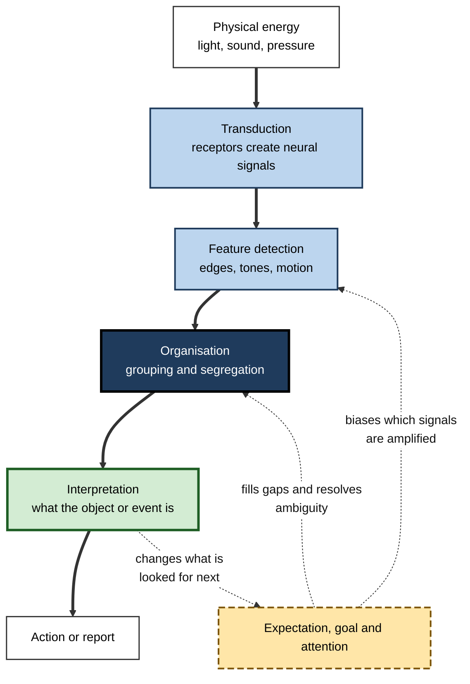
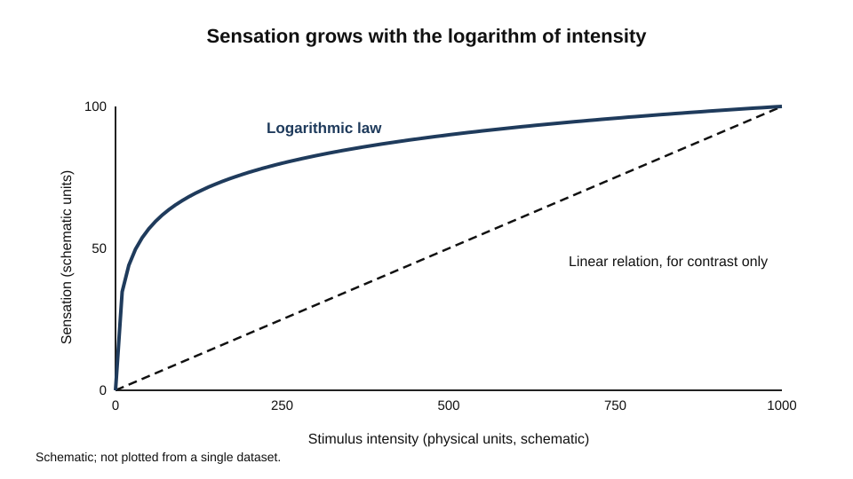
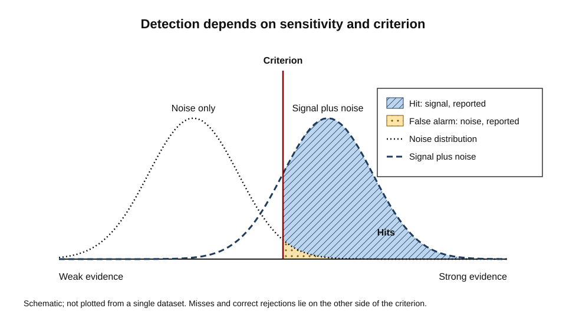
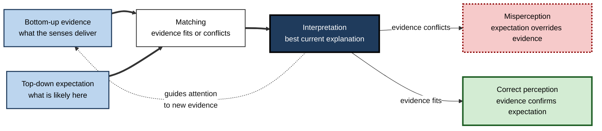
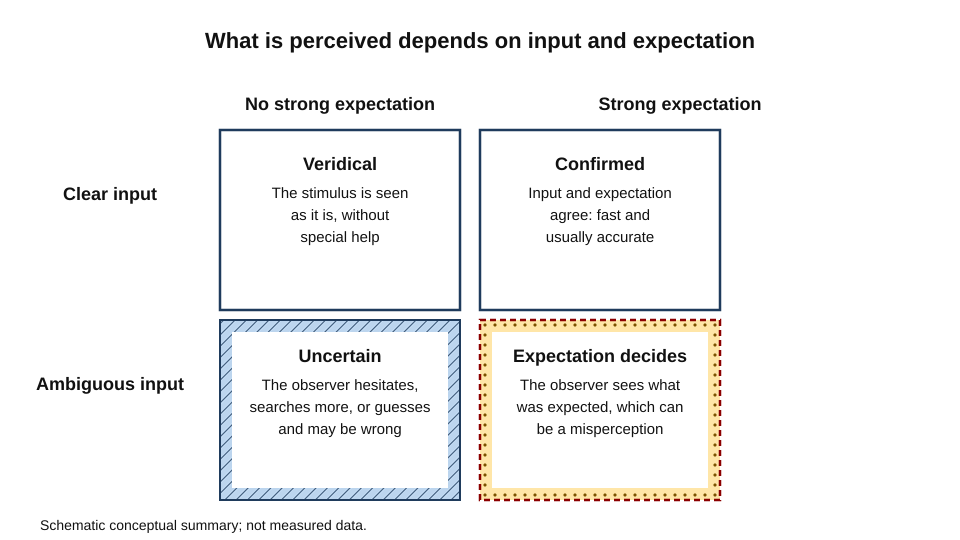

# C.2. Sensation vs. Perception

A radiologist looks at a grey smudge on a scan and sees a small nodule; a trainee looking at the same image sees noise.

A night-shift worker hears a door close two rooms away and knows it is a colleague, not a burglar. A commuter in a crowded station hears a train announcement and misses their own name, then hears the name in a conversation across the platform. In each case the eyes or ears delivered a signal, and the person made something of it. The first step is **sensation**; the second is **perception**. The difference between them is the subject of this account.

> **Definition — Sensation:** the detection of physical energy, such as light, sound, pressure or chemicals, by specialised receptors that convert it into neural signals.

> **Definition — Perception:** the organisation and interpretation of sensory signals so that they become meaningful experience and guide action.

**Why the distinction matters**

- It separates what the sense organs can register from what the mind makes of it. Many performance failures come from the second step, not the first.
- It explains why two observers with equally good eyes can disagree about what is present.
- It shapes how people should be trained: learning to notice a pattern is different from having better vision.
- It underpins design of displays, alarms, medical imaging and vehicle warnings, where what is detected and what is understood must both be engineered.

---

## Two Stages on a Continuum

The distinction is useful, but the boundary is not sharp. Sensation and perception form a chain in which each stage can be influenced by the one that follows it.

**Figure 1.** From physical energy to interpreted object: the chain of stages, with feedback from interpretation to earlier processing.

> **Key point:** the chain is not a one-way conveyor. Expectation and attention feed back into the earliest stages, which is why the same signal can be detected by one observer and missed by another.

> **Watch out:** the sensation-perception distinction is a useful analytical tool, not a claim that the brain keeps two separate departments. Most sensory cortex is already engaged in interpretation.

---

## Sensation: From Energy to Signal

### Receptors and transduction

- Each sense has receptors tuned to one kind of energy.
  - Photoreceptors in the retina respond to light.
  - Hair cells in the cochlea respond to movement of fluid caused by sound.
  - Mechanoreceptors in the skin respond to pressure and vibration.
  - Chemoreceptors in the nose and mouth respond to molecules.
- **Transduction** is the conversion of one form of energy into an electrical signal in a neuron.
  - The signal is encoded as the rate and timing of impulses, and as the pattern across many receptors.
- The receptor determines what can be sensed at all. A wavelength outside the range of photoreceptors is not dimmer light; it is nothing, for that observer.

> **Definition — Absolute threshold:** the smallest stimulus intensity that a person detects on a given proportion of trials, conventionally around fifty per cent.

> **Definition — Just noticeable difference:** the smallest change in a stimulus that a person detects as a change.

### Psychophysics and the logarithmic law

- **Gustav Fechner (1860)** published *Elemente der Psychophysik*, which set out a method for relating physical intensity to experienced sensation.
  - His approach used the just noticeable difference as a unit: sensation was assumed to grow in equal steps for equal proportional increases in stimulus.
  - This led to **Fechner's law**: the sensation grows with the logarithm of stimulus intensity.
- The law is a good first approximation for some continua, but it is not universal, and later work has proposed other functions for different sensory dimensions.
- The lesson that survives is methodological: subjective experience can be measured through systematic changes in reports under controlled conditions.

**Figure 2.** Sensation as a logarithmic function of stimulus intensity.

> **Example (illustrative):** a lighting designer doubles the brightness of a corridor and finds that people report only a modest increase in brightness. Doubling is a large physical change but a small perceptual one, which is why lighting plans specify steps and not just multipliers.

### Adaptation

- Sensory systems adjust to the level of stimulation they have recently received.
  - *e.g.* walking from bright sunlight into a dim cinema, where the room seems black at first and then reveals its seats.
  - *e.g.* a strong smell that is no longer noticed after a few minutes.
- Adaptation shifts thresholds. A sensation that is adapted away is still being transduced; the system has simply turned its gain down.

> **Watch out:** adaptation is not the same as learning. It is a short-term change in sensitivity, reversed when stimulation changes, whereas learning changes what the system can do.

### Detection as a decision: signal detection theory

Detection is not only a matter of how sensitive a receiver is. Observers also decide how much evidence they need before saying "yes".

**Green and Swets (1966)** argued in *Signal Detection Theory and Psychophysics* that traditional threshold methods could not tell apart two things that are mixed in every detection response: the observer's **sensitivity** to the signal, and the observer's **response criterion**, the amount of evidence needed to report a signal.

- **Signal and noise:** on every trial there is background noise, and sometimes a signal is added to it. The observer sees only the total.
- **Four outcomes:**
  - a **hit**: a signal is present and reported;
  - a **miss**: a signal is present and not reported;
  - a **false alarm**: no signal is present, but one is reported;
  - a **correct rejection**: no signal is present and none is reported.
- **Sensitivity** is the ease with which signal and noise can be separated. A more sensitive observer shows more hits for the same number of false alarms.
- **Criterion** is the placement of the decision threshold. A lenient criterion yields many hits and many false alarms; a strict one yields few of both.

**Figure 3.** Signal and noise distributions with a response criterion.

> **Remember:** a change in the number of misses is not automatically a change in sensitivity. An inspector who becomes more cautious may catch more faults and reject more good items, without seeing any better.

> **Worked example (illustrative):** a quality inspector checks hairline cracks on packaging.
>
> 1. **Count the outcomes** over a shift: 40 faulty items, 30 caught; 960 good items, 48 wrongly rejected.
> 2. **Compute the rates:** hit rate 30 out of 40 (75%); false-alarm rate 48 out of 960 (5%).
> 3. **Add pressure:** the line speeds up. The inspector becomes stricter, and the next shift shows 26 hits out of 40 and 19 false alarms out of 960.
> 4. **Interpret:** the hit rate fell and the false-alarm rate also fell. The inspector's criterion moved; sensitivity may not have changed at all.
> 5. **Act:** separate the two effects before blaming the person or the lighting. Training that shifts sensitivity looks different from changes to the decision threshold.

---

## Perception: From Signal to Meaning

### Perception as inference

- **Hermann von Helmholtz (1867)** proposed that visual perception depends on **unconscious inference**: the observer draws the most probable conclusion about the external world from ambiguous sensory evidence.
  - *e.g.* the same shade on a retinal image may come from a bright surface in shadow or a dark surface in sunlight. Perception usually decides in favour of the surface, not the light.
- Inference in this sense is a fast, automatic computation that works with prior expectations about the world. It is not conscious reasoning.
- The idea underlies many later accounts of perception as a best guess under uncertainty.

> **Definition — Unconscious inference (Helmholtz):** the automatic process by which perception combines sensory evidence with expectations about the world to reach a conclusion that is never experienced as a judgement.

> **Watch out:** perceptual inference can be wrong. Illusions are not failures of the eye; they are the price of a system that usually gets the right answer.

### Grouping and organisation

- **Max Wertheimer (1923)** described the factors by which the visual system groups elements into wholes.
  - **Proximity:** nearby elements are seen as a unit.
  - **Similarity:** elements alike in shape, colour or size are grouped.
  - **Closure:** gaps are filled so that a shape is completed.
  - **Good continuation:** lines are seen as continuing in their smooth direction.
  - **Common fate:** elements moving together are seen as one object.
- These factors explain why a row of dots reads as columns or rows depending on spacing, and why a partly hidden shape is still recognised.
- Gestalt organisation is a powerful account of what the visual system prefers. It describes outcomes more clearly than it explains the mechanisms behind them.

### Feature detectors and early vision

- **David Hubel and Torsten Wiesel (1959)** recorded single neurons in the visual cortex of anaesthetised cats.
  - Some cells responded most strongly to a bar or edge at a particular orientation. Others responded to edges wherever they fell in their receptive field.
  - The result showed that cortical neurons are tuned to simple features, and that complex perception is built on such tuning.
- The discovery bridges sensation and perception: the features are sensed, but the tuning is a first stage of interpretation.
- Later research showed that feature detection is only one part of perception; integration across features and across time is needed for recognition.

**Figure 4.** Interpretation and expectation in a loop.

> **Example (illustrative):** a proofreader expecting the word "the" reads "the the" as a single word and misses the repetition. The expectation has overridden what was on the page.

---

## Constancy, Context and Illusion

- **Constancy:** perception keeps objects looking the same across changes in the image that reaches the eye.
  - Size constancy: a person at a distance is not perceived as shrinking.
  - Lightness constancy: a white page in shadow still looks white.
  - Shape constancy: a tilted door still looks rectangular.
- **Context** changes what a stimulus is taken to be.
  - *e.g.* the same ambiguous letter shape reads as "B" in a word of letters and "13" in a row of numbers.
- **Illusions** reveal the assumptions the system makes.
  - Most illusions occur when the image is ambiguous and the usual assumptions are violated.

**Figure 5.** How the clarity of the input and the observer's expectations together determine what is perceived.

> **Key point:** illusions are diagnostic. Each one shows which assumption the system makes about the world, which is why they are used to test theories of perception.

---

## Direct and Constructive Perception

Two traditions have shaped the field's debate about what perception is.

- **Constructive view** (in the line of Helmholtz): perception builds representations from sensory evidence and prior knowledge.
- **Ecological view:** **James J. Gibson (1979)**, in *The Ecological Approach to Visual Perception*, argued that perception picks up information that is already present in the structured environment, without needing elaborate internal construction.
  - His central idea was the **affordance**: the action possibilities an environment offers a particular organism, such as a surface that affords standing to one animal and not another.
  - Perception, on this view, is direct and tied to action.
- The two views disagree about how much work the brain does. Few researchers now defend either extreme; most accept that information in the environment and internal processes both matter, and disagree about their balance.

> **Watch out:** "direct" does not mean "effortless". The ecological view claims that the information is available, not that its detection is simple.

---

## Attention and What Is Seen

Attention determines which signals reach awareness, so it is part of the link between sensation and perception.

### Study card — Simons and Chabris (1999)

- **Design:** observers watched a short video of two teams passing basketballs and were asked to count the passes made by one team. During the video, a person in a gorilla costume walked through the scene, paused and thumped their chest.
- **Result:** many observers did not notice the gorilla, even though it was on screen for several seconds.
- **Conclusion:** attention to one task can leave an unexpected event unnoticed, even when it is in full view. The authors called this inattentional blindness.
- **Significance:** the result established that the failure to see is not a failure of the eyes; it reflects where attention was allocated.

### Study card — Simons and Levin (1998)

- **Design:** an experimenter stopped pedestrians to ask for directions. While the pedestrian was partly hidden behind a door carried between two people, the experimenter was replaced by a different person.
- **Result:** roughly half of the pedestrians did not notice that they were now talking to someone else.
- **Conclusion:** changes to attended objects can escape detection in real-world interaction, provided the meaning of the scene is unchanged.
- **Significance:** the study moved change blindness from carefully controlled picture displays into ordinary life.

> **Key point:** the things most likely to go unnoticed are not peripheral details, but objects the observer is not expecting to change.

### Blindsight

- **Lawrence Weiskrantz and colleagues** described patient D.B., who had lost much of his primary visual cortex and reported no conscious vision in the affected part of the visual field.
  - When forced to guess, he could point to stimuli, discriminate their orientation and detect movement well above chance.
  - He denied seeing the stimuli, yet his responses were systematically correct.
- The case shows that visual information can guide behaviour without reaching awareness.
- The interpretation remains debated. Some researchers hold that the vision is conscious but degraded, and that the patient's reports were conservative; others hold that it is genuinely unconscious.

> **Watch out:** blindsight is not a claim that patients see through some other route. It is a dissociation between discriminative responses and reported experience, produced by brain damage.

### Study card — Gibson and Walk (1960): the visual cliff

- **Design:** infants and young animals were placed on a glass-topped table with a patterned surface directly beneath one side and a patterned surface far below the other side, creating an apparent drop.
- **Result:** most infants tested after they could crawl refused to cross onto the apparent drop, even when their mothers called them from the far side. Young animals also avoided the drop.
- **Caveats:** infants could only be tested once they could crawl, at around six months, so the study could not rule out learning before that age. Later work has studied depth perception at earlier ages with different methods.
- **Significance:** the study became a classic demonstration that depth perception is available early, and that it is linked to the capacity for locomotion.

---

## Perceptual Learning and Expertise

- Perception is shaped by experience. Trained observers notice distinctions that novices cannot see.
  - *e.g.* a coffee taster separates notes that an untrained palate blends.
  - *e.g.* an experienced sonar operator hears a pattern in a noisy display.
- This **perceptual learning** is not merely a change in sensitivity. Trained observers attend to different dimensions, group features into meaningful units and ignore irrelevant variation.
- The distinction matters for training. Exposure alone is often less effective than exposure with feedback, deliberate contrast between similar cases, and explicit attention to the features that matter.

> **Remember:** perceptual learning is specific. A trained discrimination often transfers poorly to new stimuli or new contexts, which is why training must be designed around the situations in which it will be used.

### Case study (illustrative): missed faults on a packaging line

- **Situation:** a plant producing sealed food trays found that inspectors missed roughly one in five hairline seal faults, and rejected too many good trays during peak shifts.
- **Problem:** the faults were real and small, and the lighting was adequate by the standard in use. Complaints from customers were rising.
- **Diagnosis:**
  - the signal-to-noise ratio was low: the seal's appearance varied with tray colour and film gloss;
  - the criterion moved with pressure: inspectors became stricter during peaks and more lenient otherwise;
  - inspectors had never practised discriminating the faults against realistic good trays;
  - no feedback reached inspectors about the faults they had passed.
- **Actions:**
  1. Measured hit and false-alarm rates by shift, to separate sensitivity from criterion.
  2. Introduced a short training set of paired faulty and good trays, with immediate feedback.
  3. Changed the lighting angle to increase contrast for the seal edge.
  4. Set a stable target for the criterion, with a weekly audit of samples that had been passed and rejected.
- **Result (illustrative figures):** detection of faults rose after training, and false alarms fell during peak shifts once the target criterion was fixed.
- **Side effects / caveats:** the training took time from production; some faults remained hard to see at the highest line speed.
- **Lesson:** a missed fault is a joint product of signal, criterion and training. Each has a different remedy, and measuring them separately prevents wasted effort.

---

## Designing for Perception

- **Contrast and size:** text and warnings must be large enough and different enough from their background to be detected at the viewing distance.
- **Grouping:** related controls should be placed close together and share similar form, so that they are perceived as a group.
- **Salience and expectation:** a critical alert that rarely appears may be missed because it is not expected. Frequent false alarms teach users to ignore the alarm.
- **Consistency:** the same symbol should mean the same thing everywhere, so that expectation supports rather than competes with the display.

> **In practice:** in safety-critical work, measure the whole chain, not just the display. Ask whether the signal is present, whether the operator is sensitive enough to see it, and whether the decision threshold is set where it should be.

---

## Open Questions

- **How much of perception is inference, and how much is direct pickup of information?**
  - The two accounts make different predictions, but experiments often fit both.
- **How far does expectation alter sensation itself?**
  - Some studies suggest top-down effects reach early sensory areas; others show these effects arise later. The question is unresolved.
- **Is blindsight conscious?**
  - Methods that measure reports may underestimate awareness, but the boundary between degraded and absent experience is difficult to set.
- **Do laboratory thresholds predict performance in the field?**
  - Field conditions combine fatigue, distraction and changing criteria, which laboratory measures rarely capture.

---

## Summary

- **Sensation** converts physical energy into neural signals through receptors and transduction; **perception** organises and interprets those signals.
- The two stages form a **chain with feedback**: expectation and attention alter what is detected and how it is organised.
- **Thresholds** and **Fechner's logarithmic law** describe how physical intensity relates to reported sensation, with limits.
- **Signal detection theory** separates sensitivity from response criterion, so that a change in misses or false alarms can be attributed correctly.
- **Helmholtz's unconscious inference** treats perception as a best guess under uncertainty; **Gestalt grouping** describes how elements become wholes.
- **Hubel and Wiesel's** orientation-tuned cells showed that cortical neurons respond to simple features, the first step in interpretation.
- **Gibson's affordances** present a direct, action-based view of perception that contrasts with constructive accounts.
- **Inattentional blindness**, **change blindness** and **blindsight** show that attention and awareness shape what is seen.
- **Perceptual learning** is specific and improves with feedback and deliberate contrast.
- In practice, a perceptual failure can lie in signal, criterion or training, and each calls for a different remedy.

---

## Self-Check

1. Define sensation and perception, and give an everyday example of each.
2. Why is the boundary between sensation and perception not sharp? Name one feedback route from interpretation to an earlier stage.
3. What is the difference between an absolute threshold and a just noticeable difference?
4. What does Fechner's logarithmic law claim, and why is it only a partial account?
5. In signal detection terms, what are a hit, a miss, a false alarm and a correct rejection?
6. Why can a change in the number of misses not be read as a change in sensitivity?
7. Explain Helmholtz's notion of unconscious inference using an example of a shadow or a colour.
8. List three Gestalt grouping factors and describe what each predicts.
9. What did Hubel and Wiesel's recordings show about cortical neurons, and why is that not the whole of perception?
10. How does the ecological view of Gibson differ from the constructive view, and what does each predict?
11. Describe the Simons and Chabris finding and explain why it is a failure of attention rather than of vision.
12. What does blindsight show about the relation between information and awareness, and what is still debated?
13. A safety display is rarely noticed when an alarm sounds. Identify two perceptual causes and one design change for each.
14. An inspector's hit rate falls in peak shifts. Describe the analysis that would tell you whether training is needed.

### Answer Key

1. Sensation: a light reaches the eye and photoreceptors respond. Perception: the same light is recognised as a friend's face in a crowd.
2. Interpretation can change how signals are amplified and organised. For example, attention and expectation alter which features are emphasised in early processing.
3. The absolute threshold is the smallest intensity detected on a proportion of trials, conventionally about half. The just noticeable difference is the smallest change in intensity detected as a change.
4. Sensation grows with the logarithm of stimulus intensity, which fits some continua well. It is only partial because the functional form differs across sensory dimensions and some data do not fit it.
5. Hit: signal present and reported. Miss: signal present and not reported. False alarm: no signal present but one reported. Correct rejection: no signal and none reported.
6. The criterion may have shifted, making the observer more or less willing to report a signal. Sensitivity is measured separately, from how hits and false alarms trade off.
7. An image patch may reflect a light surface in shadow or a dark surface in strong light. Perception usually attributes the cause to the surface, using the surrounding context. The conclusion is reached automatically and is not experienced as reasoning.
8. Proximity: nearby elements group together. Similarity: alike elements group. Closure: gaps are filled to complete a shape. Good continuation: lines are seen as continuing smoothly.
9. Some neurons were tuned to edge orientation, and others responded to edges across their receptive field. This shows simple tuning, but recognition needs integration across features, space and time.
10. The constructive view holds that perception builds representations from evidence and prior knowledge. The ecological view holds that perception picks up structured information directly, tied to action. The constructive view predicts that expectation alters perception; the ecological view predicts that information in the layout matters most.
11. Observers counting passes often failed to notice a person in a gorilla costume. Vision registered the scene; attention, allocated to the counting, did not reach the unexpected event.
12. Patients can discriminate stimuli they deny seeing, which shows information can guide behaviour without reported awareness. Whether the residual vision is conscious or unconscious is still debated.
13. Possible causes: the alarm is not expected, so it is not attended to; or it is frequent and false, so it is disregarded. Changes: make the alarm distinct in form and position; reduce false alarms by tuning the criterion.
14. Measure hit and false-alarm rates separately by shift. If the criterion moved while sensitivity held, the remedy is a fixed criterion and audit; if sensitivity fell, training on the discrimination is needed.

---

## Glossary

| Term | Meaning |
|---|---|
| Absolute threshold | The smallest intensity detected on a given proportion of trials. |
| Affordance | An action possibility an environment offers an organism. |
| Blindsight | Discrimination of stimuli in a region of lost vision, without reported awareness. |
| Change blindness | Failure to notice a change in a scene, especially to an attended object. |
| Constancy | Perception of stable size, shape or lightness despite changes in the retinal image. |
| Criterion | The amount of evidence needed before an observer reports a signal. |
| False alarm | Reporting a signal when none is present. |
| Feature detector | A neuron tuned to a simple property such as edge orientation. |
| Fechner's law | The claim that sensation grows with the logarithm of stimulus intensity. |
| Gestalt grouping | Principles by which elements are organised into wholes. |
| Hit | Reporting a signal when one is present. |
| Inattentional blindness | Failure to notice an unexpected event while attending to something else. |
| Just noticeable difference | The smallest change in a stimulus detected as a change. |
| Perception | The organisation and interpretation of sensory signals into meaningful experience. |
| Perceptual learning | Improvement in discrimination or recognition through experience and training. |
| Receptor | A cell specialised to convert one kind of energy into neural signal. |
| Sensation | The detection of physical energy by receptors. |
| Sensitivity | The ease with which signal and noise can be distinguished. |
| Signal detection theory | A framework separating sensitivity from response criterion. |
| Transduction | The conversion of physical energy into an electrical neural signal. |
| Unconscious inference | Automatic perceptual conclusions drawn from sensory evidence and expectations. |
