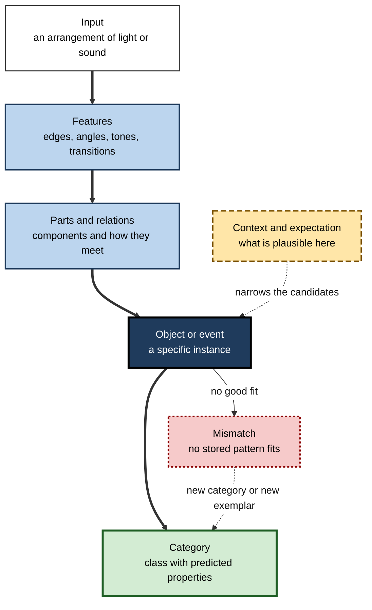
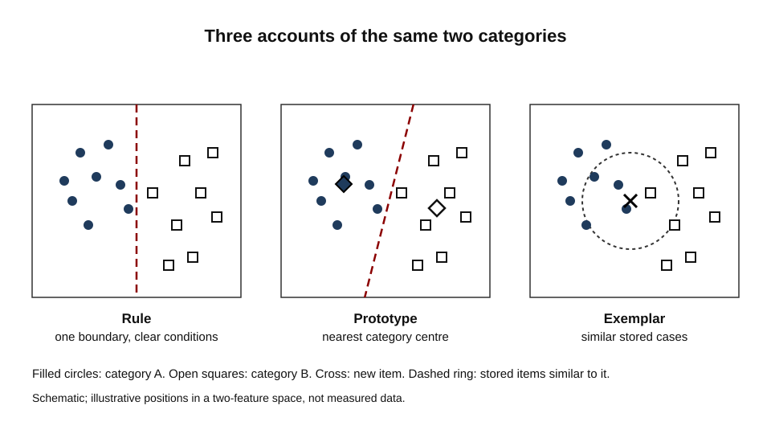
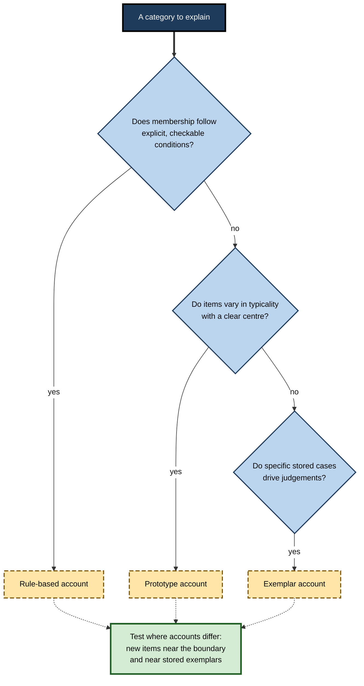
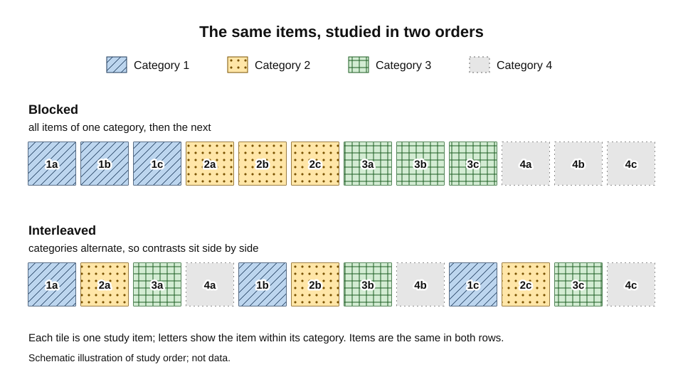
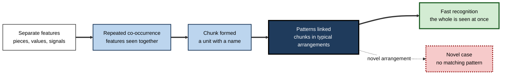

# C.3. Pattern Recognition and Categorization

A dermatologist glances at a mole and places it in a category before she has consciously listed its features. A fraud analyst scanning a list of payments sees one that "looks wrong" and flags it.

A birdwatcher identifies a warbler by its flight and posture from a hundred metres away. None of them is reasoning step by step. Each has matched a pattern to something stored, and assigned it to a class that carries predictions: what the item is likely to be, what it is likely to do, and what to do next.

> **Definition — Pattern recognition:** identifying an arrangement of sensory input as an instance of something already known, by matching it against stored representations.

> **Definition — Categorisation:** assigning an item to a class, so that properties observed in some members can be used to predict properties of others.

**Why it matters**

- Almost every act of recognition is categorisation: a word is a category of sounds, a face is a category of arrangements, and a tool is a category of uses.
- The way a category is represented determines which new cases are recognised, which are missed and which are confused.
- Learning to categorise is one of the main routes by which expertise develops, and it is often taught badly.
- Categorisation errors have consequences in medicine, security, quality control and law, where a wrong class can change what happens next.

---

## How Patterns Are Recognised

**Figure 1.** The stages by which a visual input becomes a category.

### Simple accounts and their failures

- **Template matching:** the input is laid over a stored image and compared point by point.
  - It is easy to picture and works when the input is always the same size, position and orientation.
  - It fails as soon as the input is rotated, partly hidden or drawn in a different style.
- **Feature analysis:** the input is broken into features, such as lines at particular angles, and the object is identified by the combination of features present.
  - It handles variation better, but it struggles to say which combinations of features matter and how they are related.

### Recognition by components

**Irving Biederman (1987)** proposed that objects are recognised by decomposing them into a small set of simple three-dimensional shapes, called **geons**, and by the spatial relations among them.

- Geons are shapes such as blocks, cylinders and wedges that can be combined in many ways.
- Edges, which stay visible across viewpoints, and the junctions where parts meet carry much of the information needed to identify the parts.
- The theory predicts that recognition should be robust to changes of viewpoint and to partial hiding of an object, provided the parts and their arrangement remain visible.
- The theory predicts failure when rotation hides the part that distinguishes two objects.

> **Definition — Geon:** a simple volumetric component, such as a brick or a cylinder, whose combinations are proposed as the units of object recognition.

> **Watch out:** recognition-by-components is a theory of rapid recognition of objects with clear part structure. It does not explain faces, textures or highly familiar scenes equally well, and the number of basic components is a modelling choice rather than a measured constant.

### Faces: a special case?

Faces are recognised so quickly and reliably that some researchers treat them as a separate process.

**Study card — Yin (1969)**

- **Design:** participants studied and later recognised faces and other objects, presented either upright or upside down.
- **Result:** turning a face upside down impaired recognition much more than turning other objects upside down.
- **Conclusion:** face recognition depends strongly on the normal orientation of the whole face. The effect is called the **inversion effect**.
- **Significance:** the inversion effect became a standard marker of face-specific processing.

**Study card — Kanwisher, McDermott and Chun (1997)**

- **Design:** participants viewed faces and assorted common objects while their brains were scanned with functional magnetic resonance imaging.
- **Result:** a region on the underside of the temporal lobe, the fusiform gyrus, responded more to faces than to objects in most participants.
- **Conclusion:** the authors argued for a region selectively involved in face perception, rather than a region that responds to any demanding visual task.
- **Status:** the existence of the region is widely accepted. Whether it is specific to faces, or part of a broader system for expert recognition of familiar categories, is still debated.

> **Key point:** the inversion effect shows that the way a pattern is organised, not only its parts, determines whether it can be recognised. Context and configuration matter.

---

## Categories: What Is Grouped and Why

Categories are not arbitrary. They are useful because items in one class share properties that matter for prediction and action.

- **Economy:** a category lets a person know a great deal about an item once its class is recognised.
- **Inference:** a learned property of one member can be extended to other members.
- **Communication:** shared categories allow people to talk about the same things.

### Family resemblance and prototypes

**Study card — Rosch and Mervis (1975)**

- **Design:** participants listed the attributes of members of common categories, such as furniture, vehicles, fruit, vegetables, weapons and clothing. Each member was then rated for how typical it was of its category.
- **Result:** typicality ratings correlated strongly with how many attributes an item shared with other members of its category, and how few it shared with members of other categories.
- **Conclusion:** categories are organised around **family resemblance** rather than a set of defining features that every member must share. Some items are more central than others.
- **Significance:** the study gave empirical support to Wittgenstein's observation that category members can overlap in many ways without any single feature in common.

> **Definition — Typicality:** the degree to which an item is a good example of its category. A robin is more typical of birds than a penguin is.

- **Typicality effects:** people verify that a robin is a bird faster than that a penguin is a bird.
- **Graded boundaries:** many natural categories have no sharp edge, so membership is a matter of degree.
- **Central tendency:** a category's central tendency, or prototype, is the most representative member or the average of its members.

> **Watch out:** typicality is not the same as frequency. A rare but highly representative example can be more typical than a common but unusual one.

---

## Rules, Prototypes and Exemplars

Three broad accounts describe how people represent categories. They make different predictions, which is how the field decides between them.

### Rule-based categories

- A category is defined by logical conditions that an item must meet.
  - *e.g.* a triangle is a closed figure with three straight sides.
- **Bruner, Goodnow and Austin (1956)** studied how people attain concepts from examples, showing that participants proceed by testing hypotheses about what the defining features must be.
- Rules are easy to state and to teach. They work well for formal categories but poorly for natural ones, where exceptions are common.

### Prototype accounts

- The category is represented by a single summary, such as an average or a central example.
- New items are classified by their similarity to the summary.
- The account predicts graded typicality and fast classification of central examples, and it accommodates the family-resemblance findings.

### Exemplar accounts

**Medin and Schaffer (1978)** proposed the **context model** of classification. Their central idea was that people store specific examples rather than a summary.

- A new item acts as a retrieval cue that activates stored examples in proportion to their similarity to it.
- Judgements come from the total activation of examples in each category.
- Similarity was modelled as a multiplicative combination across dimensions, so that a mismatch on any one dimension sharply reduces the activation.
- Later exemplar models elaborated the idea. The most influential of these is the generalised context model.

**Figure 2.** Three accounts of the same two categories in a space of two features.

> **Remember:** a prototype account predicts that the category's centre is the best test item. An exemplar account predicts that a central item with many close neighbours in the other category may be harder than it looks. The two accounts can be separated experimentally.

> **Example (illustrative):** a fraud analyst learns three kinds of suspicious payment. Under a rule account, she checks a list of conditions; under a prototype account, she compares each payment with an idea of a typical fraud; under an exemplar account, she recalls specific past cases that look like the new one. Each predicts different errors when a new kind of fraud appears.

**Figure 3.** Choosing an account of categorisation from the evidence available.

---

## Learning Categories

### Learning from examples

- Learners of a new category usually see a series of examples and infer the rule, prototype or set of exemplars from them.
- The order and mix of examples change what is learned.
- The field distinguishes two tasks that look alike but are different:
  - **identifying** a category already known, such as recognising a species from a photograph;
  - **inducing** a category from examples, such as working out what separates two families of bird.

### Blocked and interleaved practice

**Study card — Kornell and Bjork (2008)**

- **Design:** participants studied paintings by several artists. For some artists, the paintings were presented together (massed, or blocked). For others, the paintings were mixed with those of other artists (interleaved). Participants were then tested on new paintings and asked to identify the artist.
- **Result:** participants were better at identifying the artists of new paintings when the studying had been interleaved.
- **Surprise:** participants believed the blocked presentation had been more effective, even after their test scores showed otherwise.
- **Explanation:** mixing categories highlights what separates them, a process the authors called discriminative contrast.
- **Significance:** an approach that feels more fluent can be less effective for learning categories, and learners may not notice.

**Figure 4.** The same items studied in blocked order and in interleaved order.

> **Watch out:** interleaving is not always better. It helps induction and discrimination among similar categories, but blocked practice can be useful early, when a learner needs a clear first picture of each category. The sequence should follow the learning goal.

> **In practice:** for categories that look alike, deliberately place contrasting examples next to one another, and check learning on new examples rather than on the examples just studied.

---

## Expertise and Chunking

Experts recognise patterns that novices miss, and their recognition is fast. Early studies of chess players explained why.

**Study card — Chase and Simon (1973)**

- **Design:** players of different strength were shown a chess position briefly, then asked to reproduce it on an empty board. Tasks included reproducing positions in plain view and after a short exposure.
- **Result:** stronger players reproduced positions with more chunks and larger chunks than weaker players.
- **Interpretation:** a chunk is a meaningful group of pieces recognised as a unit. The authors argued that stronger players did not have a larger memory span; they perceived boards in larger meaningful units.
- **Status:** later work has revised the estimate of how many chunks experts store and how large they are. The original claim, that expert recognition is built on stored patterns, has survived, but the numbers were shown to depend on the method.

> **Definition — Chunking:** grouping of separate items into a single unit that is recognised and retrieved as a whole. Recognition of a familiar chunk costs less capacity than recognition of its parts.

**Figure 5.** How repeated exposure builds expert pattern recognition.

> **Example (illustrative):** an experienced nurse notices that a patient's pattern of heart rate, breathing and colour belongs to a common early warning sign. A novice sees three separate readings that each look acceptable.

### Case study (illustrative): spotting fraud in a payments team

- **Situation:** a payments company's new analysts were slow to flag suspicious transactions. Experienced analysts flagged most of the same cases in seconds.
- **Problem:** the new analysts followed a long checklist, which took time and missed patterns that were not on the list.
- **Diagnosis:**
  - the experienced analysts had built chunks, such as "new device, large amount, unfamiliar merchant category", that recognised fraud as a unit;
  - the checklist treated each feature separately and could not express their combinations;
  - the new analysts had seen few examples of each fraud type, and rarely with feedback on what they had missed.
- **Actions:**
  1. Built a library of confirmed cases, grouped by pattern, and asked analysts to sort new cases before seeing the answer.
  2. Interleaved fraud types in training so that contrasting patterns were studied side by side.
  3. Gave immediate feedback on each sorted case and a weekly review of misses.
  4. Kept the checklist for audit, but not as the main route to a decision.
- **Result (illustrative figures):** time to flag a case fell after the training, and the number of missed cases of the rarest fraud type fell in the second quarter.
- **Side effects / caveats:** the training depended on a stable set of examples; when the fraud pattern changed, the library lagged and had to be rebuilt.
- **Lesson:** expert recognition is built from many examples in context, with feedback. A checklist can support it but cannot replace it.

---

## When Recognition Goes Wrong

- **Overgeneralisation:** a category learned from a few examples is applied too widely, so unrelated items are grouped with it.
- **Under-generalisation:** a category learned from one kind of example is not recognised when the same class appears in a different form.
- **Confusable categories:** two categories that share many features are mixed up unless contrasting examples have been studied.
- **Fluency without accuracy:** a pattern that feels familiar can be recognised wrongly, especially when a case looks like a well-practised one but differs on a critical feature.
- **Atypical cases:** atypical members are harder to recognise, and an expert's strongest knowledge may fit typical cases best.

> **Watch out:** recognition that is fast and confident is not thereby accurate. Experts are most dangerous when a novel case resembles a familiar one on its surface.

---

## Designing Categories for People

- **Choose examples that vary:** include atypical and borderline members, and examples that differ in the features that do not matter.
- **Show contrasts:** place confusable categories side by side, and point out the feature that separates them.
- **Check transfer:** test with items the learner has not seen, not with the items used in practice.
- **Name the boundary:** where categories are ambiguous, tell the user what to do when an item does not fit.
- **Support, do not replace, judgement:** checklists are useful for audit and for novices, but experts need exposure to cases.

> **In practice:** when designing a category system such as product codes, incident types or risk classes, test whether people can sort new, unlabelled cases correctly before the system is adopted.

---

## Open Questions

- **Do people use rules, prototypes, exemplars or a mixture?**
  - Different tasks and different learners may favour different representations, and the evidence is not yet decisive.
- **Are faces recognised by a specialised process?**
  - The inversion effect and the fusiform response are well documented, but whether they reflect a dedicated mechanism or expertise with a single category remains disputed.
- **How large and how numerous are expert chunks?**
  - Estimates depend strongly on the task and method, so no single figure is secure.
- **Can novices acquire expert recognition through practice alone?**
  - Practice with feedback helps, but how much of expert perception can be taught rather than experienced is unknown.

---

## Summary

- **Pattern recognition** matches input to stored representations; **categorisation** groups items so that known properties predict unknown ones.
- Simple accounts such as **template matching** and **feature analysis** fail with variation; **Biederman's** component theory explains robustness to viewpoint and partial hiding.
- **Faces** show an **inversion effect** and a region of cortex that responds to them more than to objects.
- **Rosch and Mervis** showed that categories have **family resemblance** structure and typicality gradients.
- **Rule**, **prototype** and **exemplar** accounts make different predictions, and experiments can separate them.
- **Blocked** and **interleaved** practice affect category learning differently; interleaving aids induction even when learners feel blocking is better.
- **Chase and Simon** showed that experts perceive **chunks**; later work revised the numbers but kept the principle.
- Recognition can go wrong through **overgeneralisation**, **confusable categories** and **fluency without accuracy**.
- In practice, expert recognition is built from varied examples with feedback, and categories should be tested on new cases.

---

## Self-Check

1. Distinguish pattern recognition from categorisation, with an example of each.
2. Why do template-matching accounts fail under rotation or partial occlusion?
3. What does recognition-by-components predict about recognition when the edges of a part are hidden?
4. What did the inversion effect show about face recognition, and what is still disputed about the region studied by Kanwisher and colleagues?
5. Explain family resemblance and typicality, with a non-biological example.
6. Describe the three accounts of categorisation and one prediction on which they differ.
7. In the fraud example, how would a rule-based analyst and an exemplar-based analyst respond to a new kind of fraud?
8. Explain why interleaved practice can improve induction even when learners feel that blocked practice is more effective.
9. What does the chess study show about how experts perceive positions, and what has been revised since?
10. Define chunking and explain why it reduces the load on working memory.
11. A novice nurse fails to see an early warning pattern across several readings. Identify two causes consistent with chunking theory.
12. Give two ways in which fluent recognition can be wrong.
13. A company wants a classification scheme for incidents. Describe two tests that show whether people can use it.
14. Why might a checklist help novices but hinder experts, and how would you combine the two?

### Answer Key

1. Pattern recognition: a shape is identified as a particular chair. Categorisation: the chair is placed in the class of seating, so that its typical properties, such as load limits, can be predicted.
2. Stored templates assume a fixed size, position and orientation. Any transformation breaks the point-by-point match.
3. It predicts that recognition should be impaired when the hidden edges are needed to identify the components and their relations, and relatively preserved when the components remain visible.
4. Faces are recognised far worse when upside down than other objects are, which points to processing of the whole configuration. The debate concerns whether the fusiform response reflects a dedicated face mechanism or a broader expertise with familiar categories.
5. Family resemblance means members overlap in many attributes without any single attribute shared by all. Typicality means some members are better examples. For example, a dining chair is more typical of chairs than a bean bag is.
6. Rules predict sharp boundaries determined by conditions; prototypes predict graded typicality around a central summary; exemplars predict that specific stored cases drive judgements. A test near the boundary or near atypical exemplars can separate them.
7. The rule-based analyst checks whether the new case meets the conditions, and may miss it if none apply. The exemplar-based analyst retrieves similar past cases and may flag the new one if it resembles any of them.
8. Interleaving highlights what distinguishes the categories, which supports induction. Blocking creates a fluent sense of progress that is not matched by later accuracy, so learners misjudge it.
9. Stronger players reproduced positions with more and larger chunks, so their advantage lay in perceiving meaningful units rather than a larger memory. Later work found that the estimated number and size of chunks depended on the method, and proposed linked patterns called templates.
10. A chunk is a meaningful group recognised as one unit. Because a familiar chunk occupies a single slot, several pieces of information can be held as one.
11. Causes: the novice has not built chunks for the pattern, so the readings are processed separately; and the novice has seen few cases with feedback, so the pattern has not been linked to its meaning.
12. Fluent recognition can be wrong when a new case resembles a familiar one on its surface but differs on a critical feature; and when atypical cases are misread as typical ones because their central features are present.
13. Test with new, unlabelled cases that the staff have not seen, measuring accuracy and agreement between raters. Also test with borderline cases to see whether the boundaries are used consistently.
14. A checklist makes procedure explicit and supports novices and audit. Experts may find it slows recognition and misses patterns outside the list. Combine them by using the checklist as a first pass for novices, with exposure to cases and feedback, and by allowing experts to act on pattern recognition with the checklist as an audit record.

---

## Glossary

| Term | Meaning |
|---|---|
| Blocked practice | Studying examples of one category together before moving to the next. |
| Categorisation | Assigning items to classes so that known properties predict unknown ones. |
| Chunking | Grouping items into a unit that is recognised and retrieved as a whole. |
| Context model | An exemplar model in which stored examples are activated by similarity to a probe. |
| Exemplar account | Explanation of categorisation by stored specific examples. |
| Family resemblance | Members of a category overlapping in many attributes without sharing a single defining feature. |
| Feature analysis | Recognition by detecting the features of an input and their combinations. |
| Geon | A simple volumetric component proposed as a unit of object recognition. |
| Interleaved practice | Mixing examples from different categories during study. |
| Inversion effect | Greater impairment of recognition when a stimulus is turned upside down, most marked for faces. |
| Pattern recognition | Identifying an input as an instance of something stored. |
| Prototype | A summary or central representation of a category. |
| Recognition-by-components | Theory that objects are recognised from their component shapes and their relations. |
| Template matching | Recognition by comparing an input point by point with a stored image. |
| Typicality | The degree to which an item is a good example of its category. |
