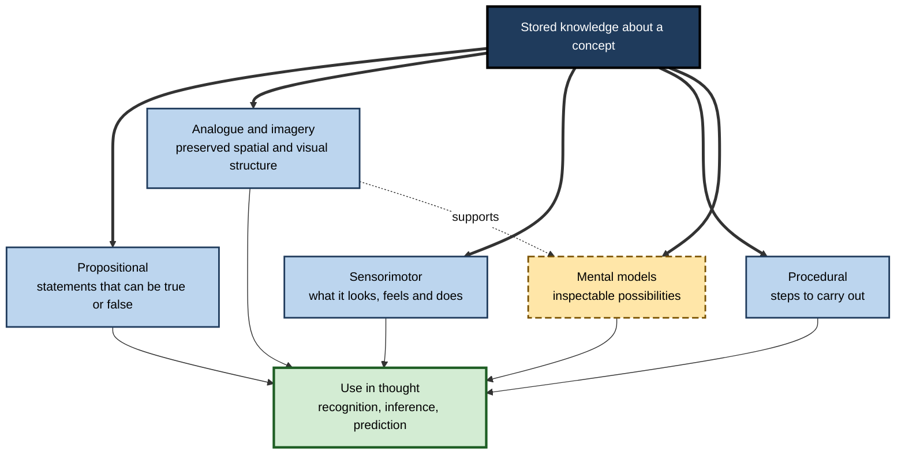
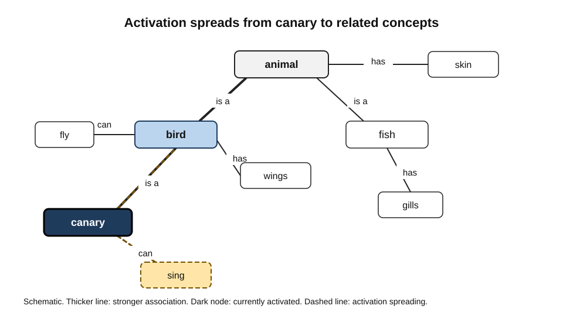
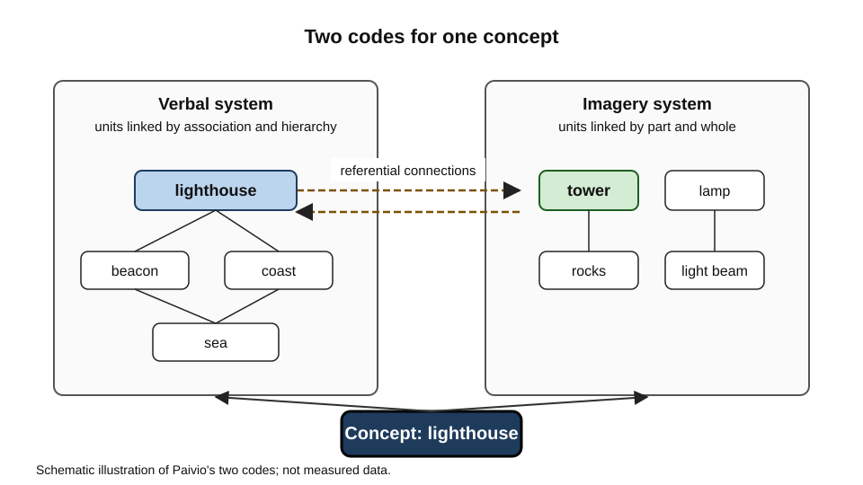
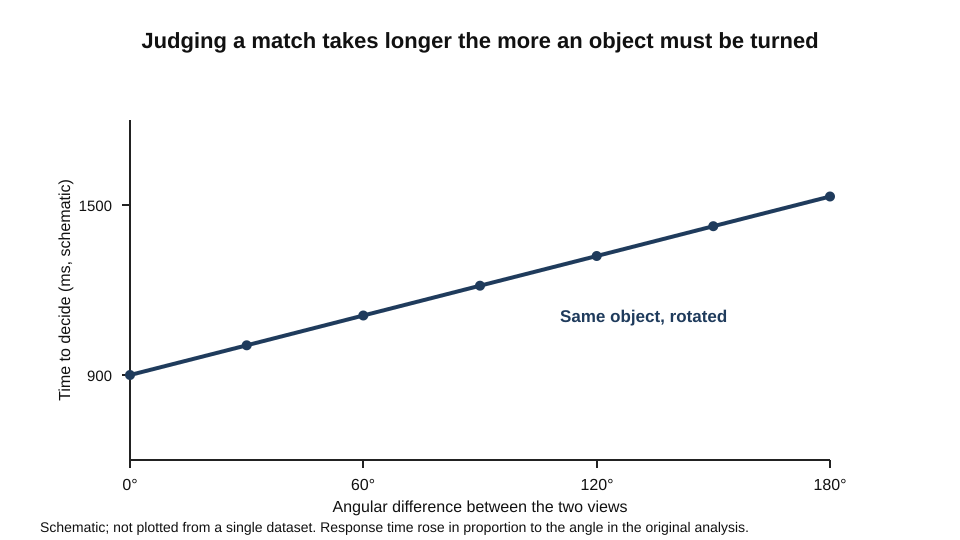
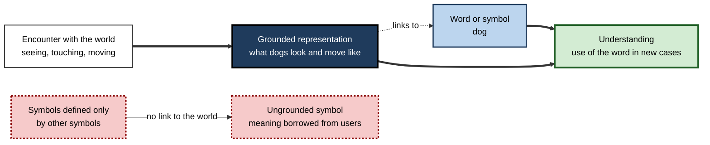

# C.4. Concepts and Mental Representations

A seven-year-old knows what a dog is long before she could define the word. A chef knows what "al dente" means without being able to say exactly what happens to starch in water. A mechanic, asked whether a wrench will clear a bracket, rotates the wrench in his mind before answering.

Each person holds something inside the head that stands for a thing, a property or an action, and uses it to recognise, predict and imagine. Cognitive psychologists call the stored structures **mental representations**, and the ones that stand for categories **concepts**.

> **Definition — Concept:** a mental representation of a category that supports recognition, inference, prediction and combination with other concepts.

**Why it matters**

- Concepts are the units of thought. Reasoning, problem solving and communication all operate on them.
- The format in which a concept is stored determines what can be inferred quickly, what is easily forgotten and what transfers to new situations.
- Misconceptions are concepts that work well in everyday life and fail in a new domain. Correcting them requires understanding how they are represented.
- Designers of interfaces, instructions and artificial systems must decide which representations to present and which to leave to the user.

---

## What a Concept Does

A concept is more than a label. It does several jobs at once.

- **Sorting:** it says which items belong together.
- **Predicting:** it says what an item is likely to have or do, beyond what has been observed.
- **Combining:** it lets people build new meanings from existing ones. A "pet fish" is neither a typical pet nor a typical fish, yet people understand it at once.
- **Communicating:** shared concepts allow two people to refer to the same thing without describing it each time.

> **Watch out:** a concept is not the same as its definition. Most everyday concepts cannot be fully defined by necessary and sufficient features, and people can use a concept competently while being unable to state its boundaries.

### Concept, category and word

- A **category** is the set of things in the world that share some property.
- A **concept** is the mental representation a person holds of that set.
- A **word** is a public label that may or may not map cleanly onto either.
- The same word can name different concepts in different people, and different words can name the same concept.

*e.g.* "heating" may mean a comfortable room to one person and a particular set of pipes and radiators to an engineer.

---

## Formats of Mental Representation

The field has proposed several formats for storing knowledge. They are not mutually exclusive, and most accounts combine two or three.

- **Propositional** representations express knowledge as statements that can be true or false.
  - *e.g.* "a canary is a bird"; "birds have feathers".
  - Good for facts and logical relations; less obviously tied to what things look or feel like.
- **Analogue** or **imagery** representations preserve spatial or perceptual structure.
  - *e.g.* the shape of a room, or the outline of a tool.
  - Good for spatial reasoning and for recognising the look of things; harder to use for abstract relations.
- **Procedural** representations encode what to do.
  - *e.g.* the steps for changing a tyre.
- **Perceptual or sensorimotor** representations are built from perception and action.
  - *e.g.* knowing what a cup is partly means knowing how it feels to lift one.
- **Mental models** represent a situation as a structure of possibilities that can be inspected and changed.
  - *e.g.* a mental picture of how water flows through a pipe network.

**Figure 1.** The main formats of mental representation and how they relate.

> **Key point:** the same concept can be stored in several formats at once. Which format is used in a given task depends on the task, and experts often switch fluently between them.

---

## Networks of Concepts

### Hierarchies

Early models of semantic memory proposed that concepts are arranged in a strict hierarchy, with properties stored at the highest level at which they apply.

- *e.g.* "canary" is a kind of "bird", and "bird" is a kind of "animal". "Can fly" is stored with "bird", and "has skin" with "animal", so the system saves storage by not repeating shared properties.
- The hierarchy predicts that retrieving a property takes longer the more levels must be traversed.

**Study card — Collins and Quillian (1969)**

- **Design:** participants judged whether sentences about categories were true, such as "a canary can sing" and "a canary has skin". Response times were recorded.
- **Results:** responses were slower when more levels had to be traversed to find the relevant property, which supported the hierarchical account.
- **Problems:** typical items were verified faster than atypical ones within the same category; a robin is a bird was verified faster than a penguin is a bird. A strict hierarchy cannot explain this without extra assumptions. "A dog is an animal" was verified faster than "a dog is a mammal", although the hierarchy predicts the opposite, because the first statement needs more levels.

### Spreading activation

**Study card — Collins and Loftus (1975)**

- **Type:** a theoretical proposal that revised the hierarchical model in the light of the same family of verification evidence.
- **Proposal:** concepts are nodes linked by associations of varying strength. Activating one node spreads activation along its links, so related concepts become briefly more available.
- **Predictions:**
  - strongly linked concepts are retrieved faster than weakly linked concepts;
  - reaction times depend on both the strength and the number of associations linking two concepts.
- **Significance:** the model dropped the strict hierarchy and cognitive economy of the earlier account and treated semantic memory as a dense web of associations.

**Figure 2.** Spreading activation through a semantic network.

> **Remember:** in a spreading-activation network, a concept is "understood" through its neighbours. Reading the word "bird" primes "wings" and "song" before the reader has chosen to think about them.

> **Watch out:** networks of this kind are easy to draw and easy to adjust after the fact. Their predictions are only as good as the measures used to set the link strengths.

---

## Imagery and Analogue Representation

### Dual coding

**Allan Paivio's** dual-coding theory, set out in full in *Imagery and Verbal Processes* (1971), proposes that the mind processes information through two partly independent systems: one specialised for language and one for nonverbal objects and events, including images.

- Verbal units, which Paivio called *logogens*, are organised by association and hierarchy.
- Nonverbal units, called *imagens*, are organised by part–whole relations and are used for pictures and mental images.
- Concrete material can be stored in both systems, and the two codes are linked by referential connections. A concrete word such as "lighthouse" can evoke an image and a verbal label together.
- The theory predicts that material with both codes should be easier to recall than purely verbal material, and that this advantage should be greatest for concrete rather than abstract items.

**Figure 3.** The two codes of dual-coding theory and the connections between them.

> **Watch out:** dual coding is a theory of representation, not a recipe for teaching. A diagram helps only if it expresses the structure of the content and is linked to the words that describe it. Decorative pictures add little.

### Mental rotation

**Study card — Shepard and Metzler (1971)**

- **Design:** participants saw pairs of line drawings of three-dimensional arrangements of cubes. In some pairs the second drawing was the same object turned in the picture plane or in depth; in others it was a mirror-image object. They judged whether the two were the same object.
- **Results:** the time to decide grew steadily with the angular difference between the two drawings. It made no difference whether the rotation was in the plane of the page or in depth.
- **Interpretation:** the authors argued that participants mentally rotated an internal image to align it with the second drawing, at a roughly constant rate.
- **Challenge:** Just and Carpenter argued that the linear pattern could reflect the number of eye movements needed to compare the drawings as their angle increased, rather than an internal rotation.
- **Significance:** the study made mental imagery measurable and is a central example of an analogue representation that behaves like a physical object.

**Figure 4.** Time to judge whether two shapes match, as the angle between them grows.

> **Key point:** imagery can be used for reasoning, but it has measurable costs. A task that requires a large rotation takes longer, and the cost is shared with perception.

---

## Mental Models

**Philip Johnson-Laird (1983)**, in *Mental Models*, proposed that people understand and reason about situations by constructing models of the possibilities consistent with what they are told, and by inspecting those models for what must hold.

- A mental model is a representation of one possibility, rather than a list of logical forms.
- Understanding a description means building a model that fits it.
- Reasoning means inspecting the model to see whether a conclusion holds in every possibility, and searching for a counterexample where it does not.
- Errors arise when people fail to construct all the possibilities a description allows, especially when only one is easily imagined.

> **Definition — Mental model:** a representation of a situation as a set of possibilities, arranged so that they can be inspected and revised.

- Mental models are also used for everyday systems: how a heating controller responds to a timer, or how a database join works.
- *e.g.* a user who believes a power switch only turns off the screen will be surprised when the computer keeps running.

> **Watch out:** a mental model is an approximation, and its accuracy determines what the person will do. Users' models are often incomplete or wrong in ways that are invisible to them until something fails.

---

## Grounding Representations in Experience

A recurring question is how representations acquire meaning at all.

### Perceptual symbol systems

**Lawrence Barsalou (1999)** proposed **perceptual symbol systems**: concepts are stored as records of perception and action, and thinking about a concept partly reactivates the sensorimotor states that accompanied experience with it.

- To think about a dog is partly to re-run a pattern of sight, sound and touch associated with dogs.
- Abstract concepts are harder to ground in this way and are proposed to rely on introspective and linguistic routes.
- The theory is motivated by evidence that perceptual and motor systems are active during some conceptual tasks. How far that activity is needed for meaning, rather than accompanying it, is debated.

### The symbol grounding problem

**Stevan Harnad (1990)** pointed out that a symbol system defined entirely in terms of other symbols can never explain what its symbols mean, just as a dictionary defines every word using other words.

- The problem is to find a way for symbols to be connected to what they stand for.
- Harnad proposed that symbols could be grounded in iconic representations of sensory input and in categorical representations that pick out the things they name.

**Figure 5.** How symbols can be grounded in experience through perception and action.

> **Watch out:** grounding is a live debate. Systems trained only on text can use words fluently, which has revived the question of whether fluent use implies grounded meaning. Neither humans nor machines show that grounding is sufficient by use alone.

---

## Conceptual Change

People arrive at formal instruction with intuitive concepts formed in everyday experience, and these concepts often conflict with the scientific or professional ones.

- **Naive physics:** many learners believe that a heavier object must fall faster, because heavier things in ordinary experience often seem to fall faster when air resistance matters.
- **Naive biology and social concepts:** learners often treat species, money or organisations as fixed essences rather than as processes.
- **Change is restructuring, not addition:** new information is not simply stacked on top of the old. The learner may keep the old concept for everyday use while building a new one for the new domain.

> **Key point:** correcting a misconception means changing the structure of a representation. Telling someone the right answer usually leaves the underlying concept intact.

### Case study (illustrative): a team's model of its billing system

- **Situation:** a software company's support staff repeatedly told customers that a refund would appear on the next invoice. Many refunds appeared months later or not at all.
- **Problem:** staff had a concept of "refund" that treated it as a reversal in the same account. The billing system treated it as a separate transaction with its own settlement rules.
- **Diagnosis:**
  - the staff model was propositional and simple: refund means credit on next invoice;
  - it lacked the mental model of settlement, including payment method and time to clear;
  - the instructions they had been given described the procedure but not the system's behaviour.
- **Actions:**
  1. Interviewed experienced staff to find where their explanations failed.
  2. Built a diagram of the billing flow with the settlement steps and the delays.
  3. Asked staff to predict the outcome for five realistic cases before checking the system.
  4. Revised the scripts so that they described the sequence and gave a range of times, not a single date.
- **Result (illustrative figures):** the share of refund queries that required escalation fell over the following two months, and staff predictions matched the system more often.
- **Side effects / caveats:** the diagram became out of date after a billing change, so the team had to assign ownership for keeping it current.
- **Lesson:** a misconception is a working concept in the wrong domain. Repair needs a model of the system, tested by prediction, not a corrected sentence.

---

## Concepts in Expertise

- Experts store concepts in richer and more organised forms than novices.
  - Their representations link a concept to its causes, its exceptions and the situations in which it applies.
  - Novices' representations are more often tied to surface features and to the words used to describe them.
- Expert knowledge is often tacit: experts may use a concept fluently and be unable to state it.
- Building expert representations requires exposure to contrasting cases, explanation, and feedback when predictions fail.

> **In practice:** when designing training, ask what the learner must be able to predict with the concept, and build the representation that supports that prediction, such as a diagram of the system, a set of cases or a model of the process.

---

## Designing Representations for Others

- **Use analogies carefully.** An analogy transfers the structure of a familiar domain, and it also transfers its misleading features. Name the points where the analogy fails.
- **Align diagrams with the structure of the content.** Show parts, relations and flow that matter for the task, and leave out ornament.
- **Pair words and images only where they describe the same thing.** Redundant labels can compete for attention.
- **Test the mental model.** Ask people to predict what the system will do in new cases, and compare their predictions with what it does.

---

## Open Questions

- **Is there one format in which all concepts are stored?**
  - Evidence supports several formats, and most models combine them, but how they are integrated is unresolved.
- **How are abstract concepts grounded?**
  - Perception and action are a good account of concrete concepts; the route for abstract ones is less clear.
- **Can text-only systems acquire grounded meaning?**
  - Fluent language use does not show that words refer to the world in the way human concepts do.
- **How stable are misconceptions under instruction?**
  - Some misconceptions persist after correct teaching; the conditions that remove them are still being studied.

---

## Summary

- A **concept** is a mental representation of a category that supports recognition, prediction and combination, and it is not the same as its definition.
- Knowledge can be stored **propositionally**, as **imagery**, as **procedures**, as **sensorimotor** patterns and as **mental models**, and one concept often uses several formats.
- **Collins and Quillian** showed that retrieval time grew with the levels to be traversed in a hierarchy, but typicality effects required more than a strict hierarchy; **Collins and Loftus** proposed **spreading activation** through a weighted network.
- **Paivio's dual-coding theory** proposes separate verbal and imagery codes linked by referential connections.
- **Shepard and Metzler** showed that the time to compare rotated objects grew with the angle, and that imagery has measurable costs.
- **Johnson-Laird's** mental models represent possibilities that can be inspected; their accuracy determines behaviour.
- **Barsalou's** perceptual symbols ground concepts in perception and action, and **Harnad's** symbol grounding problem asks how symbols acquire meaning.
- Misconceptions are working concepts in the wrong domain; correcting them requires restructuring the representation.
- In practice, build representations that support the predictions the learner must make, and test them by prediction.

---

## Self-Check

1. Define a concept and distinguish it from a category and from a word.
2. Name three functions a concept performs, and give an example of each.
3. Give one example each of propositional, analogue and procedural representation.
4. What did the hierarchical network of Collins and Quillian predict about verification times?
5. Why did typicality effects cause problems for the strict hierarchy?
6. Describe spreading activation and one prediction it makes.
7. What does dual-coding theory predict about concrete versus abstract material, and why is it not a teaching recipe on its own?
8. What did the mental rotation studies show, and what alternative explanation has been offered?
9. Explain how a mental model can be correct in one respect and wrong in another, using a system you use.
10. What is the symbol grounding problem, and what did Harnad propose in response?
11. Describe Barsalou's perceptual symbol systems and one prediction they make about concept processing.
12. Why does telling a learner the correct answer often fail to correct a misconception?
13. A support team's model of a refund process is wrong. Describe the steps needed to repair it.
14. Explain why an analogy can help learning and also mislead, and how a designer can reduce the risk.

### Answer Key

1. A concept is a mental representation of a category that supports recognition, prediction and combination. A category is the set of things in the world; a word is a public label that may not match either.
2. Sorting (deciding what belongs together), predicting (inferring unobserved properties), combining (building meanings such as "pet fish") and communicating (sharing reference).
3. Propositional: "a canary is a bird". Analogue: the shape of a room used in spatial reasoning. Procedural: the steps for changing a tyre.
4. Retrieval time for a property should grow with the number of levels in the hierarchy that must be traversed.
5. Typical members were verified faster than atypical ones within the same category, which a strict hierarchy with uniform storage at each level cannot explain without extra assumptions.
6. Activating a concept spreads activation along its associative links, making related concepts more available. A prediction is that strongly linked concepts are retrieved faster than weakly linked ones.
7. Material with both verbal and image codes should be easier to recall than purely verbal material, and the advantage should be greater for concrete items. Dual coding does not specify how to design instruction; a diagram helps only when it expresses the content's structure and is linked to its words.
8. Judgement time grows with the angle between the two drawings, which suggests a mental rotation at a roughly constant rate. Just and Carpenter argued that the pattern could reflect the number of eye movements needed to compare the drawings.
9. A user's model of a computer may correctly show that the power button turns off the screen, but wrongly omit that the machine keeps running. The model is partly accurate, and its errors show when the unrepresented process becomes visible.
10. A symbol system defined only in terms of other symbols cannot say what its symbols mean. Harnad proposed grounding symbols in iconic representations of sensory input and in categorical representations of the things they name.
11. Concepts are stored as records of perception and action, and thinking about a concept partly reactivates those sensorimotor states. A prediction is that a perceptual feature which conflicts with the one being imagined should slow the judgement about the concept.
12. Correct answers can be stored as isolated facts while the underlying concept, which generates the wrong predictions, remains in place. Repair requires restructuring the representation so that it predicts correctly.
13. Interview experienced staff to find where the model fails; build a diagram of the system including the settlement steps and delays; have staff predict outcomes for realistic cases and check them; revise the scripts to match the system's behaviour, with ranges rather than single dates; and assign ownership for keeping the model current.
14. An analogy transfers the structure of a familiar domain, which helps learners map relations. It also transfers features that do not apply. A designer should state where the analogy holds, mark where it breaks, and check learners' predictions in the new domain.

---

## Glossary

| Term | Meaning |
|---|---|
| Analogue representation | A representation that preserves spatial or perceptual structure. |
| Concept | A mental representation of a category supporting recognition, prediction and combination. |
| Dual-coding theory | Paivio's account of separate verbal and imagery codes linked by referential connections. |
| Imagens | Paivio's term for nonverbal, image-based units of representation. |
| Logogens | Paivio's term for verbal units of representation. |
| Mental model | A representation of a situation as possibilities that can be inspected and revised. |
| Mental rotation | Mentally turning an image to compare it with another. |
| Perceptual symbol system | A representation built from records of perception and action. |
| Propositional representation | Knowledge expressed as statements that can be true or false. |
| Semantic network | A web of concepts linked by associations of varying strength. |
| Spreading activation | Activation that passes from a concept to its associated concepts. |
| Symbol grounding problem | The question of how symbols acquire meaning in relation to what they stand for. |
| Hierarchical network | A model in which concepts are arranged in levels, with shared properties stored at higher levels. |
| Misconception | A working concept that gives wrong predictions when applied in a new domain. |
| Tacit knowledge | Knowledge used fluently but hard to state. |
