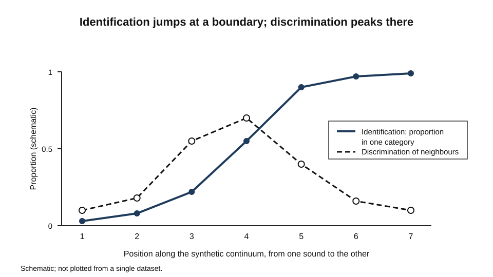
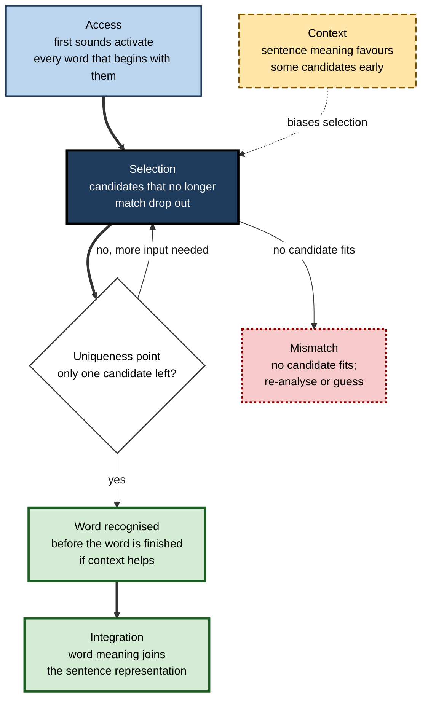
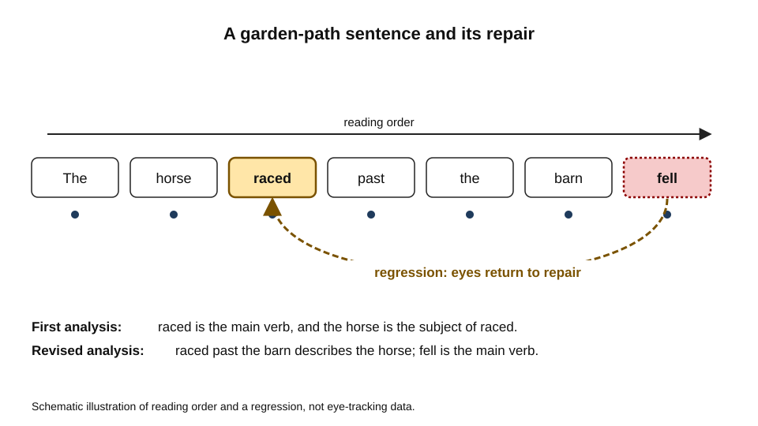
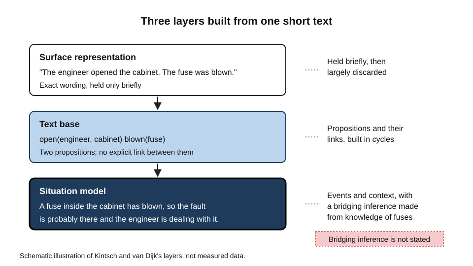

# C.5. Language Processing and Comprehension

A driver hears "turn left at the second junction" through road noise and turns at the first. A reader skims a contract, sees the word "not" in the wrong place and misreads a clause that decides who pays for a delay. A customer hears "we can refund that" and, a week later, is told the refund was never promised.

In each case, a stream of sound or print was converted into meaning, and the conversion went differently from what the speaker or writer intended. Language processing is the set of mental operations that do this conversion, in both directions, in fractions of a second.

> **Definition — Language comprehension:** the process by which a listener or reader builds a representation of the meaning of a message, from sounds or print, using knowledge of words, grammar and the world.

**Why it matters**

- Almost all professional work depends on understanding written and spoken instructions, and many errors are errors of comprehension rather than knowledge.
- The processes are fast and largely automatic, so people are often unaware of how much they have inferred or assumed.
- Comprehension is the bridge between perception and the other higher processes: a message that is not understood cannot be remembered, reasoned about or acted on.
- The same science underlies speech recognition, reading instruction, accessible design and the evaluation of machines that process language.

---

## Levels of Language Structure

Language has several interacting layers of structure. Each makes its own demands on the listener or reader.

- **Phonology:** the sound system of a language, including which differences in sound change meaning.
  - *e.g.* "bat" and "pat" differ in one sound, and that difference changes the word.
- **Morphology:** the structure of words built from smaller meaningful units.
  - *e.g.* "unreadable" combines a prefix, a stem and a suffix, each with its own meaning.
- **Syntax:** the rules by which words are combined into phrases and sentences.
  - *e.g.* "the dog chased the cat" and "the cat chased the dog" contain the same words in different structures.
- **Semantics:** the meaning of words and of their combinations.
  - *e.g.* "bank" can mean a financial institution or the side of a river.
- **Pragmatics:** the use of language in context, including what is implied rather than said.
  - *e.g.* "Can you pass the salt?" is a request, not a question about ability.

> **Definition — Ambiguity:** a word, phrase or sentence that can be assigned more than one structure or meaning. Ambiguity is resolved, when it is, by context, frequency, prosody and knowledge of the world.

**Figure 1.** How the layers of structure combine to produce a meaning, with feedback from context.

```mermaid
%%{init: {'theme':'base','themeVariables':{'fontFamily':'Arial, Helvetica, sans-serif','fontSize':'15px','primaryColor':'#FFFFFF','primaryTextColor':'#111111','primaryBorderColor':'#222222','lineColor':'#333333','secondaryColor':'#F2F2F2','tertiaryColor':'#FFFFFF','clusterBkg':'#FAFAFA','clusterBorder':'#555555','edgeLabelBackground':'#FFFFFF','titleColor':'#111111'}}}%%
flowchart LR
    classDef core    fill:#1F3B5C,stroke:#000000,stroke-width:3px,color:#FFFFFF
    classDef key     fill:#BCD5EE,stroke:#1F3B5C,stroke-width:2px,color:#000000
    classDef detail  fill:#FFFFFF,stroke:#333333,stroke-width:1.5px,color:#000000
    classDef accent  fill:#FFE6A8,stroke:#7A5200,stroke-width:2px,stroke-dasharray:8 4,color:#000000
    classDef good    fill:#D3ECD3,stroke:#1E5E24,stroke-width:3px,color:#000000

    I["Sound or print<br/>input signal"]
    P["Phonology<br/>sound categories"]
    M["Morphology<br/>word parts"]
    S["Syntax<br/>phrase structure"]
    E["Semantics<br/>word and phrase meaning"]
    G["Pragmatics<br/>meaning in context"]
    R["Situation model<br/>what the message is about"]

    I ==> P ==> M ==> S ==> E ==> G ==> R
    G -. "context guides<br/>the choice of structure" .-> S
    G -. "context selects<br/>among word meanings" .-> E

    class I detail
    class P,M,S,E key
    class G accent
    class R good
```

> **Key point:** these layers are not processed in strict sequence. A later layer, such as meaning or context, can change how an earlier one is read.

---

## From Sound to Category

### Categorical perception of speech

The acoustic signal of speech varies continuously. A listener, however, hears sounds as belonging to discrete categories.

**Study card — Liberman, Harris, Hoffman and Griffith (1957)**

- **Design:** a synthetic continuum of speech sounds was created, which changed gradually from one consonant sound to another, passing through the sounds written as b, d and g. Listeners identified each sound, and separately tried to discriminate pairs of sounds on the continuum.
- **Results:**
  - identification changed sharply from one category to the next, rather than gradually;
  - discrimination was best for pairs that straddled a category boundary and poorer for pairs within one category.
- **Conclusion:** perception of speech sounds is organised around categories, so that small acoustic differences within a category are hard to hear as different, while similar differences across a boundary are easy.
- **Significance:** the effect was named categorical perception. It later proved not to be unique to speech, but the speech case remains the classic example.

**Figure 2.** Identification and discrimination along a synthetic speech continuum.

> **Remember:** categorical perception helps a listener ignore irrelevant variation, such as the speaker's voice or accent, and attend to the distinctions that carry meaning in the language.

### Seeing speech: the McGurk effect

**Study card — McGurk and MacDonald (1976)**

- **Design:** participants watched and listened to a speaker in conditions where the visible lip movements and the audible sound did not match.
- **Result:** in the classic case, a sound heard as "ba" combined with lip movements for "ga" was perceived as "da", a sound that matched neither the sound nor the visible movements.
- **Conclusion:** speech perception integrates visual and auditory information. People do not perceive the lips and the sound separately; they perceive a single speech event.
- **Origin:** the effect was discovered by accident during a study of infant speech perception, when a mismatched audio track was played back.

> **Watch out:** the McGurk illusion is a striking demonstration, but its size varies between listeners and conditions. Its existence shows integration; it does not measure how much a listener relies on lip-reading in everyday conversation.

---

## Recognising Words

### Lexical access

- Words are recognised before they are finished. The listener's mind activates candidate words as the first sounds arrive.
- **William Marslen-Wilson (1987)** proposed the **cohort model**. In this account, the first sounds of a word activate every word that begins with them, forming a cohort of candidates.
  - As more of the word arrives, candidates that no longer match drop out.
  - Recognition occurs at the **uniqueness point**, when the input diverges from all other words in the lexicon.
  - Sentence context can allow recognition before the uniqueness point.
- Experiments that asked listeners to repeat speech as they heard it, called shadowing, showed that listeners often began to repeat a word before the word was complete. This supported the claim that recognition is incremental.

**Figure 3.** Stages of word recognition in the cohort account.

### Reading words

- Reading involves eye movements. The eyes move in quick jumps and pause, and information is taken in during the pauses.
- **Keith Rayner (1998)** reviewed twenty years of eye-movement research in *Psychological Bulletin*. His review showed that eye-movement records reflect moment-to-moment processing, including how much of the text around the fixation is available, how the eyes are directed, and how difficulty in one word affects the next.
- Readers use **parafoveal** information, text just beyond the point of fixation, to prepare the next word, particularly when it is short or predictable.
- Frequent words are fixated more briefly. Words that are hard to recognise, or that break the expected structure, attract longer fixations and more returns to earlier text.

> **Watch out:** eye movements show where attention goes and how long processing takes. They do not show what a reader understood. A long fixation may mean difficulty, or careful checking.

---

## Parsing Sentences

Syntactic analysis happens as the sentence unfolds. The listener or reader builds a structure incrementally and revises it when the input contradicts it.

- **Incremental parsing:** the structure is built word by word, with a best guess at each point.
- **Garden-path sentences:** some sentences lead the reader to a structure that turns out to be wrong.
  - *e.g.* "The horse raced past the barn fell." Most readers first take "raced" as the main verb, and must reanalyse when "fell" arrives, so that "raced past the barn" becomes a modifier of "horse".
- **Regression:** when a reader detects a mismatch, the eyes often move back to an earlier word to repair the analysis.

**Figure 4.** A garden-path sentence and the regression that repairs it.

- **Working-memory limits** matter when a sentence places several phrases inside one another, so that the reader must hold open several incomplete structures at once.
- **Context and frequency** guide the first guess. Structures that are common in a language, or that fit the situation, are preferred.

> **Watch out:** a garden-path sentence is not a sign of a poor reader. Skilled readers are also led astray, and the effect shows how strongly the first analysis is preferred.

---

## Comprehension: From Words to Situations

Understanding a sentence is not the same as understanding a text. Comprehension builds layers of representation.

### Three layers of representation

**Walter Kintsch and Teun van Dijk (1978)** proposed a model of text comprehension in which the reader builds a **text base**: a network of propositions, linked when they share an argument or when a connective signals a relation.

- Comprehension proceeds in cycles, because the reader can hold only a limited amount in working memory at any one time.
- The reader also forms a **macrostructure**: a gist that reduces the text to its main points, guided by the reader's goals.
- Van Dijk and Kintsch (1983) added the **situation model**: a representation of the events, participants and circumstances the text describes, which combines the text with what the reader already knows.

**Figure 5.** The three layers that a reader builds from a text.

- **Surface representation:** the exact wording, which is usually held only briefly.
- **Text base:** the propositions the wording expresses and the links between them.
- **Situation model:** the world the text describes, including inferences the reader has drawn.

> **Key point:** the situation model is what allows a reader to act on a document. Two readers who share a text base can build different situation models if their knowledge differs.

### Inference

- Readers make **bridging inferences** to connect sentences that refer to the same thing in different ways.
  - *e.g.* "The engineer opened the cabinet. The fuse was blown." The reader infers that the fuse was inside the cabinet.
- Readers also make **elaborative inferences** that go beyond the text, such as assuming that a character who is "in a hurry" is likely to be impatient.
- Most inferences are made without being noticed, and some are wrong. Writers rely on this, but they cannot rely on readers making the right ones.

---

## Language in Professional Work

### Writing for comprehension

- **Reduce unnecessary ambiguity.** Place modifiers next to the words they modify, and avoid stacking several negations.
- **Keep the key relation close.** A reader needs the subject, verb and critical condition together.
- **Signal structure.** Headings, numbered steps and explicit connectives reduce the work of building a text base.
- **Anticipate the situation model.** State the context that the reader needs to draw the right inferences, such as what counts as a refund and when it is paid.

### Spoken instructions

- Listeners in noisy places depend more on context and on the categories of sound, and they miss unexpected words.
- Repeating critical information in a different structure is often more useful than repeating it word for word.

> **In practice:** when a message matters, test it with a reader who has not seen the source. Ask what they would do, not whether they understood. Misreadings found in advance are cheap; misreadings found after an error are expensive.

### Case study (illustrative): a negation that changed a contract

- **Situation:** a services firm sent a contract summary to its client's finance team. The summary said that delay penalties "do not apply where the supplier has notified the client within five days". A dispute followed, because the client read the penalties as not applying in all cases of supplier notification.
- **Problem:** the summary was accurate in the reviewers' minds but ambiguous to the finance team.
- **Diagnosis:**
  - the negation and the condition sat in one long clause, so the reader had to decide which part the condition modified;
  - the first parse the finance team built was the most natural one for their situation, a common garden-path effect;
  - the reviewers, who wrote the clause, already held the correct situation model, so they did not notice the ambiguity;
  - no one tested the summary with a reader who lacked the original contract.
- **Actions:**
  1. Split the clause into two numbered rules, each with its condition stated first.
  2. Added a worked example showing a delay with and without timely notice.
  3. Asked two reviewers from outside the project to state what they would owe in three scenarios, and compared their answers with the intended ones.
- **Result (illustrative):** the revised summary produced the intended answers in all three scenarios, and the finance team raised no further queries on the clause.
- **Side effects / caveats:** the summary became longer, and needed review whenever the contract changed.
- **Lesson:** a message is understood through the situation model the reader builds, so it must be tested through the reader's answers, not the writer's sense of clarity.

---

## Speech and Reading Skills

- Competent language users recognise words quickly and parse sentences with little conscious effort. Difficulties often arise where word recognition, parsing and integration are each slow or error-prone.
- Some accounts describe reading comprehension as the product of two components: decoding printed words, and understanding spoken language. Difficulty in either can limit comprehension, and the two components can be assessed separately.
- Learners who read fluently but cannot state a text's main claim may be building a text base without a situation model.

> **Remember:** a fluent reader is not necessarily a comprehending reader. Check the situation model with questions that require inference and application, not only recall of wording.

---

## Open Questions

- **How are text base and situation model combined in practice?**
  - Models describe the layers, but the way readers switch between them and the timing of that switch remain unclear.
- **How much does prediction drive comprehension?**
  - Context-based prediction speeds recognition, yet it can also produce errors when the prediction is wrong.
- **Do speech and text share one comprehension system?**
  - Speech is multimodal and transient; text is persistent and self-paced. Their overlap is substantial but not complete.
- **How should comprehension be measured in professional settings?**
  - Recall tests and reading speed capture part of the picture; the situation model needs tasks that require applying the text.

---

## Summary

- Language comprehension converts sound or print into meaning through interacting layers: phonology, morphology, syntax, semantics and pragmatics.
- **Liberman and colleagues** showed that speech perception is **categorical**: listeners attend to category boundaries and largely ignore variation within categories.
- The **McGurk effect** shows that speech perception integrates what is seen with what is heard.
- **Marslen-Wilson's cohort model** describes words as recognised incrementally, as candidates are eliminated and context helps.
- **Rayner's** review showed that eye-movement records reveal moment-to-moment processing during reading, but not understanding by themselves.
- Sentences are parsed incrementally; **garden-path** sentences reveal the strength of initial analyses, and **regressions** repair them.
- **Kintsch and van Dijk** described a **text base** built in cycles and a **situation model** that combines the text with knowledge.
- Readers draw **bridging** and **elaborative** inferences, and writers depend on them.
- In practice, test messages with readers who lack the source, and check the situation model they build.

---

## Self-Check

1. Define language comprehension and name the five layers of language structure, with an example of one.
2. Give an example of an ambiguity that context resolves, and one that frequency might resolve.
3. What did the Liberman study show about how listeners perceive a continuum of speech sounds?
4. Describe the McGurk effect and what it shows about speech perception.
5. How does the cohort model explain recognition of a word before it is complete?
6. Why does a long fixation in reading not automatically indicate poor comprehension?
7. Explain why "The horse raced past the barn fell" is hard, and what a regression does in reading it.
8. Distinguish the text base from the situation model, with an example of each.
9. What is a bridging inference? Give an example from a technical report.
10. Why can two readers of the same text build different situation models?
11. A policy says "Staff need not report a loss unless it exceeds the limit set in the schedule." Identify the comprehension risks and rewrite the rule.
12. Why is a fluent reader not necessarily one who comprehends the text?
13. A team member mishears a figure in a noisy call. Explain which processes make that error likely, and one design change that would reduce it.
14. Why should a message be tested with readers who did not write it? What would you measure?

### Answer Key

1. Comprehension is the construction of a meaning representation from sound or print, using knowledge of words, grammar and the world. The layers are phonology, morphology, syntax, semantics and pragmatics; for example, morphology describes how "unreadable" is built from its parts.
2. "Bank" in a sentence about a river and a sentence about money is resolved by context. A sentence in which the common reading of a word fits better than the rare one illustrates frequency.
3. Identification changed sharply at category boundaries, and discrimination was best for pairs that straddled a boundary. Listeners attended to categories and were poorer at hearing differences within a category.
4. A sound heard as "ba" paired with lip movements for "ga" is perceived as "da". The effect shows that speech perception integrates visual and auditory information into a single event.
5. The first sounds activate all words beginning with them. As more of the word arrives, candidates that no longer match drop out, and recognition can occur at the uniqueness point or earlier if context favours one candidate.
6. A long fixation may reflect difficulty, but it may also reflect careful checking, and eye movements do not show what was understood.
7. The first analysis treats "raced" as the main verb, so the reader must reanalyse when "fell" arrives. A regression is a backward movement of the eyes to an earlier word to repair the analysis.
8. The text base is the set of propositions the wording expresses and their links. The situation model is the representation of the events and circumstances described, combining the text with the reader's knowledge.
9. A bridging inference connects two sentences that refer to the same thing indirectly. In a technical report, "The pump failed. The seal was worn" leads the reader to infer that the seal belongs to the pump.
10. The text base is largely shared, but the knowledge each reader brings produces different inferences and so different situation models.
11. Risks: the negative and the condition are separated, so the reader may not know whether a loss must be reported at all. A rewrite: "A loss must be reported if it exceeds the limit in the schedule. Losses at or below the limit do not need to be reported."
12. Fluent decoding can occur without building a text base or situation model, so the reader may pronounce or scan words without understanding them. Comprehension must be checked with questions that require inference or application.
13. Noise degrades the signal, so categories are harder to identify and context is needed to resolve ambiguity; a number is also easily confused with a similar one. A design change is to repeat the figure in a second form, such as a written confirmation or a read-back.
14. Writers judge clarity from the situation model they already hold, so they miss ambiguities. Readers without the source must build a situation model from the text alone; measure whether their answers to scenario questions match the intended answers.

---

## Glossary

| Term | Meaning |
|---|---|
| Ambiguity | A word or sentence that can be assigned more than one structure or meaning. |
| Bridging inference | An inference connecting sentences that refer to the same thing indirectly. |
| Categorical perception | Perception of speech sounds organised around discrete categories. |
| Cohort model | An account of word recognition in which candidates matching the input are progressively eliminated. |
| Comprehension | Constructing a representation of meaning from sound or print. |
| Garden-path sentence | A sentence that leads to an initial analysis which must later be revised. |
| McGurk effect | Perception of a sound altered by conflicting visual speech. |
| Morphology | The structure of words built from meaningful units. |
| Parafoveal | The area of text just beyond the point of fixation. |
| Pragmatics | The use of language in context, including implied meaning. |
| Regression | A backward eye movement to an earlier part of a text. |
| Semantics | The meaning of words and their combinations. |
| Situation model | A representation of the events and circumstances a text describes. |
| Syntax | The rules by which words are combined into phrases and sentences. |
| Text base | A network of propositions expressed by a text and their links. |
| Uniqueness point | The point at which a spoken word diverges from all other candidates. |
