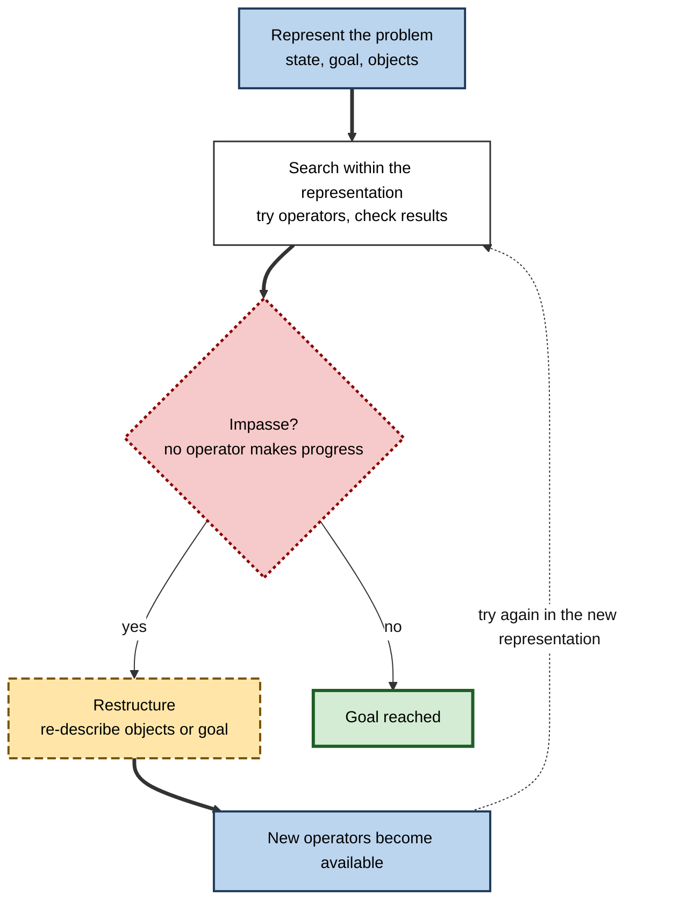
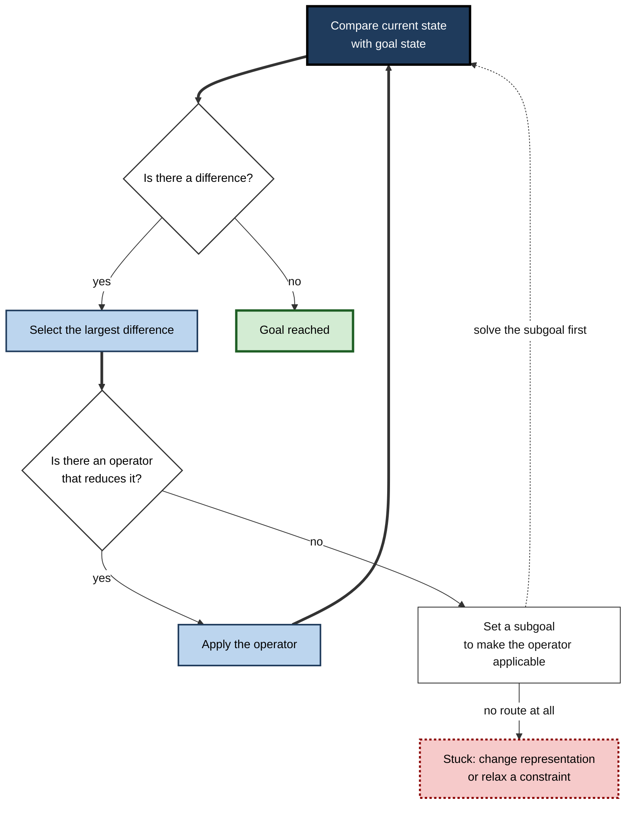
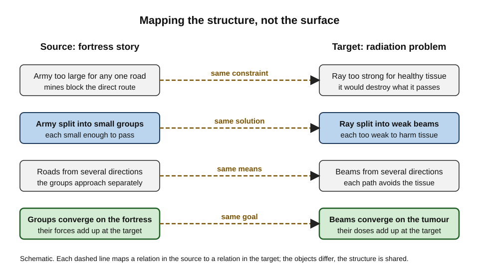
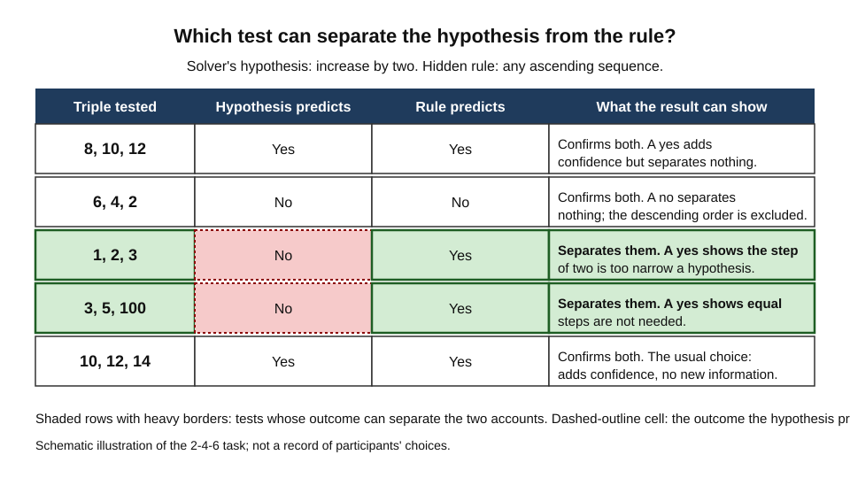
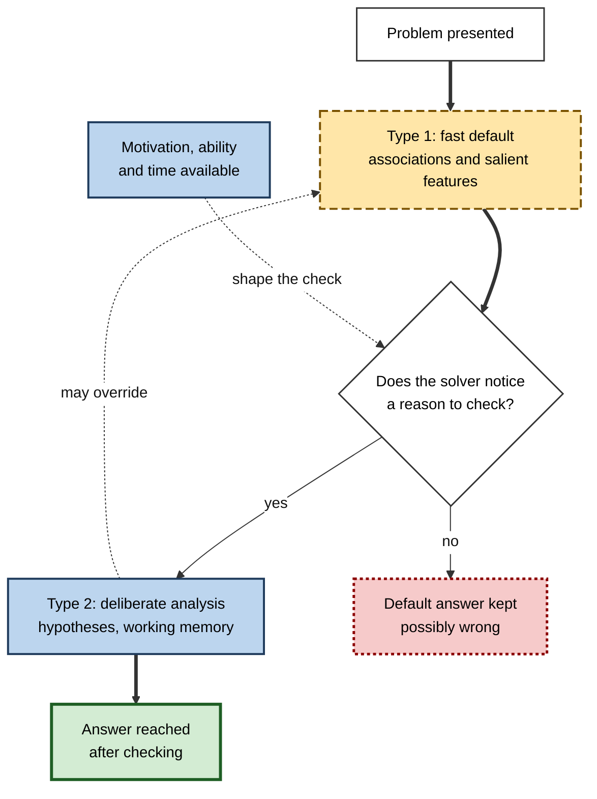

# C.6. Problem Solving and Reasoning

A support engineer receives a ticket that says the system is "slow for some users". Nothing in the manual covers it. She must work out what the goal is, what she already knows, which step to try first and how to tell whether it worked.

A chess player who sees a forced win in four moves is solving a problem whose solution space is enormous. A doctor who reasons from a cluster of symptoms to a diagnosis is reasoning: moving from premises to a conclusion that might be false. Problem solving is goal-directed activity when the route is not known in advance. Reasoning is the drawing, testing and evaluation of conclusions from evidence and premises.

> **Definition — Problem:** a situation in which a person has a current state, a goal state, and no immediately available sequence of actions that connects them.

> **Definition — Reasoning:** the process of drawing, evaluating or revising conclusions from premises, evidence or hypotheses.

**Why it matters**

- Almost every professional task that is not routine is a problem in this sense.
- Errors in reasoning are costly and often invisible: a wrong conclusion feels as sound as a right one.
- Problem-solving performance depends on what a person represents, which strategies they reach for and how they test their ideas, so each stage can be improved.
- The field explains why experienced people sometimes fail on problems that look simple, and why novices sometimes succeed by means they cannot justify.

---

## Problems and Their Structure

Problems vary in how much of their structure is given.

- **Well-structured problems** have a clear goal, a defined set of allowed actions and an unambiguous test of success.
  - *e.g.* a sum to be calculated, or a configuration to be checked against a specification.
- **Ill-structured problems** lack one or more of these features. The goal is vague, the allowed actions are unclear or the criteria of success are contested.
  - *e.g.* deciding how to restructure a team whose problems are partly political.

**Newell and Simon** described a problem in terms of an **initial state**, a **goal state**, a set of **operators** (permitted actions) and **constraints** (what blocks or limits them). The framework makes clear that solving a problem is searching a space of states for a path from the initial state to the goal.

> **Watch out:** many real problems are ill-structured in disguise. Solvers often treat them as well-structured, which narrows the search before they have understood the goal.

---

## Representation and Insight

Some problems are solved by changing how they are represented, not by searching harder within a representation. The Gestalt psychologists of the early twentieth century, and later researchers, called the moment this happens **insight** or **restructuring**.

**Figure 1.** How impasse and restructuring can change a solution path.

**Duncker's candle problem (1945)** is the classic example. A participant is given a candle, a box of tacks and matches, and asked to fix the candle to a wall so that it does not drip wax on the floor. The solution requires seeing the box as a support rather than as a container for tacks.

- Karl Duncker (1945) treated the difficulty as a fixation on the usual function of an object.
- He named this **functional fixedness**: a mental block against using an object in a new way that the problem requires.
- Functional fixedness is learned rather than innate; it appears to develop through experience with objects in their usual roles.

> **Definition — Functional fixedness:** the tendency to see an object only in its familiar role, which blocks a solution that uses it differently.

> **Key point:** insight is not magic. It is a change in representation that becomes available once the current one has been exhausted, and it is more likely when the solver has fewer fixed assumptions about the objects involved.

---

## Fixation and Set Effects

Experience helps problem solving, but it can also fix a method in place.

**Study card — Luchins (1942), the water-jar problems**

- **Design:** participants were given a series of problems in which they had to measure out a target quantity of water using jars of given capacities. The first several problems could all be solved by the same three-step method. The later critical problems could be solved by a much simpler method.
- **Results:** many participants continued to use the longer method on the critical problems, even when a simpler method was available.
- **Conclusion:** practice on one method created a set, or *Einstellung*, that persisted even when it was no longer efficient.
- **Significance:** the Einstellung effect is a reminder that expertise can make a solver less flexible when the familiar method no longer fits.

> **Watch out:** the same set that causes an error can also speed a correct answer. Set effects are not a flaw in expertise; they are a cost that must be managed by checking whether the familiar method is still the best one.

> **Remember:** before applying a familiar method, ask whether it is the shortest route here, and what would make it fail.

---

## Search and Means-Ends Analysis

When the representation is clear, solvers search. Much of human search is not systematic; it is directed by the difference between where one is and where one needs to be.

**Allen Newell and Herbert Simon (1972)**, in *Human Problem Solving*, described **means-ends analysis**. Their General Problem Solver program, developed from 1957, used the method to solve problems by comparing the current state with the goal, identifying the largest difference, and selecting an operator that reduces it.

- The method works backwards from the goal, creating **subgoals** for each difference.
- It is effective in well-structured domains such as logic and algebra, where differences between states can be defined.
- It is less effective when the difference that matters is hard to define, or when reducing one difference increases another.

**Figure 2.** Means-ends analysis as a repeated comparison of current state and goal.

> **Worked example (illustrative): reconciling two ledgers**
>
> 1. **Compare the states:** the two ledgers differ by 1,200 in total.
> 2. **Select the largest difference:** three invoices from one supplier are missing from the second ledger.
> 3. **Find an operator:** post the missing invoices to the second ledger.
> 4. **Find a precondition:** the invoices cannot be posted until their supplier code is valid.
> 5. **Set a subgoal:** correct the supplier code, then return to step 3.
> 6. **Compare again:** the difference is now 200, from a timing difference on one payment.
>
> **Watch out:** means-ends analysis can move steadily towards the wrong goal if the goal itself was misunderstood. The method is only as good as the representation of the goal.

---

## Analogy: Using What Is Known Elsewhere

People often solve a new problem by recalling a similar one. The question is whether they notice the similarity and can map its parts onto the new case.

**Study card — Gick and Holyoak (1980)**

- **Design:** participants were asked to solve Duncker's radiation problem, in which a tumour must be destroyed with rays strong enough to kill it but not the healthy tissue around it. Before attempting it, some participants read a story about a general who needed to attack a fortress surrounded by mines. The army could not march together along any single road, so the general divided it into small groups that converged on the fortress from several roads at once. Some participants were then given a hint that the story might help; others were not.
- **Results:** few participants solved the radiation problem spontaneously after reading the fortress story alone. When they were told that the story might help, most who had read it solved the problem.
- **Conclusion:** people often failed to notice that a source case was relevant, even when they had recently read it, but could use it once the relevance was pointed out.
- **Significance:** analogical problem solving involves noticing the analogy, mapping corresponding parts, and applying the mapping to the target. Retrieval and noticing were the main obstacles.

**Figure 3.** The mapping that makes the fortress story useful for the radiation problem.

> **Key point:** an analogy helps only when its structure, rather than its surface, is mapped. The fortress has nothing physical in common with a tumour; what matters is the relation between many weak forces converging on one target.

> **Watch out:** analogies that are retrieved only by surface similarity often mislead. A solver who relies on a familiar surface may map the wrong parts.

---

## Expertise in Problem Solving

Experts and novices differ in how they represent the same problems.

**Study card — Chi, Feltovich and Glaser (1981)**

- **Design:** physics students with different levels of experience were asked to sort a set of physics problems into groups of their own choosing, based on how similar the problems were in their solutions.
- **Results:** novices grouped problems by surface features, such as the objects or the physical arrangement described. Experts grouped them by the major physics principles needed to solve them.
- **Conclusion:** expert knowledge is organised around problem schemata, each holding the information needed to solve a category of problem. Novices' representations are organised around the literal features of the problem.
- **Significance:** the study explained why experts solve problems faster and why they can explain their solution in terms of principles, while novices may be misled by superficial similarity.

> **In practice:** an expert's first act in a new problem is often to decide what kind of problem it is. The representation that results determines which strategies come to mind.

---

## Reasoning: Conditionals, Hypotheses and Evidence

### Mental models in deduction

- **Philip Johnson-Laird (1983)** proposed that people reason about a set of premises by building models of the possibilities consistent with them, then checking whether a conclusion holds in every model.
- Errors arise when a possibility that the premises allow is not constructed, especially when only one model is easily imagined.
- The theory explains why some valid inferences are easy and others, though logically equivalent, are hard.

### Confirmation and the 2-4-6 task

**Study card — Wason (1960)**

- **Design:** participants were told that triples of numbers, such as 2, 4, 6, followed a rule that they had to discover. They proposed triples, were told whether each one conformed to the rule, and announced a rule when they were confident.
- **Rule:** the hidden rule was simply "any ascending sequence".
- **Results:** most participants formed a narrower hypothesis, such as "numbers increasing by two", and tested mainly triples that fitted it. Few tested triples designed to break the hypothesis, such as 1, 2, 3, which the narrow hypothesis predicts to fail but the broader rule predicts to succeed.
- **Conclusion:** people tend to seek confirming evidence rather than disconfirming evidence, a tendency Wason called **confirmation bias**.
- **Status:** the effect has been replicated in many variants, but its size and cause are debated, and some researchers argue that it is partly a matter of how the task is framed.

**Figure 4.** Which candidate tests can separate a narrow hypothesis from the broader rule, and which cannot.

### The selection task

**Wason's four-card selection task (1966)** presents four cards, each with a letter on one side and a number on the other, and the rule "if a card has a vowel on one side, it has an even number on the other". Participants must choose which cards to turn over to test the rule.

- The logically correct choice is the card showing a vowel and the card showing an odd number, because only those can reveal a violation.
- Most participants instead choose the vowel and the even number, which are cards that can only confirm the rule.
- Performance on the abstract version is typically poor, which is why the task is used to study how logical form and content interact.

> **Watch out:** a wrong answer on an abstract task does not show that a person cannot reason. It shows that the task, as presented, does not engage the reasoning the person would use with familiar content.

---

## Dual-Process Accounts

Many accounts of reasoning distinguish fast from slow processes.

**Evans and Stanovich (2013)** described **dual-process theories** as a family of accounts in which two kinds of processing contribute to judgement.

- **Type 1 processing** is fast, autonomous and largely unconscious. It supplies default responses based on associations, familiarity and salient features.
- **Type 2 processing** is slower, deliberate and draws on working memory. It supports hypothetical thinking, and it can override the defaults of Type 1 when the solver recognises the need.
- Whether Type 2 intervenes depends on the solver's ability, motivation and the time available, as well as on the task.

**Figure 5.** How default responses and deliberate checking interact.

> **Watch out:** dual-process accounts are a family, not one theory. Critics have argued that the family is too heterogeneous to be tested as a whole, and the better-supported claims concern the conditions under which deliberate checking is more or less likely.

---

## Case Study (illustrative): Triage of an Intermittent Outage

- **Situation:** an online service suffered short outages every few hours. The team had made many changes in the previous fortnight.
- **Problem:** the team spent three days investigating the most recent deployment, which was the most salient change, and found nothing.
- **Diagnosis:**
  - the team had fixed on the last change, a classic set effect;
  - the initial representation of the problem was "something changed recently", so every search was directed at change;
  - no one had written down what evidence would separate the candidate causes.
- **Actions:**
  1. Restated the problem: outages recur at intervals that do not match the deployment schedule.
  2. Listed the candidate causes and, for each, the observation that would confirm it and the one that would rule it out.
  3. Used means-ends analysis: the difference was the timing of failures; the operator was a scheduled batch job that ran every few hours; the subgoal was to test whether the job contributed.
  4. Recalled a similar incident the previous year, in which a scheduled job had locked a shared table, and mapped its structure onto the present case.
- **Result (illustrative figures):** the scheduled job was confirmed as the trigger within a day, and the fix took effect on the next cycle.
- **Side effects / caveats:** the analogy was useful because the structure matched, but a second team member noted that the earlier incident had involved a different table, so the match was checked before the fix was applied.
- **Lesson:** a team that restates the problem, names disconfirming evidence and maps structure rather than surface can escape an early fixation.

---

## Designing for Problem Solving

- **Make the goal explicit.** Many failures are failures of representation. A written statement of the goal and the constraints reduces the chance of solving the wrong problem.
- **Supply contrasting cases.** Showing problems that look alike but need different principles helps learners build the expert's kind of representation.
- **Scaffold early practice with worked examples.** Worked examples reduce the search that novices must do. The effect is well documented in algebra learning, where studying worked solutions helped learners solve later problems faster and with fewer errors (Sweller and Cooper, 1985).
- **Build in checks for disconfirmation.** Ask the solver to name the observation that would show the hypothesis is wrong before testing it.
- **Watch for fixation.** Ask when the familiar method was last shown to be the best one.

> **In practice:** the most useful habit in professional problem solving is to state, before acting, what result would prove the current idea wrong.

---

## Open Questions

- **How is representation chosen, and can it be trained?**
  - Insight is hard to predict, and it is unclear which training generalises to new problems.
- **How far do reasoning errors reflect task framing rather than reasoning capacity?**
  - Performance changes markedly with content, and the mechanisms behind that change are not settled.
- **Which dual-process claims survive testing?**
  - Some predictions hold under specific conditions; the general architecture is contested.
- **Can analogical transfer be made reliable?**
  - Solvers often fail to notice relevant sources; interventions that improve noticing have effects that vary.

---

## Summary

- A **problem** has a current state, a goal and no immediate route; **reasoning** evaluates conclusions from premises and evidence.
- **Newell and Simon** described problems as states, operators and constraints, and solving as search.
- **Insight** comes from restructuring the representation; **Duncker's** candle problem showed **functional fixedness**.
- **Luchins's** water-jar study showed that practice can create an **Einstellung** set that persists after it is useful.
- **Means-ends analysis** reduces the difference between current state and goal, using subgoals.
- **Gick and Holyoak** showed that analogies are often not noticed spontaneously, but can be used when their relevance is pointed out.
- **Chi, Feltovich and Glaser** showed that experts represent problems by principles and novices by surface features.
- **Johnson-Laird's** mental models explain deduction through possibilities, and **Wason's** tasks showed confirmation bias and difficulty with abstract rules.
- **Evans and Stanovich** describe dual-process accounts in which fast defaults can be overridden by deliberate checking.
- In practice, state the goal, name disconfirming evidence, and check whether familiar methods still fit.

---

## Self-Check

1. Define a problem in terms of state, goal and operators, and distinguish well-structured from ill-structured problems.
2. Explain why insight is a change of representation rather than a faster search.
3. What is functional fixedness, and how did Duncker's candle problem illustrate it?
4. Describe the Luchins water-jar study and what the Einstellung effect means for experts.
5. Explain means-ends analysis and one situation in which it fails.
6. What did Gick and Holyoak's study show about spontaneous analogical transfer, and what helped?
7. What did Chi, Feltovich and Glaser find about how experts and novices sort physics problems?
8. How does a mental-model account explain an error in a deductive problem?
9. In the 2-4-6 task, why did most participants fail to discover the rule, and what is confirmation bias?
10. Why does the logically correct choice in the selection task involve a card that could falsify the rule?
11. Describe Type 1 and Type 2 processing, and say what determines whether Type 2 intervenes.
12. A team keeps investigating the latest change despite no evidence. Diagnose the problem using set effects and propose a remedy.
13. A worked example is shown to a novice before practice. Explain why this may help, and when it may not.
14. What evidence would you want before concluding that a professional's reasoning error reflects a lack of reasoning capacity rather than the framing of the task?

### Answer Key

1. A problem has an initial state, a goal state, operators that change states and constraints that limit them. Well-structured problems have a clear goal, defined operators and a test of success. Ill-structured problems lack one or more of these.
2. Insight occurs when the current representation is exhausted and a re-description makes new operators available. The solver does not search faster within the old representation; the search space itself changes.
3. Functional fixedness is the tendency to see an object only in its familiar role. In the candle problem, the box must be seen as a support rather than as a container for tacks.
4. Participants trained on a longer method kept using it on critical problems where a shorter method was available. For experts, the lesson is that practised methods can persist after they stop being the best option.
5. The solver compares current and goal states, selects the largest difference and applies an operator that reduces it, setting subgoals where needed. It fails when the relevant differences are hard to define or when reducing one difference increases another.
6. Solvers often did not spontaneously use the fortress story to solve the radiation problem, but many did when told it might help. Noticing and mapping were the main obstacles.
7. Novices sorted problems by surface features such as the objects described. Experts sorted by the principles needed for the solution, consistent with organised problem schemata.
8. A reasoner may construct only some of the possibilities the premises allow. The conclusion then looks valid in the models built but fails in a model not constructed.
9. Participants proposed narrow hypotheses and tested mainly examples that fitted them, rather than examples designed to break them. Confirmation bias is the tendency to seek evidence that supports a current belief.
10. The conditional is falsified only by a vowel with an odd number on the other side. Turning the vowel card could reveal an odd number, and turning the odd card could reveal a vowel. The even card can only confirm the rule.
11. Type 1 is fast, autonomous and associative, and supplies default answers. Type 2 is slower, deliberate and uses working memory. Type 2 intervenes depending on the solver's ability, motivation, time and whether the solver notices a reason to check.
12. The team is fixed on the most salient change, a set effect. Remedy: restate the problem, list candidate causes with the evidence that would confirm or rule out each, and test them in order.
13. Worked examples reduce the search a novice must do, so more attention goes to the principles. They may not help when learners already have the relevant knowledge, or when the examples are not matched to the practice that follows.
14. Evidence would include whether performance changes when the same logic is presented with familiar content, whether the person reasons correctly in their own professional domain, and whether errors are consistent with a particular framing rather than random failure.

---

## Glossary

| Term | Meaning |
|---|---|
| Analogical transfer | Applying a solution from one problem to another with a similar structure. |
| Confirmation bias | The tendency to seek evidence that supports a current hypothesis. |
| Dual-process theory | A family of accounts with fast default processing and slower deliberate processing. |
| Einstellung effect | Persistence of a practised method after a simpler one is available. |
| Functional fixedness | Seeing an object only in its usual role, which blocks a new use. |
| Impasse | A point at which no available operator makes progress. |
| Insight | A sudden solution that follows a change in representation. |
| Means-ends analysis | Reducing the difference between current state and goal using subgoals. |
| Mental model | A representation of the possibilities a set of premises allows. |
| Operator | An action that changes the state of a problem. |
| Problem schema | An organised representation of a category of problems and their solutions. |
| Reasoning | Drawing, evaluating or revising conclusions from premises or evidence. |
| Restructuring | Changing the representation of a problem to make new solutions available. |
| Set effect | A tendency to reuse a familiar method, sometimes to the solver's cost. |
| Subgoal | An intermediate goal set in order to make a later step possible. |
| Type 1 processing | Fast, autonomous and largely associative processing. |
| Type 2 processing | Slower, deliberate processing that supports hypothetical thinking. |
| Well-structured problem | A problem with a clear goal, defined operators and a test of success. |
