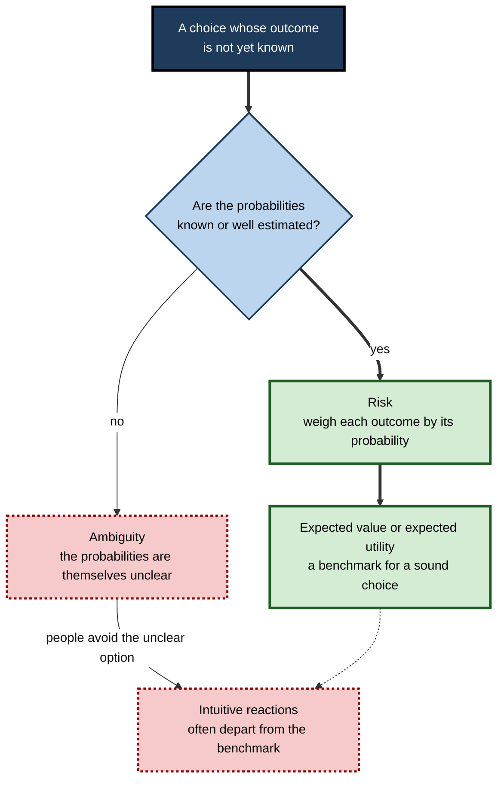
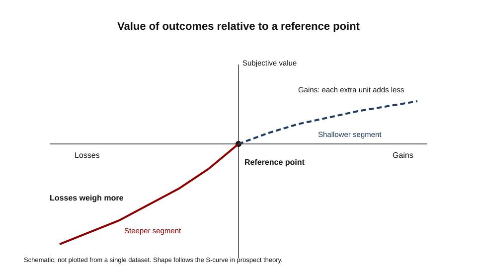
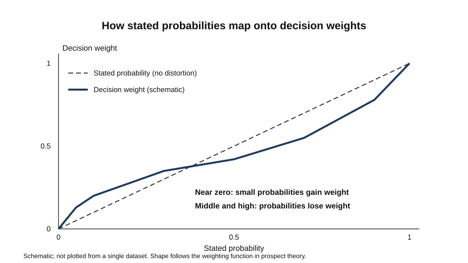
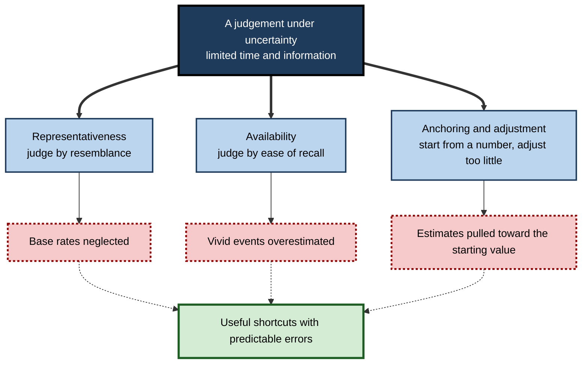
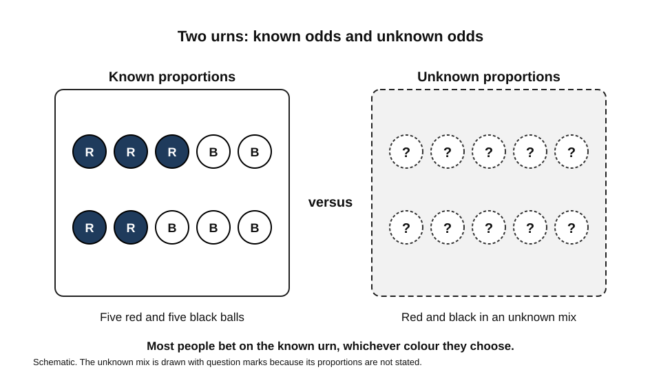

# C.7. Decision Making Under Uncertainty

A hospital pharmacist must decide whether to stock a cheaper drug with a well-known effect or a newer drug with a better chance of a large benefit and a small chance of harm. A product manager chooses a launch date on a forecast that may prove badly wrong. A job candidate weighing two offers cannot know how either will turn out.

In each case the outcome is unknown when the choice is made, so the quality of the decision has to be judged by the reasoning and the information available at that moment, not only by what happens later.

> **Definition — Decision under uncertainty:** a choice among options whose outcomes depend on events that are not known when the choice is made.

**Why it matters**

- Most consequential professional decisions are made before their results are known.
- A sound decision can produce a bad outcome, and a poor decision can produce a good one. Judging decisions by outcomes alone confuses luck with skill.
- Research over several decades has shown that people systematically misjudge probabilities and risks. These errors affect hiring, investment, safety, pricing and policy.
- The field offers both a normative standard (how a rational chooser should weigh options) and a descriptive account (how people actually choose). Good practice depends on knowing the gap between them.

---

## Risk, Ambiguity and Missing Knowledge

Decisions differ in how much is known about the chances of each outcome.

- **Risk** — the possible outcomes are known and their probabilities are known or can be estimated with reasonable confidence.
  - *e.g.* the chance of a fair die landing on six; the failure rate of a component tested thousands of times.
- **Ambiguity** — the possible outcomes are known, but the probabilities are unclear, contested or unknowable in advance.
  - *e.g.* the chance that a new regulation will be enforced within two years.
- **Structural uncertainty** — the list of outcomes itself may be incomplete.
  - *e.g.* a market entrant that has not yet imagined the competitor that will matter most.

> **Key point:** the same decision can sit at different points on this spectrum depending on how much evidence the decision-maker has. Treating an ambiguous situation as if it were a known risk is one of the most common errors in professional judgement.

**Figure 1.** Deciding which kind of reasoning fits a choice under uncertainty.

---

## The Normative Benchmark

### Expected value and expected utility

- **Expected value** — the average outcome if the choice could be repeated many times: each outcome multiplied by its probability, then summed.
- **Expected utility** — the same weighting applied to subjective value rather than money, so that a loss of a given size can matter more than a gain of the same size, and a sum matters differently to a person with little or much already.
- **Why the benchmark matters** — it states what consistent choices look like. A chooser who prefers A to B, and B to C, but C to A, can be shown to be inconsistent.

> **Formula — Expected value:** EV = sum of (probability × outcome).
> **Example (illustrative):** Option A pays 40 for certain. Option B pays 100 with probability 0.5 and 0 otherwise. EV(B) = 0.5 × 100 + 0.5 × 0 = 50. On expected value, B is better by 10.

> **Watch out:** a normative benchmark is a standard, not a description. Its existence does not show that people follow it, and in many real choices the inputs (probabilities and utilities) are uncertain themselves.

---

## Prospect Theory

### Study card — Kahneman and Tversky (1979)

- **Design:** participants answered hypothetical choice problems that offered sure outcomes against gambles, and gains against losses.
- **Results:**
  - Sure gains were preferred to gambles of similar or higher expected value. The authors called this the certainty effect: outcomes that are merely probable are underweighted relative to outcomes that are certain.
  - The pattern reversed for losses. People preferred a gamble to a sure loss of similar expected size.
- **Conclusion:** expected utility does not describe how people choose. Choices depend on gains and losses measured from a reference point, and on probabilities transformed in a non-linear way.
- **Significance:** the paper was published in *Econometrica* in 1979 and became the foundation of prospect theory, for which Daniel Kahneman received the Nobel Memorial Prize in Economic Sciences in 2002.

The theory has three central components.

### Reference point and the value function

- **Reference point** — outcomes are evaluated as gains or losses relative to a reference, such as the status quo, an expectation or a target.
  - *e.g.* a salary rise of 3% feels like a gain when the reference is last year's pay and like a loss when the reference is a 5% rise that colleagues received.
- **Value function** — the subjective value of an outcome is S-shaped around the reference point.
  - Concave for gains: each extra unit of gain adds less value, which encourages caution about gambles.
  - Convex for losses: each extra unit of loss adds less pain, which encourages gambling to avoid a sure loss.
- **Loss aversion** — the loss side of the curve is steeper, so a loss hurts more than an equal gain pleases.
  - Tversky and Kahneman's 1992 revision estimated a loss-aversion coefficient of about 2.25.
  - Later estimates cluster around 2, with wide variation across samples and tasks. The number is a rough guide, not a constant.

**Figure 2.** The shape of the value function around a reference point.

### Probability weighting

- **Probability weighting** — people do not use the stated probability directly. They transform it.
  - Small probabilities are overweighted: rare outcomes loom larger than their chance warrants.
  - Moderate and high probabilities are underweighted: near-certain outcomes are treated as less certain than they are.
- **Consequences:**
  - *e.g.* people buy lottery tickets and extended warranties because a small chance of a large effect feels larger than its probability.
  - *e.g.* a 95% chance of success can feel only a little better than a 99% chance.

**Figure 3.** How stated probabilities map onto decision weights.

> **Definition — Prospect theory:** a descriptive model of choice under risk in which outcomes are valued relative to a reference point, the value function is S-shaped and steeper for losses, and probabilities are transformed by a weighting function.

> **Watch out:** prospect theory describes choices, not necessarily beliefs. People may hold accurate probability beliefs and still weight them unevenly when choosing. The 1992 cumulative version extended the theory to gambles with any number of outcomes and made it consistent with stochastic dominance.

**Table 1.** Expected value and prospect theory compared.

| | Expected value | Prospect theory |
|---|---|---|
| What is evaluated | Final outcomes in money | Gains and losses relative to a reference point |
| Treatment of probability | Used as stated | Transformed; small chances overweighted |
| Response to losses | Equal and opposite to gains | Larger than equal gains (loss aversion) |
| Predicted behaviour with a sure gain | Pick the higher expected value | Often accept a lower sure gain over a higher-EV gamble |
| Predicted behaviour with a sure loss | Pick the lower expected loss | Often accept a gamble that might avoid the loss |

---

## Heuristics and Biases

### Judgement shortcuts

> **Definition — Heuristic:** a mental shortcut that reduces the effort of a judgement by substituting an easier question for a harder one.

Tversky and Kahneman (1974), in a paper in *Science*, described three heuristics that people use when judging probabilities and quantities. They argued that these shortcuts are usually effective and economical, but that they produce systematic and predictable errors.

- **Representativeness** — judging how likely something is to belong to a category by how closely it resembles that category.
  - Error: base rates are neglected. A vivid resemblance can outweigh a much more common alternative.
- **Availability** — judging how frequent something is by how easily examples come to mind.
  - Error: recent, dramatic or emotionally charged events seem more common than they are.
- **Anchoring and adjustment** — starting from an initial value and adjusting insufficiently from it.
  - Error: estimates are pulled toward the starting value, even when that value is arbitrary.

**Figure 4.** From an uncertain judgement to the three heuristics and their characteristic errors.

### Base-rate neglect in practice

- **The principle:** the probability that an item belongs to a rare category depends on how rare the category is, not only on how well the item fits it.
- **Worked example (illustrative figures):** a quality test flags 90% of faulty units and wrongly flags 10% of sound units. One unit in 100 is faulty.
  1. In 1,000 units, 10 are faulty and 990 are sound.
  2. The test flags 9 of the faulty units (90% of 10).
  3. It wrongly flags 99 sound units (10% of 990).
  4. Of the 108 flagged units, only 9 are faulty, which is about 8%.
- **Conclusion:** a positive result from an accurate test can still be wrong most of the time when the condition is rare.

> **Watch out:** base-rate neglect is strongest when the individual case is vivid and the base-rate information is only a statistic. Its pull is strong even when the statistic is given explicitly and the person can see it.

### Study card — Thinking biases tested against cognitive ability

- **Design:** several studies measured general cognitive ability and a set of thinking biases, and checked whether people with higher ability were less affected.
- **Results:**
  - Many classic biases, including framing effects, anchoring and base-rate neglect, were largely unrelated to general cognitive ability.
  - Some tendencies were related to ability, so the picture is not uniform.
- **Conclusion:** being intelligent does not protect a person from many judgement errors. Thinking biases and cognitive ability are partly separate capacities.

> **Watch out:** "smart people are not immune" is a fair summary of the classic biases, but not of every error. The relationship depends on the bias and the task, so it should not be stated as a general law.

### Overconfidence and calibration

- **Overconfidence** — stated confidence exceeds accuracy, especially for difficult or unfamiliar questions.
- **Calibration** — the match between stated probabilities and observed frequencies. A well-calibrated forecaster who says 70% is right about seven times in ten.
- **Why it matters:** planning, budgets and timelines are built on probability judgements. Miscalibrated estimates produce plans with too little contingency.

---

## Ambiguity Aversion

### Study card — Ellsberg (1961)

- **Design:** a bettor chooses a colour, red or black, and draws a ball from one of two urns. The first urn contains known numbers of red and black balls, in equal proportions. The second contains red and black balls in an unknown mixture.
- **Results:** most people prefer to bet on the urn with known proportions, whichever colour they bet on. Choosing the known urn in both colours is inconsistent with the assumption that people assign a single probability to the unknown mixture.
- **Conclusion:** people treat ambiguity as something to avoid, beyond their attitude to risk. This conflicts with subjective expected utility theory, which assumes a single subjective probability for each event.
- **Replication:** later experiments have largely confirmed the pattern, although its size varies with stakes and expertise.

**Figure 5.** The two urns in the classic ambiguity problem.

> **Definition — Ambiguity aversion:** a preference for options with known probabilities over options with equally attractive but unclear probabilities.

> **Key point:** ambiguity aversion is a reason that professionals hesitate over new markets, untested suppliers and unfamiliar regulations, even when a carefully reasoned estimate exists.

---

## Intuition in Decisions Under Uncertainty

- **Two positions:** one research tradition emphasises the errors of intuitive judgement; another studies the skilled intuitions of experienced practitioners such as firefighters and anaesthetists.
- **Kahneman and Klein (2009)** reviewed the two positions and concluded that they largely agree. Intuition is likely to be accurate when two conditions hold:
  - the environment is regular enough that its patterns can be learned;
  - the person has had enough practice, with prompt and accurate feedback, to learn those patterns.
- **Implication:** an intuition is not reliable simply because it is strong. Confidence is a poor guide to accuracy, so the environment and the feedback history matter more than the feeling of certainty.
- **Watch out:** where feedback is delayed, rare or misleading, even an experienced person may hold an intuition that is confidently wrong. A market, a hiring panel and a long-term policy may all lack the feedback needed to train reliable intuitions.

> **In practice:** before trusting a quick judgement, ask whether the situation has regular patterns and whether past judgements of this kind were checked against outcomes.

---

## Improving Decisions Under Uncertainty

### Separating decision quality from outcome quality

- **Decision log** — record the options, the probability and value estimates, the assumptions and the reasons, before the outcome is known.
- **Outcome review** — compare the decision with what was known at the time. Judge the process separately from the result.
- **Why it matters:** a log protects against hindsight, in which people judge an outcome as having been foreseeable when it was not.

### Practices that counter the common errors

- **Start from base rates** — find how often comparable projects, hires or launches succeeded before adjusting for the features of the case in hand.
- **Make probabilities explicit** — give ranges and probabilities rather than adjectives such as "likely" or "unlikely".
- **Test the anchor** — ask what estimate would have been made without the first number that was offered.
- **Ask what would make the plan fail** — list the most plausible reasons for failure before committing.
- **Check the reference point** — state whether an option is framed as a gain or a loss, and see whether the same choice would look different under the other framing.

> **Remember:** a good decision process makes assumptions visible, uses base rates, separates probability from preference, and judges the choice on the information available when it was made.

### Case study (illustrative): launching a feature under uncertainty

- **Situation:** a software company must decide whether to release a new analytics feature to all customers in one quarter or to pilot it with a small group first.
- **Problem:** the team had strong positive feedback from internal testers, and the sales team wanted a full launch to meet a commercial target.
- **Diagnosis:**
  - The estimate of uptake was drawn from the internal testers, who were unusually enthusiastic. This is an anchor and an availability problem: the most vivid evidence dominated.
  - The base rate for comparable features in the company's history was a much lower uptake, which had not been compared.
  - The downside was framed as a loss of a sales target, which made a full launch feel safer than its risk warranted.
- **Actions:**
  1. Record the forecast range and the probability of each outcome before launch.
  2. Compare the forecast with the historical base rate for similar features.
  3. Pilot the feature with a random sample of customers, with a defined threshold for a full launch.
  4. Set in advance the signals that would trigger a rollback.
- **Result:** the pilot showed uptake well below the internal estimate, and a problem with one integration that the testers had not used. The feature was fixed before the full release, and the target was met one quarter later than planned.
- **Side effects and caveats:** the pilot delayed a visible launch and slowed some sales conversations.
- **Lesson:** in a decision under uncertainty, the most useful evidence is often the base rate and a test of the assumption, not the most enthusiastic anecdote.

---

## Open Questions

- **Are prospect-theory parameters stable across people and domains?**
  - Loss aversion and weighting vary between studies, tasks and stakes; the reasons are not settled.
- **Are the classic biases errors, or appropriate responses to real-world environments?**
  - Some researchers argue that heuristics are well adapted to the environments people usually meet; others see them as systematic failures. Evidence supports both claims for different situations.
- **Which debiasing methods work outside the laboratory?**
  - Many techniques improve performance in controlled tasks, but their effects on organisational decisions are less well measured.
- **How should people use AI-generated probability estimates?**
  - Automated forecasts can supply base rates that people neglect, but they can also become a new anchor, and their calibration in unfamiliar settings is not yet well understood.

---

## Summary

- A **decision under uncertainty** is a choice whose outcome is not known when it is made; judge it by the information available at the time.
- **Risk** has known or well-estimated probabilities; **ambiguity** has unclear probabilities, and people tend to avoid it.
- **Expected value** and **expected utility** are normative benchmarks; they describe how a consistent chooser should weigh outcomes.
- **Prospect theory** (Kahneman and Tversky, 1979) describes choice with a reference point, an S-shaped value function, **loss aversion** and **probability weighting**; the 1992 **cumulative prospect theory** extended it to many outcomes.
- **Heuristics** — representativeness, availability and anchoring and adjustment — are useful shortcuts that produce predictable errors, including **base-rate neglect**.
- Many classic biases are only weakly related to general cognitive ability, so intelligence is not a safeguard.
- **Ambiguity aversion** (Ellsberg, 1961) shows that people avoid unclear probabilities beyond their attitude to risk.
- **Intuition** is reliable when the environment is regular and feedback is prompt; confidence is a poor guide.
- Good practice separates decision quality from outcome quality, uses base rates and makes assumptions and reference points explicit.

---

## Self-Check

1. Distinguish risk from ambiguity with one professional example of each.
2. Compute the expected value of a gamble that pays 200 with probability 0.3 and 0 otherwise, and compare it with a sure payment of 50.
3. Why is expected value a normative benchmark rather than a description of how people choose?
4. Describe the design and main result of Kahneman and Tversky's 1979 work on the certainty effect and the reversal for losses.
5. Explain the three components of prospect theory: reference point, value function and probability weighting.
6. What does loss aversion predict about how a person responds to a proposed change framed as a loss compared with the same change framed as a gain?
7. A product team sees a 2% chance of a serious failure described as "negligible". Explain how probability weighting might distort that judgement.
8. Name the three heuristics Tversky and Kahneman (1974) described, and give one typical error for each.
9. Work through the base-rate example: why does a positive result from an accurate test still usually indicate a sound unit when the fault is rare?
10. What did the multi-study work on thinking biases suggest about the relationship between those biases and general cognitive ability?
11. Describe the two urns in Ellsberg's problem and explain why the preference for the known urn is hard to reconcile with a single subjective probability.
12. What two conditions does Kahneman and Klein (2009) identify as necessary for trustworthy intuition, and why does confidence not satisfy them?
13. A hiring manager relies on a candidate's impressive interview and ignores the low success rate of hires with similar backgrounds. Identify the heuristic and the correction.
14. Design a decision log for a major investment. What should be recorded before the outcome is known, and why?
15. Under what conditions might a pilot be preferable to a full launch even when the internal forecast is very positive?

### Answer Key

1. Risk: a manufacturing defect rate measured over a million units. Ambiguity: the likelihood that a new competitor will enter a market in the next year, given no comparable precedent. Risk allows numerical weighting; ambiguity makes numerical estimates themselves uncertain.
2. EV = 0.3 × 200 + 0.7 × 0 = 60. The gamble has a higher expected value than the sure 50, by 10. Expected value alone does not settle whether a person should take it, because risk attitudes and the size of the stakes also matter.
3. It states what a consistent chooser should do, given probabilities and utilities. Real choices often depart from it, and the inputs are themselves uncertain. Prospect theory was developed because observed choices differed systematically from expected utility.
4. Participants preferred a sure gain to a gamble of similar or higher expected value, showing that probable outcomes are underweighted relative to certain ones. For losses the pattern reversed, and people preferred a gamble to a sure loss. The result contradicts expected utility as a description of choice.
5. The reference point sets what counts as a gain or a loss. The value function is S-shaped around it, concave for gains and convex for losses. Probability weighting transforms stated probabilities, overweighting small ones and underweighting moderate and high ones.
6. The loss framing makes the change feel larger and more painful than the equivalent gain framing, so people are more likely to resist a change framed as a loss. The same outcome can therefore produce different decisions depending on the reference point.
7. A 2% chance of a serious failure may be overweighted because small probabilities loom large, so calling it negligible sits uneasily with how a person would weigh it. The label itself is a framing that may reduce the perceived weight, so the team should ask what the probability is and what the failure costs.
8. Representativeness (error: base rates neglected); availability (error: vivid or recent events overestimated); anchoring and adjustment (error: estimates pulled toward the starting value).
9. Because the fault is rare, most flagged units come from the much larger group of sound units. The false positives outnumber the true positives, so a flagged unit is more likely to be sound.
10. Many classic biases, such as framing and base-rate neglect, were largely unrelated to general cognitive ability, while some tendencies were related. Intelligence therefore offers only partial protection against judgement errors.
11. One urn has known equal proportions; the other has an unknown mixture. Betting on the known urn in both colours implies two different probabilities for the unknown urn's colour, which a single subjective probability cannot produce.
12. The environment must be regular enough to learn, and the person must have had practice with prompt, accurate feedback. Confidence does not reveal either condition; people can feel sure in environments where they have never been corrected.
13. The heuristic is representativeness, combined with neglect of base rates. The correction is to start from the base rate of success for similar hires and then adjust for the specific evidence.
14. Record the options, the probability and value estimates for each outcome, the key assumptions, the reasons for the choice and the date. Recording before the outcome prevents later judgements from being reshaped by hindsight and separates the quality of the decision from its result.
15. When the forecast rests on enthusiastic internal evidence that differs from the base rate, when a downside would be severe or hard to reverse, or when the forecast is ambiguous, a pilot gives evidence about the assumption that the forecast cannot provide.

---

## Glossary

| Term | Meaning |
|---|---|
| Ambiguity | Uncertainty in which the probabilities of outcomes are unclear or unknown. |
| Ambiguity aversion | Preference for known probabilities over equally attractive unclear ones. |
| Anchoring and adjustment | Estimating by starting from a value and adjusting insufficiently from it. |
| Availability | Judging frequency by how easily examples come to mind. |
| Base-rate neglect | Ignoring how common or rare a category is when judging an individual case. |
| Calibration | The match between stated probabilities and observed frequencies. |
| Certainty effect | The tendency to prefer a sure outcome to a gamble with a higher expected value. |
| Cumulative prospect theory | The 1992 extension of prospect theory that handles any number of outcomes. |
| Decision under uncertainty | A choice whose outcome depends on events not known when it is made. |
| Expected utility | Probability-weighted average of subjective values of outcomes. |
| Expected value | Probability-weighted average of outcomes. |
| Heuristic | A mental shortcut that substitutes an easier question for a harder one. |
| Loss aversion | The tendency for losses to weigh more heavily than equal gains. |
| Overconfidence | Stated confidence that exceeds actual accuracy. |
| Probability weighting | The transformation of stated probabilities into decision weights. |
| Prospect theory | A descriptive model of choice using reference points, an S-shaped value function and probability weighting. |
| Reference point | The baseline against which outcomes are judged as gains or losses. |
| Representativeness | Judging likelihood by resemblance to a category. |
| Risk | Uncertainty in which outcomes and their probabilities are known or well estimated. |
