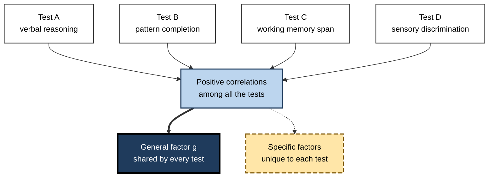
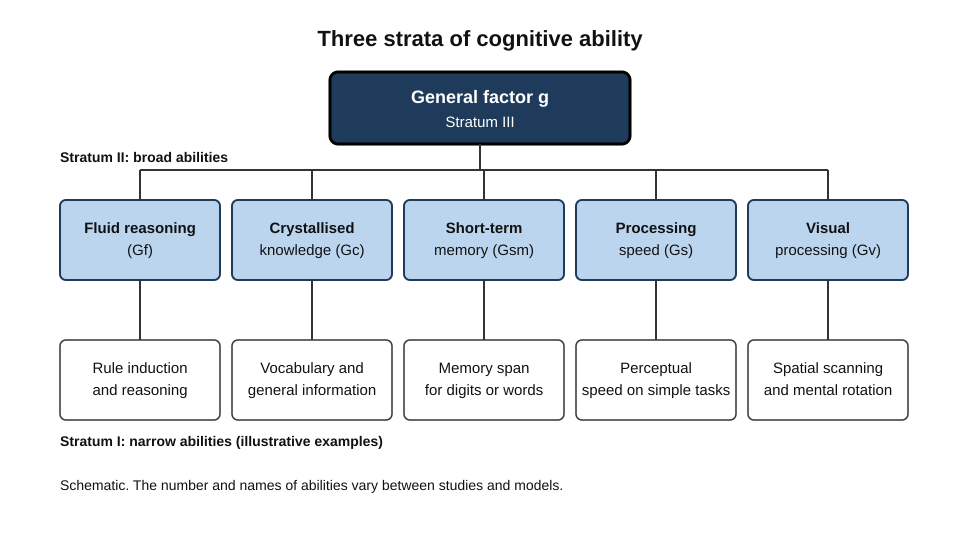
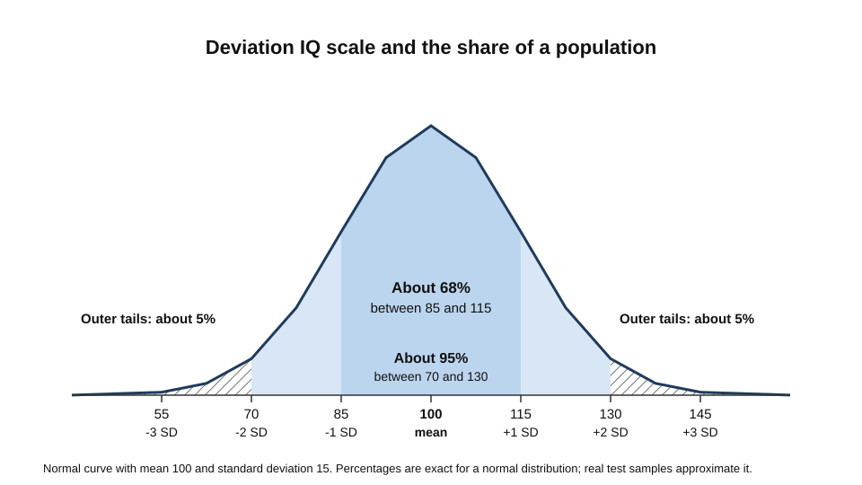
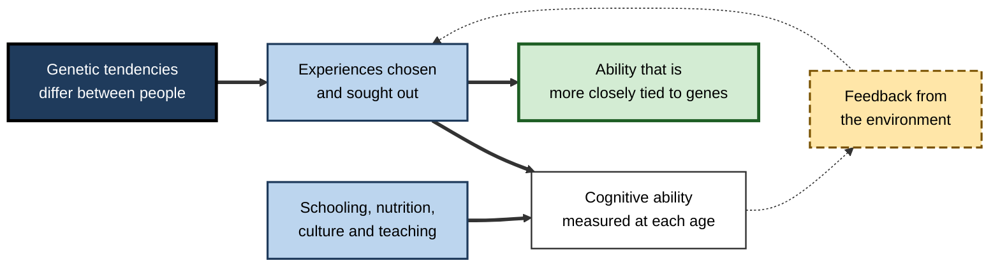
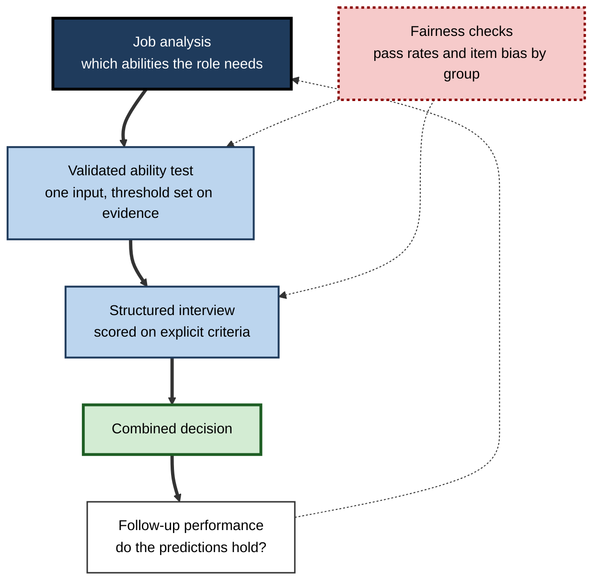

# C.8. Intelligence and Cognitive Ability

Two people are given the same unfamiliar problem: a set of shapes that follow a hidden rule. One spots the rule in seconds and extends the pattern; the other needs several minutes and asks for a hint.

Across a school year, one child absorbs new vocabulary and mathematical methods quickly while a classmate with the same teaching struggles. A consultant reads a long, unfamiliar regulation and identifies the one clause that matters. Each case involves what psychologists call cognitive ability, and each raises the same question: how much of the difference reflects a general capacity, how much reflects what a person has learned, and how far either can change.

> **Definition — Intelligence (in psychometrics):** a broad mental capacity to reason, solve problems, learn from experience and adapt to new demands, inferred from performance across many different tests.

**Why it matters**

- Ability tests are among the most widely used tools in selection, education and clinical assessment, so their meaning and limits affect many decisions.
- Cognitive ability is one of the most consistent predictors of learning and performance, which makes it central to any account of how people learn.
- The field is one of the most empirically studied in psychology, and its debates about measurement, heredity, environment and fairness are often misunderstood.
- Understanding what a test score does and does not show is a professional skill in its own right.

---

## From One Common Factor to a Hierarchy

### Spearman and the general factor

- **Charles Spearman (1904)** gave participants several tasks, including tests of sensory discrimination, and examined how performance on the different tasks related to each other.
- **Finding:** performance on very different tasks was positively correlated. Someone good at one tended to be better than average on others.
- **Interpretation:** a single common factor, which he called *g* (general intelligence), contributes to all of them, alongside a *specific* factor for each task.
- **Consequence:** intelligence could be thought of as one general capacity plus many specialised abilities.

> **Definition — The g factor:** the common element of performance across diverse cognitive tests, extracted statistically as the shared variance among them.

> **Key point:** a correlation between tests does not reveal a mechanism. The *g* factor is a statistical summary of overlap, and its biological or cognitive basis is still a matter of research.

**Figure 1.** From correlated test scores to a general factor and specific abilities.

---

## Fluid and Crystallised Intelligence

### The Cattell distinction

- **Raymond Cattell (1963)** proposed two broad abilities that behave differently across the lifespan.
  - **Fluid intelligence (Gf)** — reasoning with novel material, without relying on previously acquired knowledge.
    - *e.g.* working out the rule in an unfamiliar pattern puzzle.
  - **Crystallised intelligence (Gc)** — knowledge and skills built through experience and education.
    - *e.g.* vocabulary, general information and the use of learned procedures.
- **Working distinction:** fluid ability is used to acquire new knowledge; crystallised ability reflects the knowledge already acquired.

### Horn and Cattell (1966) and the broader model

- **Horn and Cattell (1966)** refined the theory and tested it, extending it to several further broad abilities such as visual processing, short-term memory, and processing speed.
- **Fluid and crystallised abilities** were shown to be related but distinct, with different patterns of development and decline.
  - Crystallised knowledge typically continues to grow into middle and later adulthood.
  - Fluid reasoning tends to peak earlier than crystallised knowledge, and some fluid components peak at different ages.

### Carroll's three-stratum model

- **John Carroll (1993)** reanalysed several decades of factor-analytic studies, covering hundreds of datasets.
- **Three strata** organise abilities by generality:
  - **Stratum I** — many narrow abilities, such as specific memory or perceptual tasks.
  - **Stratum II** — a set of broad abilities, such as fluid reasoning, crystallised knowledge and processing speed.
  - **Stratum III** — a single general factor, *g*, at the top.
- The integrated **Cattell–Horn–Carroll (CHC)** model combines the Gf–Gc framework with Carroll's hierarchy and is widely used in test design.

**Figure 2.** A three-stratum view of cognitive ability.

> **Watch out:** the hierarchy is a model of the test-score structure, not a proof that intelligence is a single organ. Some researchers have questioned both the need for, and the empirical basis of, an integrated model that combines Cattell-Horn and Carroll.

---

## How Intelligence Is Measured

### Wechsler's approach

- **David Wechsler** developed individual intelligence scales for adults, beginning with the Wechsler-Bellevue scale, later succeeded by the adult scale (WAIS).
- **His definition:** intelligence is the aggregate or global capacity of an individual to act purposefully, think rationally and deal effectively with the environment.
  - The definition treats intelligence as the combination of many capacities, not a single number.
- **The scale:** modern Wechsler tests combine several index scores, such as verbal comprehension, perceptual reasoning, working memory and processing speed, into a full-scale score.

> **Formula — Deviation IQ:** IQ = 100 + 15 × z, where z is how many standard deviations a score lies above or below the average of the reference group.
> **Example (illustrative):** a score one standard deviation above the group mean gives 100 + 15 = 115. About two-thirds of a representative group lies between 85 and 115, and about 95% between 70 and 130.

**Figure 3.** The deviation IQ scale and the share of a representative population in each band.

### Reliability and validity

- **Reliability** — the consistency of a score. The same person should get a similar result on a retest, or on a parallel form, within the limits of practice and fatigue.
- **Validity** — whether the score measures what it claims to measure, and whether it predicts what it should.
- **Watch out:** a test can be reliable and still measure a narrow skill. A high score on one test does not guarantee a broad capacity, and a low score can reflect anxiety, language, motivation or unfamiliarity with the test format.

---

## What Ability Predicts

### Study card — Schmidt and Hunter (1998)

- **Design:** a review of 85 years of personnel selection research, combining meta-analyses of the validity of 19 selection methods for predicting job performance and training success.
- **Results:**
  - General mental ability was among the strongest single predictors, especially for people without prior job experience.
  - For ability alone, the average validity was roughly .5 on the correlation scale; combining ability with other methods such as a work sample or structured interview raised the figure further.
- **Conclusion:** ability tests are useful for selection, and their value is greatest when they are combined with other evidence.
- **Later debate:** Sackett and colleagues (2022) reanalysed more recent studies and reported lower average validity for general mental ability. The difference is debated, and partly reflects changes in the work, the samples and the methods used.

> **Watch out:** a correlation of about .5 means ability accounts for a quarter of the variance in performance, so three-quarters of the variation comes from other factors. Predictions are probabilities for groups, not verdicts on individuals.

### Education and everyday outcomes

- Ability predicts school achievement and the rate of acquiring new academic knowledge, but the relationship is shaped by teaching, motivation and prior learning.

---

## Change Over Time

### Study card — Flynn (1987)

- **Design:** the author compiled intelligence test data from 14 nations and compared performance across generations.
- **Results:**
  - Scores rose substantially in the countries studied, in the range of 5 to 25 points per generation.
  - The largest gains were on tests of fluid reasoning, such as matrix puzzles that rely less on culturally specific vocabulary and knowledge. Gains on verbal tests were smaller.
- **Conclusion:** the rise was too quick to be explained by genetic change alone, which pointed to environmental causes.
- **Later findings:** a meta-analysis by Pietschnig and Voracek (2015) reported that gains had decreased in more recent data, and that some countries showed slowed or stopped gains.

> **Watch out:** the Flynn effect shows that scores change, not that the underlying general ability has changed by the same amount. Whether test gains reflect improved reasoning, better test familiarity, schooling, nutrition or other factors is still debated.

---

## Heritability and Environment

### What heritability means

> **Definition — Heritability:** the proportion of the variation in a trait within a particular population that is associated with genetic differences in that population.

- Heritability is a **population** statistic. It describes how much of the differences among people in one population, in one environment, is associated with genetic differences.
- It is **not** a fixed share of an individual's ability, and it changes when environments change.
- It is **not** a measure of how much a person can change through learning.

### Study card — Haworth and colleagues (2010)

- **Design:** a large twin study, including about 11,000 twin pairs from four countries, measured general cognitive ability at several ages.
- **Results:** heritability estimates rose across childhood: about 41% at age 9, 55% at age 12 and 66% at age 17.
- **Interpretation:** the authors proposed that as children grow older they increasingly choose, shape and seek out experiences that fit their genetic tendencies. This process, called gene–environment correlation, strengthens the link between genes and measured ability over time.
- **Caveat:** the figures describe the population studied; they do not predict any one child's future.

**Figure 4.** How genetic tendencies and experience interact over development.

> **Key point:** high heritability and large environmental effects are not contradictory. Heritability describes how differences are distributed within a population; environments can still raise average scores for everyone, as the Flynn effect shows.

---

## Professional Use and Its Limits

### Case study (illustrative): a graduate recruitment programme

- **Situation:** a consulting firm recruits several hundred graduates a year and wants a fair, predictive selection process.
- **Problem:** the first selection stage relied on interviews rated by different people with very different standards. Hiring outcomes were inconsistent, and the firm could not show that its ratings predicted performance.
- **Diagnosis:**
  - Interviewer judgement varied widely and was poorly anchored to the job.
  - No validity evidence existed for the interview scores.
  - Some groups of candidates passed at much lower rates, and no one had examined whether the difference reflected job-relevant skill or a feature of the test.
**Figure 5.** A selection process in which each step needs its own evidence of validity and fairness.

- **Actions:**
  1. Analyse the job to identify the abilities it requires: complex analysis, written communication and learning speed.
  2. Use a short, validated ability test as one input, with a pass threshold set on evidence rather than habit.
  3. Replace unstructured interviews with a structured interview, scored against explicit criteria.
  4. Track pass rates by group, test the items for bias, and review whether the cut-off is needed.
  5. Follow new hires' performance to check the predictions against outcomes.
- **Result:** the combined process predicted early performance better than the earlier interview alone, and the firm found and removed items that disadvantaged one group without adding to prediction.
- **Side effects and caveats:** the process took longer and needed trained raters; the programme had to keep checking whether the test remained valid for the firm's changing work.
- **Lesson:** an ability test is evidence, not a verdict. Its value depends on job analysis, validity checks, fairness monitoring and the way it is combined with other information.

> **Watch out:** using a single test score as a decision rule, without checking its validity for the specific role and group, is a common and avoidable error.

---

## Open Questions

- **Is *g* a single underlying capacity or the result of many interacting processes?**
  - Both views predict the same overlap among tests, so the statistics alone cannot settle the question.
- **How much of the Flynn gain is lasting, and what caused it?**
  - Gains have slowed in some countries, and the explanations remain contested.
- **How stable is the predictive validity of ability tests in changing work?**
  - Reanalyses of recent studies report lower averages than earlier estimates; the reasons are debated.
- **Can selection and assessment reduce group differences without losing validity?**
  - Methods exist, but their trade-offs are still under study.
- **Can training raise fluid ability, and if so, does the gain transfer to everyday reasoning?**
  - Evidence on transfer from training is mixed, and the answer depends on the training and the outcome measured.

---

## Summary

- **Intelligence** in psychometrics is a broad capacity to reason, learn and adapt, inferred from performance across many tests.
- **Spearman (1904)** found positive correlations among diverse tests and proposed a general factor, *g*, plus specific factors.
- **Cattell and Horn** separated fluid reasoning (Gf) from crystallised knowledge (Gc); **Carroll (1993)** organised abilities into three strata, integrated in the CHC model.
- **Wechsler** defined intelligence as a global capacity to act purposefully and think rationally; modern scales combine several index scores into a full-scale score.
- Deviation IQ places scores on a scale with a mean of 100 and a standard deviation of 15.
- **Schmidt and Hunter (1998)** found general mental ability among the strongest predictors of job performance, especially for people without prior experience; later reanalysis reports lower and debated averages.
- The **Flynn effect** shows large score gains over generations, largest on fluid tests and not necessarily equal to gains in underlying ability.
- **Heritability** is a population statistic that rises across childhood in twin data; **gene–environment correlation** helps explain why.
- Responsible use requires job analysis, validity evidence, fairness monitoring and a combination of evidence rather than a single score.

---

## Self-Check

1. Define intelligence as a psychometric construct and explain why it is inferred rather than observed.
2. What did Spearman find, and what did he propose to explain it?
3. Distinguish fluid intelligence from crystallised intelligence with one example each.
4. Describe the three strata in Carroll's model and where *g* sits.
5. What does Wechsler's definition emphasise, and how does it differ from a single-number view?
6. Compute the deviation IQ for a score two standard deviations below the mean.
7. A selection test has a validity of about .5. Explain what this means for the share of performance differences it explains.
8. Summarise Schmidt and Hunter's finding about general mental ability and job experience, and state one reason later reanalyses might differ.
9. What did Flynn's 1987 analysis find about the size and pattern of score gains?
10. Why does the Flynn effect argue against a purely genetic explanation of score differences over generations?
11. Define heritability and explain why it is a population statistic.
12. Explain gene–environment correlation in the developmental process described by Haworth and colleagues.
13. A school uses a heritability estimate to conclude that a child's ability cannot change. Identify the error.
14. Design a fair selection process for a role that requires complex analysis. What evidence would justify each step?

### Answer Key

1. Intelligence is a construct: a broad capacity inferred from patterns of performance across many tasks. No one observes it directly; it is inferred from how tests correlate and predict outcomes.
2. Spearman found that performance on different sensory and school-type tasks was positively correlated. He proposed a general factor, *g*, common to all tasks, plus a specific factor for each task.
3. Fluid intelligence is reasoning with novel material, such as solving an unfamiliar pattern puzzle. Crystallised intelligence is accumulated knowledge, such as vocabulary or domain information.
4. Stratum I contains many narrow abilities; Stratum II contains broad abilities such as fluid reasoning and processing speed; Stratum III contains *g* at the top.
5. Wechsler emphasised intelligence as an aggregate of capacities used purposefully and effectively, not one number. Modern scales therefore report several index scores alongside a full-scale score.
6. IQ = 100 + 15 × (−2) = 70.
7. A validity of about .5 means ability accounts for about a quarter of the variance in performance. The remaining three-quarters reflects other factors and measurement error.
8. General mental ability was among the strongest single predictors, especially for people without prior job experience. Later reanalyses of more recent studies report lower averages, partly because work, samples and methods have changed.
9. Scores rose by roughly 5 to 25 points per generation across the 14 nations, and the largest gains appeared on tests of fluid reasoning rather than on verbal tests.
10. Gains that large over a few generations cannot be explained by changes in the gene pool, so environmental causes must account for much of the rise. This does not prove that individual differences are non-genetic.
11. Heritability is the proportion of variation in a trait in a particular population associated with genetic differences in that population. It depends on the population and environment, so it does not describe an individual's potential.
12. As children grow, they increasingly select and shape experiences in line with their genetic tendencies, which strengthens the correlation between their genes and their measured ability.
13. The error is treating a population statistic as an individual fixed fact. Even if heritability is high, environmental change can alter a child's measured ability and performance.
14. Analyse the job to identify required abilities; use a validated ability test as one input with a threshold set on evidence; use a structured interview scored on explicit criteria; monitor pass rates and test items for bias; follow up performance to check predictions. Each step needs evidence of validity or fairness for the specific role.

---

## Glossary

| Term | Meaning |
|---|---|
| Crystallised intelligence (Gc) | Knowledge and skill built through experience and education. |
| Deviation IQ | A score scaled to a mean of 100 and a standard deviation of 15. |
| Flynn effect | The substantial rise in intelligence test scores across generations. |
| Fluid intelligence (Gf) | Reasoning with novel material, not reliant on prior knowledge. |
| *g* (general factor) | The common element of performance across diverse cognitive tests. |
| Gene–environment correlation | The tendency for people to select and shape environments in line with their genetic tendencies. |
| Heritability | The proportion of population variation in a trait associated with genetic differences. |
| Index score | A summary score for a group of related subtests in a test battery. |
| Reliability | The consistency of a test score across occasions or forms. |
| Specific factor | The part of a test's performance not shared with other tests. |
| Stratum | A level in Carroll's hierarchy, from narrow abilities to general intelligence. |
| Validity | The degree to which a test measures and predicts what it claims. |
