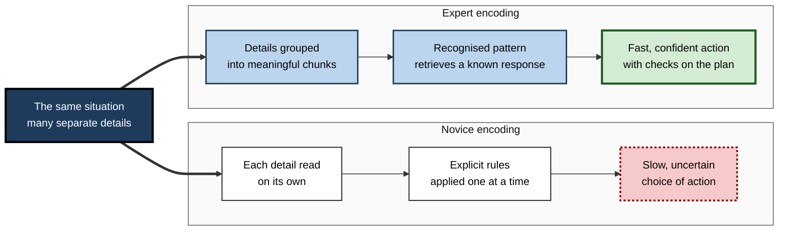
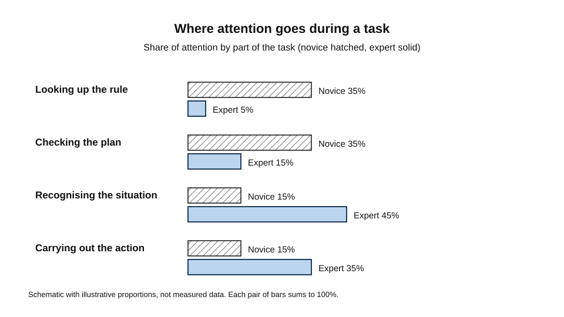
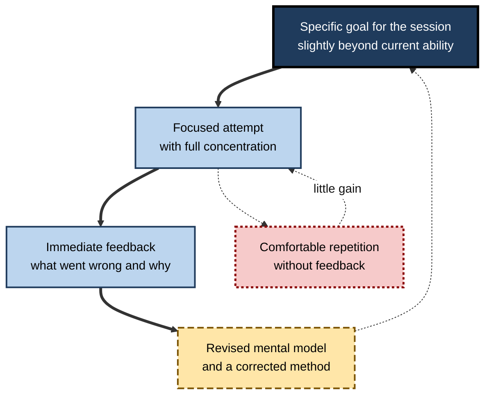
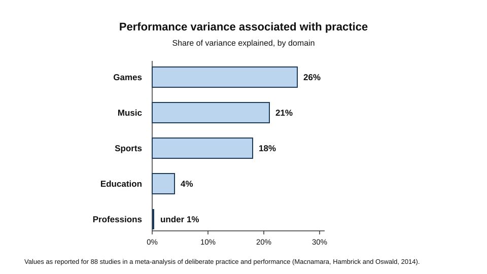

# C.9. Expertise and Novice-Expert Differences

A newly qualified nurse and a senior ward nurse walk into the same room of a patient who is deteriorating.

The newcomer checks each monitor in turn and reads the numbers. The senior nurse glances at the patient, notices a change in colour and breathing, and starts an intervention before the numbers have moved. A junior software engineer and a senior engineer read the same unfamiliar codebase; one traces every line, the other sees the structure within minutes. Both pairs differ in speed and accuracy, but the difference is not simply intelligence or effort. It lies in what each person has learned to see, remember and do.

> **Definition — Expertise:** consistently superior performance on the tasks of a particular domain, built through extended experience and practice, and largely specific to that domain.

**Why it matters**

- Professional quality depends on expertise, so understanding how it develops is central to training, hiring and career design.
- The same features that make experts fast, such as pattern recognition, can also create blind spots when they meet unfamiliar cases.
- Claims that anyone can become expert with enough practice have been widely repeated, and the evidence behind them is more qualified than the slogans suggest.
- Expertise is a moving target: new tools, including generative AI, change what experts must know and what novices must still learn for themselves.

---

## What Experts Know Differently

### Organised knowledge

Experts do not simply know more facts. They organise what they know around the situations in which it applies.

- **Novices** tend to see the surface features of a problem and reason from explicit rules.
- **Experts** see the underlying structure and recall relevant principles, procedures and past cases together.
- **Chunks** — groups of meaningful elements that are stored and retrieved as one unit.
  - *e.g.* a chess master sees a familiar attacking formation as one unit rather than as separate pieces.

### Study card — Chase and Simon (1973)

- **Design:** chess players of several skill levels, from masters to novices, viewed a board position briefly and then reconstructed it from memory. Game positions and random arrangements of the same pieces were both tested.
- **Results:**
  - With game positions, recall rose steeply with skill. Masters reconstructed far more pieces correctly than novices.
  - With random positions, the advantage of the masters was much smaller in the original study.
- **Conclusion:** the masters' superior memory depended on meaningful patterns stored from experience, which they could chunk. Their working memory span was not, in their account, dramatically larger.
- **Later reanalysis:** a later reanalysis argued that random positions also show a small but real master advantage, which chunk-based theory predicts because a large store of familiar fragments can match some random arrangements.

> **Watch out:** the chess result is an illustration of organised knowledge, not a measure of expertise in general. Whether the chunking account covers every domain is a separate question.

**Figure 1.** How a novice and an expert encode the same situation.

### Automatic and controlled processing

- **Controlled processing** — effortful, attention-demanding and limited in capacity. It is used when a rule must be looked up, checked or consciously applied.
- **Automatic processing** — fast, effortless and largely outside conscious control, once a sequence has been learned well enough.
- **Schneider and Shiffrin (1977)** proposed that practice shifts a task from controlled to automatic processing. Their experiments on visual search showed that consistent mappings between stimuli and responses could become automatic after extended training.
- **Relevance to expertise:** automatic processing frees limited attention for the parts of a task that still need judgement.

> **Watch out:** automatic processing is fast and confident, but it can also run when conditions have changed. An expert's habit may be wrong in a new context, and the expert may not notice.

**Figure 2.** How attention is spread across a task at different levels of skill.

---

## Stages of Skill Acquisition

### The Dreyfus model

- **Stuart and Hubert Dreyfus (1980)** described the mental activity of learners in directed skill acquisition, for an Air Force research report.
- **Stuart Dreyfus (2004)** summarised the model as five stages:
  1. **Novice** — follows context-free rules and features, with little sense of the situation.
  2. **Advanced beginner** — recognises recurring aspects of situations and applies rules with some adaptation.
  3. **Competent** — chooses a plan among many options, takes responsibility for outcomes and feels the stress of getting it wrong.
  4. **Proficient** — sees a situation as a whole and recognises what matters most, though deliberation is still used.
  5. **Expert** — acts fluidly from an intuitive grasp of the situation, returning to analysis mainly when something is unexpected.
- **Use:** the model is widely used in education, medicine and workplace training.

> **Watch out:** the Dreyfus model is a descriptive framework, not a measured sequence of tests. Its stages are not equally well supported in every domain, and some critics argue it does not fit all kinds of expertise.

**Figure 3.** The stages of skill acquisition in the Dreyfus model.

```mermaid
%%{init: {'theme':'base','themeVariables':{'fontFamily':'Arial, Helvetica, sans-serif','fontSize':'15px','primaryColor':'#FFFFFF','primaryTextColor':'#111111','primaryBorderColor':'#222222','lineColor':'#333333','secondaryColor':'#F2F2F2','tertiaryColor':'#FFFFFF','clusterBkg':'#FAFAFA','clusterBorder':'#555555','edgeLabelBackground':'#FFFFFF','titleColor':'#111111'}}}%%
flowchart LR
    classDef core    fill:#1F3B5C,stroke:#000000,stroke-width:3px,color:#FFFFFF
    classDef key     fill:#BCD5EE,stroke:#1F3B5C,stroke-width:2px,color:#000000
    classDef detail  fill:#FFFFFF,stroke:#333333,stroke-width:1.5px,color:#000000
    classDef accent  fill:#FFE6A8,stroke:#7A5200,stroke-width:2px,stroke-dasharray:8 4,color:#000000
    classDef good    fill:#D3ECD3,stroke:#1E5E24,stroke-width:3px,color:#000000

    S1["Novice<br/>context-free rules"]
    S2["Advanced beginner<br/>recognised aspects, adapted rules"]
    S3["Competent<br/>chooses a plan, owns outcomes"]
    S4["Proficient<br/>sees the situation as a whole"]
    S5["Expert<br/>intuitive, fluent response"]
    X["Analysis returns<br/>when the situation is unexpected"]

    S1 ==> S2 ==> S3 ==> S4 ==> S5
    S5 -.-> X

    class S1 detail
    class S2,S3 key
    class S4 accent
    class S5 good
    class X core
```

---

## Deliberate Practice

### Study card — Ericsson, Krampe and Tesch-Römer (1993)

- **Design:** violin students at a Berlin music academy were compared by skill group, and researchers collected detailed accounts of how each student had spent their time since starting to play.
- **Results:**
  - The most accomplished group had accumulated more solitary, focused practice than the others.
  - On average, the best group had logged about 10,000 hours of solitary practice by about age 20.
- **Conclusion:** the authors proposed that expert performance is built largely through **deliberate practice**, which they distinguished from playing for enjoyment.

> **Definition — Deliberate practice:** effortful practice aimed at a specific improvement, with immediate and informative feedback, typically at the edge of current ability, and sustained over long periods.

- **Typical features:**
  - a specific goal for each session;
  - a task slightly beyond current ability;
  - prompt feedback that shows what went wrong;
  - repetition with correction, not repetition alone.

**Figure 4.** The deliberate practice cycle.

### How much practice explains

- **The popular rule** — "ten thousand hours to mastery" — was popularised by Malcolm Gladwell's 2008 book. Ericsson disputed the rule, and described the 10,000-hour figure as an average from one study, not a threshold.
- **Macnamara, Hambrick and Oswald (2014)** meta-analysed 88 studies, with a combined sample of more than 11,000 participants, to see how much of the variation in performance was explained by accumulated practice.

**Figure 5.** The share of performance variance associated with practice, by domain.

- **Key results:** practice accounted for about 26% of the variance in games, 21% in music, 18% in sports, 4% in education and under 1% in professions.
- **Interpretation:** practice matters, but in many domains it accounts for a smaller share of performance differences than advocates had claimed. Other factors, such as starting ability and the quality of practice, may account for the rest.

> **Watch out:** a low share of explained variance does not mean practice is unimportant. It may mean that the practice measured is too crude, that performance measures are noisy, or that other factors matter more. The meta-analysis shows the limits of the evidence, not a verdict on practice.

---

## Routine and Adaptive Expertise

Hatano and Inagaki distinguished two kinds of expert. Routine experts are efficient at familiar tasks; adaptive experts can handle new problems and invent procedures.

| | Routine expertise | Adaptive expertise |
|---|---|---|
| Strength | Speed and accuracy on familiar cases | Flexibility with unfamiliar cases |
| Basis | Mastered procedures | Conceptual understanding of why procedures work |
| Response to change | Works well until the situation changes | Adjusts methods and devises new ones |
| Typical risk | Brittle when conditions shift | Slower on routine cases |
| Developed by | Repetition with feedback on known tasks | Practice on varied, unfamiliar problems with feedback |

- **Environment shapes which expertise develops.** Environments with stable, repeated tasks favour routine expertise; environments with varied tasks and rewards for experimentation favour adaptive expertise.
- **Balance matters.** Professional work usually requires both: routine efficiency for the common case and adaptive skill for the exception.

---

## When Expert Intuition Can Be Trusted

- **Kahneman and Klein (2009)** reviewed the evidence on intuitive expertise and concluded that skilled intuitions develop in environments with two properties:
  - regularities that can be learned, so the patterns recur reliably;
  - opportunities to learn, through practice with prompt and accurate feedback.
- **Where these conditions fail** — in fields with rare, delayed or unclear feedback, the same experience can produce confident but inaccurate intuitions.
- **Expertise and confidence** — experienced people are not always more accurate than they feel. Confidence is a weak indicator of accuracy unless feedback has been reliable.

> **In practice:** when assessing an expert's judgement, ask how often the expert has been corrected by outcomes in situations like this one.

---

## Blind Spots of Expertise

- **Expert blind spot** — experts forget how hard a task was when they first learned it, and assume that the steps they now take automatically are obvious to others.
  - *e.g.* a senior engineer's design review skips a step that a new team member needs to understand.
- **Adaptation to a narrow environment** — expertise that is strongly tuned to one set of conditions can fail when the environment changes.
  - *e.g.* a trader's strong intuitions about one market do not carry over to a market with different rules.
- **Resistance to new methods** — established experts may discount evidence that conflicts with their successful routines.

> **Watch out:** expertise is not a license to skip checks. The best experts build in routines for checking their own judgement, particularly in unfamiliar cases.

---

## Developing Expertise in Organisations

- **Structured practice** — break the work into components, with targeted repetition and feedback on each.
- **Case libraries** — collections of real cases with the reasoning and outcome recorded, so that novices can learn patterns before they meet them at work.
- **Deliberate feedback loops** — review of decisions against outcomes, with the reasons for each decision recorded.
- **Varied practice** — include unusual and difficult cases so that learners build adaptive, not only routine, expertise.
- **Apprenticeship with visible reasoning** — experts explain their choices as they work, so novices can see the pattern behind a judgement.
- **AI tools and expertise** — a tool that supplies answers can bypass the practice that builds pattern recognition. Designers and managers need to decide which tasks must still be carried out by the learner.

### Case study (illustrative): building credit-risk judgement in a bank

- **Situation:** a bank's credit-risk team included experienced analysts and many recent hires. Approval decisions varied widely between analysts.
- **Problem:** new analysts took more than a year to reach consistent judgement, and senior analysts disagreed on borderline cases.
- **Diagnosis:**
  - New analysts learned the policy manual but had little exposure to the patterns that predicted default.
  - Feedback arrived months later, when loan outcomes were known, so analysts could not connect decisions to results.
  - Senior analysts explained decisions only in terms of their overall experience, which new hires could not reproduce.
- **Actions:**
  1. Build a case library of anonymised past applications, each with the decision and the eventual outcome.
  2. Run weekly practice sessions in which analysts decide on cases before seeing the outcome, then compare their reasoning with the result.
  3. Require senior analysts to write short explanations of the features that drove borderline decisions.
  4. Include a set of unusual cases to test adaptive judgement, not only routine approval.
- **Result:** after a year, decisions on routine cases converged, and analysts were more consistent on borderline cases. The bank did not claim that the full gap closed.
- **Side effects and caveats:** the sessions took senior time, and some analysts were slower on routine cases while they learned to explain their reasoning.
- **Lesson:** expertise develops through practice with prompt, specific feedback on the patterns that matter, not through policy knowledge alone.

---

## Open Questions

- **How should expertise be measured?**
  - Performance measures are often noisy, and what counts as superior performance differs by domain.
- **What explains the variance that practice does not?**
  - Starting ability, selection, the quality of practice and the choice of measure all contribute; their relative weight is unsettled.
- **Does expertise transfer across domains?**
  - The evidence suggests that the advantage is largely domain-specific, but the boundaries are not clear.
- **How will generative AI change the development of expertise?**
  - Tools may speed up routine work while reducing the practice that builds pattern recognition. The effects are not yet measured well.
- **How does expertise interact with changes in the learner over a career?**
  - Long careers raise questions about how experts maintain their judgement as the work and the people change.

---

## Summary

- **Expertise** is consistently superior performance in a domain, built through extended practice and largely specific to that domain.
- Experts **organise knowledge into chunks** tied to situations; **Chase and Simon (1973)** showed this in chess, and a later reanalysis found a smaller but real advantage with random positions.
- **Automatic processing** frees attention for judgement; it can also run when conditions have changed.
- The **Dreyfus model** describes five stages from novice to expert, as a descriptive framework rather than a measured sequence.
- **Deliberate practice** combines specific goals, challenge, immediate feedback and correction; **Ericsson, Krampe and Tesch-Römer (1993)** linked it to elite performance.
- **Macnamara, Hambrick and Oswald (2014)** found practice explained about a quarter of performance variance in games and a much smaller share in professional domains.
- **Routine** and **adaptive** expertise differ in flexibility; professional work usually needs both.
- Expert intuition is trustworthy in regular environments with reliable feedback; confidence is not a sufficient guide.
- Developing expertise needs case libraries, feedback on decisions against outcomes, varied practice and visible reasoning.

---

## Self-Check

1. Define expertise and explain why it is considered domain-specific.
2. What did Chase and Simon's chess study show about the role of organised knowledge, and what did the random-position condition reveal?
3. Distinguish controlled processing from automatic processing and explain how practice changes the balance.
4. Describe the five stages of the Dreyfus model, one sentence each.
5. What is the difference between deliberate practice and playing for enjoyment?
6. Explain the origin and the misreading of the "10,000 hours" figure.
7. Macnamara, Hambrick and Oswald reported different shares of variance by domain. What does the pattern suggest about where practice matters most?
8. Compare routine and adaptive expertise and explain why an environment's stability affects which develops.
9. What two conditions does Kahneman and Klein (2009) identify for trustworthy expert intuition?
10. Give an example of an expert blind spot and a practice that would reduce it.
11. A manager says a senior analyst "just knows" when a loan is risky. Explain what evidence would support or undermine that claim.
12. Design a practice programme for junior staff in a domain you know. Specify goals, feedback, and how you would check progress.
13. Why might a tool that always supplies the correct answer reduce the development of expertise?
14. What would convince you that a claimed expert is an adaptive expert rather than a routine expert?

### Answer Key

1. Expertise is consistently superior performance on the tasks of a domain, built through extended experience. It is domain-specific because the organised knowledge and pattern recognition that produce it are tied to the situations in which they were learned, so the advantage rarely carries over fully to other domains.
2. Masters reconstructed meaningful game positions far more accurately than novices, showing the benefit of stored patterns. In random positions the advantage was much smaller in the original study; a later reanalysis found a small but real master advantage, consistent with chunk-based theory.
3. Controlled processing is effortful and capacity-limited; automatic processing is fast and needs little attention once learned. Practice shifts tasks from controlled to automatic, freeing attention for judgement.
4. Novice: context-free rules. Advanced beginner: recognised aspects of situations with adapted rules. Competent: deliberate choice of a plan and ownership of outcomes. Proficient: a holistic view that identifies what matters. Expert: fluent, intuitive response, with analysis when the situation is unexpected.
5. Deliberate practice is effortful, aimed at a specific improvement, with immediate feedback, typically at the edge of current ability. Playing for enjoyment may involve practice without these features.
6. The 10,000-hour figure was an average for the best group in a violin study, by about age 20. Gladwell's 2008 book popularised it as a general threshold, and Ericsson disputed that reading.
7. Practice explained a substantial share of variance in games and a smaller share in education and professions. This suggests that practice matters most where tasks are stable, well defined and measurable, and less where performance depends on other factors or where practice is hard to define.
8. Routine expertise is efficient on familiar tasks and depends on mastered procedures; adaptive expertise depends on understanding why procedures work and adjusts to new problems. Stable environments reward repetition and so favour routine expertise; varied environments that reward experimentation favour adaptive expertise.
9. The environment must contain regularities that can be learned, and the person must have had practice with prompt, accurate feedback.
10. A senior engineer who skips a step that is obvious to them but not to a newcomer. A practice that reduces it is having the expert explain reasoning step by step to someone new, and asking for an explanation of the skipped step.
11. Evidence would include the analyst's record of decisions against outcomes, comparison with a base-rate model or with colleagues on the same cases, and whether the analyst's judgements remain accurate in cases unlike the training ones. Without these, the claim is a feeling of certainty.
12. A good answer sets specific goals for each session, includes tasks slightly beyond current ability, provides immediate feedback, and measures progress against outcomes or independent assessment at intervals, not only at the end.
13. Answers supplied without the reasoning or the search for the pattern bypass the practice that builds pattern recognition, so the learner accumulates less of the knowledge that expertise depends on.
14. Evidence would include successful performance on unfamiliar problems, explanations that connect procedures to principles, and the ability to change method when conditions change, not only fast and accurate work on familiar cases.

---

## Glossary

| Term | Meaning |
|---|---|
| Adaptive expertise | Expertise that adjusts to new problems and devises new procedures. |
| Automatic processing | Fast, effortless processing that has become largely outside conscious control. |
| Chunk | A meaningful group of elements stored and retrieved as one unit. |
| Controlled processing | Effortful, capacity-limited processing that requires attention. |
| Deliberate practice | Effortful, goal-directed practice with immediate feedback at the edge of ability. |
| Domain specificity | The tendency of expertise to apply mainly within the domain where it was built. |
| Dreyfus model | A five-stage description of skill acquisition from novice to expert. |
| Expert blind spot | Failing to see what is difficult for others because one's own steps have become automatic. |
| Expertise | Consistently superior performance in a domain, built through extended practice. |
| Routine expertise | Efficient performance on familiar tasks based on mastered procedures. |
