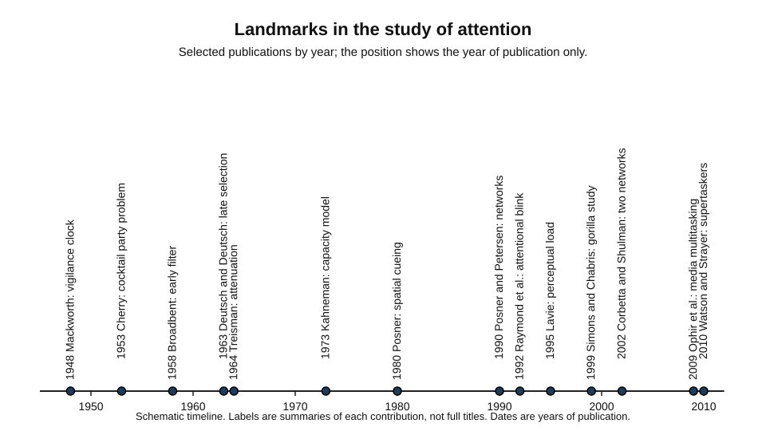
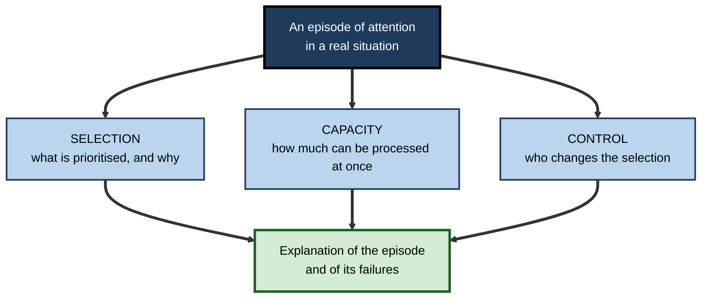
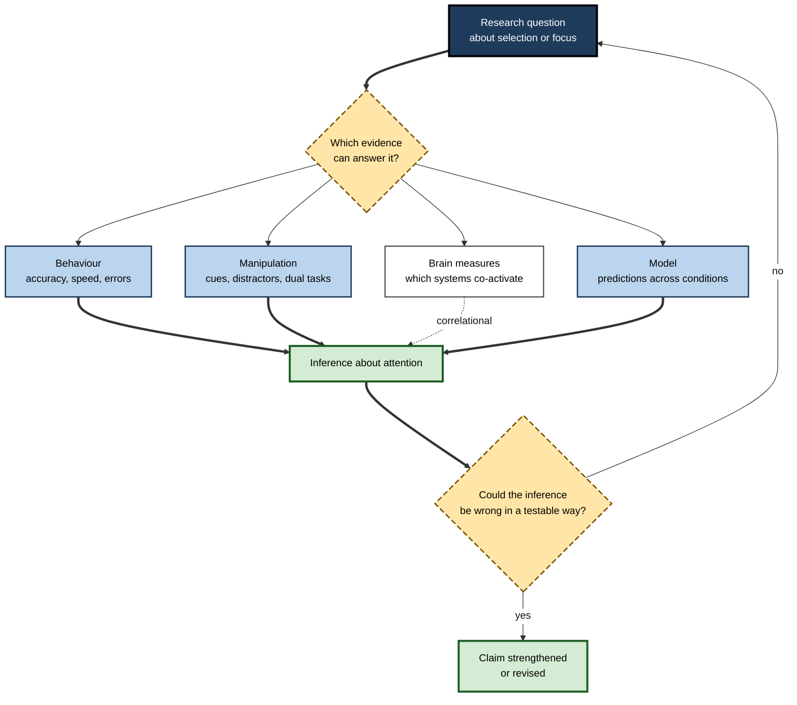
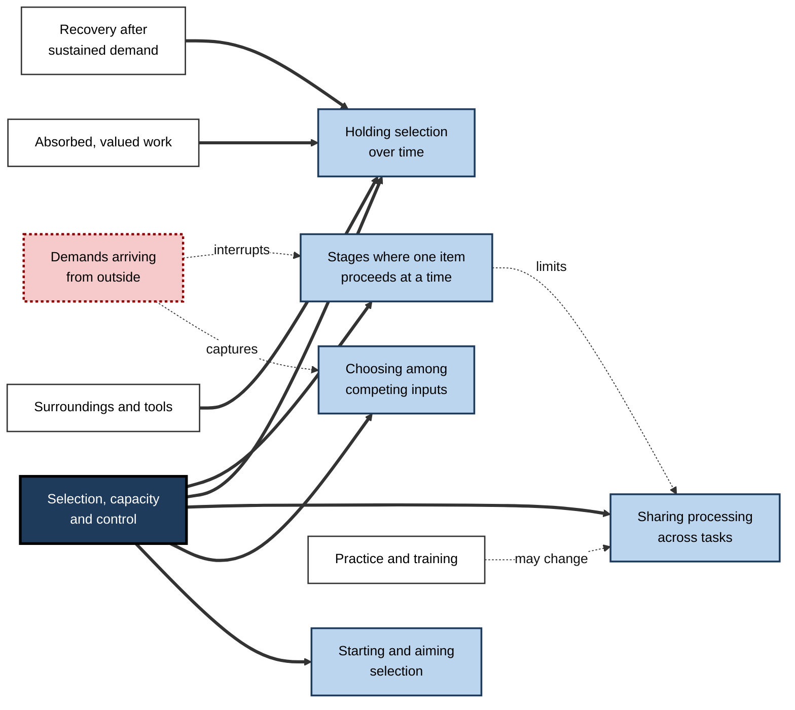

# D. Attention & Focus

A surgeon hears the monitor's alarm, glances at the screen, and returns to the incision without losing the thread of the operation. A student opens a textbook, reads the same paragraph four times, and realises that nothing has entered memory. A product team agrees on a single priority, then spends the week answering messages that have nothing to do with it.

Each case turns on the same capacity: the mind's ability to choose what it will work on, to hold that choice against competition, and to return to it when pulled away. This is attention, and when it is sustained on a purpose it becomes focus.

> **Definition — Attention and focus:** attention is the selection of some information, thoughts or actions for priority processing over others. Focus is attention held steadily on a chosen purpose, despite competing demands.

**Why it matters**

- What a person attends to is what they learn, remember and act upon. Attention is therefore a precondition for almost every other capability.
- Most costly errors in work and daily life are failures of selection, sustaining or switching, rather than failures of knowledge.
- The conditions of modern life, with constant messages, alerts and open demands, make the protection of focus an explicit professional skill.

---

## What the Subject Covers

The subject of attention and focus spans four kinds of question.

- **What is selected** — how the mind chooses among sights, sounds, thoughts and possible actions, and what happens to what is not chosen.
- **How much can be processed at once** — why the mind has limits, where those limits sit, and how they make some combinations of demands impossible.
- **Who or what controls selection** — how goals and intentions compete with sudden events and habits for priority.
- **How focus is kept, lost and rebuilt** — how attention is sustained over time, how it is disrupted, and how people and environments can support it.

These questions are asked in laboratories, clinics and workplaces alike. Laboratory work offers precise control of the input and timing. Clinical work, for example after brain injury, offers a view of what breaks when attention fails. Workplace studies show how selection behaves under the pressures of real jobs. The subject is strongest where these three sources of evidence agree.

---

## Origins and Debates

The modern study of attention began with listening experiments in the 1950s. Colin Cherry (1953) showed that people can follow one voice among several and retain little of the others' content, which set the question of where selection happens. Donald Broadbent (1958) proposed an early filter that admitted information on physical features.

Deutsch and Deutsch (1963) argued for late selection, in which all input is analysed for meaning and selection happens at the level of response. Anne Treisman (1964) replaced the on–off filter with attenuation, a graded weakening that lets important signals through.

Two long debates followed from these proposals. The first was whether selection is early, late or flexible. The second was whether attention is best described as a set of filters or as a limited pool of effort. Daniel Kahneman (1973) gave the second debate its most influential form, arguing that attention is a shared pool that tasks draw on in amounts that depend on demand.

From the 1980s the subject diversified. Michael Posner's spatial cueing experiments (1980) showed that attention can move to a place without eye movement, and Posner and Petersen (1990) described separate networks for alerting, orienting and executive control. Raymond, Shapiro and Arnell (1992) identified the attentional blink, and Nilli Lavie (1995) argued that perceptual load determines whether distractors are processed. Simons and Chabris (1999) showed that a visible but unexpected event can go unreported when attention is occupied elsewhere.

The most recent work has linked these findings to brain systems and to digital life. Corbetta and Shulman (2002) proposed a goal-directed network and a stimulus-driven network that interact. Studies of media use and multitasking, including Ophir, Nass and Wagner (2009) and Watson and Strayer (2010), have asked how habits of divided attention relate to control, though with mixed replication.

**Figure 1.** Landmark studies and models in the study of attention, placed by year of publication.

> **Key point:** the field's central debates were not resolved by one experiment. They were refined as each result narrowed the range of explanations that remained plausible.

---

## A Working Framework: Three Questions

Each episode of attention can be analysed by three questions, and most confusion in the field comes from answering only one of them.

- **Selection** — what is chosen, and by what criterion (a goal, a salient event or a learned habit)?
- **Capacity** — how many demands can be processed at once, and at which stage does the limit apply?
- **Control** — who or what changes the selection, and how quickly can it be changed back?

**Figure 2.** Three questions for analysing an episode of attention.

> **Watch out:** a failure that looks like poor selection may be a capacity limit, and a capacity limit may be a control problem. Ask all three questions before deciding what to change.

---

## How the Subject Is Studied

Attention cannot be observed directly. Researchers infer it from behaviour, from brain signals and from models that predict both.

**Figure 3.** From a question about attention to a claim that can be tested.

- **Behaviour** — accuracy, reaction time and the pattern of errors.
  - *e.g.* a person who misses targets only on one side of a display shows a spatial pattern in selection.
- **Experimental manipulation** — cues, distractors, dual tasks and time pressure, used to isolate one process.
  - *e.g.* a cue that predicts a target location tests whether selection can be directed by expectation.
- **Brain measures** — electrical and metabolic signals recorded during tasks.
  - They show which systems are active together, but do not reveal the content of attention.
- **Computational models** — accounts that predict behaviour across many conditions.
  - A good model makes predictions that could fail, which is what distinguishes it from a restatement of the data.
- **Self-report** — people's own judgements of their focus.
  - Useful, but often inaccurate, especially for drift that happens without awareness.

> **Key point:** each method answers a different question. A claim about attention is only as strong as the method that supports it.

### Measurement pitfalls

- **Laboratory artefacts** — brief tasks with simple stimuli may not represent the demands of work.
- **Self-report bias** — people underestimate how often they drift and overestimate how well they multitask.
- **Replication** — some striking findings, including some about media multitasking, have proved weaker on repetition. A single study is a hypothesis, not a settled fact.

---

## How the Parts Fit Together

Attention is organised around the same questions at every scale, from a single glance to a working day, so its parts are best understood as variations on those questions.

The distinctions between types of attention, such as stimulus-driven and goal-directed attention, clarify how selection is started and aimed. Selective attention concerns the choice among competing inputs, while divided attention concerns the sharing of processing across tasks. Sustained attention and vigilance describe what happens when the same selection must be held for a long time, and attentional bottlenecks explain why some demands must wait.

Focus in everyday life depends heavily on the external pressures that compete with it. Distraction and digital interruptions show how demands arriving from outside capture attention, while the environment in which work happens shapes how easily attention can settle. Deep work and flow describe the state in which attention is absorbed in valuable work for long periods, a condition that depends on the task, the person and the absence of interruption. 

Mindfulness practices address the ability to notice drift and return to a chosen object, while attention restoration concerns how directed attention can recover after sustained demand. Finally, the question of whether focus can be trained, and how far training transfers beyond the trained task, links the subject to the practical design of learning and work.

**Figure 4.** How the parts of the subject depend on one another, shown as concepts rather than as a sequence.

> **Remember:** the parts are not independent. A good environment supports sustained attention; sustained attention depends on limiting interruptions; interruptions are costly because of bottlenecks.

---

## Attention in Professional Life

Professional work places attention under a particular set of demands.

- **Several streams at once** — messages, documents, meetings and monitoring compete for the same attentional resources.
- **Safety-critical vigilance** — rare but important signals must be detected over long periods.
- **Judgement under interruption** — decisions are often made while other demands are queued.
- **Long-term skill** — expertise depends on sustained focused practice, and the habits that protect it are learned.

**Figure 5.** How a professional protects focus: a cycle of planning, protection, interruption and recovery.

```mermaid
%%{init: {'theme':'base','themeVariables':{'fontFamily':'Arial, Helvetica, sans-serif','fontSize':'15px','primaryColor':'#FFFFFF','primaryTextColor':'#111111','primaryBorderColor':'#222222','lineColor':'#333333','secondaryColor':'#F2F2F2','tertiaryColor':'#FFFFFF','clusterBkg':'#FAFAFA','clusterBorder':'#555555','edgeLabelBackground':'#FFFFFF','titleColor':'#111111'}}}%%
flowchart LR
    classDef core    fill:#1F3B5C,stroke:#000000,stroke-width:3px,color:#FFFFFF
    classDef key     fill:#BCD5EE,stroke:#1F3B5C,stroke-width:2px,color:#000000
    classDef accent  fill:#FFE6A8,stroke:#7A5200,stroke-width:2px,stroke-dasharray:8 4,color:#000000
    classDef caution fill:#F6CACA,stroke:#8B0000,stroke-width:2.5px,stroke-dasharray:3 3,color:#000000
    classDef good    fill:#D3ECD3,stroke:#1E5E24,stroke-width:3px,color:#000000

    P["Plan<br/>choose the priority"]
    PR["Protect<br/>set the conditions for focus"]
    W["Work<br/>sustained selection"]
    I["Interruption<br/>demand from outside"]
    RC["Recover<br/>rebuild goal and place"]

    P ==> PR ==> W
    W ==> I
    I -. "may be unavoidable" .-> RC
    I ==> RC
    RC ==> W
    W -. "review and re-plan" .-> P

    class P key
    class PR good
    class W core
    class I caution
    class RC accent
```

### Case study (illustrative): A product team's focus week

- **Situation:** a software team of eight has agreed one priority for the quarter, but its members spend most of each day answering chat messages, reviewing requests and attending short meetings.
- **Problem:** the priority falls behind. Engineers report that they are "always busy" and cannot point to the work they completed that week.
- **Diagnosis:**
  - no protected time existed, so each demand took the first available attention;
  - chat notifications were on by default and were treated as urgent;
  - the team had no shared rule for what could wait.
- **Actions:**
  1. Two focus blocks each day were agreed, with notifications switched off and a shared status message.
  2. A rota covered incoming requests during those blocks, so one person was available to respond.
  3. The team set a simple rule for deferral: a message waits unless it is blocking another person.
- **Result:** the priority was completed on the planned date in the following quarter (illustrative).
- **Side effects / caveats:** some colleagues outside the team found response times longer and asked for a clearer escalation route.
- **Lesson:** focus is a shared resource. Protecting it requires agreed rules, not only individual effort.

### Worked example (illustrative): auditing one working day

- Record the day in blocks of an hour, noting the main task, the number of interruptions and whether the work was finished.
  - *Illustrative pattern:* of eight hours, three were spent on the main priority, four were broken into fragments of under twenty minutes, and one was spent recovering from a meeting that ran over.
- **Reading:** the main priority received less than half the day, and the fragments explain most of the lost time.
- **Action:** protect one block at the time of day when the person reports being most alert, and test whether the main priority advances more.

> **Watch out:** an audit that counts only hours worked misses the cost of fragmentation. Track what was completed, not only how long was spent.

---

## Common Misconceptions

- **"Attention spans have shrunk to a few seconds."**
  - The figure of eight seconds is widely repeated, but its origin could not be traced to a measurement study. Research on switching measures something else.
- **"Multitasking is a skill anyone can master."**
  - Practice reduces interference for specific pairs of tasks, and a few people perform unusually well on particular combinations. Most people pay a cost.
- **"Focus is a matter of willpower."**
  - Sustained attention declines under monotony and time on task, whatever the motivation. Structure and environment matter as much as effort.
- **"More hours means more focus."**
  - Output depends on the amount of uninterrupted, well-selected work, not on hours present.

> **Watch out:** several of these claims are repeated in popular writing with more confidence than the evidence supports. Check the study behind any specific number before using it.

---

## Open Questions

- **How are selection, capacity and control related?**
  - Each has support as a distinct concept, but how they interact across tasks is not settled.
- **Which parts of attention can be trained, and for how long?**
  - Training effects on specific tasks are well documented; transfer to new settings is less clear.
- **How far does digital environment design shape focus?**
  - Evidence is growing, but much of it is correlational or short-term.
- **Where should the line be drawn between protecting focus and avoiding necessary interruption?**
  - Professions differ in how much immediate responsiveness they require, and there is little comparative evidence.

---

## Summary

- **Attention** selects information for priority processing; **focus** is attention sustained on a chosen purpose against competition.
- The field began with **listening experiments** (Cherry, 1953; Broadbent, 1958) and debated whether selection is **early**, **late** or **flexible** (Deutsch and Deutsch, 1963; Treisman, 1964).
- **Kahneman (1973)** treated attention as a **shared pool** of effort; **Posner (1980)** and **Posner and Petersen (1990)** showed how attention moves to locations and how its networks are organised.
- Later work identified the **attentional blink**, the role of **perceptual load**, and **inattentional blindness**, and linked attention to brain systems and to digital habits.
- Attention is studied through **behaviour**, **manipulation**, **brain measures** and **models**; self-report is informative but unreliable.
- Three questions structure any episode: **selection**, **capacity** and **control**.
- Professional focus is protected by **shared rules**, **structure** and **recovery**, not by effort alone.
- Several popular claims, including the eight-second attention span, are not supported by traceable evidence.

---

## Self-Check

1. Define attention and focus and explain how they differ.
2. Why is attention a precondition for learning and remembering?
3. Name the four kinds of question the subject asks and give one example of each.
4. Summarise the early–late debate and say which study introduced attenuation.
5. What did Kahneman's 1973 proposal change about how limitations are understood?
6. What do the three attentional networks in the Posner and Petersen framework each do?
7. Explain why a single failure of attention can be a selection problem, a capacity problem or a control problem.
8. Describe two ways attention is inferred in research, and one limitation of each.
9. Why is self-report of focus unreliable, and what can be done about it?
10. In the product team case, identify the source of lost focus and one shared rule that addresses it.
11. What does the one-day audit measure that an hours-worked count does not?
12. Evaluate the claim that focus is simply a matter of willpower.

### Answer Key

1. Attention is the selection of information for priority processing. Focus is attention held steadily on a chosen purpose despite competition.
2. Information that is not attended is usually poorly encoded, so it is rarely remembered or used later.
3. What is selected: how the mind chooses among inputs and thoughts. How much can be processed at once: capacity and its limits. Who or what controls selection: goals versus salient events and habits. How focus is kept and rebuilt: sustained attention, disruption and support.
4. Broadbent placed selection early; Deutsch and Deutsch placed it late; Treisman proposed flexible attenuation, and introduced the idea in 1964.
5. It moved the concept from a fixed filter at one point to a shared, limited pool of effort that tasks draw on according to demand.
6. Alerting maintains readiness; orienting selects a location, object or feature; executive control resolves conflicts between responses.
7. A failure can be a poor choice of priority (selection), too many demands for the processing available (capacity), or a priority that cannot be changed when needed (control). Each calls for a different response.
8. Behaviour (accuracy and reaction time) can be confounded by strategy and criterion. Brain measures show correlation, not the content of attention. Choose the method that matches the question.
9. People often misjudge drift and multitasking because the lapses are brief and unnoticed. Use objective measures and sampling in context.
10. The loss came from unprotected time and default notifications treated as urgent. The rule that a message waits unless it blocks another person addresses it.
11. It measures what was completed and how the time was fragmented, so it reveals the cost of interruptions that an hours count hides.
12. The claim is not supported. Sustained attention declines with monotony and time on task despite motivation, and structure, environment and rules affect focus strongly.

---

## Glossary

| Term | Meaning |
|---|---|
| Attention | The selection of some information or actions for priority processing over others. |
| Capacity | The amount of processing available at one time, and where it is limited. |
| Control | The means by which selection is started, aimed and changed. |
| Focus | Attention held steadily on a chosen purpose despite competition. |
| Inattentional blindness | Failure to notice a visible but unexpected event when attention is elsewhere. |
| Selection | Choosing some inputs or actions for priority processing. |
| Spatial cueing | A signal that directs attention to a location, used to measure how attention moves. |
| Vigilance | Sustained attention in which the target is rare. |
