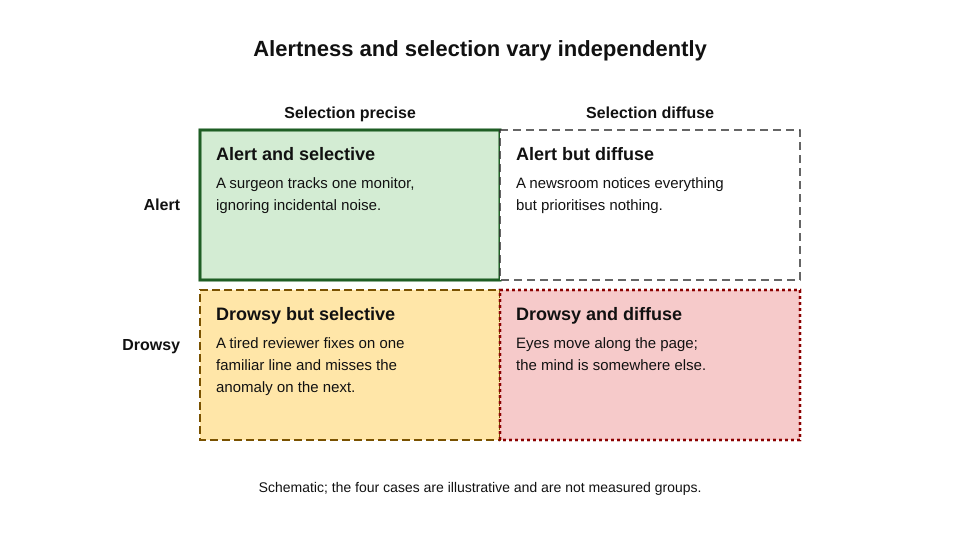
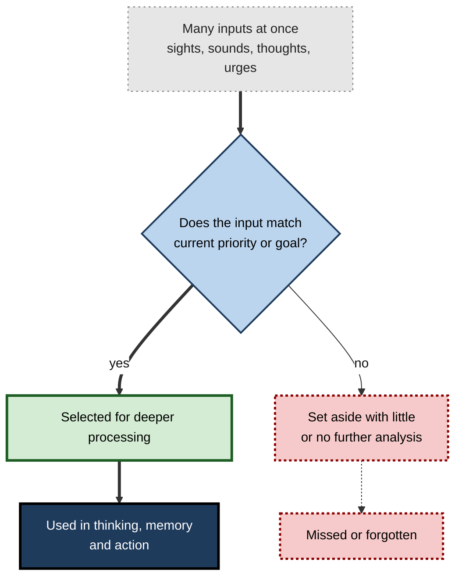
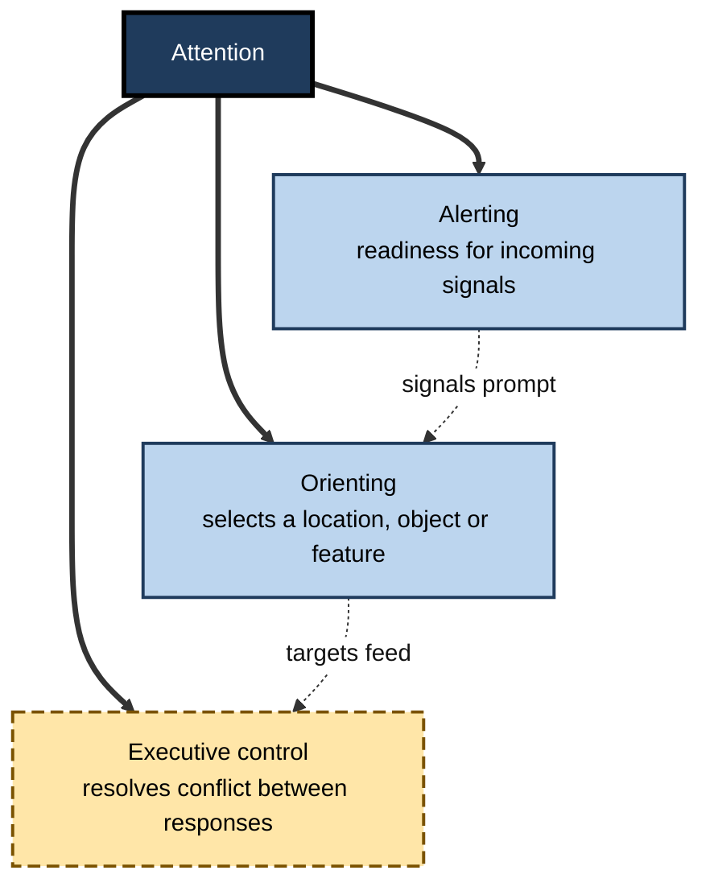
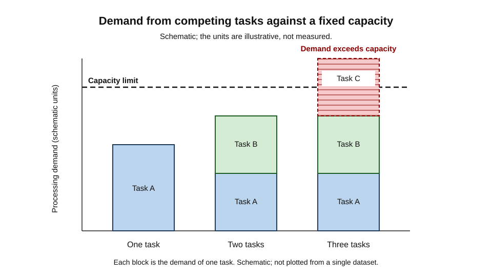
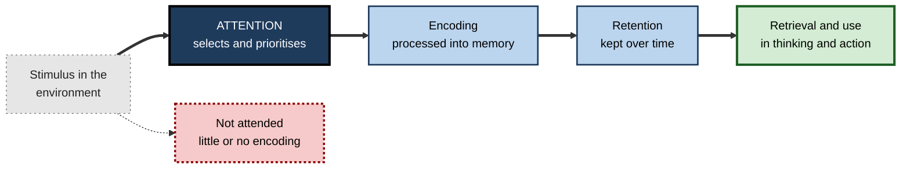

# D.1. What is Attention?

A driver on a motorway listens to the radio, tracks the car ahead and notices a cyclist at the kerb without searching for one. A pharmacist checks a prescription while a colleague speaks at her shoulder and later recalls nothing of what was said. A student reads three pages, reaches the end and realises that her eyes have moved along every line while her mind has been elsewhere.

In each case the mind receives far more information than it can use, and something decides which part gets priority. That something is attention.

> **Definition — Attention:** the set of processes by which the mind selects a limited part of the information available to it and gives that part priority for further processing, while the rest is set aside.

**Why it matters**

- Information that receives little or no attention is usually poorly remembered and rarely acted upon.
- Many errors at work, such as a missed clause, a skipped step or an unnoticed warning light, are failures of selection rather than gaps in knowledge.
- Deliberate learning depends on attention more than on any other single process, because what is not attended cannot be worked on.

---

## Attention in Everyday Experience

Human senses deliver a continuous flood of signals: light on the retina, pressure on the skin, sound at the ears, smells, body position and inner sensations. Conscious thought can work with only a small part of this at any moment.

**Three kinds of everyday selection**

- **Involuntary capture** — a sudden movement, a siren or one's own name in a crowded room draws attention without a decision to look.
  - *e.g.* a team member hears "Priya" across an open-plan office and turns before deciding to.
- **Voluntary choice** — reading a contract, following a recipe or watching for a particular train.
  - *e.g.* a reviewer deliberately scans a financial statement for unusual totals and ignores the rest.
- **Habitual selection** — a practised routine runs with little conscious direction.
  - *e.g.* an experienced driver changes gear and checks mirrors while the conversation continues.

> **Key point:** attention is not only the spotlight a person turns on purpose. Much of it is set in advance by past experience, by sudden events and by what the person currently cares about.

**Noticing is not the same as attending**

- **Noticing** — registering that something happened, often briefly and without detail.
  - *e.g.* sensing that a room has become quieter.
- **Attending** — giving sustained priority to a stimulus or a thought so that it can be processed in depth.
  - *e.g.* working out why the room has gone quiet and deciding what to do about it.

---

## Defining Attention

### The four parts of the definition

- **Selection**
  - Choosing among competing inputs, thoughts or responses.
  - Attention is always a choice of *some* over *others*.
- **Limited capacity**
  - The system cannot process everything at the same depth at the same time.
  - Evidence: when two demanding tasks run together, performance on one or both usually falls.
- **Priority**
  - Selection follows importance, and importance can come from the goal (a person searching for a specific file) or from the stimulus (a flashing alarm).
- **Control**
  - Selection can be deliberate or automatic.
  - Control is what allows a person to shift attention when the situation demands it.

> **Definition — Capacity:** the amount of processing a system can carry out at one time. Limited capacity is the reason selection is needed at all.

### What attention is not

- **Alertness** — a general readiness to respond.
  - A sleepy driver can be alert in the sense of being awake yet attend poorly to the road.
- **Effort** — the subjective strain of working hard.
  - Attention can be effortless, as with a familiar route, and effort can be wasted on the wrong target.
- **Awareness** — conscious access to information.
  - Some attended information is never reported, and some reported information was not attended in the sense used here.
- **Memory** — the retention of information over time.
  - Attention determines what is encoded in the first place; it does not store anything.

> **Watch out:** "paying attention" is often used to mean compliance, politeness or motivation. Motivation influences attention, but the two are not the same process. A person can be highly motivated and still attend to the wrong thing.

**Figure 1.** Alertness and selection vary independently; each cell is one illustrative case.

---

## Early Ideas About Selection

- **The question** — if the senses deliver more than the mind can use, where does the bottleneck lie: at the senses, at meaning, or at action?
  - Early psychologists tested this with listening experiments that set two spoken messages against each other.
- **Colin Cherry (1953)** — the "cocktail party problem": listeners could follow one spoken message among several, but retained little of the meaning of the others.
  - Cherry's dichotic listening experiments showed that physical features of an unattended voice, such as its gender or pitch, could be reported, while its content was largely lost.
- **Donald Broadbent (1958)** — proposed that selection happens early, through a filter that admits information on the basis of physical features before meaning is analysed.
  - The model put the limit at a single point in processing.
- **Daniel Kahneman (1973)** — argued instead that attention is a flexible pool of mental effort that can be divided between tasks in different amounts.
  - The model put the limit in the total effort available, not at a fixed point in the sequence.

> **Definition — Filter theory:** the view that attention acts as a gate placed at one stage of processing, letting only some information through to later stages.

> **Definition — Capacity theory:** the view that attention is a limited pool of processing resources that can be shared out among tasks, with the sharing depending on demand.

---

## The Three Networks of Attention

Michael Posner and Steven Petersen (1990) reviewed the psychological and neurological evidence and proposed that attention is best understood as three interacting systems.

- **Alerting** — maintaining a state of readiness so that signals are processed quickly once they arrive.
  - *e.g.* a surgeon's readiness after a warning tone during an operation.
- **Orienting** — selecting a location, object or feature from the sensory array.
  - *e.g.* moving the eyes to a sudden movement in the corner of a control room screen.
- **Executive control** — resolving conflict between competing responses, especially when routine habits are not enough.
  - *e.g.* stopping oneself from answering a question with the first, familiar but wrong, answer.

**Figure 2.** Attention as selection: many inputs, a limited channel and a choice about what proceeds.

**Figure 3.** Three networks of attention, each with a different job.

---

## Why Attention Is Limited

### Evidence from interference

- **Dual-task interference** — two tasks performed together are worse than either alone, or one task is done slowly while the other is attended.
  - *e.g.* a person given directions by phone while trying to reverse into a parking space.
- **Shared channels** — tasks that compete for the same kind of input or output tend to interfere more than tasks that use different ones.
  - *e.g.* reading two documents at once is harder than reading one and listening to a short announcement.
- **Practice reduces interference** — a skill that becomes automatic takes less of the pool.
  - *e.g.* a typist can hold a conversation; a novice typist cannot.

### Capacity in working life

- Professional work often sets several streams of information against each other: messages, documents, colleagues and one's own plans.
- Once capacity is exceeded, performance drops in ways that are hard for the person to notice.
- Designing work well means reducing unnecessary demands on attention, not relying on individuals to try harder.

**Figure 4.** Schematic: how demand from competing tasks can exceed a fixed attentional capacity.

> **Watch out:** the two-task demonstrations above show that capacity is limited, but they do not show a single fixed number of "units" of attention. The size and shape of the limit depend on the task.

---

## Attention and Learning

- **Encoding** — information must be attended well enough to be processed into a durable form.
- **Consolidation** — once encoded, it must be kept intact; attention is less central here, but interruption can disturb it.
- **Retrieval** — information is brought back by cues, and the cues must be attended to in order to be used.

**Figure 5.** From input to learning: attention is the gate that decides what enters the rest of the system.

### Case study (illustrative): a missed handover on a ward

- **Situation:** a nurse receives a handover at the end of a long night shift in a busy ward, while monitors sound in the next bay.
- **Problem:** the handover includes a change to a patient's medication timing. The nurse does not register it and the next dose is given at the old time.
- **Diagnosis:**
  - the handover was delivered while alarms competed for the same attentional resources;
  - the nurse was in a state of low alertness after the night shift;
  - the change was mentioned once, in the middle of a list, with no emphasis.
- **Actions:**
  1. The ward moved handovers to a quiet room with a checklist that is read aloud and signed.
  2. Changes in medication are listed first and repeated back by the receiving nurse.
  3. Alarm-free periods are scheduled around handover.
- **Result:** medication timing errors fell in the following months (illustrative).
- **Lesson:** errors of this kind are usually failures of selection, not of knowledge. The fix lies in making the important item stand out and in reducing competing demands.

### Worked example (illustrative): reading a cueing result

Attention can be measured by how quickly a person responds to a target that appears where they expected it.

| | Target at cued location | Target at uncued location |
|---|---|---|
| Mean reaction time | 340 ms | 390 ms |
| Difference | — | 50 ms cost of being uncued |

*Illustrative figures.*

- The 50 ms difference indicates that the cue drew attention to one location and that attention was not spread evenly across the display.
- A single result does not measure "how much attention" a person has. It measures how attention was allocated in this task, at this moment.

> **Watch out:** reaction time differences of a few tens of milliseconds are common in attention experiments and can be significant in controlled conditions. They are not useful for judging an individual's everyday focus.

---

## Measuring Attention

- **Accuracy** — proportion of targets detected, and false alarms to non-targets.
  - *e.g.* a security screener who misses a knife on the X-ray image.
- **Reaction time** — how quickly the person responds, often compared between conditions.
  - *e.g.* the response to a light appearing on the left versus the right.
- **Cueing** — a signal indicates where a target is likely to appear. Michael Posner (1980) showed that people respond faster to targets at cued locations, even while keeping their eyes still.
- **Neural measures** — electrical or metabolic signals recorded while a task is performed.
  - Used to infer which brain systems support selection, not to observe attention directly.

> **Key point:** attention is always inferred from behaviour or brain signals. The inference is only as good as the task that produced it.

---

## Open Questions

- **What does attention select?**
  - Locations, objects, features, or whole episodes? Experiments support each, and the answer may depend on the task.
- **Is there one pool of capacity or several?**
  - Capacity models and multiple-resource models make different predictions, and the evidence is mixed.
- **How much attention is automatic?**
  - Practice makes some selection automatic, but where the boundary lies is still debated.
- **How reliable is self-report?**
  - People often judge their own focus poorly, and it is not yet clear how to measure it in everyday work without disturbing it.

---

## Summary

- **Attention** is the set of processes that select a limited part of available information and give it priority.
- It is **not** the same as alertness, effort, awareness or memory, though each influences it.
- **Cherry (1953)** showed that people follow one message among several, while retaining little of the others' meaning.
- **Broadbent (1958)** proposed an early filter; **Kahneman (1973)** proposed a flexible pool of effort shared across tasks.
- **Posner and Petersen (1990)** described three networks: **alerting**, **orienting** and **executive control**.
- Limited capacity is shown by **interference** between tasks; practice reduces interference by making skills automatic.
- Attention determines what is **encoded**, and therefore what can later be retained and used.
- Attention is always **inferred** from accuracy, reaction time or brain signals, and the inference depends on the task.

---

## Self-Check

1. Give the definition of attention and explain what each of its four parts contributes.
2. Distinguish noticing from attending with an example from your own working day.
3. Why is attention not the same as alertness? Give an example in which the two diverge.
4. What did Cherry's dichotic listening experiments show about what listeners retain from an unattended message?
5. Contrast Broadbent's filter with Kahneman's capacity view of attention.
6. Name the three networks proposed by Posner and Petersen and give a workplace example of each.
7. A colleague says, "I was paying attention; I just forgot." Explain why this may reflect a failure of encoding rather than of memory.
8. Why does dual-task interference provide evidence for limited capacity? What result would weaken that inference?
9. Two people perform the same task, one with a practised routine and one without. How would attention differ, and how would you test it?
10. In the ward case study, identify one selection failure and one design change that addresses it.
11. A cueing result shows a 50 ms cost for uncued targets. What does it show and what does it not show?
12. Why might a good result on a single attention test still be a poor guide to someone's focus at work?

### Answer Key

1. Selection: choosing among competing inputs or responses. Limited capacity: the reason selection is needed. Priority: selection follows goals or stimulus salience. Control: selection can be deliberate or automatic, and can be shifted when needed.
2. Noticing is registering that something happened, such as a phone buzzing. Attending is sustained priority, such as deciding whether the message needs a reply and then composing one.
3. Alertness is general readiness. A person can be awake and alert yet attend to the wrong thing, such as a driver who is awake but absorbed in a conversation.
4. Listeners could follow the attended message and often report physical features of the unattended voice, such as gender or pitch, but retained little of its meaning.
5. Broadbent placed a filter early, admitting information on physical features before meaning is analysed. Kahneman described a flexible pool of effort divided among tasks according to demand, with no single fixed gate.
6. Alerting: readiness, such as a surgeon's response to a tone. Orienting: selecting a location or feature, such as moving the eyes to a movement on a screen. Executive control: resolving conflict, such as stopping an automatic wrong answer.
7. The information may have been registered but not encoded because attention was not sustained, so it was never stored in a usable form. Forgetting presupposes that encoding succeeded.
8. If two tasks interfere, and the interference grows with demand, the inference is that they draw on a shared limited resource. Evidence that weakens it would be unlimited parallel performance even at high demand, or interference that disappears with no change in task demand.
9. The practised person should show less interference when a second task is added. Test by measuring performance on the primary task alone and with a secondary task, before and after practice.
10. Selection failure: the medication change was given once in a list during a noisy handover. Design change: a quiet room, a read-aloud checklist, and changes listed first and repeated back.
11. It shows that a cue drew attention to one location and that uncued targets were processed more slowly in this task. It does not show a fixed amount of attention, nor how focused the person is in everyday work.
12. A single test measures attention in a specific, brief, artificial situation. Real work involves many demands, fatigue, motivation and interruptions that the test does not capture.

---

## Glossary

| Term | Meaning |
|---|---|
| Alerting | The attentional network that maintains readiness to respond. |
| Attention | Processes that select a limited part of information and give it priority. |
| Capacity | The amount of processing a system can carry out at one time. |
| Capacity theory | The view that attention is a shared pool of processing resources. |
| Cueing | A signal that indicates where a target is likely to appear. |
| Dual-task interference | Worse performance when two tasks are performed together. |
| Encoding | Processing that turns attended information into a durable form. |
| Executive control | The attentional network that resolves conflict between competing responses. |
| Filter theory | The view that attention acts as a gate at a single stage of processing. |
| Noticing | Registering that something has happened, often without detail. |
| Orienting | The attentional network that selects a location, object or feature. |
| Selection | Choosing some inputs, thoughts or responses over others. |
