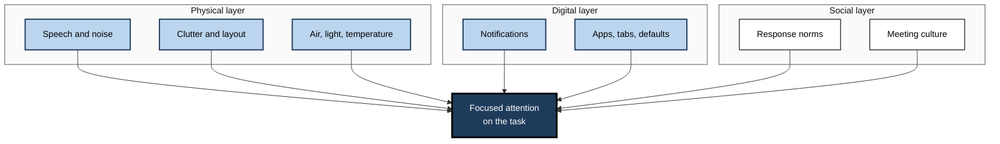
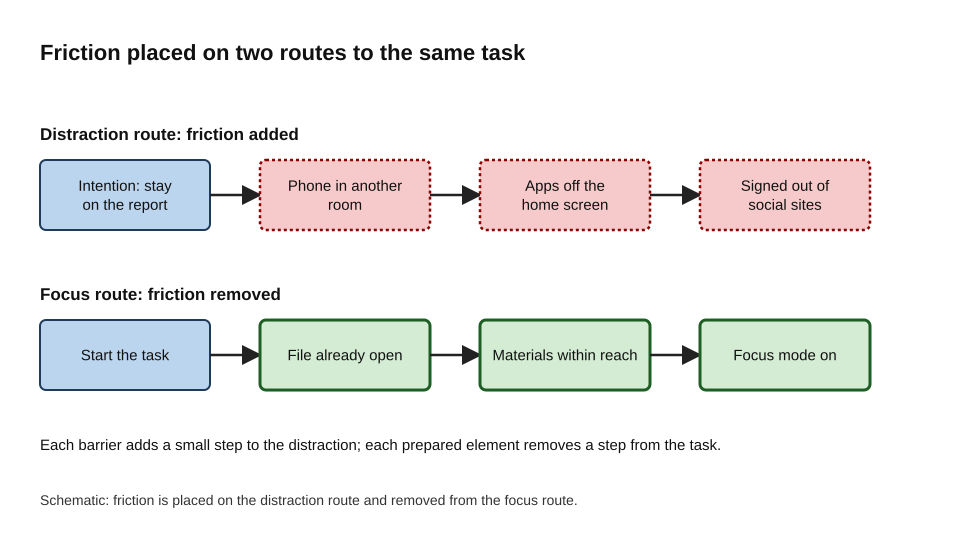
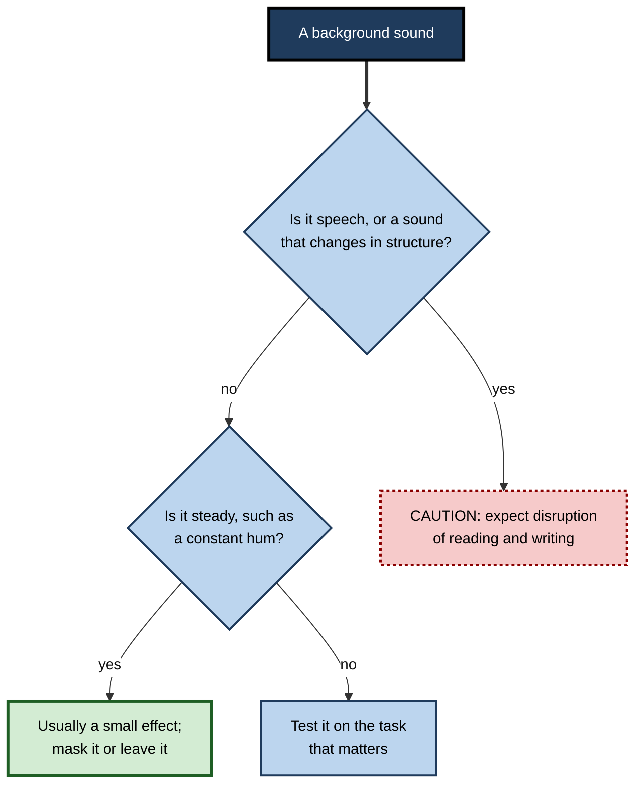
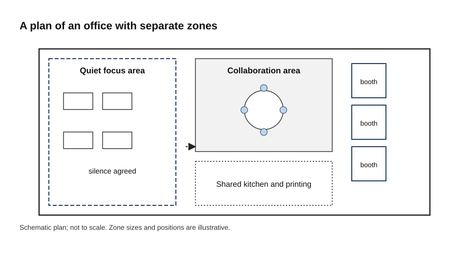
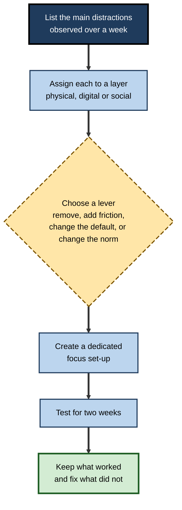

# D.10. Environmental Design for Attention

A bowl of sweets on the desk is hard to ignore. Each glance costs a little effort, and most people eventually give in. The same sweets in a cupboard down the hall are almost never eaten, not because willpower has changed, but because the path to them now takes effort.

Attention works in a similar way. A phone face-up on the desk, a chat window that blinks, a colleague talking nearby, a cluttered screen: each is a standing invitation to look away. Environmental design for attention means arranging physical space, digital tools and social surroundings so that focus is the easy default and distraction takes effort.

> **Definition — Environmental design for attention:** the deliberate arrangement of physical, digital and social surroundings so that the task at hand is the path of least resistance and competing stimuli require extra steps to reach.

**Why it matters**

- People often rely on resisting distraction, but resistance uses limited self-control on every attempt. Changing the environment removes the need to resist.
- The environment acts continuously, across the whole day, whether or not anyone is paying attention to it.
- Small changes to space, devices and team norms can shift how much attention a person spends on the task, and they can be scaled from one desk to a whole organisation.
- Design decisions made for other reasons, such as open-plan layouts or default notification settings, shape attention in ways that are often overlooked.

---

## Three Layers of the Attention Environment

Surroundings that compete for attention fall into three layers, and each has its own levers.

| Layer | What it includes | Main levers |
|---|---|---|
| **Physical** | Noise, speech, lighting, air, temperature, clutter, layout, devices within reach | Quiet zones, sound masking, clearing the desk, device placement, daylight and fresh air |
| **Digital** | Notifications, apps, tabs, home screens, defaults, tool layouts | Notification settings, focus modes, blockers, single-purpose set-ups, clean desktops |
| **Social** | Colleagues' expectations, meeting culture, response norms, visible status | Agreed focus periods, response-time agreements, status signals, meeting rules |

**Figure 1.** The three layers of the attention environment, each pressing on the task from a different direction.

---

## Why Environment Beats Resolve

### Removing and resisting

- **Resisting** a distraction is a repeated act of control. Each resisted glance draws on the same limited capacity that the task needs.
- **Removing** a distraction ends the competition. The phone in another room cannot be checked by reflex.
- Most of the benefit of environmental design comes from reducing the number of decisions a person has to make in the first place.

> **Key point:** the best self-control is often a decision made in advance about the environment, not a decision made under pressure at the desk.

### Friction and defaults

- **Friction** is a small effort or delay that makes a behaviour less likely. Signing out of a social site, or moving an app off the home screen, adds friction to distraction.
- **Defaults** are what happens when nothing is done. Focus modes that switch on automatically, or notifications that are off by default, make the focused path the one people take without deciding.
- Removing friction from the task makes it easier to begin. A file already open, materials within reach and a focus mode switched on in advance all reduce the start-up cost.

**Figure 2.** Friction as a design choice: distraction is made effortful, and the focused task is made the easy route.

### Context cues

- Environments become associated with behaviours. A place used only for focused work comes to cue focus; a place used for everything cues everything at once.
- Habit research shows that many behaviours are triggered by context. Changing the context, for example with a separate browser profile or a different room, can disrupt an old pattern and make room for a new one.

> **Watch out:** buying equipment is not the same as changing the environment. Expensive headphones matter less than switching off notifications and removing the phone from the desk.

---

## Noise, Speech and Acoustics

### The irrelevant sound effect

- Background sound can impair tasks that depend on holding things in order in memory, such as reading, writing and mental arithmetic.
- The effect occurs even when people try to ignore the sound and do not report being bothered.
- Dylan Jones and colleagues proposed a changing-state account: sounds that vary in a structured way, such as speech, interfere more with memory for order than steady sounds do.
- In practical terms, a steady background hum is much less disruptive than a conversation, and a conversation is one of the most disruptive sounds for reading and writing.

> **Key point:** the sound most likely to derail thinking work is a changing sound, such as speech, that the brain cannot easily ignore.

**Figure 3.** Deciding how much background sound is likely to matter for demanding work.

### Music

- Instrumental music may be neutral for some routine tasks and some people, but music with lyrics tends to harm reading and writing.
- The once-popular claim that listening to Mozart raises intelligence has not held up. A meta-analysis by Pietschnig, Voracek and Formann (2010) found that the evidence for a specific Mozart effect on performance was weak, and that effects were larger in studies by the original research group than in those by others.

> **Watch out:** a pleasant sound is not necessarily a helpful one. Test a sound against the task that matters before deciding it helps.

### Sound masking

- Sound masking adds steady background sound that makes nearby speech less intelligible. It reduces the disruption caused by speech rather than removing the speech.
- Masking is most useful where a room is shared and enclosed spaces are scarce. It does not replace a quiet room.

---

## Open-Plan Offices and Workplace Layout

### What the field evidence shows

Open-plan offices were introduced to increase collaboration. Ethan Bernstein and Stephen Turban (2018), in a study published in *Philosophical Transactions of the Royal Society B*, tracked two organisations that moved into more open spaces. Face-to-face interaction fell sharply, by around seventy per cent by the authors' own summary, while electronic interaction rose. Employees appeared to withdraw from one another in person and move the contact to messages.

- The study used sensor and communication data rather than surveys alone.
- Its findings are from two organisations, so the generalisation to other settings is an open question.
- Reviews of office research repeatedly link open layouts with more distraction and lower satisfaction with concentration work, although the strength of the link varies with design.

> **Watch out:** an open layout is not inherently harmful. The problem is an open layout without enough quiet zones, enclosed spaces for calls and enforced norms.

**Figure 4.** A schematic plan of an office with zones for different kinds of work.

### Activity-based zones

- **Quiet focus areas**, with acoustic separation and norms for silence.
- **Collaboration areas**, where conversation is expected and visible.
- **Enclosed booths** for calls and private work, which reduce the need for people to take calls at their desks.

A layout with all three types of space works only if the zones are used as intended. If the quiet zone is regularly occupied by conversation, it fails in the same way as an open plan.

---

## Air, Temperature and Light

- **Air quality:** a controlled study by Joseph Allen and colleagues (2016), published in *Environmental Health Perspectives*, had participants work for six days in an office with different ventilation and building conditions. Decision-making scores were higher in the greener, better-ventilated conditions, and the study linked lower carbon dioxide and fewer volatile compounds with better scores. The study was small, and the size of the effect at ordinary indoor levels is debated.
- **Temperature:** performance tends to decline when rooms are noticeably too warm or too cold. The comfortable range varies from person to person.
- **Light:** daylight and bright light during the day support alertness and healthy sleep timing, while poor lighting can add to fatigue.

> **Remember:** good ventilation and comfortable temperature are low-risk improvements. Their effect on focus is real but usually modest, and they are most useful when the other layers are already in order.

---

## Visual Clutter

- Neuroscience of visual attention suggests that several objects in view compete for neural representation, and that a biased competition favours the attended object. Desimone and Duncan (1995) framed attention as an outcome of this competition.
- On screens, extra windows, sidebars, badges and tabs act as competitors. Reducing them follows from this model.
- Evidence on the tidiness of physical desks is thinner and more mixed than evidence on screens. A clear desk is a reasonable choice, but it should not be presented as a proven route to focus.

---

## Digital and Social Design

### Digital defaults

- Notification digests and quiet hours can be set as defaults, so that alerts are batched without any individual action.
- Badges can be switched off for low-priority channels, which removes the open loop that draws attention repeatedly.
- Focus modes can be scheduled to start automatically during blocks of work.
- A separate browser profile or desktop with only the tools for the current task reduces the pull of unrelated tabs.

### Social design

- A visible status, such as "focusing until eleven", tells colleagues when a person is reachable.
- Response-time agreements turn an individual's wish for quiet into a shared expectation.
- Meeting norms, such as default meeting lengths with buffers, reduce the fragmentation that undermines focus.

> **Key point:** a digital setting that no one else respects gives only partial protection. Social norms make the digital setting work.

### The mere presence of a phone

The evidence that a nearby phone reduces cognitive capacity is contested. Ward and colleagues (2017) reported such an effect, and replications have mostly been null. Moving the phone out of reach remains a sensible low-cost choice, but the effect should not be presented as proven. Out-of-reach placement also removes the easy, unthinking checking that is the most costly part of phone use.

---

## Designing for Attention in Teams and Organisations

### Designing workplaces

| Design area | Professional practice |
|---|---|
| **Acoustic zoning** | Separate quiet areas from collaboration areas; use absorbent materials and sound masking; provide enough booths for calls. |
| **Ratio planning** | Match the share of focus space to the share of focus work, not to tradition. |
| **Visible norms** | Clear signage and agreements for quiet zones; booking systems that make focus rooms easy to obtain. |
| **Air and light** | Ventilation monitoring, with carbon dioxide sensors as a proxy, and access to daylight. |
| **Remote and hybrid work** | Guidance or stipends for home workspaces; "focus days" at home and "collaboration days" in the office. |

**Figure 5.** An environment audit, from listing distractions to testing a redesign.

### Designing the digital workplace

- Set organisation-wide defaults for notifications, with digests and quiet hours switched on.
- Keep channels few, named clearly and tied to explicit purposes, with an urgent route for emergencies.
- Treat automated updates and AI-generated messages as sources of interruption. Each should be batched or bounded, so that the tool does not add to the load it was meant to reduce.
- Measure aggregate focus time and after-hours messaging, with privacy protections.

### Designing learning environments

- Phone-free learning sessions, minimal on-screen clutter in e-learning, and no autoplay distractions protect the learner's attention.
- Instructional designers remove "seductive details", which are interesting but irrelevant material that draws attention from the core content.

---

## Case Study (illustrative): an open-plan floor after a move

**Situation:** A company of about five hundred staff moved to an open-plan office. Within months, surveys showed that complaints about concentration had roughly doubled, and rooms were being booked for solo work.

**Problem:** The layout gave no enclosed space for focus work, and there were no shared norms about noise or response times.

**Diagnosis:**

- The workplace experience manager measured noise and speech levels and observed how space was used.
- A survey asked how much time staff spent on focus work and where they did it.
- The findings showed that intelligible conversation was the main complaint and that the rooms available for solo work were insufficient.

**Actions:**

1. Part of the floor was converted into an enclosed quiet zone with clear rules.
2. Phone booths were added for calls, and sound masking was installed in the open areas.
3. Carbon dioxide monitors were installed to check ventilation.
4. A team agreement on chat response times was introduced alongside the physical changes.

**Result (illustrative):** six months later, complaints about concentration fell, and solo use of meeting rooms declined. The manager reported the results with the caveat that other changes had happened over the same period.

**Lesson:** physical, digital and social changes work best together, and the evaluation needs to separate them where possible.

---

## Ethical Limits

- Environmental design can slide into control: monitoring screens, limiting personal devices beyond what is necessary, or nudging people without their knowledge.
- Good practice is transparent, consultative and aimed at giving people more control over their own attention, not less.
- Designs should be tested with the people who use the space, because a layout that suits one team may frustrate another.

---

## Open Questions

- **How large are the effects of physical environment on focus in real, varied workplaces?**
  - Many findings come from laboratory tasks or single organisations.
- **Does open-plan design harm focus in all settings, or only where zones and norms are weak?**
  - Evidence points to design quality and enforcement as key moderators, but the data are limited.
- **Does the mere presence of a phone matter for everyday focus?**
  - The question remains contested, and the replication record is mixed.
- **Which digital defaults produce lasting change rather than temporary compliance?**
  - Long-term evaluations are rare.

---

## Summary

- **Environmental design** makes focus the easy path and distraction an effortful one.
- The attention environment operates in **three layers**: physical, digital and social, each with its own levers.
- **Friction** and **defaults** shape behaviour more reliably than resolve, and reducing the need to resist is the central principle.
- **Changing sound**, especially speech, disrupts memory for order more than steady sound does, which is the basis of the irrelevant sound effect.
- Bernstein and Turban (2018) found that open layouts reduced face-to-face contact, while the effect on focus depends on quiet zones and norms.
- Better **ventilation** and comfort support cognition in controlled studies, with modest effects.
- The Mozart effect on intelligence has not been supported, and the evidence for a nearby phone's effect is contested.
- At organisational scale, design must combine **physical zones**, **digital defaults** and **social norms**, and it must remain **transparent**.

---

## Self-Check

1. Why is removing a distraction generally more effective than resisting it?
2. Name the three layers of the attention environment and one lever for each.
3. What is friction, and how can it be used on both distractions and tasks?
4. What is the difference between a default and a norm, and why do both matter?
5. What is the irrelevant sound effect, and why does speech disrupt thinking work more than steady sound?
6. What did Pietschnig and colleagues (2010) conclude about the Mozart effect?
7. What did Bernstein and Turban (2018) find about face-to-face interaction after the move to open-plan offices?
8. What does Allen and colleagues' (2016) controlled study suggest about ventilation and cognitive performance, and what are its limits?
9. Explain biased competition in one sentence, and say how it relates to screen clutter.
10. Why is a changing sound more disruptive than a steady one, according to the changing-state account?
11. How should an organisation respond to evidence that open-plan layouts reduce concentration?
12. Propose a digital default set that protects attention, and explain how a social norm would reinforce it.
13. Why is "buy better headphones" often a weaker response than changing notifications?
14. What ethical limits apply to designing environments for attention, and what does good practice look like?

### Answer Key

1. Resisting uses limited control on each attempt, while removal eliminates the competition for attention. Removal depends on a decision made in advance rather than under pressure.
2. Physical: quiet zones, sound masking, clearing clutter or device placement. Digital: notification settings, focus modes, blockers. Social: agreed focus periods, response-time norms, status signals.
3. Friction is a small effort or delay that makes a behaviour less likely. It can be added to distractions (signing out, moving apps) and removed from the task (having files open and materials ready).
4. A default is what happens when no action is taken; a norm is an agreed expectation shared by a group. Defaults reduce the number of decisions needed, and norms make defaults effective across a team.
5. The irrelevant sound effect is the impairment of memory-dependent tasks by background sound that is ignored. Speech changes in structured ways that interfere with memory for order, so it disrupts reading and writing more than a steady sound.
6. The evidence for a specific Mozart effect on performance was weak after correction for publication bias, and the effects were larger in studies by the original group than in others.
7. Face-to-face interaction fell sharply in both organisations studied, and electronic interaction rose. Employees appeared to withdraw from in-person contact to protect their attention.
8. Participants performed better on decision-making tasks in greener, better-ventilated conditions with lower carbon dioxide and fewer volatile compounds. The study was small, and the size of the effect at ordinary indoor levels is debated.
9. Multiple stimuli in view compete for neural representation, and attention biases the competition toward the attended object. Screen clutter adds competitors and so reduces processing efficiency.
10. Changing sounds are more disruptive because they compete with the target items for the cues that define the order of items in memory. Steady sounds provide no such competing order cues.
11. Treat it as a design problem: provide enclosed quiet zones, enough booths for calls, sound masking and norms that are enforced, and evaluate the result rather than assuming it.
12. Examples: notification digests and quiet hours on by default, and badges off for low-priority channels. A norm such as a visible focus status and agreed response times reinforces the default by making it expected.
13. Headphones reduce sound but do not change the notifications, the open tabs or the habit of checking. Changing the notification settings and the environment removes the cues that prompt checking.
14. Designs must be transparent, consultative and aimed at giving people more control. Surveillance of screens, covert nudging and restrictions beyond what is necessary are ethical problems. Good practice tests designs with users and measures outcomes at team level.

---

## Glossary

| Term | Meaning |
|---|---|
| Activity-based working | Office design with different zones for different kinds of work. |
| Biased competition | The account in which stimuli compete for processing and attention biases the outcome toward the attended stimulus. |
| Changing-state effect | The disruption of memory for order by sound that varies in a structured way. |
| Choice architecture | The design of how options are presented so that the preferred choice is easier. |
| Context cue | A feature of a place or situation that triggers a habit. |
| Default | What happens if no action is taken. |
| Friction | A small effort or delay that makes a behaviour less likely. |
| Irrelevant sound effect | Impairment of memory-dependent tasks by background sound that is ignored. |
| Seductive details | Interesting but irrelevant material that draws attention from the core content. |
| Sound masking | Steady background sound that reduces the intelligibility of nearby speech. |
