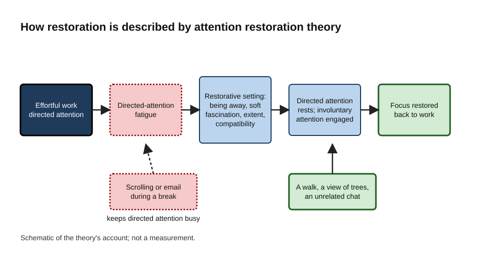
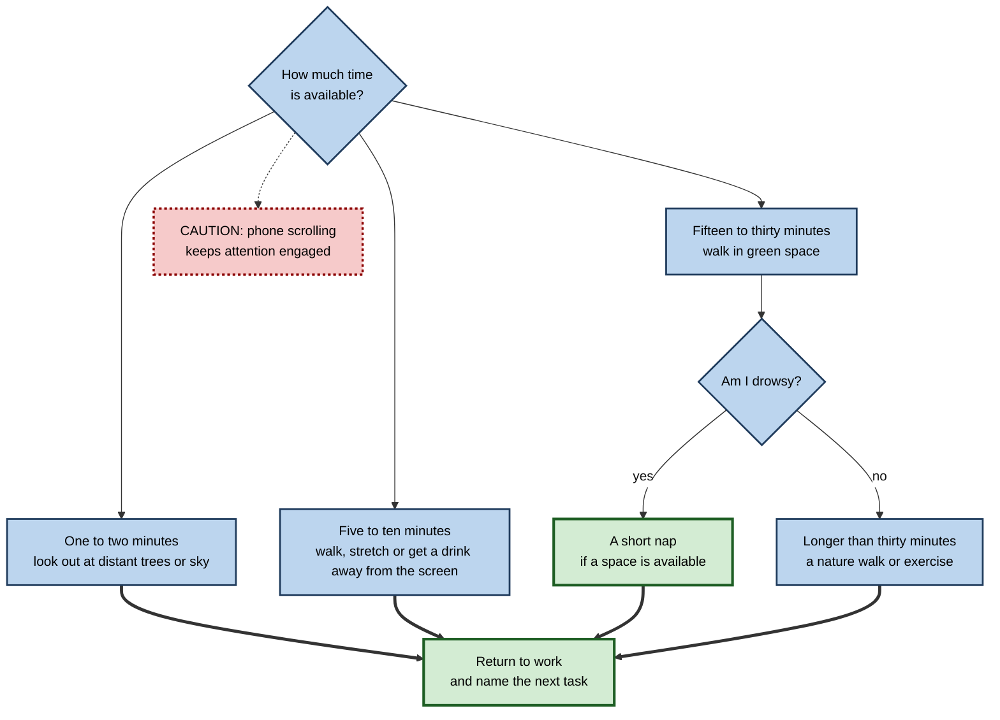
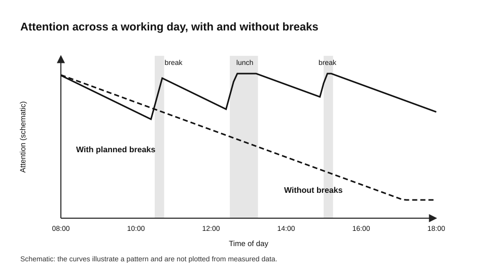
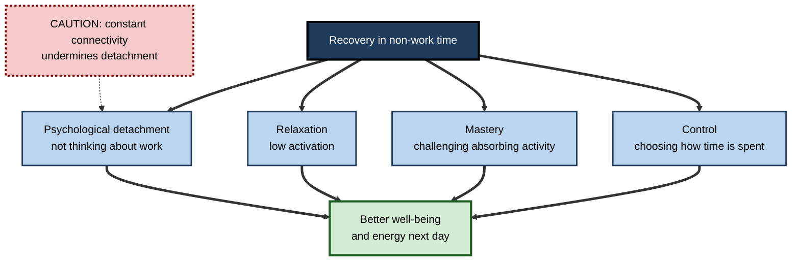
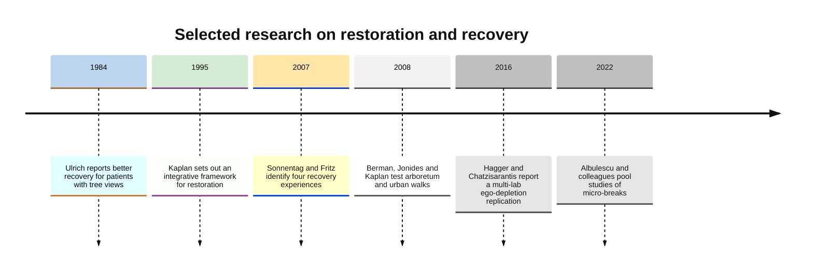

# D.11. Attention Restoration Techniques

After a morning of dense spreadsheets, attention feels used up. You reread sentences, make small errors and drift towards your phone. You then take a twenty-minute walk through a park, and when you return the work seems clearer and the errors stop. Something was restored, and the walk was the cause.

Attention restoration is the recovery of the ability to focus after it has been worn down. It is not a fixed daily allowance that runs out, but a capacity that varies across the day and can be partly renewed. The question for professionals is which breaks actually renew it, and which only seem restful.

> **Definition — Attention restoration:** the recovery of effortful, focused attention after a period of demanding work, through activities that rest the systems engaged by that work.

> **Definition — Directed attention:** the effortful, deliberate attention used to concentrate on something that does not hold attention naturally, while suppressing distractions.

**Why it matters**

- Lapses in attention, errors and slow decisions become more frequent as demanding work continues, so recovery shapes the quality of later work.
- Breaks are often treated as lost time. Evidence on recovery suggests that a well-chosen break can improve the work that follows.
- Organisations that build recovery into schedules tend to see fewer errors in long shifts and less strain over time, although the evidence on organisational outcomes is still developing.

---

## Why Some Breaks Restore and Others Do Not

Directed attention works like a muscle held steady for a long time. Holding still tires it, and a different, easy movement lets it recover. A good break does not mean doing nothing. It means stopping the use of the tired system and engaging a different one.

The distinction matters because much of what people do in breaks keeps the tired system busy.

- **Scrolling** a news feed demands attention, makes choices and produces small emotional reactions. It rarely lets directed attention rest.
- **Answering a message** during a break carries the work into the break.
- **A walk outdoors** or a chat about something unrelated engages attention without demanding effort.

> **Key point:** the most restorative breaks engage attention effortlessly and take a person away from the demands of the work. Scrolling usually does neither.

---

## Attention Restoration Theory

Rachel and Stephen Kaplan developed attention restoration theory (ART) through the late 1980s and 1990s. Stephen Kaplan's 1995 paper in the *Journal of Environmental Psychology* set out an integrative framework for the restorative benefits of nature.

The theory makes two main claims.

1. **Directed attention fatigues.** Suppressing distractions in order to concentrate draws on a capacity that weakens with sustained use. This is called directed-attention fatigue.
2. **Some environments restore.** Settings, especially natural ones, engage what the theory calls involuntary attention gently, through soft fascination, such as clouds moving, leaves in the wind or water. This lets directed attention rest and recover.

The framework identifies four features of a restorative environment.

| Feature | Meaning | Example |
|---|---|---|
| **Being away** | A sense of psychological distance from everyday demands | A park, or a walk without the phone |
| **Soft fascination** | Gentle interest that needs little effort | Trees, water, the sky |
| **Extent** | A sense of a coherent world to explore | A long trail or a large garden |
| **Compatibility** | Fit between the setting and what the person wants to do | A place the person enjoys being |

**Figure 1.** How directed-attention fatigue is restored, according to attention restoration theory. The diagram is a schematic of the theory rather than a plot of data.

### A second account: stress reduction

Roger Ulrich proposed stress reduction theory, which emphasises the physiological effects of natural settings. On this account, nature reduces stress quickly, and the reduction supports recovery of attention and mood.

- **Study card — Ulrich (1984)**
  - **Design:** the records of surgical patients who had gallbladder operations at a suburban hospital were compared. Patients with a window view of trees were matched with patients whose windows faced a brick wall.
  - **Results:** the patients with a view of trees had shorter post-operative stays, fewer negative comments in nurses' notes, and took fewer potent painkillers.
  - **Conclusion:** the view may have influenced recovery, through the stress-reduction pathway.
  - **Caveat:** the study was small and based on records, not a randomised trial. The effect is an influential early finding that later work has tested in many ways.

> **Watch out:** the hospital study concerns recovery from surgery, not focus at work. It is evidence that nature influences recovery, and it should not be read as a direct test of attention.

---

## Experiments on Nature and Attention

Marc Berman, John Jonides and Stephen Kaplan reported in 2008 in *Psychological Science* that walking in a natural setting could improve directed attention more than walking in a busy urban setting.

- **Design:** participants completed a backward digit-span task, which requires holding and reversing a sequence of numbers, and then walked either through a city centre or through an arboretum. They then repeated the task.
- **Results:** the urban walk did not measurably change performance, but the arboretum walk improved it.
- **Interpretation:** the authors took this as evidence that interacting with nature supports directed attention.
- **Limits:** the sample was small, the task measures short-term memory as well as attention, and walks differ in many ways beyond their natural content.

> **Key point:** the best-known experiments show that a walk in nature can improve attention on a demanding task more than a walk in a busy setting. They do not show that any natural setting is equally restorative.

### Why the evidence is still developing

- Reviews of attention restoration theory have criticised it for vagueness about which attention processes are restored and for variation in the measures used.
- Newer studies have used electrophysiological and behavioural markers, and results have varied.
- The practical question for professionals is not whether nature is restorative in general, but which breaks, of what length and kind, are most worthwhile for a given demand.

---

## Micro-Breaks

A micro-break is a short break from work, typically of ten minutes or less. A 2022 meta-analysis by Patricia Albulescu and colleagues in *PLOS ONE* pooled studies of micro-breaks and found the following.

- Micro-breaks produced small but significant improvements in vigour and reductions in fatigue.
- Overall effects on performance were small and not statistically significant.
- Performance benefits appeared mainly for tasks with lower cognitive demands.
- Longer breaks tended to help performance more, which suggests that recovery from highly demanding work may need more than a few minutes.

> **Key point:** micro-breaks reliably improve how energised and less fatigued people feel. Their effect on performance is smaller and depends on the task.

**Figure 2.** Choosing a restoration technique by the time available.

---

## The Shape of Fatigue Across a Day

Attention tends to decline as demanding work continues, and it recovers partly with breaks, sleep and time away from the task. The diagram below is a schematic of that pattern, not a plot of measured values. It shows why planning breaks before exhaustion is often more effective than recovering after it.

**Figure 3.** Schematic of attention across a working day with planned breaks. The curve is illustrative of the pattern, not a plotted dataset.

- **Breaks before deep fatigue** tend to restore more than breaks taken once attention has collapsed.
- **Long, unbroken demand** lowers the level of attention at which the afternoon begins.
- **Sleep** sets the starting level of attention for the next day, and sleep loss increases lapses sharply.

---

## Sleep, Naps and Movement

- **Sleep** is the strongest and most reliable restorer of attention. Loss of sleep increases attentional lapses, and people tend to underestimate how impaired they are.
- **Short naps** can improve alertness with little grogginess when they are kept brief. Longer naps can bring a period of grogginess on waking, known as sleep inertia.
- **Physical movement**, such as a walk, is a common and accessible restorer. It changes arousal and mood, and it breaks the posture of sustained screen work.

> **Watch out:** caffeine raises alertness for a time, but it does not replace sleep, and it does not remove the errors that build up with fatigue.

---

## Recovery Beyond the Break

Work psychologist Sabine Sonnentag and colleagues identified four recovery experiences that were linked to better well-being and energy in the following days.

- **Psychological detachment** — not thinking about work during non-work time.
- **Relaxation** — periods of low physical and mental activation.
- **Mastery** — engaging in challenging activities outside work, such as a hobby that requires skill.
- **Control** — having a say in how one spends leisure time.

**Figure 4.** The four recovery experiences in non-work time, and the gap that persistent connectivity can create.

Detachment has the most consistent link with well-being in the research on these experiences. Connectivity that keeps work present in the evening makes detachment harder, and the link is therefore a practical concern for anyone who must answer messages at night.

**Figure 5.** Selected research milestones on restoration and recovery, by year of publication.

---

## A Daily Recovery Rhythm

- **Plan breaks between blocks of work**, rather than only when exhausted.
- **Leave the screen** for at least one break in the half day, and go outside where possible.
- **Choose effortless engagement** — something gently interesting rather than demanding or highly stimulating.
- **Protect lunch** as a real break, because a skipped lunch often reduces afternoon quality.
- **Close the working day** with a clear end, so that the mind has a boundary from which to detach.

### Case study (illustrative): a financial analyst at quarter-end

- **Situation:** during quarter-end, reconciliation work was dense, and the analyst ate lunch at the desk, scrolling news, and worked through the mid-afternoon slump with extra coffee.
- **Problem:** errors clustered late in the day, and sleep was poor during the busy weeks.
- **Diagnosis:** breaks were engaging the same demanding attention as the work, and recovery in the evening was blocked by work email.
- **Actions:**
  1. A short walk outside at lunch on most days.
  2. A five-minute screen-free break roughly every hour and a half.
  3. A clear end to the working day, with no work email outside the on-call nights.
- **Result (illustrative):** fewer late-day errors were caught at review, and the analyst reported feeling less exhausted by the end of the week.
- **Caveat:** the quarter-end was also less demanding in some respects, so the change cannot be attributed to breaks alone.

---

## Designing Recovery Into Work

- **Schedules** can include buffers, such as meetings of twenty-five or fifty minutes rather than sixty, and avoid long back-to-back blocks.
- **Shift work** can include planned rest breaks, rotation away from monitoring roles and, in safety-critical settings, planned naps.
- **Workplaces** can provide access to green space, outdoor routes for walking meetings and quiet rest areas.
- **Culture** matters: when leaders take visible breaks, others are more likely to do so, and after-hours messaging norms protect detachment.
- **Learning programmes** can use spaced sessions with breaks, rather than long single sessions, so that attention is not exhausted by the design.

> **Key point:** recovery that depends only on individual discipline is fragile. Recovery built into schedules and norms is more likely to last.

---

## Ethical Limits

- Recovery should not become another performance demand, in which people are asked to optimise their rest.
- Breaks are not a substitute for a reasonable workload. If people need constant recovery techniques to cope, the problem may lie in the work.
- AI tools can free time for recovery, or fill it with more output to review. They can also erode detachment if work reaches people at all hours. Notifications from automated tools should respect working hours.

---

## Open Questions

- **Which kinds of break restore which attention processes, and for how long?**
  - Evidence points to effects on some processes more than others, but the mapping is not complete.
- **How much nature exposure is needed, and does it need to be real rather than simulated?**
  - Studies have varied in design, and the question is still being tested.
- **Does restoration work through depleting a resource, or through mood, arousal and motivation?**
  - Large replication efforts have not supported the classic resource account of self-control, so the mechanisms are uncertain.
- **Do organisational recovery programmes change well-being and error rates over the long term?**
  - Evaluations rarely measure both over long periods.

---

## Summary

- **Directed attention** is effortful and fatigues with sustained use; **restoration** depends on resting it.
- **Attention restoration theory**, set out by Kaplan (1995), proposes that restorative settings offer being away, soft fascination, extent and compatibility.
- Ulrich's **stress reduction** account shows that natural views can affect recovery from surgery, although the study concerns recovery rather than focus.
- Berman, Jonides and Kaplan (2008) found that a walk in an arboretum improved a demanding attention task more than an urban walk.
- **Micro-breaks**, typically ten minutes or less, reliably reduce fatigue and increase vigour; their effects on performance are smaller and task-dependent.
- **Sleep** is the strongest restorer; **short naps** help when drowsy.
- Sonnentag and colleagues identified four **recovery experiences**, with **psychological detachment** the most consistently linked to well-being.
- Scrolling and answering messages during breaks keep directed attention engaged and restore little.
- Recovery is strongest when built into **schedules and norms**, not left to individual effort alone.

---

## Self-Check

1. Why does scrolling a phone often fail to restore focus?
2. Name two breaks that are likely to be more restorative than scrolling, and explain why.
3. What is directed-attention fatigue?
4. Name the four features of a restorative environment in attention restoration theory.
5. What did Ulrich's 1984 study compare, and what did it find?
6. What did Berman, Jonides and Kaplan (2008) compare, and what was the result?
7. What do micro-breaks reliably improve, and where are their effects on performance weaker?
8. Why might a break planned before exhaustion restore more than a break taken after attention has collapsed?
9. Name the four recovery experiences identified by Sonnentag and colleagues.
10. Why is psychological detachment important for next-day energy, and what undermines it?
11. What does the evidence on ego depletion suggest about the "fuel tank" model of self-control?
12. A worker has ten minutes between two demanding meetings. What would you recommend, and why?
13. How can AI tools both support and undermine recovery?
14. An organisation wants to build recovery into its shifts. Propose three specific measures and explain how each one would be evaluated.

### Answer Key

1. Scrolling keeps directed attention and emotional engagement busy, so the tired system does not rest. It demands choices and produces reactions, which is the opposite of effortless engagement.
2. A walk outdoors, because it provides movement and a change of setting. A chat about something unrelated to work, because it engages attention without demanding effort.
3. The reduced capacity for effortful, distraction-suppressing attention that follows prolonged use.
4. Being away, soft fascination, extent and compatibility.
5. It compared surgical patients whose windows looked on trees with matched patients whose windows faced a brick wall. Patients with the tree view had shorter post-operative stays, fewer negative nurse comments and fewer requests for strong painkillers.
6. It compared a walk through an arboretum with a walk through a busy urban area, using a backward digit-span task before and after. The arboretum walk improved performance, and the urban walk did not change it measurably.
7. Micro-breaks reliably increase vigour and reduce fatigue. Their effects on overall performance were small and not statistically significant, and performance benefits were mainly seen for less demanding tasks.
8. Recovery is easier before attention has fallen far, and it prevents the decline that accumulates during demanding work. A break taken after collapse begins from a lower level and may need to be longer.
9. Psychological detachment, relaxation, mastery and control.
10. Detachment, meaning not thinking about work in non-work time, is most consistently linked to well-being and next-day energy. Constant connectivity, such as checking work messages in the evening, undermines it.
11. Large multi-laboratory replications have largely failed to reproduce classic ego-depletion effects. This suggests caution about simple fuel-tank metaphors, and restoration may also work through mood, motivation and arousal.
12. Leave the screen, walk outside if possible, get a drink, and name the next task before returning. Walking or looking at green space engages attention effortlessly, which is more restorative than scrolling.
13. They can free time for recovery by taking routine work off people. They can also make work available at all hours, fill freed time with more output and erode detachment. Scheduling digests in working hours and protecting freed time limits the harm.
14. Examples: planned rest breaks with cover; rotation away from monitoring roles; default meetings of shorter length with buffers. Evaluation could track error rates by time of shift, fatigue survey items, after-hours message volume and absence, comparing shifts with and without the measure.

---

## Glossary

| Term | Meaning |
|---|---|
| Attention restoration theory | Kaplan's account of how restorative environments allow directed attention to recover. |
| Directed attention | Effortful, distraction-suppressing attention. |
| Directed-attention fatigue | Reduced capacity for directed attention after prolonged use. |
| Involuntary attention | Effortless attention drawn by interesting stimuli. |
| Micro-break | A short break, typically of ten minutes or less. |
| Psychological detachment | Mentally switching off from work during non-work time. |
| Recovery experiences | Detachment, relaxation, mastery and control during non-work time. |
| Restorative environment | A setting that supports recovery of attention. |
| Sleep inertia | Grogginess after waking, especially from deep sleep. |
| Soft fascination | Gentle, effortless interest, such as watching water or leaves. |
| Stress reduction theory | Ulrich's account that natural settings reduce stress quickly and support recovery. |
