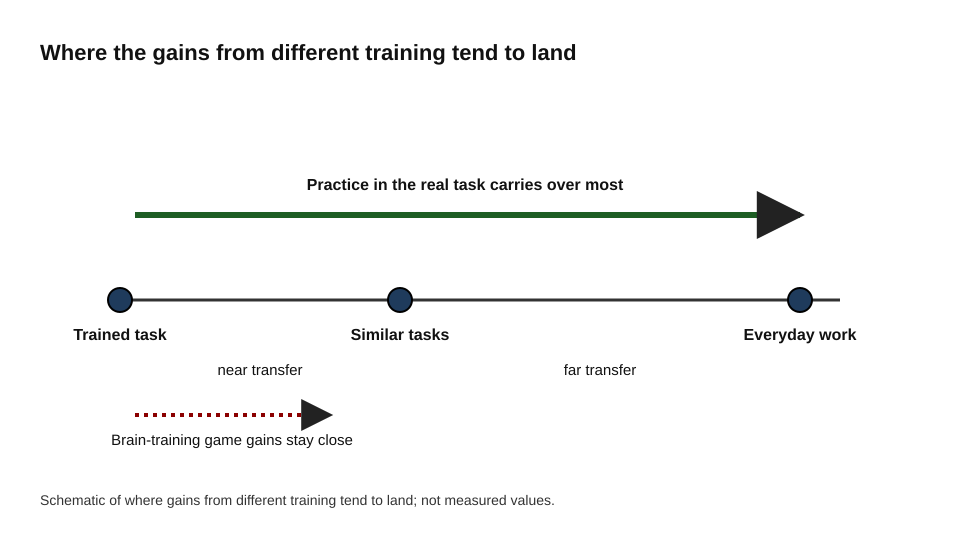
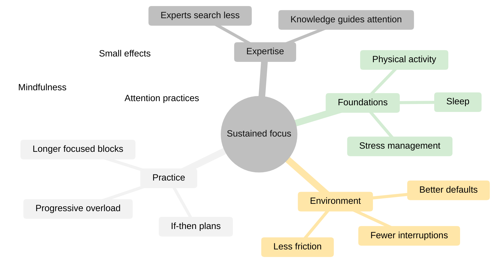
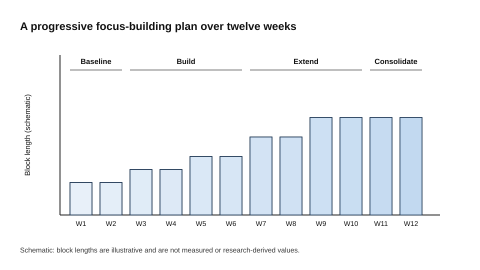
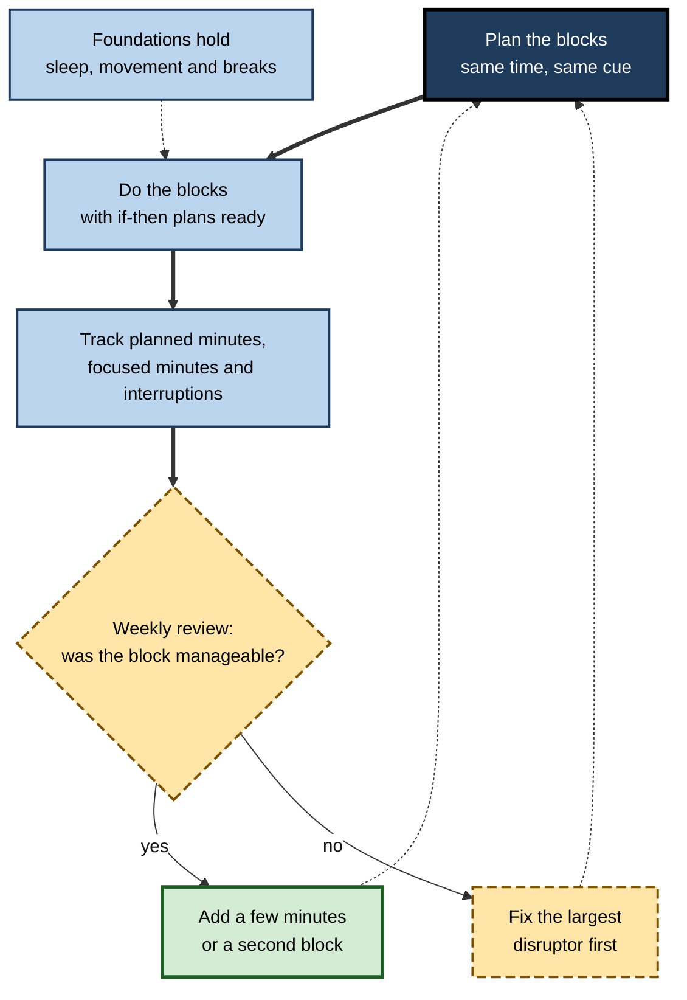
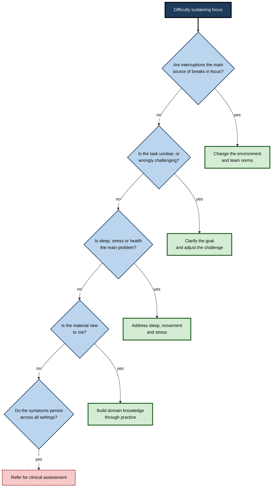

# D.12. Training Sustained Focus Over Time

Many people say they have lost the ability to concentrate. Research on attention suggests that sustained focus is not fixed. People who could barely read for ten minutes can, over months, work for an hour or more on a difficult problem, and the change usually comes from practice in the work itself, not from exercises set apart from it.

The training question is harder than it looks. Attention is shaped by sleep, environment, health, habits and expertise, and the methods that promise to build it do not all work. Knowing which approaches have evidence, and which are marketing, is the basis of a sensible plan.

> **Definition — Sustained focus:** the ability to keep attention on a task over an extended period, resisting drift and interference, at the level that the task requires.

> **Definition — Training transfer:** the extent to which improvement on one activity carries over to other activities, such as everyday work performance.

**Why it matters**

- Sustained focus underlies learning, the quality of complex work and the ability to undertake deep work, so it compounds over a career.
- Many commercial products claim to train attention, and their claims rarely match the evidence on transfer to real tasks.
- Clear thinking about training helps professionals spend effort where it is likely to help: on the work, the environment and their health.

---

## The Central Question: Does Training Transfer?

Every attention-training method must answer one question: does getting better at the training improve anything else?

- **Near transfer** is improvement on tasks very similar to the training task.
- **Far transfer** is improvement on tasks that are different, or on real-life performance, such as concentrating during a difficult project.

Practice on a task usually improves that task, and similar tasks to a lesser degree. Far transfer is rare. This is why training that takes place in the real activity, such as sustained work on the material itself, tends to outperform abstract exercises with a different surface.

**Figure 1.** Transfer distance: why practice that resembles the real task tends to carry over most strongly. The diagram is schematic.

### Brain-training games

- Commercial brain-training programmes claimed broad benefits for everyday cognition.
- A 2016 review by Daniel Simons and colleagues, published in *Psychological Science in the Public Interest*, examined the research cited in support of these claims. It found extensive evidence that people improve on the trained tasks, some evidence for closely related tasks, and little evidence of improvement in everyday cognitive performance.
- Many studies cited tested performance on simplified laboratory tasks rather than on real-world outcomes, and some of the companies relied on testimonials rather than peer-reviewed research.

> **Watch out:** a rise in a brain-training score is evidence of learning the game. It is not evidence that work focus has improved.

### Action video games

- Action video games are a partial exception. A meta-analysis by Benoit Bediou, Daphne Bavelier and colleagues (2018) reported that frequent players outperform non-players on some visual and attention tasks, and that some training studies show gains on those tasks.
- A re-analysis by Hilgard, Sala, Boot and Simons (2019), in the journal *Collabra: Psychology*, argued that the original analysis did not adequately correct for publication bias, and that transfer to measures of cognitive ability was minimal once this was addressed.
- The games train fast visual attention. Whether that carries over to sustained focus on slow, demanding work is not established.

> **Key point:** the most defensible claim is narrow. Some games improve performance on fast perceptual tasks, and the evidence for broader gains in focus is weak.

---

## Routes to Stronger Focus

Several routes have some support. They differ in how directly they affect focus on real work.

| Route | What it involves | Strength of evidence for real-world focus |
|---|---|---|
| Foundations | Sleep, physical activity, stress management | Strong for sleep; moderate for physical activity |
| Environment | Fewer interruptions, less friction, better defaults | Strong, mainly through reduced interruptions |
| Practice and habits | Regular, progressively longer blocks of focused work; if–then plans | Moderate; well-supported mechanisms, few direct trials |
| Attention practices | Mindfulness and related methods | Small, component-specific effects |
| Domain expertise | Deep knowledge of the material | Strong; experts attend more efficiently in their field |

### Foundations

- **Sleep** is the most reliable support for attention. Chronic sleep restriction degrades attention, and no training plan offsets it.
- **Physical activity** supports mood, energy and general health, which indirectly support attention. The direct cognitive benefits of exercise are less certain than the benefits for sleep and mood.
- **Stress** affects attention through arousal and worry, and managing it is part of the foundation.

### Environment

The most immediate gains usually come from reducing the interruptions and friction that break focus. Changing the environment is the most reliable starting point because it alters the conditions every day without requiring new skills.

### Practice in the real task

- Progressively longer blocks of focused work on the real material build the capacity to sustain attention on that material.
- The principle is progressive overload, borrowed from physical training: demand is increased as capacity grows, and it is kept just above what is comfortable.
- Practice that is too easy does not build capacity, and practice that is too hard tends to end in abandonment.

### Expertise

Expertise may be the strongest route, and it works through the way attention is organised.

- In a 2011 meta-analysis of eye-tracking studies, Gegenfurtner, Lehtinen and Säljö (in *Educational Psychology Review*) compared experts and novices across professional domains.
- Experts fixated more on task-relevant areas, spent less time on irrelevant ones, and reached relevant information sooner.
- Knowledge tells experts what matters, so less effort goes into searching for it.

> **Key point:** focus training and skill training are often the same project. Deepening knowledge of the work makes that work easier to attend to.

**Figure 2.** Five routes to stronger sustained focus and how they connect to real work.

---

## Practice Schedules and Progression

### Building blocks gradually

- Start from a measured baseline: the length of focused work that is currently manageable.
- Increase the length gradually, adding time only when the current length feels consistently manageable.
- Keep the same time and place for the block, so that a context cue supports the start.
- Track the planned minutes, the focused minutes and the number of self-interruptions.

The lengths in a twelve-week plan are a practical heuristic rather than research-derived numbers. The principle is what matters: start where you are and progress steadily.

**Figure 3.** Schematic of a progressive focus-building plan across twelve weeks. Block lengths are illustrative and are not measured data.

### Implementation intentions

- An implementation intention is an if–then plan that links a situation to a response, such as "If I feel the urge to open email during this block, I will write it on my list and return to the paragraph."
- Peter Gollwitzer and Paschal Sheeran's 2006 review, in *Advances in Experimental Social Psychology*, found a medium-to-large average effect of implementation intentions on goal attainment across many tests.
- Such plans are useful for shielding focus from predictable distractions, because they decide the response in advance.

### Habits take time

Phillippa Lally and colleagues (2010) studied how long a new daily behaviour took to become automatic. The median was about sixty-six days, and individual times varied widely. A focus routine is therefore likely to take months rather than days to feel automatic, and a plan should expect slow progress.

> **Watch out:** the claim that a habit forms in twenty-one days is not supported by the research on habit formation. Plan for a longer timescale and track progress over it.

**Figure 4.** The weekly loop of a focus-building plan, with a review that decides the next step.

---

## Mindfulness and Other Attention Practices

Mindfulness is a reasonable supporting practice in a focus plan rather than its main engine. Brief training in mindfulness has been associated with gains on some attention and working memory measures, and Verhaeghen's 2021 analyses found small average effects, strongest for inhibition and executive control. The effects are modest and differ by component.

Brain-stimulation and neurofeedback methods have produced some laboratory effects on attention, but results are inconsistent and they are not established as practical training tools for professionals.

---

## Stimulants, Supplements and Neurotechnology

- **Prescribed stimulants** are effective for diagnosed attention-deficit conditions under medical supervision. In healthy adults, evidence for meaningful enhancement of focus is weak and inconsistent, and the risks include sleep disruption, misuse and overconfidence.
- **Dietary supplements** marketed for focus generally lack strong evidence beyond what caffeine provides.
- **Caffeine** raises alertness for a period, but it does not replace sleep and does not remove the errors that accumulate with fatigue.
- **Neurotechnology** that promises to train focus should be treated sceptically until its effects on real tasks are shown.

> **Watch out:** a product that promises to double focus in days is making a claim that the evidence does not support.

---

## Generative AI and the Practice of Attention

Generative AI raises a new question: if tools read, summarise and draft for us, does that reduce the practice that builds sustained focus?

- In a 2025 field experiment in high school mathematics, Bastani and colleagues reported in the *Proceedings of the National Academy of Sciences* that students who had access to an unrestricted AI tutor performed better during practice but worse on unaided exams once access was removed.
- A tutor designed to offer hints rather than final answers largely avoided that loss.
- The study was conducted in a single school, so its generalisation to professional work is an open question. It is consistent, however, with the view that heavy reliance on a tool can reduce independent effort.

**Professional practice**

- Preserve unaided practice: schedule regular periods of reading, writing or problem solving without tools.
- Use AI to remove friction, such as fetching or formatting, while keeping the core thinking.
- Recognise that reviewing AI output is itself a sustained-attention task, and that missed errors are easy to overlook.

> **Key point:** a tool should reduce the friction around demanding work, not the demand itself. Otherwise the capacity it was meant to support is not built.

---

## Diagnosing a Focus Problem

Difficulties with sustained focus have different causes, and each needs a different response. A coach or professional should ask which cause applies before choosing an intervention.

**Figure 5.** A diagnostic sequence for focus problems, linking each likely cause to the most suitable response.

Clinical conditions that affect attention, such as attention-deficit conditions, depression and anxiety, need professional assessment rather than productivity advice. Treating them as a matter of technique can delay effective help.

---

## Case Study (illustrative): a junior lawyer building research stamina

**Situation:** A junior lawyer in a new practice area found that research tasks drained her attention. At the start of the programme, she could work for about twenty-five minutes before her first self-interruption.

**Problem:** Email was open all day, the phone was on the desk, and much of the effort went into unfamiliar terms rather than the legal questions.

**Diagnosis:**

- The environment was the most immediate problem, and it was easy to fix.
- The task was too unfamiliar: much effort went into vocabulary rather than reasoning.
- The lack of a fixed starting time meant that each session began with a search for focus.

**Actions:**

1. Email was closed during research blocks, and the phone was kept out of reach.
2. Blocks were set at a fixed time each morning.
3. A simple if–then plan was used for the urge to check email.
4. Lengths were increased slowly, and the material was studied in a planned order.

**Result (illustrative):** after twelve weeks she could work in two blocks of about eighty minutes most days. Research memos that had taken two days took about one. Part of the improvement came from growing expertise, since the same text required less effort to attend to.

**Caveat:** several changes happened together, and the expertise effect cannot be separated from the practice effect in a case like this.

**Lesson:** focus improves through a mix of environment, routine, progressive practice and knowledge, and the mix matters more than any single technique.

---

## Professional Design for Teams

- **Start with the environment.** Before training individuals, reduce the team's interruption load through focus time, response norms and fewer unnecessary meetings.
- **Practise together.** Shared focus sessions, in person or virtual, with a clear start and end, give people a common routine.
- **Let progression be individual.** Each person sets a baseline and increases block length at their own pace. Fixed targets imposed on everyone tend to produce overreaching and abandonment.
- **Integrate skill practice.** Pair focus practice with deliberate practice in the core skill, so that expertise grows alongside attention.
- **Protect the foundations.** Provide information on sleep and recovery, and policies that protect evenings.
- **Measure at team level.** Track focused blocks, self-reported focus and quality indicators, and keep individual data private.

### Case study (illustrative): a professional services firm

- **Situation:** leaders of a firm with several thousand staff wanted to license a brain-training app for everyone to "improve focus".
- **Response:** the head of learning presented the evidence on far transfer and proposed a voluntary, twelve-week programme instead. It combined cohort focus sessions, a guide to progressive blocks and if–then plans, a team-level interruption audit and integration with technical curricula.
- **Evaluation:** four teams took part, compared with similar teams that did not. Focused blocks, self-reported focus and quality indicators were measured.
- **Result (illustrative):** the pilot teams reported more focused time. The effects were modest, and the leaders shared the results as they were, including the small effects.

---

## Ethical Limits

- Focus training should not become another performance demand, in which individuals feel responsible for an attention problem that is caused by the workload or design.
- Individual monitoring of attention or screen use is intrusive, and it undermines trust. Measures should be aggregated and voluntary.
- Clinical conditions should be referred for assessment and not treated through productivity programmes.

---

## Open Questions

- **Does any attention-training method produce lasting far transfer to demanding work?**
  - Evidence for far transfer from abstract training is weak, and the mechanisms of transfer from real-task practice are not fully mapped.
- **How much of the gain from practice comes from expertise, and how much from attention practice?**
  - Few studies separate the two, and most real-world programmes combine them.
- **What is the right progression for different people and tasks?**
  - Heuristics are common, but evidence on individual progression is limited.
- **How will AI tools change the development of sustained focus over the long term?**
  - Early studies are suggestive but limited to particular settings and tasks.

---

## Summary

- Sustained focus **can be built**, mainly through **practice in the real task**, **environment**, **sleep and health** and **domain expertise**.
- **Transfer** is the central question: improvement on a trained task does not reliably carry over to real work.
- **Brain-training games** improve the trained tasks, with weak evidence of broader gains, as Simons and colleagues found in 2016.
- **Action video games** improve some fast perceptual attention, but the transfer to sustained focus is unclear.
- **Expertise** organises attention: experts fixate on relevant information sooner and waste less effort on irrelevant areas.
- Use **progressive blocks**, **if–then plans** and simple tracking, and expect progress over months.
- **Stimulants, supplements and neurotechnology** lack strong evidence for healthy adults, and clinical conditions need assessment.
- In the AI era, **preserve unaided practice** and use tools to remove friction rather than the demand of the work.

---

## Self-Check

1. Can sustained focus improve over time? Name the approaches with the strongest support.
2. Why is a brain-training game unlikely to fix focus at work?
3. Define near transfer and far transfer.
4. Name the five routes to stronger sustained focus, and say which has the strongest real-world evidence.
5. What did Simons and colleagues (2016) conclude about brain-training programmes?
6. What did Bediou and colleagues (2018) find about action video games, and why was the re-analysis important?
7. How should the length of focused blocks change across a training plan, and when should it increase?
8. Write an implementation intention for a common distraction.
9. What did Gegenfurtner and colleagues (2011) find about how experts attend to information?
10. How long did Lally and colleagues (2010) find that a new daily behaviour took to become automatic, and why does that matter for a focus routine?
11. Why are fixed targets imposed on every person a poor design for team focus training?
12. What did Bastani and colleagues (2025) find about unrestricted AI tutoring, and what does the result suggest about professional use of AI?
13. A colleague's focus problem appears only in the office and is solved when they work from home. Which cause is most likely, and what would you recommend?
14. Why should a focus problem that persists across all settings be referred for clinical assessment?

### Answer Key

1. Yes. The approaches with the strongest support are sleep, reducing interruptions, progressively longer practice in the real task and the growth of domain expertise.
2. The game improves performance on the game and similar tasks. Evidence for broad improvement in everyday cognitive performance is weak.
3. Near transfer is improvement on tasks similar to the trained task. Far transfer is improvement on dissimilar tasks or on real-life performance.
4. Foundations (sleep, activity, stress), environment, practice and habits, attention practices and domain expertise. Sleep and reducing interruptions have the strongest real-world support, with expertise also strong.
5. Brain-training programmes reliably improve the trained tasks, sometimes related ones, but there is little evidence of improvement in everyday cognitive performance.
6. Frequent action-game players performed better on some visual and attention tasks, and some training studies showed gains on those tasks. The re-analysis argued that the original analysis did not adequately correct for publication bias, and that transfer to cognitive ability was minimal once it did.
7. Start from a measured baseline and increase gradually, adding time only when the current length is consistently manageable. The lengths are a heuristic, not a research-derived rule.
8. For example: "If I feel the urge to check chat during this block, I will write it on my list and continue with the paragraph."
9. Experts fixated more on task-relevant areas, fixated less on irrelevant areas and reached relevant information sooner than novices.
10. The median was about sixty-six days, with wide individual variation. A focus routine is likely to take months to feel automatic, so progress should be tracked over that timescale.
11. Fixed targets tend to produce overreaching and abandonment, because people differ in baseline and capacity. Individual progression at each person's pace is more sustainable.
12. Students with unrestricted access performed better in practice but worse on unaided exams once access was removed, while a hint-giving tutor largely avoided the loss. For professionals, the result suggests keeping unaided practice and using AI to remove friction rather than the core demand.
13. Environmental causes are most likely, because the problem appears in one setting and disappears in another. Recommend a review of interruptions, the office layout and team norms, and test changes before considering other causes.
14. Symptoms that persist in every setting may indicate a clinical condition, which needs professional assessment. Productivity techniques may delay effective help.

---

## Glossary

| Term | Meaning |
|---|---|
| Far transfer | Improvement on dissimilar tasks or real-life performance. |
| Implementation intention | An if–then plan linking a situation to a response. |
| Near transfer | Improvement on tasks similar to the trained task. |
| Progressive overload | Gradually increasing demand as capacity grows. |
| Sustained focus | The ability to keep attention on a task over an extended period. |
| Training transfer | The extent to which improvement on one activity carries over to others. |
| Brain training | Cognitive exercises intended to improve general abilities. |
| Action video game | A fast-paced game that demands rapid visual attention and responses. |
| Cognitive offloading | Using tools to do mental work that could be done unaided. |
| Expertise | Deep, organised knowledge of a domain, which guides attention to what matters. |
