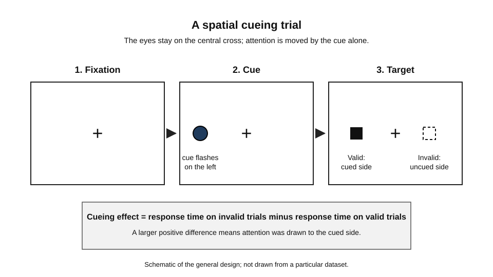
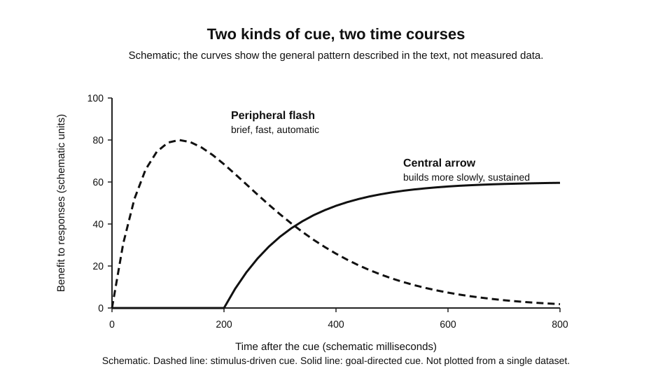
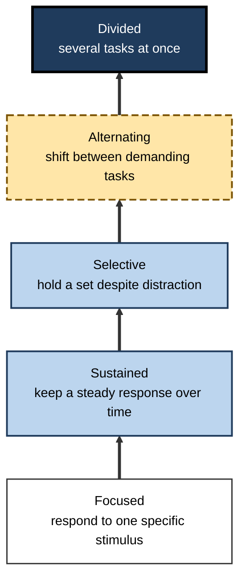
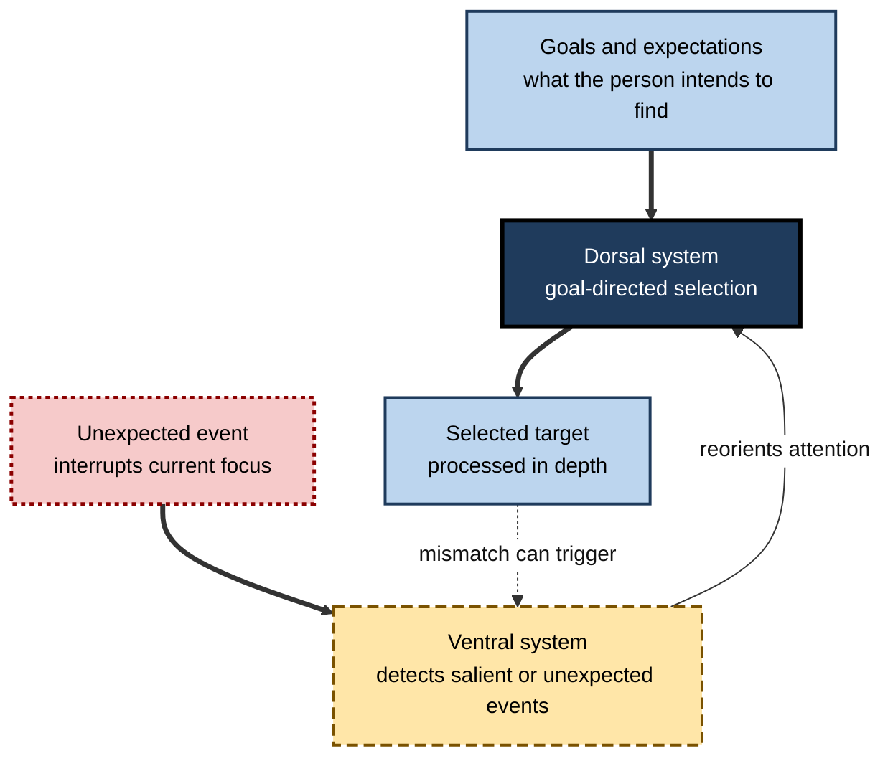
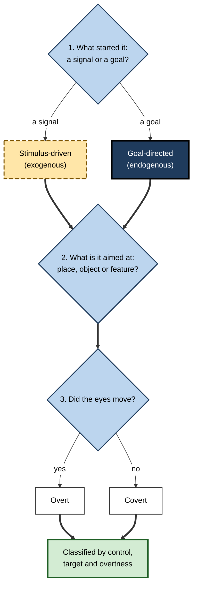

# D.2. Types of Attention

A waiter in a busy restaurant hears a glass break across the room and turns at once. A few minutes later she is taking an order at one table, deliberately ignoring the kitchen bell. Later still she checks a bill against the till, her attention fixed on numbers rather than faces.

The same person, in the same room, has used attention in three quite different ways. Attention is not one ability. It is a family of processes that differ in what starts them, where they are aimed and whether the eyes move with them.

> **Definition — Attentional type:** a way of describing an episode of attention by what controls it (the environment or a goal), where it is aimed (a place, an object or a feature) and whether the eyes move with it (overt or covert).

**Why the classification matters**

- Different types fail in different ways, so they need different remedies.
  - A goal-directed search can be lost to a sudden distraction; a stimulus-driven capture can be missed when a person is absorbed in a task.
- Clinical assessment of attention after brain injury relies on distinguishing types.
- Designers of screens, alarms and workplaces decide what will capture attention and what must be sought deliberately.

---

## Two Sources of Control

### Stimulus-driven attention

- Also called **bottom-up** or **exogenous** attention.
  - Triggered by a signal in the environment: a sudden movement, a bright colour, a loud sound or a moving object.
- Fast and often automatic.
  - *e.g.* a flashing alert on a dashboard pulls the eyes before the operator has decided to look.
- Hard to override in the moment.
  - *e.g.* a notification on a phone screen is difficult to ignore while it remains in view.

> **Watch out:** "automatic" does not mean "always captured". Capture depends on how relevant a stimulus is to current goals, and experienced people learn to ignore many signals.

### Goal-directed attention

- Also called **top-down** or **endogenous** attention.
  - Set by an intention, an instruction or a standing plan.
- Flexible, because the target can be changed at will.
  - *e.g.* scanning a contract for dates, or searching a crowded car park for a particular car.
- Dependent on holding the goal in mind and on continued control.
  - When the goal is weak or competing demands are high, stimulus-driven signals can take over.

### Interaction

- Most real attention is a mixture.
  - A goal sets *what* to look for; salient signals decide some of *when* attention moves.
- *e.g.* a call-centre agent who is listening for a customer's account number still turns to a sudden message on a second screen.

### Study card — Posner (1980)

- **Design:** participants fixated a central point. A cue appeared, followed by a target that appeared either at the cued location (valid) or at the other location (invalid). Participants responded as quickly as possible to the target.
  - Two kinds of cue were used: a brief flash in the periphery, and a central arrow that pointed to a side.
  - Participants were asked to keep their eyes still.
- **Results:**
  - Responses were faster on valid trials than on invalid trials.
  - The benefit appeared even though the eyes had not moved.
- **Conclusion:** attention can be moved to a location without moving the eyes. Posner distinguished the brief, stimulus-driven effect of a peripheral flash from the goal-directed effect of a central, symbolic cue, which must first be interpreted.

**Figure 1.** A spatial cueing trial: the eyes stay on the cross while the cue moves attention.

> **Definition — Cueing effect:** the difference in response time between invalid and valid trials. A larger positive value means attention was drawn to the cued location.

**Figure 2.** Schematic time course: a brief stimulus-driven cue and a goal-directed cue differ in onset and duration.

---

## Overt and Covert Attention

- **Overt attention** — attention that moves the eyes towards the object of interest.
  - *e.g.* looking at the instruction label on a machine before reaching for it.
- **Covert attention** — attention that shifts without any eye movement.
  - *e.g.* a presenter keeps the eyes on the slides while attending to a questioner at the side of the room.
- Eye movements usually accompany overt attention, but they are not required for it.
  - Posner's cueing studies showed covert shifts directly, by holding the eyes still.

> **Watch out:** eye tracking shows where a person is looking, not what they are attending. A reader can fixate a line for several seconds while thinking about an unrelated problem.

**Why covert attention matters at work**

- Meetings, driving and monitoring all depend on covert shifts: people monitor peripheral information without looking at it directly.
- It also explains why a person can appear to be looking at a screen and still have missed what is on it.

---

## Where Attention Is Aimed

### Location-based attention

- Attention behaves somewhat like a spotlight or zoom lens over a region of space.
  - *e.g.* scanning the left-hand column of a spreadsheet for negative values.
- Attention to a location makes detection there faster, whatever the object at that location.

### Object-based attention

- Attention tends to spread across the whole of an object rather than stop at a boundary.
  - *e.g.* a driver attends to a cyclist as a whole, not to a single part of the bicycle.
- Parts of the same object are easier to attend together than parts of two separate objects that are the same distance apart.
- This matters for interface design: a grouped panel is easier to monitor than scattered items.

### Feature-based attention

- Attention can be set to a visual property, such as a colour, a shape or a direction of motion, across the whole visual field.
  - *e.g.* looking for all red items on a screen, wherever they are.
- Feature-based settings speed detection of that property everywhere, though they cost some ability to notice other features.

> **Key point:** location, object and feature are different ways of choosing what to select. Real selection often combines them.

---

## A Clinical Classification: Five Levels

Clinicians working with people who have attention problems after brain injury often use a model developed by Sohlberg and Mateer. It describes attention as five levels, each built on the ones below.

- **Focused attention** — responding to a specific stimulus, from one sensory input.
  - *e.g.* picking out a single voice in a quiet room.
- **Sustained attention** — keeping a continuous response to an unchanging stimulus over time.
  - *e.g.* monitoring a quality-control line for the same fault for an hour.
- **Selective attention** — keeping a behavioural or cognitive set in the face of distraction.
  - *e.g.* finishing a report while a colleague's conversation continues nearby.
- **Alternating attention** — shifting between tasks with different cognitive demands.
  - *e.g.* moving between a spreadsheet and a customer email without losing the figures.
- **Divided attention** — doing several things at once, either by very rapid alternation or by automating one of the tasks.
  - *e.g.* driving while talking with a passenger.

**Figure 3.** The five levels, each depending on those below it.

> **Watch out:** the model is a practical clinical scheme, not proof that the five levels are five separate brain systems. Some versions add arousal, or general alertness, as a foundation beneath focused attention.

---

## Two Brain Systems

### Review card — Corbetta and Shulman (2002)

- **Review:** a synthesis of neuroimaging and patient evidence on how the brain controls attention.
- **Proposal:**
  - a **dorsal** network, spanning parts of the intraparietal and superior frontal cortex, supports goal-directed selection;
  - a **ventral** network, spanning temporoparietal and inferior frontal cortex, detects salient or unexpected stimuli and redirects attention to them.
- **Interaction:** the two networks normally work together. The ventral system can interrupt goal-directed activity when something important appears.
- **Status:** the main nodes of both networks are widely accepted. Their lateralisation is disputed: the ventral system was proposed to be mostly right-lateralised, but left-hemisphere activation has also been reported.

> **Key point:** the networks are inferred from brain imaging and patient studies. They describe how attention is organised in the brain, not separate attentional "modes" that a person switches between at will.

**Figure 4.** Two interacting systems: goal-directed control and stimulus-driven reorienting.

---

## Comparing Stimulus-Driven and Goal-Directed Attention

| | Stimulus-driven (exogenous) | Goal-directed (endogenous) |
|---|---|---|
| What starts it | A salient event in the environment | An intention, instruction or plan |
| Onset | Quick; often within a fraction of a second | Slower to take effect; the cue must be interpreted |
| Effort | Little; often automatic | Needs sustained control and holding the goal |
| Duration | Brief, and fades quickly | Lasts as long as the goal is held |
| Typical failure | Capture by irrelevant signals | Loss of the goal under competing demands |
| Example | A flash at the edge of a control panel | Searching a panel for one particular gauge |

> **Key point:** the two types are not opposites. Good performance usually depends on a goal that sets priorities and a system that can still interrupt when something important happens.

---

## Worked Example (illustrative): Classifying Five Episodes

1. **A phone vibrates on a desk during a meeting.**
   - Stimulus-driven, overt if the eyes turn to it, covert if the person only registers it.
2. **A nurse scans a drug chart for the one allergy notice.**
   - Goal-directed, feature-based (searching for the notice), overt.
3. **A chef hears the timer, and reaches for the pan while still watching the sauce.**
   - Goal-directed for the sauce, stimulus-driven for the timer, with covert attention to the pan.
4. **A reviewer notices that a column of totals is off, having been asked to check the names.**
   - Stimulus-driven capture by an unexpected anomaly, despite a goal aimed at names.
5. **A driver keeps attention on the road while listening to the sat-nav.**
   - Goal-directed to the road, with the sat-nav instructions stimulus-driven when they become relevant.

> **Remember:** name the source of control first, then the target, then whether the eyes moved. Most confusion about "types" disappears when these three questions are asked in order.

**Figure 5.** Three questions, asked in order, classify any episode of attention.

---

## Case Study (illustrative): A Dispatch Room Redesigned

- **Situation:** an emergency dispatch room where operators watch a map, a radio channel and a queue of incoming calls.
- **Problem:** operators regularly missed lower-priority calls in the queue while flashing alerts on the map drew their attention.
- **Diagnosis:**
  - the map alerts were stimulus-driven and were all set at the same brightness, so every alert captured attention;
  - the goal of checking the queue was held in mind, but it could be overridden by any alert;
  - no routine existed for returning to the queue.
- **Actions:**
  1. Alerts were graded: only life-threatening ones flashed; others appeared in a quiet panel.
  2. A queue check was built into a fixed rhythm, prompted by the system at set intervals.
  3. The map was grouped by object (incidents as whole units) rather than scattered icons.
- **Result:** missed calls fell in the following quarter (illustrative figures) and operators reported fewer interruptions.
- **Side effects / caveats:** some operators found the quieter panel too easy to forget and asked for an audible option.
- **Lesson:** design must respect the balance of stimulus-driven and goal-directed control. Capture is useful for true emergencies; it becomes a hazard when it overrides goals for everything else.

---

## Open Questions

- **Are the types separate systems, or aspects of one system?**
  - The dorsal and ventral networks are well supported as organising principles, but their boundaries remain debated.
- **How do goals and salience interact in complex environments?**
  - Laboratory cues are simple; real workplaces combine many signals with changing goals.
- **How far do covert and overt attention diverge in daily work?**
  - Eye tracking is widely used in design, yet its link to what people actually attend is incomplete.

---

## Summary

- Attention is a **family of types**, classified by **control** (stimulus-driven or goal-directed), **target** (location, object or feature) and **overtness** (overt or covert).
- **Stimulus-driven** attention is fast and brief, and is captured by salient signals; **goal-directed** attention is flexible and depends on holding a goal.
- **Posner (1980)** showed that attention can shift to a cued location without eye movements, and distinguished brief stimulus-driven cues from goal-directed central cues.
- **Covert** attention is common in work; eye movements do not prove what is attended.
- Attention can be aimed at **locations**, **objects** and **features**, and real selection often combines them.
- The **Sohlberg and Mateer** clinical model describes five levels: focused, sustained, selective, alternating and divided.
- **Corbetta and Shulman (2002)** proposed a dorsal goal-directed system and a ventral stimulus-driven system that interact; lateralisation remains disputed.

---

## Self-Check

1. Define attentional type using the three dimensions of control, target and overtness.
2. Give one everyday example of stimulus-driven attention and explain why it is hard to override.
3. Why is "automatic" not the same as "always captured"? Give an example.
4. Describe the design of Posner's cueing task and explain what the valid–invalid difference measures.
5. Explain how covert attention can cause a person to look at a screen and still miss what is on it.
6. Distinguish location-based, object-based and feature-based attention with one workplace example each.
7. Place the five levels of the Sohlberg and Mateer model in order and explain why the order matters for rehabilitation.
8. A colleague says eye tracking proves what someone attended to. Give two reasons the claim is too strong.
9. In the dispatch room case, identify where stimulus-driven control helped and where it harmed performance.
10. Why might a goal-directed search fail even when the goal is clear? Name two causes.
11. Compare the typical speed and duration of stimulus-driven and goal-directed attention, and explain the basis for the comparison.
12. What does the Corbetta and Shulman proposal predict about what happens when an unexpected event occurs during a goal-directed search?

### Answer Key

1. Control: whether the environment or a goal starts the episode. Target: where attention is aimed, at a place, object or feature. Overtness: whether the eyes move with attention. Each episode can be described along all three.
2. A notification on a phone screen. It is hard to override because the signal is salient and its onset is quick, so it captures attention before any decision is made.
3. Capture depends on relevance to current goals. A regular operator may fail to notice a warning that is clearly irrelevant to the current task, showing that automatic processes can be modulated.
4. A cue, then a target at the cued (valid) or uncued (invalid) location, with eyes held still. The valid–invalid difference in response time measures the benefit of the cue.
5. Covert attention can be directed to a peripheral area while the eyes remain on the screen. A person can therefore look at a display and attend elsewhere, so the screen may be seen but not processed.
6. Location: scanning a spreadsheet column. Object: a driver attending to a cyclist as a whole. Feature: searching a dashboard for all red warnings.
7. Focused, sustained, selective, alternating, divided. Higher levels depend on lower ones, so rehabilitation addresses the foundations first.
8. First, eye movements show where the eyes point, not what is processed, because covert attention exists. Second, looking at a location is not evidence of understanding what is seen.
9. Helped: stimulus-driven alerts for life-threatening events. Harmed: the same capture for lower-priority alerts, which overrode the queue check.
10. The goal can be lost when competing demands take capacity, or when a salient distraction captures attention. Also, a goal held in mind may fade with time or fatigue.
11. Stimulus-driven attention tends to take effect quickly and fade. Goal-directed attention tends to take longer, and lasts while the goal is held. The comparison rests on the cueing literature, which is general and depends on the paradigm.
12. The ventral system should be able to interrupt goal-directed processing and redirect attention to the unexpected event, so the focus of the search shifts.

---

## Glossary

| Term | Meaning |
|---|---|
| Alternating attention | Shifting between tasks with different cognitive demands. |
| Covert attention | Attention shifts without eye movements. |
| Cueing effect | Response-time difference between invalid and valid trials. |
| Dorsal system | A proposed network for goal-directed selection. |
| Endogenous attention | Attention set by internal goals; also called goal-directed. |
| Exogenous attention | Attention triggered by a stimulus; also called stimulus-driven. |
| Feature-based attention | Attention set to a visual property across the field. |
| Goal-directed attention | Attention controlled by intentions and plans. |
| Location-based attention | Attention aimed at a region of space. |
| Object-based attention | Attention that spreads across a whole object. |
| Overt attention | Attention that moves the eyes towards its target. |
| Stimulus-driven attention | Attention captured by a salient signal in the environment. |
| Ventral system | A proposed network for detecting salient or unexpected events. |
