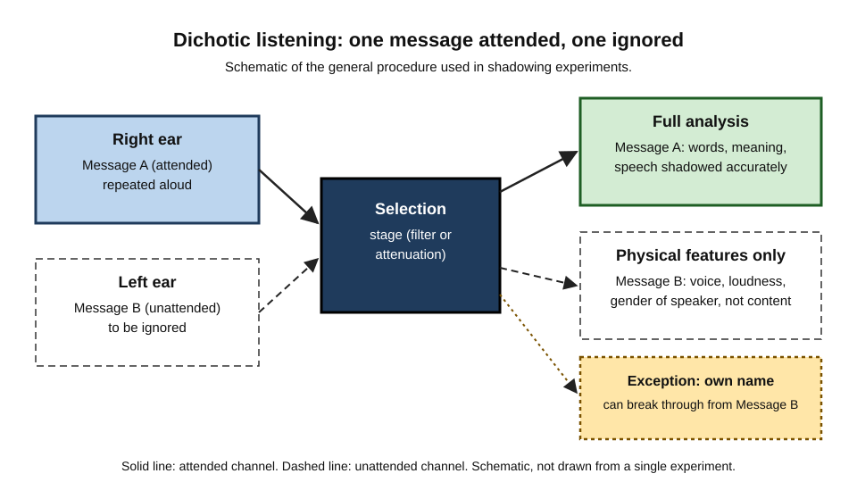
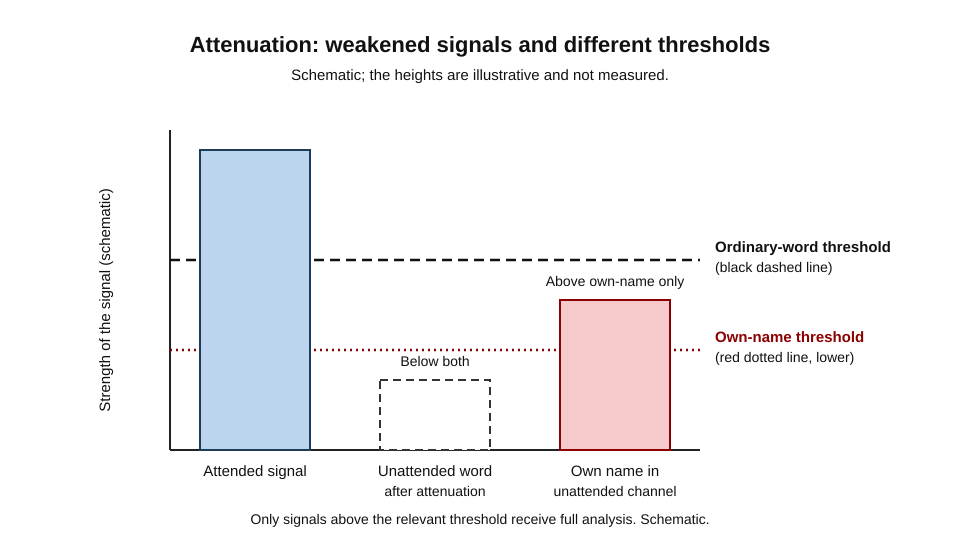
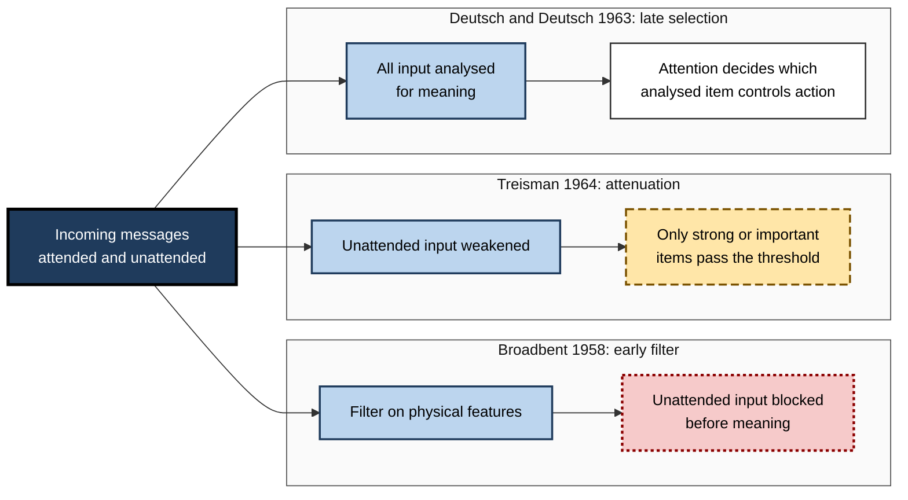
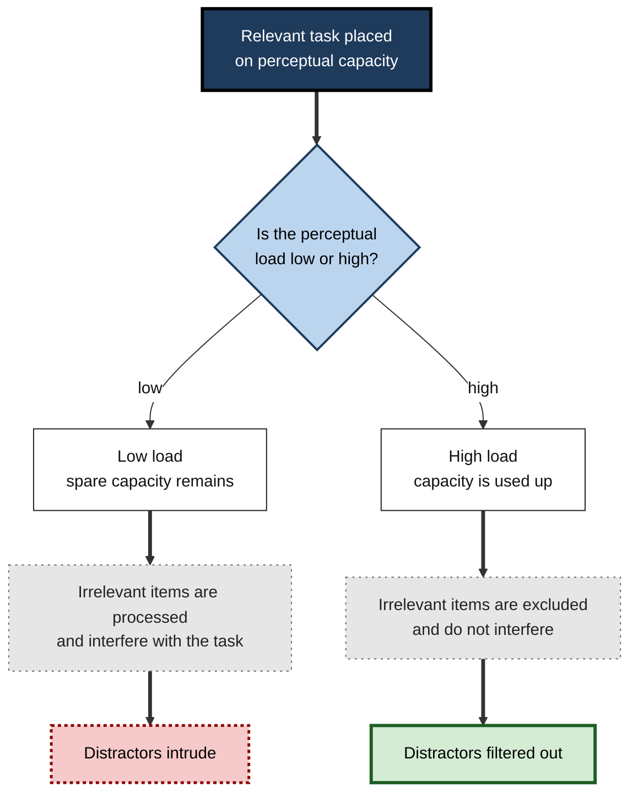
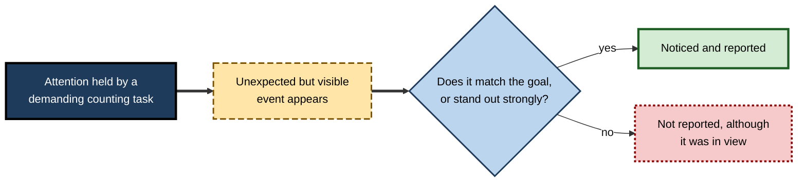

# D.3. Selective Attention and Filtering

At a crowded dinner party a guest follows one conversation while a dozen others run in parallel. Halfway through the evening she hears her own name from across the table and turns immediately, though she had heard none of the words around it.

A radiologist reading a scan for a fracture misses a small nodule that is plainly visible in the image, because the search for the fracture has captured her attention. A driver ignores the billboards on a motorway until one of them shows a logo for the company he is about to visit. Each case is an instance of selective attention: the mind chooses some information for deeper processing and keeps the rest out, and the boundary between the two is not always where the person expects.

Each case is an instance of selective attention.

> **Definition — Selective attention:** the ability to choose some sources of information, or some features of them, for processing while suppressing others that compete for the same capacity.

**Why it matters**

- Almost every task involves ignoring something: the other conversations in an office, the notifications on a screen, the cars that are not one's own.
- Failures of filtering cause most of the mistakes people describe as "I did not see it" or "I did not hear that".
- The question of where and how selection happens has shaped theories of attention for seventy years and still divides researchers.

---

## The Cocktail Party Problem

Colin Cherry (1953) named the problem. Listeners are asked to follow one spoken message through headphones while a different message is played to the other ear. Cherry's procedure, now called dichotic listening, made the experimenter's control of input precise: each ear received a separate stream.

**Study card — Cherry (1953)**

- **Design:** listeners heard two different spoken messages, one in each ear, and were asked to repeat ("shadow") the message in one ear aloud as it was spoken.
- **Results:**
  - Listeners could follow the attended message accurately.
  - They recalled very little of the content of the unattended message.
  - They could often report physical features of the unattended voice, such as whether it was a man or a woman speaking, roughly its loudness and whether it was speech.
  - Some listeners did not notice that the unattended message had switched language.
- **Conclusion:** selection is strongly tied to physical characteristics of the input. Content was largely not analysed for the unattended stream.

> **Definition — Shadowing:** repeating aloud a spoken message as it is heard, so that the attended stream is verified word by word.

> **Definition — Dichotic listening:** presenting different material to each ear at the same time, so that the listener's attention can be tested for one stream and not the other.

> **Key point:** Cherry showed that people can separate two voices by physical cues, such as direction, pitch and speaker identity, and that the content of the rejected voice is largely lost.

**Figure 1.** Dichotic listening: one message attended and repeated, one ignored, with a narrow exception for personal names.

### Own name and personal relevance

**Study card — Moray (1959)**

- **Design:** following Cherry's shadowing method, Moray presented messages to both ears and tested what listeners noticed from the unattended ear.
- **Result:** almost none of the unattended material was processed in a way that listeners could report, with the important exception of personally significant items, most prominently the listener's own name.
- **Conclusion:** the unattended channel is not completely blocked. Some information passes through even when attention is elsewhere.

> **Watch out:** the exact detection rates for names in this experiment differ across secondary summaries. The effect itself is well established; the precise figures should be checked against the original paper before quoting them.

---

## Early Selection: Broadbent's Filter

Donald Broadbent (1958) built a model to explain Cherry's results. His book *Perception and Communication* proposed that the senses hold incoming information briefly in a store, and that a filter selects which information passes into a limited-capacity channel, based on physical features such as pitch and loudness.

- **Early selection** — selection occurs before meaning is analysed.
  - *e.g.* a filter that lets through the higher-pitched of two voices without knowing what either says.
- **The limited channel** — only the information that passes the filter can reach identification, memory and response.
- **What the model predicts** — unattended content should be lost, and personally important words should not be able to break through.

> **Definition — Filter theory:** the view that selection happens at a single early point in processing, and that rejected information is blocked before its meaning is analysed.

> **Watch out:** the filter model cannot easily explain the own-name effect, which needs the meaning of the name to be recognised before the message is blocked.

---

## Attenuation: Filters That Weaken

Anne Treisman (1964) revised Broadbent's model. Instead of an on–off gate, she proposed that the filter **attenuates**: it weakens unattended information rather than blocking it completely. Only signals that remain strong enough, after weakening, can be fully analysed.

- **Attenuation** — the unattended signal is reduced in strength, not removed.
- **Thresholds** — each word has a threshold for recognition. Common words have high thresholds; words that matter to the person have lower thresholds.
  - *e.g.* a person's own name, or a word closely linked to what is being attended, can pass a threshold that ordinary words cannot.
- **Predictions** — the model accounts for the own-name effect and for the disruption of shadowing when important items appear in the unattended stream.

**Figure 2.** Schematic: an unattended word is weakened below the threshold for ordinary words, but an own name can pass a lower threshold.

> **Definition — Attenuation:** the reduction of the strength of an unattended signal, so that only signals strong enough to exceed the relevant threshold receive full analysis.

**Worked example (illustrative): a shared inbox**

- An analyst is reading a report and an automated message arrives in a second window.
  - The message is weakened by attention to the report, so most of its words are not analysed.
  - A line containing the analyst's own name, or a client's name she is watching for, has a lower threshold and is noticed.
- *Result:* the analyst reads the report uninterrupted until her name appears, then notices a request buried in a list.

> **Watch out:** attenuation is a graded account, but it is not a complete explanation of meaning analysis. The model says little about how semantic processing of unattended words is organised.

---

## Late Selection: Deutsch and Deutsch

Deutsch and Deutsch (1963) proposed the opposite view. They argued that all incoming information is analysed for meaning in parallel, and that selection happens late, at the point where a response is chosen.

- **Late selection** — every input is recognised, including the unattended ones; the attention decision comes after.
  - *e.g.* (illustrative) a passenger hears the word "exit" in a station announcement even when reading a paper, and the meaning shapes what she does next.
- **Mechanism** — the authors described a shifting reference standard: a system that keeps track of the most important arriving signal.
  - The argument was that separating wanted from unwanted messages requires discrimination about as complex as ordinary perception, so selection could not sit before meaning.
- **Why it was persuasive** — it explained why unattended but meaningful material could influence behaviour.

> **Definition — Late selection:** the view that all inputs are analysed for meaning, and that attention determines which of the analysed material controls thought and action.

**Figure 3.** The three early models compared: where each places selection and what it predicts for unattended meaning.

### What the evidence favours

- **Own-name and meaning effects** favour attenuation or late selection over a strict early filter.
- **Failures to notice unattended events** favour limits on analysis, whichever stage they arise at.
- **Current view** — most researchers accept that selection can happen at more than one stage, and that where it falls depends on the task. Perceptual load, discussed below, is one of the factors that moves it.

> **Key point:** the early–late debate was less about whether selection happens and more about where it sits. The modern answer is flexible.

---

## Perceptual Load: Lavie's Account

Nilli Lavie (1995) proposed that the answer depends on how demanding the attended task is in perceptual terms.

- **Perceptual load** — how much of perceptual capacity the relevant task uses.
  - *e.g.* searching for one letter among six letters is low load; searching among many items with complex features is high load.
- **Low load** — spare capacity remains, and it spills over to process irrelevant items. Distractors interfere.
- **High load** — the relevant task uses up capacity, so distractors are not processed and do not interfere.

**Figure 4.** Lavie's account: spare capacity under low load allows distractor processing; high load prevents it.

> **Watch out:** load theory has critics. An alternative account, the dilution account, attributes some of the same effects to competition among the irrelevant items themselves. The debate is active; treat load theory as well supported but not settled.

> **Remember:** under high perceptual load, distractors can be filtered; under low load, they often cannot.

---

## Inattentional Blindness: When Filtering Removes Something Visible

Filtering can remove information that is plainly present in the visual field. Simons and Chabris (1999) showed this with a short video in which two teams of people passed basketballs. Observers were asked to count the passes made by one team. Partway through, a person in a gorilla suit walked across the scene for several seconds.

**Study card — Simons and Chabris (1999)**

- **Design:** observers watched a short video of two teams passing basketballs and counted the passes of one team. During the video, a person in a gorilla costume walked through the scene, pausing in the middle, and beat their chest before leaving.
- **Results:**
  - Close to half of the observers did not report the gorilla when asked afterwards.
  - Observers who had been counting passes were not told to look for anything else, so the gorilla was an event outside the task they had been set.
- **Conclusion:** attention focused on one demanding task can prevent a conspicuous, unexpected event from being consciously noticed.

> **Key point:** the gorilla study shows that failures of filtering can make visible events disappear from awareness, not only sounds or peripheral details.

**Figure 5.** When a demanding task holds attention, an unexpected but visible event may not be reported.

> **Definition — Inattentional blindness:** failure to notice a clearly visible but unexpected object or event when attention is engaged elsewhere.

> **Watch out:** the demonstration is widely cited and has been repeated in many variants, but the proportion of observers who miss the event depends on the task, the instructions and the people tested. A single demonstration is not a measure of how often people miss things in general.

---

## Filtering Distraction in Everyday Work

### Filtering is effortful and uneven

- **Effort** — keeping a distraction out takes continuing control, especially when the distraction is meaningful.
  - *e.g.* ignoring a colleague's conversation while drafting a difficult email.
- **Unevenness** — the same distraction can be filtered in one moment and captured in the next, depending on mood, fatigue and what is at stake.
  - *e.g.* a pilot ignores a passenger's chatter during a stable cruise but attends to it when a warning is pending.

### Relevance is the decisive variable

- Items relevant to a person's goals (their name, a client's name, a deadline word) are more likely to break through.
- Items that are emotionally charged can also break through, though the evidence for this varies by paradigm and should be treated with care.

> **Key point:** the filter is not a fixed wall. It is tuned by what a person is trying to do, and tuned badly when the goal is vague.

### Case study (illustrative): a financial close team's inbox

- **Situation:** a team preparing month-end accounts receives alerts from six systems, a steady stream of colleague messages and urgent queries from auditors.
- **Problem:** a late change to a supplier's bank details, mentioned in a routine message, was not acted on. The team's selective attention was on the reconciliation, and the message was filtered.
- **Diagnosis:**
  - the message did not contain the words the team had learned to watch for;
  - the reconciliation task had high perceptual load, which kept distractors out of mind;
  - the filter had been set by habit, not by the riskiest items in the flow.
- **Actions:**
  1. Changes to payment details were routed to a separate queue with its own review step.
  2. Message subject lines were standardised so that high-risk items were marked clearly.
  3. Reconciliation work was scheduled in blocks, with the queue checked at fixed times.
- **Result:** no further payment errors of this kind were recorded in the following quarter (illustrative).
- **Lesson:** designing for selection means making the important items **stand out in the right channel**, and building a check that does not depend on the moment the filter happens to be working.

---

## Open Questions

- **Where does selection happen in a given task?**
  - The answer appears to vary with load, goals and the type of information. A general rule is not yet agreed.
- **Is there one filter or several?**
  - Early, attenuating and late accounts may describe different stages within one system.
- **How much meaning is analysed without attention?**
  - Evidence from name effects and unnoticed events disagrees about how far unattended content is processed.
- **Can filtering be trained?**
  - Some studies suggest it can, but the transfer from training to real work is uncertain.

---

## Summary

- **Selective attention** chooses some information for processing and suppresses competing information.
- **Cherry (1953)** showed that listeners follow one voice, retain little of the other's content, and still detect physical features of the rejected voice.
- **Moray (1959)** showed that the unattended channel is not fully blocked: a listener's own name can break through.
- **Broadbent (1958)** proposed an early filter on physical features; this model struggles with the own-name effect.
- **Treisman (1964)** proposed attenuation: unattended signals are weakened, and important items pass lower thresholds.
- **Deutsch and Deutsch (1963)** proposed late selection: all inputs are analysed for meaning, and selection happens at the level of response.
- **Lavie (1995)** showed that under high perceptual load, distractors are filtered out; under low load, they interfere.
- **Simons and Chabris (1999)** showed that a conspicuous, unexpected event can go unnoticed when attention is engaged on a demanding task.

---

## Self-Check

1. Define selective attention and explain why filtering is needed for almost every task.
2. Describe Cherry's shadowing procedure and what listeners could and could not report about the unattended message.
3. What did Moray's work add to Cherry's findings, and why does it matter for early filter models?
4. Explain how Broadbent's model predicts that unattended content should be lost.
5. How does Treisman's attenuation model differ from Broadbent's? Give one observation that favours it.
6. Describe late selection and say what it predicts about the meaning of unattended material.
7. What evidence would count against a strict early filter?
8. Explain Lavie's account of perceptual load and predict what happens to distractor interference when the relevant task becomes harder.
9. Why is the gorilla study an example of selective attention rather than a failure of vision?
10. A critic says the gorilla result is only a laboratory trick. Identify two ways in which everyday work resembles the study and one way in which it differs.
11. In the financial close case, identify the filtering failure and one design change that addresses it.
12. Why is a single fixed filter an inadequate model of selection in daily work?

### Answer Key

1. Selective attention is the choice of some information for processing, with suppression of competing information. Almost every task involves competing stimuli, so filtering is required to protect the task at hand.
2. The listener repeats one message aloud while another plays to the other ear. Listeners could follow the attended message but recalled little of the unattended content; they could report physical features such as the speaker's gender or whether the sound was speech.
3. Moray showed that some unattended material, especially a listener's own name, can break through. This challenges a strict early filter, because recognising the name requires some analysis of meaning.
4. Under Broadbent's model, a filter operating on physical features admits one stream to the limited channel. Unattended content is blocked before its meaning is analysed, so it should be lost.
5. Broadbent's filter is an on–off gate; Treisman's attenuates unattended signals and allows strong or important items through. The own-name effect favours attenuation.
6. In late selection, all inputs are analysed for meaning and attention decides which analysed material controls action. It predicts that unattended meaningful material can influence behaviour even when not reported.
7. Evidence that an unattended word is fully analysed for meaning and has no effect on behaviour under any condition would count against a strict early filter, as would the own-name effect in conditions where the filter should block it.
8. Lavie predicts that under low load, spare capacity processes distractors and interference appears; under high load, the relevant task absorbs capacity and interference falls.
9. The gorilla is visible and unambiguous; it is not missed by the eyes but is absent from conscious report because attention was engaged on the counting task. The failure is one of selection, not of visual acuity.
10. Similarities: a focused task such as checking a dashboard can hide an unexpected warning; reviewers can miss an obvious error when reading for something else. Difference: the study uses a short, controlled video with no consequences, while real work carries costs that change how strongly people attend.
11. The filtering failure is that a risky message did not match the watched cues and was filtered during a high-load task. Design change: route payment-detail changes to a separate queue with its own review step.
12. Selection depends on the task, the person's goals, fatigue and the perceptual load of the moment. A single fixed filter cannot describe these changes, which is why the literature has moved towards flexible accounts.

---

## Glossary

| Term | Meaning |
|---|---|
| Attenuation | Weakening of an unattended signal so that only strong or important signals are fully analysed. |
| Cocktail party problem | Following one speaker among several while ignoring the others. |
| Dichotic listening | Presenting different material to each ear at the same time. |
| Early selection | Selection before the meaning of input is analysed. |
| Inattentional blindness | Failure to notice a visible but unexpected event when attention is engaged elsewhere. |
| Late selection | Analysis of all input for meaning, with selection at the level of response. |
| Perceptual load | The amount of perceptual capacity used by the relevant task. |
| Selective attention | Choosing some information for processing while suppressing competing information. |
| Shadowing | Repeating aloud a spoken message as it is heard. |
| Threshold | The strength at which a signal is recognised and analysed. |
