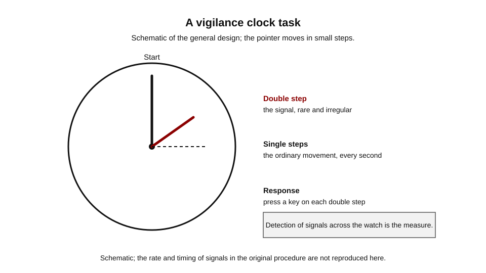
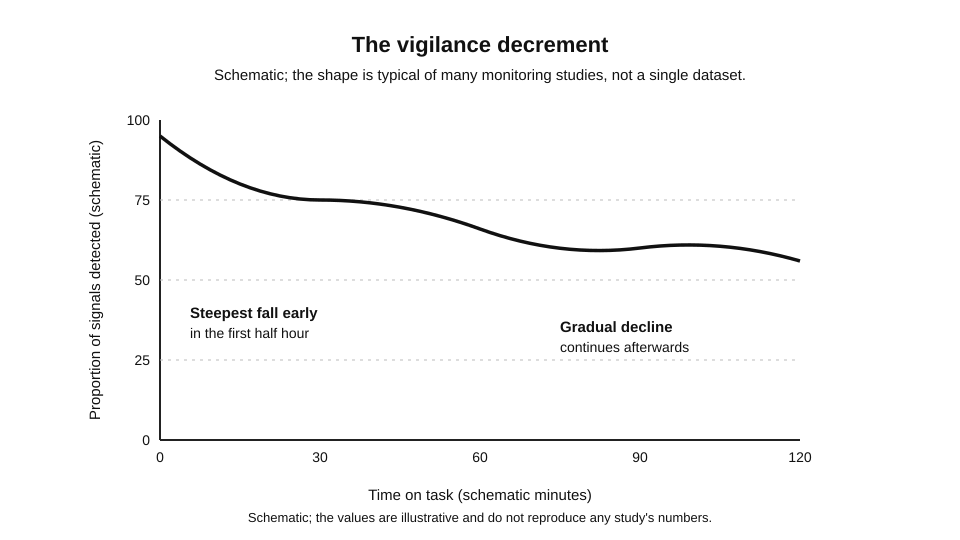
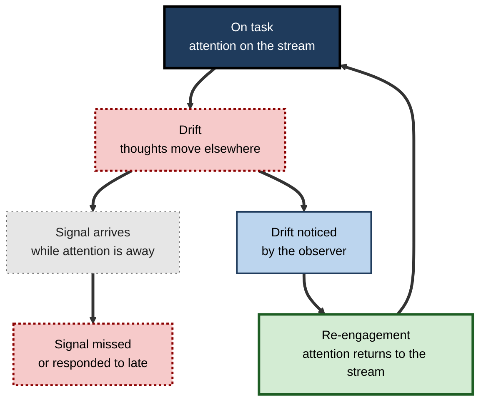
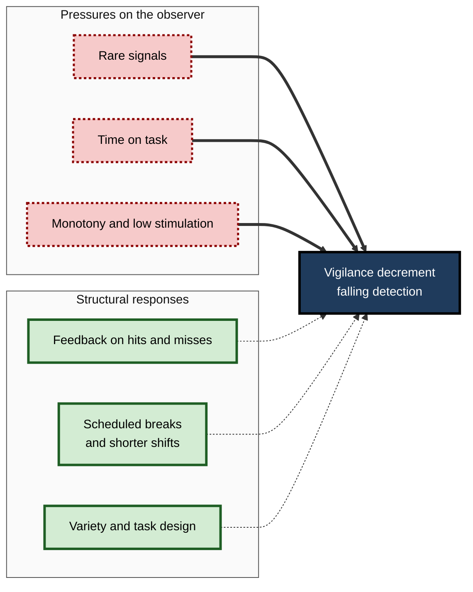
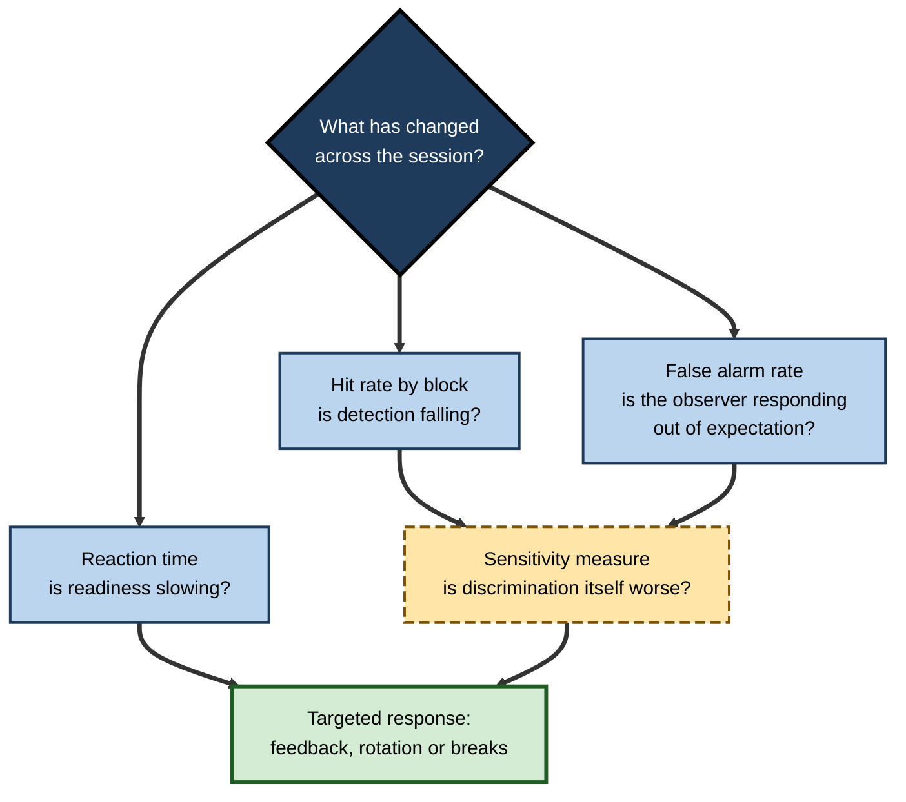

# D.4. Sustained Attention and Vigilance

A quality inspector watches bottles pass on a conveyor for four hours, looking for the rare cracked one. A security officer studies an X-ray screen, most of whose images are clear. A network engineer keeps an eye on a dashboard that is green almost all the time, knowing that the one red warning will matter. A student listens to a three-hour lecture, catching most of it in the first hour and rather less in the third.

Each person must keep attention on one thing for a long time, and each finds that the task becomes harder as time passes, even when nothing about the task changes. That ability, and its decline, is the subject of this section.

> **Definition — Sustained attention:** the ability to keep focused on a task over an extended period, maintaining performance on a continuous or repetitive activity despite fatigue, boredom and competing distractions.

> **Definition — Vigilance:** a form of sustained attention in which the task is to detect rare, often weak, signals within a stream of mostly unremarkable events.

**Why it matters**

- Monitoring work, from aviation and manufacturing to security screening and clinical observation, depends on sustained attention to rare events.
- Many failures attributed to carelessness are declines in sustained attention that no amount of goodwill can prevent.
- Learning from long sessions, such as lectures, training courses and reading, also depends on keeping attention going.

---

## Sustained Attention and Vigilance Compared

The two terms overlap, and they are often used loosely. The comparison below separates them by what the task demands.

| | Sustained attention | Vigilance |
|---|---|---|
| Typical task | A continuous activity such as reading, driving or assembling a product | Watching a stream for rare signals |
| What counts as success | Keeping performance steady over time | Detecting the infrequent event |
| Frequency of the target | Often frequent, part of the activity | Rare; may occur only a few times in an hour |
| Main threat | Fatigue, boredom and drifting focus | The decline in detection over the watch |

> **Key point:** vigilance is a demanding special case of sustained attention. Its defining feature is that the target is rare, so the observer must stay ready without much reinforcement.

---

## Mackworth's Clock: The First Classic Test

N. H. Mackworth (1948) built a test to model the monitoring work of wartime radar operators, whose job was to watch a display for rare signals over long periods. The result was published as "The breakdown of vigilance during prolonged visual search".

**Study card — Mackworth (1948)**

- **Design:** an observer watched a pointer that moved in small steps, like the second hand of a clock. At infrequent and irregular intervals, the pointer made a double step. The observer pressed a key whenever a double step occurred.
  - The task lasted a prolonged period, which allowed decline to be observed.
- **Results:**
  - detection of double steps fell over the watch;
  - the greatest drop came early, in the first half hour;
  - the decline continued more gradually afterwards.
- **Conclusion:** vigilance declines with time on task, even for an observer who is attentive and motivated at the start.

**Figure 1.** A vigilance clock task: rare double steps are the signal in a stream of ordinary ones.

> **Definition — Vigilance decrement:** the decline in detection performance over a watch or monitoring session, typically measured as a fall in the proportion of signals detected.

> **Watch out:** the Mackworth clock is a laboratory task. The decline it demonstrates is well established across many variants, but the precise rate of decline depends on how often signals occur, how they are presented and how much the observer knows about them.

---

## The Vigilance Decrement

**Figure 2.** Schematic: detection falls steeply early in a watch and more gradually afterwards.

- **Early fall** — the largest loss is often in the first part of the session.
  - *e.g.* an inspector who catches most faults in the first hour is catching fewer by the end of the shift.
- **Gradual continuation** — performance keeps slipping, more slowly, as time passes.
  - *e.g.* a monitor who has stayed alert for two hours may still be missing signals that would have been caught earlier in the day.
- **Not only fatigue** — the decline can occur without physical tiredness, which is why it is not simply a sleep effect.

> **Remember:** the question is not "is the observer tired?" but "how has the task, the signal and the environment changed the observer's ability to stay ready?"

---

## Why Sustained Attention Declines

### Four proposed influences

Researchers have proposed several explanations. They are not mutually exclusive, and the evidence for each is still debated.

- **Resource depletion** — the idea that continued control uses up a limited resource.
  - Attractive as an explanation, but contested: the evidence that a single depletable resource produces the vigilance decrement is not conclusive.
- **Expectancy** — observers come to expect signals to be rare, and their readiness to respond falls.
  - *e.g.* a screener who sees no threats in a long run of bags begins to respond more slowly to the first real one.
- **Arousal and boredom** — low stimulation makes it harder to stay engaged, and an observer may drift to other thoughts.
  - *e.g.* a monitoring task that offers nothing to do between signals.
- **Mind wandering** — attention drifts away from the task to internal thoughts.
  - The next section looks at the evidence on how common this is.

> **Key point:** whichever explanation is preferred, the practical lesson is the same. Design can reduce the decline, and it is wiser to plan for it than to rely on willpower.

---

## Mind Wandering

### Study card — Killingsworth and Gilbert (2010)

- **Design:** adults in daily life were prompted through a smartphone app at random moments. They reported what they were doing, how happy they were and whether their thoughts were on the activity or elsewhere.
  - The sample comprised about 2,250 adults, sampled across many activities.
- **Results:**
  - Thoughts were off the current activity in almost half of the sampled moments (46.9 per cent).
  - People were less happy when their minds wandered, including during activities they found less enjoyable.
- **Conclusion:** mind wandering is common, and the authors argued that where the mind goes is a stronger predictor of happiness than the activity in which a person is engaged.

> **Watch out:** this is a single study. The sampling depends on self-report, and "mind wandering" was measured in a particular way. The finding that drifting thought is common is well supported; the exact percentage belongs to this study.

**Figure 3.** The mind-wandering cycle in a sustained task: drift, detection and re-engagement.

- **Two outcomes of drift** — a drift can coincide with a signal, causing a miss, or be noticed in time, allowing re-engagement.
- **Detection of drift** is itself a form of sustained attention; a person who notices they have drifted has not failed the task.

---

## Attention Span Claims

Popular writing often claims that human attention span has shrunk to a few seconds. The claim needs careful handling.

> **Watch out:** a figure of about eight seconds, often compared with the attention of a goldfish, is widely repeated. It is usually attributed to a 2015 report by Microsoft Canada, but its underlying source could not be confirmed, and the number is not a measurement from research on attention in the form it is quoted. Do not use it as evidence.

- **What the research measures** — it is more useful to measure how long people stay on one task or screen before switching, and under what conditions.
  - Gloria Mark (University of California, Irvine) has studied how often people switch between screens and tasks at work.
- **What this changes** — claims about declining attention are better stated as claims about specific tasks, interruptions and environments.
  - *e.g.* a person who checks messages every few minutes during a report is switching more, not necessarily attending less capably.

---

## Factors That Shape Vigilance

| Factor | What it does to sustained attention | Practical response |
|---|---|---|
| Signal rate | Rare signals make the observer less ready, and the decrement grows | Add artificial signals or rotate observers |
| Feedback | Knowing outcomes helps the observer recalibrate expectations | Give frequent, specific feedback on hits and misses |
| Task variety | A monotonous stream allows drift; some variation helps stay engaged | Mix tasks or change the display |
| Time on task | Performance declines as the session continues | Schedule breaks and limit shift lengths |
| Environment | Noise, heat and poor lighting add load and reduce engagement | Control the physical conditions of the work |

> **Key point:** the responses most often recommended are structural. They change the task, the schedule or the feedback, rather than asking the observer to try harder.

**Figure 4.** The factors that shape a monitoring task, and how the decrement responds to them.

---

## Measuring Vigilance

- **Hit rate** — the proportion of signals detected.
  - The simplest measure of the decrement, often tracked across blocks of time.
- **False alarm rate** — responses to events that were not signals.
  - A rising rate may show the observer is responding out of expectation rather than detection.
- **Sensitivity measures** — indices from signal detection methods that separate how well an observer discriminates signals from noise from how willing they are to respond.
  - These help distinguish a loss of sensitivity from a change in response criterion.
- **Reaction time** — how quickly signals are responded to.
  - Slower responses can show a decline in readiness even when hits are still made.

> **Watch out:** a stable hit rate can hide a slowdown, and a falling hit rate can reflect a change in criterion rather than perception. Measure more than one thing.

**Figure 5.** Which measure answers which question in a monitoring session.

### Worked example (illustrative): reading a watch

- A monitoring session is divided into four 15-minute blocks, with signals presented at the same rate in each.
  - *Illustrative figures:* hit rates of 92%, 85%, 78% and 74% across the blocks.
  - Mean reaction time rises from 510 ms in the first block to 580 ms in the last.
- **Reading:** the decline is steepest between the first two blocks and then continues, which matches the pattern of the classic studies. The rising reaction time suggests readiness is falling even where hits are still made.
- **Conclusion:** a single average hit rate for the session would hide both facts. Block-by-block measurement reveals the decrement and shows where to intervene.

---

## Case Study (illustrative): A Visual Inspection Line

- **Situation:** a plant inspects glass vials on a fast line, with one inspector at each station and a fault rate of roughly one in several hundred vials.
- **Problem:** inspectors' detection of faults fell across each four-hour shift. The end-of-shift error rate was double the start-of-shift rate.
- **Diagnosis:**
  - faults were rare, so inspectors became less ready to respond;
  - there was no feedback on misses, so expectations were not recalibrated;
  - shifts were long and breaks were irregular.
- **Actions:**
  1. Inspectors rotated between stations every hour, so that no one stayed on the same task for the full shift.
  2. Synthetic faults were inserted at a low rate, with immediate feedback when they were found.
  3. Breaks were scheduled every ninety minutes, and shift length was reduced by one hour.
- **Result:** error rates were more even across the shift in the following months (illustrative figures), and inspectors reported less fatigue.
- **Side effects / caveats:** the synthetic faults needed careful design to avoid being detected by pattern alone, and rotation required training at every station.
- **Lesson:** the decrement is a predictable feature of sustained attention. Systems that plan for it outperform those that depend on individual vigilance.

---

## Open Questions

- **Why does the decrement occur?**
  - Resource depletion, expectancy, arousal and mind wandering each have support, and their relative weight is not settled.
- **How far does training reduce the decline?**
  - Some studies suggest training can help, but the transfer from laboratory tasks to real monitoring is uncertain.
- **What is the best way to detect drift?**
  - Systems that prompt observers to re-engage may help, but the timing and intrusiveness of prompts remain open.
- **How should individual differences be handled?**
  - Some people sustain attention better than others, but the measures available are not yet reliable predictors for hiring or allocation decisions.

---

## Summary

- **Sustained attention** is the ability to stay focused over a long period; **vigilance** is its form in which the target is rare.
- **Mackworth (1948)** showed a decline in detection of rare signals over a prolonged watch, with the largest drop in the first half hour.
- The **vigilance decrement** continues over time and is not simply a sign of tiredness.
- Proposed causes include **resource depletion**, **expectancy**, **arousal and boredom** and **mind wandering**; the evidence for each is contested.
- **Killingsworth and Gilbert (2010)** found that thoughts were off the current activity in almost half of sampled moments; this is one study, using self-report.
- The **eight-second attention span** figure is not a usable research finding; Gloria Mark's work on switching is a different measure.
- The most effective responses are **structural**: feedback, rotation, breaks, variety and design of the signal rate.
- Vigilance should be measured by **hit rate**, **false alarms**, **sensitivity** and **reaction time**, block by block.

---

## Self-Check

1. Define sustained attention and vigilance, and explain how the two differ in the target's frequency.
2. Describe Mackworth's clock task and explain why the double step is a signal that tests vigilance.
3. What is the vigilance decrement, and why is it not simply a sign of physical tiredness?
4. Where in a watch does the largest decline typically occur, according to the classic studies?
5. Give two proposed causes of the decrement and the evidence that counts for or against each.
6. What did Killingsworth and Gilbert measure, and why is their finding a single study rather than settled fact?
7. Why is the eight-second attention span figure unsuitable as evidence about attention?
8. Explain why a stable hit rate can conceal a decline in readiness.
9. Design a monitoring task for a low signal rate, and state how you would measure whether the design works.
10. Compare the effect of rotating observers with the effect of asking them to try harder. Which is more likely to help, and why?
11. In the visual inspection case, identify which pressure on the observer each intervention addresses.
12. A manager says that the decrement proves that inspectors are lazy. Give a reasoned reply.

### Answer Key

1. Sustained attention is the ability to maintain focus over an extended period on a continuous activity. Vigilance is its form in which the target is rare, so the observer must stay ready for infrequent signals.
2. The pointer moves in small steps, and occasional double steps must be detected by a key press. The double step is a signal that is rare and irregular, so detecting it requires staying ready over time.
3. The vigilance decrement is the decline in detection performance over a watch. Because it occurs without physical tiredness, and depends on the task and signals, it is not simply a sleep effect.
4. The largest decline appears early, in the first half hour in Mackworth's study, with a gradual decline afterwards.
5. Resource depletion: plausible but not conclusive as a single cause. Expectancy: supported by the finding that observers become less ready as signals become rare. Each needs careful testing, and the evidence is contested.
6. They measured thoughts off the current activity in daily life using a smartphone app, sampling about 2,250 adults. It is one study with self-report, so the percentage belongs to that study and should be treated as a single estimate.
7. The number is not traced to a measurement study, and the comparison with a goldfish is unsourced. Research on how people switch between tasks and screens measures different things.
8. Hit rate counts detections but not response speed or criterion. Readiness can fall, with reaction times slowing, while some signals are still detected; a single hit rate misses the change.
9. Add artificial signals or feedback, and rotate observers. Measure hit rate, false alarms and reaction time block by block, comparing with the original design.
10. Rotation changes the structure of the task and reduces the pressure of time on task, so it is more likely to help. Asking for more effort does not change expectancy or the monotony of the stream.
11. Rare signals: addressed by artificial signals and feedback. Time on task: addressed by rotation and breaks. Monotony: addressed by rotation and shorter shifts.
12. The decrement is a predictable feature of sustained attention, observed under many conditions and task designs. It is better explained by the structure of the task, the rarity of signals and time on task than by individual laziness, which the data do not show.

---

## Glossary

| Term | Meaning |
|---|---|
| Expectancy | The observer's sense of how likely a signal is, which shapes readiness. |
| False alarm | A response to an event that was not a signal. |
| Hit rate | The proportion of signals that are detected. |
| Mind wandering | Attention drifting from the current task to internal thoughts. |
| Sensitivity | The ability to discriminate signals from noise, separate from willingness to respond. |
| Sustained attention | The ability to stay focused on a task over an extended period. |
| Time on task | The length of time a person has spent on the same activity. |
| Vigilance | Sustained attention in which the target is rare. |
| Vigilance decrement | The decline in detection performance over a watch or monitoring session. |
