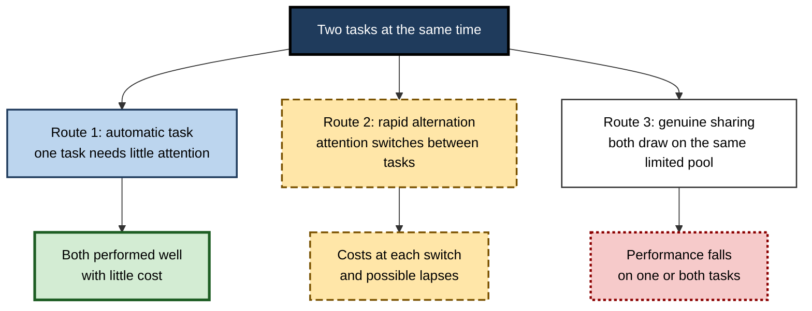
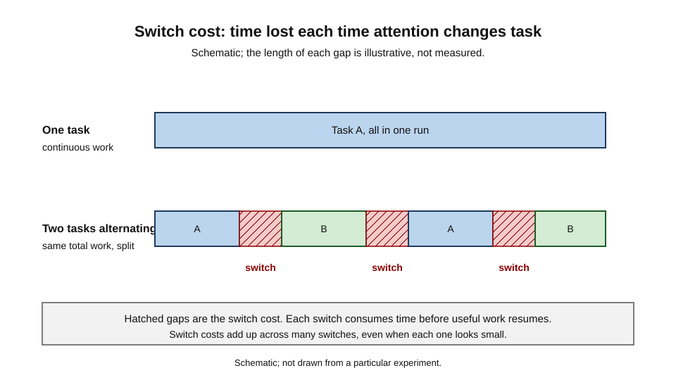
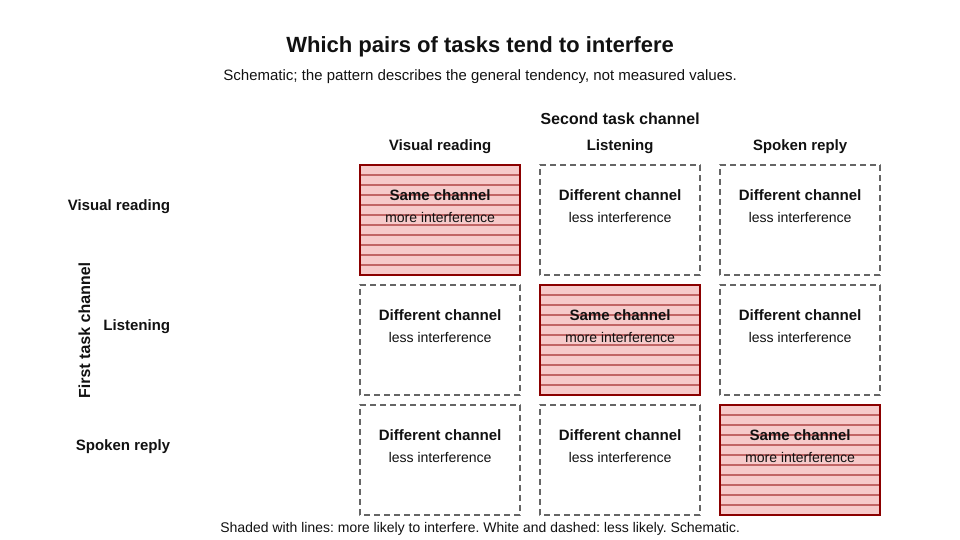
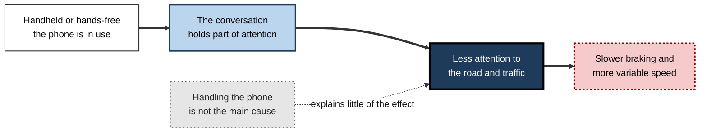
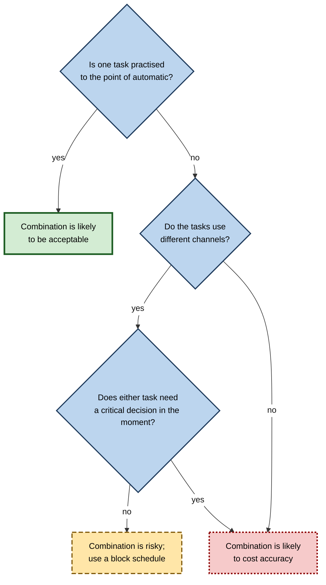

# D.5. Divided Attention and Multitasking

A paramedic drives an ambulance through traffic while listening to the dispatcher's updates and checking a patient's vital signs on a monitor in the back. A parent cooks dinner, answers a child's question and keeps an eye on a boiling pan. A customer-service agent types a reply to one customer while a second chat window flashes. Each person is doing several things.

Each relies on a belief that the tasks can be combined. Sometimes that belief is right. Often it is partly wrong: one task is dropped, slowed or made less accurate, and the person does not notice the loss. Divided attention is the study of when combination works, when it does not and why.

> **Definition — Divided attention:** the allocation of attention across two or more tasks at the same time, so that performance on each depends on how the available processing is shared.

> **Definition — Multitasking:** the everyday term for working on several tasks in close succession or in parallel. In psychology, the term usually refers to the cost of sharing attention, not the simple fact of doing several things.

**Why it matters**

- Most modern work involves several streams at once: messages, documents, calls, dashboards and colleagues.
- Errors in combined tasks are rarely dramatic. They tend to be small, delayed or invisible until something goes wrong.
- Design, training and personal habits all change how well people combine tasks.

---

## Three Ways Divided Attention Can Work

Clinical models of attention describe divided attention in terms that help make sense of everyday multitasking. The clinical model developed by Sohlberg and Mateer describes divided attention as possibly reflecting rapid alternation between tasks, or the automatic processing of one task while the other receives attention. The first step in any analysis is to ask which of three routes a particular combination takes.

**Figure 1.** Three routes by which two tasks can be carried out together.

- **Route 1: automatic processing** — one task has become so practised that it takes little attention.
  - *e.g.* walking while talking, for most people, is an automatic combination.
- **Route 2: rapid alternation** — attention moves back and forth, and the two tasks are interleaved.
  - *e.g.* checking a spreadsheet and replying to a message in turns, with a small cost each time.
- **Route 3: genuine sharing** — both tasks need limited processing at the same time, and performance on at least one falls.
  - *e.g.* reading a dense technical document while composing a complex email.

> **Key point:** most everyday combinations are a mixture of the three routes, and the balance changes with practice, difficulty and the person's state.

---

## Task Switching and the Switch Cost

When attention alternates, each change has a cost. The switch cost is the time or accuracy lost at the moment attention moves from one task to the other, before the second task is fully running again.

**Figure 2.** Schematic: the same total work, done in one run or split between two tasks, with a cost at each switch.

- **The cost is at the transition.** Each switch requires reloading the goals, rules and context of the other task.
- **Costs accumulate.** Many small switches can exceed the value of the work they interleave.
- **Costs depend on similarity.** Switching between similar tasks often costs less than switching between dissimilar ones, though this depends on how they are practised.

### Worked example (illustrative): three tasks in an afternoon

- Three reports each need ten minutes of focused work, so 30 minutes of work in total.
  - If done one after another with no switches, the afternoon takes 30 minutes.
  - If the three are interleaved and switched six times, with a one-minute cost at each switch, the afternoon takes 36 minutes.
- *Illustrative figures.*
- **Reading:** the work did not change, but the interleaving added six minutes. In a busier day, the same pattern repeated across dozens of switches becomes a substantial part of the time available.

> **Watch out:** switching cost is not the same as the time spent on the other task. It is the delay before the newly attended task is performed as well as it would have been without the switch.

---

## Dual-Task Interference and Shared Channels

When two tasks are performed together, they often interfere. The pattern of interference is not random. It is strongest when two tasks compete for the same input or output channel.

**Figure 3.** Schematic: tasks that use the same channel tend to interfere more than tasks that use different channels.

- **Input channels** — visual and auditory information can be processed in parallel more easily than two visual streams.
  - *e.g.* reading one document while listening to a short announcement is easier than reading two documents at once.
- **Output channels** — two speech responses, or two manual responses, compete for the same mechanism.
  - *e.g.* dictating a reply while speaking to a colleague is harder than typing while listening.
- **Practice** — interference shrinks as a pairing is practised, sometimes to near zero.

> **Key point:** the pattern in the figure is a general tendency. Individual pairings vary widely, and practice can change which pairs interfere.

---

## Driving and the Phone Conversation

Driving is the best-studied everyday divided-attention task. It combines a continuous perceptual and motor task with a secondary conversation, and the consequences are measurable.

### Study card — Strayer, Drews and Crouch (2006)

- **Design:** forty volunteers drove a simulator under four conditions: undistracted, using a handheld phone, using a hands-free phone, and intoxicated to a blood-alcohol limit.
- **Results:**
  - drivers using either type of phone braked more slowly and varied their speed more than undistracted drivers;
  - the impairment with a hands-free phone was similar to that with a handheld phone, with no significant difference between the two;
  - the authors reported that the impairment at the legal blood-alcohol limit was comparable.
- **Conclusion:** the conversation itself, not the physical handling of the phone, produced much of the impairment. Hands-free use did not remove the risk.

**Figure 4.** The route from a phone conversation to slower braking, as the simulator study suggests.

> **Watch out:** this is a driving simulator study. Simulator results generalise imperfectly to real roads, and the authors' policy conclusions go beyond the data. The safer statement is that a phone conversation impairs attention to driving, with or without the hands free.

---

## Supertaskers and Individual Differences

Most people show clear dual-task costs. A small minority do not.

### Study card — Watson and Strayer (2010)

- **Design:** participants drove a simulated freeway while, in some conditions, carrying on a phone conversation that involved memorising words and solving maths problems.
  - The study screened a large group of people for their performance on the combined tasks.
- **Results:**
  - Dual-task performance dropped for most participants.
  - A small group, about 2.5 per cent of those tested (five people in a group of 200), kept their driving, maths and memory performance intact while multitasking. The authors called them supertaskers.
- **Conclusion:** some people can combine tasks that interfere for most others, which challenges a simple view of a single fixed capacity.

> **Watch out:** supertaskers are a small group, and the result comes from a specific pairing of tasks. A person who multitasks well on one combination may not do so on another. The finding does not show that multitasking is safe for anyone.

---

## Heavy Media Multitaskers

### Study card — Ophir, Nass and Wagner (2009)

- **Design:** participants were divided by their habitual use of several media at once, into heavy and light media multitaskers. Both groups completed tests of cognitive control, including tasks that required filtering irrelevant information and switching between tasks.
- **Results:**
  - heavy media multitaskers did worse on the filtering task, struggling to ignore irrelevant information;
  - they were also slower to switch between tasks.
- **Conclusion:** the authors suggested that habitual heavy media use may be linked to weaker control of attention. They could not establish which way the relationship runs.

> **Watch out:** the study did not show that media use caused poorer control; people who are already less able to filter may also multitask more. Later studies have not all reproduced the association, and a 2017 replication effort questioned the original result. Treat the finding as a hypothesis under test.

---

## Why Multitasking Feels Easier Than It Is

- **Perceived performance** — people often judge their own multitasking as efficient, because the costs are small, spread out or invisible at the time.
  - *e.g.* a manager who answers messages in meetings may not notice the parts of the discussion missed.
- **Recovery** — after an interruption, the person must rebuild the goals and details of the interrupted task.
  - The rebuilding is not instant, and it is not always complete.
- **Error detection** — errors made while switching are not always caught, so the cost is paid later.

> **Key point:** felt efficiency is a poor guide to actual performance. The best test is an objective measure of the combined work, compared with the separate tasks.

---

## Case Study (illustrative): A Support Team's Two Queues

- **Situation:** a support team handles live chat and telephone calls. Agents are expected to monitor the chat queue while on calls, and to pick up chats when a call ends.
- **Problem:** chats were answered late, and several customers received incomplete answers because the agent had switched away and back without re-reading the conversation.
- **Diagnosis:**
  - the agents were on route 3, genuine sharing, while being told they were on route 2, rapid alternation;
  - the switch costs were not visible in the team's targets, which measured only response time;
  - the telephone task used a voice channel, and the chat used a visual channel, so the combination was a moderate, not a trivial, load.
- **Actions:**
  1. Agents were assigned to either calls or chats in fixed blocks, with a short handover between them.
  2. The chat tool showed the last message of each conversation on the switch-back screen.
  3. Targets were revised to measure complete answers, not only response times.
- **Result:** late responses fell and complete-answer scores rose in the following quarter (illustrative figures).
- **Side effects / caveats:** agents found block allocation less flexible at peak times, so the team kept a small pool for overflow.
- **Lesson:** the team's problem was not that agents multitasked. It was that the combination was designed as rapid alternation, when the work demanded sharing, and the metric did not measure the cost.

---

## Designing for Combined Tasks

**Figure 5.** A practical sequence for judging whether two tasks can be combined safely.

- **Assess before combining.** Ask which route the combination takes, and what each task needs in the moment.
- **Separate what must be separated.** Tasks that carry a critical decision, or that compete for the same channel, are better scheduled in blocks.
- **Make the cost visible.** Measure the combined work and the switch-back, not only the speed of each response.
- **Support recovery.** Interfaces that show the last state of an interrupted task reduce the cost of returning to it.

> **Remember:** a combination that feels fine is not necessarily safe. Test it against an objective outcome.

---

## Open Questions

- **How much of multitasking ability is trainable?**
  - Practice reduces interference for specific pairs. Whether it transfers to new combinations is not settled.
- **Are supertaskers a distinct group or the tail of a continuum?**
  - The data so far come from small samples and particular tasks.
- **Does heavy media use change attentional control?**
  - The evidence is mixed, and causation is unclear.
- **Which combinations are acceptable in safety-critical work?**
  - Laboratory results do not yet give clear thresholds for real settings.

---

## Summary

- **Divided attention** shares limited processing across tasks; **multitasking** in psychology refers to the cost of that sharing.
- Combined tasks run by one of three routes: **automatic processing**, **rapid alternation** or **genuine sharing**.
- Each change of task carries a **switch cost**, and many small switches add up.
- Interference is strongest when tasks compete for the same **channel**, and it falls with practice.
- **Strayer, Drews and Crouch (2006)** found that a phone conversation impaired simulated driving, with hands-free use no safer than handheld.
- **Watson and Strayer (2010)** identified a small group, about 2.5 per cent, who kept performance intact on a demanding combination.
- **Ophir, Nass and Wagner (2009)** reported weaker filtering and task switching among heavy media multitaskers; causation and replication remain open.
- Felt efficiency is a poor guide: judge combinations by objective outcomes and the cost of switching back.

---

## Self-Check

1. Define divided attention and explain how psychology's use of "multitasking" differs from everyday usage.
2. Describe the three routes by which two tasks can be carried out together, with an example of each.
3. What is a switch cost, and why does it accumulate over an afternoon?
4. Using the worked example, explain why the total time rises even though the work does not change.
5. What does the channel pattern predict about a visual task combined with a spoken reply, compared with two visual tasks?
6. Summarise the Strayer, Drews and Crouch study and explain what its finding implies for hands-free policy.
7. What did Watson and Strayer find about the small group they called supertaskers, and what does their existence not show?
8. Describe the Ophir, Nass and Wagner result and two reasons it cannot be read as a causal finding.
9. Why does felt efficiency mislead people about their multitasking performance?
10. In the support team case, identify the mismatch between the intended route and the actual demand, and state one change that addresses it.
11. Apply the decision sequence in the final figure to two combinations: typing a report while listening to a radio, and checking a drug dose while answering a phone.
12. What evidence would show that a training programme improved multitasking in real work rather than only on the training task?

### Answer Key

1. Divided attention is the allocation of attention across two or more tasks at once. In everyday speech, multitasking means doing several things; in psychology it usually refers to the cost of sharing attention.
2. Automatic processing: walking while talking for most people. Rapid alternation: checking a spreadsheet and replying to a message in turns. Genuine sharing: reading a dense document while composing a complex email.
3. A switch cost is the time or accuracy lost when attention moves to a new task before it is running as well as before. Each switch adds a cost, so many switches across a session accumulate.
4. The switches add six minutes of cost to the thirty minutes of work, so the total rises to 36 minutes, while the work itself is unchanged.
5. The channel pattern predicts more interference when the visual task is combined with another visual task than when it is combined with a spoken reply, because the spoken reply uses a different channel.
6. Forty participants drove a simulator. Phone use with either handheld or hands-free slowed braking and increased speed variation, with no significant difference between the two. The implication is that hands-free use does not remove the main risk, so a policy based only on handling the phone is incomplete.
7. About 2.5 per cent of those tested kept driving, maths and memory performance intact while multitasking. The finding does not show that multitasking is safe for ordinary people or that the same ability holds for other combinations.
8. Heavy media multitaskers did worse on a filtering task and were slower to switch. The result cannot be read causally because people with weaker control may choose heavier media use, and later studies have not all reproduced the association.
9. Costs of switching are small, spread out or hidden at the time, and the person may not notice what was missed. Felt ease is therefore not evidence of accurate performance.
10. The team's agents were expected to share attention across two queues (genuine sharing) but were managed as if they were alternating; the metric measured speed, not complete answers. Changing to block scheduling with a handover and measuring complete answers addresses this.
11. Typing while listening to a radio: automatic only for a practised typist; the radio uses a different channel, so the combination is more likely acceptable unless the listening needs a decision. Checking a drug dose while answering a phone: the dose check needs a critical decision and the phone uses speech, so the sequence points to a risky combination and a block schedule.
12. Improvement would need to appear on a transfer task that resembles real work, measured objectively, and to be maintained after a delay. A training effect that appears only on the training task does not show that real multitasking has improved.

---

## Glossary

| Term | Meaning |
|---|---|
| Automatic processing | Performance of a practised task with little attention. |
| Channel | An input or output route, such as vision, hearing or speech. |
| Dual-task interference | Worse performance when two tasks are performed together. |
| Divided attention | Allocation of attention across two or more tasks at once. |
| Rapid alternation | Attention moving back and forth between tasks. |
| Supertasker | A person who combines demanding tasks with little cost, in a particular study. |
| Switch cost | The time or accuracy lost when attention changes task. |
| Multitasking | In psychology, the cost of sharing attention across tasks. |
