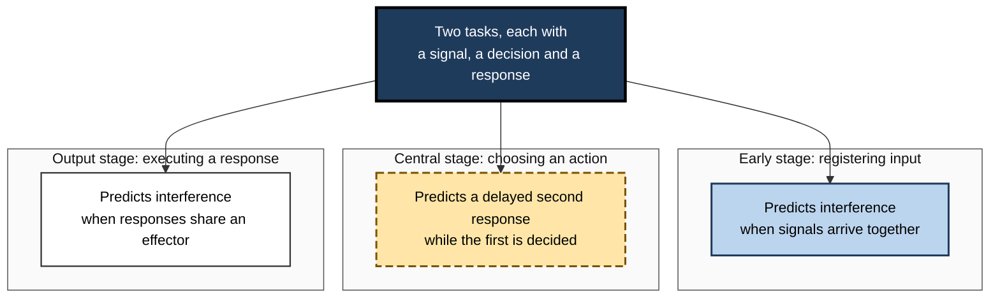
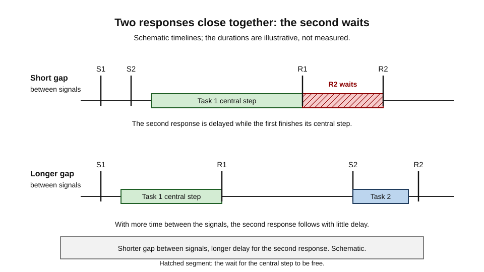
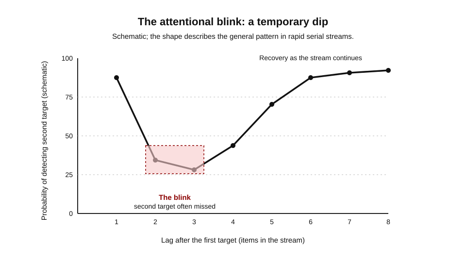
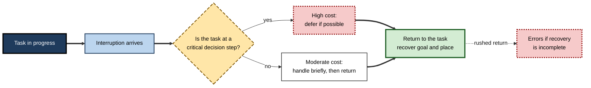
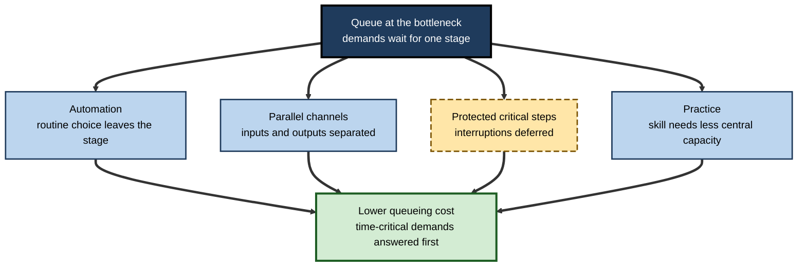

# D.6. Attentional Bottlenecks

A single-lane bridge carries traffic in both directions, one car at a time. However many cars are waiting, the bridge admits one at a time, and the queue grows. 

A switchboard with one operator behaves the same way: a second call arriving during the first must wait, and if the caller hangs up, it is lost. A person reading a message while a colleague asks a question faces the same structure. Each has more demands than the bottleneck can pass at once, so something must wait, and waiting has a cost.

An attentional bottleneck is a point in the processing of information at which only one item, or one task, can proceed at a time.

> **Definition — Attentional bottleneck:** a stage of processing at which attention can handle only one item or one task at a time, so that other items must wait, be processed later, or be lost.

**Why it matters**

- Many errors that look like carelessness are queueing failures: the second demand was processed late, or not at all.
- Interruptions cost time for exactly this reason. The interrupting item takes the bottleneck, and the interrupted task must be picked up again.
- Where the bottleneck sits determines what kind of interference appears, and what can be done about it.

---

## Where a Bottleneck Can Sit

Early theories placed the limit at a single fixed point. Later research suggested that a bottleneck can occur at several stages. The idea is most useful when the stage is specified.

- **Early, perceptual stage** — the registration of sensory input.
  - *e.g.* two visual signals arriving in the same fixation cannot both be registered in full detail.
- **Central, decision stage** — the choice of what to do with a registered input.
  - *e.g.* two tasks each requiring a decision cannot both be decided at once.
- **Output stage** — the execution of a response.
  - *e.g.* two manual actions that use the same hand compete for the same motor system.

**Figure 1.** Three possible positions of an attentional bottleneck, and what each predicts.

> **Watch out:** the location of the bottleneck is an open question. A given experiment can usually be explained by more than one of these positions, which is why careful task design matters.

---

## The Central Bottleneck: Pashler (1994)

Harold Pashler's review of dual-task studies (1994) asked why two simple tasks, performed together, interfere even when each is easy. The answer proposed was that a central stage, choosing and initiating a response, can serve only one task at a time.

**Study card — Pashler (1994)**

- **Design:** a review of dual-task experiments in which two simple tasks, such as responding to a tone and to a light, are presented close together in time.
- **Results:**
  - interference between the two responses persisted even when the tasks were simple and their inputs were easily identifiable;
  - perceptual processing and motor execution could overlap between the tasks;
  - the selection of the response appeared to be serial.
- **Conclusion:** a central bottleneck, at response selection, limits what can be done at the same moment, whatever the perceptual and motor demands.

> **Key point:** the central bottleneck explains why a person can see and hear two signals at once, yet respond to them one after the other.

> **Watch out:** the central bottleneck is not unanimously accepted. An alternative account, often associated with a model called EPIC, treats the bottleneck as functional rather than structural, and under the strategic control of the participant. The debate is about the nature and location of the limit, not whether interference occurs.

---

## The Psychological Refractory Period

When two signals arrive close together, the response to the second is delayed. This delay is known as the psychological refractory period. It is a direct consequence of a single channel for response selection.

- **The pattern** — the second response is delayed more when the signals are closer together, and less when they are further apart.
- **The meaning** — the second task is not failing; it is queued behind the first.
- **The practical implication** — a second request that arrives during a decision will be answered later, and the delay depends on how close the first demand was.

**Figure 2.** Schematic: a short gap between signals delays the second response; a longer gap reduces the delay.

> **Definition — Psychological refractory period:** the delay in responding to a second signal when it follows a first signal closely, because the first response occupies a shared central stage.

> **Remember:** the delay is in responding, not necessarily in perceiving. The second signal may be seen clearly and still be answered late.

---

## How a Bottleneck Is Detected

A bottleneck is inferred from a pattern, not observed directly. The logic is simple to state.

- **Overlap** — if two tasks are arranged so that their demands overlap in time, a stage that handles one item at a time will delay the second response.
- **Gap** — as the gap between the two signals increases, the overlap shrinks.
- **Signature** — if the delay of the second response shrinks as the gap grows, and disappears once the gap is long enough, a shared stage is a likely cause.
  - A delay that stays constant regardless of the gap points to a different explanation, such as a change in strategy or a fixed cost of switching.

**Worked example (illustrative): reading a gap manipulation**

| Gap between signals | Response time to second signal |
|---|---|
| Short | 900 ms |
| Medium | 700 ms |
| Long | 500 ms |

*Illustrative figures.*

- The second response is slower when the gap is short, and the slowing shrinks as the gap grows.
- The pattern fits a shared stage that the first task occupies for a period after its signal.
- The pattern does not prove where the stage lies. Other accounts can produce the same overall shape, which is why researchers vary the tasks as well as the timing.

> **Watch out:** a bottleneck model makes specific predictions about the shape of this relation. Checking the shape, not only whether a delay exists, is what separates the models.

### Bottlenecks and expertise

- **Experts show less interference** on familiar pairings, because routine decisions take little central capacity.
- **Novices show more interference** because each step must be decided, so the shared stage is occupied for longer.
- **Practice changes the bottleneck's load**, which is why the same pair of tasks can interfere strongly at first and hardly at all after training.

> **Key point:** expertise does not remove the bottleneck from the system. It shortens the time each demand occupies it.

---

## The Attentional Blink

A bottleneck can also appear as a brief failure to report a second target in a rapid stream. Raymond, Shapiro and Arnell (1992) named this the attentional blink.

### Study card — Raymond, Shapiro and Arnell (1992)

- **Design:** participants viewed a rapid serial stream of items, including two targets among distractors. They reported the first target and then detected a second target, which appeared at varying positions in the stream after the first.
  - A control condition removed the need to identify the first target, or added a blank interval after it.
- **Results:**
  - the second target was often missed when it appeared a few hundred milliseconds after the first;
  - detection recovered as the interval lengthened;
  - the dip did not appear when a blank interval followed the first target, or when the first target was not identified.
- **Conclusion:** the processing of the first target temporarily reduces the ability to register a second target that follows closely.

**Figure 3.** Schematic: detection of the second target dips a few items after the first, then recovers.

> **Definition — Attentional blink:** a brief period, after a target has been identified, during which a second target in a rapid stream is often missed.

> **Watch out:** the attentional blink is a laboratory effect with a specific stream of items. Its timing varies with the task, and its size varies between people. Its existence is well supported; the precise duration in any real setting is not.

---

## Bottlenecks and Interruption

Interruptions are the everyday form of the bottleneck. The interrupting demand takes the central stage, and the interrupted task must be resumed later.

- **The cost has two parts.**
  - the time the interrupting task takes;
  - the time and accuracy lost when returning to the interrupted task.
- **The return is not free.** The person must recover the goal, the place in the task and the information they were holding.
  - *e.g.* a surgical nurse who is asked a question mid-count may need to recheck the count before continuing.
- **Interruptions at critical points are worse.** A demand that arrives during a decision is more costly than one that arrives between steps.
  - *e.g.* a call during a diagnosis is more disruptive than the same call after the diagnosis is recorded.

> **Key point:** the bottleneck means that interruptions cannot be avoided by trying harder. They can be managed by timing, by protecting critical steps and by making the return easier.

**Figure 4.** What happens to a task when an interruption arrives, and where the cost falls.

### Worked example (illustrative): two alarms in one second

- A monitoring station receives two alarms within 300 milliseconds: a high-priority alarm on one patient and a lower-priority reminder on another.
  - Both are perceived, because they arrive on separate channels.
  - The response to the second is delayed, because the decision for the first occupies the central stage.
  - If the second alarm is a reminder that falls due a few seconds later, the delay may be harmless.
- *Illustrative figures.*
- **Reading:** the bottleneck is not the failure to see the second alarm. It is the queue for a decision. Design can shorten the queue by grading alarms, by pre-deciding routine responses and by making high-priority signals stand out.

> **Watch out:** the same alarm can be harmless or dangerous depending on what the first decision costs. A bottleneck matters most when the queued demand cannot wait.

---

## Case Study (illustrative): A Sea Operations Room

- **Situation:** a sea-rescue coordination room in which two operators share a map, a radio channel and a phone line. Requests arrive in bursts.
- **Problem:** during a major incident, a second request for assistance from a vessel in difficulty was answered nearly two minutes after it came in. The vessel's position had moved in that time.
- **Diagnosis:**
  - the first incident required a complex decision about which resources to deploy, occupying the central stage;
  - the second request arrived on the radio, a channel the operator monitored in the same moment;
  - no triage rule existed to decide which request should be answered first when two arrived together.
- **Actions:**
  1. A triage rule was written: life-threatening requests are answered immediately, and a second operator takes all other calls.
  2. Routine resource allocation was pre-planned for common incident types, so that the central decision was shorter.
  3. The radio and phone lines were given separate alert tones so that a second incoming request is noticed without being confused with the first.
- **Result:** in the following exercises, the time to answer a second life-threatening request fell to a fraction of the previous figure (illustrative).
- **Side effects / caveats:** the second operator sometimes handled low-priority calls more slowly, so the rule was reviewed monthly.
- **Lesson:** the bottleneck cannot be removed, but it can be shaped. Pre-decision and clear priorities protect the time-critical demands.

---

## Where Bottlenecks Can Be Shifted

- **Automation of routine decisions** — when a choice is made automatically, it no longer takes the central stage.
  - *e.g.* a standard response to a common, low-risk query.
- **Parallel channels** — when inputs and outputs are separated, some interference is avoided.
  - *e.g.* a visual alert and an auditory cue for different urgency levels.
- **Protecting critical steps** — when the bottleneck is occupied by a demanding decision, interruptions should be deferred.
  - *e.g.* a stop sign on a control panel that means "do not take calls during this step".
- **Practice** — extended practice can move a skill out of the central stage, freeing the bottleneck for other demands.

**Figure 5.** Four levers that reduce the queueing cost at an attentional bottleneck.

> **Key point:** the load on a bottleneck depends on how tasks are structured, how automatic they are and how well demands are prioritised. Whether the limit itself can move is the open question noted below.

---

## Open Questions

- **Where is the bottleneck?**
  - Early, central and output accounts each explain some results. The balance is still debated.
- **Is the bottleneck structural or strategic?**
  - If it is strategic, people may be able to reorganise their processing; if structural, they cannot.
- **Can training widen the bottleneck?**
  - Practice reduces interference for specific tasks; whether it changes the bottleneck itself is unclear.
- **How should organisations set priorities at the bottleneck?**
  - Triage rules work in principle, but their design in real settings is not well studied.

---

## Summary

- An **attentional bottleneck** is a stage at which only one item or task can proceed at a time; other demands must wait, be late or be lost.
- The bottleneck may be **early**, **central** or at the **output** stage, and the position matters for predictions.
- **Pashler (1994)** reviewed dual-task interference and argued that a **central bottleneck** at response selection limits simultaneous performance, though the nature of the limit is debated.
- The **psychological refractory period** shows that a second response is delayed when two signals are close together.
- **Raymond, Shapiro and Arnell (1992)** described the **attentional blink**: a brief dip in detecting a second target after the first.
- Interruptions are everyday bottlenecks: the cost includes the interrupting task and the return to the interrupted one.
- Bottlenecks can be shifted by **automation**, **parallel channels**, **protection of critical steps** and **practice**.

---

## Self-Check

1. Define an attentional bottleneck and explain what happens to demands that arrive while it is occupied.
2. Name the three possible positions of a bottleneck and give an example of each.
3. What did Pashler's review suggest about why two simple tasks interfere?
4. Explain the difference between the central bottleneck and the functional account associated with EPIC.
5. What is the psychological refractory period, and how does the delay change with the gap between signals?
6. Describe the design of the attentional blink study and the result it found.
7. Why is the attentional blink not a failure to see the second target at all, if the effect is about detection?
8. How does an interruption reproduce the structure of a bottleneck, and what two costs does it carry?
9. In the alarm example, why might a delayed response to the second alarm be harmless in one case and dangerous in another?
10. In the sea operations case, identify the bottleneck and state which intervention changes its position or load.
11. Describe two ways to shift a bottleneck and one risk of each.
12. An organisation argues that training will remove its bottleneck entirely. Give a reasoned reply.

### Answer Key

1. A bottleneck is a stage at which only one item or task can proceed at a time. Demands arriving while it is occupied must wait, be processed late or be lost.
2. Early (registering sensory input), central (choosing an action) and output (executing a response). Early example: two visual signals in one fixation. Central example: two decisions at once. Output example: two actions using the same hand.
3. Two simple tasks interfered even when each was easy, which suggested a central stage, response selection, that could serve only one task at a time while perception and motor execution overlapped.
4. The central bottleneck is a structural limit of a single response-selection stage. The functional account treats the limit as arising from how the system is strategically controlled, so it can in principle be reorganised.
5. The delay in responding to a second signal when it follows a first closely. The delay grows as the gap between signals shrinks, and falls as the gap grows.
6. Participants identified a first target in a rapid stream and detected a second target at varying lags, with control conditions. The second target was often missed a few hundred milliseconds after the first, with recovery as the lag grew.
7. The effect is one of detection and report under a specific task, so the second target may be registered but not reported. The blink is a temporary limit on processing the second target, not evidence that the eyes missed it.
8. The interrupting task takes the central stage, and the interrupted task must be resumed later. The two costs are the time of the interruption and the time and accuracy lost on return.
9. The delay is harmless if the queued demand can wait without consequence, such as a reminder. It is dangerous if the second alarm is time-critical and the delay allows deterioration.
10. The bottleneck is the central decision for the first incident, with the second request queued behind it. Pre-planned routine allocation shortens the central decision, and a second operator takes other calls, reducing the load.
11. Automation: risk of errors in routine decisions if automated choices are not checked. Parallel channels: risk of confusion if alerts are not distinct. Protection of critical steps: risk of delaying important interruptions. Practice: risk of skill becoming rigid in changing conditions.
12. Training may reduce interference for specific trained tasks, but it is unlikely to remove the bottleneck entirely, and transfer to new combinations is uncertain. A better plan combines training with structural changes such as automation, priority rules and protected steps.

---

## Glossary

| Term | Meaning |
|---|---|
| Attentional bottleneck | A stage at which only one item or task can proceed at a time. |
| Attentional blink | A brief dip in detecting a second target after the first has been identified. |
| Central bottleneck | A limit at response selection that serves one task at a time. |
| Early bottleneck | A limit at the registration of sensory input. |
| Output bottleneck | A limit at the execution of responses. |
| Psychological refractory period | Delay in responding to a second signal that follows a first closely. |
| Queueing | Waiting in line for a stage that is occupied by another demand. |
| Triage | Ordering demands by priority so that the most urgent are handled first. |
