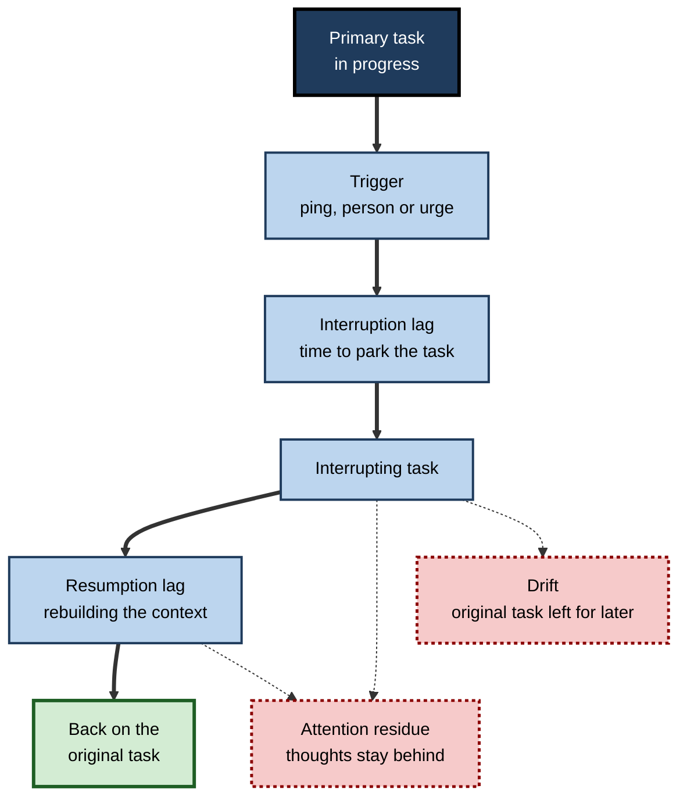
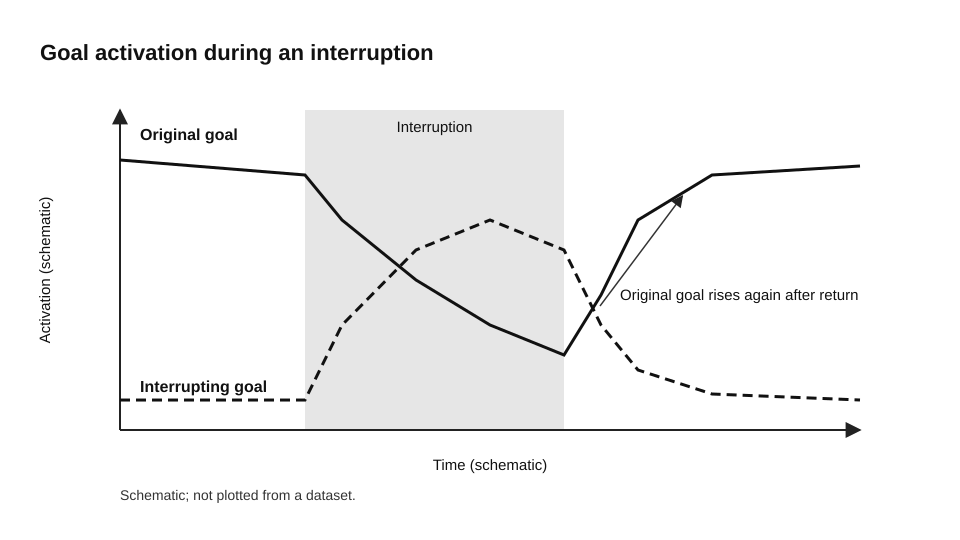
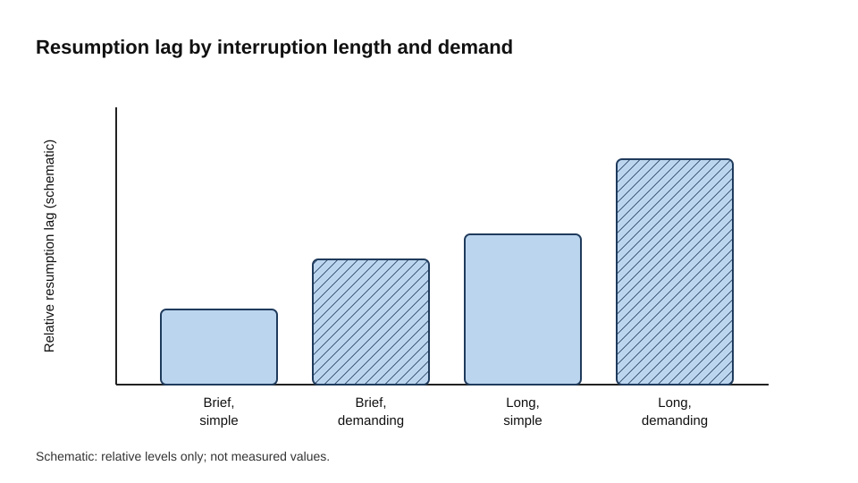
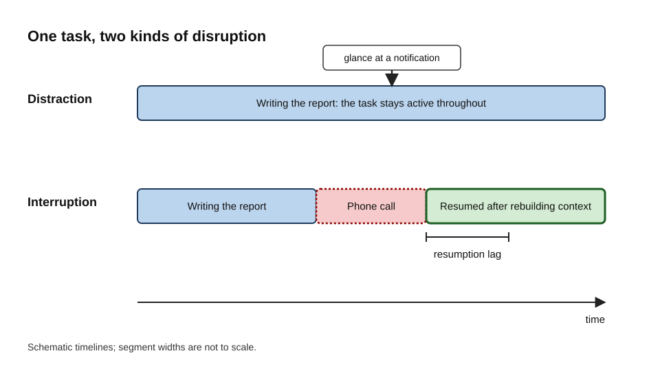
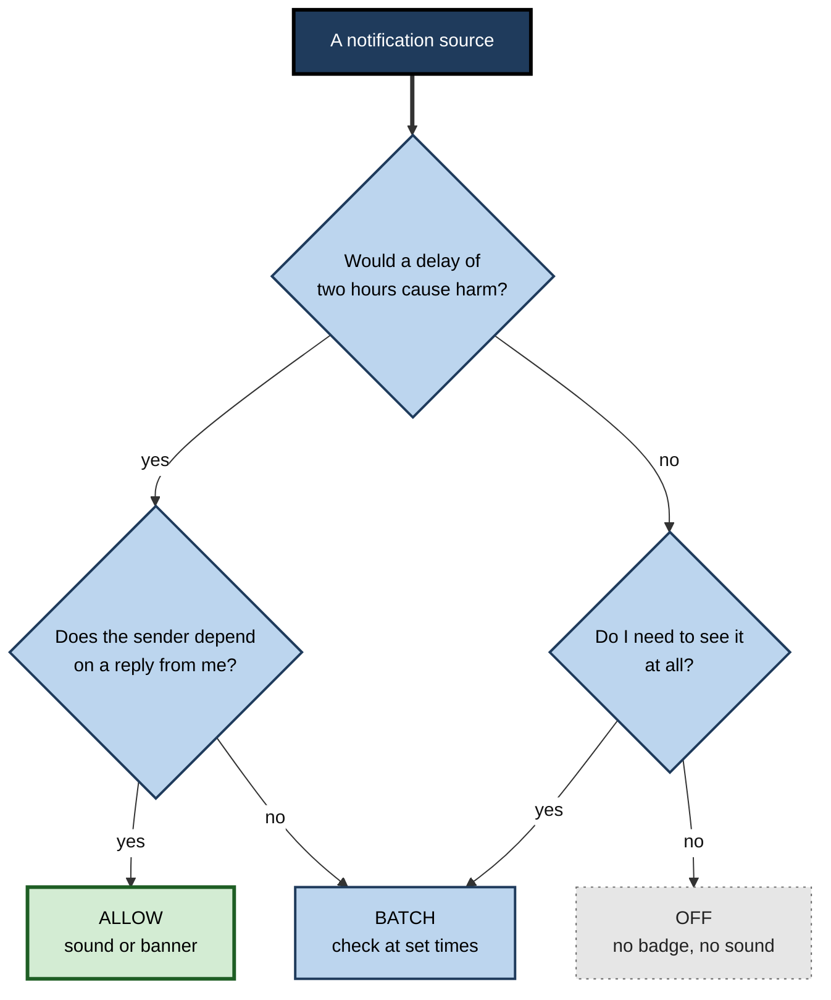

# D.7. Distraction and Digital Interruptions

You sit down to draft a report. Two minutes in, your phone lights up with a retail offer. You glance at it, return to the document and find you cannot say where you had got to. You reread the last paragraph. A chat message arrives; you answer it, and while there you remember an email. Twenty minutes later the report has three new sentences, and you have no clear memory of the detour.

Nothing dramatic happened in that sequence. Each step was small. The total cost was large, and most of it was invisible.

> **Definition — Distraction:** anything that pulls attention away from the task you are doing while you remain nominally on that task, such as a noise, a glance at a notification or a stray thought.

> **Definition — Interruption:** an event that suspends the primary task, so that you must stop, do something else and later resume.

**Why it matters**

- Most knowledge work is performed in short bursts broken by messages, alerts and requests, so the cost of these breaks shapes the quality of the output as much as the skill of the worker.
- The cost of an interruption is not the time spent on the interruption. It lies in the time and accuracy lost when the original task is picked up again.
- Digital systems are designed to attract attention, and the people using them are not usually aware of how often they switch.
- Understanding the mechanisms makes it possible to design responses that work, rather than relying on resolve in the moment.

---

## Two Different Problems

The words distraction and interruption are often used interchangeably, but they describe different situations.

**Distraction**

- The task stays active in working memory, but part of attention is diverted.
  - *e.g.* a colleague's conversation nearby, which you hear but keep working through.
- The cost is usually a loss of speed and accuracy during the diverted moment.
- Distraction can happen without any change in what you are doing.

**Interruption**

- The task is suspended, and its goal must be reactivated later.
  - *e.g.* answering a call in the middle of drafting a paragraph.
- The cost has three phases: the switch itself, the time spent on the interrupting task, and the return.
- The return is usually the expensive part.

> **Key point:** a distraction taxes the task you are doing; an interruption takes the task away and asks you to rebuild it.

### A useful analogy

A tower of wooden blocks on a table. A distraction is a bump on the table, which makes the tower wobble but leaves you standing beside it. An interruption is leaving the room: when you return, you must remember how the tower was built, and some blocks may have fallen.

---

## Where the Cost of an Interruption Comes From

Researchers and practitioners usually separate the cost into several components. They overlap, and their relative size depends on the task.

- **Interruption lag** — the time between the trigger (a ping, a person, an urge) and the switch. A short lag gives an opportunity to park the task.
- **Resumption lag** — the time needed to rebuild where you were after the interruption, including recalling the next step and the context.
- **Errors on return** — interrupted tasks show more mistakes, particularly skipped or repeated steps, because the sequence has to be reconstructed.
- **Attention residue** — part of the mind stays on the interrupting or unfinished task. Sophie Leroy's 2009 work on switching between tasks described this lingering attention, which impaired performance on the next task when the first was left unfinished.
- **Drift** — one interruption leads to another, and the original task may not be resumed for a long time.

> **Definition — Attention residue:** the lingering thoughts about an unfinished task that remain in mind after switching, and that impair performance on the task that follows.

> **Key point:** the cost of an interruption is the sum of lag, errors, residue and drift. The duration of the interruption is only one of the four.

### Why the return is hard: the memory-for-goals account

Gerald Altmann and J. Gregory Trafton's 2002 memory-for-goals model explains much of the resumption cost in terms of general memory processes rather than a special mental stack.

- Each goal is held as a memory item whose **activation** depends on how recently and how often it has been used.
- Activation decays over time, and goals with higher activation are retrieved first.
- When a new task takes over, the old goal's activation falls, and the new goal's activation rises.
- To resume, the old goal must be reactivated, which takes time and depends on cues in the environment.

> **Definition — Activation (in memory models):** the momentary strength with which a memory item can be retrieved; higher activation means faster and more reliable recall.

The model makes testable predictions that laboratory work has supported in general terms. Longer interruptions, and interrupting tasks that are similar or demanding, tend to lengthen the time to resume. Cues that remind a person of the pending goal help.

**Figure 1.** How an interruption moves through the stages of switching, interrupting and resuming.

The pattern of goal activation during an interruption can be sketched as follows. The curves are schematic and are not plotted from a dataset.

**Figure 2.** Schematic of goal activation during an interruption: the original goal fades while the interrupting goal rises.

The longer and more demanding the interruption, the more the original goal is allowed to fade before it is needed again. The bars below are a schematic of that relation, not measured values.

**Figure 3.** Schematic of resumption lag against interruption length and demand. Bars show relative levels only.

---

## Why Digital Interruptions Are So Hard to Resist

Digital notifications combine several features that draw attention automatically.

- **Salience** — sound, vibration, movement and red badges capture attention from the bottom up, before any decision is made.
- **Unpredictable reward** — sometimes a message matters and sometimes it does not. Behavioural research on reinforcement has long shown that unpredictable rewards produce persistent checking.
- **Social obligation** — a message from a person feels as if it requires a reply, and the reply feels urgent.
- **Open loops** — an unread badge signals unfinished business, which competes for attention until it is closed.

### Self-interruption

- A large share of task switches are initiated by the person rather than by a notification.
  - *e.g.* opening a news site without any external prompt during a difficult paragraph.
- Internal triggers include boredom, difficulty, anxiety and habit. Difficulty is a common trigger: the moment a task becomes hard, the nearest easy escape is a screen.
- External interruptions also seem to train self-interruption. In environments with frequent alerts, people begin to check without being prompted.

> **Watch out:** most self-interruptions are not decisions. They are reactions to a small wave of discomfort, and they are easier to manage when the discomfort is named and tolerated for a short time.

### Measuring the modern pattern

- Gloria Mark's team observed office workers from the mid-2000s onwards, and later logged their screen use. Both kinds of study found that people switch between windows and tasks frequently, and that the time spent on any one screen is short. These observations describe behaviour at work, not a biological limit on attention.
- Single figures for how long it takes to return to an interrupted task vary widely between studies and should not be treated as a fixed cost.

> **Watch out:** the widely quoted figure that it takes a fixed number of minutes to "refocus" after an interruption is not a laboratory measurement of refocusing. It depends on what the person did in between, and on how the task was measured. Treat any single figure with caution.

---

## Does Notification Presence Matter?

### A notification you did not open

In a 2015 study, Cary Stothart, Ainsley Mitchum and Courtney Yehnert gave participants an attention task and sent some of them phone notifications, without requiring them to touch the device.

- **Design:** participants performed a demanding attention task while receiving or not receiving notifications.
- **Results:** receiving a notification disrupted performance, and the size of the disruption was comparable to that caused by actually using the phone for calls or texts.
- **Interpretation:** the authors proposed that a notification triggers task-unrelated thoughts, which is the mechanism of mind wandering.
- **Limits:** the task was computerised, not the work of most readers, and the study was small by modern standards.

> **Key point:** an alert that is never acted upon can still reduce the quality of attention, because it prompts thinking about something other than the task.

### The mere presence of a phone

- In 2017 Adrian Ward and colleagues reported what they called a "brain drain": the mere presence of a person's own smartphone appeared to reduce the cognitive capacity available for a task. Performance was worst when the phone sat on the desk, and better when it was in a pocket or another room.
- The effect was strongest among people who rated themselves as more dependent on their phones.
- Replications have been mixed, and most attempts reported null results. A 2024 meta-analysis of the wider literature found a negative effect on working memory capacity and little or no effect on most other measures.

> **Watch out:** the evidence for mere presence is weaker than early reports suggested. Moving the phone out of reach remains a low-cost choice, but it should not be described as a proven cognitive enhancement.

### Heavy media multitasking

- In 2009 Eyal Ophir, Clifford Nass and Anthony Wagner reported in the Proceedings of the National Academy of Sciences that people who habitually ran several media streams at once were more prone to interference from irrelevant stimuli and irrelevant items held in memory.
- They also performed worse on a task-switching test. The authors interpreted this as a reduced ability to filter out irrelevant information.
- The result has been influential, but later work has not uniformly replicated it. A 2017 follow-up by Wiradhany and Nieuwenstein reported that not all subsequent studies found the same association.

> **Watch out:** heavy media multitasking may be associated with poorer filtering, but the direction of cause is unknown. Those who multitask most may already differ in ways that matter.

---

## Practical Consequences in Work Settings

### Notification triage

Notifications differ in how urgent they are and who depends on them. A common response is to sort every notification source into three groups.

- **Allow** — time-critical messages from people who depend on you.
- **Batch** — information you need, but which can wait for a scheduled check.
- **Off** — sources with no urgent use, which should not send alerts at all.

**Figure 4.** The difference between a distraction and an interruption, shown as two timelines of the same task.

**Figure 5.** Triage of notification sources by urgency and dependence.

### Batching and signalling

- **Batching** means checking email and chat at set times rather than continuously. Kostadin Kushlev and Elizabeth Dunn (2015) randomly assigned adults to check their email only three times a day for one week, and compared that with an unrestricted week. Daily stress was lower in the limited week. The sample was small, the design short and the measure self-reported, so the finding is suggestive rather than definitive.
- **Signalling** means telling colleagues when you are focusing and when you will respond. A status or calendar block is a cheap way to reduce interruptions that would otherwise be sent by habit.
- **Parking the task** means writing a short note before a switch: where you stopped and what comes next. This reduces resumption lag and residue, because it rehearses the goal and gives the memory a cue to reactivate later.

> **Remember:** triage the sources, batch what remains, signal your state and park the task before every switch.

### Worked example (illustrative): a developer's afternoon

- **Before:** chat, email and phone notifications all on; a browser with twenty open tabs. Chat was checked every few minutes, even without an alert.
- **Change:** notifications kept only for on-call pages and direct messages from a manager; chat batched at set times; a one-line note written before every switch, such as "next: handle the null user case in the validator".
- **Result (illustrative figures):** the feature took two afternoons instead of three, and there were no regressions in review.
- **Caveat:** the developer also changed the working day, so the gain cannot be attributed to notifications alone.

> **Watch out:** the most common error is switching mid-thought. Without a parking note, much of the thought is lost, and the return is slower than the switch.

---

## Interruptions Across a Team

Most interruptions in organisations come from other people and from systems, so a single person's discipline has limited reach.

- **Response-time agreements** — for example, chat replies within a set number of hours, email within a day, and urgent matters by a defined route.
- **Asynchronous defaults** — updates written into shared documents rather than sent as separate pings.
- **Protected focus time** — team-wide periods without meetings, with calendars showing them.
- **A defined urgent channel** — one route for genuine emergencies, so that other messages can wait safely.
- **Complete messages** — requests stated fully in the first message, so that fewer follow-up exchanges are needed.

> **Key point:** agreed norms protect everyone's attention; individual vigilance without norms usually loses to the next message.

### Measuring interruption load without surveillance

- Teams can track aggregate patterns: the number of uninterrupted blocks of ninety minutes or more each week, messages received during core hours, and after-hours message volume.
- These measures are reported at team level, with clear privacy rules. Monitoring of individual screen activity is not a substitute for better norms and carries its own costs in trust.

---

## Professional Scenario (illustrative): a chief of staff's pilot

**Situation:** In an engagement survey of a software company with about three hundred staff, "too many interruptions" was the most common complaint. Calendar data showed that few employees had uninterrupted blocks longer than an hour.

**Actions:**

1. A six-week pilot in two departments.
2. Response-time agreements and a clearly defined urgent channel.
3. Default meeting lengths of twenty-five and fifty minutes, to create buffers.
4. Two protected focus mornings each week.
5. Daily written digests replacing two status channels.

**Measurement:** uninterrupted blocks, cycle time, after-hours messaging and survey scores, compared with two departments that did not take part.

**Result (illustrative figures):** the pilot departments showed more focus blocks and fewer after-hours messages. The chief of staff reported the results with the caveat that other changes occurred during the same period, and the norms were rolled out with adjustments.

---

## Designing Against Interruption: Limits and Ethics

- Reducing interruptions must not make people unreachable when they are genuinely needed. An urgent route must exist, and it must be used sparingly.
- Measures should aggregate and protect individuals. Monitoring every person's activity to enforce focus usually damages the trust that makes norms work.
- Technology that batches and digests messages is useful, but tools that generate more automated messages can add to the interruption load. Every new source of alerts, including AI assistants and automated updates, should be assessed for the attention it demands.

---

## Open Questions

- **Does reducing interruptions improve the quality of outcomes, or mainly the experience of work?**
  - Most studies measure speed, stress or self-reported focus. Few measure the quality of the final output over a long period.
- **How much of the mere-presence effect is real?**
  - The original claims were large, and replications have mostly been null. The true size, and whether it matters outside laboratory tasks, remains uncertain.
- **Is heavy media multitasking a cause of poorer filtering or a marker of other differences?**
  - Observational data cannot settle the direction of effect. Longitudinal and experimental designs are still limited.
- **Does an interruption-free working day help people recover from the interruptions that already occurred?**
  - Attention residue may persist beyond the moment of switching, and there is little evidence on how long it lasts across a working day.

---

## Summary

- **Distraction** diverts attention while the task remains active; **interruption** suspends the task and requires resumption.
- The cost of an interruption is the sum of **interruption lag**, **resumption lag**, **errors**, **attention residue** and **drift**.
- Leroy's work on **attention residue** and Altmann and Trafton's **memory-for-goals** model explain why the return to a task is costly.
- Mark's team's observational studies show that people often switch screens quickly, but single figures for refocusing time are unreliable.
- A notification that is not acted upon can still disrupt attention, as Stothart and colleagues found.
- The **mere presence** of a phone has a weaker and more contested effect than early reports claimed; putting the phone out of reach is still a sensible low-cost choice.
- Heavy **media multitasking** is associated with poorer filtering, but the causal direction is unresolved.
- Practical responses are **triage**, **batching**, **signalling** and **parking** the task, and the largest gains come from **team norms**.

---

## Self-Check

1. Explain the difference between a distraction and an interruption, using one example of each.
2. Why is the cost of an interruption larger than the time spent on it? Name the four components.
3. What is attention residue, and how did Leroy's work on task switching describe it?
4. In the memory-for-goals account, what happens to the activation of the original goal during an interruption?
5. Why might a short parking note reduce the cost of returning to a task?
6. Describe the three-group triage of notification sources and give one example for each group.
7. What did Stothart and colleagues find about notifications that participants did not act upon?
8. What is the "brain drain" claim, and what has happened to its replication?
9. What did Ophir, Nass and Wagner's 2009 study find about heavy media multitaskers, and why should the finding be treated cautiously?
10. Why is a single figure for "refocusing time" unreliable as a fixed cost?
11. A team wants to reduce interruptions without making people unreachable. Propose three norms and explain how each protects both focus and responsiveness.
12. How would you measure interruption load across a team without monitoring individuals?
13. Why does self-interruption matter, and what internal triggers commonly drive it?
14. A manager proposes banning all messaging during the day. Identify two benefits and two risks of the proposal.

### Answer Key

1. A distraction is something that pulls attention while you remain on the task, such as a conversation you hear while writing. An interruption suspends the task, such as answering a call in the middle of a paragraph and then returning to it.
2. The cost includes interruption lag (the time to park the task), resumption lag (rebuilding the context), errors on return and drift to other tasks. The duration of the interruption is only one component.
3. Attention residue is lingering thought about a previous or unfinished task that remains after switching and impairs the next task. Leroy's 2009 work described it in the context of switching between work tasks, where unfinished tasks left more residue.
4. Its activation decays while the interrupting goal becomes active. Resuming requires reactivating the original goal, which takes time and benefits from cues.
5. A parking note records where you stopped and what comes next. It rehearses the goal, creating a cue that makes reactivation faster and reducing the amount of context that must be rebuilt.
6. Allow: time-critical items from people who depend on you (for example, a production alert from a colleague). Batch: information needed but not urgent (for example, a team newsletter, checked at set times). Off: sources with no urgent use (for example, promotional alerts).
7. Notifications disrupted performance on an attention task even when participants did not interact with them, and the disruption was comparable in size to that caused by using the phone. The proposed mechanism was task-unrelated thinking.
8. Ward and colleagues (2017) reported that the mere presence of one's own smartphone reduced available cognitive capacity. Replications have mostly reported null results, and a 2024 meta-analysis found a negative effect on working memory and little on other functions.
9. Heavy media multitaskers were more prone to interference from irrelevant stimuli and items in memory, and they performed worse on task switching. The findings have not replicated uniformly, and the direction of causation is unknown.
10. Estimates depend on what people do in between, how the task is measured, and the context. A single figure hides large variation, so it cannot be treated as a constant cost of switching.
11. Examples: response-time agreements (protect focus by avoiding constant checks, while keeping predictable responsiveness); a defined urgent channel (keeps a route for emergencies while others wait); protected focus blocks shown in calendars (protects focus and signals availability at other times).
12. Use aggregate, team-level measures such as uninterrupted blocks per week, messages per core hour and after-hours message volume, reported without individual identification and with clear privacy rules.
13. Self-interruptions are switches without external prompts, and they make up a large share of switching. Boredom, difficulty, anxiety and habit commonly drive them.
14. Benefits: fewer interruptions and more protected time for deep work. Risks: urgent needs may go unmet, and colleagues may face delays that create other interruptions by phone or in person. A better proposal would define urgent routes and agreed response times.

---

## Glossary

| Term | Meaning |
|---|---|
| Activation | The momentary strength with which a memory item can be retrieved. |
| Attention residue | Lingering thoughts about a previous task that impair the next one. |
| Batching | Checking messages at set times rather than continuously. |
| Distraction | A pull on attention that leaves the current task active. |
| Drift | Drifting away from an interrupted task so that it is not resumed for a long time. |
| Interruption | An event that suspends the primary task. |
| Interruption lag | The time between an interrupting trigger and the switch. |
| Mere presence effect | The claim that a nearby phone reduces available cognitive capacity, even when unused. |
| Memory-for-goals model | An account in which goals are memory items whose activation decays and must be reactivated. |
| Notification triage | Sorting notification sources into allow, batch and off. |
| Parking note | A short written record of where a task stopped and what comes next. |
| Resumption lag | The time needed to rebuild a task after an interruption. |
| Self-interruption | A switch away from a task without an external trigger. |
