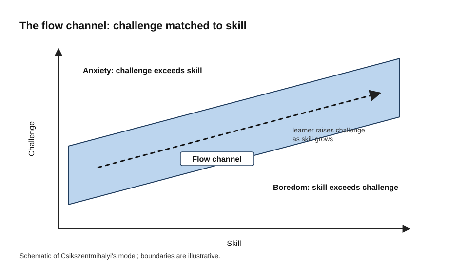
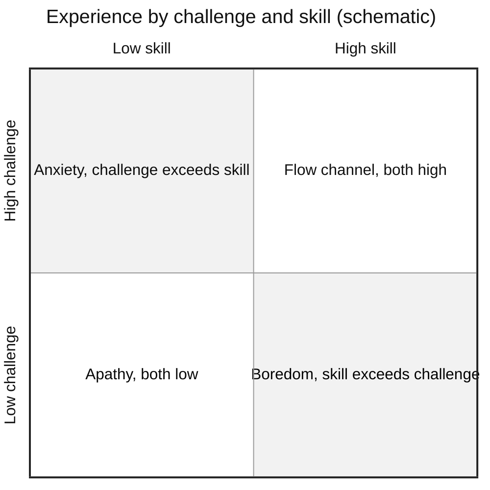
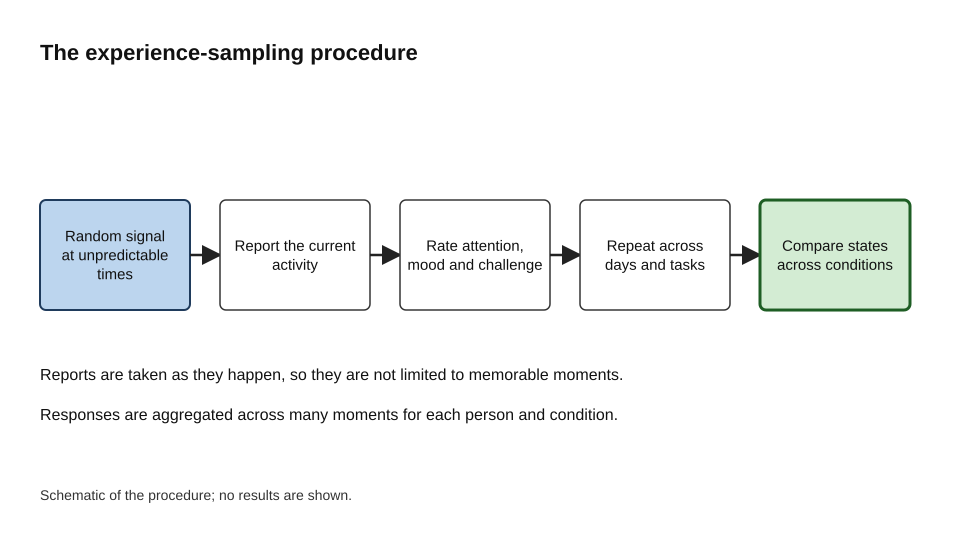
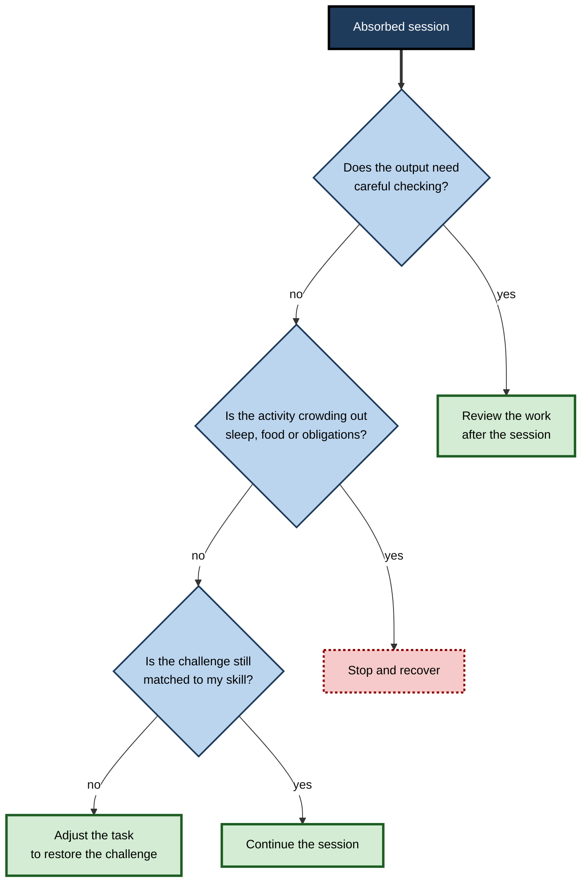

# D.8. Deep Work and Flow State

A programmer looks up from a function she has been rewriting and sees that the window has gone dark. She cannot say how long she has been working, and the problem that seemed impossible an hour ago now seems obvious. A chess player on a long run of good moves loses track of the clock and of the spectators. A surgeon in a long procedure moves through steps that feel effortless, while the rest of the theatre fades out of awareness.

In each case attention has narrowed onto a demanding task, and the experience feels effortless rather than strained. Psychologists call the most complete form of this state **flow**. Professionals who produce the most valuable work, such as analysis, design, writing and programming, spend long periods in a related condition of concentration that is called **deep work** in popular writing.

> **Definition — Flow:** a state of full absorption in an activity, in which attention is focused, self-consciousness fades, time seems to pass differently and the activity feels rewarding in itself.

> **Definition — Deep work:** sustained concentration on a cognitively demanding task, free from interruption, that pushes the limits of a person's ability. The term is a practitioner's framing popularised by Cal Newport, not a construct tested as a whole in research.

**Why it matters**

- The most consequential professional output, such as a sound design, a careful analysis or a well-argued document, depends on long stretches of concentrated attention.
- Absorbed states are associated with higher performance and better wellbeing, although much of the evidence is correlational and the causal direction is not settled.
- Understanding what makes absorption more likely lets people design their work, and their teams' work, so that the conditions for attention are present more often.
- Knowing the limits of flow prevents the opposite error: treating every intense absorption as good.

---

## Deep Work and Flow Are Different Things

Deep work describes an activity and its demands. Flow describes an experience. The two overlap, but they are not the same.

- **Deep work** is something a person can plan: a block of time, a clear task and reduced interruptions.
- **Flow** is something that may happen during deep work. It cannot be ordered, although its conditions can be made more likely.
- **Shallow work** is the contrasting category: logistical, low-concentration tasks, such as routine messages and administrative tasks. Shallow work is not worthless, but it tends to expand to fill whatever time is available.

> **Key point:** deep work is a condition a person arranges; flow is a state that sometimes arises within it.

An analogy: clearing a runway and lining up the aircraft is deep work. Take-off is flow. The runway does not guarantee take-off, but without one it is unlikely.

---

## What Flow Feels Like

Mihaly Csikszentmihalyi's research on flow, presented in his 1990 book *Flow*, described a recurring set of experiences across many kinds of activity, including sport, games, art and skilled manual work.

- **Absorption** — concentration is complete and the attention rests on the task.
- **Merging of action and awareness** — movements feel automatic, and the person is not reflecting on each step.
- **Loss of self-consciousness** — worries about how one appears recede.
- **Altered sense of time** — hours can pass as minutes, or the reverse.
- **Sense of control** — the person feels able to meet the demands of the task.
- **Autotelic experience** — the activity is rewarding in itself, rather than only as a means to an end.

> **Key point:** flow is defined by the quality of attention and experience, not by productivity. A person can be in flow while producing little that is useful, and can produce a great deal without flow.

### How flow was studied

Csikszentmihalyi and his colleagues relied heavily on **experience sampling**: participants carried a device that signalled them at random times, and each time they recorded what they were doing and how they felt.

- The method captures experience as it happens, rather than as remembered.
- In a 1989 study by Csikszentmihalyi and Judith LeFevre, seventy-eight working adults were sampled over a week, and the researchers compared experience at work and in leisure.
- The results showed that flow was reported more often at work than during leisure, while motivation was higher in leisure.
- Csikszentmihalyi later described the tension between these results as the paradox of work.

**Study card — Csikszentmihalyi and LeFevre (1989)**

- **Design:** adult workers carried signal devices for one week and recorded their activity and experience at random times.
- **Results:**
  - Flow was more common during work than during leisure.
  - Motivation was higher during leisure than during work.
- **Conclusion:** the workplace can produce absorbed experience, yet motivation is often lower there, a tension that Csikszentmihalyi called the paradox of work.
- **Caveat:** the study relied on self-reports, and the sample was modest in size and drawn from a particular setting.

> **Watch out:** the "paradox of work" is a description of a pattern, not evidence that work is inherently unrewarding. Its interpretation depends on the kind of work and the organisation of the day.

---

## The Conditions That Make Absorption More Likely

Csikszentmihalyi's model identifies conditions that tend to accompany flow. Three are usually treated as central.

1. **Clear goals** — the person knows what the next step is.
2. **Immediate feedback** — the person can tell, as they go, whether the step is working.
3. **Balance between challenge and skill** — the task stretches the person slightly but is within reach.

**Figure 1.** The flow channel: challenge matched to skill. The diagram is a schematic of Csikszentmihalyi's model rather than a plot of measured data.

### Anxiety and boredom

- When challenge greatly exceeds skill, the typical experience is anxiety, and attention splits between the task and the sense of being overwhelmed.
- When skill greatly exceeds challenge, the typical experience is boredom, and attention drifts to something more stimulating.
- The channel of flow lies between these two states, where challenge and skill are both reasonably high and matched.

**Figure 2.** Experience by challenge and skill, using the same model as a quadrant map.

> **Key point:** the most reliable way to protect flow is to keep the challenge matched to the current skill, which means adjusting the task as the skill grows.

### Clear goals and feedback

- Goals that are vague, such as "work on the project", give attention nothing definite to hold.
- Feedback that arrives only at the end of a long period, such as a review after weeks, cannot guide attention as it happens.
- Environments that show progress quickly, such as tests that run in seconds or a draft that shows its structure, make absorption easier to reach.

---

## Attention During Absorption

Flow is a psychological description. Explaining it requires accounts of how attention and control are arranged during absorbed work.

### The transient hypofrontality hypothesis

Arne Dietrich proposed in 2004 that flow may involve a temporary reduction in activity in parts of the prefrontal cortex that support self-monitoring and explicit, verbal control. On this account, a well-practised skill can run smoothly when the reflective system steps back.

- The idea links the experience of effortless action to reduced explicit monitoring.
- Some imaging and electrophysiological studies have reported patterns consistent with it, but the findings vary by task and method.
- A small number of reviews have found the literature heterogeneous, and a competing account, the synchronisation theory of flow, has also been proposed.

> **Watch out:** claims that flow "switches off" the prefrontal cortex overstate the evidence. Treat the hypothesis as a useful model, not as an established neural fact, and be sceptical of products that promise to induce flow through the brain.

### Why this matters for attention

- If explicit monitoring is reduced, errors that require careful checking may go unnoticed. This is a reason to review work after a long absorbed session.
- If a skill runs automatically, attention is free for judgement about the problem rather than about the mechanics. This is one reason experts seem to experience more flow in their own domains.
- Absorbed states depend on a stable context. Each interruption breaks the context and forces the reflective system back into action, which is why interruptions suppress flow even when they are brief.

---

## Deep Work as a Popular Framing

The term "deep work" was popularised by Cal Newport, who developed it on his blog and then in his 2016 book *Deep Work*. The book is a practical guide built on the author's own framing and examples, and it is not a research study. Its ideas are plausible and widely used, but they have not been tested as a package.

- **Paul Graham's essay on the maker's schedule (2009)** made a related point. Makers, such as programmers and writers, need long uninterrupted stretches, while managers organise their time in shorter slots, and a meeting placed in the middle of a maker's afternoon can cost far more than its length suggests.
- **The components of the deep-work argument** rest on research that is better established. Interruptions harm complex tasks, sustained practice builds skill, and attention takes time to re-establish after a switch. The overall recommendation, however, is a practitioner's synthesis.
- **Fixed focus cycles** deserve particular caution. Claims that the mind works in fixed ninety-minute cycles are widely repeated, but the evidence that such cycles govern focus in knowledge work is weak. The appropriate length of a focused block is best found by testing one's own sustained attention.

> **Watch out:** a convincing story about deep work is not the same as evidence that a particular schedule improves outcomes. Test the claims in your own work and report the results honestly.

### Deep work and shallow work

- **Demands:** deep work demands high concentration and uses the person's most developed skills; shallow work demands little.
- **Interruptions:** deep work is damaged by interruptions; shallow work is barely affected.
- **Value:** deep work tends to create value that is hard to replicate; shallow work is usually easy to replicate or delegate.

These are useful contrasts for attention, although the boundary between them is not always sharp. Some administrative work requires careful thought, and some creative work is routine.

**Figure 3.** How well each claim in the deep-work and flow literature is supported. The grouping is a judgement about the strength of the evidence, not a measurement.

```mermaid
%%{init: {'theme':'base','themeVariables':{'fontFamily':'Arial, Helvetica, sans-serif','fontSize':'15px','primaryColor':'#FFFFFF','primaryTextColor':'#111111','primaryBorderColor':'#222222','lineColor':'#333333','secondaryColor':'#F2F2F2','tertiaryColor':'#FFFFFF','clusterBkg':'#FAFAFA','clusterBorder':'#555555','edgeLabelBackground':'#FFFFFF','titleColor':'#111111'}}}%%
flowchart TD
    classDef core    fill:#1F3B5C,stroke:#000000,stroke-width:3px,color:#FFFFFF
    classDef key     fill:#BCD5EE,stroke:#1F3B5C,stroke-width:2px,color:#000000
    classDef good    fill:#D3ECD3,stroke:#1E5E24,stroke-width:3px,color:#000000
    classDef accent  fill:#FFE6A8,stroke:#7A5200,stroke-width:2px,stroke-dasharray:8 4,color:#000000
    classDef caution fill:#F6CACA,stroke:#8B0000,stroke-width:2.5px,stroke-dasharray:3 3,color:#000000

    D["Claims about deep work and flow"]
    subgraph STRONG["Comparatively well supported"]
        S1["Interruptions harm<br/>complex task performance"]
        S2["Challenge and skill<br/>predict engagement"]
    end
    subgraph MIXED["Mixed or early evidence"]
        M1["Flow and performance<br/>mostly correlational"]
        M2["Flow measured<br/>by wearables"]
    end
    subgraph WEAK["Weakly supported or contested"]
        W1["Fixed ninety-minute<br/>focus cycles"]
        W2["Flow switches off<br/>the prefrontal cortex"]
        W3["Deep work as a tested<br/>package of practices"]
    end

    D ==> S1
    D ==> S2
    D --> M1
    D --> M2
    D -.-> W1
    D -.-> W2
    D -.-> W3

    class D core
    class S1,S2 good
    class M1,M2 accent
    class W1,W2,W3 caution
```

---

## How Flow and Deep Attention Are Measured

Each method has strengths and weaknesses, and combining them is usually more informative than relying on any one.

| Method | Strength | Limitation |
|---|---|---|
| Experience sampling | Captures experience in real settings as it happens | Interruption to ask the question can break the state being measured |
| Post-task questionnaires | Quick, standardised and easy to repeat | Retrospective; influenced by how the task ended |
| Experimental manipulation of difficulty | Gives control over challenge and skill | Often uses artificial tasks such as games or arithmetic |
| Physiological and wearable measures | Objective and continuous | No single reliable signature of flow has been established |

**Figure 4.** The experience-sampling procedure, shown as a sequence from random prompt to recorded state. The diagram is schematic.

> **Remember:** a single self-report, given once, is weak evidence. Repeated reports across days and tasks, combined with a measure of output, give a much stronger picture.

---

## Case Study (illustrative): a data scientist's modelling project

**Situation:** A data scientist was building a model that predicted customer cancellation. Her work was split between modelling and short tasks, and she rarely had more than thirty minutes without interruption.

**Problem:** Attention was fragmented. Each time she began to build a useful piece of the model, a message or a request interrupted her. When she returned, she had to rebuild the steps and check her earlier work.

**Diagnosis:**

- The challenge was uneven: the modelling choices were demanding, but the data definitions were often missing, which left her stuck.
- The feedback loop was slow, because each training run took a long time.
- The interruptions were frequent and mostly from colleagues who did not know her availability.

**Actions:**

1. The missing data definitions were gathered before the blocks of modelling, so that work could begin without stopping.
2. The training pipeline was shortened so that results came back within minutes.
3. Two longer blocks each week were set aside for modelling, with a note to colleagues about when she was reachable.

**Result (illustrative):** Stuck periods became less frequent, and she reported more absorbed sessions. The model was completed in three weeks instead of five.

**Caveats:** several changes occurred together, so it is not possible to say which change mattered most. The improvement in feedback speed may have contributed more than the reduction in interruptions.

**Lesson:** attention is absorbed most readily when the goal is clear, the feedback is quick and the challenge is matched to skill. Interruptions matter because they break these conditions, not only because they take time.

---

## When Absorption Is Not Good

Flow is valuable, but it is not automatically beneficial.

- **Absorption can be compulsive.** People can experience flow in gaming or gambling, where the activity crowds out sleep, food, social contact and other obligations. The experience alone does not show that an activity is good for the person.
- **Absorption can reduce self-monitoring.** Because explicit checking is reduced during flow, errors can accumulate unnoticed. Work that requires careful review should be checked after an absorbed session.
- **Novices find flow harder in complex fields.** When a domain is new, the challenge can far exceed skill, so the experience tends to be anxiety rather than flow. Structured tasks that increase in difficulty help.
- **Flow can be confused with easy practice.** Smooth, enjoyable practice can coexist with weak long-term retention. Enjoyment is not evidence of learning.

> **Watch out:** a session that feels absorbing has not necessarily been productive or accurate. Judge the outcome, not the feeling.

Flow is valuable, but absorption can also be harmful. The diagram below shows the points at which a person should check the outcome and take a break, rather than assume the absorbed state is working well.

**Figure 5.** Points at which an absorbed session should be checked before it is trusted.

---

## Professional Practice

### Designing work so flow is more likely

- **Set clear targets for each session** — a specific deliverable, a specific question, or a specific section, rather than a general area.
- **Build feedback into the task** — tests, previews or checks that show progress as the work proceeds.
- **Match challenge to skill** — break a task down when it is too hard, and add constraints or a harder version when it is too easy.
- **Protect the time** — long, undisturbed blocks give absorption room to develop. Short blocks rarely reach the deeper states, because much of the time goes on starting.

### Teams and attention

- Teams can make deep work more likely by sharing the conditions that support it: clear weekly goals, quick feedback from tests and builds, and agreed times when interruption is discouraged.
- Team norms matter more than individual resolve. When one person protects their attention but everyone else expects immediate replies, the protection quickly erodes.
- Shallow work still has to be done, and an unfair division can place it on the people who are least able to refuse, such as junior staff, those who handle support, or those whose work is less visible. Fair teams share shallow work and recognise it.

### AI assistance and the challenge of the task

Generative AI tools can remove friction, such as the search for a syntax detail or the first draft of boilerplate. They can also remove the challenge that produces absorption and skill growth.

- A 2025 field experiment in high school mathematics, reported by Bastani and colleagues in the Proceedings of the National Academy of Sciences, gave students access to an unrestricted AI tutor and a tutor designed to give hints rather than answers. Practice performance improved with both tools, but students who had used the unrestricted tool performed worse on unaided exams once access was removed. The tutor with guardrails largely avoided that drop.
- The lesson for professionals is to decide deliberately when AI is in the loop. Using it to handle set-up and clean-up, and keeping the core reasoning for oneself, preserves the challenge that absorption requires.

> **Key point:** use tools to remove friction around the task, and keep the challenge at the centre of the task.

### Ethical limits

- Deep work can become a status marker that devalues necessary shallow work, which is often done by people with less power or recognition.
- Organisations should not use the language of flow to justify excessive hours or to make people feel responsible for their own absorption.

---

## Open Questions

- **Does flow cause better performance, or do skilled people who perform well simply experience more flow?**
  - Most evidence is correlational. Experimental manipulation of challenge and skill is still limited to particular tasks.
- **What is the neural basis of flow?**
  - Transient hypofrontality and related accounts are plausible models, but the empirical base is small and varied.
- **Is there an optimal length for a focused block in knowledge work?**
  - Claims of fixed cycles are not well supported. The most useful answer may be individual and task-specific.
- **Can flow be measured continuously and objectively at work?**
  - Wearable measures are promising, but no reliable signature of flow has yet been established across people and tasks.

---

## Summary

- **Flow** is a state of absorbed attention with a sense of control and reward in the activity itself; **deep work** is the arrangement of time and conditions that makes such attention possible.
- Csikszentmihalyi's model identifies **clear goals**, **immediate feedback** and a **challenge–skill balance** as the conditions that tend to accompany flow.
- The **flow channel** is narrow: too much challenge produces anxiety, too little produces boredom.
- Csikszentmihalyi and LeFevre (1989) found that flow was more common at work than in leisure, which gives rise to the **paradox of work**.
- Dietrich's **transient hypofrontality hypothesis** is a plausible but contested account of the neural side of flow.
- Newport's **deep work** is a popular practitioner framing rather than a tested research construct; its components are better supported than the package as a whole.
- Flow is not always beneficial: it can be compulsive, and it can reduce the checking that careful work needs.
- Professionals protect attention through **clear targets**, **fast feedback**, **matched challenge** and **shared team norms**, and should use AI to remove friction rather than challenge.

---

## Self-Check

1. Describe flow in your own words, and name two features of the experience.
2. How does deep work differ from flow?
3. What are the three conditions usually treated as central to flow?
4. What happens when challenge greatly exceeds skill, and what happens when skill greatly exceeds challenge?
5. What is experience sampling, and why is it useful for studying flow?
6. What did Csikszentmihalyi and LeFevre (1989) find about work and leisure, and what is the paradox of work?
7. Explain the transient hypofrontality hypothesis and state how strong the evidence is.
8. Why is "deep work" described as a practitioner framing rather than a research construct?
9. Why does the evidence for fixed ninety-minute focus cycles deserve caution?
10. Why might a flow state lead to errors in work that needs careful checking?
11. A novice starts a complex new field and feels constantly anxious. Using the flow model, what would you advise and why?
12. How can AI tools both support and undermine sustained, absorbed work? Use the 2025 mathematics study in your answer.
13. Propose three team practices that make absorbed work more likely, and explain how each addresses a condition of flow.
14. Why should a fair team share shallow work rather than let deep work become a status marker?

### Answer Key

1. Flow is a state of full absorption in an activity, with focused attention, reduced self-consciousness, altered sense of time and a sense of reward in the activity itself. Two features: absorption and loss of self-consciousness, or altered sense of time and intrinsic reward.
2. Deep work is a condition a person plans: sustained concentration on demanding tasks free from interruption. Flow is an experience that may arise within deep work and cannot be ordered directly.
3. Clear goals, immediate feedback and a balance between challenge and skill.
4. Greatly exceeding challenge produces anxiety, because attention splits between the task and a sense of being overwhelmed. Greatly exceeding skill produces boredom, because attention drifts to something more stimulating.
5. Experience sampling prompts participants at random times to report what they are doing and how they feel. It captures experience as it happens rather than as remembered, which reduces retrospective distortion.
6. Flow was more common at work than in leisure, but motivation was higher during leisure. The paradox of work is the tension between the absorption people report at work and the lower motivation they report there.
7. Dietrich proposed that flow may involve temporary reduced activity in prefrontal regions that support explicit self-monitoring, allowing a practised skill to run smoothly. Some imaging and electrophysiological studies are consistent with it, but the findings vary and the evidence is contested.
8. The term was popularised in a 2016 book that uses the author's framing and examples. The components are partly supported by research, but the package of practices has not been tested as a whole.
9. Widely repeated claims of fixed cycles lack strong support for knowledge work. The appropriate block length is better found by testing sustained attention for one's own work.
10. Flow reduces explicit monitoring, so errors that need careful checking may go unnoticed. Reviewing work after an absorbed session reduces this risk.
11. The challenge is far above the current skill. Advise structured tasks with graded difficulty, clear sub-goals and feedback, so that the challenge rises as skill grows and anxiety gives way to absorption.
12. AI can remove friction such as syntax lookups and boilerplate, and keep feedback fast. The 2025 study found that unrestricted AI assistance improved practice performance but reduced unaided exam performance, while a tutor that gave hints rather than answers largely avoided the loss. Unrestricted use can remove the challenge that drives skill and absorption.
13. Examples: clear weekly goals (provide clear next steps); fast feedback loops such as quick tests and builds (provide immediate feedback); agreed focus periods and a defined urgent route (protect the continuity that absorption needs).
14. Deep work can become a status marker that devalues necessary shallow work, which is often done by people with less power or recognition. Sharing shallow work fairly and recognising it keeps attention protection from becoming a source of inequality.

---

## Glossary

| Term | Meaning |
|---|---|
| Absorption | Complete concentration on a task, with little awareness of anything else. |
| Autotelic experience | An activity rewarding in itself, pursued for its own sake. |
| Challenge–skill balance | The match between the difficulty of a task and the person's ability. |
| Deep work | Sustained, undistracted concentration on cognitively demanding tasks. |
| Experience sampling | A method that prompts people at random times to report their current activity and experience. |
| Flow | A state of full absorption, with focused attention and reward in the activity itself. |
| Maker's schedule | Working time organised in long uninterrupted blocks, typical of programmers and writers. |
| Shallow work | Logistical, low-concentration tasks that are often easy to replicate or delegate. |
| Transient hypofrontality | The hypothesis that flow involves temporary reduced activity in prefrontal regions that support self-monitoring. |
