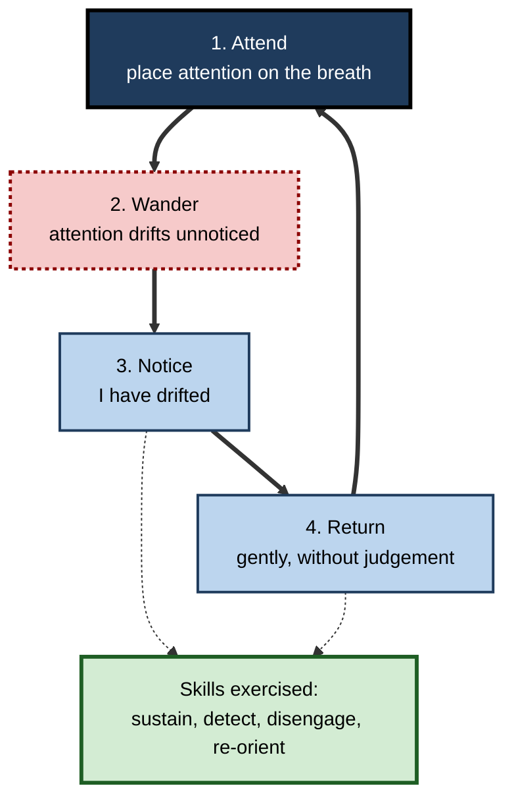
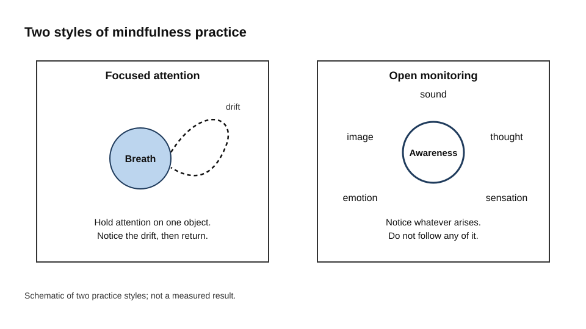
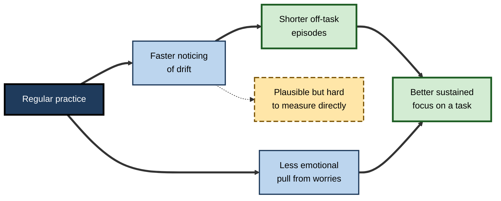
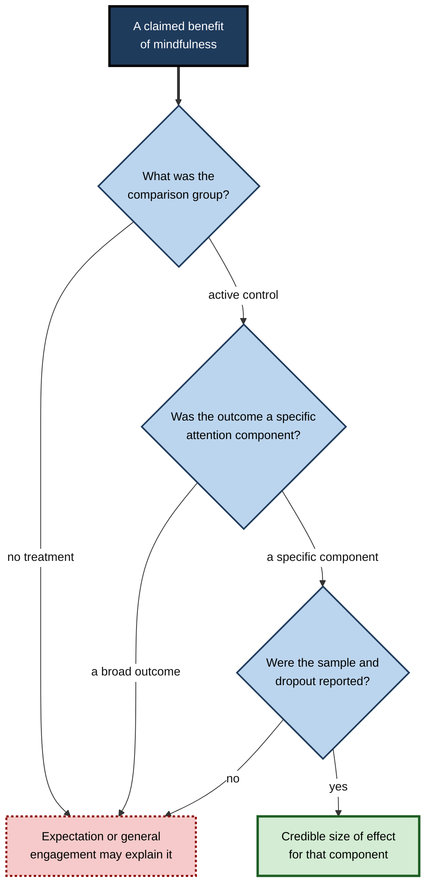

# D.9. Mindfulness for Better Focus

Try this: sit comfortably and attend to the feeling of your breath for one minute. Within a few seconds, most people find that attention has moved to something else: a message, a worry, a sound in the corridor. That movement is **mind wandering**, and noticing it is the moment the practice is about.

Mindfulness training is built on that moment. It is a repeated exercise in placing attention on purpose, noticing when it has drifted, and bringing it back. Over many repetitions the noticing tends to happen sooner, and this is the part of the practice that is thought to carry over into work.

> **Definition — Mindfulness:** paying attention on purpose, to the present experience, without becoming caught up in judging it.

> **Definition — Mind wandering:** attention drifting from the task in hand towards thoughts that are unrelated to it, often without the person noticing.

**Why it matters**

- Mind wandering is common during reading, listening and routine work, and it is associated with poorer comprehension and slower or less accurate performance on many tasks.
- Mindfulness is among the most studied attention-training methods, with a body of randomised trials, so it is possible to say something specific about what it does and does not do.
- Professionals who understand the evidence can use practice sensibly, neither dismissing it as a fad nor expecting it to transform performance.

---

## What Mindfulness Trains

Mindfulness is often described as a single practice, but researchers distinguish styles that exercise different skills.

- **Focused-attention practice** holds attention on one object, such as the breath, a sound or a body sensation. When attention wanders, the practitioner notices and returns it.
- **Open-monitoring practice** notices whatever arises in awareness, such as sounds, thoughts or sensations, without following any of them.

In a 2008 review in *Trends in Cognitive Sciences*, Antoine Lutz, Heleen Slagter, John Dunne and Richard Davidson described these two styles as different regimes of attention regulation. Focused attention builds the ability to sustain and redirect attention. Open monitoring builds a broader awareness of where attention is at any moment.

**Figure 1.** The focused-attention cycle. Each return is one repetition of the skill being trained.

**Figure 2.** Two styles of practice, with the attention skill each is thought to train. The panels are schematic.

### Mind wandering is the material, not the failure

- A session full of drift is not a poor session. Each noticed drift followed by a return is a repetition.
- Practitioners who judge sessions as good or bad tend to become discouraged, and discouragement ends practice.
- The skill being built is the speed of noticing, which can improve even when the total amount of wandering stays high.

> **Key point:** mindfulness does not aim to stop the mind wandering. It aims to shorten the time between wandering and noticing.

---

## A Short History

- The best-known structured programme is mindfulness-based stress reduction (MBSR), developed by Jon Kabat-Zinn in 1979 at the University of Massachusetts Medical Center.
- MBSR is an eight-week group programme, with weekly sessions and a day-long retreat, combining meditation, body awareness and gentle movement.
- Related programmes, such as mindfulness-based cognitive therapy, adapted the approach for other clinical uses.
- As the approach spread into workplaces and schools, it was sometimes presented as a general tool for productivity. Critics argued that this presentation separated mindfulness from its ethical roots and from the conditions that cause stress in the first place.

---

## Evidence on Attention

### Brief training and working memory

- **Study card — Zeidan and colleagues (2010)**
  - **Design:** novice meditators received four sessions of mindfulness training. A comparison group listened to a recorded book in the same format.
  - **Results:** the mindfulness group showed improvement on visuospatial processing, working memory and some executive functions.
  - **Conclusion:** a few sessions of training may affect attention in people with no prior experience, but the finding needs replication before it is relied upon.

- **Study card — Mrazek and colleagues (2013)**
  - **Design:** 48 undergraduates took either a two-week mindfulness course or a nutrition course, in random assignment.
  - **Results:**
    - The mindfulness group improved on a test of working memory capacity and on the reading section of a graduate admissions test (GRE).
    - Mind wandering was reduced during the tasks.
  - **Conclusion:** part of the benefit appeared to be explained by reduced mind wandering during the tasks.
  - **Caveat:** the study was small and used one short course. It is promising rather than conclusive.

> **Watch out:** a result from a small study with an active comparison group is a reason to continue testing, not a reason to claim broad cognitive enhancement.

### What meta-analyses find

- Paul Verhaeghen's 2021 analyses, published in the journal *Mindfulness*, reviewed studies of mindfulness interventions, long-term meditators and trait mindfulness. The average effects on attention were small, with Hedges' g around 0.3 for interventions.
- Effects were most consistent for inhibition and executive control. Other components, such as updating and sustained attention, showed less consistent results, and shifting attention changed only in some analyses.
- Effects tended to be larger for accuracy than for speed.
- A later analysis of randomised trials reported a small-to-medium average effect on executive control, with larger effects on some sub-skills than on others.

> **Key point:** mindfulness training modestly improves some components of attention, most reliably the ability to resist interference. It is not a general enhancer of intelligence or productivity.

### Mechanisms

Researchers have proposed several mechanisms, which differ in how well they are supported.

| Mechanism | Idea | Evidence |
|---|---|---|
| Faster detection of drift | Repeated noticing shortens off-task episodes | Consistent with behavioural data; hard to measure directly |
| Re-orienting | Repeated returns exercise shifting attention | Plausible; direct evidence is limited |
| Reduced reactivity | Less emotional pull from distractions and worries | Supported in stress and emotion research |
| Changes in default-mode activity | Altered activity in networks linked to mind wandering | Imaging findings exist; their practical significance is unclear |

**Figure 3.** The chain of proposed effects from practice to focus, with the strength of support indicated by border style.

---

## Evaluating the Evidence

### Choose the right comparison

- **Passive controls** — a waiting list or no treatment. Improvements against passive controls may reflect expectation, attention from the teacher and the simple experience of taking part.
- **Active controls** — a comparison activity with similar time, attention and expectations, such as listening to a recorded book. These are a stricter test, because they remove many non-specific benefits.
- Zeidan's study used an active control, and Mrazek's used a nutrition course as its comparison.

> **Watch out:** a programme that beats a waiting list may not beat an equally engaging alternative. Always ask what the comparison group did.

**Figure 4.** Questions to ask about any study of a mindfulness programme.

### Mind wandering and reading

- Students who take part in a mindfulness course may read with less mind wandering, and comprehension may improve as a result.
- The reduction in mind wandering is an important mechanism to measure directly, because it links the training to the task.
- The effect of one short course on a standardised test is a result to replicate, not a general finding for all readers.

---

## Practice in Professional Life

### Starting a practice

- Short, regular practice is more likely to be kept than long sessions attempted once. Five to ten minutes a day is a reasonable start.
- Focused attention on the breath or body is a common first practice, because the anchor is always available.
- Returns should be counted as repetitions rather than failures, which keeps the practice going.

### Brief resets during work

Mindfulness is also used as a short practice between tasks. A brief reset might involve three slow breaths with full attention, a moment of naming what is pulling at attention, and a choice of the next task. Such resets are simple to try, and their value lies in interrupting the automatic move to the next stimulus.

**Figure 5.** The sequence of a brief reset, from noticing the pull on attention to beginning the next task.

```mermaid
%%{init: {'theme':'base','themeVariables':{'fontFamily':'Arial, Helvetica, sans-serif','fontSize':'15px','primaryColor':'#FFFFFF','primaryTextColor':'#111111','primaryBorderColor':'#222222','lineColor':'#333333','secondaryColor':'#F2F2F2','tertiaryColor':'#FFFFFF','clusterBkg':'#FAFAFA','clusterBorder':'#555555','edgeLabelBackground':'#FFFFFF','titleColor':'#111111'}}}%%
flowchart LR
    classDef core    fill:#1F3B5C,stroke:#000000,stroke-width:3px,color:#FFFFFF
    classDef key     fill:#BCD5EE,stroke:#1F3B5C,stroke-width:2px,color:#000000
    classDef good    fill:#D3ECD3,stroke:#1E5E24,stroke-width:3px,color:#000000

    A["Feel the feet<br/>on the floor"]
    B["Three slow breaths<br/>with full attention"]
    C["Name what is<br/>pulling at attention"]
    D["Choose the next<br/>single task"]
    E["Begin the task"]

    A ==> B ==> C ==> D ==> E

    class A core
    class B,C key
    class D,E good
```

> **Remember:** a reset is a way of noticing where attention has gone and choosing where to send it. It is not a substitute for changing a distracting environment.

### Worked example (illustrative): a consultant between client meetings

- **Before:** no practice; attention carried over from one call into the next, so details were missed and questions were repeated.
- **Practice:** ten minutes of focused attention most mornings, and a brief reset before each client meeting.
- **Result (illustrative):** the consultant noticed drift sooner in meetings and reported fewer follow-up requests for information already given.
- **Caveat:** the consultant also reduced back-to-back meetings during the same period, so the change cannot be attributed to the practice alone.

---

## Limits, Risks and Critique

### Adverse experiences

- Mindfulness and meditation are widely regarded as safe for most people, but some practitioners report distressing experiences, including increased anxiety, unwanted memories and dissociation.
- Farias and colleagues (2020) reviewed 83 studies and found that adverse experiences were reported in a minority of participants in experimental studies, with a higher rate in observational work. The review does not settle which kinds of practice carry the most risk.
- People with a history of trauma or serious mental health conditions should seek qualified guidance before starting intensive practice.

> **Watch out:** "risk-free" is not an accurate description. Adverse experiences are uncommon in many studies but documented, and they deserve attention.

### Commercialisation and McMindfulness

- In 2013 Ronald Purser and David Loy published "Beyond McMindfulness" in the *Huffington Post*. The article argued that a secularised form of mindfulness, sold to organisations, can help individuals cope with stressful conditions rather than changing the conditions themselves.
- The critique matters for professionals because a programme can be used to shift responsibility from the organisation to the individual.
- A credible programme treats mindfulness as one tool alongside better work design, such as realistic workloads, reduced interruptions and fair meeting practices.

### Expectations and dose

- Improvements in well-being or attention can be partly due to expectation and the social effect of group participation.
- More practice is often associated with more benefit, but people who practise more may also differ in other ways, so the relation is hard to interpret.
- App-based practice is convenient, and some trials have supported it, but engagement often falls after the first weeks.

---

## Case Study (illustrative): a workplace programme for a professional services firm

**Situation:** The executive team of a firm with about two thousand staff asked for a mindfulness programme to "improve focus and productivity".

**Problem:** The stated goal was broader than the evidence supports, and the team's meeting schedule was highly fragmented.

**Diagnosis:**

- The evidence supports modest effects on stress and on some components of attention, not large gains in productivity.
- Fragmented meetings and constant messaging would reduce any benefit from individual practice.
- Participation needed to be voluntary, because compulsory mindfulness can reduce trust.

**Actions:**

1. The programme was offered as an eight-week voluntary course with qualified teachers and information about who should seek advice first.
2. A waiting-list comparison was used, with an active comparison planned for a second cohort.
3. A pilot of meeting-free mornings was run alongside the programme, so that the two effects could be separated.
4. Outcomes included well-being, a short self-report of attention and team-level data on focused time.

**Result (illustrative):** participants reported better well-being and modest changes in attention. The waiting-list comparison overstated the benefit, and the programme team reported that result together with the dropout rate.

**Lesson:** an evaluation that reports dropout and null findings is more useful than one that reports only success.

---

## Open Questions

- **Which attention components does mindfulness reliably change, and which change only in some studies?**
  - Inhibition appears most consistent. Sustained attention and shifting are less clear.
- **How much of the benefit comes from specific attentional training, and how much from expectation and social engagement?**
  - Active controls are needed in larger trials, and not all studies use them.
- **What is the right dose, and does the answer depend on the person?**
  - Dose–response relations are hard to separate from self-selection.
- **Who is at risk of adverse experiences, and how can practice be made safer?**
  - Reporting of adverse events varies widely across studies.

---

## Summary

- **Mindfulness** trains a cycle of attending, wandering, noticing and returning; each return is a repetition.
- **Focused attention** practice builds the ability to sustain and redirect attention, and **open monitoring** builds broader awareness of where attention is.
- Zeidan and colleagues (2010) and Mrazek and colleagues (2013) found benefits after brief training, but both studies were small, and the claims need replication.
- Meta-analyses by Verhaeghen (2021) report **small average effects** on attention, strongest for inhibition and executive control.
- Mind wandering is the material of practice, not a failure, and the aim is to shorten the time to noticing.
- Evaluations should use **active controls**, measure specific attention components and report dropout and null results.
- Practice carries some **adverse risk** for some people, and people with trauma or serious mental health conditions should seek guidance.
- Mindfulness is a modest tool that works best alongside **better work design**, not in place of it.

---

## Self-Check

1. Describe mindfulness in plain words, and explain what a practitioner does when attention drifts.
2. Why is a session full of mind wandering not a failure in mindfulness practice?
3. Contrast focused-attention and open-monitoring practice.
4. What does Lutz and colleagues' 2008 review suggest about the attention skills each style trains?
5. Describe the design and main result of the Mrazek and colleagues (2013) study.
6. What did Zeidan and colleagues (2010) compare, and why does the comparison group matter?
7. Roughly how large are the average effects of mindfulness on attention, according to the 2021 meta-analyses, and which component changes most consistently?
8. What is the difference between a passive control and an active control, and why does it change the interpretation of a result?
9. Name two mechanisms proposed for mindfulness effects on focus, and state how well each is supported.
10. What is the "McMindfulness" critique, and how would a credible programme respond to it?
11. What adverse experiences have been reported, and who should seek qualified guidance before intensive practice?
12. A vendor claims that a mindfulness app will double the focus of your staff. Identify three questions you would ask before considering it.
13. Why do short, regular practices tend to outlast long sessions attempted once?
14. How would you evaluate a workplace mindfulness programme credibly, in a way that would report weak results honestly?

### Answer Key

1. Mindfulness is paying attention on purpose to the present, without becoming caught up in judging it. When attention drifts, the practitioner notices the drift and gently brings attention back.
2. Each noticed drift followed by a return is one repetition of the skill being trained. The aim is to notice sooner, not to stop the mind from wandering.
3. Focused-attention practice holds attention on one object and returns it when it drifts. Open monitoring notices whatever arises without following it.
4. Focused attention is thought to build the ability to sustain and redirect attention. Open monitoring is thought to build broader awareness of the current focus of attention.
5. Forty-eight undergraduates took either a two-week mindfulness course or a nutrition course. The mindfulness group improved on a working memory test and a reading comprehension test, and mind wandering was reduced.
6. Novice meditators received four sessions of mindfulness training or listened to a recorded book in the same format. The comparison matters because listening to a book also takes time and involves attention, so it controls for many non-specific effects.
7. Average effects are small, with Hedges' g around 0.3 for interventions. Inhibition and executive control changed most consistently.
8. A passive control receives no treatment or waits. An active control is a comparison with similar time, attention and expectation. A benefit over a passive control may reflect expectation or engagement; a benefit over an active control is a stricter test.
9. Faster detection of drift, supported by behavioural data but hard to measure directly, and reduced reactivity to distractions, supported by stress and emotion research. Changes in default-mode activity are reported in imaging but their practical significance is unclear.
10. The critique is that organisations use mindfulness to help people cope with poor conditions instead of changing them. A credible programme keeps participation voluntary and pairs mindfulness with changes to workload, interruptions and meetings.
11. Some practitioners report increased anxiety, distressing memories and dissociation. People with a history of trauma or serious mental health conditions should seek qualified guidance first.
12. Possible questions: which specific attention component was measured, against what comparison group, and were dropout and null findings reported? Any claim of doubling focus should be treated with scepticism.
13. Short practices are easier to keep, so repetition accumulates. Long sessions attempted once tend to be abandoned, and the repetition that builds the skill is lost.
14. Use voluntary participation, a comparison group (ideally active), pre and post measures with follow-up, both self-report and behavioural measures, and report dropout and null results honestly.

---

## Glossary

| Term | Meaning |
|---|---|
| Active control | A comparison condition with similar time, attention and expectation. |
| Focused-attention practice | Meditation that holds attention on one object and returns it when it drifts. |
| Mind wandering | Attention drifting to thoughts unrelated to the current task. |
| Mindfulness | Intentional, non-judging attention to present experience. |
| MBSR | Mindfulness-based stress reduction, an eight-week group programme developed in 1979. |
| McMindfulness | Critique of mindfulness used to help people adapt to poor conditions rather than change them. |
| Open-monitoring practice | Meditation that notices whatever arises without following it. |
| Passive control | A comparison group that receives no treatment or waits. |
| Reactivity | An emotional or behavioural response to a stimulus, such as a distraction or worry. |
