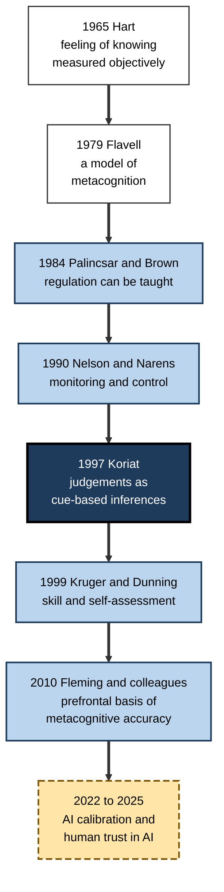
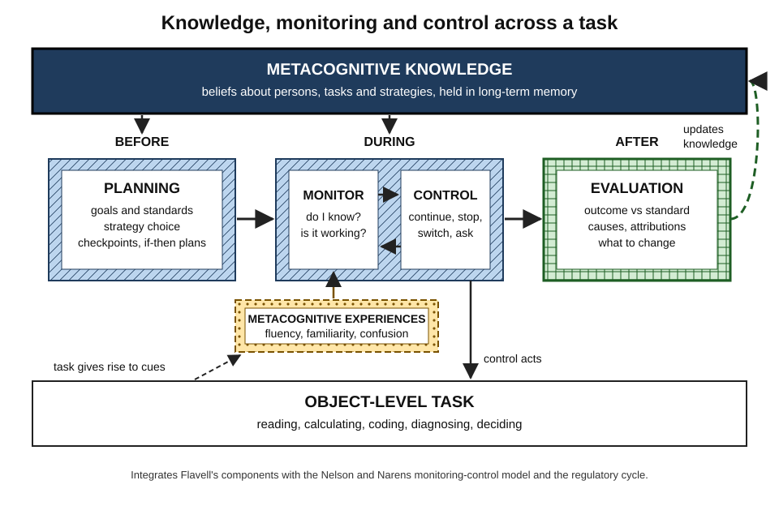
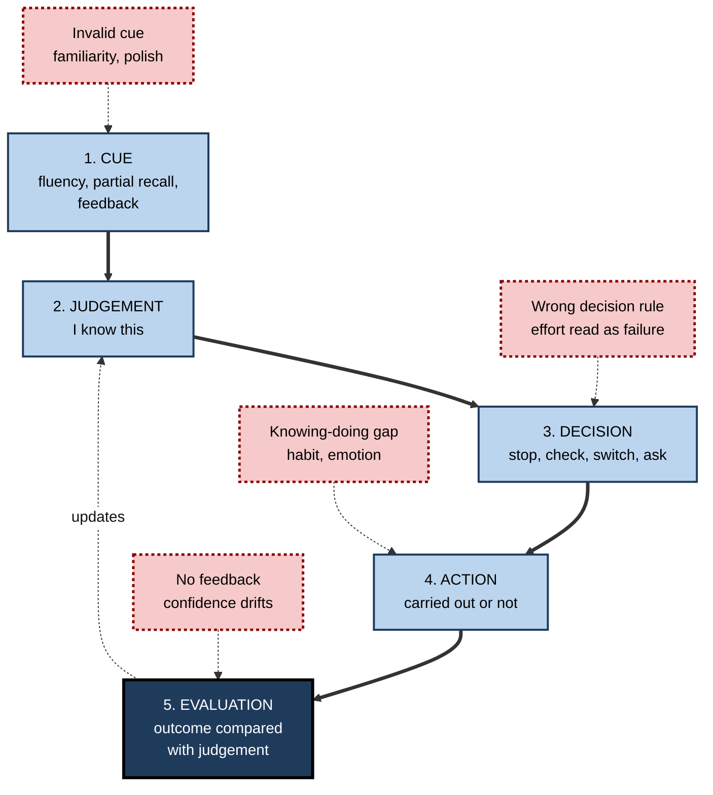
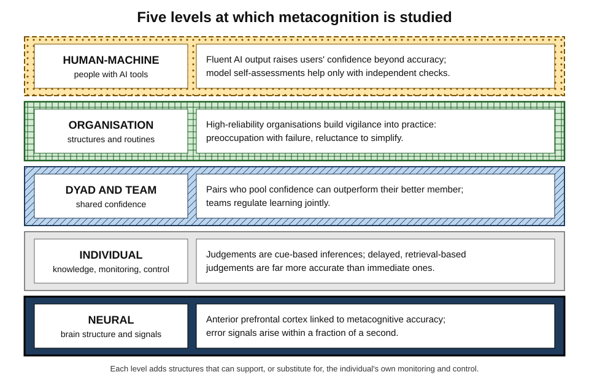
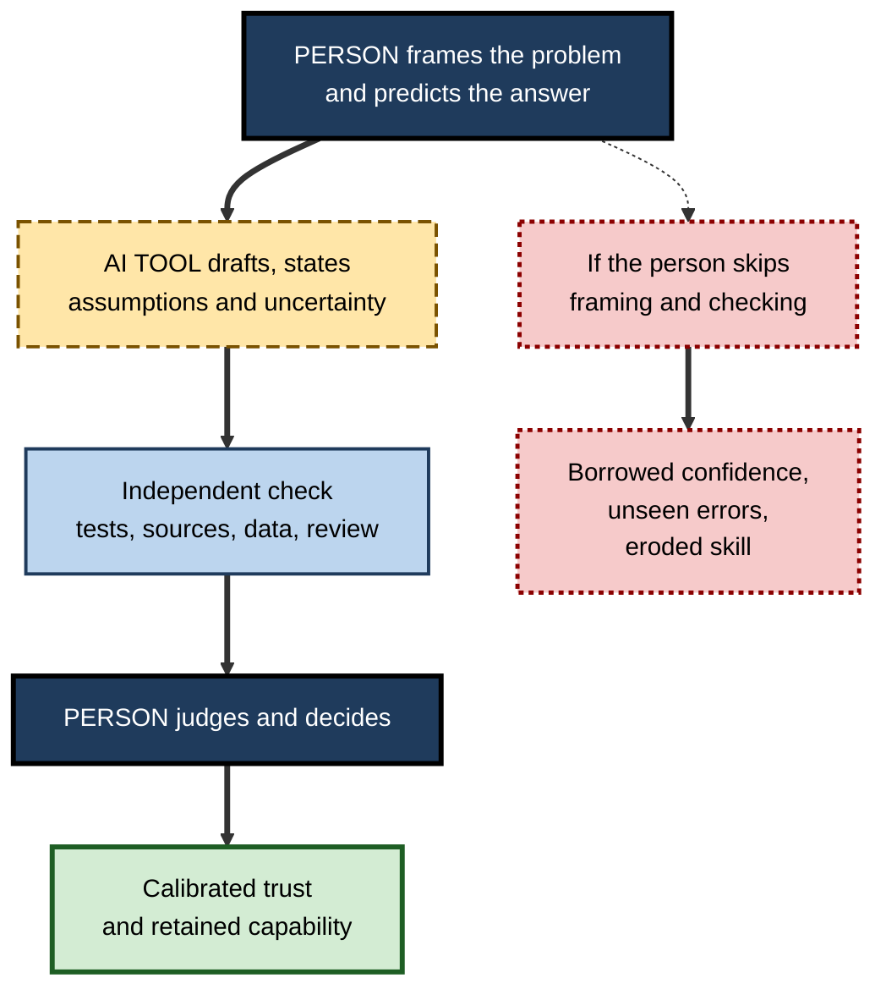

# K. Metacognition

A pilot senses that an approach "does not feel right", asks the co-pilot to cross-check, and they find a mis-set altimeter. A student closes a textbook sure she has mastered a chapter and recalls half of it the next day. A data scientist accepts a fluent AI-generated analysis, and a client later spots the error. In each case the outcome turned less on what the person knew than on **how well they judged and managed their own knowing**.

> **Definition — Metacognition:** cognition about cognition — the knowledge people have about their own and others' thinking, and the processes by which they monitor, evaluate and control that thinking as it unfolds.

**Why it matters**

- It is the **steering system** of learning and expert work: it decides what to study, when to stop, which method to use, when to check, and when to ask.
- Its failures — confident error, premature closure, studying the wrong thing, unseen gaps — are among the **most costly and most common** in education and professional life.
- It is **measurable** with unusual precision, so its accuracy can be tracked and improved.
- It is **teachable**, and teaching it is among the most cost-effective investments in learning.
- In an age of fluent AI output, it becomes the **central human contribution**: judging what to trust, what to check and what to decide.

---

## The Subject and Its Scope

### Thinking that takes thinking as its object

- **First-order cognition** works on the world — reading a contract, debugging code, diagnosing a patient.
- **Second-order cognition** works on the first — "Have I understood the indemnity clause?", "Am I chasing the wrong bug?", "How sure am I of this diagnosis?"
- The distinction is functional, not anatomical: the same mind, and often the same brain regions, do both; what differs is the **object** of the thought.

### What the field studies

- **Knowledge** — what people believe about how minds, tasks and strategies work.
- **Monitoring** — judgements about the state of one's own cognition: knowing, learning, understanding, confidence.
- **Control** — decisions that start, stop, continue or change cognitive activity on the basis of monitoring.
- **Experiences** — the felt signals during thinking: familiarity, fluency, confusion, the tip of the tongue.
- **Regulation over time** — how monitoring and control combine with motivation, emotion and context across whole learning projects.
- **Development and training** — how these capacities grow and how they can be taught.
- **Collective and artificial metacognition** — how groups, organisations and machines represent and manage their own knowledge.

> **Key point:** metacognition is not a single skill but a **system**: stored knowledge feeds moment-to-moment judgements, judgements drive control decisions, and the results update the knowledge.

### Neighbouring constructs

| Construct | Relation to metacognition | Key difference |
|---|---|---|
| Self-regulated learning | Contains metacognition as its steering core | Also regulates motivation, emotion, behaviour and context |
| Executive function | Supplies control processes metacognition uses | Can operate without any representation of one's own cognition |
| Critical thinking | Uses metacognitive checking of one's own reasoning | Aimed primarily at arguments and evidence, not at the mind |
| Reflection | Overlaps with evaluation after the event | Metacognition also works before and during tasks |
| Intellectual humility | Shares the value of calibrated confidence | A disposition and virtue rather than a set of processes |
| Theory of mind | Shares the representation of mental states | Concerns others' minds; metacognition mainly one's own |

---

## How the Field Developed

### Philosophical roots

- **Aristotle** discussed how we perceive that we are perceiving — an early recognition of second-order awareness.
- **John Locke (1690)** named the mind's perception of its own operations **reflection**.
- **Auguste Comte (1830s)** argued that the mind cannot observe itself in action — an objection that shaped later scepticism about introspection.
- **William James (1890)** described tip-of-the-tongue states and the "fringe" of consciousness that signals what is almost known.

### The experimental era

- **Joseph Hart (1965)** showed that **feelings of knowing** about unrecalled answers predict later recognition — the first objective measure of monitoring accuracy, answering Comte by comparing judgements with performance rather than trusting introspection.
- **John Flavell (1970s)** coined **metamemory** and **metacognition**, showing that children's knowledge about memory develops and predicts their study behaviour; his 1979 model of knowledge, experiences, goals and actions founded the field.
- **Ann Brown (late 1970s–1980s)** brought the regulation side to the fore — planning, checking and revising during reading — and, with Annemarie Palincsar, showed it could be taught.
- **Thomas Nelson and Louis Narens (1990)** gave the field its central architecture: an **object level** and a **meta level** linked by **monitoring** and **control**.
- **Asher Koriat (1990s onwards)** showed that metacognitive judgements are **inferences from cues** rather than readouts of memory strength — explaining both their accuracy and their systematic illusions.
- **Robert and Elizabeth Bjork** demonstrated that the conditions which make learning feel easy often make it weak, and vice versa — making the gap between **feeling and fact** a central theme.

### Widening horizons

- **Social and organisational psychology** — overconfidence, the planning fallacy and the Dunning–Kruger debate brought metacognition into judgement, decision-making and management.
- **Comparative psychology** — **J. David Smith** found that dolphins and monkeys use an "uncertain" response most on hard trials; **Robert Hampton (2001)** showed that rhesus monkeys could decline memory tests selectively when they had forgotten, suggesting some animals monitor their own memory.
- **Cognitive neuroscience** — **Stephen Fleming and colleagues (2010)** found that individual differences in metacognitive accuracy were associated with the structure of the **anterior prefrontal cortex**; later studies of patients with damage there found impaired perceptual metacognition with task performance intact.
- **Education policy** — large evidence reviews from the 2010s rated teaching metacognition and self-regulation among the highest-impact, lowest-cost classroom approaches; an updated guidance report in late 2025 emphasised **metacognitive talk**.
- **Artificial intelligence** — from 2022, whether language models "know what they know" and how people calibrate their trust in AI became major research questions.

**Figure 1.** Landmark studies in the development of metacognition research.

---

## The Architecture of Metacognition

### Components and time

- **Knowledge** sits in long-term memory and is brought to each task.
  - Beliefs about persons, tasks and strategies — accurate or not — set the defaults for every self-managed choice; why these beliefs so often favour comfortable, weak methods is a question in its own right.
- **Monitoring and control** operate in real time.
  - The meta level holds a **model** of what the object level is doing and adjusts it — and because that model is built from cues, it can be confidently wrong.
- **The regulatory cycle** runs across time.
  - Before a task, **planning** sets goals, strategies and checkpoints; during it, **monitoring and control** steer; after it, **evaluation** updates knowledge and the next plan.
- **Experiences** colour every phase.
  - Feelings of fluency, confusion and confidence are the raw data for judgement, and also the main source of illusions.

**Figure 2.** The architecture of metacognition: knowledge, monitoring and control operating before, during and after a task.

### From cue to consequence

- A metacognitive act passes through a chain, and can fail at every link:
  1. **Cue** — something is available to judge from (fluency, partial recall, feedback).
  2. **Judgement** — the cue is interpreted ("I know this").
  3. **Decision** — a control choice follows ("stop studying").
  4. **Action** — the choice is carried out — or not, through effort aversion or habit.
  5. **Evaluation** — the outcome is compared with the judgement, updating future judgements — or not, if no feedback arrives.

**Figure 3.** The chain from cue to evaluation, and where metacognition commonly fails.

---

## How the Parts Interact

The components of metacognition are not independent modules; each shapes the others in characteristic ways.

- **Knowledge shapes monitoring.**
  - Beliefs supply the theories behind judgements: a learner who believes "re-reading is how memory works" judges familiarity as knowing.
  - Correcting beliefs improves **theory-based** judgements but leaves **experience-based** feelings untouched.
- **Experiences feed monitoring — and can override knowledge.**
  - A person may know that fluency misleads and still feel sure after re-reading; feelings are fast, beliefs are slow.
- **Monitoring drives control.**
  - What is judged unknown is studied; what is judged known is dropped; what is judged right is not checked.
- **Control shapes later monitoring.**
  - The effort a task demands becomes a cue: effortful retrieval lowers confidence even when it builds memory.
- **Evaluation updates knowledge.**
  - Only when outcomes are compared with judgements do beliefs and calibration improve; without feedback the loop is open.
- **Motivation and emotion modulate everything.**
  - Anxiety narrows monitoring and pushes control towards avoidance; self-efficacy sustains persistence when monitoring reports difficulty.

| Interaction | Healthy form | Failure form |
|---|---|---|
| Knowledge → monitoring | Accurate beliefs guide judgement | Folk theories produce systematic misjudgement |
| Experience → monitoring | Feelings checked against evidence | Fluency taken as knowledge |
| Monitoring → control | Effort goes where it is needed | Accurate judgement ignored, or wrong judgement obeyed |
| Control → monitoring | Chosen effort read as investment | Imposed effort read as failure |
| Evaluation → knowledge | Beliefs and calibration updated | No feedback; confidence drifts |

> **Key point:** most persistent metacognitive failures are **loops**, not single errors — a wrong belief produces a misleading judgement, which drives a poor choice, whose outcome is never evaluated, so the belief survives. Breaking any one link — usually by adding external feedback — can break the loop.

---

## Core Findings of the Field

### Seven well-established principles

- **1. Judgements are inferences.** People do not read their memories directly; they infer knowing from cues such as fluency and familiarity, which is why judgements are usually informative and sometimes systematically wrong.
- **2. Monitoring drives control.** Study choices, checking and stopping follow what people *believe* they know, so improving monitoring improves choices and outcomes.
- **3. Feeling is not learning.** Conditions that make learning feel easy — re-reading, massing, polished presentation — often produce weak learning, while effortful retrieval and spacing feel worse and work better; the illusions this creates, and how to see through them, form one of the field's richest literatures.
- **4. Accuracy follows feedback.** People are well calibrated where feedback is frequent, fast and clear, and poorly calibrated where it is slow, absent or ambiguous.
- **5. Self-assessment is weakly tied to skill.** Across education, medicine and work, global self-ratings correlate only modestly with objective performance, and least well for the least skilled — although how much of that pattern is a genuine deficit is contested.
- **6. Accuracy is domain-specific; habits are more general.** Monitoring accuracy depends on knowing what good looks like in a domain, while habits of planning, checking and questioning transfer more readily.
- **7. Metacognition is teachable — best in context.** Explicit, embedded, sustained teaching with modelling and gradual handover improves learning; generic, detached courses add little.

| Principle | Representative evidence | Practical implication |
|---|---|---|
| Judgements are inferences | Cue-utilisation studies; font-size and fluency effects | Judge by attempting retrieval, not by feel |
| Monitoring drives control | Study choices follow judgements of learning | Improve monitoring to improve allocation |
| Feeling is not learning | Re-reading vs testing; active vs passive learning | Expect effective methods to feel harder |
| Accuracy follows feedback | Weather forecasters vs slow-feedback professions | Score judgements against outcomes |
| Self-assessment is weak | Reviews in education and medicine | Seek external evidence |
| Domain-specific accuracy | Experts calibrated only in their field | Build standards and domain knowledge |
| Teachable in context | Reciprocal teaching; embedded strategy programmes | Model, prompt and fade within real work |

> **Remember:** **infer, steer, mistrust ease, seek feedback, check externally, know the domain, teach in context** — the seven principles in seven phrases.

---

## Levels of Analysis

### From neurons to organisations to machines

- **Neural** — the anterior and lateral prefrontal cortex are repeatedly implicated in metacognitive accuracy; error signals arise within a fraction of a second of a mistake; some neural markers appear specific to perception or memory.
- **Individual** — knowledge, monitoring, control and their development.
- **Dyads and teams** — people combine their confidence to decide together.
  - **Bahador Bahrami and colleagues (2010)** — pairs who discussed their confidence on difficult perceptual decisions outperformed the better individual, provided the two had similar sensitivity; pooling confidence is itself a metacognitive skill.
- **Organisations** — institutions build metacognition into structures: reviews, audits, checklists, red teams, risk registers.
  - **Karl Weick and Kathleen Sutcliffe** described **high-reliability organisations** — air-traffic control, aircraft carriers, nuclear plants — whose practices amount to organisational metacognition: preoccupation with failure, reluctance to simplify, sensitivity to operations, commitment to resilience and deference to expertise.
- **Human–machine systems** — monitoring and control are shared between people and AI tools, raising questions about who checks whom.

**Figure 4.** Metacognition studied at five levels, from neural signals to human–machine systems.

| High-reliability principle | Metacognitive equivalent |
|---|---|
| Preoccupation with failure | Treating near-misses as signals that monitoring has detected something |
| Reluctance to simplify | Resisting premature closure on a single explanation |
| Sensitivity to operations | Continuous monitoring of the current state of work |
| Commitment to resilience | Prepared control responses when things go wrong |
| Deference to expertise | Routing decisions to whoever knows most, regardless of rank |

---

## Landmark Debates

### Is there one metacognitive ability?

- **For:** questionnaire scores and habits of planning and checking correlate across tasks; some prefrontal regions contribute to several domains.
- **Against:** confidence accuracy in perception and in memory correlates only weakly within individuals; lesions and training effects can be domain-specific.
- **Current view:** a **partly general** system with **domain-specific** accuracy that depends on knowledge.

### How conscious is metacognition?

- Some metacognition is explicit and reportable; much is fast and **procedural** — felt uncertainty that slows a response without any deliberate thought.
- Whether implicit uncertainty signals and explicit confidence reports share a mechanism is unsettled; the answer matters for training, which mostly targets the explicit level.

### Do animals have metacognition?

- Monkeys, and possibly some other species, decline difficult or forgotten trials selectively.
- Sceptics argue that associative learning about reward contingencies can mimic this without a representation of one's own mind; carefully designed transfer tests have narrowed but not closed the debate.

### What does the Dunning–Kruger pattern mean?

- The pattern — low performers overestimating most — is robust in the raw data.
- Its interpretation as a special metacognitive deficit is contested by accounts based on regression to the mean, a general better-than-average tendency and noisy self-perception; the practical lesson that self-assessment needs external checks survives either reading.

### Does measuring metacognition change it?

- Asking people for judgements of learning can itself change what they remember — **reactivity** — sometimes helping, sometimes harming.
- Questionnaires, think-aloud protocols, confidence judgements and behavioural traces often disagree; there is no gold standard.

| Debate | Main positions | State of evidence |
|---|---|---|
| One ability or many? | General faculty vs domain-specific skills | Partly general habits, domain-specific accuracy |
| Conscious or implicit? | Explicit reports vs procedural feelings | Both exist; relation unclear |
| Animal metacognition? | Genuine self-monitoring vs associative mimicry | Suggestive in primates; contested |
| Dunning–Kruger | Metacognitive deficit vs statistical artefact | Pattern robust; interpretation contested |
| Measurement | Self-report vs online measures | Measures diverge; reactivity documented |

---

## Metacognition and Artificial Intelligence

### Machines that judge themselves

- Large language models can produce probability estimates of their own correctness; such estimates are **partly informative** but, when stated in words, often **overconfident**.
- Without new external information, models asked to correct their own reasoning frequently fail to improve — the meta level has no independent access to truth.
- Designs that add **retrieval, tools, tests or human review** provide the independent check that genuine metacognition requires.

### People judging machines

- Fluent AI explanations raise users' confidence beyond the answers' accuracy, especially when explanations are long.
- AI assistance can raise task performance while **lowering** the accuracy of users' self-assessment.
- Learners using AI to revise work can improve the product while doing less of the planning, monitoring and evaluating that builds capability — **metacognitive laziness**.

### Dividing metacognitive labour

**Figure 5.** How monitoring and control can be divided between a person and an AI tool.

| | Human metacognition | Current machine self-assessment |
|---|---|---|
| Source of confidence | Cues: fluency, partial recall, feedback history | Internal probabilities or generated statements |
| Typical bias | Overconfidence on hard items; fluency illusions | Verbal overconfidence; plausible error |
| Independent check | Possible through feedback, others, delay | Needs external tools, data or people |
| Improves with | Scored feedback, domain knowledge, habits | Training methods, retrieval, verification tools |

> **Key point:** in human–AI work the person must keep the parts of metacognition the machine cannot reliably perform — **framing, prediction, independent checking and final judgement** — and must notice when convenience tempts them to give those parts away.

---

## Metacognition in Professional Mastery

### What metacognitively expert professionals do

- **Frame before solving** — restate the real question and its constraints; much of expertise in problem solving lies in this framing and in monitoring progress against it.
- **Know the edges of their competence** — and say so; they map what they do not know as deliberately as what they do.
- **State confidence in numbers or ranges** — and track how often they are right.
- **Plan their own learning** — with goals, matched strategies, realistic schedules and if–then plans.
- **Check by an independent route** — estimates against calculations, code against tests, drafts against sources.
- **Evaluate process as well as outcome** — distinguishing good decisions from lucky ones.
- **Make their thinking visible** — so that colleagues can check it and juniors can learn it; teaching others to monitor their own work is how this capability spreads.
- **Design their environments** — pause points, reviews, logs and norms that keep monitoring alive under pressure.

### Organisational design

- **Make judgements explicit** — confidence ratings, probability forecasts, stated assumptions.
- **Score and feed back** — compare judgements with outcomes routinely.
- **Separate authoring from checking** — reviews and second opinions.
- **Value stated uncertainty** — reward "I don't know yet" when it is honest.
- **Review successes as well as failures** — to escape outcome bias.
- **Teach metacognition in the flow of work** — through mentoring, modelling and prompts that fade.

### Worked example (illustrative): a metacognitive audit of a team process

- **Situation:** a regulatory-compliance team reviews client documents for a bank; errors found by internal audit are rising. The team leader audits the process component by component.

| Component | Question asked | Finding | Change |
|---|---|---|---|
| Knowledge | Do reviewers know where errors typically occur? | No shared list of common failure points | Build a list of the ten most frequent audit findings |
| Planning | Do reviewers plan their approach per document type? | One approach for all documents | Short pre-review plan for complex documents |
| Monitoring | Are confidence and doubts recorded? | Decisions recorded as pass/fail only | Add *certain / probably / unsure* rating |
| Control | Is there a rule for when to escalate or stop? | Escalation left to individual judgement | Escalate all *unsure* items and novel structures |
| Evaluation | Are reviewers' decisions compared with audit outcomes? | Only failures discussed, months later | Monthly accuracy report by confidence band |
| Teaching | How do new reviewers learn the checks? | Shadowing without explanation | Seniors think aloud on two reviews a week |

1. **Locate the weakest links** — monitoring and evaluation were invisible; control relied on individuals.
2. **Change the cheapest high-leverage elements first** — confidence ratings and escalation rules.
3. **Close the loop** — the monthly report turns audit outcomes into calibration feedback.

- **Conclusion:** the audit treats metacognition as a **system** with components, each of which can be made explicit, measured and improved.

> **Watch out:** adding forms without changing norms produces box-ticking. A confidence rating is useful only if honest "unsure" ratings are welcomed rather than penalised.

### Case study (illustrative): building calibrated judgement in a public-health analytics unit

- **Situation:** a regional public-health agency's analytics unit advised officials on outbreaks, hospital capacity and vaccination uptake.
- **Problem:** officials complained that forecasts were presented with false precision and that the unit was "always surprised"; analysts, mostly early-career, rarely voiced doubts in briefings.
- **Diagnosis:**
  - **monitoring** was implicit: forecasts were single numbers with no stated uncertainty;
  - **evaluation** was absent: nobody compared forecasts with outcomes;
  - **knowledge** of typical failure modes — reporting delays, changes in testing behaviour — lived only in a few senior heads;
  - the culture treated uncertainty as weakness.
- **Actions:**
  1. Every forecast carried an **interval and a probability**; briefings began with "what we are least sure about".
  2. A **forecast log** recorded every prediction; each month the team reviewed calibration and Brier scores.
  3. Before each major analysis, analysts held a short **premortem**: "If this forecast is badly wrong, why?"
  4. Seniors ran fortnightly **think-aloud sessions** on live analyses, verbalising checks and doubts.
  5. Reviews examined **process** — data checks, assumptions — for forecasts that turned out right as well as wrong.
  6. Analysts using AI coding assistants were required to write the expected result before running generated code, and to test it on a known case.
- **Result:**
  - within a year, stated 80% intervals contained the outcome far more often than at the start, approaching the stated rate;
  - officials reported greater trust, because uncertainty was stated in advance rather than discovered afterwards;
  - junior analysts increasingly raised data concerns in briefings.
- **Side effects:** some officials initially wanted single numbers; the unit gave a central estimate alongside the interval and explained its use.
- **Lesson:** metacognition at team level is built from the same parts as in individuals — **explicit judgements, scored feedback, anticipation of failure, visible expert reasoning and norms that value honest uncertainty**.

---

## Open Questions

- **What is the structure of metacognitive ability?**
  - How general and how domain-specific it is, and how its neural basis is organised, remain unresolved.
- **How can the knowing–doing gap be closed?**
  - People often know which strategies work and still choose others; reliable ways to make knowledge drive behaviour are limited.
- **How should metacognition be measured in real work?**
  - Laboratory measures are precise but narrow; workplace measures are realistic but crude.
- **What happens to metacognition when AI does more of the thinking?**
  - Early evidence shows both erosion (borrowed confidence, metacognitive laziness) and the possibility of AI as a metacognitive coach; long-term effects are unknown.
- **Can machines have genuine metacognition?**
  - Whether a model's self-assessment can become an independent meta level, rather than more output from the same process, is an open technical and philosophical question.
- **How do culture and environment shape metacognition?**
  - Calibration and help-seeking norms vary across settings; how organisational and national cultures shape them is under-studied.

---

## Summary

- **Metacognition** is cognition about cognition: **knowledge** of thinking, **monitoring** of its state, **control** of its course, and the **experiences** that feed judgement — a system that runs before, during and after every task.
- The field grew from **philosophy** to **Hart's** objective measurement (1965), **Flavell's** model (1979), **Brown's** work on regulation, the **Nelson–Narens** architecture (1990), **Koriat's** cue-based account and the **Bjorks'** work on the gap between feeling and fact, then widened into decision research, animal cognition, neuroscience, education policy and AI.
- A metacognitive act passes from **cue** to **judgement**, **decision**, **action** and **evaluation**, and can fail at each link.
- Seven principles: judgements are **inferences**; monitoring **drives** control; **feeling is not learning**; accuracy **follows feedback**; self-assessment is **weakly** tied to skill; accuracy is **domain-specific**; metacognition is **teachable in context**.
- It is studied at **neural, individual, team, organisational and human–machine** levels; **high-reliability organisations** embody metacognition in their practices.
- Major debates concern its **generality**, **consciousness**, existence in **animals**, the meaning of the **Dunning–Kruger** pattern and **measurement**.
- With AI, people must retain **framing, prediction, independent checking and judgement**, guarding against borrowed confidence and metacognitive laziness.
- Mastery means framing first, knowing one's limits, stating and scoring confidence, planning learning, checking independently, evaluating process, making thinking visible and designing environments that keep monitoring alive.
- The parts interact as **loops**: knowledge shapes monitoring, experiences can override knowledge, monitoring drives control, control effort feeds back as a cue, and evaluation updates knowledge — failures persist when the loop is never closed by feedback.

---

## Self-Check

1. Define metacognition and explain the difference between first-order and second-order cognition.
2. Name the main components of metacognition and how they relate over time.
3. How did Hart's 1965 study answer Comte's objection to introspection?
4. What did Nelson and Narens contribute, and why is their idea of a meta-level "model" important?
5. Explain why Koriat's view of judgements as inferences accounts for both accuracy and illusion.
6. Describe the chain from cue to evaluation and give an example of failure at each link.
7. State the seven core principles and give one practical implication of each.
8. Distinguish metacognition from self-regulated learning, executive function and critical thinking.
9. What did Bahrami and colleagues find about pairs pooling confidence?
10. Explain how the principles of high-reliability organisations amount to organisational metacognition.
11. Summarise two landmark debates and the current state of evidence on each.
12. What are the main metacognitive risks of working with AI, and which functions should people retain?
13. Using the audit approach, diagnose a team whose post-project reviews never change anything.
14. You are asked to make a graduate programme "more metacognitive". Propose a design touching knowledge, monitoring, control, evaluation and teaching.

### Answer Key

1. Cognition about cognition — knowledge, monitoring and control of one's thinking. First-order cognition works on the world (reading a contract); second-order works on that cognition (judging whether one has understood it).
2. Knowledge (long-term beliefs), monitoring and control (real-time judgement and steering), experiences (felt signals), organised in a cycle of planning before, monitoring and control during, and evaluation after a task, with evaluation updating knowledge.
3. Instead of trusting introspective reports, Hart compared feelings of knowing with later recognition performance, giving an objective measure of monitoring accuracy.
4. An object level and a meta level linked by monitoring (up) and control (down). Because the meta level works on a model built from cues, it can be confidently wrong — explaining illusions of knowing.
5. Cues such as fluency usually correlate with knowledge, so judgements are often accurate; when conditions make cues invalid (recency, polish), the same inference produces systematic illusions.
6. Cue (fluency from re-reading), judgement ("I know it"), decision (stop studying), action (failing to start practice despite deciding to), evaluation (no test, so confidence never corrected).
7. Inferences — judge by retrieval; monitoring drives control — improve monitoring; feeling is not learning — expect effective methods to feel harder; accuracy follows feedback — score judgements; self-assessment is weak — seek external evidence; domain-specific accuracy — build standards; teachable in context — model, prompt, fade within real work.
8. SRL includes metacognition plus regulation of motivation, emotion, behaviour and context; executive function provides control processes without a self-representation; critical thinking evaluates arguments, using metacognitive checks of one's own reasoning.
9. Pairs who communicated confidence outperformed the better individual when their sensitivities were similar — pooling confidence is a collective metacognitive skill.
10. Preoccupation with failure, reluctance to simplify, sensitivity to operations, commitment to resilience and deference to expertise correspond to monitoring for errors, resisting premature closure, continuous monitoring, prepared control responses and routing decisions to the best-informed.
11. *e.g.* Generality: partly general habits but domain-specific accuracy. Dunning–Kruger: the pattern is robust but its interpretation as a deficit is contested by statistical accounts.
12. Borrowed confidence from fluent output, lowered self-assessment accuracy, metacognitive laziness. Retain framing, prediction, independent checking and final judgement.
13. *e.g.* knowledge: no record of past lessons; planning: lessons not built into next plans; monitoring: no tracking of whether changes were made; control: no owner or deadline for actions; evaluation: only failures reviewed, by outcome; teaching: lessons not shared. Fix with owned actions, follow-up checks, process-focused reviews of successes and failures.
14. *e.g.* Knowledge: teach how learning and judgement work with demonstrations. Monitoring: confidence ratings and prediction logs on real tasks. Control: escalation and time-box rules. Evaluation: exam wrappers and after-action reviews. Teaching: mentors think aloud, ask before telling and fade support; AI use requires prediction and independent checks.

---

## Glossary

| Term | Meaning |
|---|---|
| Calibration | Match between level of confidence and level of accuracy. |
| Control | Meta-level decisions that start, stop, continue or change cognition. |
| Cue utilisation | The view that metacognitive judgements are inferences from available cues. |
| Desirable difficulty | A condition that slows learning now but improves long-term retention. |
| Feeling of knowing | A sense that unrecalled information is stored and would be recognised. |
| High-reliability organisation | An organisation that operates hazardous systems with very few failures through practices of collective vigilance. |
| Knowing–doing gap | The failure to act on accurate metacognitive knowledge or judgement. |
| Meta level | The level that holds a model of ongoing cognition and directs it. |
| Metacognition | Cognition about cognition: knowledge, monitoring and control of one's thinking. |
| Metacognitive experience | A conscious feeling or judgement about an ongoing cognitive activity. |
| Metacognitive knowledge | Beliefs about persons, tasks and strategies as they affect cognition. |
| Metacognitive laziness | Reduced self-regulation when a tool takes over planning, monitoring and evaluation. |
| Monitoring | Meta-level assessment of the state and progress of one's own cognition. |
| Object level | The cognitive activity itself, as opposed to its management. |
| Reactivity | A change in learning caused by making a metacognitive judgement. |
| Resolution | How well confidence distinguishes correct from incorrect responses. |
| Self-regulated learning | Cyclical regulation of cognition, motivation, emotion, behaviour and context towards learning goals. |
| Type 2 performance | Accuracy of confidence judgements about one's own responses. |
