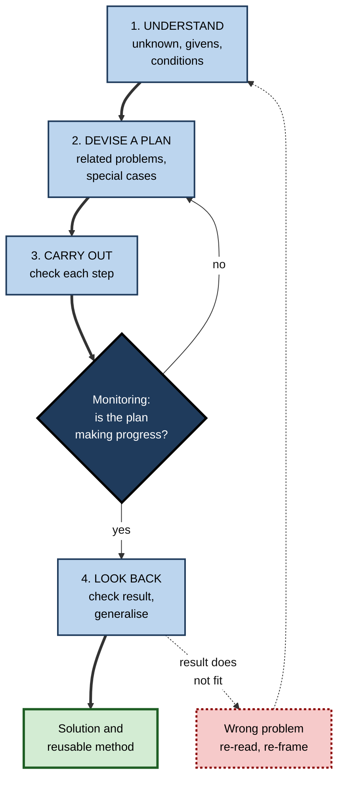
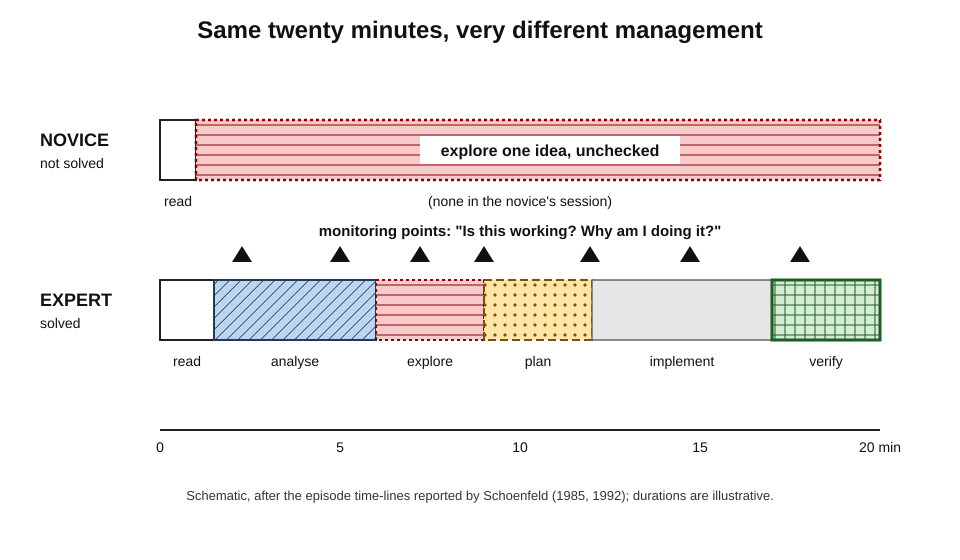
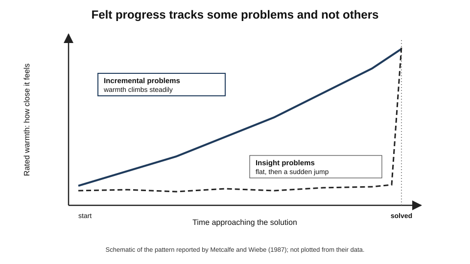
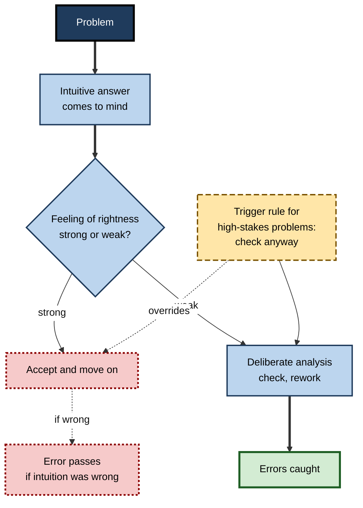
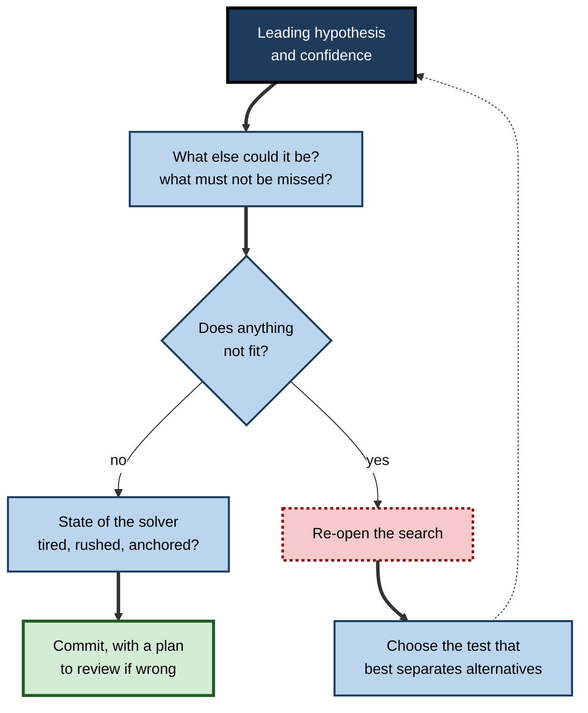

# K.11. Metacognition in Problem Solving

A student spends twenty minutes on an exam problem using the first method that came to mind, never stopping to ask whether it is getting anywhere. An experienced engineer facing a production fault spends the first five minutes asking what exactly is broken and what has changed, tries a hypothesis, notices after ten minutes that the evidence does not fit, and changes course. Both know enough to solve the problem. The difference is that the engineer is **managing her problem solving** as she goes.

> **Definition — Metacognition in problem solving:** the planning, monitoring and control of one's own problem-solving process — understanding and framing the problem, choosing an approach, checking progress, recognising impasses and errors, deciding when to change course or stop, and reviewing the solution.

**Why it matters**

- Most failures in problem solving are not failures of knowledge but of **management** — persisting with a dead end, solving the wrong problem, accepting the first answer.
- Metacognitive control decides when slow, deliberate reasoning is **engaged at all**.
- In professional work — diagnosis, debugging, consulting, legal analysis — the costliest errors come from **premature closure** and unexamined assumptions.
- AI tools increasingly produce candidate solutions; the human contribution shifts towards **framing, checking and judging**.

---

## The Classic Framework

### Pólya's four phases

**George Pólya, *How to Solve It* (1945)**, distilled mathematical problem solving into four phases with guiding questions.

1. **Understand the problem.**
   - What is unknown? What is given? What are the conditions?
   - Can the problem be restated? Drawn?
2. **Devise a plan.**
   - Has a related problem been seen before? Can its method be used?
   - Can a simpler or special case be solved first? Can one work backwards?
3. **Carry out the plan.**
   - Check each step. Can it be seen clearly that each step is correct?
4. **Look back.**
   - Can the result be checked? Derived differently? Used for other problems?

> **Key point:** three of Pólya's four phases are largely **metacognitive** — understanding, planning and looking back. Only carrying out the plan is mainly execution.

**Figure 1.** Pólya's four phases, with the monitoring loops that connect them.

| Phase | Guiding questions | Common failure |
|---|---|---|
| Understand | What is asked? What is given? Can I restate it? | Solving a different problem from the one posed |
| Plan | Have I seen something similar? Can I simplify? | Grabbing the first method that comes to mind |
| Carry out | Is each step right? Is this getting closer? | Persisting with a failing approach |
| Look back | Does the answer make sense? Another way to check? | Stopping at the first answer |

---

## How Experts Manage Problem Solving

### Schoenfeld's evidence

**Study card — Alan Schoenfeld (1985, 1992)**

- **Design:** university students and professional mathematicians worked on unfamiliar problems while thinking aloud; sessions were coded into episodes — reading, analysis, exploration, planning, implementation, verification — and marked for **monitoring** comments.
- **Results:**
  - many students **read the problem, chose an approach almost at once, and pursued it** for the whole session without checking whether it was working — "wild goose chases";
  - a mathematician working outside his speciality spent much of the time **analysing** and **planning**, interrupted himself frequently to assess progress, abandoned unpromising paths quickly and solved the problem — despite knowing less relevant content than some students;
  - after a course that repeatedly asked students "What exactly are you doing? Why are you doing it? How does it help you?", students' time-lines came to resemble the expert's, and their success improved.
- **Conclusion:** **control** — the management of resources during problem solving — can matter as much as knowledge, and it can be taught.

**Figure 2.** Time-lines of a novice and an expert working on an unfamiliar problem.

### Problem representation

- **Michelene Chi, Paul Feltovich and Robert Glaser (1981)** — asked to sort physics problems, **novices** grouped them by surface features (inclined planes, springs), **experts** by underlying principles (conservation of energy, Newton's second law).
- **Consequence:** experts' first metacognitive act — **framing** the problem — draws on deep structure, so their plans fit the problem.
- **Monitoring representation:** "Is this really a cash-flow problem, or a pricing problem that shows up in cash flow?"

| | Novice problem solver | Expert problem solver |
|---|---|---|
| Time spent understanding | Little; starts calculating at once | Substantial; restates and represents the problem |
| Basis of approach | Surface features, first idea | Underlying principles, comparison of options |
| Monitoring during work | Rare | Frequent; explicit checks of progress |
| Response to impasse | Persists or gives up | Changes representation or strategy |
| Checking the answer | Seldom | Routinely, by an independent route |

> **Key point:** experts are often **slower at the start** and faster overall. Time spent understanding and planning prevents long wild goose chases.

---

## Monitoring Progress: Warmth, Impasse and Fixation

### Feelings of warmth

**Study card — Janet Metcalfe and David Wiebe (1987)**

- **Design:** people solved **insight** problems (which require a sudden restructuring) and **non-insight** problems (such as multi-step algebra), rating every few seconds how "warm" — close to a solution — they felt.
- **Results:**
  - for **non-insight** problems, warmth rose **gradually** towards the solution;
  - for **insight** problems, warmth stayed **low and flat** until a sudden jump just before the solution;
  - people's predictions of which insight problems they would solve were poor.
- **Conclusion:** monitoring of progress is reliable for incremental problems and **unreliable** for problems that need restructuring — a lack of felt progress does not mean a solution is far away.

**Figure 3.** Feelings of closeness to a solution in incremental and insight problems.

### Impasse and fixation

- **Impasse** — no available move seems to make progress.
- **Fixation** — inability to see alternatives because a familiar approach dominates.
- **Einstellung (mental set)** — **Abraham Luchins (1942)** gave people water-jar problems all solvable by one complicated formula, then a problem with a much simpler solution; most kept using the complicated formula, and many failed a problem the old formula could not solve.
- **Metacognitive remedies:**
  - **notice the impasse** explicitly — "I have tried this three times";
  - **change the representation** — draw it, restate it, work backwards, try a special case;
  - **step away** — incubation; a meta-analysis by **Ut Na Sio and Thomas Ormerod (2009)** found a reliable, modest benefit of breaks for problem solving, larger for creative problems;
  - **explain the problem** to someone else.

> **Definition — Einstellung effect:** the tendency of a familiar, previously successful method to block recognition of a better or necessary alternative.

> **Watch out:** "keep at it" is poor advice at an impasse. Persistence with the **same representation** rarely breaks fixation; a deliberate change of representation or a break usually helps more.

---

## When Does Careful Thinking Start? The Feeling of Rightness

### Intuition and its monitor

- Many problems produce an **immediate answer** that comes to mind without effort.
- Whether that answer is checked depends on a metacognitive signal.

**Study card — Valerie Thompson, Jamie Prowse Turner and Gordon Pennycook (2011)**

- **Design:** people gave a quick first answer to reasoning problems, rated their **feeling of rightness**, then could reconsider with unlimited time.
- **Results:**
  - **high** feelings of rightness → **less** time rethinking and **fewer** changes of answer;
  - feelings of rightness were driven partly by **fluency** — how quickly the first answer came — not just by its correctness.
- **Conclusion:** a metacognitive feeling acts as the **gatekeeper** for deliberate reasoning; when it is misleadingly strong, errors pass unchecked.

> **Definition — Feeling of rightness:** the metacognitive sense, accompanying an intuitive answer, of how likely it is to be correct; it determines whether further analysis is undertaken.

> **Example:** the bat-and-ball question in **Shane Frederick's (2005)** Cognitive Reflection Test — a bat and a ball cost 1.10 in total; the bat costs 1.00 more than the ball; how much is the ball? The fluent answer "10 pence" feels right; the correct answer is 5 pence. Most people who answer 10 never check.

**Figure 4.** The feeling of rightness decides whether an intuitive answer is checked.

### Designing triggers for deliberate thinking

- Because feelings of rightness can mislead, professionals use **rules that trigger checking regardless of feeling**:
  - always estimate the expected size of an answer before calculating;
  - always ask "what else could explain this?" before committing to a diagnosis;
  - always run the failing test before declaring a bug fixed;
  - always have a second person check figures going to a client.

---

## Metacognition in Diagnostic Reasoning

### Premature closure

- **Mark Graber, Nancy Franklin and Ruthanna Gordon (2005)** — reviewing diagnostic errors in internal medicine, found **premature closure** — accepting a diagnosis before it was fully verified — to be the most common cognitive factor.
- Related failures:
  - **anchoring** — over-weighting the first impression;
  - **confirmation bias** — seeking evidence that fits;
  - **search satisficing** — stopping the search once one abnormality is found.
- These are failures of **metacognitive control**: the process stops too early.

> **Definition — Premature closure:** the acceptance of a solution or diagnosis before it has been adequately verified, ending further search.

### The diagnostic time-out

- **Pat Croskerry** and others proposed **cognitive forcing strategies**: deliberate checks at key moments.
- A typical **diagnostic time-out**:
  1. What is my leading hypothesis, and how confident am I?
  2. What else could it be? What must not be missed?
  3. Does anything not fit?
  4. What test or observation would distinguish the alternatives?
  5. Am I tired, rushed or influenced by someone else's label?

**Figure 5.** A diagnostic time-out before committing to a solution.

> **Watch out:** evidence that general debiasing checklists reduce diagnostic error is **mixed**; trials have often found small or no effects. Checks seem to work best when **specific** to the problem type and combined with domain knowledge, not as generic warnings against bias.

---

## Problem Solving in Teams

### Shared monitoring

- In teams, one person's monitoring can catch another's error — if the team allows it.
- **Crew resource management (CRM)** in aviation grew from accident investigations in the late 1970s, including the 1977 Tenerife runway collision and a 1978 crash in Portland, Oregon, in which a crew preoccupied with a landing-gear problem ran out of fuel.
- **CRM principles:**
  - **cross-monitoring** — each crew member checks others' actions;
  - **speaking up** — structured, assertive statements of concern regardless of rank;
  - **shared mental models** — briefing so that everyone knows the plan and can notice deviation.
- Similar principles now appear in surgery, anaesthesia, incident response and other high-risk work.

| | Individual problem solving | Team problem solving |
|---|---|---|
| Who monitors | The solver alone | Every member, including cross-checks |
| Typical failure | Fixation, premature closure | Groupthink, deference to rank, diffusion of responsibility |
| Key safeguard | Personal time-outs and triggers | Briefings, cross-monitoring, permission to speak up |
| Benefit | Speed, coherence | More perspectives; errors caught by others |

---

## Problem Solving With AI

### Who monitors the machine?

- AI systems can propose solutions, code and diagnoses quickly; the human role becomes **framing the problem, checking the output and deciding**.
- **Self-correction limits** — studies such as **Jie Huang and colleagues (2023)** found that large language models asked to review and correct their own reasoning **without external feedback** often failed to improve, and sometimes changed correct answers to wrong ones.
- **Implication:** external checks — tests, data, independent sources, human review — remain the reliable meta level.

> **In practice:** when using AI on a problem, first write down your own framing and expected shape of the answer; ask the tool to state its assumptions; then verify the solution by an **independent route** — a test case, a back-of-envelope estimate or a source.

---

## Worked Example (illustrative): Managing a Debugging Session

- **Situation:** a developer is told that a nightly data job produced totals 3% lower than expected.

| Minute | Activity | Metacognitive move |
|---|---|---|
| 0–5 | Restates the problem: which totals, since when, how big, which records? | **Understand** — avoids fixing the wrong thing |
| 5–8 | Lists what changed recently: a library upgrade, a new data source, a schema change | **Plan** — generates alternatives before committing |
| 8–10 | Predicts: if the new data source is the cause, the shortfall will be confined to its records | **Prediction before checking** |
| 10–20 | Tests the prediction: the shortfall is spread across all sources | **Monitor** — evidence does not fit; drops the first hypothesis |
| 20–25 | Notices she was about to check the library upgrade in exhausting detail; asks "What is the fastest test that separates the two remaining hypotheses?" | **Control** — chooses a discriminating test |
| 25–35 | Finds that the schema change truncated a date field, excluding late-night transactions | **Carry out** |
| 35–45 | Re-runs the job on yesterday's data, compares totals, adds a test for the date boundary | **Look back** — independent check and prevention |

- **Conclusion:** the decisive moves were **restating the problem**, **predicting** what each hypothesis implied, **abandoning** a hypothesis when evidence did not fit and **looking back** with an independent check.

> **Watch out:** the most common failure in debugging is spending an hour **confirming** the first hypothesis rather than ten minutes trying to **refute** it.

---

## Case Study (illustrative): Restructuring Incident Response

- **Situation:** an online payments company suffered several long outages; post-incident reviews showed that engineers often spent the first hour pursuing a single wrong theory.
- **Problem:** responders fixated on the most recent deployment as the cause, even when evidence pointed elsewhere; nobody had the role of stepping back.
- **Diagnosis:**
  - **premature closure** on a familiar hypothesis;
  - **no explicit monitoring** of whether the investigation was progressing;
  - junior engineers who noticed contradictory signals did not speak up.
- **Actions:**
  1. Introduced an **incident commander** role, separate from hands-on investigation, responsible for monitoring progress and options.
  2. Every 15 minutes, a short **time-out**: current hypotheses, evidence for and against, what would discriminate between them, what has been ruled out.
  3. A shared incident document listing hypotheses and their status, visible to everyone.
  4. Explicit permission — and an expectation — for anyone to say "this does not fit".
  5. Post-incident reviews examined the **reasoning path**, not just the root cause.
- **Result:** within a year, median time to identify the cause fell markedly; reviews recorded more hypotheses considered and earlier abandonment of wrong ones.
- **Side effects:** time-outs felt like interruptions during the first incidents; engineers came to value them after seeing that they shortened outages.
- **Lesson:** problem-solving metacognition can be **built into roles and rhythms**, so that monitoring does not depend on one stressed individual remembering to step back.

---

## Ill-Structured and Wicked Problems

### When the problem itself is unclear

- **Herbert Simon (1973)** distinguished **well-structured** problems — clear goals, known operators, testable solutions — from **ill-structured** ones, where goals, constraints and criteria are themselves uncertain.
- **Horst Rittel and Melvin Webber (1973)** described **wicked problems** in planning and policy: no definitive formulation, no stopping rule, solutions that are better or worse rather than right or wrong, and every attempt changing the problem.
- **Most professional problems** — strategy, design, policy, organisational change, many diagnoses — are ill-structured to some degree.

| | Well-structured problem | Ill-structured or wicked problem |
|---|---|---|
| Goal | Clear | Contested or evolving |
| Stopping rule | Solution found and checked | Resources run out or "good enough" is agreed |
| Checking | Against a correct answer | Against stakeholders' criteria and consequences |
| Main metacognitive task | Monitoring progress towards the answer | Monitoring the **framing** itself |

### Metacognition for ill-structured problems

- **Monitor the framing** — repeatedly ask "Are we still solving the right problem?"
- **Make criteria explicit** — agree what would count as a good solution before choosing one.
- **Seek multiple perspectives** — stakeholders often hold parts of the problem definition.
- **Decide when to stop** — agree a satisficing standard rather than searching indefinitely.
- **Treat solutions as experiments** — plan to monitor consequences and adapt.

> **Example (illustrative):** a hospital asked to "reduce waiting times" first frames the problem as lack of clinic capacity; monitoring the framing — by mapping where patients actually wait — reveals that most delay occurs in booking and referral, and the solution changes completely.

---

## Open Questions

- **Can control skills taught in one domain transfer to others?**
  - Schoenfeld's training improved mathematical problem solving; evidence of transfer to unrelated domains is limited.
- **How can monitoring work for insight problems?**
  - Feelings of warmth are poor guides when restructuring is needed; reliable ways to judge progress on such problems are unknown.
- **Why do generic debiasing checklists show weak effects?**
  - Possible reasons include lack of domain specificity, low compliance and the automaticity of biases; the question is unresolved.
- **How should human and AI monitoring be combined?**
  - When AI proposes solutions, the best division of framing, checking and deciding between people and machines is an open design question.

---

## Summary

- **Metacognition in problem solving** is the planning, monitoring and control of the solving process: framing, choosing an approach, checking progress, handling impasses, deciding when to stop and looking back.
- **Pólya (1945):** understand, devise a plan, carry out, look back — three of the four phases are largely metacognitive.
- **Schoenfeld:** novices pursue first ideas without checking; experts analyse, plan and monitor frequently; control can be taught.
- Experts **represent** problems by deep structure (Chi, Feltovich and Glaser, 1981), spending more time understanding and less time lost.
- **Feelings of warmth** track progress on incremental problems but not on **insight** problems (Metcalfe and Wiebe, 1987).
- **Impasse, fixation and Einstellung** (Luchins, 1942) are broken by changing representation, breaks (incubation) and explanation — not by persistence alone.
- The **feeling of rightness** gates deliberate reasoning and is driven by fluency (Thompson and colleagues, 2011); **trigger rules** force checking when stakes are high.
- **Premature closure** is the most common cognitive factor in diagnostic error; **diagnostic time-outs** help, though generic debiasing evidence is mixed.
- Teams use **cross-monitoring, speaking up and shared mental models** (crew resource management).
- AI self-correction without external feedback is unreliable; humans must supply **independent checks**.
- **Ill-structured** (Simon, 1973) and **wicked** problems (Rittel and Webber, 1973) shift the main metacognitive task to monitoring the **framing**, making criteria explicit and agreeing when to stop.

---

## Self-Check

1. Define metacognition in problem solving and give three examples of metacognitive moves.
2. List Pólya's four phases with one guiding question each.
3. Describe Schoenfeld's comparison of students and a mathematician, and the effect of his teaching.
4. How do experts and novices differ in representing problems?
5. What did Metcalfe and Wiebe find about feelings of warmth?
6. Explain the Einstellung effect with Luchins's water-jar study.
7. Name three ways of breaking fixation.
8. What is the feeling of rightness, and what drives it?
9. Solve the bat-and-ball problem and explain why many people get it wrong.
10. What is premature closure, and what did Graber and colleagues find?
11. Describe a diagnostic time-out. What does the evidence say about generic debiasing?
12. What principles of crew resource management support team monitoring?
13. Why is AI self-correction without external feedback unreliable, and what follows for users?
14. A consultant has spent two days building a model to answer a client's question, and the results look odd. Using the ideas above, outline how she should proceed.

### Answer Key

1. Planning, monitoring and control of one's own problem-solving process. *e.g.* restating the problem, predicting what a hypothesis implies, abandoning an approach when evidence does not fit.
2. Understand (What is unknown?); devise a plan (Have I seen a related problem?); carry out (Is each step correct?); look back (Can I check the result differently?).
3. Students chose an approach at once and pursued it without checking; the mathematician analysed, planned and monitored frequently, abandoning poor paths and solving the problem despite less content knowledge. Repeated questioning about what, why and how made students' behaviour more expert-like and improved success.
4. Novices sort by surface features; experts by underlying principles, so expert plans fit the problem's deep structure.
5. Warmth rose gradually for non-insight problems but stayed flat until just before solution for insight problems, so felt progress is a poor guide to insight problems.
6. A familiar method blocks better alternatives; after many problems solvable by one complex formula, people used it on a problem with a simple solution and failed one it could not solve.
7. Changing the representation (draw, restate, work backwards, special case); taking a break; explaining the problem to someone.
8. The sense that an intuitive answer is correct, which determines whether it is rechecked; it is driven partly by fluency — how quickly the answer came.
9. Ball = 0.05, bat = 1.05. The fluent answer 0.10 feels right, so the feeling of rightness suppresses checking.
10. Accepting a diagnosis before full verification; the most common cognitive factor in diagnostic errors reviewed.
11. A pause to state the leading hypothesis and confidence, consider alternatives and must-not-miss conditions, look for misfits, choose discriminating tests and check one's own state. Generic debiasing shows mixed, often weak effects; specific checks with domain knowledge work better.
12. Cross-monitoring, speaking up regardless of rank, briefings to create shared mental models.
13. Without new information, the model's critique draws on the same processes that produced the error; it may even change correct answers. Users need independent checks — tests, data, sources, review.
14. Pause and restate the client's question; list assumptions and what each implies; predict what results should look like; check data and model against a simple independent estimate; consider whether the problem is framed correctly; ask a colleague to review; decide explicitly whether to fix, re-frame or stop.

---

## Glossary

| Term | Meaning |
|---|---|
| Anchoring | Over-weighting an initial impression or value. |
| Cognitive forcing strategy | A deliberate check at a key moment to counter predictable errors. |
| Cognitive Reflection Test | Short problems with fluent but wrong intuitive answers (Frederick, 2005). |
| Crew resource management | Training in teamwork, cross-monitoring and speaking up, from aviation. |
| Cross-monitoring | Team members checking one another's actions. |
| Diagnostic time-out | A structured pause to reconsider a diagnosis before committing. |
| Einstellung effect | A familiar method blocking recognition of a better alternative. |
| Feeling of rightness | The sense that an intuitive answer is correct, which gates further analysis. |
| Feeling of warmth | The sense of being close to a solution. |
| Fixation | Inability to see alternatives because one approach dominates. |
| Ill-structured problem | A problem whose goals, constraints or criteria are uncertain. |
| Impasse | A state in which no available move seems to make progress. |
| Incubation | Setting a problem aside, after which a solution may come more easily. |
| Insight problem | A problem requiring a sudden restructuring of its representation. |
| Premature closure | Accepting a solution before it has been adequately verified. |
| Problem representation | The way a solver mentally frames a problem. |
| Search satisficing | Stopping a search once one finding is made. |
| Wicked problem | A problem with no definitive formulation or stopping rule, changed by every attempt to solve it. |
