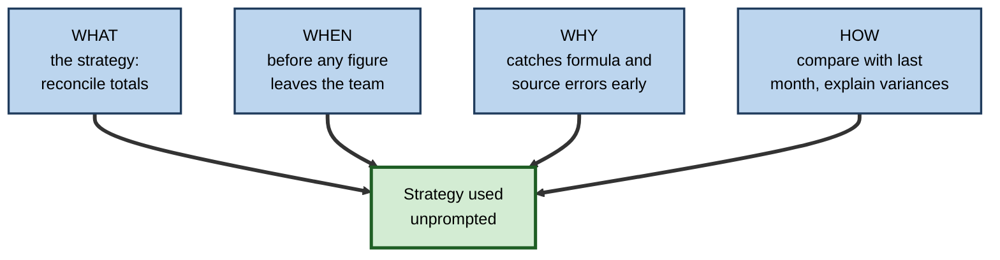
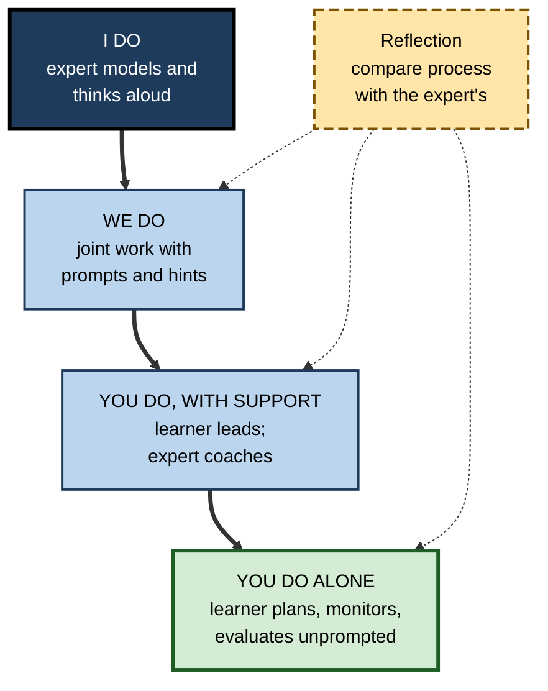
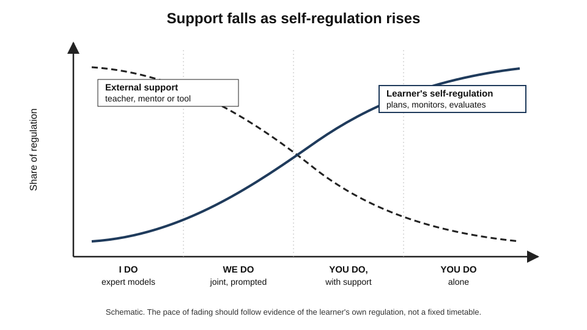
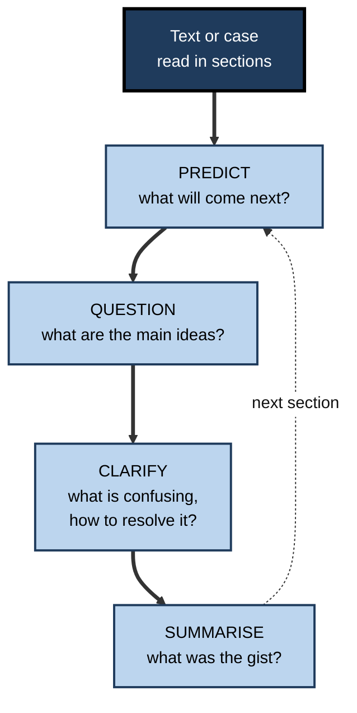
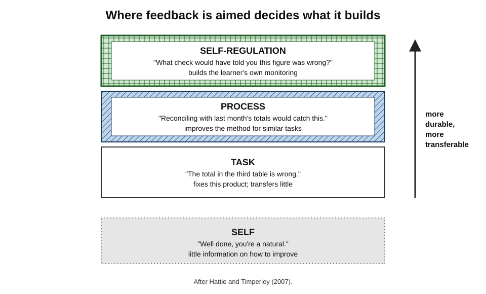

# K.12. Teaching Metacognition to Others

A junior analyst brings a spreadsheet to two different senior colleagues. The first spots the error, fixes it and hands it back. The second asks, "Before I look — how confident are you in the totals, and how did you check them?", listens, and then says, "Here is how I would have checked: I always reconcile the total against last month's report first." The first colleague fixed a spreadsheet; the second taught the analyst **how to check her own work**.

> **Definition — Teaching metacognition:** deliberately helping others develop knowledge of their own thinking and the skills to plan, monitor and evaluate it — through explicit instruction, modelling, guided practice, prompting, feedback and the gradual transfer of control to the learner.

**Why it matters**

- Metacognitive skill is one of the **most teachable** influences on learning, and teaching it is among the most cost-effective educational investments.
- It **multiplies**: a learner who can manage their own learning keeps improving after the teacher has gone.
- Experts' metacognition is mostly **invisible** — it happens in their heads — so it is rarely passed on unless made explicit.
- Managers, mentors, trainers and senior colleagues all teach metacognition, well or badly, every time they review someone's work.

---

## What the Evidence Says

### Teaching works — when done well

- **Large evidence reviews in England** (the Education Endowment Foundation's teaching and learning toolkit) estimate that approaches teaching **metacognition and self-regulation** add, on average, around **seven months' additional progress** over a school year, at low cost; a 2025 update put the estimate at around **eight months** for disadvantaged pupils.
- **Meta-analyses of interventions** (for example Charlotte Dignath and Gerhard Büttner, 2008; later reviews of university and online learning) find positive effects on achievement, larger when strategies are **taught explicitly, embedded in subject content and practised over time**.
- **Effects vary widely**: brief, generic, detached "study skills" sessions often show little benefit.

> **Watch out:** the headline "months of progress" figures are averages across very different programmes. They indicate that well-designed metacognitive teaching tends to work; they do not guarantee that any given programme will.

### The WWW&H rule

**Marcel Veenman, Bernadette Van Hout-Wolters and Peter Afflerbach (2006)** summarised what effective metacognitive instruction requires.

- **Embedded** — taught within the content being learned, not as a separate subject.
- **Informed** — learners are told **why** the strategy is useful, so they will use it unprompted.
- **Prolonged** — practised over time until it becomes habitual.
- **The WWW&H rule** — learners must know:
  - **What** to do;
  - **When** to do it;
  - **Why** to do it;
  - **How** to do it.

> **Mnemonic — WWW&H:** What, When, Why and How — the four things a learner must know for a strategy to be used.

**Figure 1.** The four things a learner needs to know before a strategy will be used unprompted.

| | Detached instruction | Embedded instruction |
|---|---|---|
| Form | A separate "learning to learn" course | Strategies taught within real subject or work tasks |
| Example | A workshop on "critical thinking skills" | Checking routines taught during actual financial analysis |
| Transfer to real tasks | Weak; learners rarely apply strategies elsewhere | Stronger; strategies are linked to the tasks where they are needed |
| Evidence | Small or inconsistent effects | Moderate, more reliable effects |
| Best use | Brief introduction of shared vocabulary | The main vehicle of teaching |

---

## Core Methods

### Explicit instruction in strategies

- **Name** the strategy and its purpose.
- **Describe** the steps.
- **Explain** when it applies and why it works.
- **Show** it in use on a real task.
- *e.g.* "This is a pre-mortem. Before we start a project we imagine it has failed and list why. It works because imagining failure as fact makes risks easier to see. Watch how I run one for our migration plan."

### Modelling: thinking aloud

- Experts **verbalise their metacognition** while working:
  - "First I'm asking what the question really is…"
  - "This number looks too high — I'll check the source before going on."
  - "I'm not confident here, so I'll flag it rather than guess."
- **Why it matters:** novices see the *products* of expert thinking (the finished report, the working code) but not the **planning, monitoring and checking** that produced them.
- Recent guidance in school education places particular weight on **metacognitive talk** — teachers modelling their thinking aloud and building learners' own talk about their thinking.

> **In practice:** in a code review, a senior engineer who writes "I checked the boundary case where the list is empty, because that's where this pattern usually fails" teaches more than one who writes "LGTM".

### Cognitive apprenticeship

**Allan Collins, John Seely Brown and Susan Newman (1989)** argued that thinking skills, like crafts, can be taught by apprenticeship — if the thinking is made visible. Their six methods:

- **Modelling** — the expert performs and thinks aloud.
- **Coaching** — the expert observes the learner and gives hints and feedback.
- **Scaffolding** — the expert provides supports the learner cannot yet supply, then **fades** them.
- **Articulation** — the learner explains their reasoning.
- **Reflection** — the learner compares their process with the expert's.
- **Exploration** — the learner tackles new problems independently.

> **Definition — Cognitive apprenticeship:** teaching cognitive and metacognitive skills by making expert thinking visible through modelling, then coaching and scaffolding learners towards independent performance.

### Scaffolding and fading

- **David Wood, Jerome Bruner and Gail Ross (1976)** coined **scaffolding** for the support a tutor gives so that a learner can do what they could not do alone — recruiting interest, simplifying the task, keeping direction, highlighting critical features, managing frustration, demonstrating.
- **Fading** — support is **withdrawn gradually** as the learner's own regulation grows.
- The sequence is often summarised as **"I do, we do, you do"** — gradual release of responsibility.

**Figure 2.** Gradual release: from expert modelling to independent use.

**Figure 3.** As the learner's self-regulation grows, external support is faded.

> **Watch out:** support that is never faded produces **dependence**; support withdrawn too early produces **failure and discouragement**. Fading should follow evidence of the learner's own regulation, not the calendar.

---

## Programmes With Strong Evidence

### Reciprocal teaching

**Study card — Annemarie Palincsar and Ann Brown (1984)**

- **Design:** pupils who could decode text but understood it poorly took turns leading small-group discussion of passages, using four strategies first modelled by the teacher:
  - **predicting** what comes next;
  - **questioning** — generating questions about the main ideas;
  - **clarifying** — noticing and resolving confusion;
  - **summarising**.
- **Results:** comprehension improved substantially and the gains **lasted**; pupils increasingly led the discussions themselves as the teacher faded support.
- **Later reviews** (Barak Rosenshine and Carla Meister, 1994) found positive effects across many studies — small to moderate on standardised tests, larger on tests designed by the researchers.
- **Conclusion:** comprehension monitoring can be taught by **modelling, guided practice and gradual handover**.

**Figure 4.** The four strategies of reciprocal teaching.

### IMPROVE

- **Zemira Mevarech and Bracha Kramarski (1997)** developed **IMPROVE** for mathematics, built around four kinds of self-addressed question:
  - **comprehension** — "What is the problem about?";
  - **connection** — "How is it similar to or different from problems I have solved?";
  - **strategic** — "Which strategy is appropriate, and why?";
  - **reflection** — "Does the answer make sense? Can I solve it another way?"
- Students taught to use these questions in co-operative groups outperformed comparison groups in problem solving and in mathematical reasoning, in a series of studies.

| Programme | Domain | Core method | What learners internalise |
|---|---|---|---|
| Reciprocal teaching | Reading comprehension | Four strategies, rotating discussion leader | Monitoring and repairing understanding |
| IMPROVE | Mathematics | Four types of metacognitive question | Planning and checking problem solutions |
| Cognitive apprenticeship | Any complex skill | Modelling, coaching, scaffolding, fading | Expert ways of thinking through tasks |
| Self-regulated strategy development (Karen Harris and Steve Graham) | Writing | Explicit strategy, self-statements, goal-setting, self-monitoring | Planning and revising writing |

---

## Feedback That Builds Self-Regulation

### Four levels of feedback

**John Hattie and Helen Timperley (2007)** distinguished four levels at which feedback can be aimed.

- **Task** — about the product: "The third figure is wrong."
- **Process** — about the method: "Reconciling with last month would have caught this."
- **Self-regulation** — about the learner's monitoring and control: "How could you have known this figure needed checking?"
- **Self** — about the person: "Well done, you're a star."

- **Effects:**
  - task feedback helps immediately but transfers little;
  - **process** and **self-regulation** feedback build durable capability;
  - **self**-level praise carries little information about how to improve and, on its own, rarely helps learning.

**Figure 5.** Four levels of feedback, from the product to the learner's own regulation.

| Level | Example | Effect on future work |
|---|---|---|
| Task | "Cell D14 is wrong." | Fixes this error |
| Process | "Totals should always be reconciled with the prior period." | Improves the method for similar tasks |
| Self-regulation | "What check would have told you D14 was wrong?" | Builds the learner's own monitoring |
| Self | "Great work — you're very bright." | Little guidance; may encourage avoiding difficulty |

### Questions that teach monitoring

Mentors and managers can prompt metacognition with a small set of questions, used **before** giving their own view.

- **Before the task:**
  - "What is the real question here?"
  - "How will you approach it, and why that way?"
  - "What will you check, and when?"
- **During the task:**
  - "How is it going compared with what you expected?"
  - "What would tell you that this approach isn't working?"
- **After the task:**
  - "How confident are you in this, and why?"
  - "What would you do differently next time?"
  - "What did you learn about how you work?"

> **Remember:** **ask before telling.** A question that makes the learner predict, check or evaluate first turns every review into practice of metacognition.

- **Coaching models** used in workplaces, such as **GROW** (Goal, Reality, Options, Will — associated with John Whitmore), are in effect structured metacognitive prompts.

### Calibration in teaching

- Ask learners to give **confidence ratings** on answers, and show them their accuracy at each confidence level.
- Discuss "sure but wrong" answers in particular — the most informative cases.
- **Teach-back** in healthcare — asking patients to explain instructions in their own words — is a calibration check for the teacher as well as the learner.

---

## Teaching Metacognition at Work

### Where it happens

- **Onboarding** — teaching newcomers *how to learn* the organisation, not just what to know.
- **Mentoring and pairing** — making expert reasoning visible during real work.
- **Reviews** — code review, document review, case review, used to ask about process and checks.
- **Retrospectives and post-incident reviews** — teams practising evaluation together.
- **Formal training** — embedding prompts, predictions and reflection within technical content.

### Pitfalls

- **Teaching the vocabulary, not the practice** — learners can define "metacognition" but do not change behaviour.
- **Generic workshops** — strategies taught out of context and never connected to real tasks.
- **Worksheet metacognition** — reflection forms completed mechanically.
- **Over-scaffolding** — templates and prompts that never fade, so learners never regulate for themselves.
- **Ignoring domain knowledge** — learners cannot monitor quality in a domain they barely know; metacognitive teaching must go hand in hand with content.
- **Punishing honesty** — if admitted uncertainty is penalised, learners stop reporting it.

### AI tutors and assistants

- AI systems can be designed to **prompt metacognition** — asking learners to plan, predict, explain and check — or to **replace** it by supplying answers.
- Evidence from 2024–2025 suggests that tools giving **hints rather than answers** protect learning, while unrestricted answer-giving can raise practice performance without building independent capability.
- **Design principles:**
  - require an attempt before help;
  - ask the learner to rate confidence and explain reasoning;
  - give process-level hints, not complete solutions;
  - fade prompts as the learner shows independent regulation.

---

## Worked Example (illustrative): A Four-Week Mentoring Sequence

- **Situation:** a senior consultant mentors a new analyst whose slide decks are accurate but poorly structured and unchecked; the goal is that within a month the analyst plans, checks and evaluates decks without prompting.

| Week | Mentor's role | Analyst's role | Metacognitive focus |
|---|---|---|---|
| 1 — I do | Builds a deck while thinking aloud: "What's the one-sentence answer? What does the client need to believe first? Which numbers will they question?" | Observes; notes the mentor's questions | Planning a storyline; anticipating challenge |
| 2 — We do | Co-builds a deck; asks the analyst to propose the storyline and the checks before contributing | Drafts storyline and check-list; predicts client questions | Planning and prediction |
| 3 — You do, with support | Reviews the analyst's deck by asking, "How confident are you in each page? What did you check?" before commenting | Leads; rates confidence per page; explains checks | Monitoring and calibration |
| 4 — You do alone | Reviews only the finished deck and the analyst's self-evaluation | Plans, builds, checks and writes a short self-evaluation | Independent regulation and evaluation |

1. **Make the expert's thinking visible** in week 1 — the analyst cannot imitate checks she has never seen.
2. **Ask before telling** from week 2 onwards.
3. **Use confidence ratings** in week 3; discuss pages marked "sure" that had errors.
4. **Fade** in week 4 — the mentor responds to the analyst's self-evaluation rather than the deck alone.

- **Conclusion:** by week 4 the analyst's self-evaluation identifies most of the issues the mentor would have raised; the mentor's role has shifted from **corrector** to **calibrator**.

> **Watch out:** if the analyst's week-4 self-evaluation misses major problems, the right response is to step back to week-3 support for that aspect — not to abandon fading altogether.

---

## Case Study (illustrative): Making Senior Engineers' Thinking Visible

- **Situation:** a software company's engineering organisation grew quickly; most engineers had under two years' experience, and production incidents traced to unchecked assumptions were rising.
- **Problem:** senior engineers were skilled but their checking was **invisible**; code reviews consisted of brief approvals or terse corrections, and juniors learned what to fix but not **how to think about risk**.
- **Diagnosis:**
  - juniors' metacognitive knowledge of typical failure modes was thin;
  - reviews gave **task-level** feedback only;
  - nobody modelled planning — designs were presented finished.
- **Actions:**
  1. **Design walk-throughs aloud:** senior engineers presented designs in progress, verbalising alternatives considered, risks anticipated and checks planned.
  2. **Review comments with reasons:** reviewers were asked to write at least one **process-level** comment per review — "I always test the empty and maximum cases here because…".
  3. **Ask-first reviews:** pull requests included a short author note — "riskiest part, how I tested it, confidence" — which reviewers responded to before adding their own findings.
  4. **Pairing rotation:** juniors spent a half-day a fortnight pairing with a senior on real work, with the senior thinking aloud.
  5. **Fading:** after three months, juniors began leading walk-throughs, with seniors commenting on their reasoning.
- **Result:**
  - author notes improved: juniors increasingly identified the riskiest parts correctly;
  - incidents traced to unchecked assumptions fell over the following two quarters;
  - several juniors began mentoring newer hires using the same practices.
- **Side effects:** reviews took slightly longer at first; some seniors found thinking aloud uncomfortable and needed practice.
- **Lesson:** expert metacognition spreads when it is **made visible, practised with prompts and feedback, and gradually handed over** — not when it is assumed to rub off.

---

## Building Calibration Into Group Teaching

### Commit, then discuss

- **Eric Mazur's peer instruction (1990s)** — in university physics lectures, students answer a conceptual question individually, **commit** to an answer (often with a confidence level), discuss with neighbours, then answer again.
- The method builds metacognition because learners must:
  - **commit** before hearing others — revealing what they actually think;
  - **explain** their reasoning — exposing gaps;
  - **revise** in the light of better arguments — practising evaluation.
- Studies of peer instruction report substantial gains in conceptual understanding compared with traditional lectures, and the proportion of correct answers typically rises after discussion.

### Confidence-weighted questions

- Learners mark each answer with a **confidence level**; scoring rewards being right when confident and penalises confident errors more than hesitant ones.
- Used in some medical and professional assessments to discourage guessing and to reveal **dangerous confident errors**.
- **For teaching**, the key step is discussion of the "sure but wrong" answers.

> **In practice:** in a team training session, ask a question, have everyone write an answer and a confidence rating privately, reveal the spread, discuss, and re-vote. The pattern of confidence is often more instructive than the answers.

---

## Open Questions

- **How can metacognitive teaching be made to transfer?**
  - Embedded teaching works within domains; how to help learners carry strategies to new domains remains unclear.
- **How should teachers be trained to model metacognition?**
  - Many experts' metacognition is tacit; methods for making it explicit vary in effectiveness.
- **Which AI tutoring designs build self-regulation?**
  - Early evidence favours hint-giving and prompting designs; long-term effects are unknown.
- **How does metacognitive teaching interact with domain knowledge?**
  - Learners need knowledge to monitor quality; the right balance and sequence of content and metacognitive teaching is debated.
- **How should workplace metacognitive teaching be evaluated?**
  - Most evidence comes from schools and universities; robust workplace studies are scarce.

---

## Summary

- **Teaching metacognition** develops learners' knowledge and regulation of their own thinking through explicit instruction, modelling, guided practice, prompting, feedback and **gradual release**.
- Evidence reviews rate metacognitive teaching among the most **cost-effective** approaches; effects are largest when instruction is **embedded, informed and prolonged** (Veenman and colleagues) and learners know **What, When, Why and How**.
- **Modelling** makes expert monitoring visible; **cognitive apprenticeship** (Collins, Brown and Newman, 1989) adds coaching, scaffolding, articulation, reflection and exploration.
- **Scaffolding** (Wood, Bruner and Ross, 1976) must be **faded** as regulation grows.
- Proven programmes include **reciprocal teaching** (Palincsar and Brown, 1984), **IMPROVE** (Mevarech and Kramarski, 1997) and self-regulated strategy development in writing.
- **Feedback** should target **process and self-regulation**, not just task or self (Hattie and Timperley, 2007).
- **Ask before telling**: questions before, during and after tasks make every review a lesson in metacognition; confidence ratings and teach-back build calibration.
- At work, metacognition is taught through onboarding, mentoring, reviews and retrospectives; pitfalls include vocabulary without practice, generic workshops, never-fading scaffolds, ignoring domain knowledge and punishing honesty.
- AI tutors should **prompt** rather than replace the learner's regulation.
- **Peer instruction** (commit, discuss, re-answer) and **confidence-weighted questions** build calibration and evaluation within group teaching.

---

## Self-Check

1. Define teaching metacognition and list five methods it uses.
2. What did Veenman and colleagues identify as the conditions for effective metacognitive instruction?
3. Explain the WWW&H rule with a workplace example.
4. Why does embedded instruction transfer better than detached instruction?
5. What is thinking aloud as a teaching method, and why is it needed?
6. Name the six methods of cognitive apprenticeship.
7. Describe scaffolding and fading, and the risks of getting fading wrong.
8. Describe reciprocal teaching and what the evidence shows.
9. What are IMPROVE's four types of question?
10. Distinguish Hattie and Timperley's four feedback levels, with examples.
11. Give three questions a mentor could ask before giving their own view of a junior's work.
12. How should AI tutors be designed to support rather than replace metacognition?
13. A manager runs a one-day "learning to learn" workshop and sees no change. Diagnose and redesign.
14. Design a mentoring sequence to teach a new nurse to monitor and evaluate her own medication-administration decisions.

### Answer Key

1. Deliberately helping others develop knowledge of their thinking and skills to plan, monitor and evaluate it. Methods: explicit strategy instruction, modelling, guided practice, prompting, feedback, gradual release.
2. Embedded in content, informed (learners told why it helps), prolonged practice, and learners knowing what, when, why and how.
3. What to do, when, why and how. *e.g.* What: peer-check calculations; When: before any client deliverable; Why: authors miss their own errors; How: a colleague recomputes key figures independently.
4. Strategies are learned in the tasks where they are needed, so learners connect them to real cues; detached strategies are rarely recalled when work demands them.
5. The expert verbalises planning, monitoring and checking while working, making invisible metacognition visible so novices can imitate it.
6. Modelling, coaching, scaffolding, articulation, reflection, exploration.
7. Support that lets learners do what they cannot yet do alone, gradually withdrawn as their regulation grows. Never fading produces dependence; fading too early produces failure.
8. Learners take turns leading discussion using predicting, questioning, clarifying and summarising, first modelled by the teacher. Comprehension improved substantially and durably; reviews found positive effects, larger on researcher-designed tests.
9. Comprehension, connection, strategic and reflection questions.
10. Task ("this figure is wrong"), process ("reconcile with last month"), self-regulation ("how could you have known to check?"), self ("you're brilliant"). Process and self-regulation feedback build durable capability; self-level praise rarely helps.
11. "What is the real question here?" "How confident are you, and why?" "What did you check, and what would you do differently?"
12. Require an attempt first, ask for confidence and reasoning, give process hints not answers, and fade prompts as independent regulation appears.
13. Detached, brief, generic, unpractised. Redesign: embed strategies in real tasks, explain why they help, model them, practise over weeks with prompts and feedback, and fade support.
14. *e.g.* Week 1: preceptor thinks aloud during medication rounds (checks, doubts, escalation). Week 2: joint rounds; nurse states checks before acting. Week 3: nurse leads, rates confidence, explains checks; preceptor discusses "sure but wrong" moments. Week 4: nurse works independently, writes a brief self-evaluation reviewed by the preceptor.

---

## Glossary

| Term | Meaning |
|---|---|
| Articulation | A learner explaining their reasoning aloud. |
| Cognitive apprenticeship | Teaching thinking skills by making expert thinking visible and coaching learners to independence. |
| Confidence-weighted question | An item answered with a confidence level, scored to penalise confident errors. |
| Detached instruction | Teaching learning strategies separately from subject content. |
| Embedded instruction | Teaching strategies within real subject or work tasks. |
| Fading | Gradually withdrawing support as a learner's own regulation grows. |
| Gradual release of responsibility | Moving from expert modelling to joint work to independent learner performance. |
| IMPROVE | A mathematics method using comprehension, connection, strategic and reflection questions. |
| Metacognitive talk | Spoken description of one's own thinking, modelled by teachers and practised by learners. |
| Modelling | An expert demonstrating a task while making their thinking visible. |
| Peer instruction | Answering a question individually, discussing with peers and answering again. |
| Process feedback | Feedback about the method used to produce work. |
| Reciprocal teaching | Group reading using predicting, questioning, clarifying and summarising, led in turn by learners. |
| Scaffolding | Support that enables a learner to do what they cannot yet do alone. |
| Self-regulation feedback | Feedback that prompts learners to monitor and evaluate their own work. |
| Teach-back | Asking learners to explain information in their own words to check understanding. |
| Thinking aloud | Verbalising one's thoughts while working. |
| WWW&H rule | Learners must know What, When, Why and How for a strategy to be used. |
