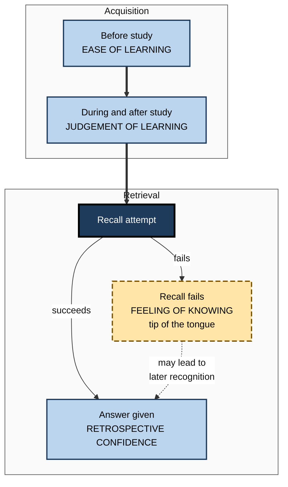
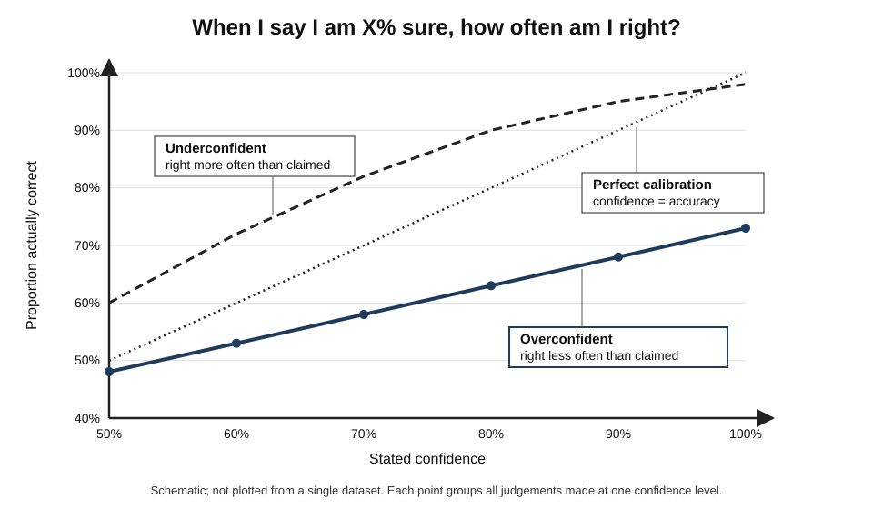
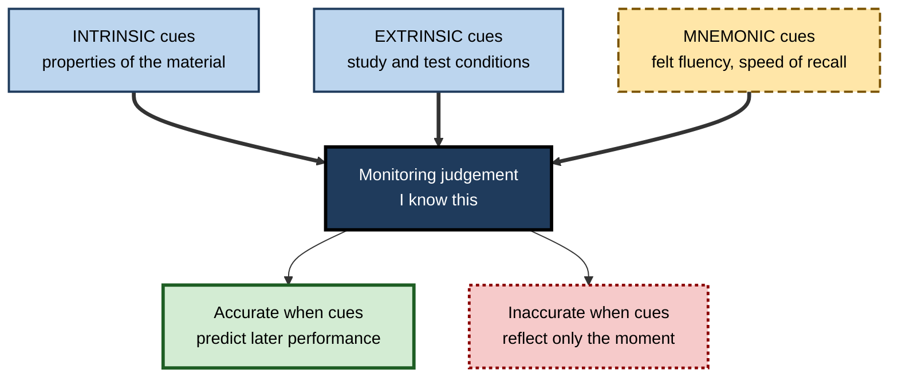
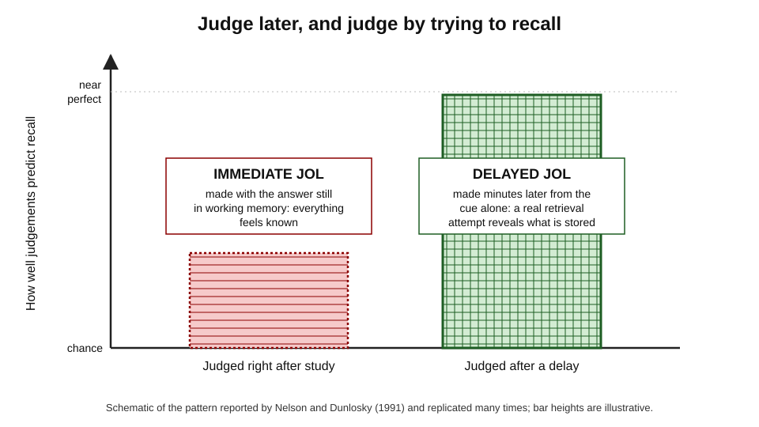
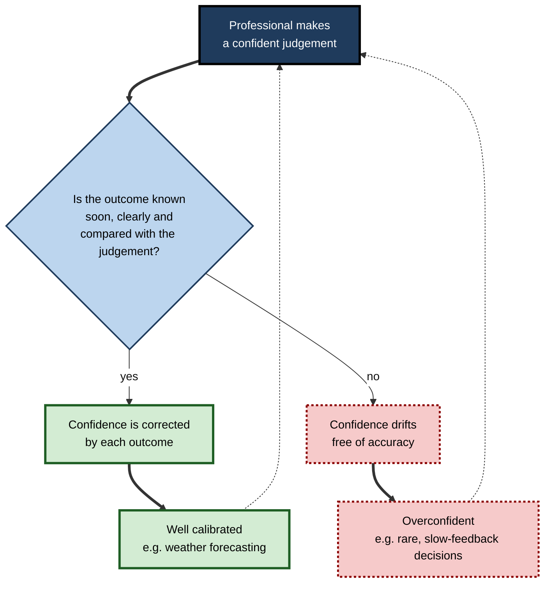

# K.3. Metacognitive Monitoring

A pub-quiz contestant is asked the capital of Australia and feels the answer "on the tip of the tongue" before producing it. A trainee pilot judges that she has mastered a checklist and is surprised to forget a step in the simulator. A weather forecaster says "70% chance of rain" and, over hundreds of forecasts, it rains on almost exactly 70% of such days. Each is **judging the state of their own mind** — and the judgements differ enormously in how well they match reality.

> **Definition — Metacognitive monitoring:** the processes by which a person assesses the state, progress or quality of their own cognition — what they know, how well they are learning, and how likely their answers are to be right.

**Why it matters**

- Every decision to **study more, stop, check, ask or act** depends on a monitoring judgement.
- Monitoring is **inferential**, not a direct reading of memory, so it can be systematically wrong.
- Its accuracy can be **measured** precisely — and improved.
- In professions, poorly monitored confidence causes **unchecked errors**; well-monitored confidence lets people act decisively where it is safe.

---

## Judgements About One's Own Mind

### The family of monitoring judgements

Researchers name monitoring judgements by **when** they are made and **what** they predict.

- **Ease-of-learning judgement (EOL)** — before study: "How hard will this be to learn?"
  - *e.g.* glancing at a list of drug names and judging which will be difficult.
- **Judgement of learning (JOL)** — during or after study: "How likely am I to remember this later?"
  - *e.g.* "I will remember this API's parameters at tomorrow's interview."
- **Feeling of knowing (FOK)** — after a failed recall: "Would I recognise the answer if I saw it?"
  - *e.g.* failing to recall a client's surname but feeling sure it would be recognised in a list.
- **Tip-of-the-tongue state (TOT)** — an intense FOK with partial access, often to first letter or number of syllables.
- **Judgement of comprehension** — "How well do I understand this text or argument?"
- **Retrospective confidence judgement (RCJ)** — after answering: "How sure am I that my answer is right?"
- **Error monitoring** — detecting a slip as or just after it happens: "That was the wrong key."

> **Definition — Judgement of learning (JOL):** a person's prediction of how likely they are to remember studied material on a later test.

> **Definition — Feeling of knowing (FOK):** the sense that information is stored in memory even though it cannot be recalled now, usually measured as a prediction of later recognition.

| Judgement | When made | What it predicts | Typical professional form |
|---|---|---|---|
| Ease of learning | Before study | Difficulty of learning | Estimating how long a new topic will take |
| Judgement of learning | During or after study | Later recall | "I am ready for the certification exam" |
| Feeling of knowing | After failed recall | Later recognition | "I know where that clause is, I just cannot quote it" |
| Comprehension | After reading or hearing | Understanding, inference | "I follow the argument in this design document" |
| Retrospective confidence | After answering | Correctness of the answer | Stating certainty in a diagnosis or estimate |

**Figure 1.** Monitoring judgements across the course of learning and remembering.

### The classic studies

**Study card — Joseph Hart (1965): the feeling of knowing**

- **Design:** people answered general-knowledge questions; for each failure they rated whether they would recognise the answer; then took a multiple-choice test.
- **Results:** items given a strong feeling of knowing were recognised far more often than items given a weak one.
- **Conclusion:** people have **partial, valid access** to what is stored in memory beyond what they can recall — monitoring can be measured objectively.

**Study card — Roger Brown and David McNeill (1966): the tip of the tongue**

- **Design:** students read dictionary definitions of rare words (*e.g.* "sampan", "sextant") and reported any tip-of-the-tongue state.
- **Results:** in the TOT state people could often guess the **first letter, number of syllables** and words of similar sound or meaning — without the word itself.
- **Conclusion:** retrieval is graded, and monitoring draws on **partial information** that arrives before the full memory.

---

## Two Kinds of Accuracy

### Absolute accuracy: calibration

- **Question:** does the **level** of confidence match the **level** of performance?
- A person who says "80% sure" across many judgements should be right about 80% of the time.
- **Overconfidence** — confidence above accuracy.
- **Underconfidence** — confidence below accuracy.

> **Formula — Bias (over/underconfidence):** mean confidence − mean accuracy. Example: average confidence 85%, proportion correct 65% → bias = **+20 points** (overconfident).

### Relative accuracy: resolution

- **Question:** is confidence **higher** for the items one gets right than for the items one gets wrong?
- Measured within a person, often with the **Goodman–Kruskal gamma** correlation, popularised in this field by **Thomas Nelson (1984)**; values run from −1 to +1.
- Resolution is what a person needs to **choose** what to restudy or what to double-check.

| | Calibration (absolute accuracy) | Resolution (relative accuracy) |
|---|---|---|
| Question | Is my overall confidence at the right level? | Can I tell my strong items from my weak ones? |
| Typical measure | Bias score; calibration curve | Gamma correlation; type 2 sensitivity |
| Failure looks like | "I'm 90% sure" on everything, right 60% of the time | Equal confidence for right and wrong answers |
| Matters most for | Deciding *whether* to act or stop | Deciding *which* items to study or check |
| Can be good while the other is poor? | Yes | Yes |

> **Key point:** calibration and resolution are **separate**. A person can be perfectly calibrated on average yet useless at telling right from wrong — or have excellent resolution with a constant overconfident shift.

**Figure 2.** A calibration curve compares stated confidence with actual accuracy.

### Proper scoring: the Brier score

> **Formula — Brier score:** the mean of (forecast probability − outcome)², where the outcome is 1 if the event happened and 0 if not. Lower is better; 0 is perfect; always forecasting 50% scores 0.25. Example: forecasting 0.8 for an event that happens gives (0.8 − 1)² = **0.04**; forecasting 0.8 for one that does not gives (0.8 − 0)² = **0.64**.

- **Glenn Brier (1950)** designed it to score weather forecasts.
- It rewards **both** calibration and resolution, and cannot be gamed by hedging.

### Worked example (illustrative): scoring an engineer's estimates

- **Situation:** a software engineer states, for ten tickets, her probability of finishing each within the sprint.

| Ticket | Stated probability | Finished? (1/0) | (p − outcome)² |
|---|---|---|---|
| 1 | 0.9 | 1 | 0.01 |
| 2 | 0.9 | 1 | 0.01 |
| 3 | 0.9 | 0 | 0.81 |
| 4 | 0.9 | 0 | 0.81 |
| 5 | 0.8 | 1 | 0.04 |
| 6 | 0.8 | 0 | 0.64 |
| 7 | 0.7 | 1 | 0.09 |
| 8 | 0.7 | 1 | 0.09 |
| 9 | 0.6 | 0 | 0.36 |
| 10 | 0.5 | 1 | 0.25 |

*Illustrative figures.*

1. **Mean confidence** = (0.9 × 4 + 0.8 × 2 + 0.7 × 2 + 0.6 + 0.5) ÷ 10 = 7.7 ÷ 10 = **0.77**.
2. **Proportion finished** = 6 ÷ 10 = **0.60**.
3. **Bias** = 0.77 − 0.60 = **+0.17** → overconfident by 17 points.
4. **Brier score** = sum of squared errors ÷ 10 = 3.11 ÷ 10 ≈ **0.31** — worse than always saying 50% (0.25).
5. **Resolution check:** at 0.9 she finished 2 of 4 (50%); at 0.7 she finished 2 of 2 → her highest confidence is not her most reliable.

- **Conclusion:** the problem is not only general overconfidence but **poor resolution** at the top end — perhaps she rates familiar-looking tickets highly without checking for hidden dependencies.

> **Watch out:** ten judgements are too few for firm conclusions. Calibration needs **dozens to hundreds** of judgements before patterns are trustworthy.

---

## How Monitoring Works: Cues and Inference

### Judgements are inferences

- The meta level has **no direct view** of memory strength.
- It infers memory from **cues** available at the moment of judgement.
- Judgements are accurate only when the cues used are **valid** — correlated with later performance.

### Koriat's cue-utilisation framework (1997)

- **Intrinsic cues** — properties of the material.
  - *e.g.* concrete words or related word pairs feel easier, and usually are.
- **Extrinsic cues** — conditions of study or test.
  - *e.g.* number of study repetitions, time until the test, presentation time.
  - People tend to **under-use** these — such as the delay before a test.
- **Mnemonic cues** — internal feelings during processing.
  - *e.g.* the **fluency** of processing; how quickly an answer comes to mind; how much comes to mind.

> **Definition — Cue utilisation:** the account, developed by Asher Koriat, in which monitoring judgements are inferences from available cues rather than direct readouts of memory strength.

**Figure 3.** Cues that feed a monitoring judgement.

### The accessibility account of feeling of knowing

- **Koriat (1993)** — a feeling of knowing rests on **how much** related information comes to mind when trying to recall, whether or not that information is correct.
- **Predicts:**
  - FOK is usually accurate because more partial information usually means the answer is stored;
  - FOK is **inflated** when much *wrong* information comes to mind;
  - familiarity with the **question** raises FOK even if the answer is absent (Lynne Reder and colleagues, 1990s).

> **Example (illustrative):** a consultant asked about a regulatory regime she has heard discussed often may feel she knows the details because the **question** feels familiar — while the actual provisions were never learned.

### Systematic patterns in confidence

- **Overconfidence in general knowledge** — **Sarah Lichtenstein, Baruch Fischhoff and Lawrence Phillips (1982)** reviewed decades of calibration studies: people answering general-knowledge questions were typically overconfident.
- **The hard–easy effect** — overconfidence on hard questions, little or even underconfidence on easy ones.
- **Overprecision** — confidence intervals that are far too narrow: people asked for 90% intervals typically capture the true value much less often.
- **Underconfidence with practice** — **Koriat, Sheffer and Ma'ayan (2002)**: on repeated study–test cycles, recall rises more than JOLs do, so learners become **underconfident** after the first trial.
- **Stability bias** — people predict that their memory will stay as it is now, neglecting future forgetting and future learning.

> **Watch out:** "people are overconfident" is too simple. Over- and underconfidence depend on **task difficulty, question selection, practice** and the **format** of the judgement; some apparent overconfidence reflects statistical effects of selecting difficult or tricky items.

---

## Making Monitoring Accurate

### The delayed-JOL effect

**Study card — Nelson and Dunlosky (1991)**

- **Design:** people studied word pairs and made JOLs either **immediately** after each pair or **after a delay** of several minutes, prompted only by the first word.
- **Results:** delayed JOLs predicted later recall **far more accurately** than immediate ones — one of the largest effects in metacognition research.
- **Explanation:** immediately after study, the answer sits in working memory and feels accessible to everyone; after a delay, the judgement involves a **retrieval attempt** that reflects long-term memory.
- **Condition:** the benefit appears when the delayed prompt shows only the cue, forcing an attempt to retrieve.

> **Remember:** **judge later, and judge by trying.** A judgement made after a delay, by attempting retrieval without the answer in view, is far more trustworthy than one made with the material still fresh.

**Figure 4.** Immediate and delayed judgements of learning differ sharply in how well they predict later recall.

### Monitoring comprehension

- **The problem** — judgements of how well a text is understood are usually **poorly** related to later comprehension-test scores (Arthur Glenberg and William Epstein, 1985, called it an **illusion of knowing**).
- **Why:** people judge familiarity with the **topic** or ease of reading rather than understanding of the **argument**.
- **What helps:**
  - **delayed keyword or summary generation** — **Keith Thiede, Mary Anderson and David Therriault (2003)**: writing keywords or summaries after a delay, before judging, improved comprehension monitoring;
  - **self-explanation** and **concept mapping** — generating the structure exposes gaps;
  - **practice tests with feedback** — calibrate future judgements against reality.

### Error monitoring

- **Fast detection** — people often detect their own slips within a fraction of a second.
  - Electrical recordings show an **error-related negativity**, a brain signal at the moment of an error, described by William Gehring and colleagues (1993).
- **Post-error slowing** — after detecting an error, people slow down on the next response.
- **In professional work** — automatic error detection is strong for familiar slips (typing, misreading) and weak for **mistakes of knowledge** (applying the wrong rule correctly).

> **Key point:** monitoring catches **slips** far more readily than **mistakes**. A wrong plan carried out flawlessly produces no internal alarm.

### Source and reality monitoring

- **Source monitoring** — judging *where* a memory came from (**Marcia Johnson, Shahin Hashtroudi and Stephen Lindsay, 1993**).
  - *e.g.* "Did the client say that, or did I infer it?"
- **Reality monitoring** — distinguishing perceived from imagined events.
- **Errors** produce false attributions: an idea recalled as one's own was heard in a meeting; a figure recalled from a report was in fact a draft estimate.

> **In practice:** careful professionals note **sources** at the time — "per client email 3 March" — because source monitoring later is unreliable.

---

## Monitoring in Professional Work

### Who is well calibrated?

| Group | Typical calibration | Why |
|---|---|---|
| Weather forecasters | Very good (Allan Murphy and Robert Winkler, 1970s) | Many probabilistic forecasts, quick unambiguous feedback, scoring |
| Expert bridge players | Good on their own contracts | Frequent, immediate outcome feedback |
| Physicians on difficult diagnoses | Often overconfident; confidence changes little with case difficulty | Delayed or missing feedback on outcomes |
| Corporate and project forecasters | Typically overconfident; intervals too narrow | Rare scoring; incentives to appear certain |
| Trained forecasting tournaments | Improves markedly with training and scoring | Explicit probabilities, Brier scoring, feedback |

- **The pattern:** calibration follows the **feedback environment** — frequent, fast, scored feedback produces good monitoring; slow or absent feedback leaves confidence untethered.
- **Diagnostic medicine:** a study by Ashley Meyer and colleagues (2013) presented physicians with easier and harder clinical vignettes; accuracy fell steeply on the harder cases but **confidence fell only slightly** — and confidence affected whether they requested more tests.

**Figure 5.** Feedback quality shapes the accuracy of professional confidence.

### Building accurate monitoring into work

- **State probabilities, not adjectives** — "70% likely", not "probably"; words such as "likely" are interpreted very differently by different listeners.
- **Score the judgements** — keep a log of predictions and outcomes; compute bias and Brier scores periodically.
- **Use reference classes** — "how often do projects like this finish on time?" before "how confident am I about this one?".
- **Predict before checking** — write the expected result before running the test, query or calculation.
- **Separate monitoring from the author** — code review, second reads and peer checks exist because authors monitor their own work poorly.

> **In practice:** intelligence analysts, forecasters and some investment teams record numerical forecasts and review them against outcomes, because calibration improves only with **scored feedback**.

### Monitoring when work is shared with AI

- When a tool produces a draft, a person must monitor **two** things: their own understanding and the tool's output.
- **Risk:** fluent output generates the mnemonic cue of ease, which feeds the person's confidence in both.
- **Defences:**
  - predict or sketch the answer before reading the tool's output;
  - check claims against an independent source;
  - track how often accepted outputs later prove wrong — a calibration log for tool use.

### Case study (illustrative): calibrating a project-estimation team

- **Situation:** a digital agency's delivery leads gave clients completion dates for website and app projects.
- **Problem:** over a year, most projects overran; clients complained more about missed dates than about cost.
- **Diagnosis:**
  - estimates were single dates, never ranges;
  - nobody compared estimates with outcomes;
  - leads described themselves as "fairly confident" about every estimate;
  - when the firm reconstructed past estimates, the actual date fell within the leads' implied range far less often than they believed.
- **Actions:**
  1. Leads gave **80% intervals** — "between 10 and 14 weeks" — instead of single dates.
  2. A shared log recorded each interval and the actual outcome.
  3. Each quarter, the team reviewed the **hit rate**: how often outcomes fell inside the interval.
  4. Estimates began from a **reference class** of the firm's similar past projects.
- **Result:** in the first quarter only about half of outcomes fell inside the "80%" intervals; leads widened their ranges and added discovery phases for uncertain work. After a year, hit rates approached the stated level, and client disputes about dates fell.
- **Side effects:** sales staff initially disliked wider ranges; the firm had to explain to clients why a range was more honest than a date.
- **Lesson:** monitoring improves when judgements are **explicit, numerical and scored** against outcomes.

---

## Judging Changes What Is Judged

### Reactivity of monitoring judgements

- **The question:** does asking people to judge their learning change the learning itself?
- **Nicholas Soderstrom, Courtney Clark, Vered Halamish and Elizabeth Bjork (2015)** found that making judgements of learning **improved** later recall of **related** word pairs (*e.g.* "dog — leash") but not of unrelated pairs.
- **Explanation proposed:** to judge, learners notice the relationship between cue and target, strengthening exactly the information that judgements draw on.
- **Later studies** have found reactivity can be **positive, absent or negative** depending on materials, test type and how often judgements are requested.

> **Watch out:** asking for confidence ratings is not a neutral act. In training and assessment design, frequent judgements may alter what is learned — usually slightly, sometimes helpfully.

### The crowd within

- **Edward Vul and Harold Pashler (2008)** asked people to estimate quantities (*e.g.* the percentage of the world's airports in a given country), then unexpectedly to estimate again later. The **average** of a person's two estimates was more accurate than either alone — especially after a delay of weeks.
- **Stefan Herzog and Ralph Hertwig (2009)** — **dialectical bootstrapping**: asking people to assume their first estimate was wrong, consider why, and make a second estimate produced an average that improved accuracy more than simple repetition did.
- **Monitoring lesson:** a single estimate contains error that the person cannot see; deliberately generating a second, **differently reasoned** estimate exposes and partly cancels it.

> **Formula — Averaging two estimates:** if a first estimate of a project's cost is 120,000 and a second, made after asking "what if my first guess was wrong?", is 160,000, the averaged estimate is (120,000 + 160,000) ÷ 2 = **140,000**. The averaged estimate is, on average across many such cases, closer to the truth than the first estimate alone.

> **In practice:** forecasters and estimators can build this into routine — make an estimate, set it aside, make a second estimate from a different angle (a different method, a reference class, the assumption that the first was wrong), and combine.

---

## Open Questions

- **Why are comprehension judgements so poor?**
  - Generation tasks help, but the reasons comprehension monitoring lags memory monitoring are still debated.
- **How general is calibration?**
  - Being well calibrated in one domain predicts calibration in another only weakly; whether training transfers is unclear.
- **Is overconfidence a cognitive bias or a statistical artefact?**
  - Some patterns arise from regression and item selection; how much remains after correction is contested.
- **Does making a judgement change learning?**
  - Recent studies find that giving JOLs can itself alter memory (**reactivity**), sometimes improving, sometimes impairing it; mechanisms are unresolved.
- **How should people monitor work co-produced with AI?**
  - Methods for calibrating trust in tool output, as distinct from trust in oneself, are only beginning to be studied.

---

## Summary

- **Monitoring** assesses one's own cognition: **EOL, JOL, FOK, TOT, comprehension, retrospective confidence** and **error monitoring**.
- **Hart (1965)** and **Brown and McNeill (1966)** showed that monitoring draws on partial, valid information about memory.
- Accuracy has two forms: **calibration** (level of confidence vs accuracy; bias) and **resolution** (confidence higher for correct items; gamma). They are separate.
- The **Brier score** rewards both and cannot be gamed by hedging.
- Monitoring is **inference from cues** — intrinsic, extrinsic, mnemonic (Koriat); FOK rests on **accessibility** of related information and on familiarity of the question.
- Patterns: overconfidence in general knowledge, the **hard–easy effect**, **overprecision**, **underconfidence with practice**, stability bias.
- **Delayed, retrieval-based JOLs** are far more accurate than immediate ones; comprehension monitoring improves with **delayed generation**.
- Monitoring catches **slips** better than **mistakes**; **source monitoring** is fallible.
- Calibration follows the **feedback environment**: weather forecasters are well calibrated; slow-feedback professions tend to overconfidence.
- Improve it with **numerical judgements, scored logs, reference classes, prediction before checking** and independent review.
- Judgements can be **reactive** (Soderstrom and colleagues, 2015), and averaging two **differently reasoned** estimates from the same person improves accuracy (Vul and Pashler, 2008; Herzog and Hertwig, 2009).

---

## Self-Check

1. Define metacognitive monitoring and list five types of monitoring judgement.
2. Distinguish a judgement of learning from a feeling of knowing.
3. What did Hart's 1965 study show?
4. Distinguish calibration from resolution, with an example where one is good and the other poor.
5. A manager's average confidence is 90% and she is right 70% of the time. Calculate her bias and interpret it.
6. Calculate the Brier score for two forecasts: 0.7 for an event that happened and 0.4 for one that did not.
7. Explain Koriat's three types of cue and which is most often misleading.
8. Why does a familiar question raise the feeling of knowing even when the answer is unknown?
9. Describe the delayed-JOL effect and explain why it occurs.
10. Why is comprehension monitoring often poor, and what improves it?
11. Why does monitoring catch slips more readily than mistakes?
12. Why are weather forecasters better calibrated than many physicians?
13. A team gives single-date project estimates and usually overruns. Propose a monitoring system.
14. A colleague says, "I always know when the AI's answer is wrong." How would you test this claim?

### Answer Key

1. Assessing the state, progress or quality of one's own cognition. Types: ease of learning, judgement of learning, feeling of knowing, retrospective confidence, comprehension judgement (also tip of the tongue, error monitoring).
2. A JOL predicts later recall of studied material; an FOK, made after recall fails, predicts later recognition of an answer that cannot be produced now.
3. Items given a strong feeling of knowing after failed recall were recognised more often than items with weak feelings — people have valid partial access to stored information.
4. Calibration: overall confidence level matches accuracy. Resolution: confidence higher for correct than incorrect items. Someone who says 70% for everything and is right 70% of the time is calibrated with no resolution.
5. Bias = 90 − 70 = +20 points: overconfident; her stated certainty overstates her accuracy by a fifth of the scale.
6. (0.7 − 1)² = 0.09; (0.4 − 0)² = 0.16; mean = 0.125.
7. Intrinsic (material properties), extrinsic (conditions such as repetitions and delay) and mnemonic (felt fluency, ease of recall). Mnemonic cues are often misleading because they reflect the moment, and extrinsic cues such as delay are under-used.
8. FOK rests partly on familiarity of the cue and on how much related information comes to mind; a familiar question generates these signals even when the answer was never stored.
9. Judgements made after a delay, prompted by the cue alone, predict recall far better than immediate ones, because they involve a retrieval attempt from long-term memory rather than reading off working memory.
10. People judge topic familiarity or reading ease rather than understanding. Delayed keyword or summary generation, self-explanation and practice tests with feedback improve it.
11. Slips are deviations from an intended action that automatic monitoring detects; mistakes come from a wrong intention or rule, so the action matches the plan and no alarm is raised.
12. Forecasters make many probabilistic forecasts with fast, unambiguous outcomes and formal scoring; physicians often receive delayed or no feedback on diagnoses.
13. Give ranges with stated probability; log estimates and outcomes; review hit rates and Brier scores each quarter; start from a reference class of similar past projects; widen or narrow ranges according to results.
14. Have the colleague rate confidence in each AI answer before checking, then verify a sample independently; compute how often answers rated "fine" were wrong and how often "suspect" ones were right.

---

## Glossary

| Term | Meaning |
|---|---|
| Bias score | Mean confidence minus mean accuracy; positive indicates overconfidence. |
| Brier score | Mean squared difference between probability forecasts and outcomes. |
| Calibration | Match between level of confidence and level of accuracy. |
| Calibration curve | A plot of accuracy against stated confidence. |
| Cue utilisation | The view that monitoring judgements are inferences from available cues. |
| Delayed-JOL effect | The greater accuracy of judgements of learning made after a delay. |
| Dialectical bootstrapping | Improving one's estimate by assuming the first was wrong, making a second and averaging. |
| Ease-of-learning judgement | A prediction, before study, of how hard material will be to learn. |
| Error-related negativity | A brain signal recorded at the moment a person makes an error. |
| Extrinsic cue | A condition of study or testing used in judgement, such as delay. |
| Feeling of knowing | A sense that unrecalled information is stored and would be recognised. |
| Gamma correlation | A rank-order measure of how well confidence discriminates correct from incorrect items. |
| Hard–easy effect | Overconfidence on hard items and little or underconfidence on easy ones. |
| Intrinsic cue | A property of the material used in judgement. |
| Judgement of learning | A prediction of later recall for studied material. |
| Mnemonic cue | An internal feeling during processing, such as fluency, used in judgement. |
| Overprecision | Confidence intervals that are too narrow. |
| Reactivity | A change in learning caused by making a monitoring judgement. |
| Resolution | How well confidence distinguishes correct from incorrect responses. |
| Retrospective confidence judgement | A rating of confidence that an answer already given is correct. |
| Source monitoring | Judging the origin of a memory. |
| Stability bias | Predicting that memory will remain as it is now. |
| Tip-of-the-tongue state | A strong feeling of imminent recall with partial access to the word. |
| Underconfidence with practice | Repeated study raising recall more than confidence. |
