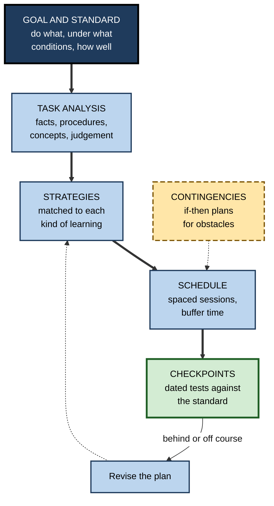
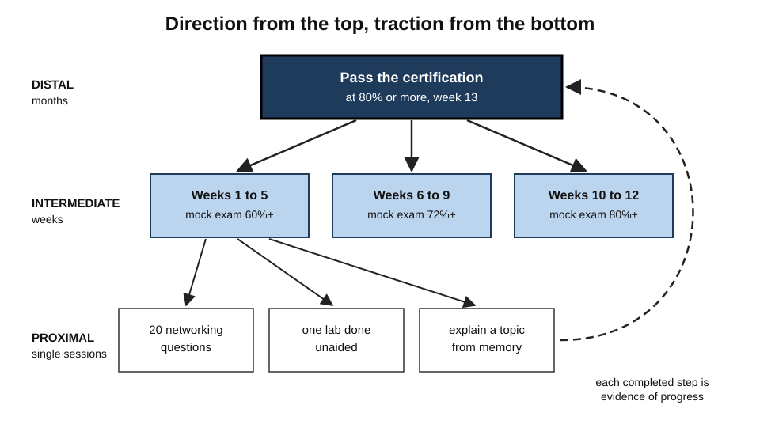
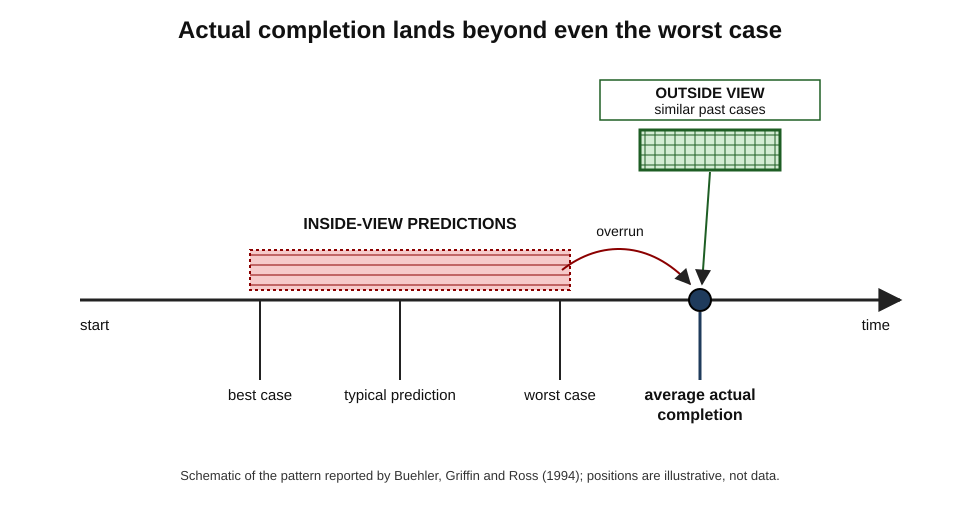
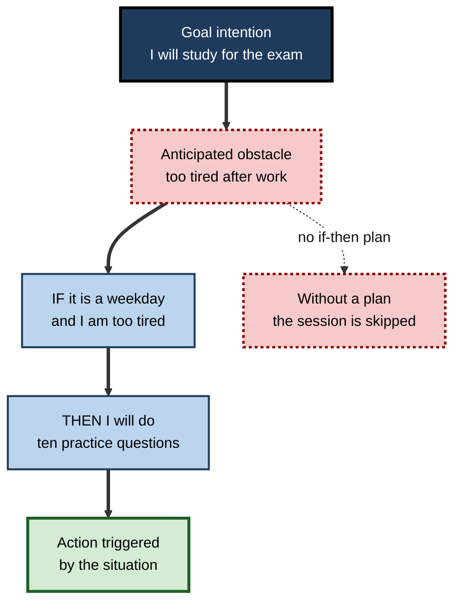
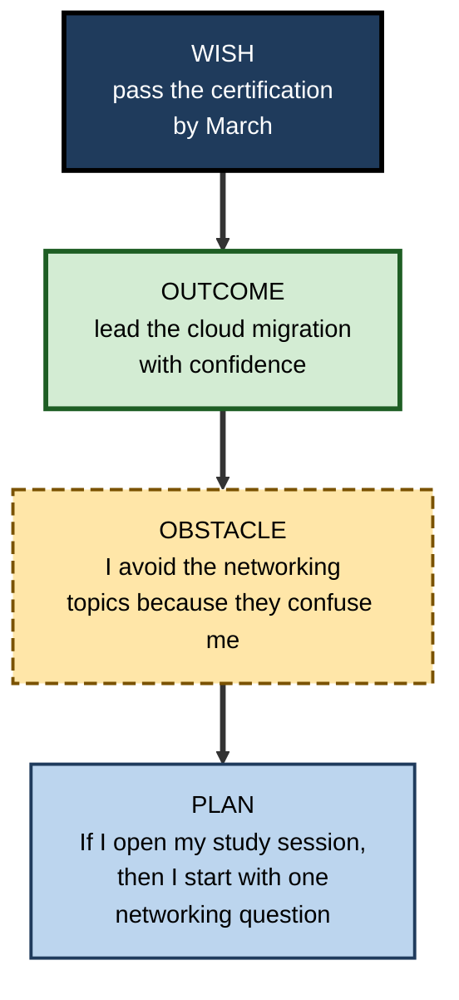

# K.8. Planning Learning Strategies

Two colleagues have ten weeks to pass the same certification. One opens the guide at page one, intending to "get through it". The other first spends an hour: she defines what passing requires, sorts the syllabus into facts, procedures and judgement calls, picks a method for each, books three mock exams, adds a buffer because past candidates found networking slow, and decides what she will do on evenings when she is too tired. Both work hard; only one has **a plan for learning**.

> **Definition — Planning learning strategies:** the metacognitive work done before learning begins — defining goals and standards, analysing what kind of learning the task requires, choosing strategies to match, scheduling them, setting checkpoints and preparing for obstacles.

**Why it matters**

- Planning decides **which strategies** will be used, before fluency and habit can choose for the learner.
- It converts vague intentions into **specific actions**, which are far more likely to be carried out.
- It builds in the **checkpoints** that later monitoring depends on.
- It counteracts a powerful bias — people **underestimate** how long learning takes.

---

## What a Learning Plan Contains

### Six elements

- **Goal and standard** — what the learner will be able to do, under what conditions, to what level.
  - *e.g.* "Pass the practice exam at 80% or above, unaided, under timed conditions."
- **Task analysis** — what kinds of knowledge and skill the goal requires.
  - *e.g.* facts to recall, procedures to execute, concepts to understand, judgements to make.
- **Strategy selection** — methods matched to each kind.
- **Schedule** — when, how often and for how long, with spacing built in.
- **Checkpoints** — dated tests of progress against the standard.
- **Contingencies** — what to do when obstacles arise.

> **Mnemonic — "GTS-SCC" ("Good Training Starts Simply, Checks Constantly"):** Goal, Task analysis, Strategies, Schedule, Checkpoints, Contingencies.

**Figure 1.** The elements of a learning plan and how they connect.

---

## Setting Goals That Work

### Goal-setting theory

**Edwin Locke and Gary Latham** developed goal-setting theory from hundreds of studies from the 1960s onwards.

- **Core finding:** **specific, challenging** goals lead to higher performance than vague goals such as "do your best".
- **Mechanisms:**
  - **direction** — attention goes to goal-relevant activity;
  - **effort** — harder goals mobilise more;
  - **persistence** — people keep going longer;
  - **strategy** — goals prompt people to search for better methods.
- **Moderators:**
  - **feedback** on progress is needed;
  - **commitment** to the goal;
  - **task complexity** — effects are smaller on complex tasks.

### Learning goals versus performance goals

- **On complex, unfamiliar tasks**, a demanding **performance** goal ("score 90%") can backfire: people rush to perform before they have found good strategies.
- **Gerard Seijts, Gary Latham and colleagues (2000s)** found that **learning goals** — "discover and master five strategies for this task" — produced better performance on such tasks than performance goals.

| | Performance goal | Learning goal |
|---|---|---|
| Form | "Score 85% on the mock exam" | "Find and practise the three best ways to tackle case questions" |
| Directs attention to | The outcome | The strategies that produce the outcome |
| Best when | Skills already exist; task is familiar | Task is new or complex; strategies must be found |
| Risk | Anxiety, rushing, shortcuts | Drifting without a performance check |
| Combined use | Learning goal first, then a performance goal once strategies are in place | |

### Distal and proximal goals

**Study card — Albert Bandura and Dale Schunk (1981)**

- **Design:** children with poor arithmetic worked through a self-directed subtraction programme of several sessions; one group set a **proximal** goal (complete a set of pages each session), another a **distal** goal (complete everything by the end), others no goal.
- **Results:** the proximal-goal group progressed fastest, achieved the greatest mastery, and showed the largest gains in **self-efficacy** and **intrinsic interest** in arithmetic.
- **Conclusion:** near-term goals provide frequent evidence of progress, which sustains motivation and makes monitoring possible.

> **Key point:** a distal goal gives **direction**; proximal goals give **traction** — frequent, checkable steps.

**Figure 2.** A goal hierarchy from a distal aim to session-level targets. (illustrative)

---

## Analysing the Learning Task

### What kind of learning does the goal require?

- **Facts and terminology** — must be recalled quickly and accurately.
  - *e.g.* regulatory thresholds, drug doses, command syntax.
- **Concepts and principles** — must be understood well enough to explain and apply to new cases.
  - *e.g.* why diversification reduces risk; how indexing speeds queries.
- **Procedures** — must be executed reliably, often fluently.
  - *e.g.* building a cash-flow forecast; configuring a network.
- **Judgement and problem-solving** — must be applied to varied, ambiguous cases.
  - *e.g.* deciding whether a transaction is suspicious; diagnosing a fault.
- **Performance skills** — must be executed under real conditions, often with others.
  - *e.g.* presenting, negotiating, interviewing.

### Matching strategies to kinds of learning

- **Transfer-appropriate processing** — **Donald Morris, John Bransford and Jeffery Franks (1977)**: memory is best when the processing during learning **matches** the processing required at test.
  - *e.g.* if the exam requires applying principles to cases, practise applying them to cases — not reciting definitions.

| Kind of learning | Core strategies | Why | Weak substitute to avoid |
|---|---|---|---|
| Facts and terms | Spaced retrieval practice | Builds fast, durable recall | Re-reading lists |
| Concepts and principles | Self-explanation, elaboration, comparing cases | Builds connected understanding | Memorising definitions |
| Procedures | Worked examples, then faded examples, then independent problems | Reduces overload early; builds fluency later | Watching demonstrations only |
| Judgement | Many varied cases with feedback; interleaved case types | Builds discrimination between situations | Studying one case type at a time |
| Performance skills | Rehearsal under realistic conditions with feedback | Practice must resemble use | Reading about the skill |

> **Definition — Transfer-appropriate processing:** the principle that learning is best retrieved when the mental processes used at study match those needed at retrieval.

### What the evidence says about common techniques

**John Dunlosky, Katherine Rawson, Elizabeth Marsh, Mitchell Nathan and Daniel Willingham (2013)** reviewed ten popular learning techniques against evidence across learners, materials and tests.

- **High utility:**
  - **practice testing** (retrieval practice);
  - **distributed practice** (spacing).
- **Moderate utility:**
  - **elaborative interrogation** — asking "why is this true?";
  - **self-explanation**;
  - **interleaved practice**.
- **Low utility (as usually practised):**
  - **summarisation**, **highlighting**, the **keyword mnemonic**, **imagery for text** and **re-reading**.

> **Watch out:** "low utility" does not mean useless in every case. Summarising can help learners who are trained to summarise well; the rating reflects how the technique is **typically** used.

---

## Scheduling: Why Plans Run Late

### The planning fallacy

- **Daniel Kahneman and Amos Tversky (1979)** — people predict task completion times optimistically, even knowing that similar tasks took longer in the past.

**Study card — Roger Buehler, Dale Griffin and Michael Ross (1994)**

- **Design:** final-year psychology students predicted when they would finish their honours theses, including a "best case" and a "worst case" estimate.
- **Results:**
  - the average actual completion time was **considerably longer** than the average prediction — and longer even than the average **worst-case** prediction;
  - fewer than half finished by their own predicted date.
- **Explanation:** people build a mental scenario of how the work will unfold (**inside view**) and neglect **distributional** information about how long such work usually takes.

> **Definition — Planning fallacy:** the tendency to underestimate the time, cost and risk of future tasks while knowing that similar past tasks overran.

**Figure 3.** Predicted and actual completion: why plans run late.

### Correcting the fallacy

- **Reference-class forecasting** — start from how long similar learning took for others.
  - *e.g.* "Candidates with my background typically spend 120–150 hours on this exam."
  - Developed for large projects by **Bent Flyvbjerg**, building on Kahneman and Tversky's "outside view".
- **Unpacking** — **Justin Kruger and Matt Evans (2004)**: listing a task's components before estimating produced longer and more accurate predictions.
- **Buffers** — reserve explicit slack, often 20–30%, for overruns.
- **Past self as reference** — "How long did my last certification take compared with my plan?"

| | Inside view | Outside view |
|---|---|---|
| Starts from | This learner's scenario of the work | Outcomes of similar learners or past projects |
| Typical estimate | Optimistic | Realistic, usually longer |
| Strength | Captures specific features | Captures base rates and hidden obstacles |
| Best use | Adjusting the baseline for genuine differences | Setting the baseline |

### Building spacing and interleaving into the schedule

- **Spacing** — spread study of each topic across sessions rather than finishing it in one block.
  - Plan **return visits**: *e.g.* a domain first studied in week 1 is reviewed in weeks 2, 4 and 7.
- **Interleaving** — once basics are learned, mix problem types within sessions.
  - Especially valuable where the test requires **choosing** the right method.
- **Front-load retrieval** — start each session by recalling the last one.
- **Protect the time** — schedule sessions as fixed appointments.

---

## Preparing for Obstacles

### Implementation intentions

> **Definition — Implementation intention:** an if–then plan that links a specific situation to a specific goal-directed response: "If situation X arises, then I will do Y."

- **Peter Gollwitzer (1990s)** — intentions phrased as **if–then** plans are carried out far more often than simple goal intentions ("I intend to study more").
- **Peter Gollwitzer and Paschal Sheeran (2006)** — a meta-analysis of 94 studies found a **medium-to-large** effect of implementation intentions on goal attainment.
- **Mechanism:** the situation becomes a **cue** that triggers the planned behaviour automatically, bypassing the need for a fresh decision.
- **Examples:**
  - "If it is 7 a.m. on a weekday, then I will do 20 minutes of flashcards before opening email."
  - "If I am too tired to study after work, then I will do ten practice questions instead of skipping."
  - "If a practice question takes more than five minutes, then I will mark it and move on."

**Figure 4.** The structure of an implementation intention.

### Mental contrasting

- **Gabriele Oettingen (1990s onwards)** — imagining only a desired future (**positive fantasy**) can sap the energy to pursue it; **contrasting** the desired future with present obstacles strengthens commitment when success is feasible.
- **WOOP** — a four-step routine combining mental contrasting with implementation intentions:
  1. **Wish** — the goal.
  2. **Outcome** — the best result, vividly imagined.
  3. **Obstacle** — the main inner obstacle.
  4. **Plan** — an if–then plan to overcome it.
- **Angela Duckworth and colleagues (2011)** — high-school students preparing for a standardised test who used this combination completed substantially more practice questions than a control group.

> **Mnemonic — WOOP:** Wish, Outcome, Obstacle, Plan.

**Figure 5.** The WOOP sequence: from wish to if–then plan.

---

## Plans as Hypotheses

### Planning well without over-planning

- **A plan is a hypothesis** about what will work; checkpoints test it.
- **Signs of over-planning:**
  - re-drawing timetables instead of studying;
  - colour-coded schedules with no checkpoints;
  - plans so detailed that one missed session collapses them.
- **Signs of under-planning:**
  - no defined standard;
  - no dated tests;
  - one strategy for every kind of material.
- **Rule of thumb:** the plan should take **minutes to hours**, not days, and should be revised at each checkpoint.

> **Watch out:** planning can become a comfortable substitute for learning — it feels productive and involves no retrieval or difficulty. A plan that does not lead to effortful practice within a day is a warning sign.

### Using AI in planning

- **Useful:** generating a draft syllabus breakdown; producing practice questions; suggesting reference-class information to verify.
- **Risky:** accepting a generic plan that ignores the learner's own gaps; delegating task analysis entirely.
- **Sound practice:** the learner writes the goal, the standard and their own task analysis first; the tool is then asked to criticise and fill gaps.

---

## Worked Example (illustrative): A Ten-Week Certification Plan

- **Situation:** a systems administrator plans to pass a cloud-architect certification. He has about **8 hours a week**.

1. **Goal and standard** — pass the official practice exam at ≥ 80%, timed, unaided, by week 9; sit the real exam in week 10.
2. **Reference class** — colleagues with similar backgrounds report 100–130 hours; his budget is 80 hours.
   - **Decision:** the target is unrealistic as set. He moves the exam to week 13 (≈ 104 hours) or negotiates 2 extra hours a week of protected time.
3. **Unpack the syllabus** — six domains; he self-tests briefly on each to sort them.

| Domain | Kind of learning | Self-test result | Strategy | Planned hours |
|---|---|---|---|---|
| Compute and storage | Facts + procedures | Strong | Spaced retrieval; two labs | 10 |
| Networking | Concepts + procedures | Weak | Diagrams + self-explanation; worked labs, then independent labs | 28 |
| Security and identity | Concepts + judgement | Partial | Scenario questions with feedback; compare cases | 22 |
| Cost management | Facts + judgement | Partial | Retrieval + priced design exercises | 12 |
| Reliability design | Judgement | Weak | Mixed case questions, interleaved | 20 |
| Migration | Judgement | Partial | Case questions | 12 |

*Illustrative figures.*

4. **Schedule** — each week mixes one weak domain (new learning) with spaced review of earlier domains; from week 7, sessions are interleaved across domains.
5. **Checkpoints** — mock exams in weeks 5, 9 and 12; each must exceed the previous by a planned margin, and errors are classified by domain.
6. **Contingencies** —
   - "If I miss a weekday session, then I do it on Saturday morning before anything else."
   - "If week-5 mock is below 60%, then I meet my mentor to re-plan the weakest two domains."
7. **Buffer** — two hours of unallocated time per week in the final month.

- **Conclusion:** the plan corrected an optimistic deadline with **outside-view** data, allocated time by **weakness and kind of learning**, and fixed **checkpoints and if–then plans** before the first session.

> **Watch out:** the hours in the table total 104 — matching the revised timeline. Plans whose hours do not add up to the time available are a common, silent failure.

---

## Case Study (illustrative): Planning Workshops for Exam Candidates

- **Situation:** a regional hospital supported junior doctors sitting a demanding postgraduate examination; first-attempt pass rates were below the national average.
- **Problem:** candidates studied hard but reported starting "properly" only weeks before the exam, relying on reading textbooks and attempting question banks late.
- **Diagnosis:**
  - goals were distal ("pass in May") without proximal targets;
  - estimates of required hours were far below those of past successful candidates;
  - strategies were not matched to the exam, which tested applied judgement through clinical scenarios;
  - night shifts disrupted every plan, and no contingencies existed.
- **Actions:**
  1. A two-hour workshop at the start of each preparation period.
  2. **Outside view:** recently successful candidates shared their total hours and timelines.
  3. **Task analysis:** candidates sorted the syllabus by kind of learning and mapped scenario questions as the core strategy, with spaced retrieval for facts.
  4. **Proximal goals:** weekly question targets and fortnightly timed mini-mocks.
  5. **WOOP and if–then plans** for shift patterns: "If I am on nights, then I do 20 questions on my phone after handover."
  6. Pairs met monthly to review plans against checkpoint results.
- **Result:** over the next two sittings, first-attempt pass rates rose towards the national average; candidates started question practice months earlier.
- **Side effects:** some candidates found the outside-view numbers discouraging; mentors had to frame them as information, not judgement.
- **Lesson:** planning works when it corrects **optimistic estimates**, **matches strategies to the test** and anticipates the **specific obstacles** of the learner's life.

---

## Planning for Retention: Choosing the Gaps

- A plan must decide not only *what* to study but **when to return** to it.
- **Nicholas Cepeda, Edward Vul, Doug Rohrer, John Wixted and Harold Pashler (2008)** taught thousands of people facts and tested them after delays of up to a year, varying the gap between first study and review.
  - The best gap **depended on how long the knowledge had to last**.
  - As the retention interval grew, the optimal gap grew in absolute terms but **shrank as a proportion** of the interval — from roughly a fifth or more for a week-long interval to well under a tenth for a year.
  - Gaps that were **too long** cost less than gaps that were too short.

> **Formula — A rule of thumb for review gaps:** gap ≈ 10–20% of the time until the knowledge must be used. Example: for an exam in **60 days**, a first review after about **6–12 days**, with further reviews at widening intervals, is a reasonable plan.

| Must remember for | Rough first review gap | Planning implication |
|---|---|---|
| One week | 1–2 days | Short cycles; daily retrieval |
| One month | About 4–7 days | Weekly review of each topic |
| Six months | About 2–4 weeks | Monthly return visits |
| Long-term professional knowledge | Months | Periodic refreshers and use on the job |

> **Watch out:** these are approximations from laboratory studies of factual learning; for complex skills the principle — **plan return visits, err on the side of longer gaps** — matters more than the exact numbers.

---

## Open Questions

- **How much planning is optimal?**
  - Too little leaves strategy to habit; too much becomes procrastination. Where the balance lies for different learners is unclear.
- **Why does the planning fallacy persist despite experience?**
  - People learn from past overruns in general but rarely apply the lesson to the next specific plan.
- **How well do people choose strategies when given the evidence?**
  - Knowing which techniques work does not guarantee using them; the link between planning and enactment is fragile.
- **Can AI-generated plans be personalised enough to help?**
  - Tools can draft plans quickly; whether they improve learning compared with self-made plans has little evidence so far.

---

## Summary

- **Planning learning strategies** defines goals and standards, analyses the task, matches strategies, schedules them, sets **checkpoints** and prepares **contingencies**.
- **Goal-setting theory** (Locke and Latham): specific, challenging goals beat "do your best", via direction, effort, persistence and strategy; on complex new tasks, **learning goals** outperform performance goals.
- **Proximal goals** sustain progress, self-efficacy and interest (Bandura and Schunk, 1981).
- **Task analysis** separates facts, concepts, procedures, judgement and performance skills; strategies follow **transfer-appropriate processing**.
- Evidence rates **practice testing** and **spacing** highest; re-reading and highlighting lowest as typically used (Dunlosky and colleagues, 2013).
- The **planning fallacy** makes schedules optimistic (Buehler, Griffin and Ross, 1994); correct it with the **outside view**, **unpacking** and **buffers**.
- **Implementation intentions** (if–then plans) markedly improve follow-through; **WOOP** adds mental contrasting.
- A plan is a **hypothesis**; avoid both over- and under-planning; use AI to criticise, not replace, the learner's own task analysis.
- **Plan review gaps** by how long knowledge must last: the optimal gap grows with the retention interval but shrinks as a proportion of it (Cepeda and colleagues, 2008).

---

## Self-Check

1. Name the six elements of a learning plan.
2. What are the four mechanisms by which goals improve performance?
3. When do learning goals outperform performance goals, and why?
4. Describe Bandura and Schunk's 1981 study and its findings.
5. Classify these into kinds of learning and propose a strategy for each: tax thresholds; presenting to a board; diagnosing network faults.
6. Explain transfer-appropriate processing with a workplace example.
7. Which techniques did Dunlosky and colleagues rate highest and lowest?
8. Describe the planning fallacy and the Buehler, Griffin and Ross findings.
9. Distinguish the inside and outside views, and explain how to combine them.
10. What is an implementation intention? Write one for a learner who skips study when meetings overrun.
11. Describe WOOP and the evidence for it.
12. What are the signs of over-planning and under-planning?
13. A colleague plans to learn a new programming language "in a month, evenings when free". Critique the plan and rewrite it.
14. Your team must learn a new regulatory framework in six weeks. Draft the planning process you would lead.

### Answer Key

1. Goal and standard; task analysis; strategy selection; schedule; checkpoints; contingencies.
2. Direction of attention, effort, persistence and the search for better strategies.
3. On complex, unfamiliar tasks; performance goals push people to perform before finding strategies, while learning goals direct effort to discovering them.
4. Children with poor arithmetic followed a self-directed programme with proximal goals, distal goals or none; proximal goals produced fastest progress, most mastery and the largest gains in self-efficacy and interest.
5. Tax thresholds: facts — spaced retrieval. Board presentation: performance skill — rehearsal under realistic conditions with feedback. Network faults: judgement and procedures — varied interleaved cases with feedback, worked examples first.
6. Retrieval is best when study processing matches test processing; an analyst preparing to apply a pricing model to client cases should practise applying it, not recite its formula.
7. Highest: practice testing, distributed practice. Lowest (as typically used): summarisation, highlighting, keyword mnemonic, imagery for text, re-reading.
8. Underestimating time while knowing past tasks overran. Students' thesis completion took considerably longer than predicted — longer even than average worst-case predictions; fewer than half finished by their predicted date.
9. Inside view: reasoning from the specific scenario; outside view: base rates from similar cases. Use the outside view as the baseline and adjust for genuine differences.
10. An if–then plan linking a situation to a response. "If a meeting overruns into my study slot, then I will do 15 minutes of flashcards before leaving the office."
11. Wish, Outcome, Obstacle, Plan — mental contrasting plus an if–then plan. Students preparing for a standardised test who used it completed substantially more practice questions.
12. Over-planning: redrawing schedules, detail without checkpoints, fragile plans, planning instead of studying. Under-planning: no standard, no dated tests, one strategy for everything.
13. Vague goal, no standard, no task analysis, no schedule, inside-view estimate. Rewrite: build a defined small application unaided in 8 weeks; outside-view hours; four 45-minute sessions a week at fixed times; worked examples then independent exercises; weekly unaided coding task; if–then plans for missed sessions.
14. Define the capability standard (e.g. correctly classify 10 unseen cases); gather outside-view estimates; sort the framework into facts, concepts and judgement; assign strategies; schedule spaced sessions and weekly case clinics; set checkpoints at weeks 2, 4 and 6; agree if–then plans for workload peaks; review and revise at each checkpoint.

---

## Glossary

| Term | Meaning |
|---|---|
| Checkpoint | A dated test of progress against the learning standard. |
| Distal goal | A long-term goal that gives overall direction. |
| Goal-setting theory | The finding that specific, challenging goals improve performance more than vague goals. |
| Implementation intention | An if–then plan linking a situation to a goal-directed response. |
| Inside view | Estimating from the specific scenario of the task at hand. |
| Learning goal | A goal to discover and master strategies rather than to reach a score. |
| Mental contrasting | Contrasting a desired future with present obstacles. |
| Outside view | Estimating from outcomes of a reference class of similar cases. |
| Performance goal | A goal defined by a level of outcome. |
| Planning fallacy | Underestimating the time and cost of future tasks. |
| Proximal goal | A near-term goal that gives frequent evidence of progress. |
| Reference-class forecasting | Basing predictions on the distribution of outcomes in similar past cases. |
| Retention interval | The time between learning and the moment the knowledge must be used. |
| Task analysis | Identifying the kinds of knowledge and skill a learning goal requires. |
| Transfer-appropriate processing | Memory is best when study processing matches retrieval processing. |
| Unpacking | Listing a task's components before estimating its duration. |
| WOOP | Wish, Outcome, Obstacle, Plan — a mental-contrasting routine with implementation intentions. |
