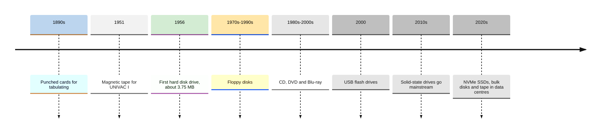
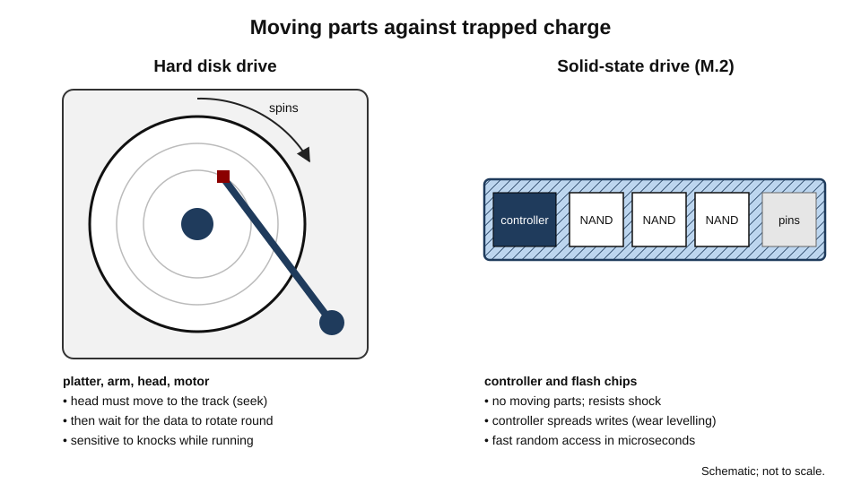
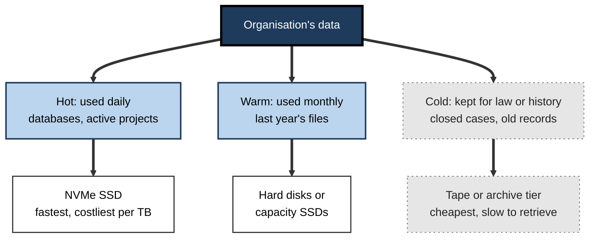
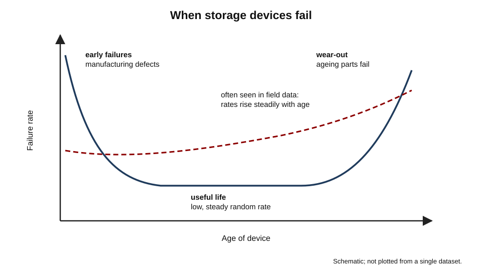
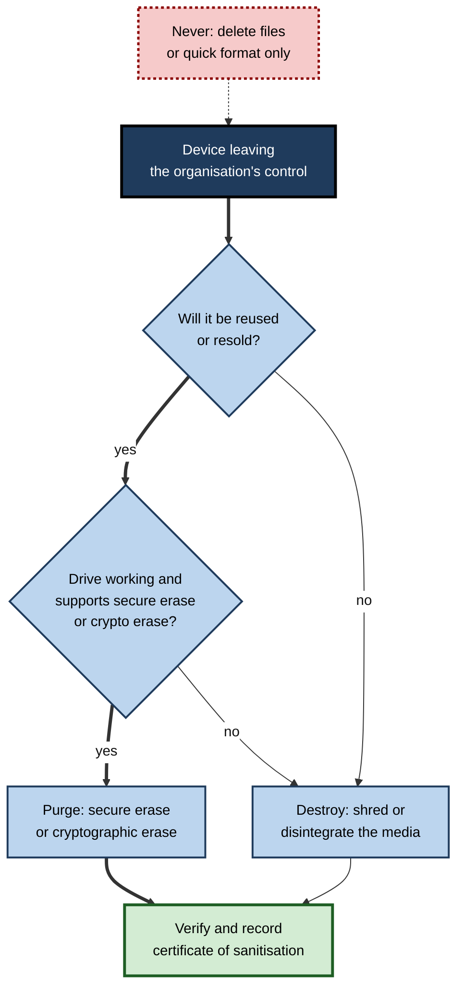

# B.10. Storage Devices

A photographer's memory card holds a wedding that cannot be reshot. A hospital's archive must keep scans for decades. A second-hand laptop bought online still contains its previous owner's tax returns. A company hit by ransomware recovers because last week's backup sat on a tape in a vault, disconnected from everything. In each case the question is the same: **where, physically, does the data live — and how safely?**

> **Definition — Storage device:** hardware that retains digital data persistently — keeping it when the power is off — so that it can be retrieved later; examples include solid-state drives, hard disk drives, memory cards, optical discs and magnetic tape.

**Why storage devices matter**

- **Speed** — the storage device often sets how quickly a computer starts, opens files and runs large applications.
- **Safety** — every storage device eventually fails; knowing how and when shapes backup and replacement.
- **Security** — data on lost, stolen or discarded devices is a leading cause of breaches; encryption and proper wiping prevent them.
- **Cost and sustainability** — organisations hold ever more data; choosing the right medium for each kind of data saves money and energy.

---

## From Punched Cards to Flash

### Milestones

- **Punched cards and paper tape** — holes encoded data for tabulating machines from the 1890s and early computers.
- **1951 — magnetic tape** stores data for the UNIVAC I computer.
- **1956 — the first hard disk drive**, part of IBM's 305 RAMAC, holds about 3.75 MB on fifty 24-inch platters and is the size of a large wardrobe.
- **1970s–1990s — floppy disks** (8-inch, then 5.25-inch and 3.5-inch) carry files between personal computers.
- **1980s–2000s — optical discs**: CD-ROM, then DVD and Blu-ray.
- **Around 2000 — USB flash drives** replace floppy disks.
- **2010s — solid-state drives** become mainstream in laptops; **NVMe** drives connect directly to the fast PCI Express bus.
- **2020s — hard disks** move mainly to data centres for bulk storage; tape remains the cheapest way to archive at scale.

**Figure 1.** Milestones in data storage.

> **Key point:** over seventy years, the cost per gigabyte has fallen by many orders of magnitude, while the physical principles have changed only a few times — holes, magnetism, light and trapped electric charge.

---

## Measuring Storage

### Capacity

- **Byte** — 8 bits; **kilobyte, megabyte, gigabyte, terabyte, petabyte** — each roughly a thousand times the last.
- **Two conventions**:
  - **Decimal (SI)** — 1 GB = 1,000,000,000 bytes; used by drive manufacturers.
  - **Binary** — 1 GiB (gibibyte) = 1,073,741,824 bytes (2³⁰); used by some operating systems, sometimes still labelled "GB".

> **Formula — Why a "1 TB" drive shows less:** 1 TB = 10¹² bytes. In binary units: 10¹² ÷ 2⁴⁰ ≈ **0.909 TiB**, displayed as about **931 GB** (really GiB) by some operating systems. Nothing is missing — the units differ.

### Performance

- **Sequential speed** — megabytes per second when reading or writing large files in one stream.
- **Random speed (IOPS)** — input/output operations per second for many small scattered reads and writes; governs how responsive a computer feels.
- **Latency** — the delay before data starts to arrive.

> **Definition — IOPS:** input/output operations per second; the number of small, separate read or write requests a storage device can handle each second.

> **Watch out:** headline speeds on drive packaging are usually best-case **sequential** figures. Everyday responsiveness depends far more on **random** performance and latency, where SSDs outclass hard disks by orders of magnitude.

---

## Hard Disk Drives

### How they work

- One or more **platters** coated with magnetic material spin at constant speed — commonly 5,400 or 7,200 revolutions per minute, up to 15,000 in some enterprise drives.
- A **read/write head** on an arm floats nanometres above the surface, magnetising tiny regions (writing) or sensing them (reading).
- To fetch data the arm must **move** to the right track (**seek time**) and wait for the spot to rotate under the head (**rotational latency**).

> **Definition — Hard disk drive (HDD):** a storage device that records data magnetically on rapidly spinning platters, read and written by moving heads.

**Figure 2.** Inside a hard disk drive and a solid-state drive.

### Strengths and weaknesses

- **Strengths** — lowest cost per terabyte for online storage; very large capacities; data does not fade quickly when unpowered.
- **Weaknesses** — slow random access; moving parts sensitive to shock (especially while running), heat and wear; noise and higher power use.
- **Where used today** — data-centre bulk storage, network storage boxes, surveillance recorders, external backup drives.

---

## Solid-State Drives and Flash Memory

### How flash works

- **NAND flash memory** stores data as electric charge trapped in cells within the chip; no moving parts.
- **Cells per bit:**
  - **SLC** — one bit per cell: fastest, most durable, expensive.
  - **MLC** — two bits per cell.
  - **TLC** — three bits per cell: the common consumer and business choice.
  - **QLC** — four bits per cell: cheapest per gigabyte, lower endurance and slower sustained writes.
- **Controller** — a processor in the drive that manages where data goes, error correction, **wear levelling** and encryption.
- **3D NAND** — cells stacked in many layers vertically to raise density.

> **Definition — Solid-state drive (SSD):** a storage device that keeps data in flash memory chips managed by a controller, with no moving parts.

> **Definition — Wear levelling:** the SSD controller's practice of spreading writes evenly across all memory cells so that no cell wears out early.

### Endurance

- Each flash cell tolerates a limited number of write cycles.
- Drives are rated in **TBW (terabytes written)** or **DWPD (drive writes per day)** over the warranty.

> **Formula — Endurance check:** years of life ≈ TBW ÷ (terabytes written per day × 365). A drive rated 600 TBW, with a user writing 40 GB (0.04 TB) a day: 600 ÷ (0.04 × 365) ≈ **41 years** — far beyond the computer's life. A video-editing workload writing 1 TB a day: 600 ÷ 365 ≈ **1.6 years**.

> **Key point:** for ordinary office use, SSD wear-out is **not** a practical concern; for heavy write workloads — video, databases, logging — endurance ratings matter.

### Interfaces and form factors

- **SATA SSD** — uses the older interface designed for hard disks; limited to roughly 550 MB/s; 2.5-inch or M.2 shape.
- **NVMe SSD** — talks directly over PCI Express lanes; several thousand MB/s and far higher IOPS; usually the **M.2** stick format in laptops and desktops, larger formats in servers.
- **Soldered storage** — in many thin laptops, phones and tablets the flash chips are fixed to the mainboard.

| | Hard disk drive | SATA SSD | NVMe SSD |
|---|---|---|---|
| Technology | Magnetic platters, moving heads | Flash, SATA interface | Flash, PCI Express |
| Sequential speed | ≈ 100–250 MB/s | Up to ≈ 550 MB/s | ≈ 3,000–14,000 MB/s |
| Random access | Very slow (milliseconds) | Fast | Fastest |
| Shock resistance | Poor | Excellent | Excellent |
| Cost per TB | Lowest | Moderate | Moderate to higher |
| Typical role | Bulk, archive, NAS | Upgrades of older PCs | Laptops, desktops, servers |

### Other flash devices

- **USB flash drives** — small, cheap, easily lost; quality and speed vary enormously.
- **Memory cards** — SD and microSD for cameras, phones, drones and dashcams.
  - **Speed classes** (such as V30 or U3) guarantee minimum sustained write speeds needed for video.
- **External SSDs** — fast, robust portable storage.

> **Watch out:** cheap unbranded flash drives and cards are frequently **counterfeit**, reporting a capacity far larger than they really have; once the real capacity is exceeded, new files silently overwrite or corrupt old ones. Buy from reputable sources.

---

## Optical Discs and Magnetic Tape

### Optical discs

- A laser reads pits (pressed discs) or dye and phase-change marks (recordable discs).
- **CD** ≈ 700 MB; **DVD** ≈ 4.7 GB per layer; **Blu-ray** ≈ 25 GB per layer.
- Uses today: software and media distribution in some markets, legal and medical archives, long-term archiving with specialist discs.
- **Risks:** recordable discs can degrade ("disc rot") over years depending on quality and conditions; many new computers lack drives.

### Magnetic tape

- Long reels of magnetic tape in cartridges, read sequentially; the **LTO (Linear Tape-Open)** family is the industry standard for data centres.
- **Strengths:**
  - lowest cost per terabyte for archives;
  - recent generations store tens of terabytes per cartridge;
  - very long shelf life in controlled conditions;
  - an **air gap** — a cartridge on a shelf cannot be reached by ransomware.
- **Weaknesses:** slow to find a particular file (minutes, not milliseconds); needs tape drives and libraries.

> **Definition — Air gap:** physical isolation of storage or systems from any network, so that remote attackers cannot reach them.

---

## Storage Beyond the Device

### Shared storage

- **NAS (network-attached storage)** — a box of drives on the network serving files to many users; common in small offices and homes.
- **SAN (storage area network)** — high-speed shared block storage for servers in larger organisations.
- **RAID** — combining several drives so that data survives the failure of one (or more), or to increase speed.
  - *e.g.* RAID 1 mirrors two drives; RAID 5 and 6 spread data with parity across several.
- **Cloud storage** — capacity rented from providers' data centres, built from the same drives and tapes at enormous scale; how files are organised and synchronised there is a subject of its own.

> **Watch out:** **RAID is not a backup.** It protects against a drive failing, but not against deletion, corruption, ransomware, theft or fire — all of which affect every drive in the array at once.

### Tiering: the right medium for each kind of data

- **Hot data** — used constantly; NVMe SSDs.
- **Warm data** — used occasionally; hard disks or cheaper SSDs.
- **Cold data** — rarely used but must be kept; tape or archival cloud tiers.

**Figure 3.** Matching storage media to how often data is used.

---

## How Storage Fails

### Failure patterns

- **Hard disks** — head crashes, motor and bearing failures, gradual growth of unreadable sectors; often audible clicking or grinding.
- **SSDs** — controller failures (often sudden and total), firmware bugs, wear-out after very heavy writing.
- **Flash cards and drives** — physical damage, counterfeit capacity, corruption when removed mid-write.
- **All media** — fire, flood, theft, accidental deletion, ransomware.

### The bathtub curve

- Many devices show **higher failure rates when new** (manufacturing defects — "infant mortality"), a **lower steady rate** in mid-life, and **rising failures** as they wear out.

**Figure 4.** The bathtub curve of device failure over time.

### What the evidence shows

**Study card — Schroeder and Gibson (2007)**

- **Design:** examined replacement records for around 100,000 disks in large real-world computing installations.
- **Results:**
  - annual replacement rates were typically **several times higher** than the failure rates implied by manufacturers' datasheet MTBF figures;
  - failure rates did not show a long flat "safe" middle period — they tended to rise steadily with age, beginning early.
- **Conclusion:** datasheet reliability numbers greatly understate failures in the field.

**Study card — Pinheiro, Weber and Barroso, Google (2007)**

- **Design:** analysed a large population of consumer-grade disks in Google's data centres.
- **Results:**
  - some drive self-monitoring (SMART) warnings, such as scan errors, strongly predicted failure;
  - but **many drives failed without any SMART warning**;
  - temperature and usage had weaker links to failure than commonly believed.
- **Conclusion:** health monitoring helps, but cannot replace backups.

> **Definition — MTBF (mean time between failures):** a statistical reliability figure for a population of devices, often in the millions of hours for drives; it does **not** mean an individual drive will last that long.

> **Formula — From MTBF to annual failure rate:** AFR ≈ hours per year ÷ MTBF. A drive with an MTBF of 1,000,000 hours implies 8,760 ÷ 1,000,000 ≈ **0.9%** failing per year; field studies have often found higher real rates.

> **Remember:** every storage device **will** fail eventually, often without warning. Important data must exist in **more than one place**, with at least one copy offline or otherwise protected from ransomware.

> **In practice:** a common rule is **3-2-1** — three copies of data, on two different kinds of media, with one copy off-site; many organisations now add an immutable or offline copy for ransomware protection.

---

## Protecting Data on Devices

### Encryption at rest

- **Full-disk encryption** — the operating system encrypts the whole drive; data is unreadable without the key, normally unlocked at sign-in with help from the TPM.
- **Self-encrypting drives** — the drive's controller encrypts everything automatically.
- **Encrypted USB drives** — hardware PIN pads or software encryption for portable media.

> **Definition — Encryption at rest:** encoding stored data so that it can be read only with the correct key, protecting it if the device is lost or stolen.

### Removable media at work

- **Risks** — loss and theft of unencrypted drives; malware carried between systems; unauthorised copying of data.
- **Controls** — encryption required, approved devices only, removable media blocked or read-only on sensitive systems, cloud sharing preferred.

> **Example:** a USB stick containing unencrypted personal data, dropped in a car park or left on a train, has been the starting point of many reported data breaches and regulatory fines.

---

## Wiping and Disposing of Storage

### Why deleting is not enough

- **Deleting a file** usually only removes the reference to it; the data stays until overwritten.
- **Formatting** often leaves most data recoverable.
- **SSDs** complicate matters: wear levelling means overwriting a file may write elsewhere, leaving old copies in cells the operating system cannot see.

### Sanitisation methods

- The United States National Institute of Standards and Technology's media sanitisation guideline (**NIST SP 800-88**) defines three levels:
  - **Clear** — overwrite user-accessible areas; protects against simple recovery tools.
  - **Purge** — methods that defeat laboratory recovery, such as the drive's built-in secure-erase commands or **cryptographic erase**.
  - **Destroy** — shredding, disintegrating, melting or incinerating.
- **Cryptographic erase** — on an encrypted drive, destroying the encryption key makes all data unreadable instantly.

> **Definition — Cryptographic erase:** sanitising a self-encrypting or fully encrypted drive by securely deleting its encryption key, rendering the stored data unreadable.

**Figure 5.** Choosing a sanitisation method for a storage device.

> **In practice:** organisations use certified IT asset disposal providers who sanitise or destroy media, record each device's serial number and issue **certificates of destruction** — evidence regulators and auditors expect.

---

## Worked Example (illustrative): Planning Storage for a Small Architecture Practice

**Situation:** a 15-person practice has 4 TB of active project files (large models and renderings), 12 TB of completed projects that must be kept for at least 12 years, and a growing photo library. Staff laptops have 1 TB NVMe SSDs.

1. **Classify the data.**
   - Hot: 4 TB of active projects, used daily by several people.
   - Cold: 12 TB of closed projects, opened a few times a year.
2. **Choose media.**
   - Hot: a NAS with SSDs or fast disks in RAID, or a business cloud file service with offline sync.
   - Cold: a cloud archive tier or LTO tape, plus a second copy elsewhere.
3. **Protect against failure and ransomware.**
   - Nightly backups of the hot data to a separate system with **immutable** (unchangeable) copies kept for 30 days.
   - Monthly archive verification of the cold data.
4. **Encrypt** laptop drives and backups.
5. **Plan disposal** — sanitise laptops and NAS drives through a certified provider at end of life.

| Data | Volume | Medium | Copies | Protection |
|---|---|---|---|---|
| Active projects | 4 TB | NAS (RAID) or cloud file service | 3 | Nightly immutable backup |
| Closed projects | 12 TB | Archive tier or LTO tape | 2, in different locations | Periodic verification |
| Laptops | 15 × 1 TB | NVMe SSD, encrypted | Synced to file service | Remote wipe; sanitise at end of life |

*Illustrative figures.*

> **Watch out:** a single NAS in the office cupboard, holding both the working files and "the backup", protects against nothing that matters — fire, theft and ransomware take both together.

---

## Case Study (illustrative): The Laptops that Were Sold with Their Data

- **Situation:** a regional council replaced 600 laptops and sold the old ones through a reseller to raise money.
- **Problem:** a researcher who bought several units recovered council emails, social-care case notes and staff records from the drives and reported it to the data-protection regulator.
- **Diagnosis:**
  - the IT team had used a quick reformat, believing it erased the data;
  - most laptops had unencrypted drives, an older practice never revisited;
  - there was no record linking each device's serial number to a sanitisation step.
- **Actions:**
  1. Recalled unsold devices; contacted buyers to retrieve sold units.
  2. Enabled full-disk encryption on all current devices.
  3. Contracted a certified disposal provider using purge or destroy methods, with per-device certificates.
  4. Added disposal to the asset-management lifecycle, so no device could leave without a sanitisation record.
- **Result:** the council was investigated and criticised by the regulator; it avoided recurrence but bore notification costs and reputational damage.
- **Lesson:** **disposal is part of the device lifecycle**. Encryption from day one makes end-of-life erasure fast and reliable; a reformat is not erasure.

---

## Removable Media in Practice

### Memory cards for cameras, drones and dashcams

- **Formats** — SD for cameras; microSD for phones, drones, action cameras and dashcams; CFexpress for professional cameras recording high-bit-rate video.
- **Capacity classes** — SDHC (up to 32 GB), SDXC (up to 2 TB), SDUC (beyond).
- **Speed ratings** — video speed classes (V30, V60, V90) and UHS classes guarantee **minimum sustained** write speeds; recording 4K or high-frame-rate video on a slow card causes dropped frames.
- **Endurance cards** — designed for constant writing in dashcams and security cameras.

> **In practice:** professional photographers use **two cards** in cameras that support it, writing every image to both, and never reformat a card until its contents are safely in two other places.

### USB drives at work

- **Encrypted, approved drives only** where removable media are allowed.
- **Label and log** drives that carry sensitive data; return them after use.
- **Prefer secure sharing services** to physical drives for sending data to clients.

---

## When Data Is Lost: Recovery

### What can be recovered

- **Recently deleted files** — often from the recycle bin, cloud version history or backups.
- **Accidentally formatted hard disks** — often recoverable with specialist software, if the disk has not been heavily used since.
- **SSDs after deletion** — recovery is much harder, because the drive's **TRIM** function tells the controller to erase deleted blocks in the background.
- **Physically damaged drives** — specialist laboratories can sometimes recover data from failed disks in clean rooms, at high cost and without guarantees.

> **Definition — TRIM:** a command by which the operating system tells an SSD which blocks are no longer in use, so that the drive can erase them in advance; it keeps SSDs fast but makes deleted data hard to recover.

### Rules when something goes wrong

1. **Stop using the device** — every new write may overwrite recoverable data.
2. **Do not run repair tools blindly** — some "fix" utilities make recovery harder.
3. **Check backups and cloud version history first.**
4. **For failing hard disks** — clicking, grinding — power off and seek professional recovery if the data matters.
5. **For ransomware** — disconnect from the network and report; do not pay or restore until the incident is contained.

> **Remember:** recovery is **uncertain, slow and expensive**; backups are **certain, fast and cheap**. Every recovery story is an argument for better backups.

---

## Storage Choices for Individuals

| Need | Sensible choice | Why |
|---|---|---|
| Fast laptop storage | Built-in NVMe SSD, sized for the device's life | Cannot usually be upgraded later |
| Portable working files | External SSD, encrypted | Fast, robust, small |
| Backup of a home computer | External drive plus a cloud backup service | Two media, one off-site |
| Photos and videos for decades | Cloud library plus periodic copies to a drive | Protects against loss of one service |
| Camera recording | Card with the right speed class | Avoids dropped frames |

> **Watch out:** a cloud **sync** service is not automatically a backup — if a file is deleted or encrypted by ransomware on one device, the change may sync everywhere. Use version history or a separate backup.

---

## Storage in Phones and Laptops

- **Soldered storage** — many laptops, phones and tablets cannot have storage added later; choose capacity for the device's whole life.
- **Expandable phones** — some phones accept microSD cards for photos and media; apps usually run best from internal storage.
- **Cloud-offloading features** — keep recent files locally and older ones in the cloud, downloading on demand; convenient, but files are unavailable offline unless kept on the device.
- **Encryption by default** — modern phones encrypt storage automatically when a passcode is set; many laptops do so when signed in with an organisational or cloud account.

> **Watch out:** an almost-full phone or laptop slows down, fails to install updates and may lose new data. Keeping **at least 10–20% free** is a common rule of thumb.

---

## Storage Habits Worth Keeping

- Save work to **synced, backed-up locations** by default, not the desktop.
- Name and file important documents so they can be found and restored.
- Check once a quarter that a restore actually works.

---

## Open Questions

- **Will hard disks survive outside archives?**
  - Flash costs keep falling; hard disks remain cheaper per terabyte for bulk storage, and the crossover date is debated.
- **How long will digital data last?**
  - Media degrade and formats become obsolete; "digital preservation" over centuries remains unsolved at scale.
- **Can new media replace tape?**
  - Research into storing data in glass and in synthetic DNA promises extreme density and longevity; cost and speed are far from practical.
- **How should SSDs be verified as erased?**
  - Controllers hide internal cells; standards bodies continue to refine methods for proving sanitisation.
- **How much data should be kept at all?**
  - Storage is cheap per gigabyte but costly in energy, risk and legal exposure; organisations struggle with deletion policies.

---

## Summary

- A **storage device** keeps data without power: **HDDs** (magnetic platters), **SSDs** (NAND flash), memory cards and USB drives, optical discs, and **tape**.
- Capacities use **decimal** units on packaging and sometimes **binary** units in software: 1 TB ≈ 931 GiB.
- Performance: **sequential speed**, **random IOPS** and **latency**; SSDs dominate random access.
- HDDs: cheapest per TB, slow random access, shock-sensitive; SSDs: fast, robust, rated by **TBW**; **wear levelling** spreads writes. SATA vs **NVMe**.
- **Tape** offers the cheapest archive and an **air gap** against ransomware; optical discs persist in niches.
- **NAS**, **SAN**, **RAID** and cloud provide shared capacity; **RAID is not a backup**; **tier** data into hot, warm and cold.
- All storage fails; field studies show failures higher than datasheet **MTBF** implies; SMART helps but misses many failures; follow **3-2-1** with an offline or immutable copy.
- Protect with **encryption at rest** and controlled removable media.
- Deleting or formatting is not erasure; use **NIST SP 800-88** levels — clear, purge (including **cryptographic erase**), destroy — with certificates.

---

## Self-Check

1. Define a storage device and distinguish it from memory (RAM).
2. Why does a 2 TB drive appear as about 1.82 TB in some operating systems?
3. Distinguish sequential speed, IOPS and latency, and explain which matters most for how responsive a laptop feels.
4. Explain how a hard disk reads data and why random access is slow.
5. Explain SLC, TLC and QLC and the trade-offs between them.
6. A drive is rated 300 TBW. How many years will it last for a user writing 25 GB a day? For a workload writing 500 GB a day?
7. Compare SATA and NVMe SSDs.
8. Give three reasons tape is still used and one limitation.
9. Why is RAID not a backup?
10. What did Schroeder and Gibson (2007) find about real-world disk failures?
11. Convert an MTBF of 2,000,000 hours into an approximate annual failure rate.
12. Why can overwriting files fail to erase data on an SSD, and what method solves this?
13. Describe NIST's clear, purge and destroy levels with an example of each.
14. A start-up stores all its files on one NAS that is backed up to a USB disk permanently plugged into it. Evaluate the arrangement and propose improvements.

### Answer Key

1. Hardware that retains data persistently without power. RAM is volatile working memory; storage keeps data when off.
2. 2 TB = 2 × 10¹² bytes; ÷ 2⁴⁰ ≈ 1.82 TiB, which the system labels "TB" or "GB" in binary units.
3. Sequential: speed for large continuous transfers; IOPS: small random operations per second; latency: delay before data arrives. Random IOPS and latency dominate responsiveness.
4. Spinning platters are magnetised; an arm moves the head to the right track and waits for the data to rotate underneath. Each scattered request needs mechanical movement, taking milliseconds.
5. Bits per cell: 1, 3, 4. More bits per cell → cheaper per GB and denser, but lower endurance and slower sustained writes; SLC is fastest and most durable.
6. 300 ÷ (0.025 × 365) ≈ **33 years**; 300 ÷ (0.5 × 365) ≈ **1.6 years**.
7. SATA uses an older interface limited to ~550 MB/s; NVMe uses PCI Express with several thousand MB/s and far higher IOPS. NVMe is standard in modern machines; SATA suits upgrades of older PCs.
8. Lowest cost per TB; long shelf life; offline air gap against ransomware; large capacity. Limitation: slow to locate files; requires drives.
9. It protects only against drive failure; deletion, corruption, ransomware, theft or fire affect all drives in the array simultaneously.
10. Real annual replacement rates were several times higher than datasheet MTBF implied, and failure rates rose with age rather than staying flat.
11. 8,760 ÷ 2,000,000 ≈ **0.44%** per year (field rates may be higher).
12. Wear levelling writes new data to different cells and leaves old copies in hidden areas. Use the drive's secure-erase command or cryptographic erase, or destroy it.
13. Clear: overwriting accessible areas before internal reuse. Purge: secure erase or crypto erase before resale. Destroy: shredding drives that held highly sensitive data or have failed.
14. The backup is always connected (ransomware encrypts both), in the same place (fire or theft takes both), on similar media. Improve: 3-2-1 with an off-site or cloud copy, immutable or offline backups, encryption, tested restores.

---

## Glossary

| Term | Meaning |
|---|---|
| 3-2-1 rule | Three copies of data, on two kinds of media, one off-site. |
| Air gap | Physical isolation from networks. |
| Cryptographic erase | Sanitising an encrypted drive by destroying its key. |
| Encryption at rest | Encoding stored data so it is unreadable without a key. |
| Flash memory | Non-volatile memory storing data as trapped electric charge. |
| Full-disk encryption | Encryption of an entire drive by the operating system. |
| Hard disk drive | Storage recording data magnetically on spinning platters. |
| IOPS | Input/output operations per second. |
| Latency | Delay before requested data begins to arrive. |
| LTO | Linear Tape-Open, the standard data-centre tape family. |
| M.2 | A small stick-shaped form factor for SSDs. |
| MTBF | Mean time between failures, a population reliability statistic. |
| NAS | Network-attached storage serving files over a network. |
| NVMe | A fast protocol connecting SSDs over PCI Express. |
| RAID | Combining drives for redundancy or speed. |
| SAN | Storage area network providing shared block storage to servers. |
| Sanitisation | Making data on media unrecoverable. |
| SATA | An older storage interface designed for hard disks. |
| SMART | Self-monitoring data reported by drives about their health. |
| Solid-state drive | Storage using flash chips and a controller, with no moving parts. |
| Speed class | A memory-card rating guaranteeing minimum sustained write speed. |
| TBW | Terabytes written: an SSD's rated write endurance. |
| Tiering | Placing data on media matched to how often it is used. |
| TRIM | A command telling an SSD which blocks are no longer in use. |
| Wear levelling | Spreading writes evenly across flash cells. |
