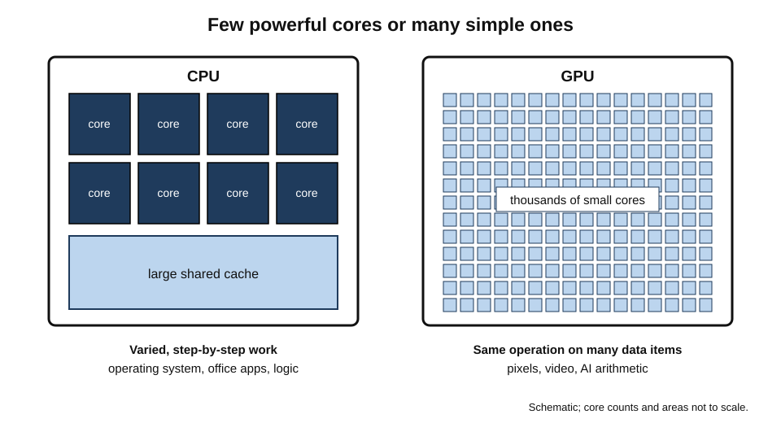
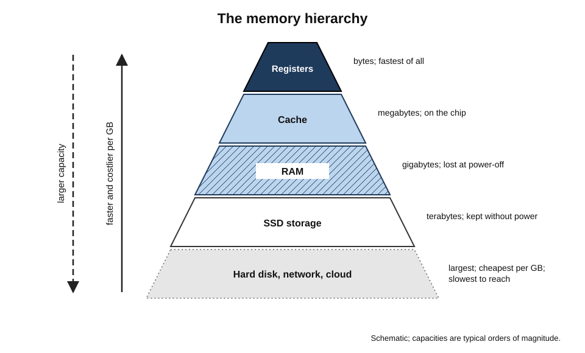
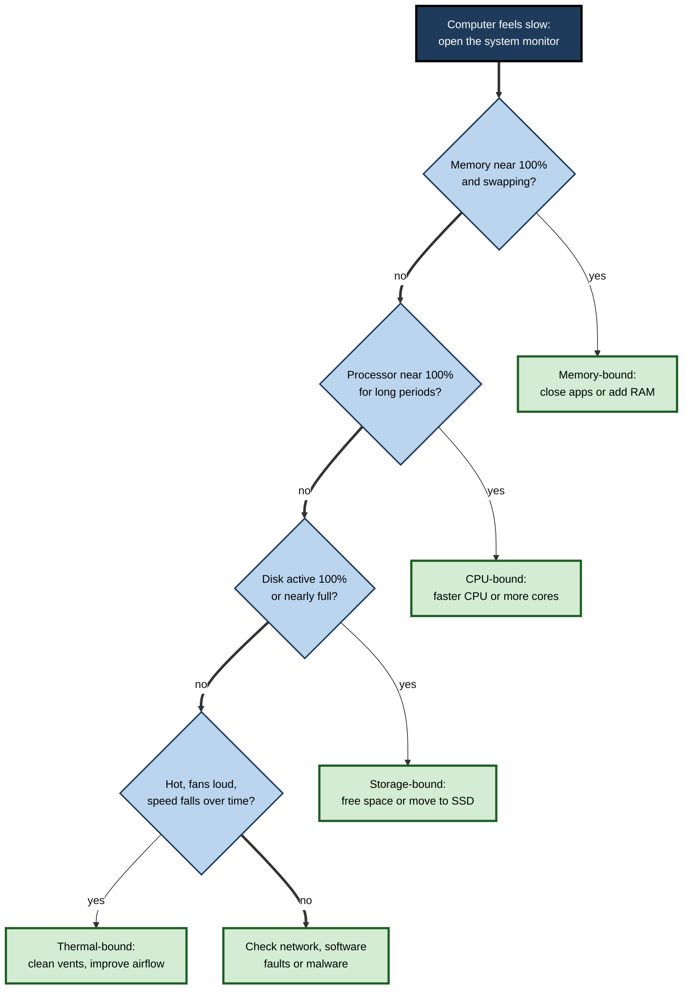
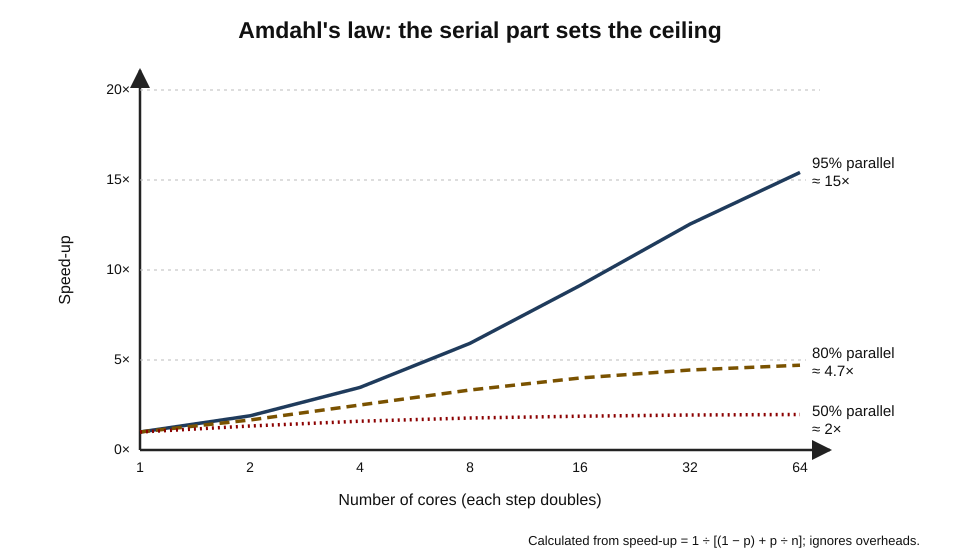

# B.7. Computer Hardware Components

A buyer compares two laptops. One lists "12 cores, up to 5.0 GHz, 16 GB LPDDR5X, 512 GB NVMe SSD, integrated graphics, 45 TOPS NPU"; the other "8 cores, 4.4 GHz, 32 GB, 1 TB, RTX graphics". The prices are similar. Which is better? The honest answer is **"for what?"** — and answering it requires knowing what each component does, how they work together, and which one will limit the work that person actually does.

> **Definition — Hardware component:** a distinct physical part of a computing device that performs a specific function — processing, holding data, connecting parts, supplying power, removing heat, or exchanging signals with the outside world.

**Why components matter to non-specialists**

- **Buying well** — most overspending and underspending on devices comes from misunderstanding which component matters for a task.
- **Diagnosing problems** — a "slow computer" may be short of memory, full of storage, overheating or simply old; each needs a different remedy.
- **Talking to specialists** — understanding the vocabulary lets a professional brief IT teams and suppliers precisely.
- **Judging claims** — marketing numbers (gigahertz, cores, TOPS) mean little without knowing what they measure.

---

## The Big Picture: How the Parts Work Together

### An analogy: the kitchen

- **Processor (CPU)** — the **head chef**: follows the recipe (program) step by step, making decisions.
- **Graphics processor (GPU)** — a **brigade of assistants** who each do the same simple task in parallel, such as chopping thousands of vegetables at once.
- **Neural processing unit (NPU)** — a **specialist machine** that does one kind of job (AI arithmetic) very efficiently.
- **Memory (RAM)** — the **worktop**: ingredients being used now; fast to reach but limited in size and cleared at the end of the day.
- **Storage (SSD)** — the **pantry**: holds everything long-term; slower to fetch from than the worktop.
- **Motherboard** — the **kitchen layout and corridors** connecting everything.
- **Power supply or battery** — the **utilities**: gas and electricity.
- **Cooling** — the **ventilation**: without it, the kitchen overheats and work slows.
- **Input/output ports** — the **doors and serving hatch** to the outside.

> **Mnemonic — "Chefs Get New Recipes So Mothers Prepare Cooking Instructions":** CPU, GPU, NPU, RAM, Storage, Motherboard, Power, Cooling, I/O.

**Figure 1.** How the main components exchange data and power.

```mermaid
%%{init: {'theme':'base','themeVariables':{'fontFamily':'Arial, Helvetica, sans-serif','fontSize':'15px','primaryColor':'#FFFFFF','primaryTextColor':'#111111','primaryBorderColor':'#222222','lineColor':'#333333','secondaryColor':'#F2F2F2','tertiaryColor':'#FFFFFF','clusterBkg':'#FAFAFA','clusterBorder':'#555555','edgeLabelBackground':'#FFFFFF','titleColor':'#111111'}}}%%
flowchart TD
    classDef core    fill:#1F3B5C,stroke:#000000,stroke-width:3px,color:#FFFFFF
    classDef key     fill:#BCD5EE,stroke:#1F3B5C,stroke-width:2px,color:#000000
    classDef detail  fill:#FFFFFF,stroke:#333333,stroke-width:1.5px,color:#000000
    classDef accent  fill:#FFE6A8,stroke:#7A5200,stroke-width:2px,stroke-dasharray:8 4,color:#000000

    subgraph SOC["Processor package or system-on-a-chip"]
        CPU["CPU cores<br/>general instructions"]
        GPU["GPU<br/>parallel graphics and maths"]
        NPU["NPU<br/>AI arithmetic"]
    end
    RAM["Memory RAM<br/>working data"]
    SSD["Storage SSD<br/>kept data"]
    MB["Motherboard buses<br/>connect all parts"]
    IO["Ports and radios<br/>USB, display, network"]
    PWR["Power supply<br/>or battery"]
    COOL["Cooling<br/>removes heat"]

    CPU === RAM
    GPU === RAM
    NPU === RAM
    SOC ==> MB
    MB ==> SSD
    MB ==> IO
    PWR -.-> MB
    COOL -.-> SOC

    class CPU core
    class GPU,NPU key
    class RAM key
    class SSD,MB detail
    class IO detail
    class PWR,COOL accent
```

> **Key point:** a computer is a **system**. Its speed for a given task is set by whichever part is slowest for that task — the bottleneck — not by its most impressive specification.

---

## The Processor (CPU)

### What it does

- Executes the instructions of programs: arithmetic, comparisons, moving data, deciding what to do next.
- Coordinates other components.
- Built from billions of transistors on a chip a few centimetres across.

> **Definition — Central processing unit (CPU):** the general-purpose processor that executes program instructions and controls the operation of a computer.

### The main specifications

- **Cores** — independent processing units on one chip.
  - More cores help when work can be split: video export, compiling code, running many applications.
  - They help little when a task is inherently step-by-step.
- **Threads** — streams of instructions; some cores run two threads at once to keep busy.
- **Clock speed (GHz)** — how many cycles per second; "up to" figures are short **boost** speeds, not sustained speeds.
- **Instructions per cycle** — how much work each cycle achieves; varies widely between designs.
- **Cache** — small, very fast memory on the chip holding recently used data, avoiding slower trips to RAM.
- **Performance and efficiency cores** — many modern chips mix large, fast cores with small, frugal ones; the operating system assigns tasks to each.
- **Power level** — the same chip design may run at very different wattages in a thin laptop and a desktop.

> **Formula — Rough throughput:** performance ≈ cores used × clock speed × instructions per cycle. Doubling the clock while halving the instructions per cycle gains nothing; this is why gigahertz alone misleads.

> **Definition — Cache memory:** a small amount of very fast memory close to the processor cores that keeps copies of frequently used data and instructions.

### Instruction set families

- **x86** — Intel and AMD; dominant in Windows desktops, laptops and servers for decades.
- **ARM** — designs licensed by Arm and used by Apple, Qualcomm, MediaTek, Samsung and others; dominant in phones, increasingly in laptops and cloud servers.
- **RISC-V** — an open instruction set anyone may use without licence fees; growing in embedded devices and research.
- Software must be built for an instruction set, or translated by **emulation**.

> **Definition — Instruction set architecture (ISA):** the set of basic instructions a processor understands — its "language"; software compiled for one ISA does not run natively on another.

### Reading a processor name

- Brands use tiers (entry, mainstream, performance, enthusiast) and generation numbers.
- **Suffixes** often indicate power level — for example low-power laptop versions versus high-performance versions.
- **Generations matter**: a mid-tier current chip may beat a top-tier chip from five years earlier.

> **Watch out:** processor naming schemes change frequently and differ between manufacturers. Compare **independent reviews of the exact model in the exact device**, not names or tiers.

---

## Graphics and AI Processors

### The graphics processor (GPU)

- Contains **thousands of small cores** designed to do the same operation on many pieces of data at once.
- Originally for drawing images: each pixel on a screen can be calculated in parallel.
- The same parallelism suits **scientific computing, video encoding, cryptography and AI**.
- **Integrated GPUs** share the system's memory and power budget; adequate for office work, video and light creative work.
- **Dedicated GPUs** have their own fast memory (**VRAM**); needed for 3D, games, heavy video and serious local AI work.

> **Definition — VRAM (video memory):** fast memory dedicated to a graphics processor; its capacity limits the size of 3D scenes, textures and AI models the GPU can work on.

**Figure 2.** A few powerful CPU cores compared with many simple GPU cores.

### The neural processing unit (NPU)

- Specialised for the multiply-and-add arithmetic of neural networks, often at reduced numerical precision.
- **Speed** quoted in **TOPS** — trillions of operations per second — usually at the lowest precision supported, which flatters the figure.
- **Purpose:** run AI features continuously (camera effects, transcription, local assistants) at a fraction of the power of a GPU.

| | CPU | GPU | NPU |
|---|---|---|---|
| Design | A few powerful, flexible cores | Thousands of simple cores | Arrays of multiply-add units |
| Best at | Step-by-step logic, varied tasks | Massively parallel maths, graphics | Neural-network inference at low power |
| Typical workloads | Operating system, office apps, browsers | 3D, video, games, AI training and large models | Live captions, background blur, local assistants |
| Energy efficiency for AI | Low | Moderate | High |
| Flexibility | Highest | High | Lowest |

> **Watch out:** TOPS figures from different makers are not always measured the same way — precision, sparsity assumptions and sustained versus peak can differ. Treat them as rough indicators.

---

## Memory (RAM)

### What it does

- Holds the programs and data in active use, so the processor can reach them in nanoseconds.
- **Volatile** — contents vanish when power is removed.
- Measured in **gigabytes (GB)**.

> **Definition — Random-access memory (RAM):** fast, volatile memory that holds the operating system, open applications and the data they are working on.

### What happens when memory runs out

1. Every open application, browser tab and background service claims memory.
2. When RAM is full, the operating system moves less-used data to storage — **swapping** or **paging**.
3. Storage is many times slower than RAM, so the computer stutters, switches slowly between windows and may freeze.
4. Adding RAM (if possible) or closing applications restores speed.

> **Definition — Swapping (paging):** moving data out of full memory to a reserved area of storage and back again when needed; it lets work continue but much more slowly.

### Capacity guidance (mid-2020s)

- **8 GB** — light use only; increasingly inadequate for professional work and AI features.
- **16 GB** — sensible baseline for most office and knowledge work.
- **32 GB** — analysts with large spreadsheets and dashboards, developers, photo and moderate video work.
- **64 GB and above** — engineering, 3D, data science, local AI models.

> **Remember:** **capacity before speed**. Running out of memory hurts far more than having slightly slower memory.

### Types and arrangements

- **DDR** generations (DDR4, DDR5) — removable sticks in desktops and some laptops.
- **LPDDR** — low-power memory soldered next to the processor in thin laptops and phones.
- **Unified memory** — CPU, GPU and NPU share one pool on the package; efficient, and allows large AI models to use all of it, but cannot be upgraded.

### The memory hierarchy

- Computers use a **ladder of storage**: tiny and very fast at the top, huge and slow at the bottom.
- **Registers → cache → RAM → SSD → hard disk or network/cloud.**
- Each step down is larger, cheaper per gigabyte and slower.

**Figure 3.** The memory hierarchy: speed against capacity.

> **Key point:** most performance engineering is about keeping the data the processor needs **as high up the hierarchy as possible**. Slow computers are often waiting for data, not calculating.

---

## The Motherboard, Firmware and Security Chips

### The motherboard

- The printed circuit board that connects processor, memory, storage, expansion cards, ports and power.
- **Socket** — where a removable processor fits (desktops); laptops and phones usually solder it.
- **Chipset** — supporting chips managing connections to storage, USB and other devices.
- **Buses** — the electrical pathways that carry data between parts.
  - **PCI Express (PCIe)** — the main high-speed link for graphics cards and fast SSDs; measured in **lanes** and **generations**, each generation roughly doubling speed per lane.

> **Definition — Bus:** a shared communication pathway that transfers data between components inside a computer.

### Firmware and start-up

- **UEFI** (successor to the older BIOS) — firmware that initialises hardware and starts the operating system.
- **Secure boot** — checks that start-up software is signed by trusted parties.
- **Firmware updates** — fix bugs and security flaws in hardware-level code; must not be interrupted.

> **Definition — UEFI (Unified Extensible Firmware Interface):** the modern standard for the firmware that starts a computer and hands control to the operating system, replacing the older BIOS.

### Security hardware

- **Trusted Platform Module (TPM)** — stores keys and measures start-up integrity; required by Windows 11.
- **Secure enclaves** — isolated areas inside the processor for biometrics and keys.
- **Hardware vulnerabilities** — flaws such as **Spectre and Meltdown** (disclosed January 2018) showed that performance features of processors could leak data between programs; fixes needed firmware, operating-system and sometimes design changes, at some cost in speed.

---

## Power and Cooling

### Power delivery

- **Desktop power supply** — converts mains to low-voltage DC; sized to the components with headroom.
- **Laptop and phone batteries** — store energy; power management chips regulate it.
- **Voltage regulators** on the motherboard step voltages down precisely for the processor.

### Heat

- Almost all electrical power used by chips becomes **heat**.
- **Heat sinks** spread heat; **fans** move air; **heat pipes** carry heat away in laptops; **liquid coolers** serve high-power desktops and servers.
- Above safe temperatures, chips **throttle** (slow down) to protect themselves.

> **Watch out:** a computer that gets slower during long tasks, or whose fans roar constantly, may have a **cooling** problem — dust, blocked vents, dried thermal paste — rather than an inadequate processor.

---

## Bottlenecks and Balance

### Finding the limiting component

- **CPU-bound** — the processor is fully busy; *e.g.* compiling software, compressing files.
- **Memory-bound** — RAM is full and the system is swapping; *e.g.* many browser tabs plus a large spreadsheet.
- **Storage-bound** — waiting for a slow or nearly full drive; *e.g.* an old hard disk at start-up.
- **GPU-bound** — the graphics processor is fully busy; *e.g.* 3D rendering, games.
- **Network-bound** — waiting for data from the internet; *e.g.* cloud applications on poor Wi-Fi.
- **Thermal-bound** — throttled by heat.

**Figure 4.** Diagnosing which component limits a slow computer.

### Why more cores give diminishing returns

- Only the parts of a task that can run **in parallel** benefit from more cores.
- **Gene Amdahl (1967)** argued that the serial part of a task limits the total speed-up, however many processors are added — now called **Amdahl's law**.

> **Formula — Amdahl's law:** speed-up = 1 ÷ [(1 − p) + p ÷ n], where *p* is the fraction of work that can run in parallel and *n* the number of cores. With p = 0.8 and n = 8: 1 ÷ (0.2 + 0.1) ≈ **3.3×**. With n = 64: 1 ÷ (0.2 + 0.0125) ≈ **4.7×** — eight times as many cores for less than half again the speed.

**Figure 5.** Amdahl's law: speed-up flattens as cores are added.

### Benchmarks

- **Synthetic benchmarks** — standard tests producing a score; easy to compare but may not resemble real work.
- **Application benchmarks** — timing real tasks such as exporting a video or recalculating a spreadsheet; more relevant.
- **Sustained tests** — repeat for many minutes to reveal throttling.

> **In practice:** the most reliable test is a **pilot**: give two or three candidate machines to representative users for a fortnight and measure their real tasks.

---

## Worked Example (illustrative): Reading Two Specification Sheets

**Situation:** a market-research firm must choose between two laptops at similar prices for its analysts, who work with large spreadsheets, statistical software and dashboards, and spend hours on video calls.

| Component | Laptop A | Laptop B |
|---|---|---|
| CPU | 12 cores, boost to 5.0 GHz | 8 cores, boost to 4.4 GHz |
| Memory | 16 GB, soldered | 32 GB, soldered |
| Storage | 512 GB SSD | 1 TB SSD |
| Graphics | Integrated | Dedicated gaming GPU, 8 GB |
| NPU | 45 TOPS | Lower, under 20 TOPS |
| Battery | 70 Wh | 60 Wh |
| Weight | 1.3 kg | 2.1 kg |

*Illustrative figures.*

1. **Identify the bottleneck of the work** — large datasets and many open applications → **memory first**.
2. **Memory** — Laptop A's 16 GB is soldered and likely to fill; Laptop B's 32 GB suits the work. Advantage B.
3. **Processor** — A has more cores and higher boost, but statistical software often uses only a few cores; difference modest. Slight advantage A.
4. **Graphics** — B's gaming GPU adds weight, heat and power use; unused by spreadsheets. Disadvantage B.
5. **NPU and battery** — A's NPU runs call effects efficiently; with a larger battery and lower weight, A suits travel and calls. Advantage A.
6. **Conclusion** — neither is right. The ideal is **Laptop A's design with 32 GB memory**; the firm asks the supplier for that configuration rather than accepting either.

> **Watch out:** the most common specification error is buying the faster processor while under-buying **soldered memory**. A laptop can never be given more memory later.

---

## Specifying Components by Role

| Role | CPU | Memory | Storage | Graphics | Notes |
|---|---|---|---|---|---|
| Reception, front desk | Entry to mainstream | 8–16 GB | 256 GB SSD | Integrated | Reliability, silence |
| General office, sales, management | Mainstream | 16 GB | 512 GB SSD | Integrated | Battery, webcam, weight |
| Analyst, developer | Mainstream to performance | 32 GB | 1 TB SSD | Integrated or modest | Memory first |
| Video and photo creative | Performance | 32–64 GB | 1–2 TB fast SSD | Dedicated | Colour-accurate display |
| Engineer, 3D, data scientist | Workstation class | 64 GB+ | 2 TB+ | Professional dedicated | Certification, ECC |

---

## The Component Industry

### Where components come from

- **Design and manufacture are separate.** Many chip companies design processors but have them made by specialist **foundries**; the most advanced manufacturing is concentrated in very few companies, notably TSMC in Taiwan.
- **Memory chips** come from a handful of major manufacturers; prices swing widely with demand.
- **Supply shocks** — the chip shortage of 2020–2023 delayed cars, appliances and computers; strong demand for AI data centres has since pushed up prices of some memory types.
- **Geopolitics** — governments subsidise domestic chip manufacturing and restrict exports of advanced chips and equipment.

> **In practice:** procurement teams increasingly plan device purchases around **component market cycles** and lead times, and consider standardising on configurations that suppliers can deliver reliably.

### Case study (illustrative): the analytics team that bought the wrong upgrade

- **Situation:** a retailer's analytics team complained that their laptops "froze" when refreshing dashboards and joining large data extracts.
- **First response:** IT ordered new laptops with faster processors but the same 16 GB memory.
- **Result:** almost no improvement; complaints continued.
- **Diagnosis:** system monitoring showed memory at 100% and heavy swapping during refreshes, while processors were mostly idle.
- **Actions:**
  1. Configured the replacement batch with 32 GB, and 64 GB for the two heaviest users.
  2. Moved the largest data joins to a cloud database, so laptops received summarised results.
  3. Added memory and processor monitoring to the service desk's standard checks.
- **Result:** refresh times fell sharply and freezing stopped; the firm also avoided buying workstations it had considered.
- **Lesson:** **measure before buying**. The bottleneck is found with data, not with the biggest number on the specification sheet.

---

## How Components Age

### What wears out

- **Batteries** — lose capacity with cycles, heat and time; the most common reason a laptop or phone "feels old".
- **Fans** — bearings wear and dust accumulates; noise and heat rise.
- **Thermal paste** — the compound between chip and cooler dries over years, reducing heat transfer.
- **Storage** — hard disks wear mechanically; SSDs wear slowly with writes.
- **Connectors and hinges** — repeated plugging and opening loosen ports and cables.
- **Keyboards** — keys and switches wear with heavy use.

### What does not wear out, but falls behind

- **Processors and memory** rarely fail in normal use, but newer software demands more of them.
- **Security features** — older chips may lack features required by new operating systems, such as particular security processors or instruction-set extensions.
- **Graphics and NPUs** — new applications, especially AI features, may require capabilities older hardware lacks.

> **Key point:** a computer usually reaches the end of its useful life through a **combination** of battery wear, rising software demands and the end of security support — rarely because the processor itself breaks.

> **In practice:** a mid-life refresh — **new battery, cleaned fans, fresh thermal paste, larger SSD and, where possible, more memory** — can add years to a desktop or repairable laptop at a fraction of replacement cost.

---

## Components in the AI Era

### What local AI demands

- **Memory capacity** — AI models must fit into memory; larger models need more RAM or VRAM. This has made memory, not processor speed, the key specification for local AI work.
- **Memory bandwidth** — generating text from a language model is often limited by how fast the model's numbers can be read from memory.
- **Specialised compute** — NPUs for efficient everyday features; GPUs for larger models and training.
- **Storage** — models occupy many gigabytes each; fast SSDs load them quickly.

> **Formula — Rough memory needed for an AI model:** memory ≈ number of parameters × bytes per parameter. A 7-billion-parameter model stored at 16 bits (2 bytes) needs about 7 × 2 = **14 GB**; compressed ("quantised") to 4 bits (0.5 bytes), about **3.5 GB**, plus working space.

> **Definition — Quantisation:** storing a model's numbers at lower precision, such as 8 or 4 bits instead of 16, to reduce memory use and speed up inference, usually with some loss of accuracy.

### Implications for buying

- **Most office users** benefit from AI features through the NPU and cloud services; a balanced business laptop suffices.
- **Developers and analysts experimenting with local models** benefit most from **more memory** and, for larger models, capable GPUs.
- **Organisations** increasingly decide which AI workloads run on devices, which in their own data centres and which in the cloud — trading privacy, cost and capability.

| Use of AI | Where it typically runs | Component that matters most |
|---|---|---|
| Call effects, captions, background blur | NPU on the device | NPU efficiency |
| Writing assistants in office software | Mostly cloud, some on device | Network connection; memory |
| Running small open models locally | Device CPU, GPU or NPU | Memory capacity and bandwidth |
| Training or fine-tuning models | Workstations, servers, cloud GPUs | GPU memory and compute |

> **Watch out:** AI hardware moves quickly, and benchmark claims are often made on the most favourable models and settings. Specify for the **actual software and models** the user will run, and expect requirements to change within a device's life.

---

## Reading Component Information on a Device

- **Operating-system settings** show processor model, installed memory and storage capacity.
- **Task or activity monitors** show live use of processor, memory, disk, GPU and NPU.
- **Battery reports** show design capacity against current full-charge capacity.
- **Manufacturer support tools** list exact configuration, warranty and firmware versions by serial number.

> **In practice:** before asking for a new computer, a professional can check whether memory is consistently near full, whether the disk is nearly full and how worn the battery is — and present that evidence, which makes the right fix far more likely.

---

## Components and Sustainability

- **Upgradeable memory and storage** extend device life; soldered parts shorten it.
- **Efficient components** reduce electricity use and heat, allowing quieter, longer-lasting machines.

---

## Open Questions

- **How much specialised silicon is enough?**
  - Chips increasingly contain units for AI, video and security; whether software will use them fully, or whether general-purpose cores remain decisive, is unsettled.
- **Will unified memory become standard?**
  - Sharing one memory pool helps AI and efficiency but removes upgradeability; the trade-off is being decided in the market.
- **Can manufacturing keep scaling?**
  - New transistor designs, chip stacking and "chiplets" extend progress at rising cost.
- **Will open instruction sets reshape computing?**
  - RISC-V is growing in embedded devices; its place in laptops and servers is still uncertain.
- **How secure are performance features?**
  - Spectre-class flaws showed that speed tricks can leak data; designing fast and safe hardware remains active research.

---

## Summary

- **Components** are the physical parts that process, hold, connect, power, cool and communicate.
- The kitchen analogy: CPU chef, GPU assistants, NPU specialist machine, RAM worktop, SSD pantry, motherboard corridors, power utilities, cooling ventilation.
- **CPU** specs: cores, threads, clock, instructions per cycle, cache, power level; gigahertz alone misleads. ISAs: **x86, ARM, RISC-V**.
- **GPU**: thousands of parallel cores; integrated or dedicated with **VRAM**. **NPU**: efficient AI inference; TOPS are rough indicators.
- **RAM** holds active work; when full the system **swaps** and slows; capacity before speed; soldered memory cannot be added.
- The **memory hierarchy** runs from registers and cache to RAM, SSD and cloud; keeping data high up is the key to speed.
- Motherboard, chipset, **buses** (PCIe), **UEFI**, secure boot and **TPM** connect, start and protect the system.
- Heat must be removed; hot chips **throttle**.
- Performance is set by the **bottleneck**; **Amdahl's law** limits gains from more cores.
- Judge machines by real-task pilots and independent reviews; component supply is concentrated and cyclical.

---

## Self-Check

1. Define a hardware component and give the role of the CPU, RAM and storage using the kitchen analogy.
2. Why is clock speed alone a poor measure of processor performance?
3. Explain the difference between cores and threads.
4. What is cache memory and why does it improve speed?
5. Distinguish x86, ARM and RISC-V, and explain why the distinction matters for software.
6. Why are GPUs suited to AI as well as graphics?
7. Compare CPU, GPU and NPU for running live captions on a laptop during a meeting.
8. What happens when RAM is full, and what are the symptoms?
9. Explain the memory hierarchy and why it matters for performance.
10. What are UEFI, secure boot and a TPM for?
11. Using Amdahl's law, calculate the speed-up for p = 0.9 with 4 cores and with 32 cores.
12. A designer's computer slows down after 20 minutes of rendering. What component category might be responsible, and how would you check?
13. An analyst's laptop has 8 cores and 16 GB of soldered RAM and freezes when large reports refresh. What would you investigate and recommend?
14. A supplier claims its laptop is faster because its NPU has more TOPS. What questions should be asked?

### Answer Key

1. A distinct physical part performing a specific function. CPU: head chef following the recipe; RAM: worktop holding what is in use; storage: pantry holding everything long-term.
2. Performance also depends on instructions per cycle, number of cores used, cache, memory speed and sustained power; boost clocks are brief.
3. A core is a physical processing unit; a thread is a stream of instructions. Some cores run two threads at once to use idle resources.
4. Small, very fast memory on the processor that keeps recently used data close, avoiding slower trips to RAM.
5. Instruction set families: x86 (Intel/AMD PCs), ARM (phones, many laptops), RISC-V (open, growing in embedded). Software must be built for an ISA or emulated.
6. AI models need huge numbers of identical multiply-add operations that can run in parallel — exactly what thousands of GPU cores do.
7. The NPU does it most efficiently, preserving battery; the GPU could do it at more power; the CPU would be slowest and least efficient.
8. The OS swaps data to storage, which is much slower: stuttering, slow window switching, freezes, constant disk activity.
9. Registers, cache, RAM, SSD, disk/cloud — each lower level larger, cheaper and slower. Performance depends on keeping needed data in the faster levels.
10. UEFI starts the hardware and hands over to the OS; secure boot verifies start-up code signatures; the TPM stores keys and measures start-up integrity.
11. 4 cores: 1 ÷ (0.1 + 0.225) ≈ **3.1×**. 32 cores: 1 ÷ (0.1 + 0.028) ≈ **7.8×**.
12. Thermal throttling (cooling). Check temperatures and clock speeds over time, clean vents and fans, ensure airflow, compare with a cool start.
13. Check memory use and swapping during refresh with a system monitor. If memory is full: replace with a 32 GB+ configuration (soldered RAM cannot be added) or move heavy processing to a server or cloud database.
14. Which applications actually use the NPU; how TOPS were measured (precision, peak versus sustained); real-task results and battery life; whether CPU, memory and GPU suit the user's actual work.

---

## Glossary

| Term | Meaning |
|---|---|
| Amdahl's law | The serial part of a task limits the speed-up from adding processors. |
| ARM | An instruction set family licensed widely, dominant in phones. |
| Benchmark | A standard test used to compare performance. |
| Bottleneck | The component that limits overall performance for a task. |
| Bus | A pathway carrying data between components. |
| Cache | Small, very fast memory near the processor cores. |
| Chipset | Supporting chips that manage a motherboard's connections. |
| Clock speed | Processor cycles per second, in gigahertz. |
| Core | An independent processing unit on a chip. |
| CPU | Central processing unit: the general-purpose processor. |
| Foundry | A company that manufactures chips designed by others. |
| GPU | Graphics processing unit with many parallel cores. |
| Instruction set architecture | The set of instructions a processor understands. |
| LPDDR | Low-power memory soldered beside the processor. |
| Memory bandwidth | The rate at which data can be read from or written to memory. |
| Memory hierarchy | The ladder from fast, small memory to slow, large storage. |
| Motherboard | The main circuit board connecting components. |
| NPU | Neural processing unit for efficient AI calculations. |
| PCI Express | The main high-speed internal connection for graphics cards and SSDs. |
| Quantisation | Storing a model's numbers at lower precision to save memory. |
| RAM | Fast, volatile working memory. |
| RISC-V | An open, licence-free instruction set. |
| Swapping | Moving data between full memory and storage. |
| Thermal paste | A compound improving heat transfer between a chip and its cooler. |
| Thread | A stream of instructions executed by a core. |
| TOPS | Trillions of operations per second. |
| UEFI | Modern firmware standard that starts a computer. |
| Unified memory | One memory pool shared by CPU, GPU and NPU. |
| VRAM | Memory dedicated to a graphics processor. |
| x86 | The instruction set family of Intel and AMD PC processors. |
