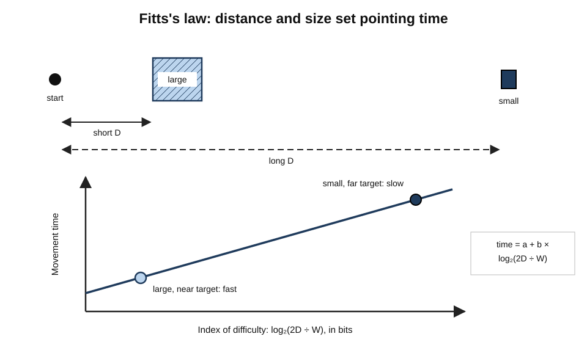
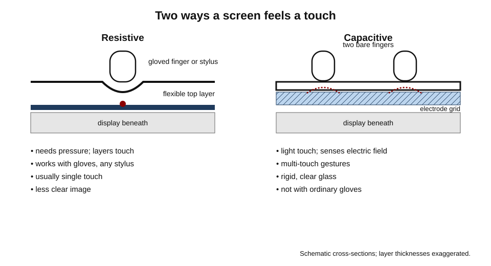
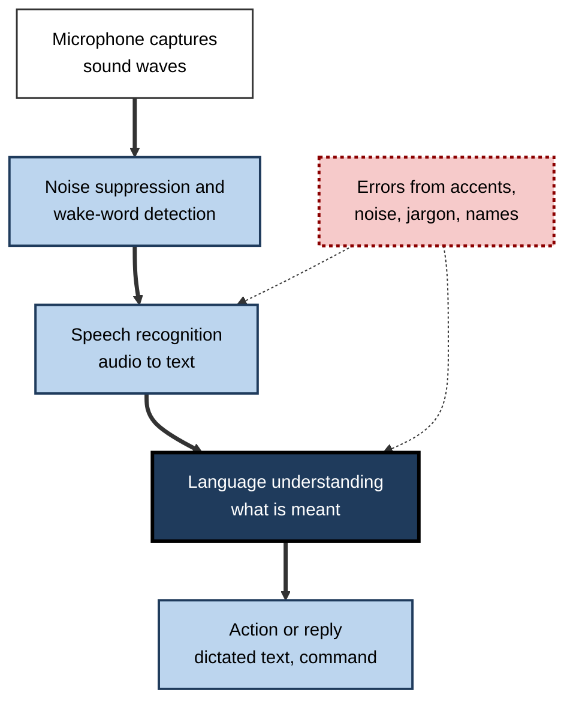
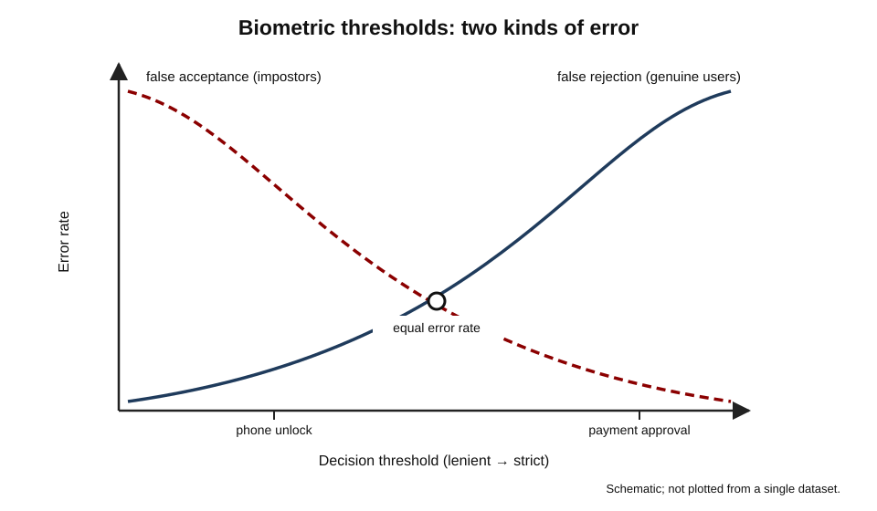

# B.8. Input Devices

A journalist types two thousand words before lunch without looking at the keys. A pharmacist scans a barcode before handing over a medicine. A designer draws a logo with a pen on glass. A driver asks the car to call home. A paralysed patient selects letters with her eyes. Every one of these acts begins the same way: something in the physical world — a press, a touch, a sound, a pattern of light — is **turned into data** a computer can use.

> **Definition — Input device:** any hardware that captures information or commands from a person or the environment and converts it into digital signals for a computing device to process.

**Why input matters**

- **Speed and accuracy** — the input method sets how fast work can be done and how many errors creep in; a scanned barcode is faster and far more accurate than a typed code.
- **Health** — keyboards, mice and touchscreens are used for thousands of hours a year; poor choices contribute to strain injuries.
- **Inclusion** — alternative inputs decide whether people with disabilities can use a system at all.
- **Security** — keystrokes, fingerprints, faces and voices are now used to prove identity, and can be stolen or faked.

---

## The Families of Input

### Main categories

- **Text input** — keyboards (physical and on-screen), handwriting recognition, dictation.
- **Pointing and gesture** — mice, touchpads, trackballs, pointing sticks, touchscreens, pens, motion and gesture sensors.
- **Audio** — microphones for calls, dictation and voice commands.
- **Image and video** — webcams, phone cameras, document scanners, document cameras.
- **Identification and data capture** — barcode and QR scanners, card readers, RFID and NFC readers.
- **Biometric** — fingerprint readers, face-recognition cameras, iris scanners.
- **Sensors** — temperature, motion, location and other environmental readings.
- **Specialised control** — game controllers, joysticks, MIDI musical keyboards, foot pedals.
- **Assistive inputs** — switch access, eye-gaze trackers, head pointers, sip-and-puff devices.

**Figure 1.** The main families of input device.

```mermaid
%%{init: {'theme':'base','themeVariables':{'fontFamily':'Arial, Helvetica, sans-serif','fontSize':'15px','primaryColor':'#FFFFFF','primaryTextColor':'#111111','primaryBorderColor':'#222222','lineColor':'#333333','secondaryColor':'#F2F2F2','tertiaryColor':'#FFFFFF','clusterBkg':'#FAFAFA','clusterBorder':'#555555','edgeLabelBackground':'#FFFFFF','titleColor':'#111111'}}}%%
flowchart TD
    classDef core    fill:#1F3B5C,stroke:#000000,stroke-width:3px,color:#FFFFFF
    classDef key     fill:#BCD5EE,stroke:#1F3B5C,stroke-width:2px,color:#000000
    classDef detail  fill:#FFFFFF,stroke:#333333,stroke-width:1.5px,color:#000000

    I["Input devices"]
    T["Text<br/>keyboards, dictation"]
    P["Pointing and gesture<br/>mouse, touch, pen"]
    A["Audio<br/>microphones, voice"]
    V["Image<br/>cameras, scanners"]
    D["Data capture<br/>barcode, RFID, cards"]
    B["Biometric<br/>fingerprint, face, iris"]
    S["Sensors<br/>motion, location, climate"]
    X["Assistive<br/>switches, eye gaze"]

    I ==> T
    I ==> P
    I ==> A
    I ==> V
    I ==> D
    I ==> B
    I ==> S
    I ==> X

    class I core
    class T,P,A,V key
    class D,B,S,X detail
```

### What makes a good input method

- **Throughput** — how much information per minute.
- **Accuracy** — error rate and ease of correction.
- **Learnability** — time to become proficient.
- **Comfort** — physical strain over hours.
- **Context** — noise, gloves, movement, light, hygiene, privacy.
- **Accessibility** — usable by people with differing abilities.

> **Key point:** no input method is best in general. Dictation beats typing for a quick note while walking and loses badly for editing a spreadsheet in an open-plan office.

---

## Keyboards

### Origins of the layout

- **QWERTY** — developed for the Sholes and Glidden typewriter, sold by Remington from 1874.
  - A popular story says the layout was designed to **slow typists down**; historians generally describe a more complicated process of arranging letters to reduce jams of the typebars and suit telegraph operators.
- **Dvorak Simplified Keyboard (patented 1936)** — August Dvorak placed the most common English letters on the home row.

> **Watch out:** claims that Dvorak is dramatically faster than QWERTY rest largely on studies run by Dvorak himself. Later reviews, notably by economists Stan Liebowitz and Stephen Margolis (1990), argued the advantage is small or unproven. QWERTY persists mainly because of the cost of relearning, not proven inferiority.

- **Regional layouts** — AZERTY (France, Belgium), QWERTZ (Germany, Central Europe), and layouts for non-Latin scripts.
  - *e.g.* India's **InScript** standard arranges Devanagari and other Indic scripts on a standard keyboard; phonetic typing (typing in Latin letters converted to Indic script) is also very common.

### How keyboards work

- A grid of switches under the keys; a small controller scans the grid many times a second and sends a code for each key pressed or released.
- **Switch types:**
  - **Membrane** — rubber domes over a printed membrane; cheap, quiet, softer feel.
  - **Scissor-switch** — low-profile mechanism used in laptops; stable, short travel.
  - **Mechanical** — an individual switch per key; durable, precise, often louder; favoured by heavy typists and programmers.
- **Rollover** — how many simultaneous key presses are registered correctly.

> **Definition — Key travel:** the distance a key moves when pressed; short travel suits thin laptops, longer travel gives clearer feedback.

### Typing speed and productivity

- **Touch typing** — typing without looking, using all fingers from the home row.
- Professional typists exceed 70 words per minute; many hunt-and-peck typists manage around half that or less.
- **Keyboard shortcuts** — copying, pasting, switching windows, undoing — save seconds hundreds of times a day.

> **Formula — Time saved by a shortcut:** saving = uses per day × seconds saved × working days. Using a shortcut 200 times a day, saving 2 seconds each over 220 days: 200 × 2 × 220 = 88,000 seconds ≈ **24 hours a year**.

### Ergonomic keyboards

- **Split and tented keyboards** keep wrists straighter and shoulders open.
- **Compact keyboards** (without number pads) bring the mouse closer to the body.
- **Wrist position** — float the hands while typing; rest only during pauses.

---

## Pointing Devices

### The mouse

- **1960s** — Douglas Engelbart and Bill English at the Stanford Research Institute build the first mouse: a wooden block with two wheels.
- **1968** — Engelbart's public demonstration, later called "the Mother of All Demos", shows the mouse together with windows, hypertext, shared editing and video conferencing.
- **1970s** — Xerox PARC refines the mouse and the graphical interface.
- **1983–1984** — Apple's Lisa and Macintosh bring the mouse to mass market.
- **Ball → optical → laser** sensors; wireless connection by radio dongle or Bluetooth.
- **DPI (dots per inch)** — how far the pointer moves for a given hand movement; higher is not automatically better.

### Other pointing devices

- **Touchpad (trackpad)** — standard on laptops; supports multi-finger gestures.
- **Pointing stick** — a small rubber nub between keys on some business laptops.
- **Trackball** — a ball rotated by thumb or fingers; the device stays still, useful for limited desk space or some wrist conditions.
- **Vertical mouse** — held in a handshake position, reducing forearm twist.
- **Graphics tablet** — a pressure-sensitive surface and pen for drawing and design.

### Fitts's law: why targets need to be big and close

- **Paul Fitts (1954)** studied how long people take to move to and hit a target.
- Time grows with **distance** and shrinks with **target size**, in a predictable logarithmic relationship.

> **Formula — Fitts's law:** movement time = a + b × log₂(2D ÷ W), where D is distance to the target, W its width, and a, b are constants for the device and person. Halving the distance or doubling the width reduces the log term by one "bit".

**Figure 2.** Fitts's law: small, distant targets take longer to hit.

**Worked example (illustrative) — two button designs**

- **Situation:** a checkout screen's "Pay" button is 20 mm wide and 160 mm from where the finger rests; a redesign proposes 40 mm wide and 80 mm away. Assume a = 0.1 s and b = 0.15 s per bit.

| | Original | Redesign |
|---|---|---|
| 2D ÷ W | 2 × 160 ÷ 20 = 16 | 2 × 80 ÷ 40 = 4 |
| log₂(2D ÷ W) | 4 bits | 2 bits |
| Movement time | 0.1 + 0.15 × 4 = **0.70 s** | 0.1 + 0.15 × 2 = **0.40 s** |

*Illustrative figures.*

- **Conclusion:** about 0.3 seconds saved per press — across hundreds of transactions per till per day, and fewer mis-taps.

> **In practice:** Fitts's law explains why menus sit at screen edges (the edge stops the pointer, making the target effectively infinitely deep), why important buttons are large, and why destructive buttons such as "Delete" are kept **away** from frequently used ones.

---

## Touch and Pen

### How touchscreens sense

- **Resistive** — two flexible layers press together where touched.
  - Works with gloves and any stylus; less clear, single-touch, needs pressure.
  - Still used in some industrial and older point-of-sale equipment.
- **Capacitive** — a grid of electrodes senses the change in electrical field caused by a finger.
  - Clear, multi-touch, light touch; does not work with ordinary gloves or non-conductive styluses.
  - Standard on phones, tablets and laptops.
- **Infrared and optical** — beams or cameras around large displays detect interruptions; used for big interactive screens.

**Figure 3.** Resistive and capacitive touchscreens compared.

> **Definition — Multi-touch:** the ability of a touch surface to detect two or more contact points at once, enabling gestures such as pinch-to-zoom.

### Pens and styluses

- **Passive stylus** — a conductive tip imitating a finger; no precision features.
- **Active pen** — electronics in the pen report position, **pressure** and tilt; supports palm rejection.
- **Uses** — signatures, annotation, design, handwriting recognition, mathematics.

### Touch at work

- **Strengths** — direct, learnable, hygienic surfaces can be wiped, no separate device to lose.
- **Weaknesses** — "gorilla arm" fatigue on vertical screens, fingers hide what they touch, no tactile feedback for touch typing.
- **Context** — gloves (healthcare, construction, cold stores) require special screens, gloves or alternatives.

---

## Voice and Audio Input

### From dictation to conversation

- **Speech recognition** converts audio into text; modern systems use neural networks trained on huge amounts of speech.
- **Error rates have fallen dramatically** since the 2010s; for clear speech in quiet rooms, modern systems approach professional human transcription for many languages.
- **Voice assistants** combine recognition with understanding and action.

> **Definition — Word error rate (WER):** the share of words a speech recogniser gets wrong — substitutions, deletions and insertions divided by the number of words actually spoken.

**Figure 4.** From spoken words to an action.

**Study card — Koenecke and colleagues (2020)**

- **Design:** five commercial speech-recognition systems from major technology companies transcribed interviews with white and Black speakers in the United States.
- **Results:** average word error rates were markedly higher — close to double — for Black speakers than for white speakers.
- **Conclusion:** systems trained mainly on some groups' speech perform worse for others, a form of **algorithmic bias** that affects dictation, assistants and automated phone systems.

> **Watch out:** speech recognition improves quickly and later systems may differ, but testing performance on **the actual users' accents, languages and vocabulary** remains essential before relying on voice input at work.

### Where voice input helps

- **Hands busy** — surgeons, mechanics, drivers, warehouse staff.
- **Long-form drafting** — many people speak faster than they type.
- **Accessibility** — people with limited hand use or with dyslexia.
- **Clinical documentation** — "ambient" AI scribes record consultations and draft notes for the clinician to check.

### Where it struggles

- **Noisy or shared spaces** — open offices, factories.
- **Privacy** — dictating confidential material within earshot of others.
- **Precise editing** — correcting a single figure in a table.

---

## Cameras, Scanners and Data Capture

### Cameras and scanners

- **Webcams** — video calls; quality depends on sensor size, lens and lighting more than megapixel count.
- **Document scanners** — flatbed for single pages and books; sheet-fed for batches.
- **Optical character recognition (OCR)** — converts images of text into editable text; modern AI systems also read handwriting and tables.
- **Document cameras** — show paper documents or objects live in meetings and teaching.

> **Definition — Optical character recognition (OCR):** software that recognises printed or handwritten characters in an image and converts them into machine-readable text.

### Barcodes, QR codes and RFID

- **Barcodes** — patterns of bars encoding a number.
  - The first retail scan of a Universal Product Code was made in 1974 in a supermarket in Ohio, on a packet of chewing gum.
- **QR codes** — two-dimensional codes invented in 1994 by Denso Wave in Japan to track car parts; now used for payments, tickets and menus.
  - Built-in error correction lets a damaged code still be read.
- **RFID and NFC readers** — read tags by radio without line of sight; contactless cards, access badges, stock tags.
- **Magnetic stripe and chip card readers** — payment and identification.

> **Watch out:** QR codes can lead to malicious websites. "Quishing" — phishing with QR codes on posters, parking meters and emails — exploits the fact that people cannot read the destination before scanning. Check the address shown before opening it.

**Study card — Poon and colleagues (2010)**

- **Setting:** a large hospital in the United States introduced bedside barcode scanning of patients' wristbands and medicines, linked to electronic records.
- **Design:** medication administrations observed on units before and after introduction.
- **Results:** errors in giving medicines (other than timing errors) fell by around two-fifths, and potential adverse drug events from those errors by about half.
- **Conclusion:** automated data capture at the point of care can substantially reduce human error — provided staff do not work around the system.

> **Example:** nurses under time pressure sometimes scanned a copy of a patient's barcode taped to a workstation rather than the wristband itself — a **workaround** that defeats the safety check. Input design must fit the workflow or people will bypass it.

---

## Biometric Input

### Common biometrics

- **Fingerprint** — capacitive or optical sensors map ridges; common on laptops and phones.
- **Face** — cameras, often with infrared and depth sensing, compare facial geometry.
- **Iris** — high-resolution images of the coloured ring of the eye; very distinctive.
- **Voice** — speaker recognition from vocal characteristics.
- **Behavioural** — typing rhythm, mouse movement, gait.

> **Definition — Biometric authentication:** verifying identity by measuring a physical or behavioural characteristic and comparing it with a stored template.

### The accuracy trade-off

- **False acceptance rate (FAR)** — impostors wrongly accepted.
- **False rejection rate (FRR)** — genuine users wrongly rejected.
- Moving the decision **threshold** lowers one and raises the other; the point where they are equal is the **equal error rate**.

**Figure 5.** The trade-off between false acceptance and false rejection.

| | Strict threshold | Lenient threshold |
|---|---|---|
| False acceptance | Very low | Higher |
| False rejection | Higher: users retry often | Low |
| Suits | Payments, high-security doors | Unlocking a personal phone with a PIN fallback |

### Strengths and risks

- **Strengths** — cannot be forgotten; quick; hard to share casually.
- **Risks:**
  - **cannot be changed** if stolen, unlike a password;
  - **spoofing** — photographs, moulded fingerprints, recorded or AI-cloned voices; good systems use **liveness detection**;
  - **bias** — some face-recognition systems have shown higher error rates for some demographic groups;
  - **legal protection** — biometric data used for identification is special-category data under GDPR, and some jurisdictions have dedicated biometric privacy laws.

> **Remember:** on modern phones and laptops, the fingerprint or face template usually **stays on the device** in a secure chip and is not sent to a server — a much safer design than central biometric databases.

> **Watch out:** voice alone is no longer a safe way to authenticate. AI voice cloning can imitate a person from short samples; several banks have moved away from voice-only verification.

---

## Inputs, Health and Inclusion

### Strain injuries

- **Repetitive strain injury (RSI)** — a general term for pain in muscles, tendons and nerves from repetitive movements and sustained postures; it includes specific conditions such as carpal tunnel syndrome.
- **Risk factors** — long uninterrupted sessions, awkward wrist angles, reaching for the mouse, high force, stress.
- **Prevention** — neutral wrists, input devices close to the body, alternating devices and hands, keyboard shortcuts to reduce mouse use, regular breaks.

> **Definition — Repetitive strain injury (RSI):** pain and dysfunction in muscles, tendons or nerves associated with repetitive tasks, forceful exertions or sustained awkward positions.

### Inputs that include

- **Switch access** — one or two large buttons scan through options.
- **Eye-gaze trackers** — cameras follow the eyes so that looking selects.
- **Head pointers and mouth sticks.**
- **Voice control** of the whole computer.
- **On-screen keyboards with word prediction.**
- **Brain–computer interfaces** — experimental implants and headsets that decode intended movements; early trials have let paralysed people control cursors and type.

> **In practice:** when choosing input devices for a team, offer **choice** — vertical mice, split keyboards, pens, dictation — rather than one standard device for everyone. The cost is small; the benefit to comfort and inclusion is large.

---

## Case Study (illustrative): Replacing Manual Entry in a Warehouse

- **Situation:** a parts distributor's staff typed order and part numbers from paper pick lists into terminals.
- **Problems:** mis-keyed digits sent wrong parts; customers complained; returns were costly.
- **Diagnosis:**
  - every manual transcription created an opportunity for error;
  - staff walked back and forth between shelves and terminals.
- **Actions:**
  1. Labelled every bin and part with barcodes.
  2. Gave pickers wearable ring scanners linked to wrist-mounted screens, leaving both hands free.
  3. Required a scan of both the bin and the part; a mismatch triggered a vibration and on-screen alert.
  4. Kept a short manual-entry fallback for damaged labels, logged and reviewed weekly.
- **Result:** picking errors fell sharply; picking speed rose; training time for new staff shortened because the scanner guided each step.
- **Side effects:** some staff reported finger fatigue from ring scanners; the company offered handheld alternatives.
- **Lesson:** the best input is often **no typing at all** — capture data automatically at the source, design for the workflow, and offer alternatives for comfort.

---

## Input in the Age of AI

### Multimodal input

- Modern systems increasingly accept **several kinds of input at once** — speech, text, images, screen content and gestures.
  - *e.g.* pointing a phone camera at a broken part and asking how to replace it; sketching a chart and asking for it to be built in a spreadsheet.
- **Natural-language commands** — asking software to "find last quarter's invoices from this client" instead of navigating menus.
- **Ambient capture** — microphones and cameras that record meetings or consultations for AI to summarise.

> **Definition — Multimodal input:** interaction in which a system accepts and combines more than one kind of input, such as voice, text, images and gestures.

### What changes, and what does not

- **Less typing for drafting and searching** — speech and short prompts replace some keyboard work.
- **More checking** — the output of AI systems must be reviewed, which still requires reading, precise editing and judgement.
- **Precision tasks remain** — spreadsheets, code, legal drafting and design still depend on exact keyboard and pointer control.
- **Privacy rises in importance** — always-listening and always-watching inputs collect far more data than a keyboard.

> **Watch out:** ambient AI scribes in clinics and meetings can reduce documentation time, but early evaluations also report errors and omissions in drafts. The professional remains responsible for what is recorded.

---

## Specialised and Professional Input Devices

- **Game controllers and joysticks** — also used to operate drones, robots, cranes and medical equipment.
- **Foot pedals** — transcription, sewing machines, surgical equipment, hands-free control in laboratories.
- **MIDI controllers and musical keyboards** — music production; also used as customisable control surfaces.
- **Macro pads and stream decks** — programmable buttons for repeated actions in video production, trading and design.
- **3D scanners and depth cameras** — capture shapes for engineering, heritage conservation and medicine.
- **Digitisers and graphics tablets** — drawing and design; signature capture in finance.
- **Medical inputs** — ultrasound probes, digital stethoscopes, dermatoscopes connected to phones.

> **Example:** a radiology department uses programmable keypads and foot pedals so that radiologists can scroll through image stacks and dictate reports without moving their hands away from the main controls — reducing both time and strain.

---

## Choosing Input Devices for a Team

### A short method

1. **List the main tasks** and how long each takes in a typical day.
2. **Identify constraints** — gloves, noise, hygiene, mobility, shared use, privacy.
3. **Offer a standard device plus alternatives** for comfort and accessibility.
4. **Trial** with a few users for two weeks; measure speed, errors and comfort.
5. **Train** — shortcuts, dictation, pen features; many capabilities go unused without training.
6. **Review** after a few months.

| Role | Main tasks | Suggested inputs | Alternatives to offer |
|---|---|---|---|
| Analyst | Spreadsheets, code, documents | Full-size keyboard, precise mouse | Vertical mouse, split keyboard |
| Designer | Drawing, layout, photo editing | Pen tablet or pen display, keyboard shortcuts | Programmable keypad |
| Clinician | Notes, orders, images | Dictation, barcode scanner, wipeable keyboard | Ambient scribe with review |
| Warehouse picker | Scanning, confirming | Ring or handheld scanner | Voice-directed picking |
| Executive on the move | Email, approvals, reading | Phone with dictation, laptop keyboard | Tablet with pen |

> **Key point:** the right input device is the one that fits the **task, the setting and the person**. Small investments in choice and training repay themselves in speed, accuracy and comfort.

---

## Input Hygiene and Shared Devices

- **Keyboards and touchscreens** are among the most frequently touched surfaces in offices, hospitals and shops.
- **Cleaning** — use the maker's approved disinfectant wipes; power off or lock the device first so that wiping does not type or tap.
- **Sealed and wipeable devices** — silicone-covered keyboards and glass-surfaced touchscreens for clinical and food settings.
- **Personal input devices** — personal mice, pens and headsets for hot-deskers reduce sharing.
- **Touchless alternatives** — voice, cards, QR scanning and proximity sensors in public kiosks.

> **Remember:** shared input devices need a **cleaning routine**; personal ones need **no one else's hands**.

---

## Input Speed in Perspective

- **Typing** — commonly 40–70 words per minute for experienced office workers.
- **Speaking** — conversational speech often runs well above 100 words per minute, which is why dictation can draft faster.
- **Handwriting** — usually slower than typing for most adults, but sometimes associated with deeper processing when taking notes, a finding still debated.

> **Watch out:** raw input speed is rarely the bottleneck in knowledge work; **thinking and editing** are. Faster input helps most in drafting and data capture.

---

## Open Questions

- **Will typing remain the core professional skill?**
  - Dictation and AI drafting are improving fast; editing, coding and data entry still favour keyboards.
- **How should biometrics be governed?**
  - Convenience and security gains compete with risks of surveillance, bias and irreversible theft.
- **Can speech systems work equally well for everyone?**
  - Accuracy across accents, dialects and languages remains uneven.
- **Will brain–computer interfaces leave the laboratory?**
  - Early clinical results are promising for paralysed patients; safety, cost and ethics for wider use are unresolved.
- **How should AI-cloned voices and faces be countered?**
  - Liveness detection and multi-factor checks are racing against generative models.

---

## Summary

- **Input devices** convert actions or phenomena into data: text, pointing, audio, image, data capture, biometric, sensor, specialised and assistive.
- Judge input by **throughput, accuracy, learnability, comfort, context and accessibility**.
- **QWERTY** (1870s) persists through switching costs; Dvorak's superiority is contested. Keyboards use membrane, scissor or mechanical switches; shortcuts save hours a year.
- The **mouse** came from Engelbart's work (1960s, 1968 demo); **Fitts's law** says time grows with distance and shrinks with target width.
- Touchscreens are **resistive** or **capacitive**; active pens add pressure and palm rejection.
- Speech recognition has improved greatly but shows **bias** across accents; measure with **word error rate**.
- Barcodes (first retail scan 1974), QR codes (1994), RFID and **OCR** automate capture; bedside barcode scanning cut medication errors substantially.
- **Biometrics** trade **FAR** against **FRR**; they cannot be changed if stolen and need liveness detection; voice-only verification is now unsafe.
- Prevent **RSI** with neutral postures, close devices, variety and breaks; offer assistive and alternative inputs.

---

## Self-Check

1. Define an input device and name six families with an example of each.
2. Which criteria would you use to compare dictation and typing for a field engineer?
3. What is the evidence for and against Dvorak's superiority over QWERTY?
4. Distinguish membrane, scissor and mechanical keyboards.
5. Calculate the yearly time saved by a shortcut used 150 times a day, saving 3 seconds, over 230 days.
6. State Fitts's law and give two design rules it explains.
7. A button 10 mm wide is 160 mm away. With a = 0.1 s and b = 0.2 s per bit, what is the movement time? What if the button is 40 mm wide?
8. Compare resistive and capacitive touchscreens and give a setting for each.
9. What is word error rate, and what did the 2020 study of commercial speech systems find?
10. How did bedside barcode scanning affect medication errors, and what workaround can defeat it?
11. Explain FAR and FRR, and why a bank's payment approval might use a strict threshold.
12. Why is a stolen biometric worse than a stolen password, and how do modern phones reduce the risk?
13. What is "quishing", and how can it be avoided?
14. A firm plans to give everyone the same keyboard and mouse to cut costs. Advise.

### Answer Key

1. Hardware that captures information or commands and converts them into digital signals. Text (keyboard), pointing (mouse), audio (microphone), image (scanner), data capture (barcode scanner), biometric (fingerprint reader), sensor (thermometer), assistive (eye-gaze tracker).
2. Throughput, accuracy and correction, context (noise, gloves, hands busy), privacy, comfort, learnability. Dictation may win on site with busy hands; typing wins for precise editing in quiet settings.
3. For: Dvorak's own studies showed large gains. Against: those studies were not independent; later reviews (Liebowitz and Margolis, 1990) found small or unproven advantages; switching costs dominate.
4. Membrane: rubber domes, cheap and soft. Scissor: low-profile, stable, used in laptops. Mechanical: individual switches, durable and precise, often louder.
5. 150 × 3 × 230 = 103,500 s ≈ **28.75 hours**.
6. Movement time = a + b log₂(2D/W). Make frequent targets large and near; place menus at screen edges; separate destructive buttons from common ones.
7. 2D/W = 32 → 5 bits → 0.1 + 0.2 × 5 = **1.1 s**. At 40 mm: 2D/W = 8 → 3 bits → **0.7 s**.
8. Resistive: pressure on layers, works with gloves and any stylus, less clear (industrial terminals). Capacitive: senses electrical field of a finger, multi-touch and clear, not with ordinary gloves (phones, tablets).
9. Errors (substitutions, deletions, insertions) divided by words spoken. Five commercial systems had error rates close to double for Black speakers compared with white speakers.
10. Non-timing administration errors fell by about two-fifths and potential adverse drug events from them by about half. Scanning a copied barcode instead of the patient's wristband defeats the check.
11. FAR: impostors accepted; FRR: genuine users rejected. A strict threshold minimises fraud (low FAR) at the cost of more retries, acceptable for high-value payments.
12. A biometric cannot be changed. Phones store templates in a secure chip on the device, never sending them to servers, and use liveness detection.
13. Phishing via QR codes leading to malicious sites. Check the address displayed before opening, avoid codes on stickers over official ones, and use official apps.
14. People differ in hand size, health, disability and work; RSI costs exceed device savings. Offer a small menu of choices (vertical mouse, split keyboard, trackball, pen, dictation) and workstation assessment.

---

## Glossary

| Term | Meaning |
|---|---|
| Active pen | A stylus with electronics reporting position, pressure and tilt. |
| Barcode | A pattern of bars or squares encoding data for optical scanning. |
| Biometric authentication | Verifying identity from a physical or behavioural characteristic. |
| Capacitive touchscreen | A screen sensing the electrical effect of a finger. |
| Equal error rate | The point where false acceptance and false rejection rates are equal. |
| Eye-gaze tracker | A device that lets eye movements control a computer. |
| False acceptance rate | The rate at which impostors are wrongly accepted. |
| False rejection rate | The rate at which genuine users are wrongly rejected. |
| Fitts's law | Movement time grows with distance and shrinks with target width. |
| Input device | Hardware that converts actions or phenomena into digital signals. |
| Key travel | The distance a key moves when pressed. |
| Liveness detection | Checks that a biometric comes from a live person present. |
| Multi-touch | Detection of several touch points at once. |
| Multimodal input | Interaction combining several kinds of input such as voice, text and images. |
| OCR | Optical character recognition: converting images of text to text. |
| QR code | A two-dimensional barcode with error correction. |
| Quishing | Phishing using QR codes. |
| QWERTY | The standard English keyboard layout from the 1870s typewriter. |
| Resistive touchscreen | A screen sensing pressure between two flexible layers. |
| RSI | Repetitive strain injury. |
| Switch access | Controlling a device with one or two large switches. |
| Touch typing | Typing without looking, using all fingers. |
| Word error rate | The share of words a speech recogniser gets wrong. |
