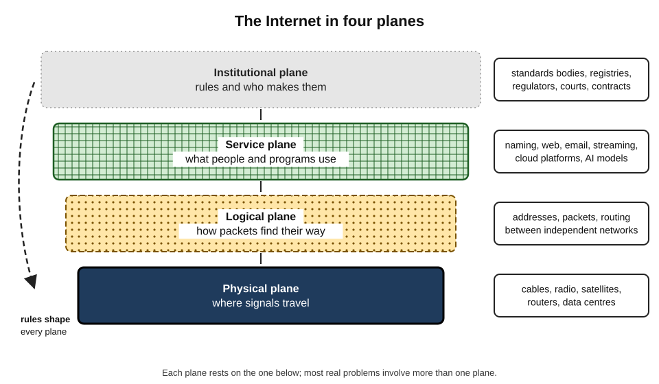
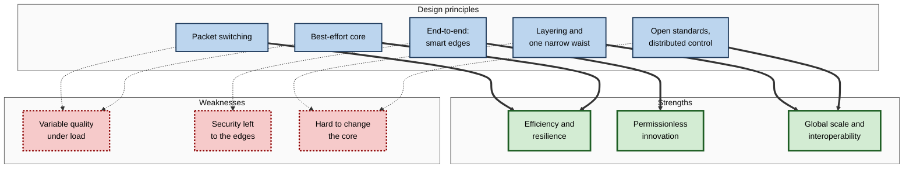
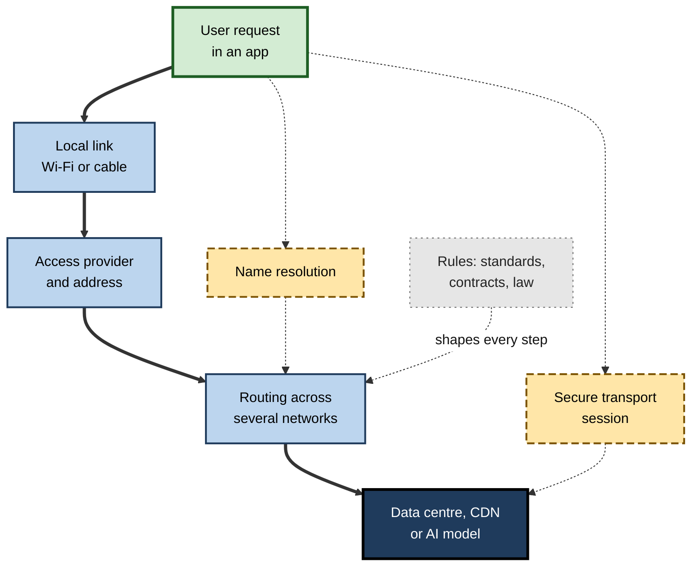
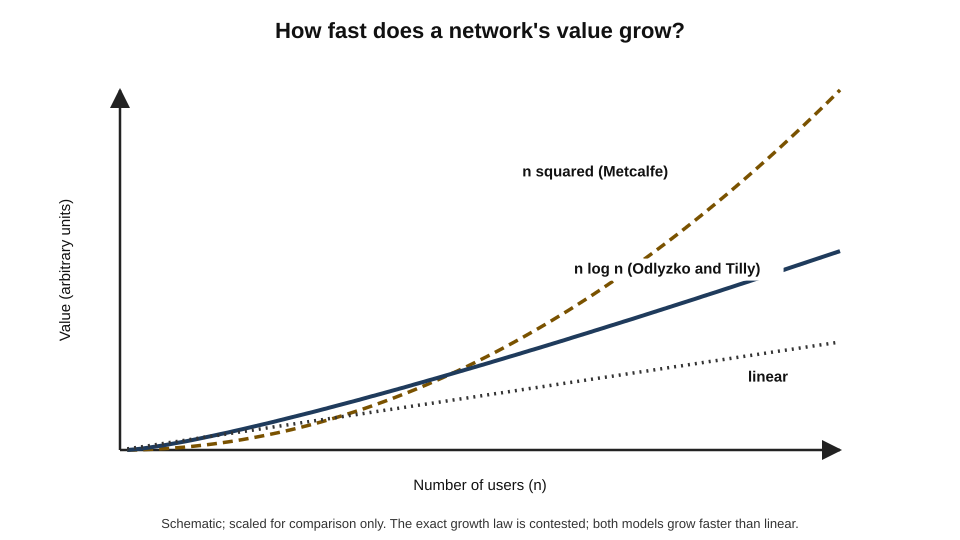
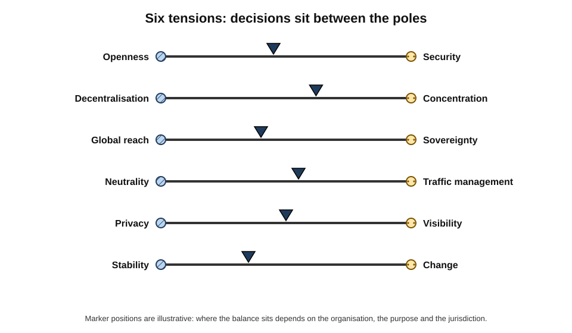

# E. Internet Fundamentals

An accountant closes the month in a cloud ledger, a surgeon reviews scans stored in another city, a student in a village joins a lecture from a phone, and an AI assistant drafts a reply using a model running on another continent.

Each depends on the same shared system — one that nobody owns, that was designed in the 1970s for a few hundred research computers, and that now connects around six billion people. Understanding that system at its foundations is no longer a specialist concern; it is part of being competent at almost any modern job.

> **Definition — Internet fundamentals:** the core concepts, design principles, components, economics and institutions that explain how the Internet works as a whole — how independent networks interconnect, how data finds its way, how services are built on top, and how the system is paid for and governed.

**Why the fundamentals matter**

- They let a professional **reason** about unfamiliar situations — a new cloud service, an outage, a security warning, a regulatory proposal — instead of memorising isolated facts.
- They expose **dependencies**: almost every business process, and every AI service, now rests on infrastructure the organisation does not control.
- They separate **durable principles**, which have held for half a century, from **fashions**, which change every few years.
- They are the shared vocabulary in which technical, commercial, legal and policy experts negotiate decisions about networks.

### Origins in brief

The Internet grew from 1960s research on packet switching into the ARPANET of 1969 and became a true inter-network when TCP/IP was adopted on 1 January 1983; the web, broadband, smartphones, cloud computing and AI services were then layered on top of that same core over the following four decades.

> **Key point:** each era added a **new layer of use** on top of the same core. The principles chosen for a research network of trusted colleagues still govern a commercial network of billions of strangers — which is why understanding them explains so much of today's behaviour.

---

## The Internet as a System

### Four planes

The Internet is easiest to understand as four interlocking planes, each with its own components, logic and owners.

- **The physical plane** — the cables, radio links, satellites, routers and data centres through which signals actually travel.
  - Owned by thousands of companies, public bodies and households.
  - Governed by physics: distance, spectrum, energy.
- **The logical plane** — the rules by which packets are addressed, forwarded and routed between independent networks.
  - The Internet Protocol, numbered addresses and the routing announcements that networks exchange.
- **The service plane** — everything people and programs actually use: naming, the web, email, messaging, streaming, cloud platforms, AI models.
- **The institutional plane** — standards bodies, registries, companies, regulators, courts and international forums that make, enforce and contest the rules.

**Figure 1.** The four planes of the Internet and what each contributes.

> **Key point:** most real problems cross planes. A slow AI assistant may be a physical problem (distance), a logical one (routing), a service one (an overloaded model) or an institutional one (a data-residency rule forcing processing far away). Diagnosis begins by asking **which plane** is involved.

### A network of networks

- **Independence** — each network (a home, a company, an ISP, a cloud provider) is run by its own operator for its own purposes.
- **Interconnection** — these networks agree, commercially and technically, to exchange traffic, directly or through intermediaries.
- **Common rules** — a shared protocol at the boundaries lets the whole behave as one Internet.
- **No centre** — there is no master switch, central directory of everything or single owner; coordination replaces control.

> **Definition — Interconnection:** the physical and commercial linking of separately operated networks so that traffic can pass between them.

> **Watch out:** two opposite misconceptions are common. "Nobody controls the Internet" ignores the very real power of states over the networks inside their borders and of large firms over the services people use. "Someone runs the Internet" ignores that no single body can switch it off or rewrite its rules alone.

---

## The Design Principles That Explain Almost Everything

A small set of design decisions, made mostly in the 1970s and 1980s, explains the Internet's strengths and weaknesses to this day.

### Packets and sharing

- **Packet switching** — data is divided into small, separately addressed packets that share links with everyone else's.
- **Statistical multiplexing** — because users rarely send at the same instant, a link can serve far more users than its capacity would suggest.
- **Consequence** — the network is efficient and robust, but quality varies with load; congestion shows up as delay and loss rather than refusal.

### Layering and the hourglass

- **Layering** — functions are divided into layers (physical links, inter-network packets, end-to-end transport, applications), each relying on the one below.
- **The narrow waist** — everything converges on one simple protocol, IP, so any physical medium below and any application above can interoperate.
- **Consequence** — new technologies (Wi-Fi, fibre, 5G, satellites; the web, video calls, AI services) join without redesigning the rest.

**Figure 2.** How the core design principles produce the Internet's characteristic strengths and weaknesses.

### End to end, best effort

- **End-to-end principle** (Saltzer, Reed and Clark, 1984) — functions such as reliability and security belong in the communicating end systems wherever possible, because only they know what the application needs.
- **Best effort** — the core network tries to deliver packets but promises nothing; reliability, ordering and encryption are added by the end systems.
- **Consequences:**
  - anyone can invent a new application without permission from network operators;
  - protection of data and devices is largely the job of devices and applications, not "the network".

> **Definition — Permissionless innovation:** the ability to create and deploy new applications on the Internet without needing approval from network operators or a central authority.

### Robustness — and its revision

- **Jon Postel's robustness principle** (in early protocol specifications around 1980): "be conservative in what you do, be liberal in what you accept from others".
  - It helped early, imperfect implementations interoperate.
- **The later critique** — engineers came to argue that excessive tolerance lets sloppy or malicious behaviour become entrenched, creating security flaws and making protocols hard to evolve; an IETF document published in 2023 recommended that protocol maintainers actively correct deviations rather than silently accept them.

> **Watch out:** design principles are not laws of nature. Some (layering, end to end) have proved durable; others (unlimited tolerance, implicit trust between networks) have been revised as the Internet grew from a cooperative research community into a global network of strangers.

### Design priorities, stated by an architect

**Study card — David Clark, "The Design Philosophy of the DARPA Internet Protocols" (1988)**

- **Who:** David Clark, chief protocol architect of the Internet in the 1980s.
- **What:** a retrospective paper setting out the goals of the original design **in order of priority**:
  1. interconnect existing, different networks;
  2. keep communicating despite the loss of networks or gateways (survivability);
  3. support multiple types of communication service;
  4. accommodate a variety of networks;
  5. allow distributed management;
  6. be cost-effective;
  7. allow hosts to attach with little effort;
  8. account for the use of resources.
- **Insight:** accountability — and, implicitly, security against misbehaving participants — sat near the **bottom** of the list. Many later problems (spam, attacks, difficulty attributing traffic) follow from that ordering.
- **Lesson:** every architecture embodies priorities; understanding them explains what a system does well and badly.

**Study card — Clark, Wroclawski, Sollins and Braden, "Tussle in Cyberspace" (2002)**

- **Argument:** the Internet is shaped by **tussles** — ongoing conflicts among parties with different interests: users and ISPs, content firms and governments, privacy advocates and law enforcement.
- **Design advice:** rather than imposing one outcome, good architecture should **allow tussles to play out** — for example, by keeping choice possible (of provider, route, encryption) and separating issues so that conflict in one area does not distort others.
- **Significance:** it reframed Internet design as partly a political problem; much later debate — over net neutrality, encryption, sovereignty and AI crawling — fits the tussle pattern.

> **Definition — Tussle:** in Internet architecture, a persistent conflict between stakeholders with divergent interests, which the design of the system can channel but not eliminate.

---

## How the Parts Work Together

### One journey, many components

When someone opens a cloud application, a chain of components cooperates within a fraction of a second. Each is intricate in its own right; the professional insight is how they **depend on one another**.

1. **The local link** — the device reaches a provider's access network over Wi-Fi, cable or mobile radio.
2. **An address** — the device holds a numeric address so that replies can find it.
3. **A name lookup** — the distributed naming system translates the service's name into an address.
4. **A secure conversation** — protocols establish an encrypted, reliable exchange between the two ends.
5. **Routing** — routers in several independently owned networks forward the packets hop by hop.
6. **The response** — a data centre, often reached through a nearby content cache, returns the result.

**Figure 3.** The dependency chain behind a single request to a cloud or AI service.

### Why interdependence matters

- **Single points of failure hide in shared components** — one naming provider, one cloud region, one identity service or one submarine cable can affect thousands of apparently unrelated services.
- **Performance is set by the weakest link** — fast fibre does not help if the Wi-Fi is congested or the server is on another continent.
- **Security is a chain** — encrypted transport does not protect against a forged name, a stolen password or a compromised device.

> **Remember:** when an Internet service misbehaves, think in terms of **the chain**: link, access, address, name, transport, route, server, rules. Most diagnosis is simply finding the broken link in that chain.

---

## The Economics of a Network of Networks

### Value grows with connections

- **Network effects** — each new participant makes the network more valuable to others.
- **Metcalfe's law** — the claim, associated with Ethernet's co-inventor Robert Metcalfe, that a network's value grows with the **square** of the number of connected users, because the number of possible pairs grows that way.
- **The critique** — Andrew Odlyzko and Benjamin Tilly (2005) argued that most possible connections are of little value, and that value grows more slowly — closer to **n log n** — which would explain why networks do not automatically merge and why the dot-com valuations based on n² proved wildly optimistic.

**Figure 4.** Two models of how network value grows with the number of users.

> **Watch out:** "Metcalfe's law" is a heuristic, not an empirical law. Its exact form is **contested**; the robust conclusion is that value rises **faster than linearly** with users, which favours large, interconnected networks and gives early leaders strong advantages.

### Cost structure and business models

- **High fixed costs, low marginal costs** — laying fibre, launching satellites and building data centres is expensive; carrying one more packet is almost free.
- **Consequences:**
  - strong economies of scale and pressure towards **concentration**;
  - flat-rate pricing for consumers is common, because metering every packet costs more than it earns;
  - **oversubscription** of shared capacity is economically essential.
- **Interconnection economics** — networks either pay for transit or exchange traffic directly by peering; the balance of who pays whom reflects bargaining power as much as cost.
- **Two-sided markets** — platforms serve users and advertisers or developers at once, often subsidising one side; this shapes the "free" services of the web.

| | Infrastructure layer | Service and platform layer |
|---|---|---|
| Typical cost structure | Very high fixed, long-lived assets | High development, low marginal cost of extra users |
| Revenue sources | Subscriptions, transit, wholesale access | Advertising, subscriptions, transaction and usage fees |
| Tendency | Local monopolies or oligopolies; regulated | Winner-takes-most markets driven by network effects |
| Main policy questions | Coverage, competition, investment, neutrality | Competition, data, content, interoperability |

> **Key point:** the Internet's **lower layers** tend to be regulated utilities or oligopolies; its **upper layers** tend towards a few dominant platforms. Many debates about "the Internet" are really debates about which layer's economics should prevail.

---

## How Knowledge About the Internet Is Produced

### Measuring a system nobody owns

- **No single source sees everything** — knowledge comes from many partial vantage points.
- **Official statistics** — the International Telecommunication Union compiles national data on users, subscriptions and prices; household surveys measure use.
- **Active measurement** — thousands of small probes hosted by volunteers and operators measure latency and reachability between points.
- **Routing observation** — route collectors record the announcements networks make to each other, revealing outages, hijacks and changing interconnection.
- **Traffic reports** — large content, CDN and security firms publish what they observe on their own networks.
- **Academic research** — measurement studies, simulations and experiments.

| Source | What it reveals well | Main limitation |
|---|---|---|
| National and international statistics | Adoption, prices and divides over time | Lags; definitions differ by country |
| Active measurement probes | Latency, reachability, outages | Probe locations are uneven |
| Route collectors | Interconnection, routing incidents | Partial view; not all paths visible |
| Company traffic reports | Trends in protocols, attacks and AI traffic | Only that company's view; commercial interests |
| Academic studies | Mechanisms and careful causal claims | Narrow samples; slower publication |

> **In practice:** expert analysts **triangulate**: a claim such as "half of web traffic is now encrypted with post-quantum methods" or "AI crawlers are a large share of requests" is checked against several independent vantage points before it is relied upon.

> **Watch out:** headline Internet numbers — devices connected, data created per day, traffic forecasts — are often **estimates or projections** by interested parties. Precise figures without a stated method deserve scepticism.

---

## The Great Tensions

The Internet's history can be read as a series of tensions that are managed rather than resolved.

| Tension | One pull | The other pull | Where it shows up |
|---|---|---|---|
| Openness and security | Anyone can connect and innovate | Strangers can attack and defraud | Firewalls, zero trust, authentication |
| Decentralisation and concentration | Many networks and providers | Scale economies favour giants | Cloud, platforms, CDNs |
| Global reach and sovereignty | One interoperable network | National control of data and content | Localisation laws, filtering, shutdowns |
| Neutrality and management | Treat all traffic equally | Manage congestion, offer differentiated services | Net-neutrality rules, traffic management |
| Privacy and visibility | Encrypt everything | See enough to secure, manage and police | Encrypted DNS, lawful access debates |
| Stability and change | Keep the core simple and stable | Add features and fix flaws | IPv6, new transports, post-quantum migration |

**Figure 5.** The tensions that shape Internet decisions, each a balance rather than a choice.

- **Professional judgement** lies in recognising which tension a decision involves and where, for this organisation and this purpose, the balance should sit.
- **Example:** an organisation adopting encrypted DNS gains privacy for its staff on public networks but must preserve its own security filtering — a privacy–visibility tension resolved by running its own encrypted resolver.

> **Key point:** most arguments that present one side of a tension as simply "right" — total openness, total control, total encryption, total visibility — are incomplete. Durable solutions **balance** both sides and allow the balance to shift as circumstances change.

---

## Understanding the Internet at Work

### What competent understanding looks like in different roles

| Role | What the fundamentals enable | Typical decisions |
|---|---|---|
| Any knowledge worker | Safe, effective use; first-line diagnosis | Wired or Wi-Fi; recognising a fake site; reporting a problem clearly |
| Manager | Realistic expectations and resilience planning | Remote-work arrangements; vendor choice; continuity plans |
| IT and security professional | Design, operation and defence of networks and services | Connectivity architecture; access control; incident response |
| Strategy, legal and policy roles | Judging regulation, risk and competitive position | Data location; platform obligations; investment in digital capabilities |

- **A shared foundation** — all four roles rely on the same core ideas; what differs is how far into each plane the role must go.
- **Translation** — senior professionals are valued for explaining Internet constraints (latency, dependency, jurisdiction) to colleagues in other disciplines.

### Connectivity as critical infrastructure

- **Dependence** — finance, operations, sales, customer service and increasingly physical systems (tills, building controls, factory sensors) stop when connectivity stops.
- **Resilience patterns:**
  - two independent connections on different technologies and routes;
  - services designed to survive the loss of a region or provider;
  - offline fallbacks for essential processes;
  - monitoring of the services that matter, from where users actually are.
- **Shared responsibility** — cloud and software providers secure their platforms; the organisation remains responsible for its identities, data, configuration and connectivity.

### The foundation under cloud and AI

- **Cloud computing is the Internet's economics applied to computing** — pooled, shared, elastic resources reached over the network.
- **AI services are Internet services** — a prompt is a set of packets to a distant data centre; training draws on data gathered from the web; responses stream back over the same protocols as any web page.
- **Implications for professionals:**
  - AI responsiveness depends on network distance as well as model speed;
  - rules about where data may be processed are, in practice, rules about **routing and hosting**;
  - concentration of AI capacity in a few providers and regions adds a new layer of dependency;
  - automated agents and crawlers are changing the composition and economics of Internet traffic.

---

## Case Study (illustrative): The AI Rollout That Was Really a Network Project

- **Situation:** a law firm of 900 people across eight offices introduced an AI drafting assistant embedded in its document system, hosted by a large cloud provider.
- **Problems in the first month:**
  1. lawyers in two regional offices found responses "painfully slow", while head-office users were satisfied;
  2. some requests failed outright with security errors;
  3. the data-protection officer asked where client documents were being processed and could not get a clear answer;
  4. an outage at the firm's identity provider made the assistant — and every other cloud tool — unavailable for half a day.
- **Diagnosis across the planes:**
  - **physical** — the regional offices' traffic was routed through head office before reaching the Internet, adding long round trips;
  - **logical and service** — the firm's protective DNS filter blocked some of the AI provider's newly introduced domain names, producing the security errors;
  - **institutional** — the contract allowed processing in several regions, some outside the jurisdictions clients had agreed to;
  - **dependency** — single sign-on was a single point of failure for all cloud services.
- **Actions:**
  1. gave regional offices direct, local Internet breakout with security applied in the cloud;
  2. agreed a process with the provider for announcing domain changes and allow-listed them;
  3. renegotiated processing to approved regions and documented the data flows;
  4. added a resilient configuration for the identity provider and an emergency access procedure;
  5. set latency and availability targets for AI tools and monitored them from every office.
- **Result:** response times in regional offices fell to the head-office level; failures disappeared; the firm could answer clients' data-location questions precisely.
- **Lesson:** adopting an AI or cloud service is as much an **Internet engineering and governance** exercise as a software choice. Understanding the fundamentals turned a frustrating launch into a dependable service.

---

## Worked Example (illustrative): An Internet-Readiness Review

Situation: a regional charity with three offices plans to move its case-management system to a cloud service and introduce AI-assisted note-taking for caseworkers, many of whom work from clients' homes.

1. **Map the dependency chain** — for each office and for mobile workers: local network, access connection, naming, identity, cloud region, AI provider.
2. **Check the physical plane** — measure upload speed, latency and reliability at each office and on the mobile networks caseworkers use; identify sites with a single connection.
3. **Check the logical and service planes** — confirm the cloud and AI services are reachable over IPv4 and IPv6 as needed; review DNS filtering rules; ensure identity uses multi-factor sign-in.
4. **Check the institutional plane** — confirm where data is processed and stored, retention and training terms for the AI provider, and obligations under data-protection law for sensitive client data.
5. **Plan for failure** — an offline mode or paper fallback for home visits; a second connection or mobile backup for the main office; a procedure if the identity provider is unavailable.
6. **Set measures** — latency and availability targets for the case system and AI tool; quarterly review of incidents and costs.
- **Conclusion:** a one-page review across the four planes surfaces the issues — weak mobile coverage in rural areas, one office with a single connection, unclear AI data terms — that would otherwise appear only after launch.

> **In practice:** experienced practitioners run this kind of four-plane review before any significant cloud, AI or remote-working change. It takes days, not months, and prevents most avoidable failures.

---

## The State of the Field

- **Scale** — about three-quarters of humanity online, with the remaining quarter concentrated in low-income and rural areas.
- **Architecture** — the 1970s core remains, but traffic is increasingly carried over the private networks of very large cloud and content companies and delivered from caches close to users.
- **Protocols** — encryption has become the default; newer transports reduce delay; addressing is migrating steadily to a vastly larger scheme; cryptography is being upgraded against future quantum threats.
- **Access** — fibre and 5G expand capacity; low-orbit satellite constellations reach remote areas at scale.
- **Traffic** — video dominates by volume; automated traffic from crawlers, bots and AI services is growing quickly.
- **Governance** — multistakeholder technical coordination has been reaffirmed internationally, while national laws on data, content, platforms and AI multiply and diverge.

---

## Open Questions

- **Can the Internet remain one interoperable network?**
  - Sovereignty pressures and divergent regulation pull towards fragmentation; the economic value of global reach pulls the other way.
- **Is concentration in a few cloud, content and AI providers compatible with resilience and competition?**
  - Large providers improve performance and security, but create systemic dependencies and market power.
- **How will automated and AI-driven traffic change the Internet's economics?**
  - If machines rather than people increasingly consume content, the advertising and subscription models that fund much of the web may need replacing.
- **Can security be retrofitted fully onto an architecture built on trust?**
  - Routing security, authenticated identity and post-quantum cryptography are spreading, but coverage remains incomplete.
- **How should meaningful connectivity for everyone be achieved and financed?**
  - Affordability, skills and relevance, not only coverage, determine whether the remaining offline population benefits.

---

## Summary

- **Internet fundamentals** are the concepts, principles, components, economics and institutions that explain the Internet as a whole.
- The Internet can be understood as **four planes** — physical, logical, service and institutional — and as a **network of independent networks** held together by interconnection and common rules, with **no centre**.
- Core design principles — **packet switching**, **layering with one narrow waist**, the **end-to-end principle**, **best-effort delivery**, **open standards** and **distributed control** — explain both its strengths (efficiency, resilience, permissionless innovation, global interoperability) and its weaknesses (variable quality, edge-based security, a core hard to change).
- **Clark (1988)** showed that accountability ranked last among the original priorities; **"Tussle in Cyberspace" (2002)** reframed design as managing conflicts of interest; Postel's **robustness principle** has been revised.
- Services depend on a **chain** of components; shared components create hidden **single points of failure**.
- Economics: **network effects** (Metcalfe's n², contested by Odlyzko and Tilly's n log n), **high fixed and low marginal costs**, **interconnection bargaining** and **two-sided platforms** drive concentration at different layers.
- Knowledge about the Internet comes from **partial vantage points**; experts **triangulate** and treat headline figures with caution.
- Decisions involve recurring **tensions** — openness–security, decentralisation–concentration, global–sovereign, neutrality–management, privacy–visibility, stability–change — to be balanced, not resolved once.
- In organisations, connectivity is **critical infrastructure**; **cloud and AI services are Internet services**, so adoption requires review across all four planes.

---

## Self-Check

1. Define "Internet fundamentals" and explain why they matter to professionals outside IT.
2. Describe the four planes of the Internet and give one example of a problem in each.
3. Why is the Internet described as a network of networks with no centre, and what are the two opposite misconceptions about control?
4. Explain statistical multiplexing and its consequence for quality under load.
5. What is the "narrow waist", and why has it allowed the Internet to absorb new technologies?
6. State the end-to-end principle and explain how it enables permissionless innovation and shifts security responsibility.
7. What was Postel's robustness principle, and why has it been revised?
8. What did David Clark's 1988 paper reveal about the original design priorities, and why does it matter today?
9. Explain the idea of "tussle" and apply it to one current debate.
10. Trace the dependency chain of a request to a cloud AI service, identifying two possible hidden single points of failure.
11. Compare Metcalfe's law with the n log n critique and state the robust conclusion.
12. Why do the Internet's lower layers tend towards regulated oligopoly and its upper layers towards dominant platforms?
13. Name four sources of knowledge about the Internet and one limitation of each.
14. Choose two of the great tensions and explain how an organisation might balance each in practice.
15. A company plans to roll out an AI assistant to all staff next month. Using the four-plane approach, list the questions it should answer first.

### Answer Key

1. The core concepts, principles, components, economics and institutions explaining how the Internet works as a whole. They let professionals reason about new services, outages, security warnings and regulation, and expose dependencies on infrastructure they do not control.
2. Physical (cables, radio, data centres) — a cut cable; logical (addressing, forwarding, routing) — a routing leak; service (naming, web, cloud, AI) — a failed DNS provider; institutional (standards, law, contracts) — a data-residency rule forcing distant processing.
3. Independently run networks interconnect by agreement and common rules; no body can switch it off or control it all. Misconceptions: "nobody controls it" ignores states' and firms' real power; "someone runs it" ignores its distributed nature.
4. Sharing a link among many bursty users who rarely send at once; it makes the network efficient, but when demand coincides, queues grow and packets are delayed or dropped.
5. The single common protocol, IP, on which all lower technologies and upper applications converge; anything that works with IP can join without the rest changing.
6. Reliability and security functions belong in end systems where possible. Since the network merely forwards packets, anyone can deploy new applications without permission; but devices and applications must protect themselves.
7. "Be conservative in what you do, be liberal in what you accept." It aided early interoperability, but tolerance of deviations entrenched flaws and security weaknesses; recent guidance favours correcting deviations.
8. That interconnection and survivability came first and accountability last; this explains many later problems with spam, attacks and attribution — architecture embodies priorities.
9. Persistent conflicts among stakeholders that design can channel but not eliminate. E.g. encrypted DNS: users' privacy versus networks' and governments' visibility, managed by allowing choice of resolver and enterprise policies.
10. Local link → access provider and address → name resolution → secure transport → routing across networks → data centre or model, all under rules. Hidden single points: the DNS or identity provider; one cloud region or one submarine cable.
11. Metcalfe: value ∝ n² because possible pairs grow that way; Odlyzko and Tilly: most connections are of low value, so value ∝ n log n. Robust conclusion: value grows faster than linearly, favouring large networks.
12. Infrastructure has very high fixed costs and natural-monopoly features, attracting regulation; services have low marginal costs and strong network effects, producing winner-takes-most platforms.
13. Official statistics (lags, differing definitions); active probes (uneven locations); route collectors (partial view); company traffic reports (one firm's view, commercial interests); academic studies (narrow samples, slower).
14. E.g. openness–security: allow broad access to services but verify every request (zero trust). Privacy–visibility: adopt encrypted DNS through an organisation-run resolver that keeps security filtering.
15. Physical: are latency and upload capacity adequate at every site and for mobile staff; is there backup connectivity? Logical/service: are the provider's domains allowed through filtering; is identity resilient with MFA; is the region close to users? Institutional: where is data processed and retained; is it used for training; what laws and client commitments apply? Plus failure plans and monitoring targets.

---

## Glossary

| Term | Meaning |
|---|---|
| Best effort | A network service that attempts delivery without guarantees. |
| End-to-end principle | Placing functions in end systems rather than in the network where possible. |
| Four planes | Physical, logical, service and institutional views of the Internet. |
| Hourglass (narrow waist) | Many technologies below and applications above converging on IP. |
| Interconnection | Physical and commercial linking of separately operated networks. |
| Internet fundamentals | Core concepts, principles, components, economics and institutions of the Internet. |
| Layering | Dividing network functions into layers that each rely on the one below. |
| Metcalfe's law | The heuristic that a network's value grows with the square of its users. |
| Network effect | Increase in value to each user as more people join. |
| Packet switching | Sending data as independently forwarded packets sharing links. |
| Permissionless innovation | Deploying new applications without operators' approval. |
| Robustness principle | "Be conservative in what you do, liberal in what you accept"; now qualified. |
| Shared responsibility | Division of security duties between service providers and customers. |
| Single point of failure | A component whose failure stops the whole service. |
| Statistical multiplexing | Sharing capacity among bursty users who rarely transmit together. |
| Triangulation | Checking claims against several independent sources. |
| Tussle | A persistent conflict of interests that Internet design must accommodate. |
| Two-sided market | A platform serving two groups, such as users and advertisers, at once. |
