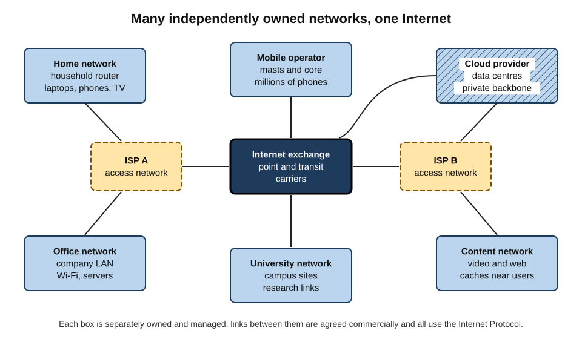
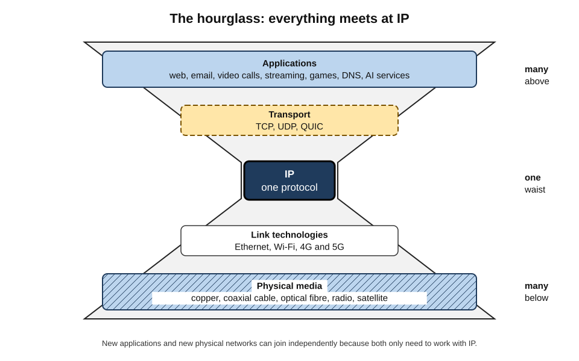
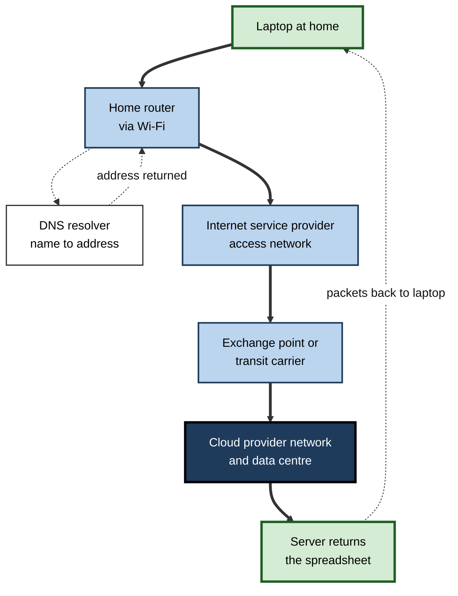
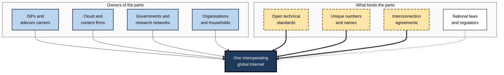
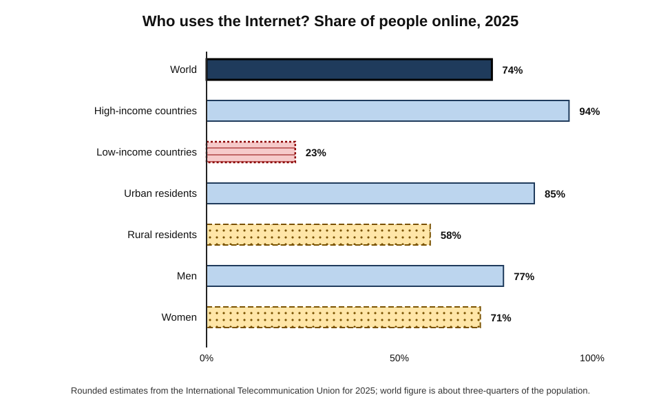
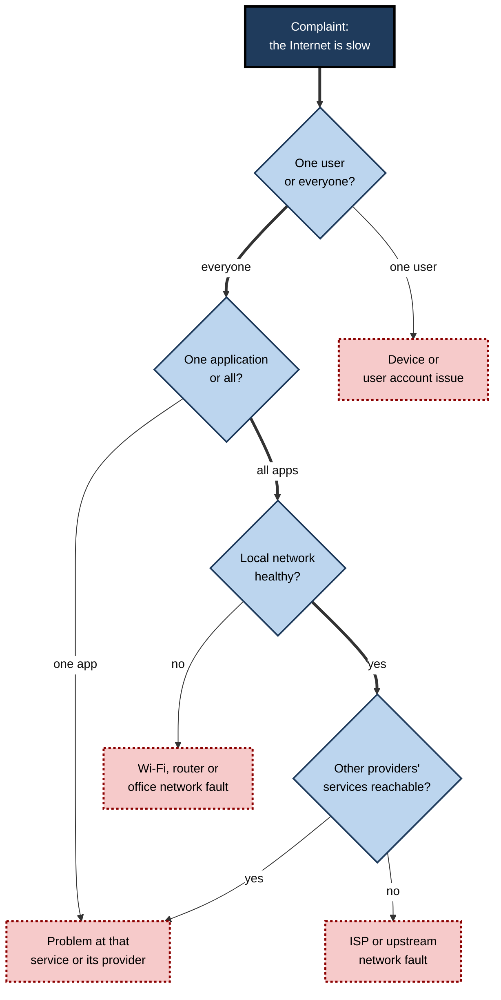

# E.1. What is the Internet?

A nurse in Pune checks a patient's laboratory results on a tablet. A sales manager in Leeds joins a video call with a client in São Paulo. A teenager streams a film while a smart meter in the same house reports electricity use to the supplier. None of these people owns, controls or even sees the system that carries their data — yet each relies on the same thing: the **Internet**.

> **Definition — The Internet:** the global system of interconnected computer networks that exchange data using a common family of rules, the Internet Protocol suite (TCP/IP), so that any connected device can, in principle, communicate with any other.

**Why the definition matters**

- It separates the **Internet** (the network of networks) from the things that run on it — the web, email, video calls, cloud services, AI assistants.
- It explains why nobody "owns" or "switches off" the Internet as a whole, and why it still fails in particular places.
- It underpins every professional decision about connectivity, cloud adoption, security and resilience.
- Most confusion about online life — "the Internet is down", "the cloud is somewhere else", "the web is the Internet" — comes from a vague answer to this one question.

---

## The Internet in Everyday Experience

Most people meet the Internet only through what it makes possible. The network itself is invisible.

**What the Internet carries in a single working day**

- **Messages** — email, chat, notifications from a project-management tool.
- **Voice and video** — calls, meetings, recorded training sessions.
- **Documents and data** — files saved to cloud storage, spreadsheets edited by several people at once.
- **Transactions** — card payments, online banking, procurement orders between firms.
- **Media** — music, films, news, podcasts, social feeds.
- **Machine-to-machine traffic** — software updates, sensor readings, backups, monitoring alerts.
- **Requests to remote intelligence** — a question typed to an AI assistant, processed in a distant data centre and answered in seconds.

> **Key point:** to the user these feel like separate "apps"; underneath, all of them are streams of small data units travelling over the same shared infrastructure, governed by the same basic rules.

### Three things that are often confused

- **The Internet** — the physical and logical **infrastructure**: cables, radio links, routers and the rules (protocols) that move data between networks.
- **The World Wide Web** — one **service** that runs on the Internet: a vast collection of linked pages and resources fetched with web browsers.
  - Invented by Tim Berners-Lee at CERN in 1989–1991, two decades after the first Internet links.
- **"The cloud"** — computing resources (storage, processing, software) **rented from remote data centres** and reached over the Internet.

| | The Internet | The World Wide Web | The cloud |
|---|---|---|---|
| What it is | A network of networks | A system of linked documents and applications | Remote computing offered as a service |
| Layer | Infrastructure and transport | Application running on the Internet | Services hosted on servers reached via the Internet |
| Typical rules | IP, TCP, UDP | HTTP, HTML, URLs | Provider APIs and web interfaces |
| Example | A packet crossing from a home router to a data centre | Opening a news article in a browser | Saving a file to an online drive; running an AI model |
| Works without the others? | Yes — email and video calls need no web pages | No — needs the Internet | Largely no — needs a network to reach it |

> **Watch out:** "the web" and "the Internet" are not synonyms. Email, online gaming, video calls, smart-home devices and most app traffic use the Internet without using the web in the strict sense. The browser is only one window onto the network.

> **Example:** when an office's Internet connection fails, the web stops working, but so do the phones (if they use internet telephony), the card terminal, the cloud accounting system and the building's remote alarm monitoring. An organisation that thinks of the Internet as "just websites" underestimates its dependence.

---

## The Core Idea: A Network of Networks

### What a network is

> **Definition — Computer network:** two or more devices connected so that they can exchange data.

- **A home network** — a router linking laptops, phones, a television and perhaps a printer.
- **An office network** — dozens or thousands of devices connected by cables and Wi-Fi.
- **A mobile network** — a telecommunications company's radio masts and core systems serving millions of phones.
- **A data-centre network** — tens of thousands of servers wired together inside one building.
- **A university, hospital or government network** — often spanning many sites.

Each of these is run by its own owner, for its own purposes. On its own, each is an **island**.

### Interconnection is the whole point

- The word comes from **inter-network**: a network *between* networks.
- The Internet exists because these independent networks **agree to connect** and to use **common rules** for passing data across their borders.
- No single owner runs the whole system — there are tens of thousands of separately managed networks, each deciding how to run its own part.
- A large network that manages its own routing towards the rest of the Internet is called an **autonomous system** — it is the unit in which the Internet is stitched together.

> **Definition — Autonomous system (AS):** a network, or group of networks, under a single administrative control that presents one consistent routing policy to the rest of the Internet. Each has a unique number (an ASN).

> **Key point:** the Internet is less like a single machine and more like the international postal or road system — many independent operators, linked at borders, following shared conventions.

**Figure 1.** The Internet as a network of independently owned networks joined by common rules.

### The analogy, and its limits

- **Postal analogy — what it gets right:**
  - Data is divided into small **packets**, each carrying a destination **address**, like envelopes.
  - Each packet is handed from one network to the next until it arrives.
  - No one needs to know the whole route in advance — each sorting office only knows the next step.
- **Where it breaks down:**
  - Packets travel in milliseconds, not days.
  - Packets from one message may take **different routes** and arrive out of order; the receiving computer reassembles them.
  - Copies are cheap — the same data can be duplicated millions of times at almost no cost.
  - The "post office" usually does not open or inspect the envelopes — although some networks can and do.

---

## How It Differs from the Telephone Network

The Internet grew up beside — and later inside — the older telephone system. The contrast explains its essential design.

### Circuits and packets

> **Definition — Circuit switching:** a method in which a dedicated path is reserved between two parties for the whole duration of a call, whether or not anything is being said.

> **Definition — Packet switching:** a method in which data is divided into small, separately addressed packets that share links with everyone else's traffic and are forwarded independently.

| | Circuit switching (classic telephone) | Packet switching (Internet) |
|---|---|---|
| Path | Reserved end to end for the call | Shared; each packet forwarded on its own |
| Use of capacity | Wasted during silences | Filled by anyone's packets when available |
| Behaviour under load | New calls refused ("all lines busy") | Everyone slows down; some packets delayed or lost |
| Failure of a link | Call drops | Traffic re-routed around the failure |
| Intelligence | In the network (exchanges) | Mostly at the edges (computers) |
| Best for | Constant, predictable voice | Bursty data of every kind |

- **Bursty traffic** — computers send data in short bursts with long pauses; reserving a circuit wastes most of it.
- **Statistical multiplexing** — because not everyone sends at once, many users can share a link far bigger than any one needs.

> **Definition — Statistical multiplexing:** sharing a communication link among many users on the expectation that their bursts of traffic will rarely all coincide.

> **Watch out:** packet switching is efficient, not magical. When too many users send at once, queues build up and packets are delayed or dropped — the everyday experience of a congested connection.

### Where the intelligence lives

- **The telephone network** — "smart network, dumb terminal": the handset was simple; the exchanges did everything.
- **The Internet** — "dumb network, smart edges": routers mostly forward packets; the computers at each end handle reliability, ordering, security and meaning.
- This is the **end-to-end principle**, set out by Jerome Saltzer, David Reed and David Clark in 1984.

> **Definition — End-to-end principle:** functions such as reliability and security should be implemented in the communicating end systems where possible, rather than inside the network, because only the ends know what the application really needs.

**Consequences of the end-to-end design**

- **Permissionless innovation** — anyone can invent a new application (the web, video calling, peer-to-peer file sharing) without asking network operators to change anything.
- **Generality** — the same network carries a heart-rate monitor's readings and a film.
- **Responsibility at the edges** — security, privacy and reliability are largely the job of devices and applications, not "the Internet".

> **In practice:** this is why a start-up can launch a global service from a laptop and rented cloud servers, and why security teams protect **endpoints and applications** rather than trusting the network to keep them safe.

---

## The Building Blocks

The Internet can be described as a set of physical parts and a set of logical rules.

### Physical parts

- **End devices (hosts)** — anything that sends or receives data: phones, laptops, servers, cameras, sensors, cars.
- **Access networks** — the "last mile" linking a home or office to a provider: fibre, copper, cable, mobile radio, satellite, Wi-Fi.
- **Routers** — specialised computers that read each packet's destination address and forward it on the next link.
- **Links** — the transmission media: copper wire, coaxial cable, **optical fibre**, radio and laser beams.
- **Core and backbone networks** — very high-capacity fibre routes run by large carriers across countries and continents.
- **Submarine cables** — fibre-optic cables laid on the sea bed; around 600 systems were active or under construction in 2025, carrying almost all intercontinental traffic.
- **Interconnection points** — buildings, called **Internet exchange points** (IXPs) and carrier-neutral data centres, where networks physically meet to swap traffic.
- **Data centres** — warehouses of servers hosting websites, cloud platforms and AI models.

> **Watch out:** it is a common belief that satellites carry most international Internet traffic. In fact, **undersea fibre cables** carry the overwhelming majority (commonly estimated at around 99%) of traffic between continents; satellites matter mainly for remote access and mobility.

### Logical parts

- **Protocols** — agreed rules for formatting and exchanging data.
  - *e.g.* the **Internet Protocol (IP)** for addressing and forwarding packets; **TCP** for reliable delivery; **HTTP** for the web.
- **Addresses** — every device on the Internet needs an **IP address** so packets can find it.
- **Names** — the **Domain Name System (DNS)** translates human-friendly names such as a company's web address into IP addresses.
- **Routing information** — networks continuously tell each other which addresses they can reach, using the **Border Gateway Protocol (BGP)**.
- **Standards and coordination bodies** — groups that write the rules and hand out unique numbers and names.

> **Definition — Protocol:** a set of rules that defines the format, order and meaning of messages exchanged between communicating systems.

> **Mnemonic — "HALL-PAN":** Hosts, Access, Links, Labs (data centres) — the physical side; Protocols, Addresses, Names — the logical side.

### The layered picture

- Engineers describe the Internet as **layers**, each relying on the one below and serving the one above.
  - **Link layer** — moving bits across one physical link (Ethernet, Wi-Fi, mobile radio).
  - **Internet layer** — moving packets between networks (IP).
  - **Transport layer** — delivering data between programs on two hosts (TCP, UDP).
  - **Application layer** — what users and programs actually want (web, email, video, DNS).
- Each layer can change without the others changing — fibre replaced copper and Wi-Fi arrived without the web having to be redesigned.

**Figure 2.** The Internet's "hourglass": many applications and many physical networks meet at one common protocol.

> **Key point:** the narrow waist of the hourglass — the single, simple **Internet Protocol** — is the Internet's most important design decision. Anything that speaks IP can join, whatever cable or radio it uses and whatever application runs on top.

---

## What Happens When Someone Goes Online

A short, conceptual journey shows the parts working together; each step hides considerable machinery, but the overall shape is simple.

### Worked example (illustrative): opening a colleague's shared document

Situation: an analyst at home clicks a link to a spreadsheet stored with a cloud provider.

1. **Local hop** — the laptop sends data over Wi-Fi to the home router.
2. **Name lookup** — the laptop asks a DNS resolver for the IP address that belongs to the provider's name.
3. **Access network** — the router passes packets over fibre or cable to the Internet service provider (ISP).
4. **Across networks** — the ISP's routers forward packets towards the provider's network, perhaps via an exchange point or a larger carrier.
5. **Arrival** — packets reach a server in the provider's data centre, often one located in the same country or city.
6. **Secure session** — laptop and server set up an encrypted connection so that intermediaries cannot read the contents.
7. **Reply** — the server sends back the spreadsheet as many packets, which the laptop reassembles and displays.
8. **Continuing exchange** — every edit flows as further small messages, in both directions, many times a second.

**Figure 3.** The main stages of a request from a home laptop to a cloud service and back.

> **Remember:** a single click typically involves **several independently owned networks**, at least one name lookup, an encrypted session and hundreds of packets — completed in well under a second.

> **Watch out:** "the Internet is down" is rarely true. Usually one link has failed — the Wi-Fi, the home router, the ISP, a DNS service or the destination's own servers. Diagnosing *which* part has failed is the first skill of any competent user or support professional.

---

## Defining Properties of the Internet

### Six properties that explain its behaviour

- **Decentralised** — no central control room; tens of thousands of operators run their own parts.
  - Consequence: hard to switch off globally, easy to fail locally.
- **Packet-switched** — traffic shared and forwarded packet by packet.
  - Consequence: efficient and robust, but quality varies with load.
- **Best-effort** — the core network tries to deliver packets but **guarantees nothing** about delivery, order or timing.
  - Consequence: reliability is added by the end systems.
- **Open standards** — the rules are published and free to implement.
  - Consequence: any manufacturer's device can interoperate with any other.
- **Layered and general-purpose** — one network for every kind of application.
  - Consequence: new services appear without rebuilding the network.
- **Global addressing** — a common addressing scheme, in principle reaching every device.
  - Consequence: any-to-any communication — a strength for collaboration and a risk for security.

> **Definition — Best-effort delivery:** a service model in which the network attempts to deliver every packet but makes no promise that it will arrive, arrive in order or arrive within a given time.

> **Mnemonic — "Do People Bother Opening Large Gifts?":** Decentralised, Packet-switched, Best-effort, Open, Layered, Global.

### The "designed to survive nuclear war" story

- **The popular claim:** the Internet was built so that the military could communicate after a nuclear attack.
- **What is true:** Paul Baran at the RAND Corporation (early 1960s) designed distributed, packet-style networks precisely to survive attack.
- **What is overstated:** the ARPANET, the Internet's main ancestor, was funded chiefly to let researchers **share scarce, expensive computers**; its builders have said survivability was not its primary purpose.
- **What remains valid:** the distributed design does make the network **resilient** to the loss of individual links and nodes.

> **Watch out:** treat the "nuclear war" origin as a half-truth. Resilience was an influence on the ideas; resource sharing among researchers was the immediate motive.

### Openness and its costs

- The early Internet assumed a small community of trusted researchers.
- Openness made growth easy — and also made **spam, fraud, malware and surveillance** easy.
- Security was retrofitted in layers: firewalls, encryption of web traffic, signed software, multi-factor sign-in.

> **Key point:** many present-day Internet problems are side effects of design choices that were excellent for a research network of trusted users and poorly suited to a global network of billions of strangers.

---

## Who Owns and Runs the Internet

### Ownership is distributed

- **Nobody owns the whole Internet.** Its parts are owned by:
  - **telecommunications companies and ISPs** — access networks and national backbones;
  - **cloud and content companies** — huge private networks and data centres, and a growing share of submarine cables;
  - **governments and public bodies** — research networks, public-sector networks, some national infrastructure;
  - **organisations and households** — their own local networks and devices;
  - **consortia** — groups of firms that jointly fund undersea cables.
- **Coordination, not ownership**, holds it together:
  - unique numbers (IP addresses, AS numbers) and top-level names are allocated through coordinating bodies;
  - technical standards are written in open forums of engineers;
  - national laws apply to the parts inside each country.

**Figure 4.** How the Internet is held together without a single owner.

| Part of the Internet | Typical owner or operator | Paid for by |
|---|---|---|
| Home or office network | The household or organisation | The user directly |
| Last-mile access | ISP or mobile operator | Subscription fees |
| National and international backbone | Large carriers, cloud providers | Transit fees, peering, own business |
| Submarine cables | Carrier consortia, increasingly large technology firms | Capacity sales or internal use |
| Exchange points | Non-profit associations or commercial operators | Member port fees |
| Root of the naming system | Coordinated by a non-profit; operated by a dozen organisations | Mostly operators' own budgets |
| Standards | Open engineering community | Volunteers and their employers |

> **Example:** when a company's video calls cross from London to Mumbai, the traffic may pass through the company's own network, two ISPs, an exchange point, a cable jointly owned by a dozen firms and a cloud provider's private backbone — each owned by someone different.

### Governed by many hands

- The Internet is governed by a **multistakeholder** mix of engineers, companies, civil society, academics and governments.
- Disputes arise over:
  - who should control the naming system;
  - how far governments may filter or shut down access;
  - whether ISPs may treat some traffic differently (the net-neutrality debate);
  - how much data should cross national borders.
- These questions are political as much as technical.

> **Watch out:** the claim that "the Internet cannot be controlled" is false at national level. Governments can and do order ISPs to block sites, slow services or shut down mobile data in a region. What is hard is controlling the *global* network from any one place.

---

## Scale and Reach

### How big is it?

- **Users:** the International Telecommunication Union (ITU) estimated that about **6 billion people** — roughly three-quarters of humanity — used the Internet in 2025.
- **The unconnected:** about **2.2 billion** people remained offline, the great majority in low- and middle-income countries.
- **Devices:** connected devices outnumber people several times over once phones, computers, sensors, cameras and vehicles are counted; precise totals vary widely between estimates.
- **Networks:** tens of thousands of autonomous systems are visible in the global routing table.
- **Traffic:** dominated by video, with rapid recent growth in automated traffic such as software updates, crawlers and AI-related requests.

> **Watch out:** headline figures for "number of connected devices" or "data created per day" vary enormously between sources and are often forecasts rather than measurements. Treat any single precise figure with caution.

### The digital divide

> **Definition — Digital divide:** the gap between those who have meaningful access to the Internet and the skills to use it, and those who do not.

- **By income (ITU, 2025):**
  - about **94%** of people in high-income countries use the Internet;
  - about **23%** in low-income countries.
- **By location:** about 85% of urban residents versus 58% of rural residents.
- **By gender:** about 77% of men versus 71% of women.
- **Beyond access — "meaningful connectivity":**
  - speed and reliability adequate for real tasks;
  - affordable data;
  - a suitable device (a phone alone limits work and study);
  - the skills and confidence to use it safely.

**Figure 5.** Share of people using the Internet, by group, in 2025.

> **Key point:** being "covered" by a mobile signal is not the same as being meaningfully connected. Cost, device, skills and quality decide what a connection is actually good for.

---

## The Internet Inside Organisations

### Internet, intranet, extranet

> **Definition — Intranet:** a private network within an organisation that uses Internet technologies but is accessible only to authorised members.

> **Definition — Extranet:** a controlled extension of an intranet that gives selected outsiders — suppliers, clients, partners — limited access.

| | Internet | Intranet | Extranet |
|---|---|---|---|
| Who can reach it | Anyone connected | Employees only | Employees plus approved partners |
| Typical content | Public websites and services | HR portal, internal wikis, internal tools | Supplier portal, client document room |
| Trust model | Untrusted by default | Traditionally trusted; now verified each time | Partly trusted, tightly controlled |
| Example | A firm's public website | An expense-claims system | A portal where retailers check stock levels |

- The old model — a trusted "inside" protected by a firewall from an untrusted "outside" — has weakened.
  - Staff work from home and on the move.
  - Most applications now live in the cloud, outside the office.
- **Zero trust** is the modern response: every request is checked for identity, device health and permission, wherever it comes from.

> **Definition — Zero trust:** a security approach that grants no automatic trust to any user or device based on network location, verifying every access request explicitly.

### What depends on the connection

- **Daily operations** — email, calendars, document collaboration, internal chat.
- **Customer-facing services** — websites, apps, contact centres, online payments.
- **Business systems** — finance, HR, sales and supply-chain software delivered as cloud services.
- **Operational technology** — tills, warehouse scanners, building systems, factory sensors.
- **Data and AI** — analytics platforms, machine-learning training and inference, AI assistants.

> **In practice:** resilient organisations treat Internet connectivity as **critical infrastructure** — with two independent connections from different providers, a mobile backup, monitored service levels and a plan for working when a cloud service is unreachable.

### The Internet as the foundation of cloud and AI

- **Cloud computing depends on cheap, fast, reliable networking.** Without it, renting a remote server makes no sense.
- **Cloud providers run some of the world's largest private networks**, linking their data centres across continents with their own fibre and cables.
- **AI services are Internet services.**
  - A prompt typed into an AI assistant travels as packets to a data centre with specialised processors, runs through a model and returns as packets.
  - Training large models involves moving vast datasets — much of it originally gathered from the public web — and linking thousands of processors over very fast internal networks.
- **Latency and location matter.** Users notice delays above a fraction of a second; providers therefore place servers close to users ("edge" locations) and choose regions to satisfy data-protection laws.

> **Key point:** for most organisations, "moving to the cloud" or "adopting AI" means **becoming more dependent on the Internet**, not less. Connectivity, latency and the reliability of distant providers become business risks.

---

## Case study: The day the network disappeared from the Internet

- **Situation:** on 4 October 2021, Facebook, Instagram, WhatsApp and the company's internal tools became unreachable worldwide for around six hours.
- **What happened:**
  1. During routine maintenance, a command unintentionally disconnected the company's backbone network.
  2. The company's DNS servers, unable to reach its data centres, **withdrew their routing announcements** as a safety measure.
  3. The rest of the Internet no longer knew how to reach the company's addresses — its names could not even be looked up.
- **Knock-on effects:**
  - billions of users lost messaging; small businesses that sold through the platforms lost a day's trade;
  - DNS resolvers worldwide were flooded with repeated lookups;
  - staff reportedly struggled to enter buildings and use internal tools that relied on the same network.
- **Recovery:** engineers had to restore access physically at data centres before services could be brought back carefully.
- **Lessons:**
  - the Internet itself kept working — one very large **autonomous system** had vanished from it;
  - routing (BGP) and naming (DNS) are critical points: when a network stops announcing how to reach it, it effectively ceases to exist online;
  - organisations should not make their **recovery tools depend on the system that has failed**.

> **Remember:** the global Internet rarely fails as a whole; **large individual networks, providers and services do**. Resilience planning should assume that any one of them can disappear for hours.

---

## How Professionals Think About the Internet

### Mental models at different depths

| Depth of understanding | Mental model | What it enables |
|---|---|---|
| Everyday user | "A connection that makes apps work" | Using services; basic troubleshooting such as restarting the router |
| Informed professional | "Independent networks joined by shared rules; services run on top" | Sensible choices about providers, cloud, security and resilience |
| Technical specialist | "Layered protocols, routing between autonomous systems, naming, addressing" | Designing, operating and diagnosing networks and services |
| Policy and strategy expert | "Shared infrastructure shaped by economics, law and geopolitics" | Judging regulation, sovereignty, competition and risk |

### Judgement calls that rest on understanding the Internet

- **Choosing where to host a service** — closer to users means lower delay; local laws may require data to stay in-country.
- **Planning for failure** — which provider, cable route or cloud region is a single point of failure?
- **Interpreting a problem** — is a slow application slow because of the user's Wi-Fi, the ISP, the provider or the software itself?
- **Assessing security claims** — "it's on our network, so it's safe" ignores the end-to-end reality.
- **Evaluating vendor promises** — "unlimited", "always on" and "guaranteed speed" have precise, usually narrower, contractual meanings.

**Figure 6.** Narrowing down where a connectivity problem lies.

> **In practice:** an experienced IT manager, when users complain that "the Internet is slow", checks in order: one user or all; one application or all; local network or beyond; one provider or several. This systematic narrowing reflects the layered, multi-owner structure of the Internet.

---

## Open Questions

- **Will the Internet remain one global network?**
  - National controls, data-localisation laws and separate technology stacks raise the prospect of a "splinternet"; how far fragmentation will go is unresolved.
- **How can the remaining 2.2 billion people be meaningfully connected?**
  - Satellites, cheaper devices and public programmes help, but affordability, skills and relevance remain stubborn barriers.
- **Can a network designed for trust be made secure enough for everything that now depends on it?**
  - Hospitals, power grids and financial systems rely on infrastructure whose foundations assumed honest participants.
- **Who should pay for the network?**
  - Debates continue over whether large content and AI companies should contribute directly to the cost of access networks.
- **How will automated and AI-driven traffic change the network?**
  - Machines already generate a large share of requests; the effects on capacity, economics and the open web are still emerging.

---

## Summary

- The **Internet** is a global **network of networks** that exchange data using the **Internet Protocol suite**; the **web**, email, video calls and **cloud** services run *on top of* it.
- It is built from tens of thousands of independently run **autonomous systems** joined at **exchange points** and by **transit** links, with **submarine cables** carrying almost all intercontinental traffic.
- It uses **packet switching** and **statistical multiplexing**, unlike the circuit-switched telephone network; delivery is **best-effort**.
- The **end-to-end principle** puts intelligence at the edges, enabling **permissionless innovation** but leaving security largely to devices and applications.
- Its **hourglass** design — many networks below, many applications above, one common IP in the middle — lets new technologies join without redesigning everything.
- Key properties: **decentralised, packet-switched, best-effort, open, layered, global**.
- Nobody owns the whole Internet; it is held together by **coordination** of numbers, names and standards, under a **multistakeholder** model and national laws.
- About **6 billion** people were online in 2025 and about **2.2 billion** offline; the **digital divide** is about meaningful connectivity, not just coverage.
- Organisations depend on the Internet for nearly everything; **cloud and AI services are Internet services**, so connectivity is a business-critical risk.
- Large outages usually come from individual networks or services disappearing, not the Internet as a whole.

---

## Self-Check

1. Define the Internet in one sentence and explain why it is called a "network of networks".
2. Distinguish the Internet, the World Wide Web and the cloud, with an example of each.
3. Give two services that use the Internet but not the web.
4. Contrast circuit switching with packet switching across three attributes.
5. What is statistical multiplexing, and why does it make the Internet efficient?
6. State the end-to-end principle and give two consequences for innovation and security.
7. Explain the "hourglass" model and why the narrow waist matters.
8. List the six defining properties of the Internet and one consequence of each.
9. How true is the claim that the Internet was designed to survive a nuclear war?
10. Who owns the Internet? Name four kinds of owner and explain what holds the system together.
11. What carries most intercontinental traffic, and what common belief does this correct?
12. Summarise ITU's 2025 estimates of Internet use and two dimensions of the digital divide.
13. Distinguish intranet, extranet and Internet, and explain why zero trust replaced the "trusted inside" model.
14. Explain, using the October 2021 Facebook outage, why "the Internet is down" is usually inaccurate.
15. A chief financial officer says moving all systems to the cloud "removes our dependence on IT infrastructure". Evaluate the claim.

### Answer Key

1. The Internet is the global system of interconnected networks that exchange data using the TCP/IP protocol suite. It is a network of networks because it consists of tens of thousands of independently owned networks — homes, firms, ISPs, clouds — that agree to interconnect and follow common rules.
2. The Internet is infrastructure (a packet crossing from a router to a data centre). The web is an application of linked pages fetched with browsers (reading a news article). The cloud is remote computing rented as a service (saving a file to an online drive).
3. Email; video calls; online games; smart-home device traffic; software updates delivered to an app.
4. Circuit switching reserves a dedicated path for the whole call, wastes capacity in silences and refuses calls under load. Packet switching shares links among everyone's packets, fills capacity efficiently and slows everyone under load; it also routes around failures.
5. Sharing a link among many users on the expectation that their bursts rarely coincide; because computer traffic is bursty, many users can share capacity much larger than any one needs at the same time.
6. Functions such as reliability and security belong in the end systems where possible. Consequences: anyone can create new applications without network changes (permissionless innovation); devices and applications must protect themselves rather than relying on the network.
7. Many physical technologies sit below and many applications above a single common protocol, IP. Because everything converges on one simple waist, new networks and applications can join independently without redesigning the rest.
8. Decentralised (hard to switch off globally, fails locally); packet-switched (efficient, variable quality); best-effort (reliability added at the ends); open standards (interoperability); layered (new services without rebuilding); global addressing (any-to-any reach, and exposure to attack).
9. Half-true. Paul Baran's distributed-network work was motivated by survivability, but ARPANET was funded mainly for sharing scarce research computers. The resulting design is nonetheless resilient to individual failures.
10. ISPs and telecom companies; cloud and content firms; governments and research networks; households and organisations; cable consortia. Coordination of unique numbers and names, open standards and interconnection agreements hold it together.
11. Submarine fibre-optic cables carry around 99% of intercontinental traffic, correcting the belief that satellites carry most of it.
12. About 6 billion users (three-quarters of people) and 2.2 billion offline. Income: about 94% use in high-income versus 23% in low-income countries; location: 85% urban versus 58% rural; gender: 77% of men versus 71% of women.
13. The Internet is open to anyone; an intranet is internal to the organisation; an extranet extends limited access to approved partners. Remote work and cloud applications dissolved the office perimeter, so access must be verified per request (zero trust) rather than trusted by location.
14. The global Internet kept working, but Facebook's network withdrew its routes and its names could not be resolved, so it disappeared from everyone's view. Most outages are of one network, provider or service, not the whole Internet.
15. The claim is wrong. Cloud adoption shifts infrastructure ownership to providers but increases dependence on Internet connectivity and on distant providers. The firm needs resilient connections, attention to latency and data location, and plans for provider outages.

---

## Glossary

| Term | Meaning |
|---|---|
| Access network | The "last mile" connection between a user's premises and their provider. |
| Autonomous system (AS) | A network under one administrative control with a single routing policy, identified by a unique number. |
| Best-effort delivery | A service that tries to deliver packets but guarantees nothing about delivery, order or timing. |
| Border Gateway Protocol (BGP) | The protocol networks use to tell each other which addresses they can reach. |
| Circuit switching | Reserving a dedicated path between parties for the whole of a communication. |
| Cloud | Computing resources rented from remote data centres and reached over the Internet. |
| Data centre | A facility housing large numbers of servers and network equipment. |
| Digital divide | The gap between those with meaningful Internet access and skills and those without. |
| Domain Name System (DNS) | The system that translates names into IP addresses. |
| End-to-end principle | The design rule that functions should be placed in end systems rather than in the network where possible. |
| Extranet | A controlled extension of an intranet for selected outside partners. |
| Host | Any device that sends or receives data on a network. |
| Internet | The global network of networks using the TCP/IP protocol suite. |
| Internet exchange point (IXP) | A facility where networks connect to exchange traffic directly. |
| Internet Protocol (IP) | The protocol that addresses and forwards packets between networks. |
| Intranet | A private organisational network using Internet technologies. |
| Packet | A small unit of data carrying addressing information, forwarded independently. |
| Packet switching | Dividing data into packets that share links and are forwarded independently. |
| Protocol | A set of rules for the format, order and meaning of exchanged messages. |
| Router | A device that forwards packets towards their destination. |
| Statistical multiplexing | Sharing a link among many bursty users who rarely all send at once. |
| Submarine cable | A fibre-optic cable laid on the sea bed linking countries and continents. |
| World Wide Web | A system of linked documents and applications accessed with browsers over the Internet. |
| Zero trust | A security model that verifies every access request rather than trusting network location. |
