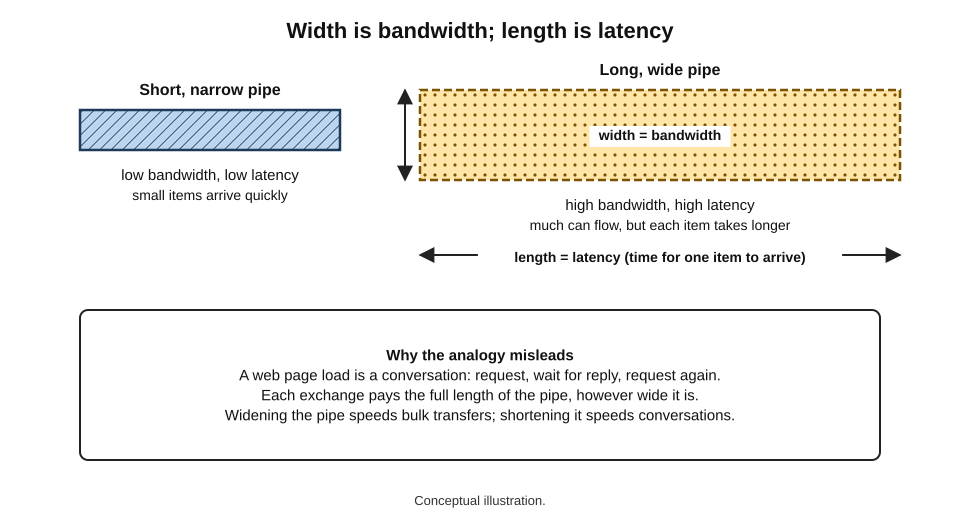
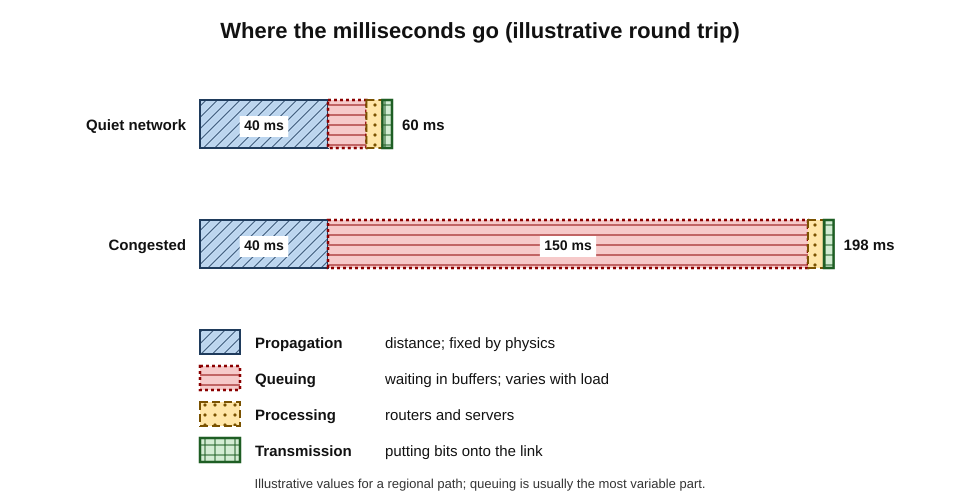
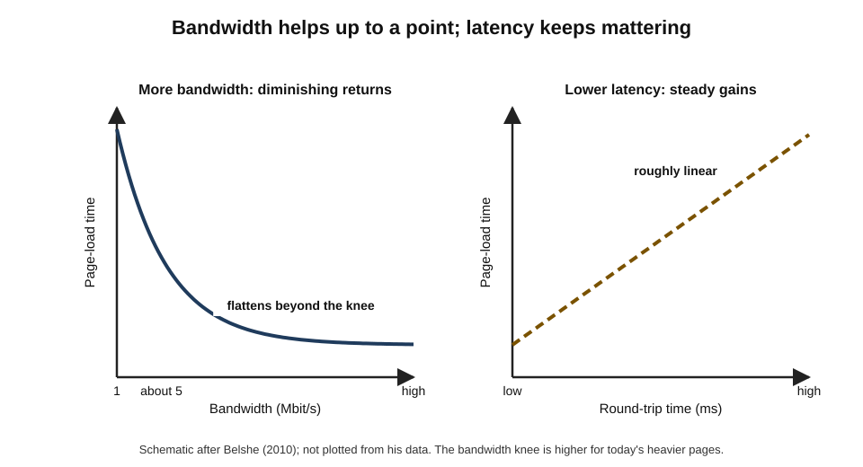
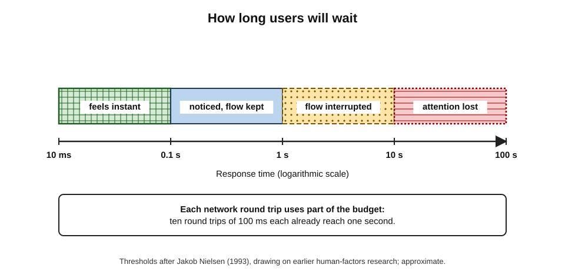
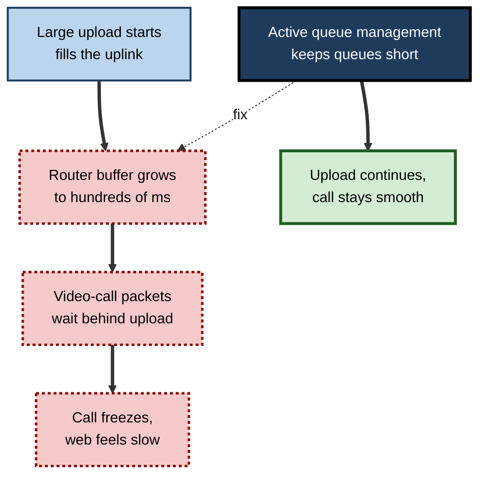

# E.10. Bandwidth, Speed & Latency

A household upgrades from a 100 to a 900 megabit connection and finds that web pages feel no faster. A trader's firm pays a fortune to shave a few thousandths of a second off the time a message takes between two cities. A video call is perfectly sharp but the other person keeps talking over the speaker. All three are discovering that "Internet speed" is not one thing. It is at least three: **how much** can flow, **how long** it takes to arrive, and **how steadily** it arrives.

> **Definition — Bandwidth:** the maximum rate at which data can be transferred over a connection, usually measured in bits per second.

> **Definition — Latency:** the time it takes for data to travel from one point to another, usually measured in milliseconds; often quoted as the **round-trip time** (RTT) — there and back.

**Why the distinction matters**

- Buying more bandwidth does not fix a problem caused by latency, and vice versa — money is wasted when the two are confused.
- Different applications need different things: a large backup needs bandwidth; a video call needs low latency and stability; a page load needs few, fast round trips.
- Professionals planning offices, cloud migrations, remote work or AI services must size **both** capacity and delay.
- Advertising focuses on one number ("up to 1 Gbps"); real experience depends on several.

---

## The Vocabulary of Speed

### Bits and bytes

- **Bit** — the smallest unit of data, a 0 or 1.
- **Byte** — 8 bits.
- **Network speeds** are quoted in **bits** per second: kbit/s, **Mbit/s** (megabits), **Gbit/s** (gigabits).
- **File sizes** are quoted in **bytes**: kilobytes (KB), **megabytes (MB)**, **gigabytes (GB)**.

> **Formula — Converting speed to file transfer rate:** bytes per second = bits per second ÷ 8. Example: 100 Mbit/s ÷ 8 = **12.5 MB/s**, so a 1 GB file takes at least 1,000 ÷ 12.5 = **80 seconds**.

> **Watch out:** a "100 megabit" connection does **not** download 100 megabytes a second. Confusing the lower-case *b* (bits) with the upper-case *B* (bytes) creates an eightfold error.

- **Decimal and binary prefixes** — networks use decimal (1 megabit = 1,000,000 bits); some operating systems display file sizes in binary units (1 MiB = 1,048,576 bytes), causing small apparent discrepancies.

### The key measures

- **Bandwidth (capacity)** — the maximum possible rate on a link.
- **Throughput** — the rate actually achieved at a given moment, end to end.
- **Goodput** — the rate of useful application data, after protocol overheads and retransmissions.
- **Latency** — delay in delivery; one-way or round trip.
- **Jitter** — variation in latency from packet to packet.
- **Packet loss** — the percentage of packets that never arrive.

> **Definition — Throughput:** the actual rate of successful data transfer between two points, which is usually lower than the bandwidth of the slowest link on the path.

> **Definition — Jitter:** the variation in packet delay over time; high jitter makes real-time audio and video uneven.

> **Definition — Packet loss:** the proportion of sent packets that fail to reach their destination.

> **Mnemonic — "Big Trucks Get Lost Just Past":** Bandwidth, Throughput, Goodput, Latency, Jitter, Packet loss.

### The pipe analogy, and where it misleads

- **Bandwidth** is like the **width** of a pipe — how much water can flow per second.
- **Latency** is like the **length** of the pipe — how long a drop takes to get from one end to the other.
- **Throughput** is how much actually flows — limited by the narrowest section and by how the tap is operated.

**Figure 1.** Bandwidth and latency as the width and length of a pipe.

> **Watch out:** the pipe analogy suggests a wider pipe always helps. In networks, much traffic is a **conversation** of many small back-and-forth exchanges, each paying the latency cost. A wider pipe does nothing for a conversation limited by the pipe's length.

---

## Where Latency Comes From

### Four components

- **Propagation delay** — time for the signal to travel the physical distance.
  - Light in optical fibre travels at about **200,000 km per second** — roughly **5 microseconds per kilometre**.
- **Transmission (serialisation) delay** — time to push all the bits of a packet onto the link.
  - Tiny on fast links; noticeable on slow ones.
- **Processing delay** — time routers and servers take to examine and handle packets.
- **Queuing delay** — time packets wait in buffers behind other traffic.
  - Usually the **largest and most variable** component on a busy network.

> **Formula — Minimum propagation delay:** distance ÷ 200,000 km/s. Example: London to New York, about 5,600 km of great-circle distance; one way ≈ 5,600 ÷ 200,000 = 0.028 s = **28 ms**; round trip ≈ **56 ms** at the very least. Real routes are longer and add equipment, so measured round trips are typically higher.

**Figure 2.** The components of latency on a typical path.

> **Key point:** propagation delay is fixed by **physics and geography**. No upgrade can make light travel faster; only shorter routes, closer servers or fewer round trips reduce it.

### Typical latencies

| Path | Typical round-trip time | Main reason |
|---|---|---|
| Device to home router over Wi-Fi | 1–5 ms (more if congested) | Local radio contention |
| Within a city over fibre | 1–10 ms | Short distance |
| Across a continent | 30–80 ms | Distance, routing |
| Between continents | 80–300 ms | Undersea distance |
| Mobile 4G or 5G to the Internet | Tens of milliseconds, variable | Radio scheduling, core network |
| Low-Earth-orbit satellite | Tens of milliseconds | Short hops, ground stations |
| Geostationary satellite | About 500–700 ms | 72,000 km up and down |

> **Watch out:** these are indicative ranges, not guarantees. Congestion, poor Wi-Fi and inefficient routing can multiply them.

---

## Why Latency Often Matters More Than Bandwidth

### Conversations, not just transfers

- Opening a typical web page involves **name lookups, connection set-up, encryption set-up** and **dozens of requests** for images, scripts and styles.
- Many of these happen **one after another**, each waiting a round trip.
- Once a connection has "enough" bandwidth, the number of round trips × the round-trip time dominates page-load time.

**Study card — Mike Belshe, "More Bandwidth Doesn't Matter (Much)" (2010)**

- **Context:** an engineer at Google working on faster web protocols measured page-load times for popular websites under controlled network conditions.
- **Method:** varied bandwidth while holding latency constant, then varied latency while holding bandwidth constant.
- **Results:**
  - increasing bandwidth from 1 to about 5 Mbit/s greatly reduced load times;
  - beyond about 5 Mbit/s, further increases brought **diminishing returns**;
  - reducing round-trip time reduced load time **almost linearly**, with no plateau.
- **Conclusion:** for typical web browsing, latency is the more important lever once bandwidth is moderate — a finding that motivated new protocols designed to cut round trips.
- **Caveat:** pages have grown much heavier since 2010, so the bandwidth "knee" has moved higher, but the shape of the finding remains widely accepted.

**Figure 3.** Page-load time against bandwidth and against latency.

> **Example (illustrative):** the household in the opening upgraded from 100 to 900 Mbit/s. Large downloads became much faster, but everyday browsing — limited by round trips to distant servers and by Wi-Fi delay — barely changed.

### Human perception

- **Classic response-time thresholds** (popularised by Jakob Nielsen in 1993, drawing on earlier human-factors research):
  - about **0.1 second** — feels instantaneous;
  - about **1 second** — flow of thought is preserved, but the delay is noticed;
  - about **10 seconds** — attention is lost; users switch tasks.
- **Conversation:** in voice and video calls, one-way delays above roughly 150 ms start to make turn-taking awkward; much higher delays cause people to talk over each other.
- **Interactive control:** gaming, remote desktops and remote control of equipment are sensitive to tens of milliseconds.

**Figure 4.** Response-time thresholds and how users experience them.

> **Key point:** for interactive services, the target is not "fast downloads" but **responses within human perception thresholds** — and every round trip consumes part of that budget.

---

## Jitter, Loss and Bufferbloat

### Real-time applications

- **Streaming video** (on-demand) uses **buffers** — it downloads ahead, so short delays and moderate jitter are hidden; it adapts quality to available throughput (adaptive bitrate).
- **Live calls and games** cannot buffer much without adding delay; jitter and loss show up as **choppy audio, frozen video and lag**.
- **Small losses matter** — even 1–2% loss can noticeably degrade calls and greatly reduce throughput for a single TCP transfer, which slows down when it detects loss.

### Bufferbloat

> **Definition — Bufferbloat:** excessive delay caused by oversized buffers in network equipment that fill up under load, so that packets wait in long queues instead of being dropped promptly.

- **Discovery:** popularised around 2010–11 by engineer Jim Gettys, who traced unusable home connections during uploads to huge buffers in modems and routers.
- **Symptom:** when someone uploads a large file or streams heavily, everyone else's calls and browsing become sluggish, with latency rising from tens of milliseconds to hundreds or even thousands.
- **Remedies:**
  - **active queue management** algorithms (such as CoDel and FQ-CoDel) that keep queues short and share them fairly between flows;
  - newer approaches that let applications signal congestion early, aiming for consistently low latency;
  - router settings ("smart queue management") that cap queue lengths.

**Figure 5.** How a full buffer turns a fast link into a slow conversation.

> **Watch out:** a speed test run on an **idle** connection can show excellent latency while the same line becomes unusable under load. Measuring latency **while the connection is busy** ("loaded latency" or "responsiveness") reveals bufferbloat.

---

## Measuring Speed

### What a speed test does

1. Finds a nearby test server.
2. Measures round-trip time with small packets (**latency**, sometimes **jitter**).
3. Downloads data over several parallel connections for a few seconds (**download throughput**).
4. Uploads data similarly (**upload throughput**).
5. Increasingly, measures latency **during** the transfers (**loaded latency**).

### Why results differ

- **Wi-Fi** — a test over Wi-Fi measures the Wi-Fi as much as the broadband.
- **The device** — older devices may not keep up with fast connections.
- **Time of day** — peak-hour contention lowers results.
- **Server location** — a nearby server shows the access line; a distant one shows the wider path.
- **Other activity** — background updates or streaming in the home.
- **Parallel connections** — tests use several at once; one real download over one connection may be slower, especially over long distances.

| Result pattern | Likely explanation | Next step |
|---|---|---|
| Fast when wired, slow on Wi-Fi | Wi-Fi coverage or interference | Improve Wi-Fi, wire key devices |
| Fast in the morning, slow in the evening | Contention in the ISP's network | Raise with ISP; consider another technology |
| Good download, very poor upload | Asymmetric technology (cable, DSL) | Consider full fibre for upload-heavy work |
| Low idle latency, huge loaded latency | Bufferbloat | Enable smart queue management; upgrade router |
| Good speed test, one service slow | Problem at that service or its route | Check the service's status; test other services |

> **Remember:** test **wired**, at **different times**, with **nothing else running**, and record **upload and loaded latency** as well as download.

---

## Working with the Numbers

### Worked example (illustrative): how long will it take?

Situation: an architect must upload a 12 GB model to a client's cloud folder from a home connection of 500 Mbit/s down and 50 Mbit/s up.

1. **Convert gigabytes to megabits** — 12 GB × 8,000 = 96,000 megabits (decimal units).
2. **Divide by the upload rate** — 96,000 ÷ 50 = 1,920 seconds = **32 minutes** at full speed.
3. **Allow for overhead and contention** — real throughput perhaps 80% of the line rate → about **40 minutes**.
4. **Compare download** — the client downloading it at 500 Mbit/s needs about 192 seconds, roughly **3–4 minutes**.
- **Conclusion:** for upload-heavy work, the **upload** figure — often a small fraction of the advertised download speed on cable and copper lines — determines the waiting time.

> **Formula — Transfer time:** (size in bytes × 8) ÷ throughput in bits per second.

### Bandwidth–delay product

> **Definition — Bandwidth–delay product:** bandwidth multiplied by round-trip time; the amount of data that must be "in flight" on a path to keep it fully used.

> **Formula — Bandwidth–delay product:** bandwidth × RTT. Example: 1 Gbit/s × 0.1 s = 100 megabits ≈ **12.5 MB** must be in transit at once to fill the link.

- **Why it matters:** if sender or receiver limits how much unacknowledged data may be in flight, a single transfer over a long, fast path cannot use the available bandwidth.
- **Practical effect:** copying a large file between distant offices may be slow even on fast links; parallel transfers, tuned settings or specialised transfer tools help.

### What applications typically need

| Application | Bandwidth per user (typical) | Latency sensitivity | Other needs |
|---|---|---|---|
| Email and messaging | Very low | Low | Reliability |
| Web browsing | Low to moderate | High (many round trips) | Low loss |
| HD video streaming | Several Mbit/s | Low (buffered) | Steady throughput |
| 4K video streaming | Roughly 15–25 Mbit/s | Low (buffered) | Steady throughput |
| Video call (HD) | Low single-digit Mbit/s each way | High | Low jitter and loss; upload matters |
| Online gaming | Low | Very high | Low jitter |
| Cloud backup and large uploads | As much upload as possible | Low | Upload capacity |
| Cloud desktops (virtual desktops) | Moderate | High | Stable latency |
| AI chat assistants | Low | Moderate to high (feels responsive or sluggish) | Reliability |

> **Watch out:** these are rules of thumb; requirements vary with codec, resolution and provider. Plan using the **provider's own guidance** and real measurements where possible.

---

## Capacity Planning in Organisations

### Worked example (illustrative): sizing an office connection

Situation: a 60-person consultancy office plans its Internet link; most work is cloud-based.

1. **Estimate concurrent heavy use** — at peak, perhaps 20 people on video calls at once.
   - 20 × about 3 Mbit/s each way ≈ **60 Mbit/s** in each direction.
2. **Add general cloud traffic** — documents, email, browsing: perhaps 1 Mbit/s average per active person × 60 = **60 Mbit/s**, with bursts.
3. **Add large transfers** — file syncs, updates, occasional large uploads: allow **100 Mbit/s** of headroom.
4. **Total peak estimate** — about 220 Mbit/s; apply a **safety factor** (×2 for growth and bursts) → around **450–500 Mbit/s symmetric**.
5. **Latency** — choose a provider with low latency to the main cloud regions used.
6. **Resilience** — a second connection on a different technology, sized to keep calls and core applications running.
- **Conclusion:** a 1 Gbit/s symmetric dedicated line with a 300–500 Mbit/s backup would comfortably serve the office; buying a larger primary line would add little.

> **In practice:** network teams monitor **peak utilisation** (often the 95th percentile of five-minute samples) and **latency to key services**, upgrading when sustained peaks approach roughly 70–80% of capacity, rather than waiting for complaints.

### Quality of service

- **Prioritisation** — routers can give real-time traffic (voice, video) priority over bulk transfers on congested links.
- **Limits** — prioritisation helps only on links the organisation controls; across the public Internet, packets are generally treated equally.
- **SD-WAN** — sends each application over the best-performing connection available, measured continuously.

### Case study (illustrative): the virtual desktop rollout that felt broken

- **Situation:** an engineering firm moved staff to cloud-hosted virtual desktops, hosted in a single cloud region on another continent to save cost.
- **Problem:** staff in two distant regional offices reported that typing "lagged" and mouse movements felt sticky, although bandwidth tests were excellent.
- **Diagnosis:**
  1. round-trip times from those offices to the cloud region were 180–250 ms;
  2. every keystroke and screen update required a round trip;
  3. office Wi-Fi added variable delay (jitter) at busy times;
  4. bandwidth was not the constraint at all.
- **Actions:**
  1. deployed desktops in cloud regions **near each office**;
  2. wired connections for heavy users; improved Wi-Fi capacity;
  3. enabled the desktop protocol's settings that tolerate latency better;
  4. set a latency target (under 50–80 ms round trip) for future sites.
- **Result:** complaints largely disappeared; cloud costs rose modestly because of the extra regions.
- **Lesson:** for interactive services, **distance is a design parameter**. Bandwidth tests can be perfect while the user experience is poor.

> **Example:** in financial trading, firms compete on microseconds. In the early 2010s, companies built a straighter fibre route and then chains of microwave towers between Chicago and the New York area, because radio through air travels faster than light through glass and the tower route was straighter. The investments were justified purely by latency, not bandwidth.

---

## Speed, Latency and the Cloud and AI Era

- **Upload matters more than ever** — video calls, collaboration and cloud backup send as much as they receive.
- **Edge computing** — placing processing close to users (in local data centres or at the network edge) reduces round-trip times for latency-sensitive applications.
- **AI assistants and streaming responses:**
  - the delay a user feels has two parts: **network latency** to the data centre and the model's **processing time**;
  - many services **stream** output piece by piece so that text begins appearing quickly — users judge responsiveness by the **time to first output** as much as the total time;
  - voice assistants and real-time translation are especially latency-sensitive, pushing some processing onto devices or nearby servers.
- **AI training** — moving enormous datasets between storage and processors needs vast bandwidth inside data centres; between sites, organisations sometimes still ship physical storage devices because it is faster than the network.

> **Formula — The "truck beats network" comparison:** time to transfer 500 TB at 1 Gbit/s = 500 × 8,000,000 Mbit ÷ 1,000 Mbit/s = 4,000,000 s ≈ **46 days**. A courier delivering physical drives in two days moves the data far faster.

---

## Mobile Speed: Why It Varies So Much

- **Signal strength and quality** — distance from the mast, walls, being underground or inside a vehicle.
- **Cell load** — everyone in the cell shares its capacity; a stadium or a busy station at rush hour can make a fast network crawl.
- **Frequency band in use** — low bands give coverage with modest speed; mid and high bands give speed over shorter range.
- **Device capability** — older phones may not support the newest bands or features.
- **Movement** — handovers between cells add brief disruptions.
- **Plan and traffic management** — some plans limit speed for video or after a usage threshold.

> **Watch out:** a mobile speed test is a snapshot of one place at one moment. Coverage maps and averages hide large variations between streets, floors and times of day.

---

## Latency Budgets

Engineers designing interactive services work backwards from an acceptable delay and allocate it among the parts of the system — a **latency budget**.

> **Definition — Latency budget:** the maximum acceptable end-to-end delay for an interaction, divided into allowances for each component (device, network, servers, processing).

### Worked example (illustrative): a budget for a conversational voice assistant

Situation: a product team wants a voice assistant to start replying within about 800 ms of the user finishing speaking, so that it feels conversational.

| Component | Allowance | Notes |
|---|---|---|
| Detecting end of speech on device | 150 ms | Must avoid cutting the user off |
| Network to the cloud region | 40 ms | Requires a nearby region |
| Speech recognition | 150 ms | Streaming recognition during speech saves time |
| AI model producing the first words | 300 ms | Time to first output, not full answer |
| Speech synthesis of the first phrase | 100 ms | Streamed |
| Network back to the device | 40 ms | |
| Total | 780 ms | Just within the target |

*Illustrative figures.*

1. **Identify the biggest items** — model and recognition time dominate.
2. **Check the network share** — 80 ms is acceptable only if the user is near the region; a user on another continent would add 200 ms or more.
3. **Design choices** — stream every stage; place the service in several regions; run end-of-speech detection on the device.
- **Conclusion:** the network is a modest part of the budget **if** the service is close to users — otherwise distance alone can break the experience.

> **Key point:** latency budgets turn vague complaints ("it feels slow") into engineering decisions about **where** to process and **what** to stream.

---

## Data Volumes and Allowances

- **Why volume matters** — mobile, satellite and some fixed plans have data allowances; organisations pay for data leaving cloud platforms ("egress").
- **Rough volumes per hour (typical, varying by service and settings):**
  - audio streaming — tens of megabytes;
  - standard-definition video — under one gigabyte;
  - HD video — one to three gigabytes;
  - 4K video — several gigabytes;
  - HD video calls — hundreds of megabytes to over a gigabyte, depending on participants and settings.

> **Formula — Data used:** rate (Mbit/s) × seconds ÷ 8 = megabytes. Example: a 5 Mbit/s HD stream for one hour = 5 × 3,600 ÷ 8 = **2,250 MB ≈ 2.25 GB**.

### Worked example (illustrative): will the allowance last?

Situation: a field engineer has a 30 GB monthly mobile allowance and joins two one-hour video calls each working day (about 20 working days).

1. **Per call** — at about 2.5 Mbit/s combined up and down: 2.5 × 3,600 ÷ 8 ≈ 1,125 MB ≈ 1.1 GB.
2. **Per day** — two calls ≈ 2.2 GB.
3. **Per month** — 20 days × 2.2 GB ≈ **44 GB** — well over the allowance.
4. **Options** — join with video off or at lower resolution when on mobile; use Wi-Fi where available; or move to a larger plan.
- **Conclusion:** simple arithmetic prevents surprise charges and mid-month throttling.

---

## Advertising Claims and What They Mean

- **"Up to" speeds** — the best the line or technology can achieve, not what a typical customer gets at peak times; many regulators now require typical or minimum speeds to be stated.
- **"Unlimited"** — usually subject to fair-use policies or traffic management at high volumes.
- **"Gigabit Wi-Fi"** — a theoretical combined radio rate; single devices see much less.
- **"Low-latency 5G"** — depends on the core network and the distance to servers, not only on the radio.

> **Watch out:** the single most useful question to ask any provider is "what **upload speed** and **peak-time latency** should I expect at my address?" — the figures advertising usually leaves out.

---

## Open Questions

- **Should ISPs advertise latency and responsiveness, not just download speed?**
  - Regulators and engineers increasingly argue for "quality" metrics; consensus on a simple consumer measure is still forming.
- **Will low-latency queue management become universal?**
  - The technology exists; deployment across home routers and ISP equipment is uneven.
- **How much bandwidth will households and offices need?**
  - Past forecasts both under- and over-estimated; AI, immersive media and cloud working add uncertainty.
- **Can edge computing deliver its promised latency gains economically?**
  - Many applications are served well enough by regional clouds; the business case for widespread edge sites is still being tested.
- **How should real-time AI interaction be engineered globally?**
  - Conversational AI across continents runs into physical latency limits; how processing will be distributed is unresolved.

---

## Summary

- "Speed" combines **bandwidth** (capacity), **throughput** (achieved rate), **goodput** (useful rate), **latency** (delay, often as RTT), **jitter** (variation) and **packet loss**.
- Speeds are in **bits** per second, file sizes in **bytes**: divide by **8**.
- Latency = **propagation** (about 5 µs per km in fibre) + **transmission** + **processing** + **queuing**; propagation is fixed by geography.
- Once bandwidth is moderate, **latency** dominates web and interactive performance (**Belshe, 2010**); human thresholds of about **0.1 s, 1 s and 10 s** shape expectations.
- **Jitter and loss** harm real-time applications; **bufferbloat** causes huge delays under load and is fixed by **active queue management**.
- Speed tests vary with **Wi-Fi, device, time, server and load**; measure upload and **loaded latency** too.
- Key calculations: transfer time = size × 8 ÷ throughput; **bandwidth–delay product** = bandwidth × RTT.
- Organisations size links by **concurrent demand**, plan **latency to key cloud services**, monitor **peak utilisation** and add resilient backups.
- Interactive cloud and AI services are **latency-sensitive**; place processing near users and stream responses.

---

## Self-Check

1. Distinguish bandwidth, throughput and goodput.
2. Convert 300 Mbit/s into megabytes per second, and estimate how long a 6 GB download takes at that rate.
3. Explain the pipe analogy and its main limitation.
4. List the four components of latency and identify which is fixed by physics.
5. Calculate the minimum round-trip time over 3,000 km of fibre.
6. Summarise Belshe's 2010 findings and explain why they matter for upgrade decisions.
7. What are the 0.1-, 1- and 10-second response-time thresholds?
8. Why do live calls suffer from jitter more than on-demand streaming?
9. What is bufferbloat, how is it detected, and how is it fixed?
10. Give four reasons why two speed tests of the same line may differ.
11. Calculate the bandwidth–delay product for 500 Mbit/s with a 200 ms RTT, and explain its significance.
12. A designer's 20 GB upload over a 20 Mbit/s uplink takes "forever". Calculate the minimum time and recommend an improvement.
13. Why might a firm's virtual desktops feel sluggish despite excellent bandwidth?
14. Size the Internet connection for a 30-person office that relies on cloud applications and frequent video calls, showing your assumptions.
15. When is physically shipping data faster than sending it over the network? Give a calculation.

### Answer Key

1. Bandwidth is the maximum possible rate on a link; throughput is the rate actually achieved end to end; goodput is the useful application data rate after overheads and retransmissions.
2. 300 ÷ 8 = 37.5 MB/s. 6 GB = 6,000 MB; 6,000 ÷ 37.5 = 160 seconds — about 2.7 minutes at best.
3. Bandwidth is the pipe's width, latency its length. The limitation: much traffic is many small back-and-forth exchanges limited by latency, which a wider pipe does not improve.
4. Propagation, transmission (serialisation), processing and queuing; propagation is fixed by distance and the speed of light in the medium.
5. 3,000 ÷ 200,000 = 0.015 s one way; round trip about 30 ms minimum.
6. Page-load time fell sharply as bandwidth rose to about 5 Mbit/s, then levelled off; reducing latency cut load time almost linearly. Buying more bandwidth beyond moderate levels may not improve browsing; reducing latency (closer servers, fewer round trips) does.
7. About 0.1 s feels instantaneous; about 1 s keeps the flow of thought though the delay is noticed; about 10 s loses attention.
8. Streaming buffers ahead and hides variation; live calls cannot buffer without adding conversational delay, so variation appears as choppy audio and video.
9. Excess delay from oversized buffers filling under load. Detect by measuring latency while the connection is busy. Fix with active queue management (e.g. FQ-CoDel), smart queue settings or better routers.
10. Wi-Fi versus wired; device capability; time of day and contention; test server location; other activity on the network; number of parallel connections.
11. 500 Mbit/s × 0.2 s = 100 megabits ≈ 12.5 MB must be in flight to fill the path; limits on unacknowledged data will cap single-transfer throughput below the line rate.
12. 20 × 8,000 = 160,000 megabits ÷ 20 = 8,000 s ≈ 2.2 hours minimum. Recommend a connection with higher upload (full fibre), scheduling overnight, or physical transfer for very large jobs.
13. High latency to a distant cloud region, since every keystroke and screen update requires a round trip; Wi-Fi jitter adds variability. Bandwidth is not the constraint.
14. E.g. 12 concurrent video calls × 3 Mbit/s ≈ 36 Mbit/s each way; general cloud use 30 × 1 Mbit/s ≈ 30 Mbit/s; 50 Mbit/s headroom for large transfers ≈ 116 Mbit/s; × 2 safety factor ≈ 250 Mbit/s symmetric, with low latency to the main cloud region and a backup connection on another technology.
15. When data volumes are huge relative to bandwidth. 500 TB at 1 Gbit/s takes about 4,000,000 s ≈ 46 days; shipping drives in two days is far faster.

---

## Glossary

| Term | Meaning |
|---|---|
| Active queue management | Router techniques that keep queues short to limit delay. |
| Bandwidth | Maximum data rate of a connection. |
| Bandwidth–delay product | Bandwidth × RTT; data in flight needed to fill a path. |
| Bit / byte | Smallest unit of data / eight bits. |
| Bufferbloat | Excess delay from oversized, full buffers. |
| Edge computing | Processing placed close to users to reduce latency. |
| Goodput | Useful application data rate. |
| Jitter | Variation in packet delay. |
| Latency | Time for data to travel between two points. |
| Loaded latency | Latency measured while the connection is busy. |
| Packet loss | Share of packets that do not arrive. |
| Propagation delay | Time for a signal to travel the physical distance. |
| Queuing delay | Time packets wait in buffers. |
| Round-trip time (RTT) | Time for a message to go and a reply to return. |
| Speed test | A measurement of latency and throughput to a test server. |
| Throughput | Actual achieved data rate. |
| Transmission delay | Time to place a packet's bits onto a link. |
